Hi, I'm Xiao G. I have shared [a hands-on guide to using the Qoder plugin in IDEA](./idea-qoder-plugin.md) and [connecting Trae to an LLM](./trae-m2.7.md), covering AI-assisted coding in the JetBrains and VS Code ecosystems. This article takes a different angle: **using Claude Code with a third-party model**.

Claude Code is Anthropic's official CLI coding tool. Some providers support third-party models through Anthropic-compatible APIs and environment variables, but compatibility, available features, and data handling depend on the provider. Do not assume they are identical to Claude models. This article records the setup and workflow I used with GLM-5.1 at the time.

GLM-5.2 is now available, and newer models may follow. The integration steps and coding workflows are broadly similar, although model-specific capabilities can differ.

I chose two representative, complex scenarios:

- **Scenario 1:** Build an Arthas-based JVM diagnostic Agent from scratch, from technology selection and architecture design through implementation.
- **Scenario 2:** Find and fix slow queries in an existing order system with millions of records, testing AI's ability to understand and incrementally optimize an existing codebase.

One is a greenfield project; the other optimizes an existing system. Together, they cover two common AI-assisted coding workflows.

## Setup: Connect Claude Code to a Third-party Model

Before starting, connect Claude Code to the third-party model. The setup has three steps:

**Step 1:** Install Claude Code.

```bash
npm i -g @anthropic-ai/claude-code@latest
```

**Step 2:** Install CC Switch to change models. On macOS, you can install it with Homebrew. See the [CC Switch documentation](https://github.com/farion1231/cc-switch/blob/main/README_ZH.md).

**Step 3:** Follow the model provider's instructions to map Claude Code's model environment variables to the target model. For GLM-5.1, see the [provider's guide](https://docs.bigmodel.cn/cn/coding-plan/tool/claude).

The configuration steps are shown below.

Click the plus sign to add a model:

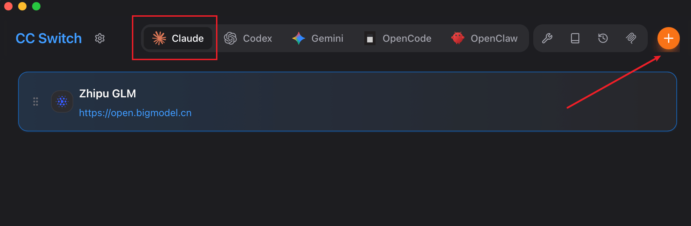

Select the model:

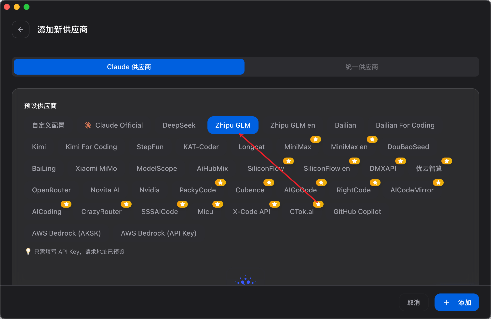

Configure the parameters:

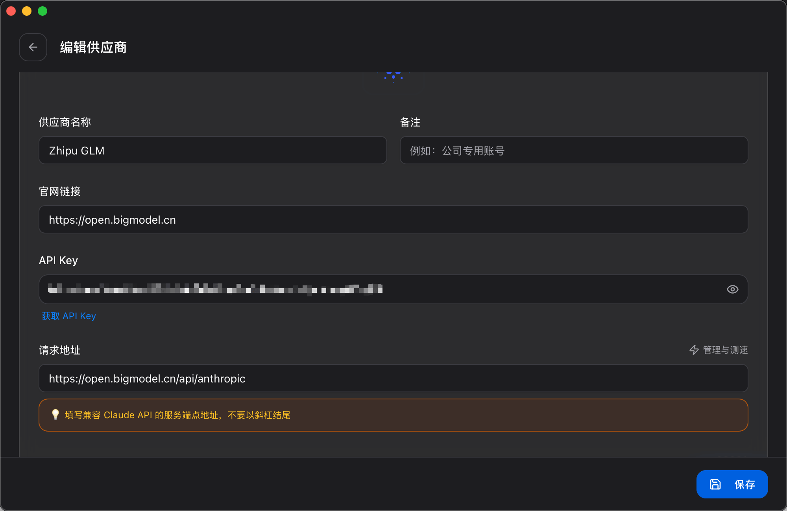

Configure the mapping between Claude Code's model environment variables and the target model in JSON:

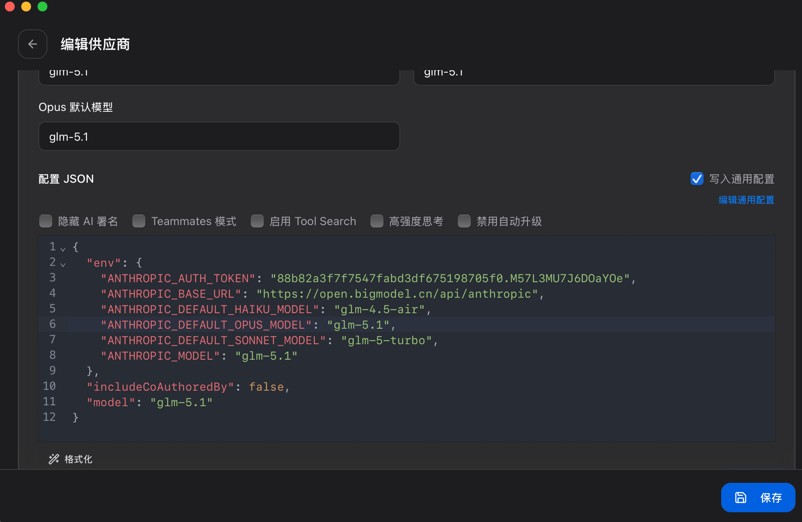

For frontend work, you may prefer interacting with the model and reviewing code in VS Code with the Claude Code extension. After installing the extension, you can work with the model directly in the IDE, which may feel more intuitive than the CLI:

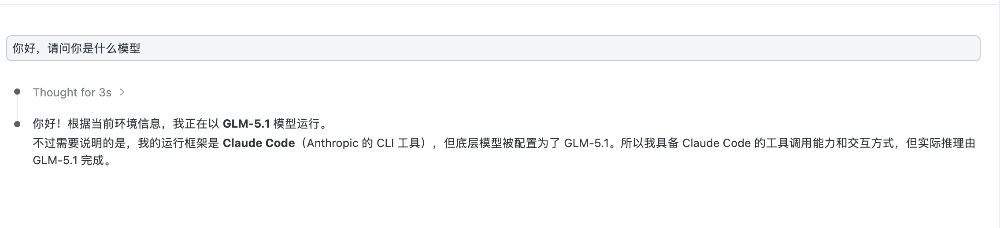

## Scenario 1: Build a JVM Diagnostic Agent from Scratch

### Why Build a JVM Diagnostic Assistant?

Production JVM diagnosis has long been one of the more difficult tasks for Java developers. When facing a performance bottleneck or production incident, engineers typically follow this process:

1. Inspect Grafana dashboards to identify likely problem areas.
2. Log in to the production server and inspect CPU, memory, GC, and other metrics.
3. Once the issue appears to be in the Java application, start Arthas and run diagnostic commands to narrow it down.
4. Find the relevant code, determine the root cause, and plan a fix.

Before AI, this workflow was cumbersome but direct and effective. As systems have grown more complex and response-time expectations have increased, its limitations have become more apparent:

- **Monitoring is hard to interpret:** CPU spikes, memory leaks, OOMs, and other issues can produce many dashboard metrics. Engineers often rely on experience and subjective inference instead of a systematic diagnostic method.
- **The diagnostic workflow is long:** Moving from Grafana to the production server and then to Arthas requires switching between tools. This takes time and slows response to urgent incidents.
- **It depends heavily on engineer experience:** Arthas is a powerful JVM diagnostic tool with commands that inspect runtime details through bytecode instrumentation. Engineers must understand its command parameters and diagnostic process to locate issues accurately.

As Agents and Skills have matured, I started exploring an engineering approach: encode diagnostic experience as auditable steps, then let AI select a read-only workflow based on the symptoms, gather evidence, and suggest possible causes. Connecting to production instances, running commands, and confirming a root cause still require explicit permissions and human oversight; a service name and symptom alone are not enough.

### Requirements and Architecture Design

After defining the idea, I moved on to technology selection and implementation planning. I gave AI the full requirements:

```bash
Build an Agent-based diagnostic tool using Arthas with these core features:
1. When a user provides the name of a failing production service and its symptoms, locate the target server and monitor and analyze the service.
2. Integrate Arthas decompilation to identify the code associated with the failure.
3. Use the analysis to produce a solution that includes the root cause, code-fix recommendations, and implementation steps.

Recommend a technology stack for the tool, including the programming language (preferably Java), core frameworks, database schema, and deployment architecture. Also design the implementation in detail, including functional modules, data flows, technical challenges, and proposed solutions.
```

AI did not start coding immediately. It first produced a phased technical proposal for the empty project. This is useful as a draft for review, but developers and operations staff still need to confirm that it is safe and fits the existing operational environment.

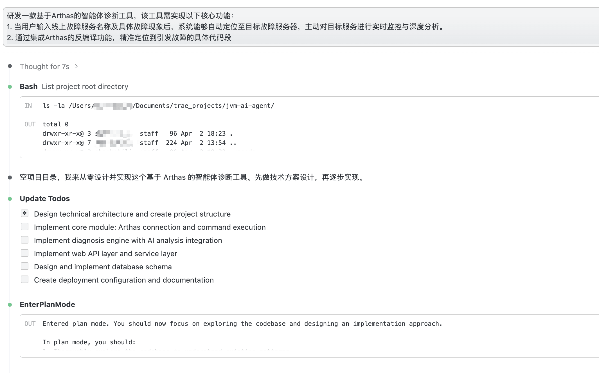

Based on the requirements, AI researched technology choices and Arthas integration options for the Agent. The search terms show that it prioritized mature, stable solutions:

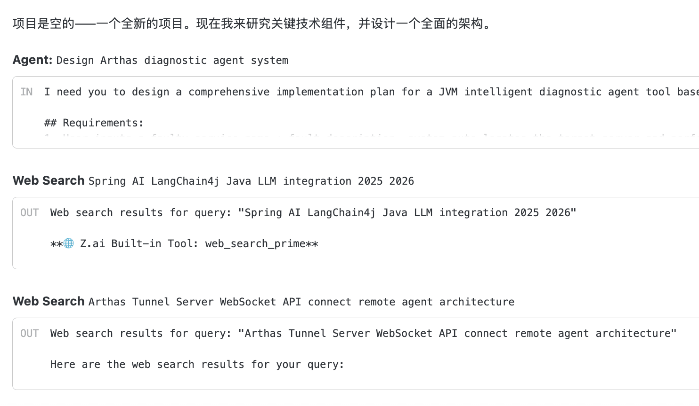

After consulting the Arthas documentation, AI produced the architecture diagram below. It has three layers: the user provides a service name and symptoms; the Agent layer combines a Skill engine, Arthas HTTP client, and AI analysis engine; and the bottom layer connects to the target service instance through the Arthas HTTP API. The diagram covers the main functional modules but omits production controls such as authentication, approval, command policies, and auditing, which are discussed below:

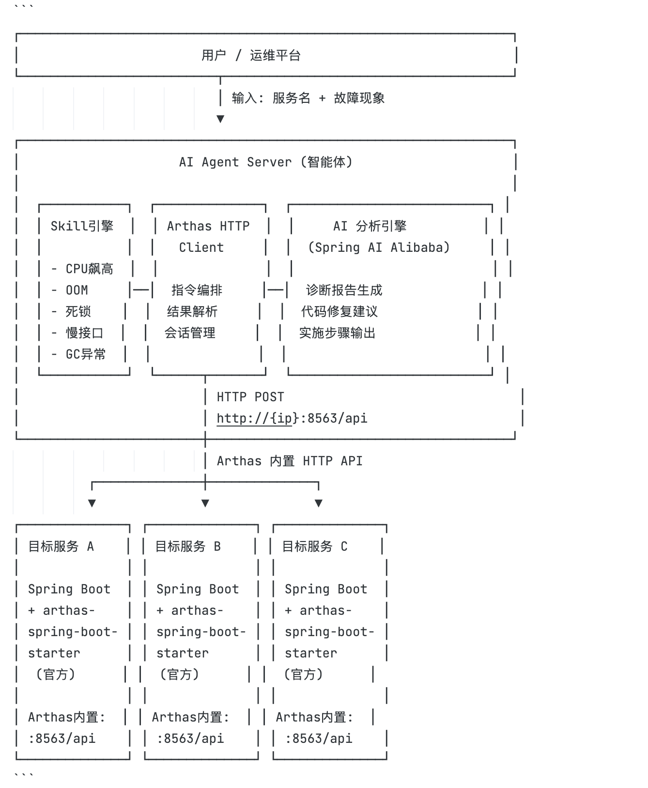

AI also described the responsibilities of six core components: workflow orchestration in the AI Agent server, session management in the Arthas HTTP client, diagnostic-step definitions in the Skill engine, and report generation in the AI analysis engine. The description made the components' boundaries and interactions clear:

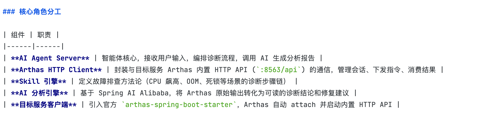

Finally, consider the data flow. Using a common response-timeout scenario, AI mapped the path from Skill matching and diagnostic-step execution to report generation. The session flow—`init_session → async_exec → pull_results → interrupt_job → close_session`—matches the asynchronous job model in the [Arthas HTTP API](https://arthas.aliyun.com/doc/http-api.html) and can manage commands that produce ongoing output. Commands such as `watch` and `trace` instrument target classes; they are not ordinary read-only queries just because they do not modify business data. Review command risk levels, session cleanup, timeouts, and security controls rather than checking only whether the API exists:

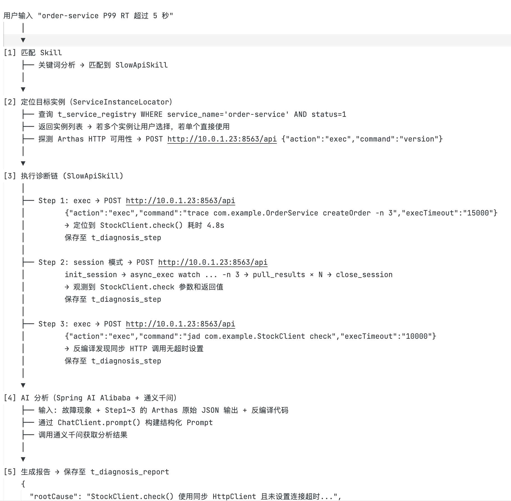

The Arthas HTTP API accepts diagnostic commands directly, and its documentation includes [authentication configuration](https://arthas.aliyun.com/doc/auth.html). Before using this Agent in production, add at least the following controls:

1. **Identity and network boundaries:** Enable Arthas authentication and keep the diagnostic endpoint on an isolated network. Give the Agent a separate service identity and least-privilege credentials; never provide credentials to the model.
2. **Target-instance allowlist:** Resolve service names only to registered instances. Do not allow users or the model to supply arbitrary IPs, ports, or URLs. Use separate credentials and policies for production and test environments.
3. **Command allowlist:** By default, expose only reviewed read-only diagnostic templates that do not instrument bytecode. Validate dynamic parameters such as class and method names by type and length. Never execute model-generated strings directly as Arthas commands.
4. **Approval for high-risk operations:** Disable dynamic instrumentation commands such as `watch`, `trace`, and `tt` by default. If they are necessary, use reviewed templates and require human approval. Limit the number of executions, runtime, sampling scope, and output size. Generate OGNL expressions only from allowlisted templates and confirm that instrumentation is removed when the task ends. Other operations that can change runtime state, create high load, or expose sensitive data also need short-lived authorization and two-person review.
5. **Resource protection:** Set timeouts, concurrency limits, rate limits, and circuit breakers for each instance. Set maximum runtimes for long-running commands and ensure `interrupt_job` and `close_session` run on error paths too.
6. **Auditing and redaction:** Record the requester, target instance, template, actual parameters, start and end times, and a result summary. Redact secrets, personal information, and business data from logs, decompiled code, and reports before sending them to the model.

Extensions should follow the same boundaries. An alert integration may create a diagnostic task automatically, but must not bypass approval to run arbitrary commands. An automated fix should produce a candidate diff, not modify a production instance directly.

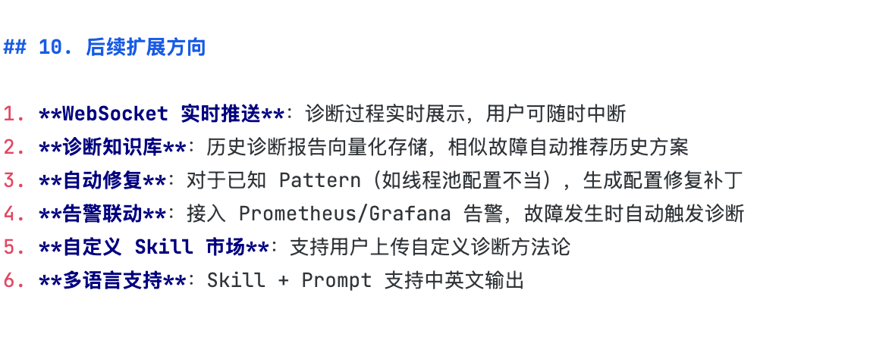

### Implementation and Project Structure

After reviewing the plan, I gave it the implementation request:

```bash
The overall plan looks good. Please implement it.
```

AI started implementing the design module by module. It built the parent POM and Maven multi-module skeleton, then added utility classes, data models, the data-access layer, Arthas client, Skill engine, AI analysis engine, business layer, Web controllers, bootstrap module, and deployment configuration. It completed all 11 subtasks:

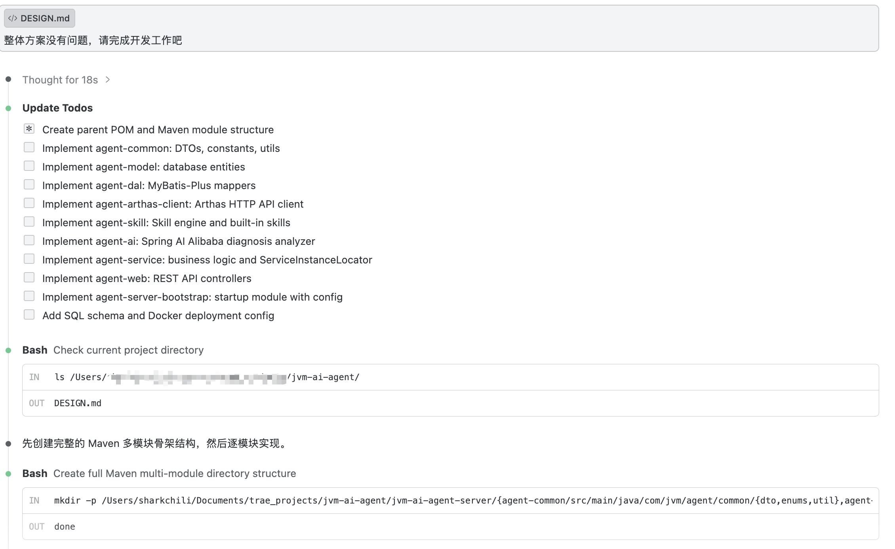

AI then generated a candidate implementation with nine modules and 46 files, including utility classes, seven diagnostic Skills, an Arthas HTTP API client, and a Spring AI Alibaba analyzer. File count shows the scope of the output, not its safety or correctness:

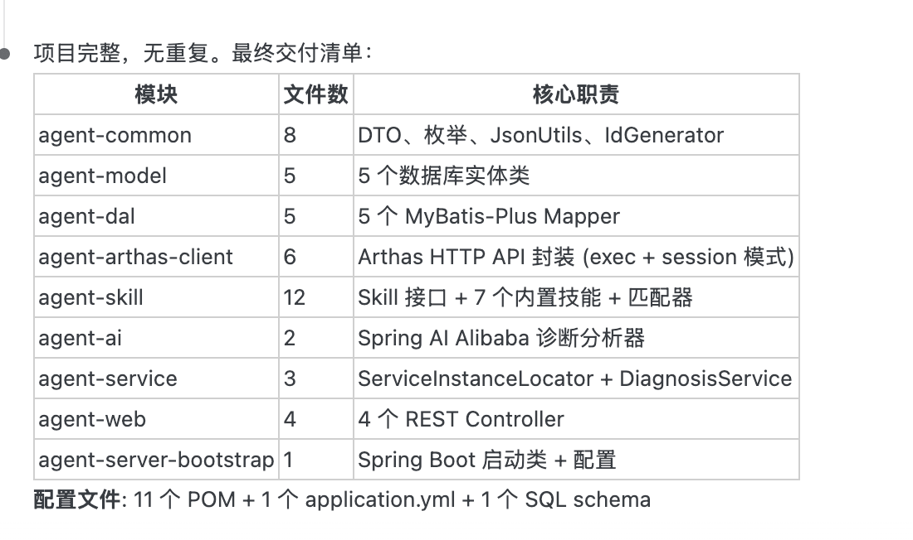

The overall module structure follows common Java multi-module conventions. Dependencies follow the hierarchy `common → model → dal → client → skill → ai → service → web → bootstrap`, with consistent naming.

The `agent-skill` module is worth a closer look. AI designed an abstract Skill-engine interface and added seven diagnostic Skills for common JVM issues: high CPU, OOM, deadlocks, slow endpoints, GC problems, thread leaks, and class-loading failures. Each Skill defines a diagnostic sequence. This “framework plus built-in implementations” design is extensible:

```bash
jvm-ai-agent/
├── jvm-ai-agent-server/                 # Core Agent server
│   ├── agent-common/                    # Utilities, constants, and DTOs
│   ├── agent-model/                     # Entities and database mappings
│   ├── agent-dal/                       # Data access: Mapper and Repository
│   ├── agent-arthas-client/             # Arthas HTTP API client
│   ├── agent-skill/                     # Skill engine (diagnostic methods)
│   ├── agent-ai/                        # AI analysis engine
│   ├── agent-service/                   # Business logic, including instance lookup
│   ├── agent-web/                       # Web layer: REST API and WebSocket
│   └── agent-server-bootstrap/          # Bootstrap module
│
└── pom.xml                              # Parent POM
```

The core `executeDiagnosis` flow matches a Skill, locates an instance, runs diagnostic steps, analyzes results, and generates a report. The original implementation also extracted variables from Arthas output and concatenated later commands. A production implementation must keep commands in reviewed templates and allow only validated variable substitution. “Continue after a non-critical step fails” must also be defined precisely; authentication failures, targets outside the allowlist, timeouts, and audit failures must never be silently skipped:

1. **Skill matching:** Use `DefaultSkillMatcher` to match symptoms to the most suitable diagnostic Skill.
2. **Instance lookup:** Use `ServiceInstanceLocator` to resolve a service name to a target IP and Arthas port.
3. **Run the diagnostic sequence:** Execute approved, read-only diagnostic templates and collect the results.
4. **Substitute validated parameters:** Extract variables such as class and method names from results, then validate their format, length, and allowed values before inserting them into a later template.
5. **Generate an AI analysis report:** Send the diagnostic data to the analysis engine and produce a structured report with the root cause, recommended fix, and severity.

```java
private void executeDiagnosis(DiagnosisRecord record, DiagnosisRequest request) {
    try {
        // 1. Match a Skill
        Optional<SkillDefinition> skillOpt = skillMatcher.findBestMatch(request.getSymptom());
        if (skillOpt.isEmpty()) {
            failDiagnosis(record, "No suitable diagnostic Skill found");
            return;
        }
        SkillDefinition skill = skillOpt.get();
        // ......

        // 2. Locate the target instance
        ServiceRegistry instance = instanceLocator.resolveInstance(
                request.getServiceName(), request.getInstanceIp());
        // ......

        // 3. Run the diagnostic sequence
        List<DiagnosticStep> chain = skill.getDiagnosticChain();
        StringBuilder allDiagnosticData = new StringBuilder();
        String decompiledCode = "";
        Map<String, String> contextVars = new HashMap<>();

        for (int i = 0; i < chain.size(); i++) {
            DiagnosticStep step = chain.get(i);
            // ... Initialize the step entity

            try {
                // Resolve only reviewed command templates; validate variable types and allowlists
                String command = resolveCommand(step, contextVars);
                // ......

                // Run the Arthas command and record its duration
                String result = executeStep(host, port, step, command);

                // Store jad output as decompiled code
                if ("jad".equals(step.getResultType())) {
                    decompiledCode = result;
                }

                // Extract context variables for subsequent steps
                extractContextVars(result, contextVars);
            } catch (Exception e) {
                // Continue only when a read-only step is explicitly marked non-critical
                // ......
            }
        }

        // 4. Run AI analysis
        String report = diagnosisAnalyzer.analyze(
                request.getSymptom(), allDiagnosticData.toString(), decompiledCode, skill);

        // 5. Save the report (extract structured fields such as root cause and severity)
        // ......

        // 6. Update the diagnosis status
        record.setStatus(DiagnosisStatus.COMPLETED.getCode());
        // ......
    } catch (Exception e) {
        failDiagnosis(record, e.getMessage());
    }
}
```

### Integrate the Agent Chat UI

While AI was coding, I checked the Spring AI Alibaba documentation and found a ready-made Agent Chat UI. Instead of asking AI to build a frontend from scratch, I integrated this component to provide a diagnostic chat with SSE streaming. I gave it a short request:

```bash
Implement the Agent chat page using the Spring AI Alibaba documentation: https://java2ai.com/docs/frameworks/studio/quick-start/
```

With only a documentation link and a short request, AI read the official docs, understood the integration steps, and built the page. This is a useful AI-assisted coding technique: when integrating an existing component, providing its documentation link can be more efficient than describing every requirement.

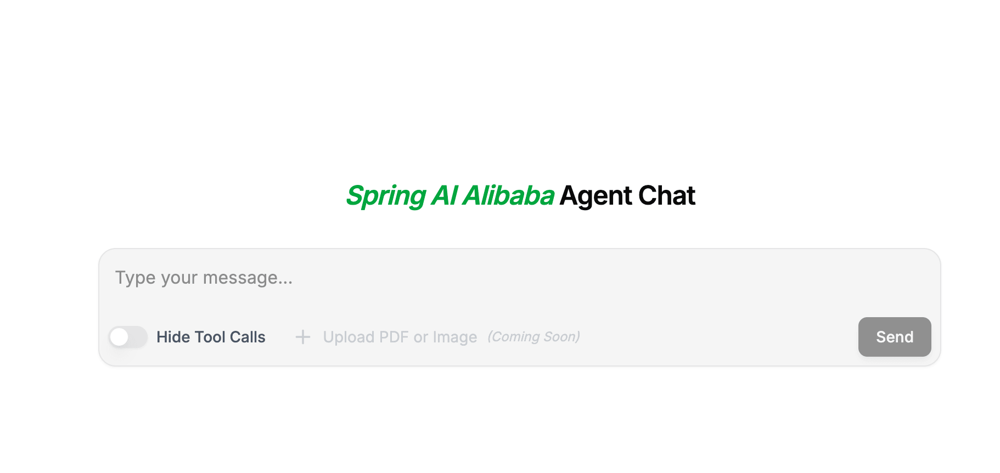

At this point, the main flow for a local demo was in place. It was not a diagnostic platform ready for production. Beyond functional testing, it still needed the security controls described earlier, fault injection, and load protection. To verify the basic workflow, I started a test endpoint locally that drives CPU usage to 100%:

```java
@Slf4j
@RestController
public class TestController {
    @RequestMapping("cpu-100")
    public  void cpu() {
        while (true){
        }
    }
}
```

Start the Agent service, open `http://localhost:{app-port}/chatui/index.html`, and enter `The order-service CPU usage has spiked. Please investigate.` In this controlled local example, the Agent gets an overview from the Dashboard, locates the relevant code from the thread dump, uses `jad` to produce decompiled output, and generates a diagnostic report. Treat the report as a hypothesis for review; do not handle a production incident based only on model output:

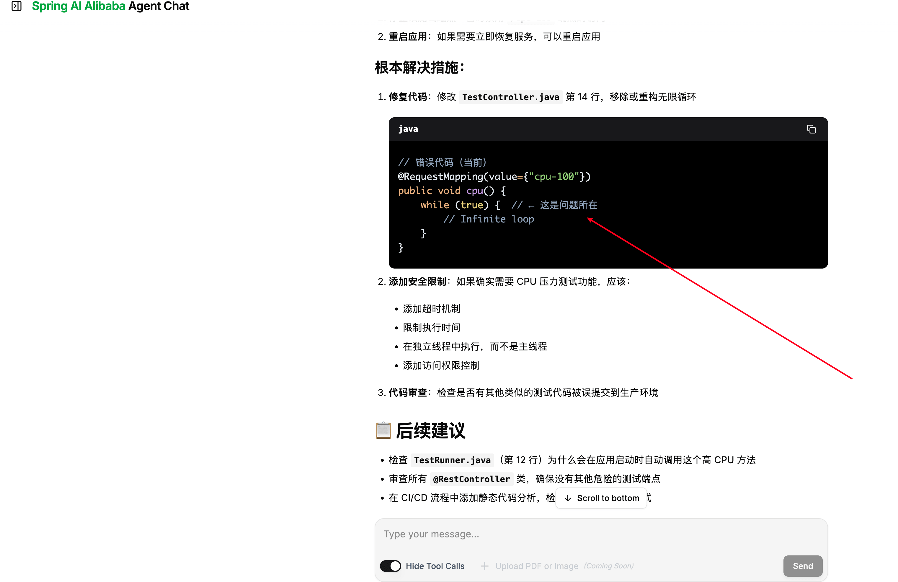

## Scenario 2: Optimize Slow Queries on Millions of Records

Scenario 1 tested AI's ability to plan and deliver a project from scratch. Scenario 2 tests another capability: **Can AI understand an existing, moderately complex codebase, locate a problem, and optimize it incrementally?**

### Identify the Problem: A Search Endpoint Takes 18 Seconds

The order query service, `glm-testing-service`, uses Spring Boot and MyBatis. Its core functions are order search and analysis, exposed through four endpoints:

| Endpoint         | Path                           | Description                                          |
| ---------------- | ------------------------------ | ---------------------------------------------------- |
| User orders      | POST /api/orders/user          | Query a user's orders with optional status filtering |
| Order search     | POST /api/orders/search        | Search by date range, amount, and product keyword    |
| Category sales   | GET /api/orders/category-stats | Aggregate category sales by order status             |
| Combined filters | POST /api/orders/filter        | Filter by user, multiple statuses, and categories    |

The database was populated with millions of test records. Its table schema is:

```sql
CREATE TABLE `orders` (
    `id`           BIGINT PRIMARY KEY AUTO_INCREMENT,
    `order_no`     VARCHAR(64)  NOT NULL,
    `user_id`      BIGINT       NOT NULL,
    `status`       TINYINT      NOT NULL DEFAULT 0,
    `total_amount` DECIMAL(10,2) NOT NULL,
    `product_name` VARCHAR(256) NOT NULL,
    `category`     VARCHAR(64)  NOT NULL,
    `create_time`  DATETIME     NOT NULL DEFAULT CURRENT_TIMESTAMP,
    `update_time`  DATETIME     NOT NULL DEFAULT CURRENT_TIMESTAMP ON UPDATE CURRENT_TIMESTAMP,
    UNIQUE KEY `uk_order_no` (`order_no`),
    KEY `idx_user_id` (`user_id`),
    KEY `idx_status` (`status`),
    KEY `idx_category` (`category`),
    KEY `idx_create_time` (`create_time`)
) ENGINE=InnoDB DEFAULT CHARSET=utf8mb4 COLLATE=utf8mb4_unicode_ci;
```

The project uses an AOP aspect to record each endpoint's execution time and help locate performance bottlenecks:

```java
@Around("controllerPointcut()")
public Object printExecutionTime(ProceedingJoinPoint joinPoint) throws Throwable {
    long startTime = System.currentTimeMillis();
    Object result = joinPoint.proceed();
    long costTime = System.currentTimeMillis() - startTime;
    log.info("[{}] {}.{} took: {}ms", Thread.currentThread().getName(), className, methodName, costTime);
    return result;
}
```

After loading millions of test records, I load-tested the order-search endpoint. It combines fuzzy keyword matching, a time range, and amount filtering. For example:

```bash
curl -X POST http://localhost:8080/api/orders/search \
  -H "Content-Type: application/json" \
  -d '{"startTime": "2025-01-01", "endTime": "2026-12-31", "minAmount": 500, "productName": "Bluetooth", "pageNum": 1, "pageSize": 10}'
```

The application log showed a slow-query warning:

```bash
[http-nio-8080-exec-1] OrderController.searchOrders took: 18375ms
```

The `LIKE '%Bluetooth%'` full table scan made the endpoint take nearly 18 seconds, far too slow for production:

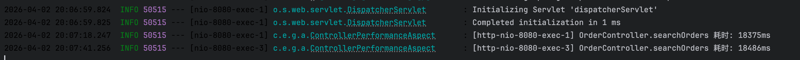

### Analyze the Issue and Design an Optimization Plan

I gave AI the slow-query log and asked it to analyze the existing code and propose an optimization plan:

```bash
Analyze the slow endpoint recorded in the log: "[http-nio-8080-exec-1] OrderController.searchOrders took: 18375ms". Review the order service and recommend optimizations.
```

AI located the relevant business code and proposed a systematic solution based on the SQL and table schema, focusing on index design:

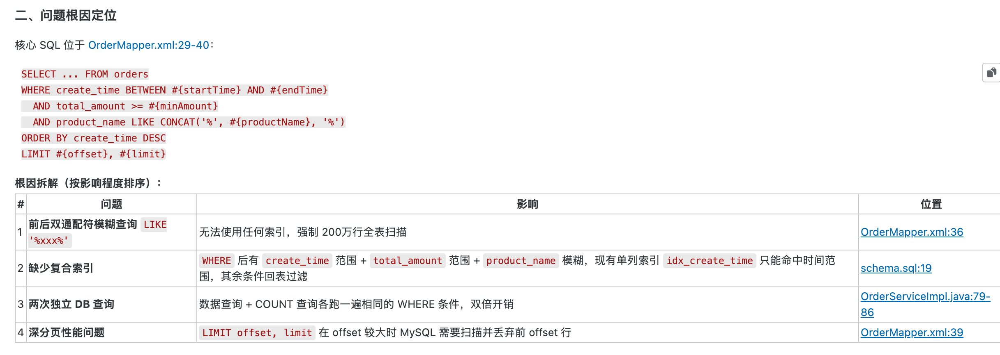

It also suggested phased optimizations and expected results:

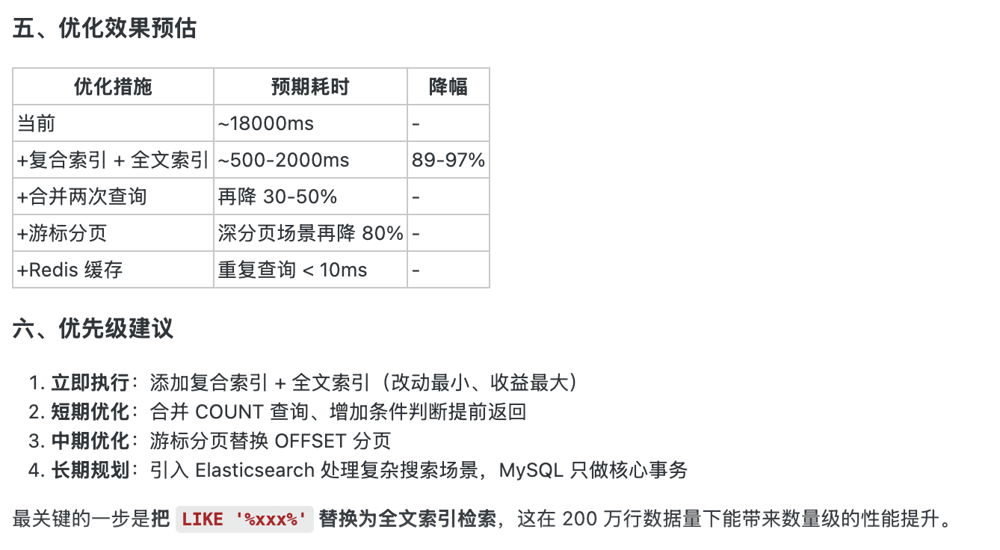

After reviewing the approach, I gave the final optimization request:

```bash
Systematically optimize the slow-query module using the project's existing technology stack.
```

AI reviewed each endpoint's business logic and query details. The optimization proceeded from the database layer up to the application layer:

**Database layer:** AI proposed five candidate indexes:

- A full-text index, `ft_product_name`, with the ngram parser for Chinese tokenization, to replace `LIKE '%xxx%'` full table scans.
- A composite index, `idx_create_time_amount`, to support date and amount filters and sorting.
- A candidate covering index, `idx_search_covering`, to reduce table lookups for `COUNT` queries.
- A composite index, `idx_user_status_category`, to optimize combined filters.
- A covering index, `idx_status_category_amount`, to optimize category aggregation.

```sql
ALTER TABLE `orders` ADD FULLTEXT INDEX `ft_product_name` (`product_name`) WITH PARSER ngram;
ALTER TABLE `orders` ADD INDEX `idx_create_time_amount` (`create_time` DESC, `total_amount`);
ALTER TABLE `orders` ADD INDEX `idx_search_covering` (`create_time`, `total_amount`, `product_name`);
ALTER TABLE `orders` ADD INDEX `idx_user_status_category` (`user_id`, `status`, `category`);
ALTER TABLE `orders` ADD INDEX `idx_status_category_amount` (`status`, `category`, `total_amount`);
```

**Application layer:** Optimize the SQL and Service layer together:

- Replace `LIKE '%xxx%'` search with `MATCH ... AGAINST` full-text search.
- Switch deep pagination to a Deferred Join, using a covering-index subquery to find primary keys before fetching full rows.
- Run `COUNT` only when requested: skip the total by default and query it only when the client explicitly passes `needTotal=true`.

The following index plan was generated by AI. Composite-index performance depends on the leftmost-prefix rule, filter selectivity, sort order, and optimizer decisions. Full-text indexes also increase write and storage costs. Before running the DDL, use representative SQL and data distributions with `EXPLAIN ANALYZE`; remove indexes that overlap or provide too little benefit. See the MySQL documentation on [multiple-column indexes](https://dev.mysql.com/doc/refman/8.4/en/multiple-column-indexes.html) and [ngram full-text indexes](https://dev.mysql.com/doc/refman/8.4/en/fulltext-search-ngram.html):

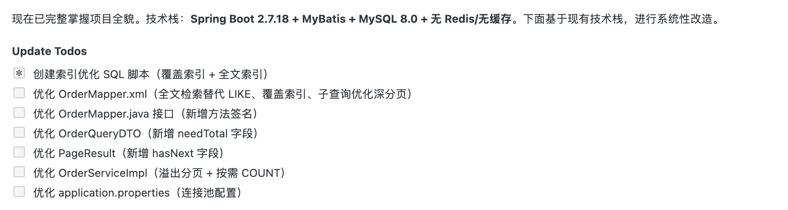

The code diff shows AI replacing `LIKE` matching with full-text search. This is not a transparent performance swap: tokenization, stop words, short terms, substring matching, and default ranking may all change. Before launch, validate Chinese tokenization, short terms, special characters, and ranking with real queries. Design a compatibility path for any old search behavior that must be preserved:

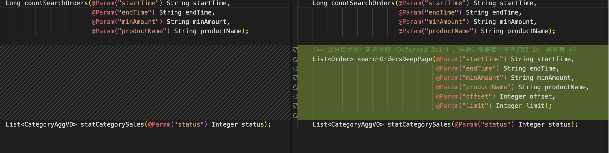

For deep pagination, AI proposed a threshold based on the million-row dataset: switch to a Deferred Join when the offset exceeds 1,000. Use a regular query for shallow pages and a covering-index subquery to find primary keys before fetching full rows for deep pages:

```java
/** Switch to a Deferred Join when the offset exceeds this threshold. */
private static final int DEEP_PAGE_THRESHOLD = 1000;

// Use a Deferred Join for deep pages (offset > 1000); otherwise, use a regular query.
boolean isDeepPage = offset > DEEP_PAGE_THRESHOLD;
List<Order> orders;
if (isDeepPage) {
    orders = orderMapper.searchOrdersDeepPage(...);
} else {
    orders = orderMapper.searchOrders(...);
}
```

`1,000` is only an initial threshold generated for this example; a million-row dataset does not make it inherently appropriate. Row width, filter selectivity, index coverage, sort order, and endpoint SLO all affect the crossover point. Load-test different offsets, examine rows scanned and p95/p99 latency, then decide whether to switch to a Deferred Join. If the product allows it, cursor pagination with a stable sort key is often worth evaluating first.

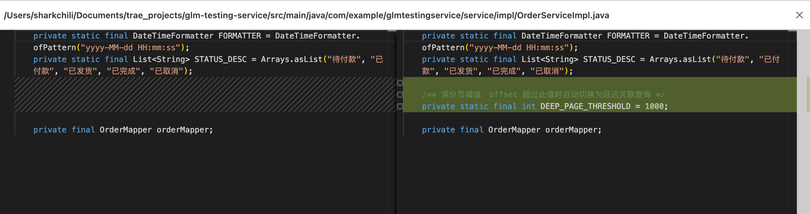

After the optimizations, AI summarized the changes and compared each endpoint before and after:

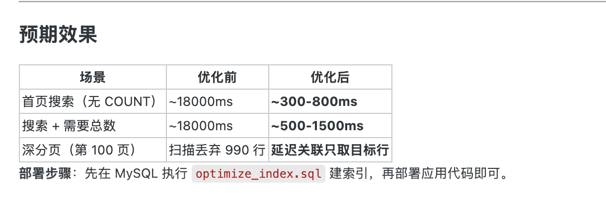

### Verify the Optimization

After the change, I called the endpoint again. The screenshot records one request taking less than 300 ms after warm-up, about 60 times faster than the original 18,375 ms. A single before-and-after screenshot cannot prove the latency stays below 300 ms. A reproducible result also needs the hardware, MySQL version and configuration, data distribution, cache state, concurrency, sample count, p50/p95/p99 latency, and error rate.

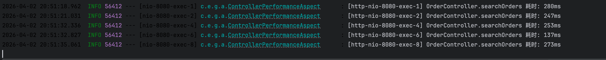

## Lessons from the Two Projects

These two scenarios offer a few lessons about using Claude Code with a third-party model for coding.

### What AI-assisted Coding Can Do

| Capability                                | Example                                                                                     | Notes                                                                        |
| ----------------------------------------- | ------------------------------------------------------------------------------------------- | ---------------------------------------------------------------------------- |
| Requirements to architecture              | Scenario 1: AI proposed a technology stack and architecture from a requirements description | Useful for quickly evaluating an idea, but the plan still needs human review |
| End-to-end implementation                 | Scenario 1: AI delivered nine modules and 46 files                                          | Reduced repetitive work, from scaffolding to business logic                  |
| Incremental optimization of existing code | Scenario 2: AI found and optimized a slow query in a project with millions of records       | Produced a phased plan based on the schema and SQL                           |
| Candidate parameter generation            | Scenario 2: AI suggested an initial pagination threshold based on data volume               | The threshold still requires benchmarking and query-plan validation          |

### What to Watch for

**What worked well:**

- **Produced review material quickly:** In Scenario 1, the model generated a technical plan and architecture sketch that served as a starting point for review.
- **Covered multiple layers:** In the slow-query scenario, it proposed both database index changes and application-level SQL refactoring.
- **Suggested testable parameters:** In Scenario 2, it proposed an initial deep-pagination threshold that could be evaluated with benchmarks.

**What needs attention:**

- **Production security needs a separate design:** The Arthas session flow is documented, but authentication, instance and command allowlists, approval, rate limiting, and auditing are still essential.
- **Long tasks can lose context:** During complex coding tasks, AI may forget design constraints later in the process. Break the work into clear phases and review each phase independently.
- **Code style and engineering conventions:** The generated structure may be reasonable but still differ from team conventions. Some names and file organization in Scenario 1 needed manual changes.
- **Tradeoffs need human judgment:** AI can suggest options but cannot choose based on your business needs. For example, full-text search versus Elasticsearch and Deferred Join versus cursor pagination require context-specific decisions.

### Tips for Using Claude Code with Third-party Models

1. **Write specific requirements:** The detailed Prompt in Scenario 1 shaped the quality of the architecture proposal; vague requirements lead to vague plans.
2. **Review in phases:** Do not ask AI to generate a complex project from start to finish in one pass. Review technology selection, architecture design, and implementation separately.
3. **Keep critical decisions under human control:** Choose architecture details such as caching and pagination based on the business context.
4. **Use documentation links:** When integrating an existing component, such as Spring AI Alibaba in Scenario 1, providing a documentation link can be more efficient than describing every detail.

## Final Thoughts

With a third-party model connected, Claude Code's Agent mode can combine context understanding, task breakdown, and code generation into a useful workflow. Across these two scenarios, AI-assisted coding shortened the path from an idea to an implementation.

But a tool is still just a tool. Consider the two scenarios in this article:

- **The JVM diagnostic Agent in Scenario 1** requires an understanding of Arthas session lifecycles and JVM diagnostics, as well as clearly defined production permissions. The model can suggest diagnostic steps, but must not have unrestricted access to targets or commands.

- **The slow-query optimization in Scenario 2** requires a strong understanding of MySQL indexes, full-text search, and deep-pagination strategies to decide whether AI's suggestions fit your system. For example, full-text indexes can add overhead in write-heavy workloads, and Deferred Join thresholds must be tuned to the actual data.

AI coding tools are changing developers' work: from writing code to reviewing it. To use AI effectively, you need to understand the task better than the AI does.

## References

- GLM Coding Plan model-switching guide: <https://docs.bigmodel.cn/cn/coding-plan/using5-1>
- Claude Code installation guide: <https://docs.anthropic.com/en/docs/claude-code>
- CC Switch model-switching tool: <https://github.com/farion1231/cc-switch>
- Spring AI Alibaba Agent Chat UI documentation: <https://java2ai.com/docs/frameworks/studio/quick-start/>
- Arthas documentation: <https://arthas.aliyun.com/doc/>
- Arthas HTTP API: <https://arthas.aliyun.com/doc/http-api.html>
- Arthas authentication: <https://arthas.aliyun.com/doc/auth.html>
