Hi, I'm Xiao G. MiniMax M3 was released a few days ago. Many people tried it right away and gave good feedback. Quite a few readers also asked me to test it.

It was not a lack of interest; I had been busy optimizing JavaGuide ahead of campus recruiting, which I do every year.

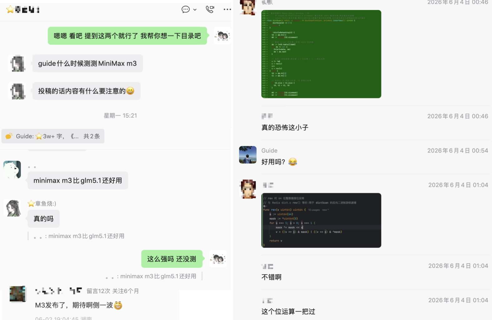

According to MiniMax, M3 is its first open-weight model to combine a 1M-token context window, native multimodality, and frontier coding capabilities. This is the vendor's description; whether it suits a particular codebase still needs to be tested against real tasks.

Published benchmark results include 59.0% on SWE-Bench Pro, 66.0% on Terminal-Bench 2.1, and 74.2% on MCP Atlas. These results correspond to specific evaluation sets and configurations; they are not independent results from this article.

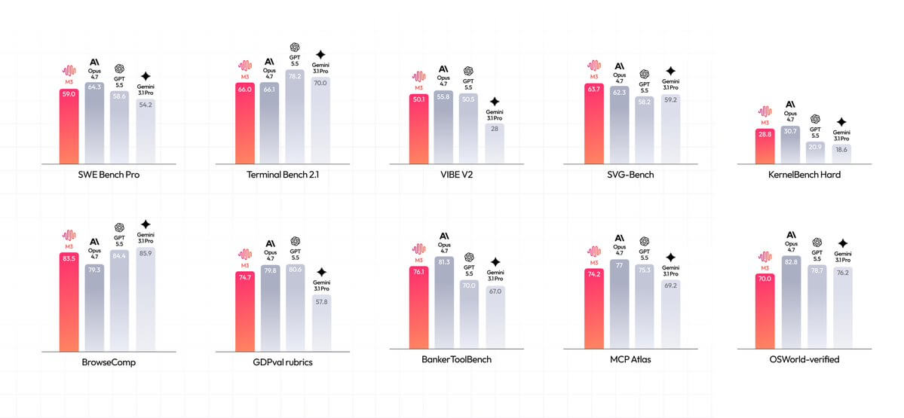

I am more interested in how it performs in real engineering work.

So I used a production issue I had encountered to evaluate it. The known symptoms were that frontend requests were affected during peak business hours, and investigation pointed to a full Redis `SCAN` loop in a background asynchronous task. Whether this loop was the primary cause because it held connections for a long time still needed to be verified through monitoring and reproduction.

This case involves reasoning across a complex business flow and diagnosing the system as a whole. After locating the issue and mitigating its impact, I also used M3 to port Redis source-code functionality from C to Go and build a full-stack Redis monitoring dashboard. These tasks let me observe cross-language reimplementation and end-to-end delivery.

The article covers three tasks:

1. Troubleshooting
2. Reimplementing a low-level algorithm
3. Delivering a monitoring dashboard

## Preparation

I use Claude Code for everyday development and manage models through cc-switch. Here are the steps to configure MiniMax M3. First, open cc-switch and click the plus button to add a model:

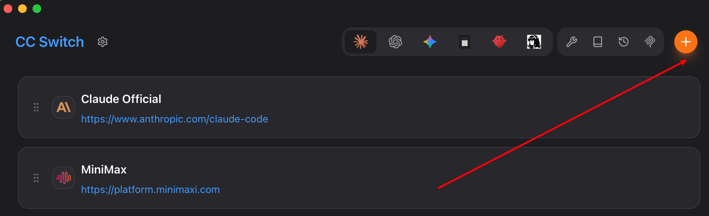

Select MiniMax M3 and enter your key in the API key field:

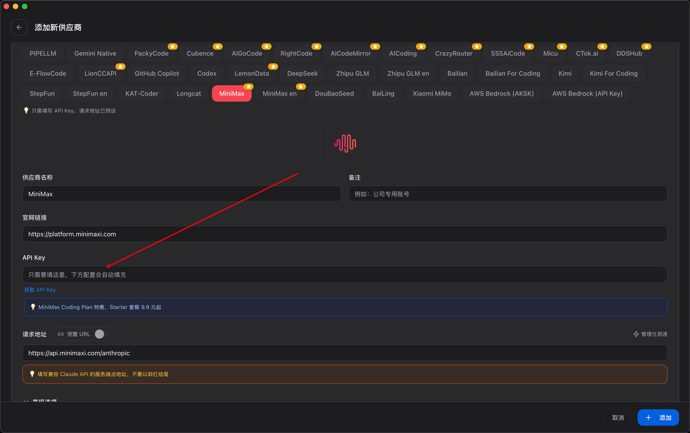

Finally, retrieve the model list to complete setup. In my configuration, I set MiniMax M3 as the primary model:

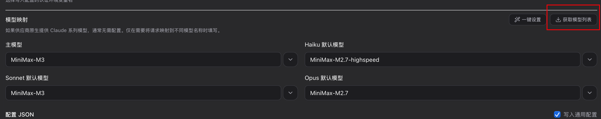

After configuration, open Claude Code and use the conversation panel to verify that the model is active:

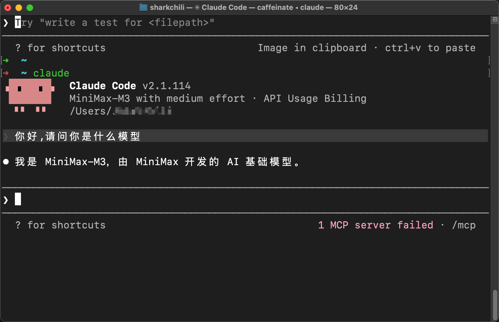

## Troubleshooting: Investigating an Application-Level SCAN Loop

The first case recreates a production issue I encountered. To make it easier to follow, I use a familiar e-commerce scenario: during a major sale, an asynchronous job automatically cancels expired orders while many users browse products. Suddenly, pages across the site start timing out. Hot data for sales, inventory, browsing, and favorites will not load:

To evaluate MiniMax M3's ability to investigate a complex business flow, I submitted a screenshot of the symptoms—using Ctrl+V in Claude Code, or Alt+V on Windows—along with a description of the error:

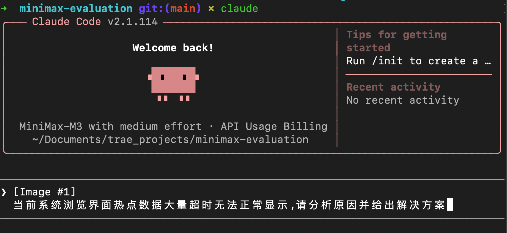

After a short analysis, MiniMax M3 traced the issue to the full `SCAN` loop in the background task. Initially, it summarized the cause as “SCAN blocks the Redis server,” which is not precise enough. A single `SCAN` call is an incremental iteration, designed to avoid the long blocking behavior of commands such as `KEYS`. What needs to be investigated is the number of loop iterations, `COUNT`, keyspace size, latency per call, and whether the application holds connections for a long time.

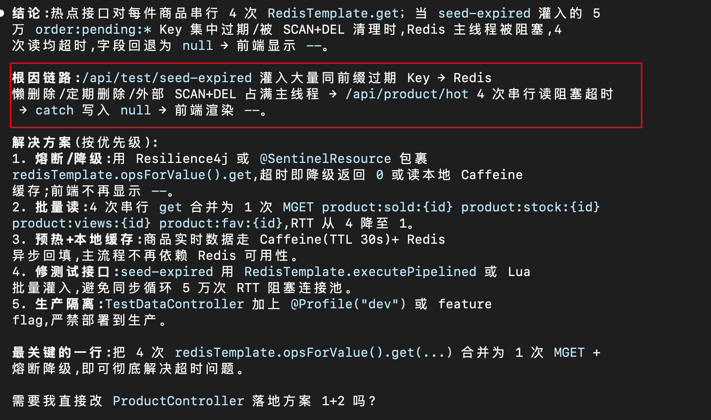

To check the business flow, I asked MiniMax M3 to draw the incident sequence as an ASCII diagram. It showed the expired-order task entering the `SCAN` loop, the available connections in the pool decreasing, and page requests queuing up. “Keyspace scanning blocks the main thread” should be treated as a hypothesis to verify, not as fixed behavior of `SCAN`:

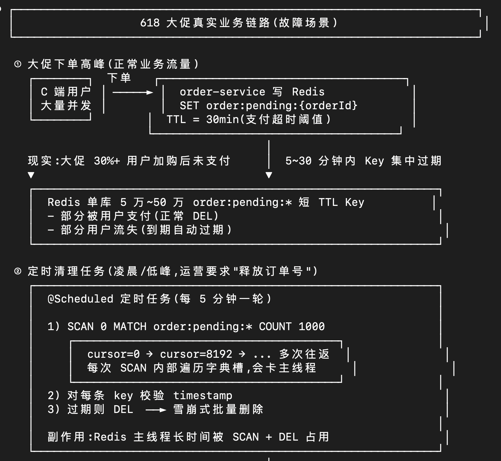

M3 then suggested four types of mitigations: data-structure changes, atomic operations, fallback behavior, and monitoring:

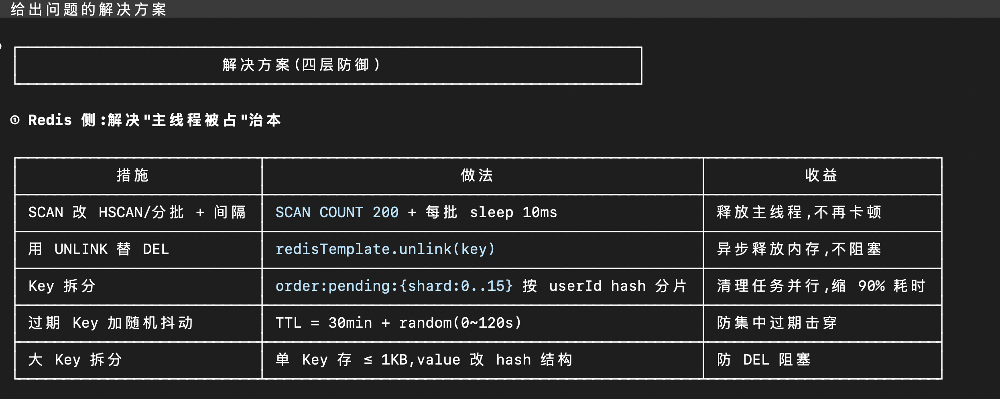

For the affected business API, M3 changed a sequence of Redis commands into one atomic operation and included a fallback strategy to limit the impact in extreme cases:

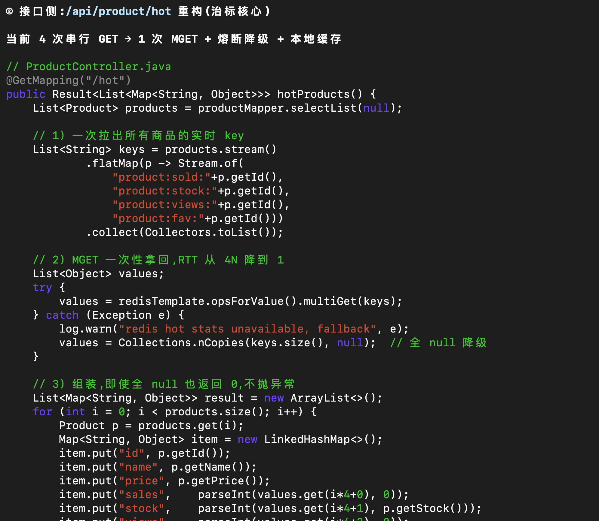

On the engineering side, M3 also suggested monitoring instrumentation and used 200 ms as an example alert threshold. That number cannot be justified by saying it is a “noticeable pause.” Set thresholds for Redis background tasks based on the API SLO, connection-pool capacity, task frequency, and historical latency percentiles:

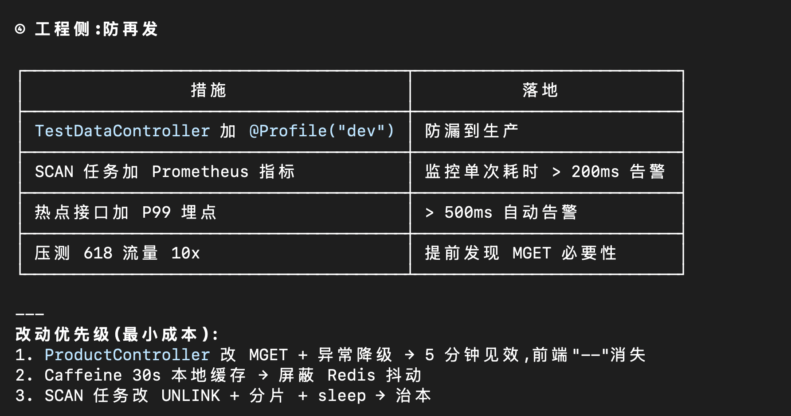

Here is the diff for the changes:

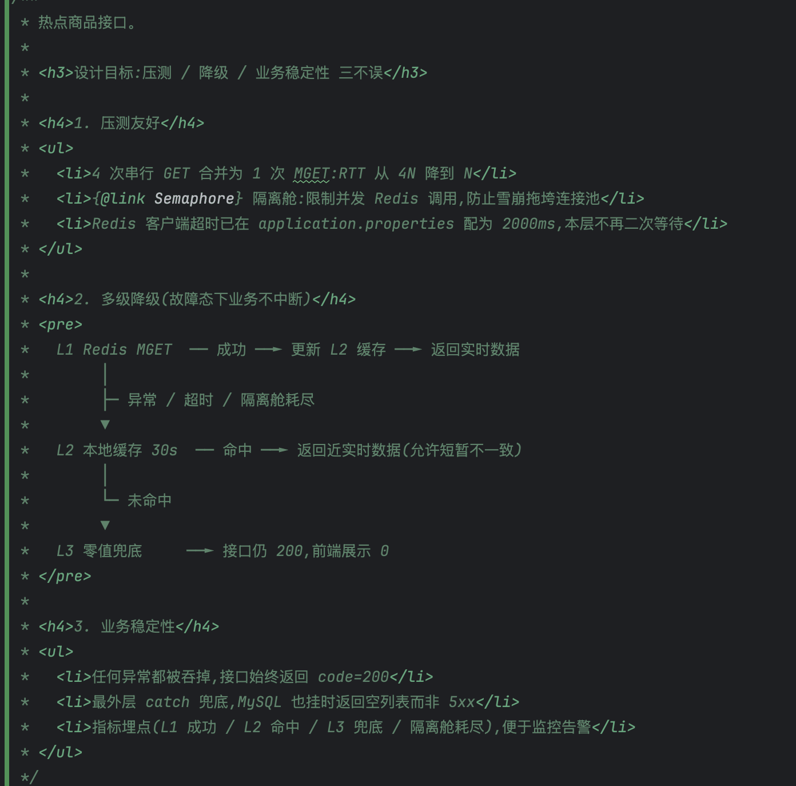

Here is the core fallback code. M3 used concurrent atomic classes for some shared state, but that only guarantees atomicity for the corresponding variables or individual operations. It does not prove thread safety or consistency across the full chain of Redis, local cache, and database fallback. Cache stampedes, duplicate database reads, and stale-value overwrites still need to be addressed through synchronization, rate limiting, and concurrency tests:

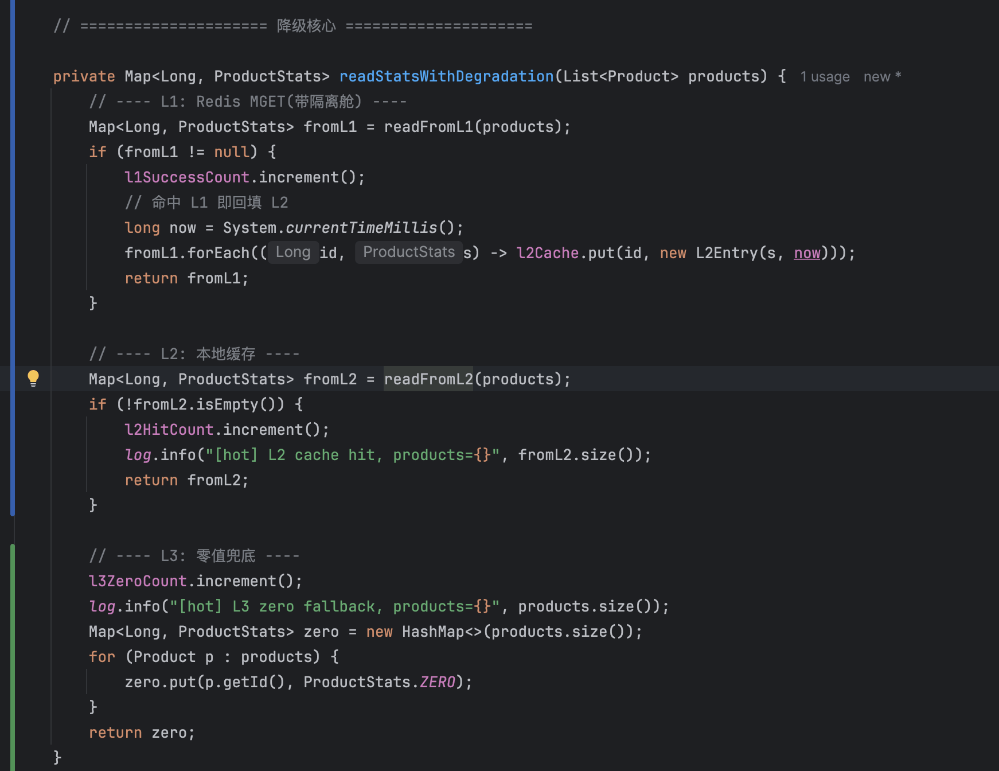

M3 also generated tests for normal fallback, exception recovery, and concurrent races. The screenshot shows that the tests compiled and passed. “100% logic coverage” only describes coverage of the measured code; it does not prove that every failure scenario has been tested:

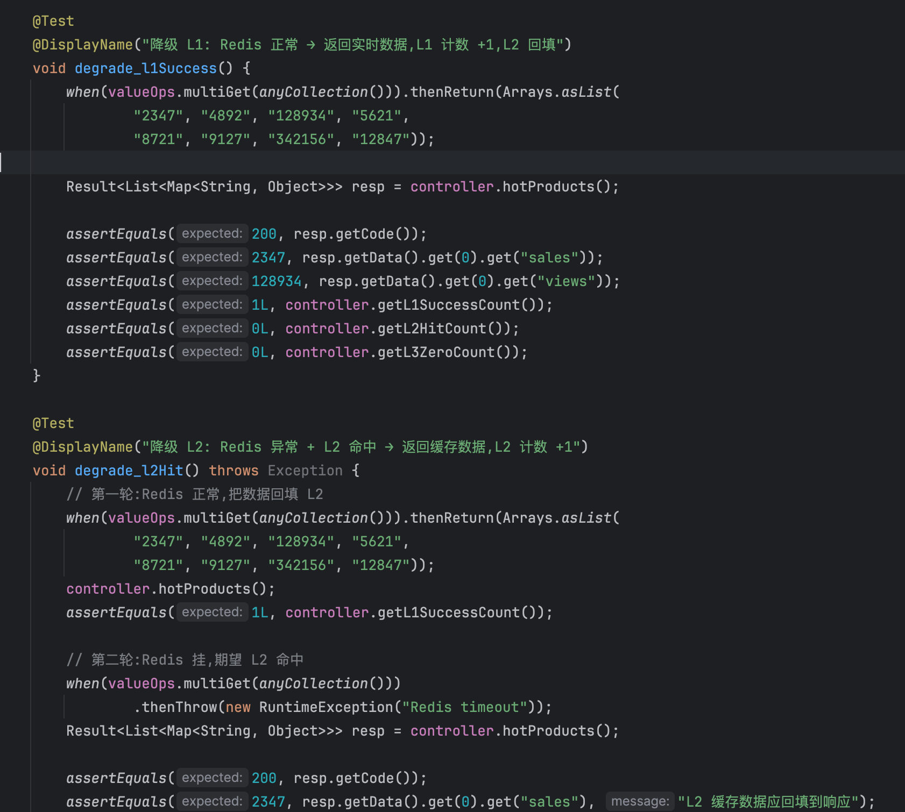

## Going Deeper: Reimplementing the Redis SCAN Cursor Algorithm and Understanding Binary Reversal

Recently, Google engineering director Addy Osmani highlighted a concern in his article [“Don't Outsource the Learning”](https://addyosmani.com/blog/dont-outsource-the-learning/): it is easy to let AI write code while skipping the learning process. The bug gets fixed, but your mental model does not improve.

He cited a randomized study by Anthropic: when learning a new library, the AI-assisted group completed tasks as quickly as the manual group, but scored only 50% on a follow-up comprehension test, compared with 67% for the manual group. Results also varied within the AI group. Engineers who used AI to ask conceptual questions scored above 65%, while those who copied and pasted code scored below 40%. Osmani's conclusion is that tools do not learn for you; how you use them matters:

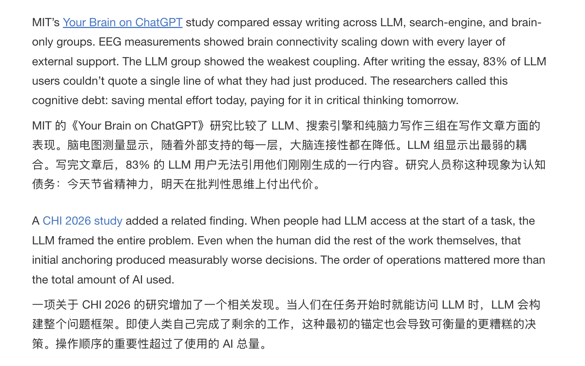

Back to this incident. Troubleshooting and mitigation were only the first steps. To understand how `SCAN` traverses a dict, what `COUNT` really means, and how bit reversal in `rev` advances the cursor, I still needed to read the documentation and source code. The official documentation explains that `COUNT` is only a work hint; source code shows how a particular version implements it. I used MiniMax M3 to reimplement the core `SCAN` algorithm and then checked the result in mini-redis, a learning project maintained by my friend sharkchili.

To provide enough context, I added the Redis source files related to `SCAN` to the mini-redis project using `add-dir`:

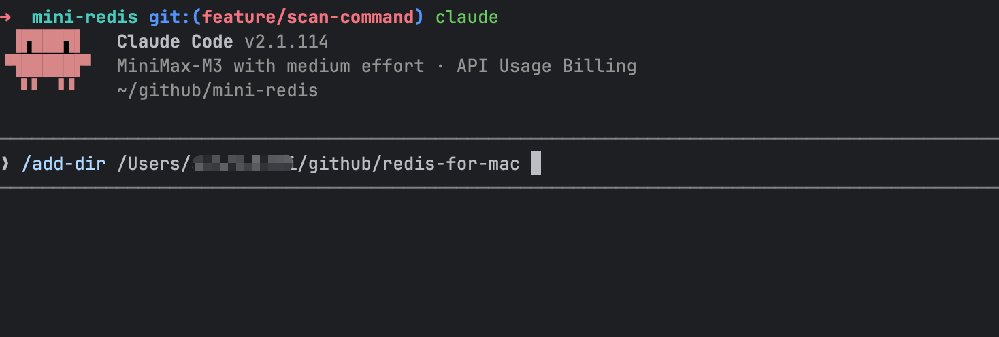

Then I entered the request. After scanning the Redis source, M3 recognized that this was a long task and used the plan-with-files Skill to break it down and plan the work:

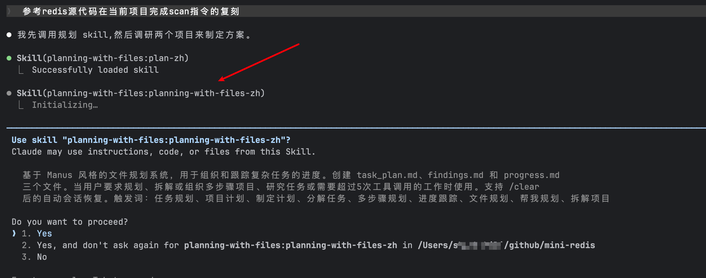

After planning, M3 asked clarifying questions. The first confirmed the scope; I chose to reimplement the `SCAN` command:

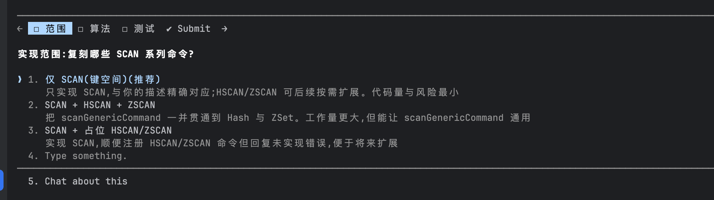

The second question was about the algorithm. M3 found that mini-redis had already reimplemented Redis's dict data structure instead of using Go's built-in map. It therefore suggested implementing cursor advancement on top of the existing dict. This preserves the main behavior and learning value of the Redis algorithm. Whether bucket ordering, memory locality, and performance are also consistent depends on the Go implementation's data layout and runtime; the data-structure names alone do not establish that:

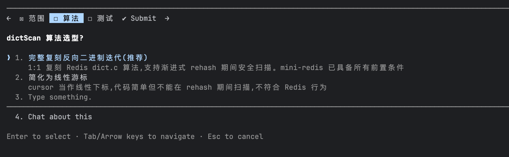

After several rounds of discussion and clarification, we agreed on this plan:

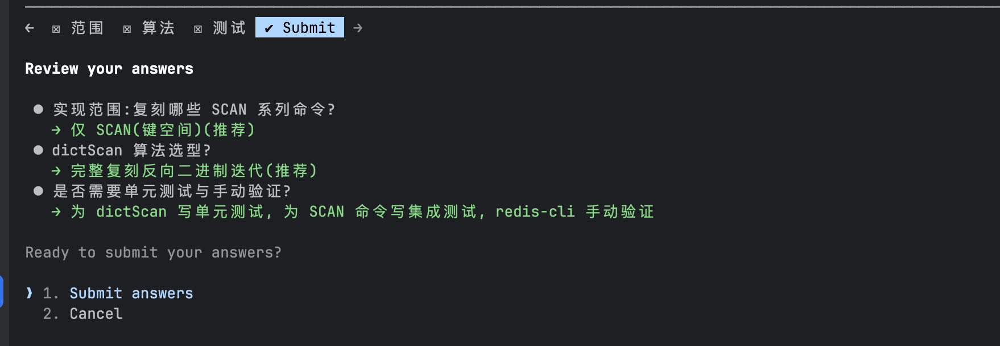

Once we agreed on the approach, M3 implemented the functions from the bottom up. It first created the foundation for dict traversal, then connected cursor advancement and parameter parsing, and finally updated the checklist in the project README:

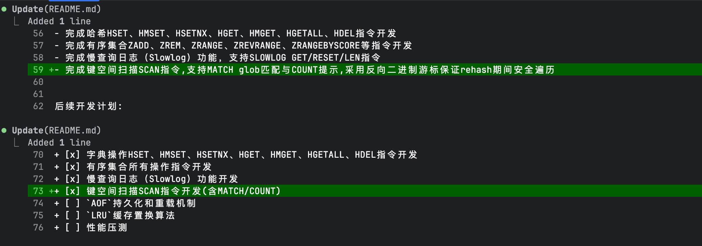

The delivered code had this structure. The `SCAN` implementation covered parsing the `match` and `count` arguments and the cursor loop:

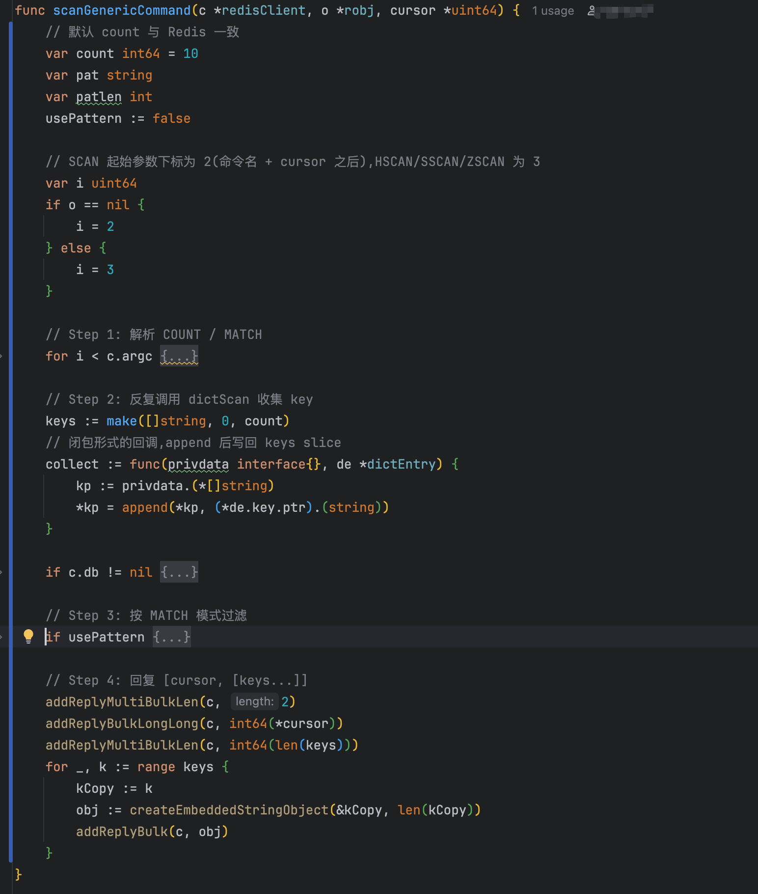

By reimplementing the algorithm and reading the comments, I learned an implementation detail: in the current Redis source, `scanGenericCommand` sets `count × 10` as a maximum number of iterations to limit the amount of work in one call when the hash table is sparse. It does not mean that the implementation always scans ten times the number of buckets, nor does it guarantee that `COUNT` items will be returned:

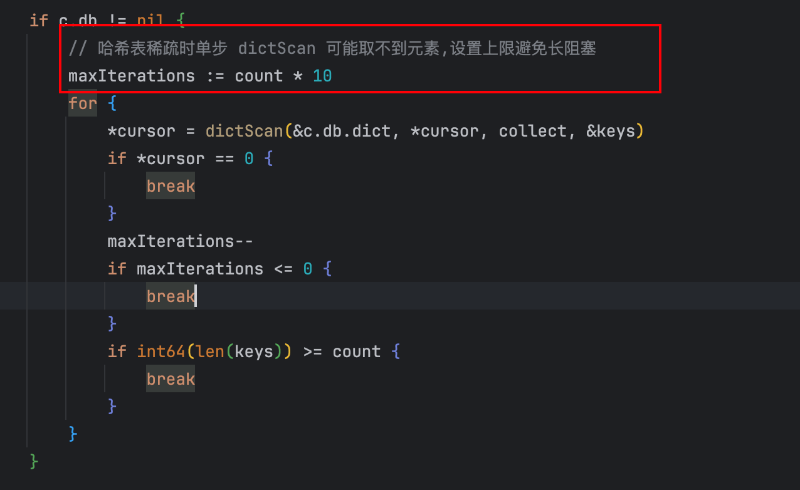

One detail deserves attention: Go uses `^` for both XOR and bitwise NOT, while C uses `^` for XOR and `~` for NOT. The `rev` algorithm performs many bit-reversal operations, so you must distinguish precisely between “flip one bit” and “invert the entire binary number.” Confusing these semantics even once can break cursor advancement. This code deserves close review to ensure M3 did not mechanically replace `~` with `^`:

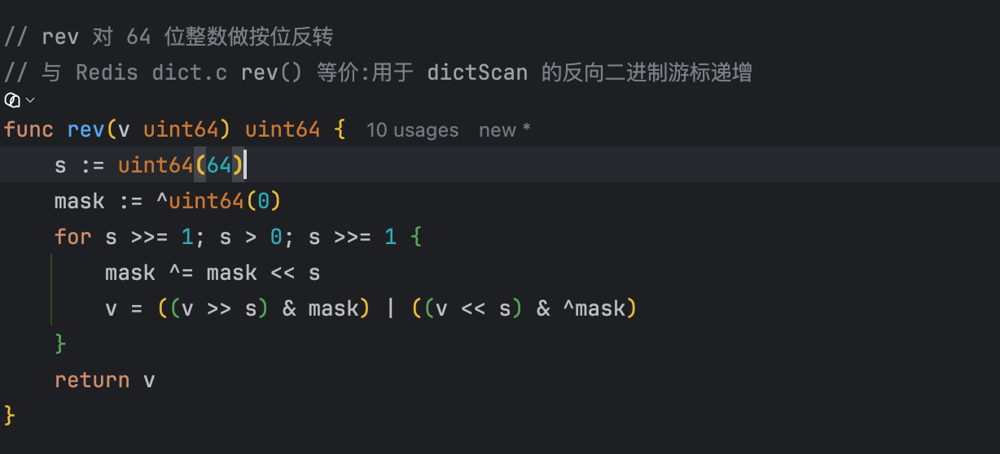

The code compiled and all unit tests passed on the first run:

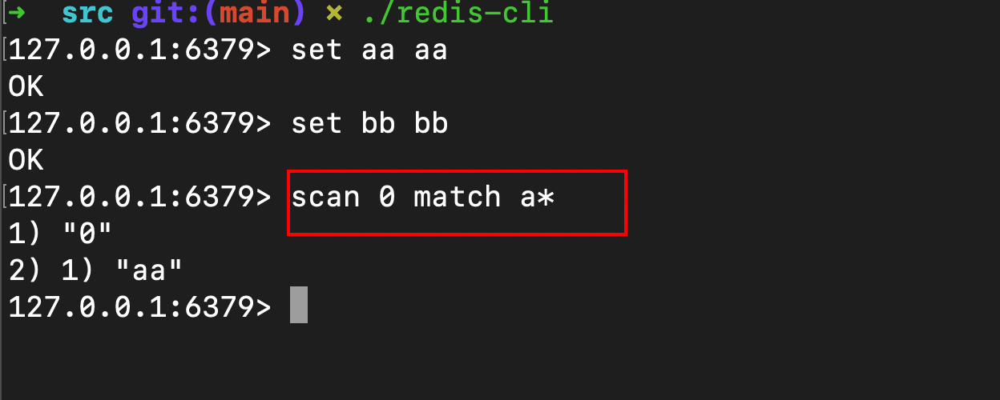

## Applying What We Learned: Building a Lightweight Redis Monitoring Dashboard

After mitigating and reviewing the incident, we still needed to add monitoring to the existing architecture so we could observe Redis in real time, quickly identify a recurrence, and mitigate it.

For this task, I provided the existing system as context to a new project and asked M3 to design and build a visual Redis monitoring dashboard from scratch. I wanted to see how it handled end-to-end frontend and backend delivery.

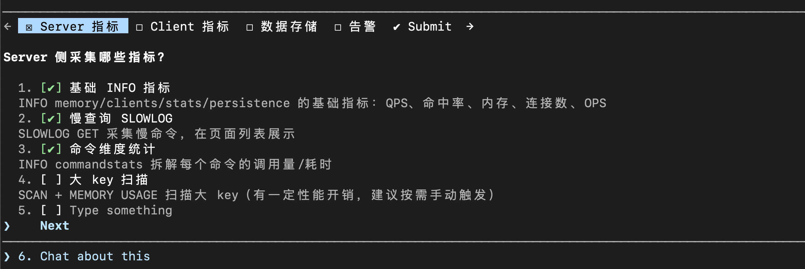

After a brief clarification, M3 produced an ASCII architecture diagram showing the data flow:

1. **Collection layer:** Collect and report instrumentation data.
2. **Buffer layer:** Use a ring buffer to absorb traffic spikes.
3. **Presentation layer:** Provide an HTTP API and frontend dashboard.

The responsibilities of the three layers were clear and loosely coupled:

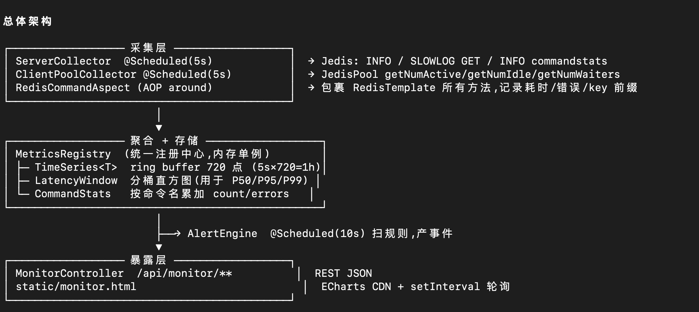

Code structure:

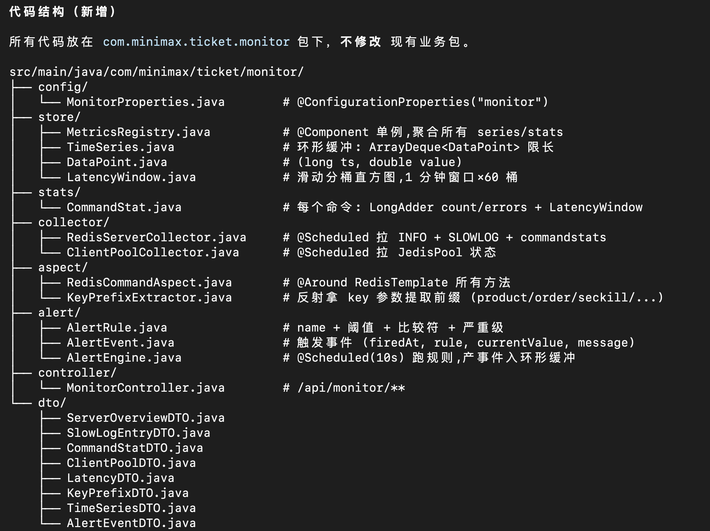

Although this was a quick MVP prototype, the ring buffer design for collecting monitoring data is worth examining. It uses a preallocated fixed-size array, a mutex to protect concurrent reads and writes, and overwrites the oldest data when full:

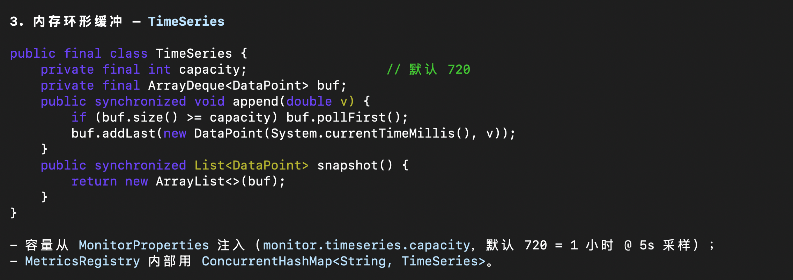

Here is the final dashboard. It uses a dark theme and several panels: Redis instance status (memory usage, connection count, and QPS), a chart of commands by type, and a timeline of slow queries:

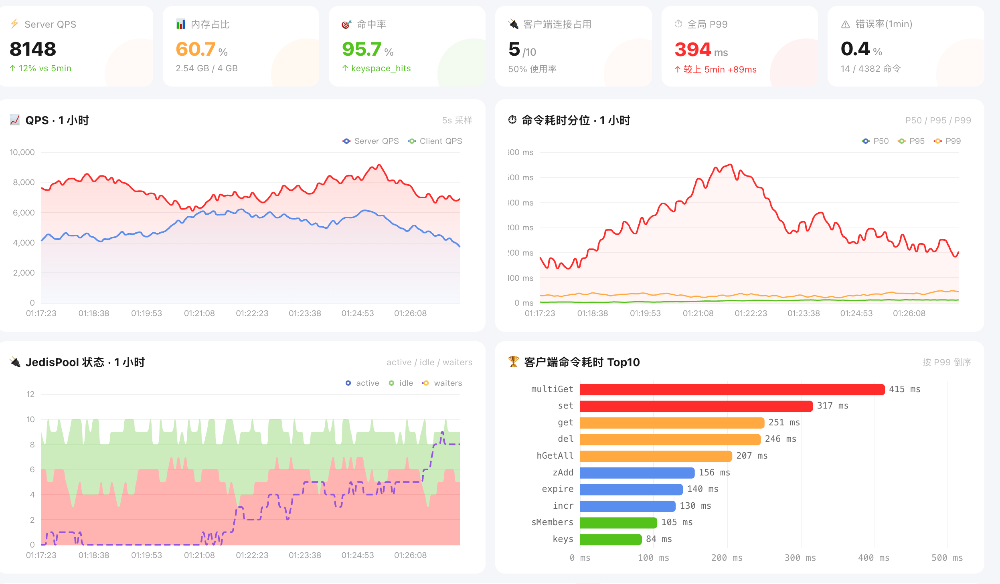

The dashboard also shows details about slow queries and key distribution on the Redis server, which can support routine monitoring:

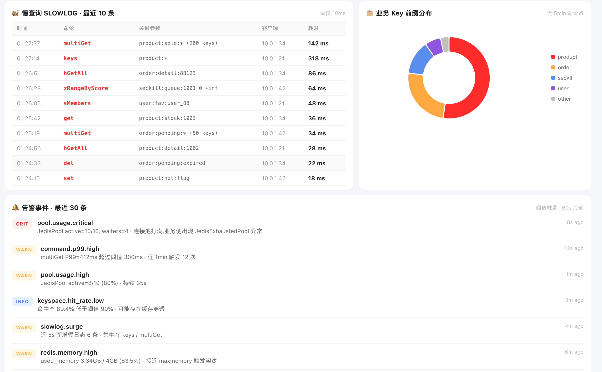

## Summary

I used M3 for three tasks: investigating a Redis connection-pool issue, porting the `SCAN` cursor algorithm from C to Go, and building a Redis monitoring dashboard. The evidence from these tasks and the limitations they exposed are what matter:

1. During troubleshooting, it suggested possible approaches involving data structures, atomicity, fallback behavior, and monitoring, but its initial explanation of how `SCAN` blocks was inaccurate.
2. During the low-level port, it recognized that the project used a custom dict rather than Go's built-in map, and distinguished Go's XOR and complement operators. The implementation still needed to be verified against source code and tests.
3. The monitoring dashboard covered collection, buffering, and presentation, but its design trade-offs were not examined thoroughly.

While porting Redis `SCAN` from C to Go, M3 found that the project reimplemented dict rather than using a Go map and recommended a faithful reimplementation of the SCAN cursor on that basis. It also distinguished the XOR and complement meanings of Go's `^` operator line by line.

The monitoring-dashboard task exposed a noteworthy limitation: when building from zero to one, M3 chose a safe, workable approach rather than the result of a well-reasoned trade-off. For example, why use a ring buffer instead of a lock-free queue? If the buffer overwrites the oldest data, could it lose important metrics under high QPS? M3 assumed a standard answer instead of raising these trade-offs. Without relevant domain knowledge, a developer cannot choose the best approach during brainstorming. The result may be a prototype that runs, but is not necessarily well designed.

This brings us back to Addy Osmani's point: tools do not learn for you. M3 generated fallback code and the `rev` algorithm, but its explanations of SCAN blocking and `count × 10` still needed correction against documentation, source code, and load tests. For me, that is the value of this evaluation: it can speed up reading and implementation, but engineering conclusions still need to be verified.
