<!-- @include: @article-header.snippet.md -->

On April 24, 2026, DeepSeek released V4 Preview as open source. There are many technical reports and community tests, but I wanted to see how it performs in a real codebase.

Open-source models have become quite capable at conversation and writing. Providers keep up with one another, and their iteration speed is easy to see. Agent coding is a different challenge.

An agent must analyze project structure, understand dependencies across files, and produce a practical engineering solution. This requires coding ability and reliable tool use.

Models have continued to improve in this area, but in practice they still fall short of being something you can confidently leave to complete a task independently.

When V4 was released, my first thought was to connect it to Claude Code and put it to work.

This article covers four areas:

1. **Two ways to connect DeepSeek V4 to Claude Code:** configuration files and visual switching with CC Switch.
2. **Five real development tasks:** how well does V4-Pro perform?
3. **Core specifications and pricing for DeepSeek V4-Pro and V4-Flash:** is it worth switching?
4. **Use cases:** when to use it and when to wait.

## Connecting DeepSeek V4 to Claude Code

Claude Code has a mature toolchain, but the official model API can be expensive. DeepSeek V4 provides an **Anthropic-compatible API**, which Claude Code can use directly without an extra protocol-conversion service. However, compatibility does not mean that it fully reproduces Anthropic model capabilities. Tool use, context, and new features still need to be tested on real tasks.

### Method 1: Configuration File (Recommended)

If Claude Code is not installed on your machine, install it first (Node.js 18+):

```bash
npm install -g @anthropic-ai/claude-code
```

Edit or create the Claude Code configuration file, `~/.claude/settings.json`. Add an `env` field with the backend URL, model, and API key:

```json
{
  "env": {
    "ANTHROPIC_AUTH_TOKEN": "your_deepseek_api_key",
    "ANTHROPIC_BASE_URL": "https://api.deepseek.com/anthropic",
    "ANTHROPIC_MODEL": "deepseek-v4-pro[1m]",
    "ANTHROPIC_DEFAULT_OPUS_MODEL": "deepseek-v4-pro[1m]",
    "ANTHROPIC_DEFAULT_SONNET_MODEL": "deepseek-v4-pro[1m]",
    "ANTHROPIC_DEFAULT_HAIKU_MODEL": "deepseek-v4-flash",
    "CLAUDE_CODE_SUBAGENT_MODEL": "deepseek-v4-flash",
    "CLAUDE_CODE_EFFORT_LEVEL": "max",
    "API_TIMEOUT_MS": "3000000",
    "CLAUDE_CODE_DISABLE_NONESSENTIAL_TRAFFIC": "1"
  }
}
```

Replace `your_deepseek_api_key` with your DeepSeek API key.

Create an API key at <https://platform.deepseek.com/>.

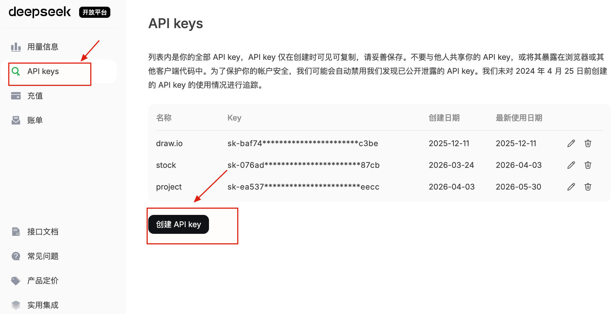

The `[1m]` suffix requests the 1M-context version of V4 Pro. For everyday tasks, change `ANTHROPIC_MODEL` to `deepseek-v4-flash` to use Flash by default. Check the [official DeepSeek integration guide](https://api-docs.deepseek.com/quick_start/agent_integrations/claude_code/) for current model IDs and mappings.

After configuration, start Claude Code:

```bash
claude
```

The first time it starts, you will need to confirm that you trust the current directory.

### Method 2: CC Switch (Visual Model Switching)

If you want to switch between providers such as DeepSeek, Claude, and MiniMax, try **CC Switch**. It manages Claude Code model configuration, lets you switch providers with one click, and can also manage Skills, MCP servers, and prompts.

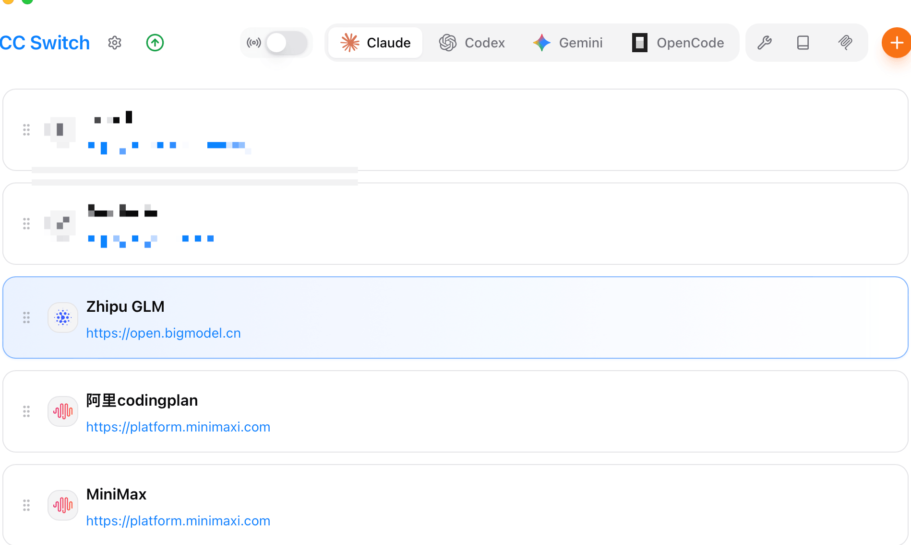

Open CC Switch, click **+** in the upper-right corner, and select a custom provider. Set the Base URL to `https://api.deepseek.com/anthropic` and enter your DeepSeek API key.

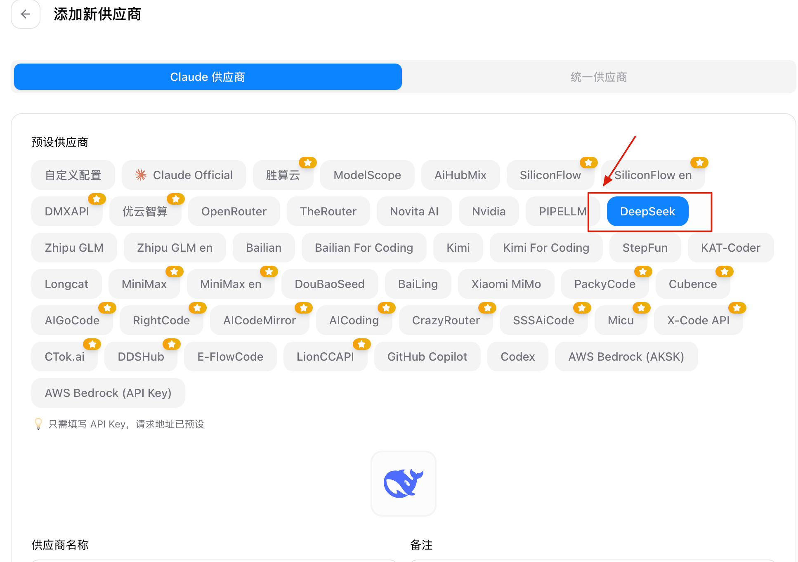

Set the model name to `deepseek-v4-pro[1m]` or `deepseek-v4-flash`, then click **Add** in the lower-right corner.

### Verify the Configuration

Run `claude` in the terminal, then enter `/status` in Claude Code. If the model is shown as `deepseek-v4-pro[1m]` or `deepseek-v4-flash`, the routing is active.

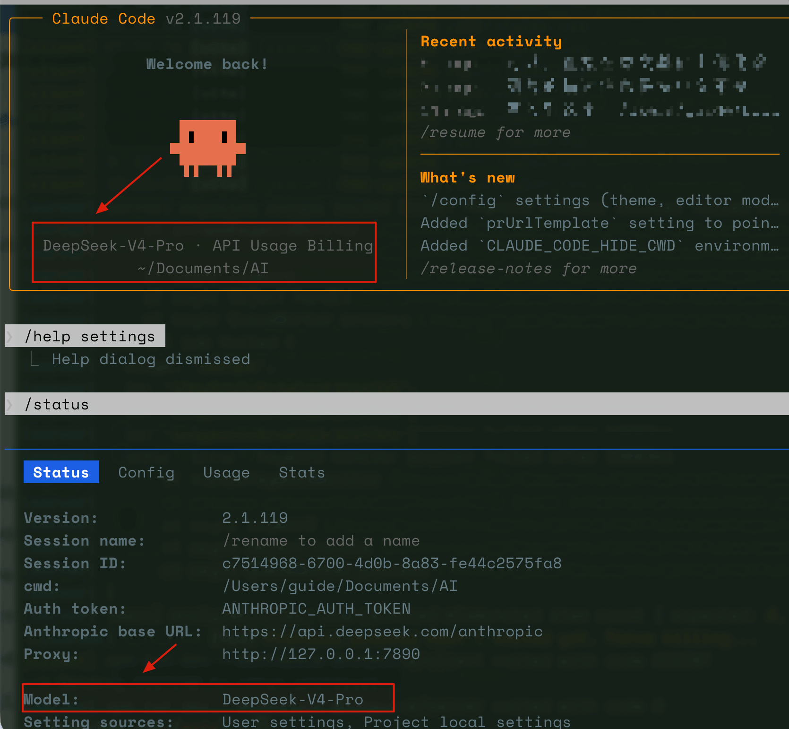

You can now call DeepSeek V4 through Claude Code. Whether a third-party model supports a particular Claude Code feature still depends on API compatibility and must be verified in practice.

## Task 1: Update the Preset Model List for Multiple LLM Providers

I have a multi-agent stock analysis project that I had not started in nearly a month. When I restarted it, the first thing I wanted to do was update its outdated model configuration.

The Settings page had only a plain text field for users to enter model names manually, which was not very user-friendly.

I had two tasks: **look up the latest models from several LLM providers** and **add a dropdown selector to the frontend**.

The prompt was simple:

> Use `/tavily-search` to find the latest DeepSeek, GLM, and OpenAI models, then update the default model recommendations and examples in the global configuration. The current LLM icons look too generic; replace them with more polished ones.

One detail is worth mentioning: without the `/tavily-search` Skill, a model guessing from its training data cutoff would likely get the latest versions wrong. When I tried other models without Tavily, I had to correct them several times before they identified the latest releases.

For more on Tavily, see [Connect Claude Code to the Tavily AI Search Engine](https://mp.weixin.qq.com/s/kAk7lLVgYzZrD9xJs3AUkQ).

V4-Pro completed the change in one pass.

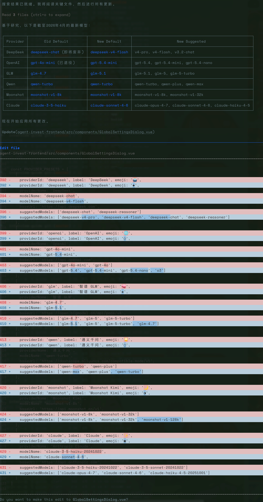

The model configuration was updated successfully, and the example recommendations switched to the latest versions. Three files changed:

1. **`application.yml`**: Added a preset DeepSeek provider and updated GLM's default model to `glm-5`.
2. **`.env.example`**: Added DeepSeek environment variables and changed Kimi's default to `kimi-k2.6`.
3. **`SettingsPage.tsx`**: Added a `PROVIDER_PRESETS` constant and changed the Model and Embedding Model fields to combo boxes.

The four providers' recommended model lists as of April 25, 2026:

| Provider  | Recommended models                                                                  |
| --------- | ----------------------------------------------------------------------------------- |
| DashScope | Eight models, including `qwen3.6-flash`, `qwen3.5-plus`, `qwen3-max`, and `qwq-32b` |
| DeepSeek  | `deepseek-v4-flash`, `deepseek-v4-pro`                                              |
| GLM       | Eight models, including `glm-5.1`, `glm-5`, and `glm-4.7-flash`                     |
| Kimi      | Five models, including `kimi-k2.6`, `kimi-k2.5`, and `kimi-k2-thinking`             |

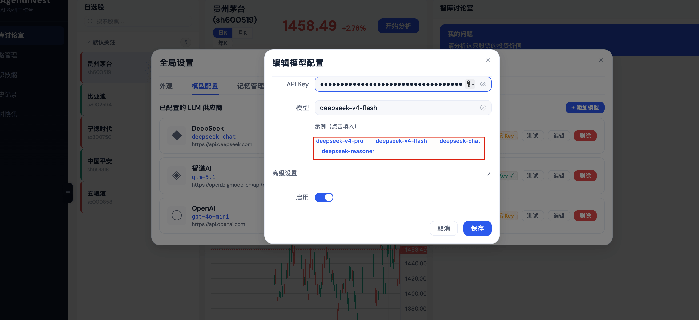

## Task 2: Diagnose a Database Migration and Integrate Flyway

The second task was more challenging.

I had a new computer and had rebuilt the environment from scratch. The project had two SQL files: one ran automatically when the project started, while the other did not. I had forgotten how this worked, so I asked the model to diagnose it.

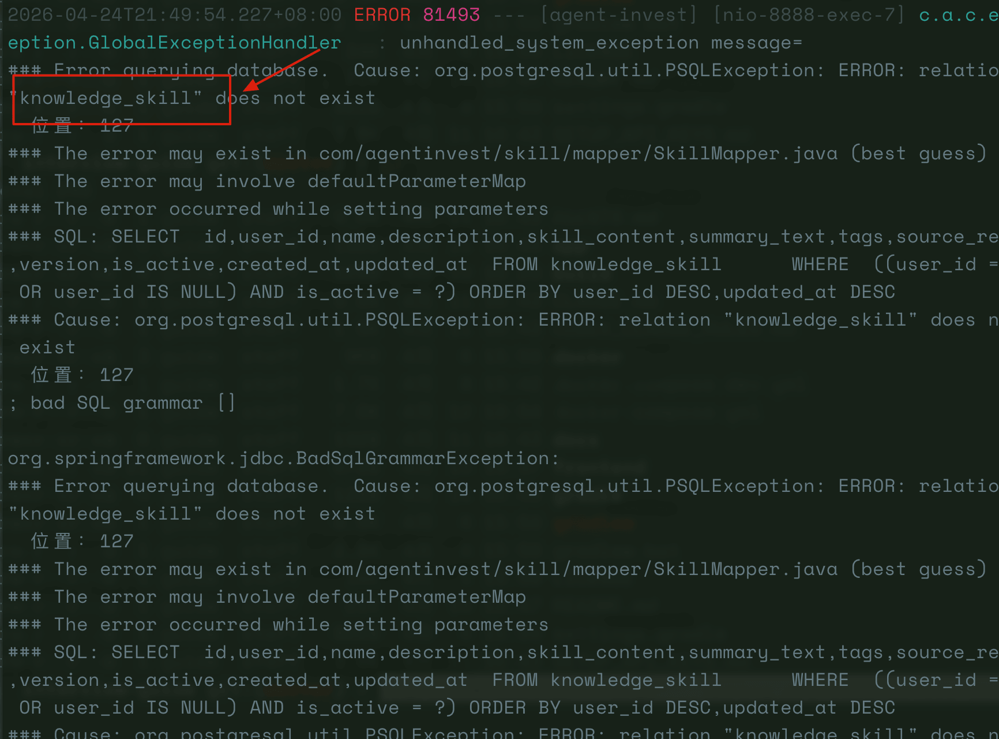

The prompt:

> The project has two SQL files. `sql/init.sql` runs automatically when the project starts, but `sql/V2__knowledge_skill.sql` does not. Analyze why, then suggest a suitable way to fix the issue.

V4-Pro identified the direct cause: **`V2__knowledge_skill.sql` was not mounted into the Docker container, and the project did not include a database migration tool.** `init.sql` ran because Docker Compose explicitly mounted it.

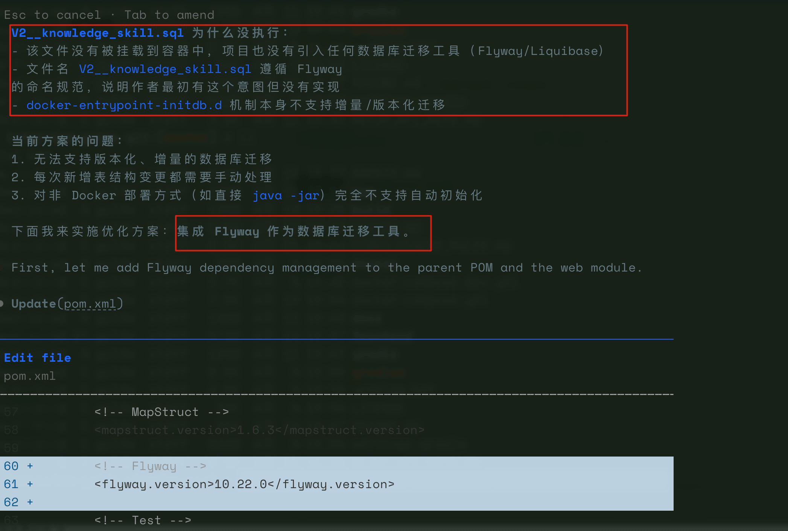

The suggested fix was to **integrate Flyway as the database migration tool**.

Flyway is a mature database migration tool in the Java ecosystem. It uses filename conventions such as `V1__init.sql` and `V2__knowledge_skill.sql` to manage migration order automatically.

DeepSeek V4-Pro did the following:

1. Analyzed how `init.sql` was mounted in the Docker Compose configuration.
2. Found why `V2__knowledge_skill.sql` was missing.
3. Added the Flyway dependency and wrote its configuration.
4. Renamed the SQL files to ensure the correct migration order.

> I hit a snag here: I accidentally changed the iTerm2 window size, and the conversation history in the terminal became garbled.

Flyway did not run on the first attempt. I shared the error logs with the model, and it fixed the problem after two rounds of debugging.

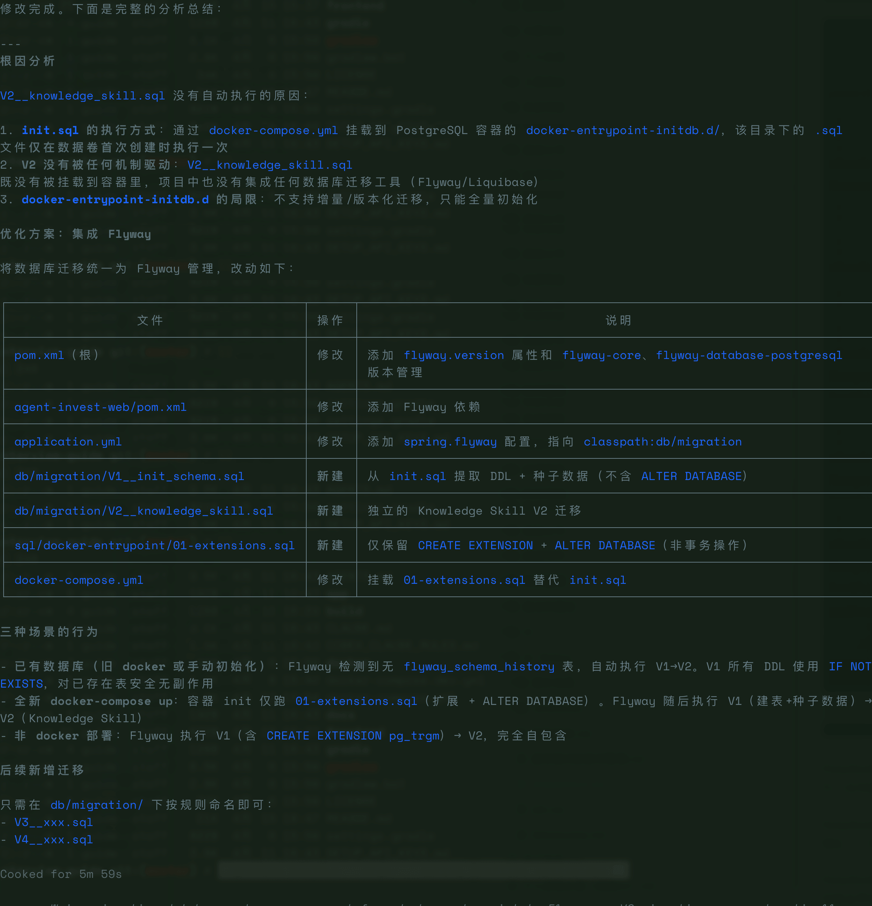

This problem deserves a closer look: DeepSeek V4-Pro also missed it during the initial integration and needed two rounds of debugging to find the root cause.

**Spring Boot 4.x split up its auto-configuration modules.** `FlywayAutoConfiguration` was removed from `spring-boot-autoconfigure` and moved to the separate `spring-boot-flyway` module.

If you include only the third-party `flyway-core` library, Spring Boot **will not automatically run migrations**. The most confusing part is that **the startup log will contain no Flyway output**. There is no error; nothing happens. This can be misleading and may make you suspect the configuration is wrong, so you keep changing the `yml` file.

Use the official starter so the auto-configuration module is included:

```xml
<dependency>
    <groupId>org.springframework.boot</groupId>
    <artifactId>spring-boot-starter-flyway</artifactId>
</dependency>
<!-- PostgreSQL dialect support still requires a separate dependency. -->
<dependency>
    <groupId>org.flywaydb</groupId>
    <artifactId>flyway-database-postgresql</artifactId>
</dependency>
```

The specific lesson from this case is that Spring Boot 4.x projects should use the corresponding official Flyway starter; do not assume migrations will run just because `flyway-core` is present. Check the Spring Boot documentation for each third-party library separately rather than generalizing this behavior.

## Task 3: Connect an AI Interview Platform to DeepSeek

Our AI interview assistant platform already supports switching and configuring multiple models, including DeepSeek.

As in Task 1, connecting the latest model worked on the first attempt, so I will skip the process and show the result.

In the configuration UI, I switched the default model to DeepSeek and selected **deepseek-v4-flash**.

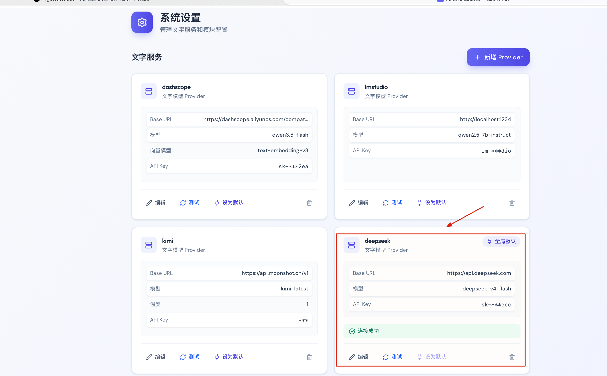

Then I uploaded a resume and generated a mock interview based on it.

The questions were generated with deepseek-v4-flash, and DeepSeek produced the answers in fast, non-thinking mode. It left two questions unanswered.

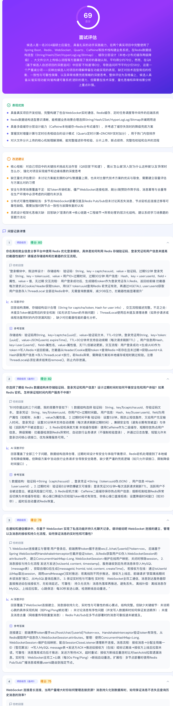

In this resume-based interview task, Flash's non-thinking mode handled the main questions but left two unanswered. It may suit batch generation when cost matters and a person can review the results.

## Task 4: Audit Project Code and Coordinate Multiple Models

The MVP of my multi-agent stock analysis project was running, with stock analysis, multiple strategies, alerts, Skills, multiple models, notifications, and other features. During development, I prioritized speed and did not review the code quality carefully.

This time, I tried a division of work: **use a cheaper model for the audit and a more capable model to make decisions and fix the issues**.

In Claude Code, I asked DeepSeek V4-Pro to start several agents and scan the whole project for security, functional correctness, code quality, and other concerns. I asked it to summarize the findings in a document.

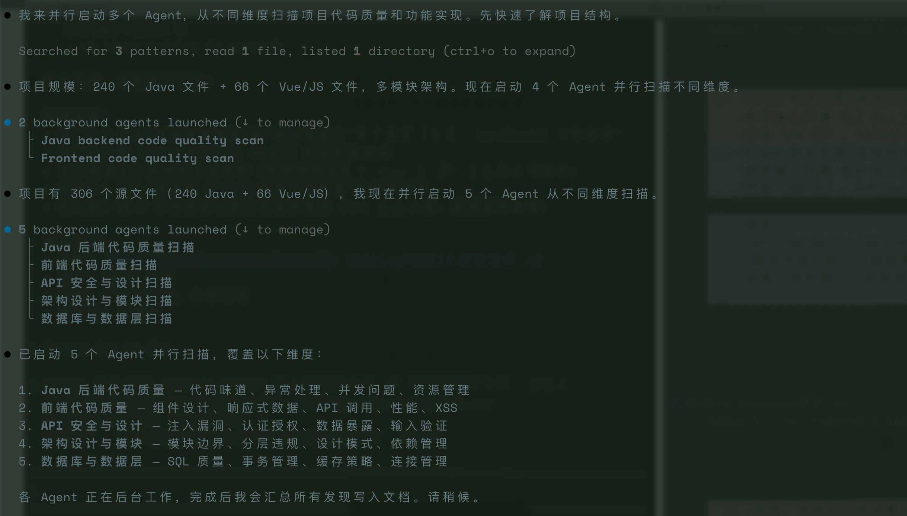

V4-Pro found a number of issues. The five most urgent were:

1. **API keys stored in plaintext:** An encryption utility existed but was not used.
2. **No access control on system administration APIs:** Regular users could modify LLM configuration.
3. **Redis deserialization vulnerability:** `activateDefaultTyping` allowed arbitrary class instantiation.
4. **Hard-coded third-party API key:** A real Bocha key had been committed to the code.
5. **Functional bug:** The History page's “Reanalyze” button failed because it did not read the route parameter.

I reviewed the findings at a high level, and they seemed reasonable. The security issues deserve special attention. If the Redis deserialization vulnerability were exploited, the consequences could be severe.

Next, I asked **GPT-5.5**, the model available in my account at that time, to review the issues V4-Pro had found.

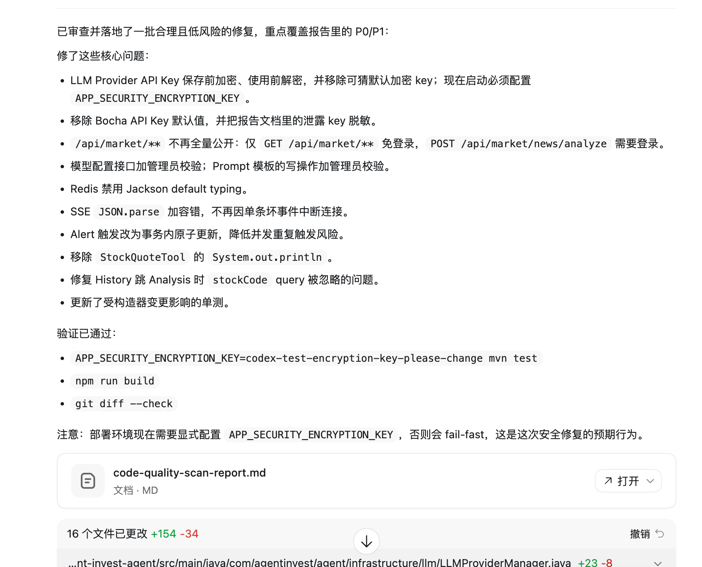

**Why not ask V4-Pro to fix its own findings?** Code auditing and code fixing are different capabilities. Cross-checking with another model seemed more reliable: one model finds problems, and another verifies and fixes them.

GPT-5.5 reviewed the findings and applied fixes. This records the model choices used in this case; it is not a current recommendation. Final verification still requires tests, code review, and key rotation. The second model's agreement alone does not close the verification loop.

This case used a division of labor: **a lower-cost model for initial screening, a more capable model for review, and tests and human review for final acceptance**. Actual savings depend on input length, cache hits, output volume, and the prices at the time. Without complete usage records, it would be misleading to claim savings of “at least two orders of magnitude.”

## Task 5: Scan and Analyze the Entire Project

This was a simple task. I mainly wanted to evaluate V4-Pro's analysis quality and see how many tokens it used.

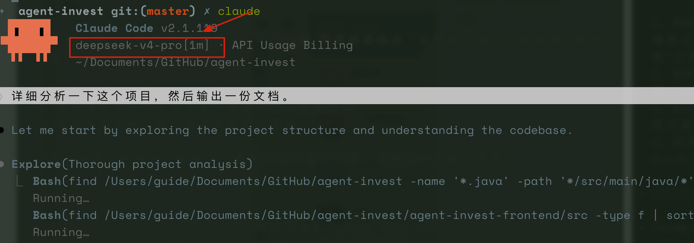

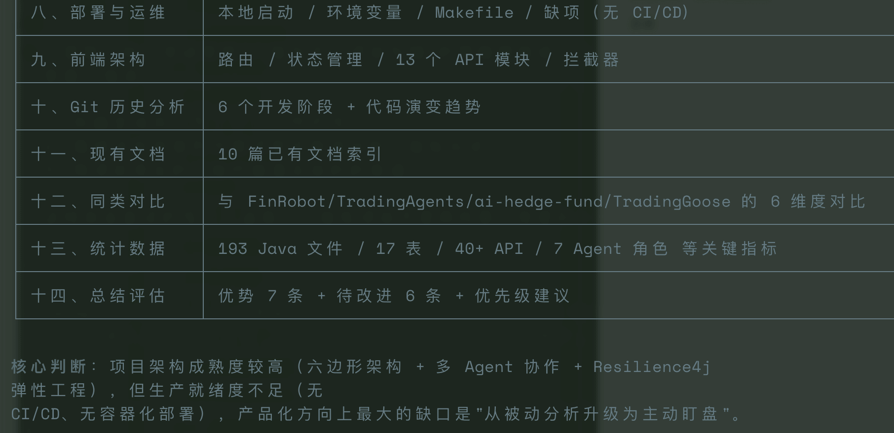

V4-Pro produced a document covering the project structure, major modules, and open issues:

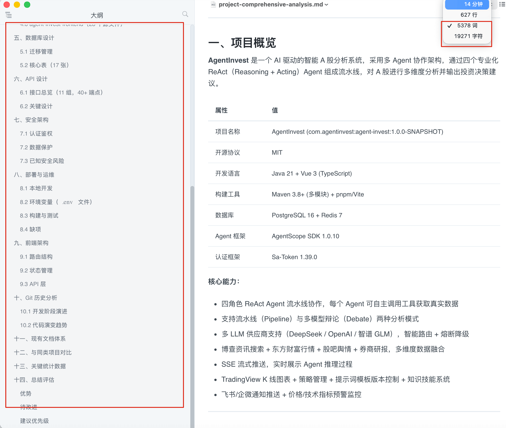

## DeepSeek V4 at a Glance: The Numbers

After the hands-on tasks, here are DeepSeek V4's specifications for additional context.

V4 Preview offers two models. The specifications and benchmarks below come from DeepSeek's official report. They are vendor-reported results, not independent evaluations from this article.

| Specification               | `deepseek-v4-pro`                     | `deepseek-v4-flash`                   |
| --------------------------- | ------------------------------------- | ------------------------------------- |
| Total parameters            | **1.6T**                              | **284B**                              |
| Active parameters per token | 49B                                   | 13B                                   |
| Context window              | **1M tokens**                         | **1M tokens**                         |
| Reasoning modes             | Non-thinking / Think High / Think Max | Non-thinking / Think High / Think Max |
| License                     | MIT                                   | MIT                                   |

The report lists these benchmark results:

- **V4-Pro scores 3,206 on Codeforces**, ranking first among the comparison models selected in the report.
- **80.6% on SWE-bench Verified**; the report's Claude Opus 4.6 comparison score is 80.8%. These scores do not establish equivalent performance or cost in a particular codebase.
- **For a 1M-token context**, V4-Pro uses 27% of V3.2's inference FLOPs per token and 10% of its KV cache.

The competitor names and scores are a historical snapshot from the V4 Preview report, not a current model ranking.

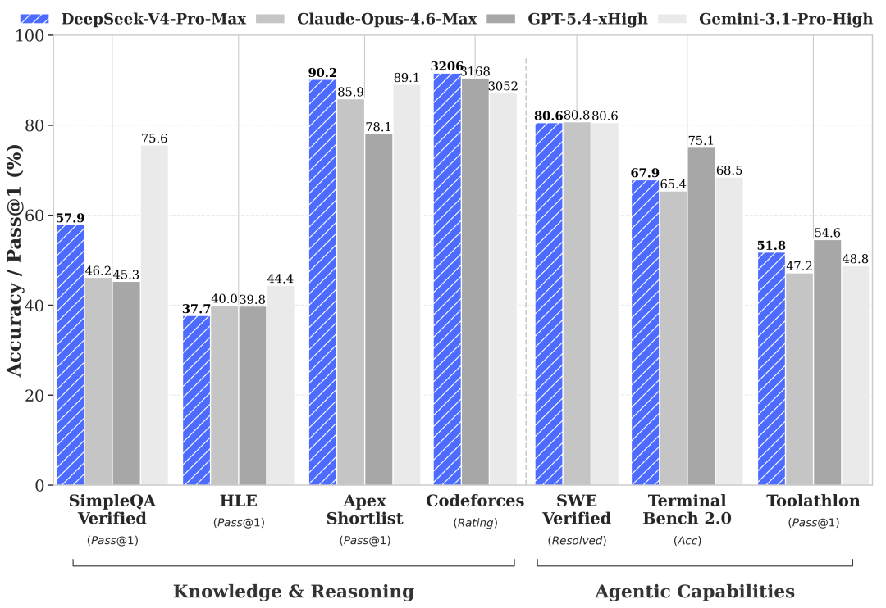

Now for the pricing:

| API pricing per million tokens (as of 2026-08-24) | `deepseek-v4-flash` | `deepseek-v4-pro` |
| ------------------------------------------------- | ------------------- | ----------------- |
| Input, cache miss: off-peak / peak                | $0.22 / $0.44       | $0.66 / $1.32     |
| Input, cache hit: off-peak / peak                 | $0.007 / $0.014     | $0.022 / $0.044   |
| Output: off-peak / peak                           | $0.66 / $1.32       | $1.98 / $3.96     |

> Peak hours are Monday through Friday, 9:00–12:00 and 14:00–18:00 Beijing time. All other times, including weekends, are off-peak; prices are half the peak rate.

Actual billing depends on cache-hit rate, context length, and output size. Cross-provider cost comparisons also need consistent accounting for input, output, caching, and retries. Since this article does not include complete usage records, it does not claim a fixed cost ratio. Prices change, so check the [official DeepSeek pricing page](https://api-docs.deepseek.com/quick_start/pricing/) before use.

Based on this price table, Flash may suit tasks where cost matters and results are easy to verify. Its suitability for everyday conversation, content generation, or simple questions still depends on measured quality and latency.

Changing model IDs may require only a small code change, but you should still regression-test context length, tool calls, and error handling. Do not treat the change as “zero cost.” The official retirement time for the previous model ID was **2026-07-24 15:59 UTC (23:59 Beijing time)**. If that time has passed by the time you read this, check whether the old ID is still available in the model list.

## Use-Case Recommendations

| Scenario                                            | Recommendation                                                    | What to verify                                                               |
| --------------------------------------------------- | ----------------------------------------------------------------- | ---------------------------------------------------------------------------- |
| Everyday chat, content generation, simple questions | Try `deepseek-v4-flash` first                                     | Quality, latency, and cache-hit rate                                         |
| Agent coding, refactoring, whole-project analysis   | Try `deepseek-v4-pro` first                                       | Tool calls, cross-file changes, test pass rate, and actual cost              |
| High-risk coding and independent review             | Compare current model families such as Claude Fable 5 and GPT-5.6 | Account availability, task success rate, security boundaries, and total cost |

The final row reflects the model families available as of July 24, 2026. Check your account and official documentation for current model IDs and availability.

## Summary

Across these tasks, V4-Pro handled model configuration updates, migration diagnosis, and an initial code audit. The official report's 80.6% SWE-bench Verified score and 3,206 Codeforces rating are useful context, but they do not replace evaluations on your team's codebase.

Whether V4-Pro is cost-effective depends on cache-hit rate and task length. V4-Flash is cheaper, but in the interview task it left some questions unanswered, so it should not be used as a development model without review.

For complex coding, questions, and advanced scientific reasoning, compare models on the actual task. My approach would be to try Flash for low-risk batch work, use a stronger model for cross-file changes and critical fixes, and keep tests and human review in the loop.

<!-- @include: @article-footer.snippet.md -->
