Hi, I'm Xiao G. I previously shared [a hands-on guide to using the Qoder plugin in IDEA](./idea-qoder-plugin.md), focused on AI-assisted coding in the JetBrains ecosystem. This article takes a different angle and looks at **connecting Trae IDE to an LLM**.

Trae is an AI coding IDE from ByteDance, based on the VS Code ecosystem and supporting multiple LLMs. This article uses MiniMax M2.7 as an example, but the integration process is similar for other models such as Claude and GPT.

I used MiniMax because I had a MiniMax Code Plan subscription and wanted to test it. This is not an endorsement; you can use another model in the same way.

I chose two representative, complex scenarios:

- **Scenario 1:** An endpoint suddenly starts timing out. The logs point to Redis, which is used across the project, making the root cause hard to locate.
- **Scenario 2:** Port Redis slow-log commands from the C source code to Go, testing cross-language refactoring and codebase understanding.

## Quick Start: Connect Trae to an LLM

Trae supports multiple LLMs. The following steps show a general setup using a custom model.

**Step 1:** Download Trae from its official website and complete the initial setup. Register with the model provider and create an API key; this example uses MiniMax:

<https://platform.minimaxi.com/subscribe/token-plan>

**Step 2:** In Trae, click **Add Model** to add a custom model:

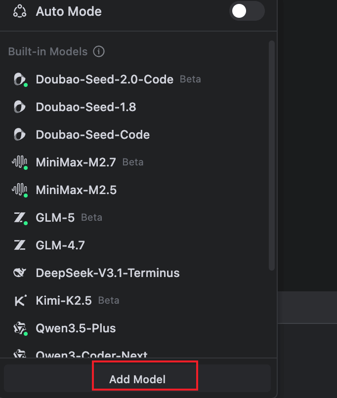

**Step 3:** Select **Other Models**, then enter the model ID and API key:

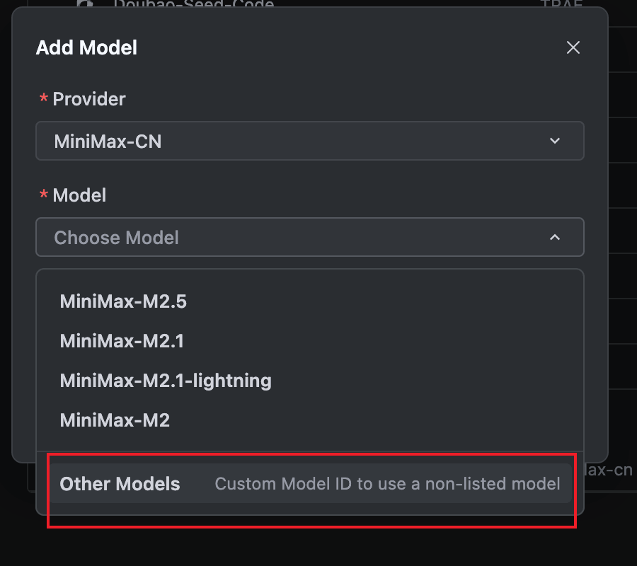

**Step 4:** Enter the model ID (such as `MiniMax-M2.7`) and API key, then click **Add Model**. If no error appears, the connection is ready:

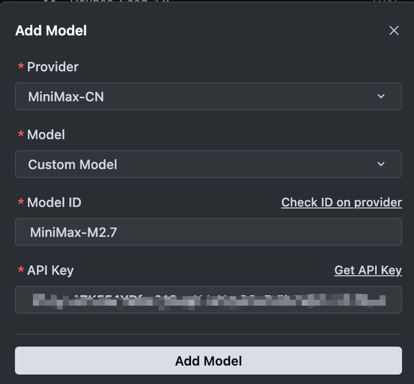

After setup, you can use the model for AI-assisted coding in Trae. The two scenarios below demonstrate the workflow and techniques.

## Scenario 1: Mitigate Endpoint Timeouts and Find the Root Cause

### Locate the Problem

The first case reproduces a real production incident with identifying details removed. A teammate reported that a list-query endpoint was failing and the page showed no data. Production monitoring identified this endpoint:

Endpoint: `GET http://localhost:8080/api/rbac/user/list`

Response:

```
{
    "code": 500,
    "message": "The service is busy. Please try again later.",
    "data": null,
    "timestamp": "2026-03-19T10:11:02.632242"
}
```

Given the `Read timed out` exception and the `get(key)` call in the relevant code, the 500 error appears to be a symptom rather than the root cause.

```java
@Override
public String getConfigValue(String configKey, String environment) {
    String cacheKey = CONFIG_CACHE_PREFIX + configKey + ":" + environment;
    String value = stringRedisTemplate.opsForValue().get(cacheKey);
    if (value != null) {
        return value;
    }
    // Remaining logic omitted
}
```

Normally, we would quickly identify the root cause, mitigate the incident, and then ask operations to investigate further. But Redis is used in many parts of this project, and checking each one takes time and may affect service stability.

To evaluate AI-assisted diagnosis, I recreated the incident with identifying details removed and asked the model to investigate. Following a standard production-incident process, the first steps were to find the root cause and mitigate the issue. I gave the model this request:

```
Investigate the 500 error from http://localhost:8080/api/rbac/user/list (message: "The service is busy. Please try again later."):
1. Analyze the provided stack trace and identify the root cause of the internal server error.
2. Provide an emergency production-mitigation plan, including options such as a temporary rollback, traffic limits, service degradation, or a restart procedure.
3. Explain the technical cause and identify the relevant code module or configuration.

... Key stack-trace detail: `java.net.SocketTimeoutException: Read timed out`
```

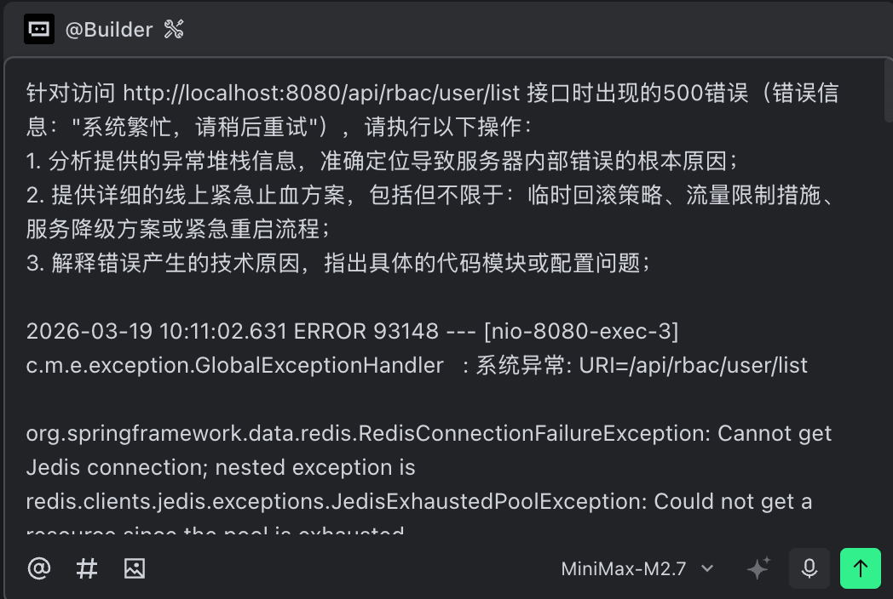

The model quickly found the relevant code context and identified four possible root causes:

- Redis is down or unresponsive.
- The connection pool is too small and is exhausted under high concurrency.
- Redis connections are leaking because they are not closed properly.
- The Redis server is overloaded.

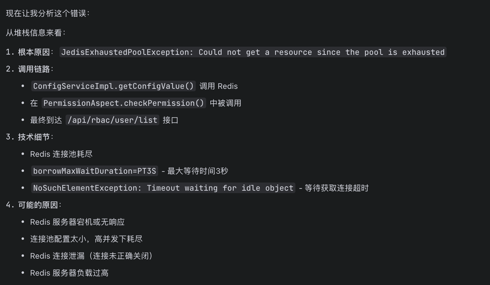

At this point, the model had narrowed the search from “many Redis calls” to “four possible root causes.” This ability to **narrow the investigation quickly** is a key benefit of AI-assisted troubleshooting. Next, consider its mitigation proposal.

### Mitigate the Incident

The model traced the code path from the stack frame and concluded that an aspect intercepted the list-query endpoint and that connection-pool exhaustion caused the 500 error. It also noted that the code lacked a fallback strategy, which I had not recognized until the incident review.

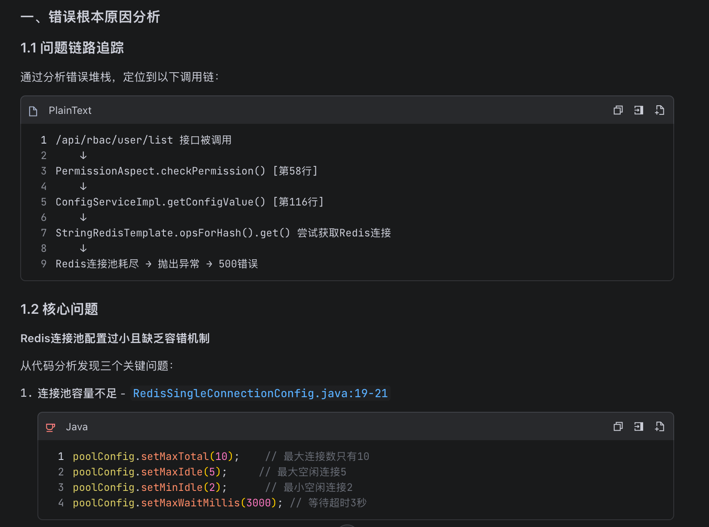

Mitigation is critical during a production incident. The model proposed several options; the first was to temporarily disable the permission-check flag because that option required clearing Redis cache data. Although aggressive, the proposal included detailed call-chain and schema information, which helped me reason about the likely scenario and cause from the business context.

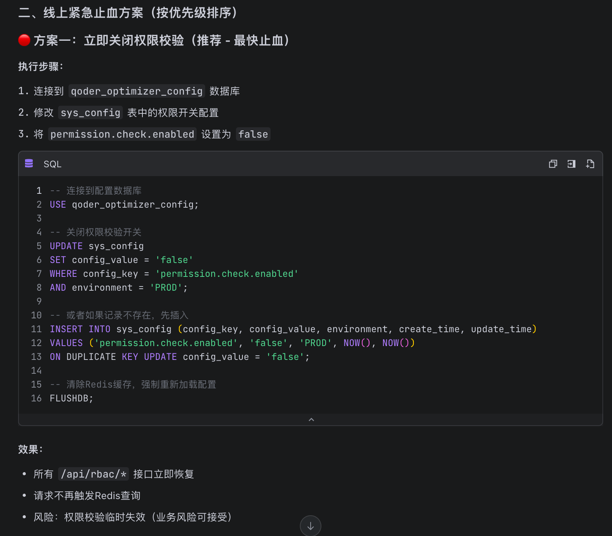

Based on the call-chain details, I asked the model to explain the technical basis for the first option so I could quickly check my understanding:

```bash
Explain the technical basis, design, and rationale for Option 1 in the context of the full code workflow.
```

The model also generated a call-chain diagram for the affected code. It showed the aspects involved in the list query and where the failure occurred, helping me understand the impact and immediate cause.

In less than 10 minutes, I got a high-level view of the architecture, the incident, and the reasoning behind the proposed options. Option 1, for example, would change database configuration and restart the service to refresh the cache and bypass the permission check.

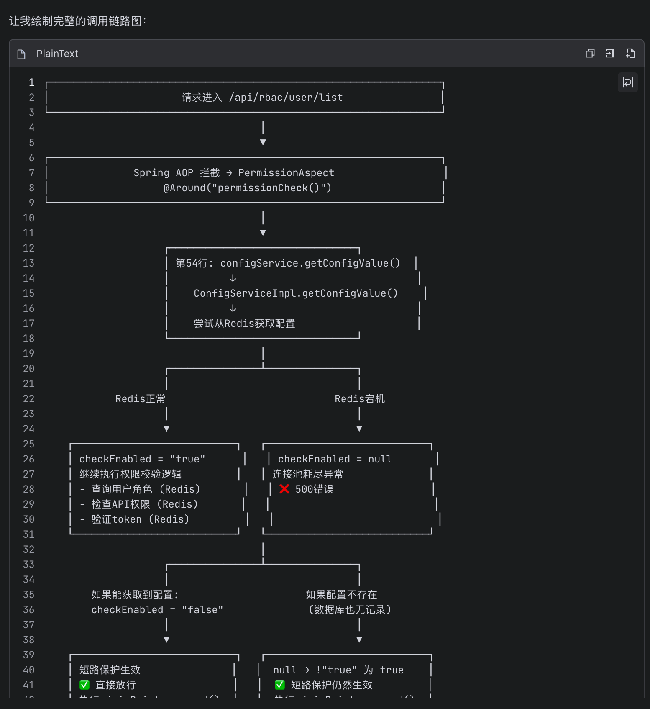

Option 3 used a different approach: when Redis is unavailable, use a local cache or default value to prevent cascading failures. The model suggested changes based on the existing code:

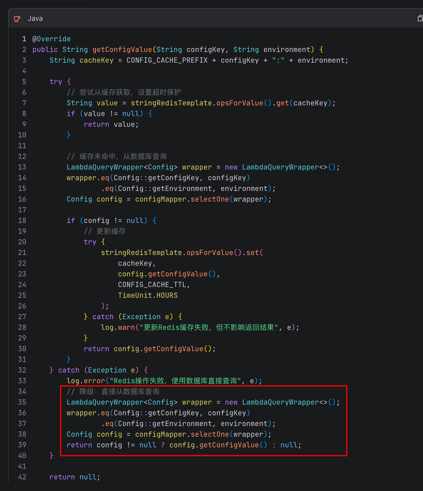

The initial diagnosis was that the Redis client connection pool was exhausted, breaking a cache-backed permission check in a business endpoint and triggering a cascading failure. Combining the model's suggestions, we chose a conservative hotfix intended to mitigate the issue quickly without overloading the database during peak traffic:

```bash
Based on the proposal, create a hotfix branch to address Redis errors. Follow these steps:
1. Create a branch from the current production code named `hotfix/redis-exception-handler`.
2. Implement the Redis exception handling from Option 3 and add try-catch blocks around Redis operations.
3. On a Redis exception, fall back to querying the database.
4. Add a JVM-local cache for query results with an appropriate expiration time.
5. Add unit and integration tests with at least 80% coverage.
6. Prepare a rollback plan so the previous version can be restored quickly in an emergency.

```

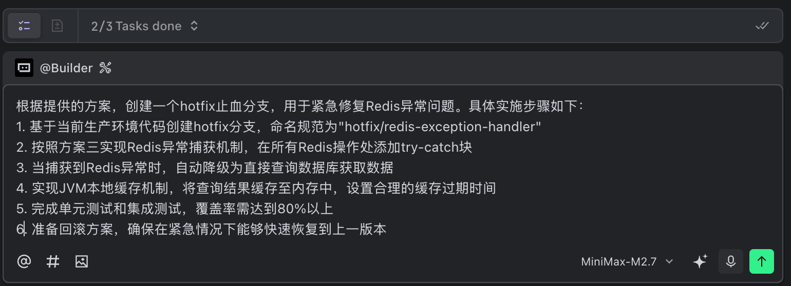

The model understood the request, broke the work into tasks, and implemented them one by one:

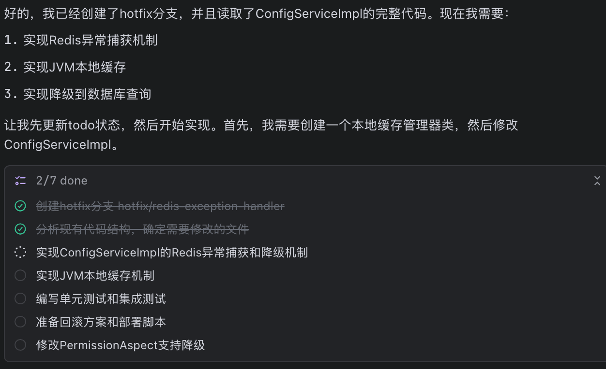

The resulting code added a database fallback to the existing permission-check logic. The model handled the existing logic and its interactions reasonably well:

```java
@Around("permissionCheck()")
public Object checkPermission(ProceedingJoinPoint joinPoint) throws Throwable {
    try {
        // Read the permission-check flag from the configuration service.
        String checkEnabled = configService.getConfigValue("permission.check.enabled", "PROD");
        if (!"true".equalsIgnoreCase(checkEnabled)) {
            return joinPoint.proceed();
        }

        // ... Existing permission-check logic ...

        // Try to get permission information from the Redis cache.
        Boolean hasPermission = checkPermissionFromCache(redisKey);

        if (hasPermission != null) {
            // ... Handle a cache hit ...
        }

        // Fallback: query permissions from the database.
        boolean hasPermissionFromDB = checkPermissionFromDatabase(userId, apiPath, httpMethod);
        // ... Handle the fallback ...

    } catch (Exception e) {
        if (e instanceof RuntimeException && "Access denied".equals(e.getMessage())) {
            throw e;
        }
        // On error, alert monitoring and fail open.
        AlertManager.notify("PERMISSION_CHECK_ERROR", e.getMessage());
        return joinPoint.proceed();
    }
}
```

> **Security issue:** This sample fails open. If the permission check throws an exception, `joinPoint.proceed()` allows the request to continue without authorization. Do not use this catch-all behavior in production; fail closed or use a narrowly defined, reviewed fallback that preserves the permission check.

The model also added local caching to `getConfigValue`. The multi-level cache is a useful resilience pattern.

```java
/**
 * Get a configuration value for the specified environment.
 */
@Override
public String getConfigValue(String configKey, String environment) {
    String cacheKey = CONFIG_CACHE_PREFIX + configKey + ":" + environment;

    // Step 1: Try the local cache.
    String localValue = localCacheManager.get(cacheKey);
    if (localValue != null) {
        return localValue;
    }

    // Step 2: Try Redis.
    try {
        if (isRedisAvailable()) {
            String value = stringRedisTemplate.opsForValue().get(cacheKey);
            if (value != null) {
                localCacheManager.put(cacheKey, value, LOCAL_CACHE_TTL);
                return value;
            }
        }
    } catch (Exception e) {
        // On a Redis exception, fall back to the database.
        handleRedisFailure(e);
    }

    // Step 3: Fall back to the database.
    // ... Remaining logic ...
    return getConfigValueFromDatabaseWithFallback(configKey, environment);
}
```

One detail worth noting is the local cache design. The model followed the open-closed principle and wrapped a `ConcurrentHashMap` in a local-cache utility. It also considered heap exhaustion and added LRU-based cache eviction:

```java
@Component
public class LocalCacheManager {
    // ConcurrentHashMap provides thread-safe storage.
    private final Map<String, CacheEntry> cache = new ConcurrentHashMap<>();
    private final ScheduledExecutorService cleanupExecutor;

    // Cache configuration.
    private static final long DEFAULT_TTL_MILLIS = 300000; // 5 minutes
    private static final long MAX_CACHE_SIZE = 10000;

    public LocalCacheManager() {
        // Use a daemon thread for scheduled cleanup.
        this.cleanupExecutor = Executors.newSingleThreadScheduledExecutor(r -> {
            Thread t = new Thread(r, "local-cache-cleanup");
            t.setDaemon(true);
            return t;
        });
        this.cleanupExecutor.scheduleAtFixedRate(this::cleanupExpiredEntries, 1, 1, TimeUnit.MINUTES);
    }

    public void put(String key, String value) {
        put(key, value, DEFAULT_TTL_MILLIS);
    }

    public void put(String key, String value, long ttlMillis) {
        // Run LRU cleanup when the cache is full.
        if (cache.size() >= MAX_CACHE_SIZE) {
            cleanupExpiredEntries();
            if (cache.size() >= MAX_CACHE_SIZE) {
                evictOldestHalf();
            }
        }
        cache.put(key, new CacheEntry(value, System.currentTimeMillis() + ttlMillis));
    }

    public String get(String key) {
        CacheEntry entry = cache.get(key);
        if (entry == null || entry.isExpired()) {
            cache.remove(key);
            return null;
        }
        return entry.getValue();
    }

    // ... Other methods omitted ...

    // LRU cleanup: remove the oldest 50% of entries.
    private void evictOldestHalf() {
        // ... Sorting and cleanup logic omitted ...
    }

    // Cache entry.
    private static class CacheEntry {
        private final String value;
        private final long expirationTime;

        public CacheEntry(String value, long expirationTime) {
            this.value = value;
            this.expirationTime = expirationTime;
        }

        public String getValue() {
            return value;
        }

        public boolean isExpired() {
            return System.currentTimeMillis() > expirationTime;
        }
    }
}
```

### Find the Root Cause

After mitigating the production incident with a hotfix branch, we investigated why the Redis connection pool was exhausted. Based on the model's analysis, a normal `GET` command should take about 1–2 ms, and Redis can handle roughly 100,000 QPS. With 10 connections, the theoretical throughput is about 6,600 commands per second, well below Redis's limit. The issue was therefore likely in the application code, so we investigated whether the project used Redis inefficiently:

```bash
Analyze the project systematically using the symptoms and characteristics of this incident. Cover the architecture, implementation, dependency management, environment configuration, and data interactions. Focus on identifying and reporting the direct cause of the production failure.
```

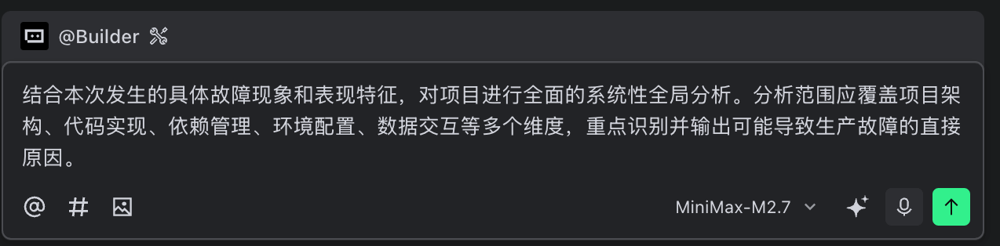

The model then inspected the project structure and context in detail:

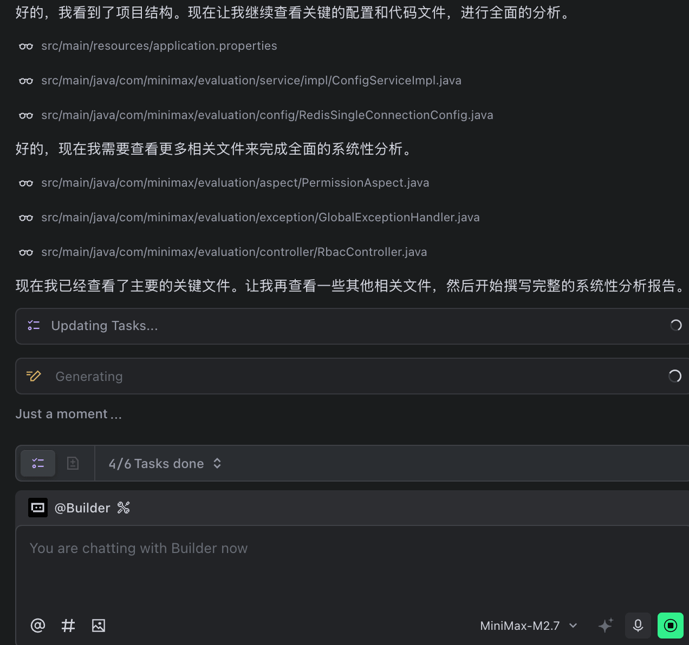

The model's incident report identified the root cause: an unsuitable Redis data structure led to a `SCAN` operation that exhausted the connection pool. It also explained the business workflow around the operation, helping us understand the failure path:

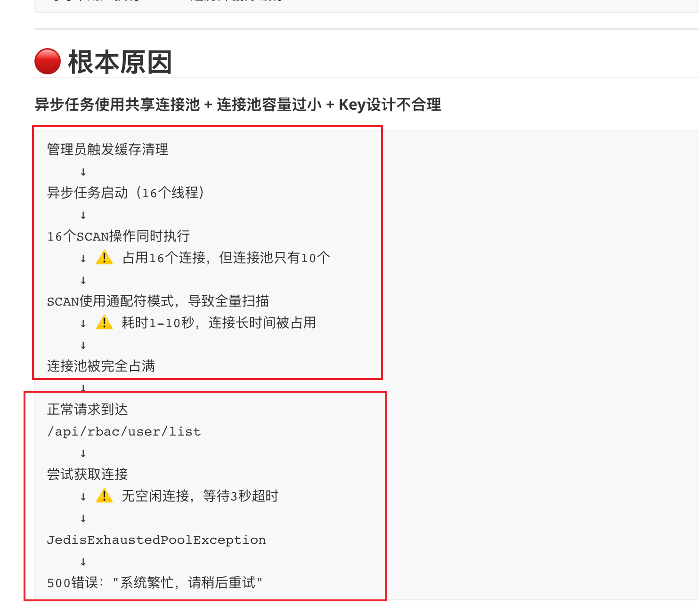

The proposed fix was straightforward: optimize the data structure to reduce the time complexity of Redis reads and writes and prevent connection-pool exhaustion:

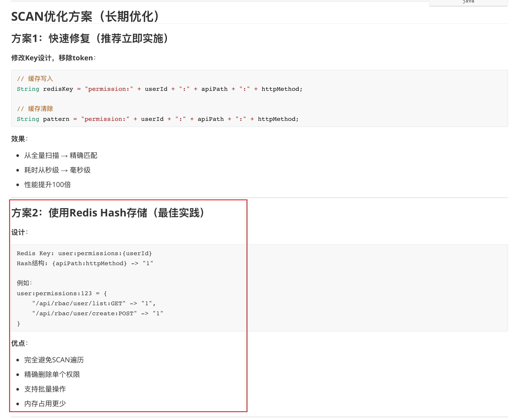

Overall, Scenario 1 went well. The model narrowed down many Redis call sites, identified the root cause, and proposed a mitigation plan through a clear line of reasoning.

There were also issues. Option 1, clearing the Redis cache, was somewhat aggressive; production may require a more conservative approach. Some defensive handling for edge cases also needed to be added manually. AI can take you most of the way, but the remaining work still requires your judgment.

## Scenario 2: Port Redis Slow Log from C to Go

### Background

Next is a more challenging task: porting Redis slow-log commands. `mini-redis` is a RESP-compatible cache middleware written in Go. It uses a goroutine-per-connection model to improve throughput and follows a procedural style inspired by the C implementation. The differences between the languages require careful analysis and adaptation, making this a useful test of cross-language design with an LLM.

### Requirements and Design

For a project rewrite, the traditional process takes significant time: read the source code to understand its logic, infer behavior from context because legacy code may lack comments, and debug as needed. After understanding the original implementation, plan how it fits the new architecture and write unit tests to preserve existing behavior. Development, testing, and release could take at least three workdays. I asked AI to help analyze the source and prepare the technical documentation.

```bash
I want to port Redis slow-log commands to Go. Read the Redis source code and explain the feature's implementation, data structures, workflow, and key steps. Cover how slow logs are stored, how thresholds are configured, how commands are collected and recorded, the related APIs, and how slow-log entries are queried and displayed. Based on this analysis, prepare technical documentation covering the core design, key data structures, implementation steps, and possible performance optimizations.
```

The model identified the technical requirements and provided a detailed, bottom-up analysis, from data structures to the execution flow:

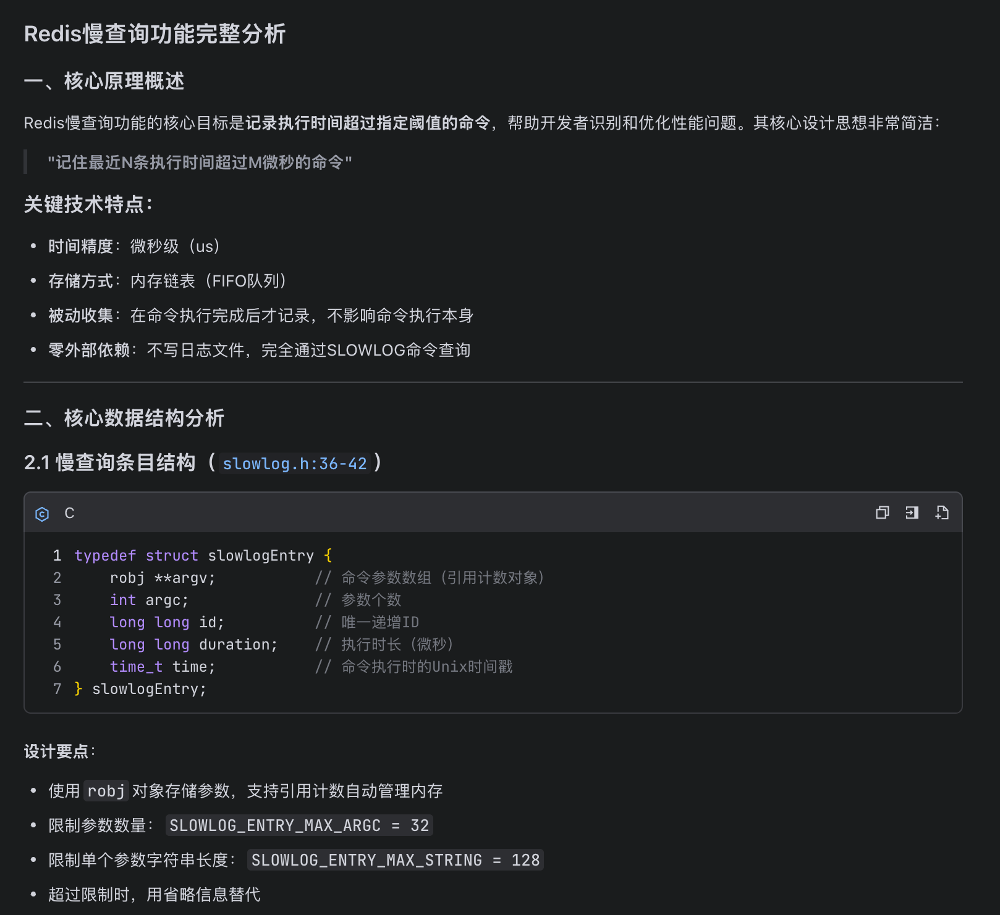

Its analysis of the slow-log instrumentation was accurate. It added comments to the main flow that helped me understand the overall process:

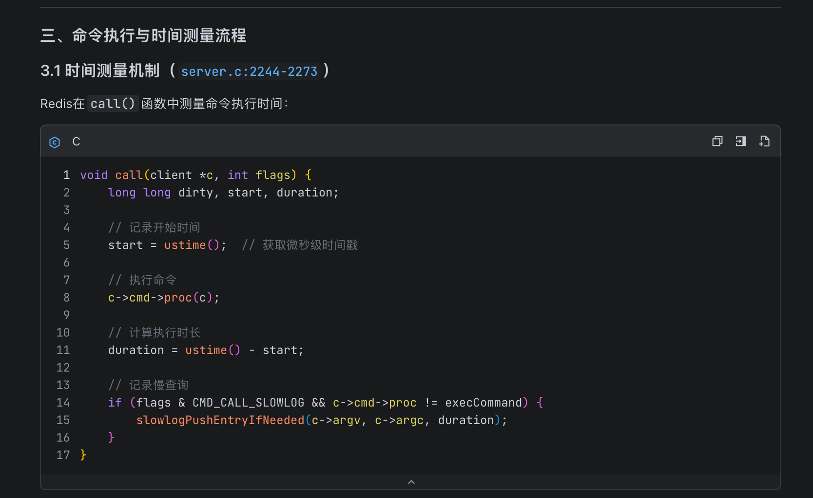

Its analysis of the `slot get` command was also solid. It focused on the core logic and added useful comments to the main flow:

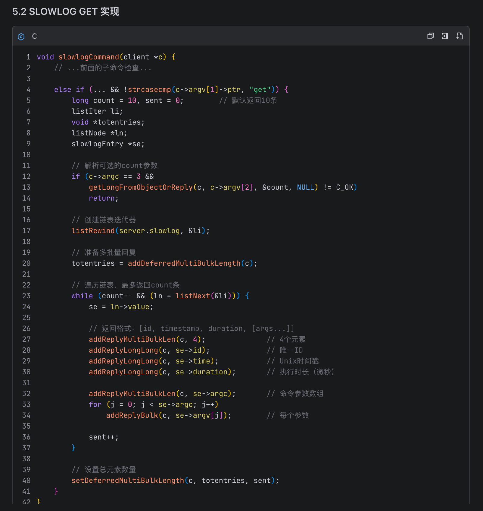

After confirming that the model understood slow-log behavior, I asked it to prepare a complete implementation plan from a developer's perspective, including feature breakdown, implementation, and regression testing:

```bash
Using test-driven development (TDD), write a detailed Go implementation tutorial for reproducing the Redis feature. Follow these requirements:

1. Development method:
   - Follow the TDD workflow: write a failing test, implement the simplest code that passes, then refactor.
   - Use a procedural style similar to the original Redis C implementation.
   - Prefer Go and its standard library.

2. Tutorial structure:
   - Start with project setup and environment configuration.
   - Organize implementation into modules by Redis feature.
   - For each module or feature, provide:
     a. Test cases with expected inputs and outputs.
     b. Step-by-step implementation with line-by-line explanations.
     c. Test commands and verification steps.
     d. Expected results and success criteria.

3. Technical requirements:
   - Include complete code snippets for all components.
   - Specify the exact file structure and naming conventions.
   - Document build and test commands in detail.
   - Explain how to debug common issues.
   - Refer to relevant patterns in the Redis C source when appropriate.

4. Implementation details:
   - Start with core data structures such as strings, lists, and hashes.
   - Progress to command handling and protocol implementation.
   - Include networking and client-server communication.
   - Cover persistence mechanisms (RDB/AOF).
   - Implement basic Redis commands with compatible behavior.

5. Testing requirements:
   - Provide complete tests for every component.
   - Explain test assertions and verification methods.
   - Include unit and integration tests.
   - Explain how to run tests and interpret results.
   - Show how to validate behavior against the Redis specification.

Make the tutorial comprehensive enough for a developer with intermediate Go skills to build a Redis-like system by following the instructions.
```

The model produced a design document that used the Redis source context to explain the core slow-log behavior and key concepts, then laid out the implementation steps:
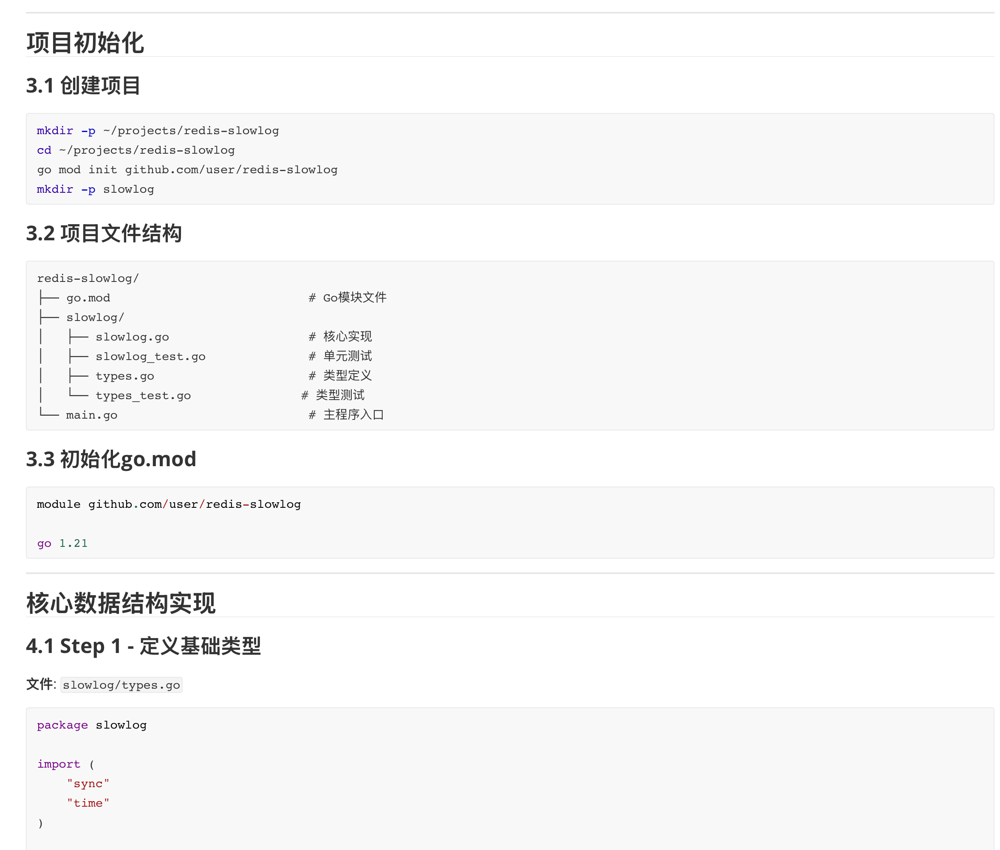

### Implementation

After extracting the design from the Redis source, I copied it into the `mini-redis` project so the model could assess its feasibility and suggest changes for the Go project's conventions:

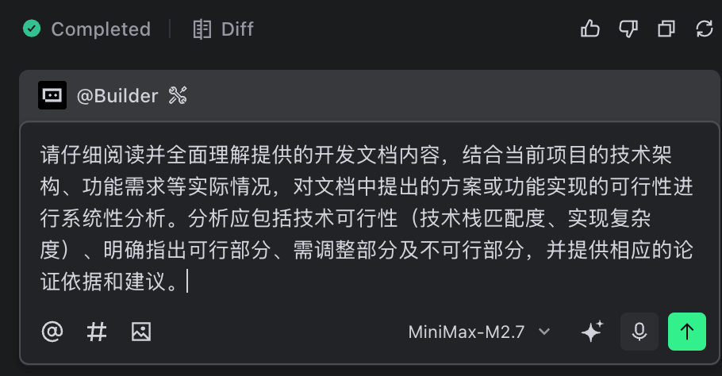

After completing the feasibility analysis and updating the document, the model reviewed the design further. It analyzed the `mini-redis` structure, found a linked-list type that could be reused for the slow log, and updated the document accordingly:

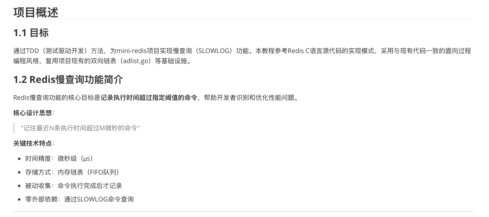

The model also proposed Go-style structs for the key data structures, following the `mini-redis` conventions:

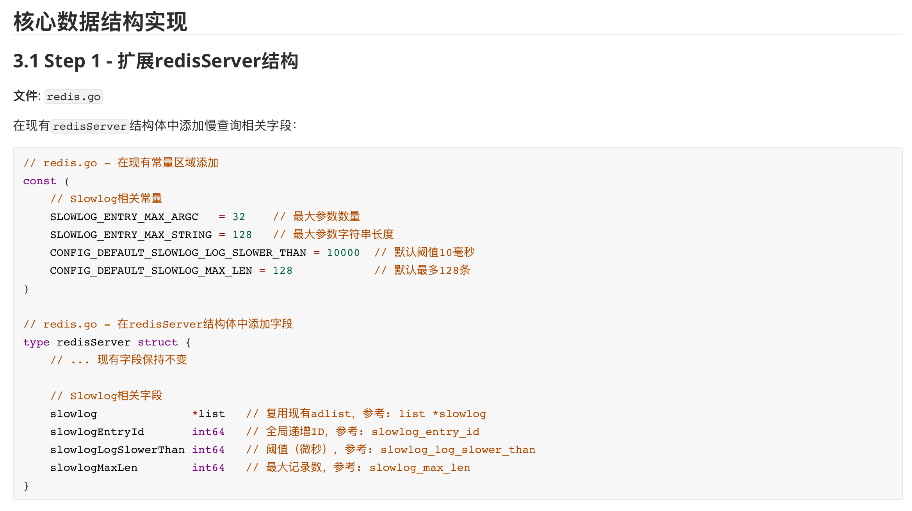

There is an implementation detail in slow-log timing. My command-dispatch entry point differs from Redis. Because of Go's language features, I made specific choices about pointers, function pointers, and file organization. The model correctly identified where to measure elapsed time in the goroutine model and added timing before and after command execution.

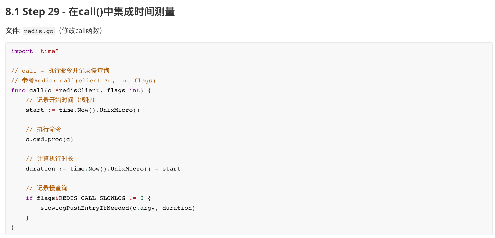

Finally, the model proposed an implementation for the slow-log commands, including argument parsing, command queries, and response handlers, adapted to the project's existing abstractions:

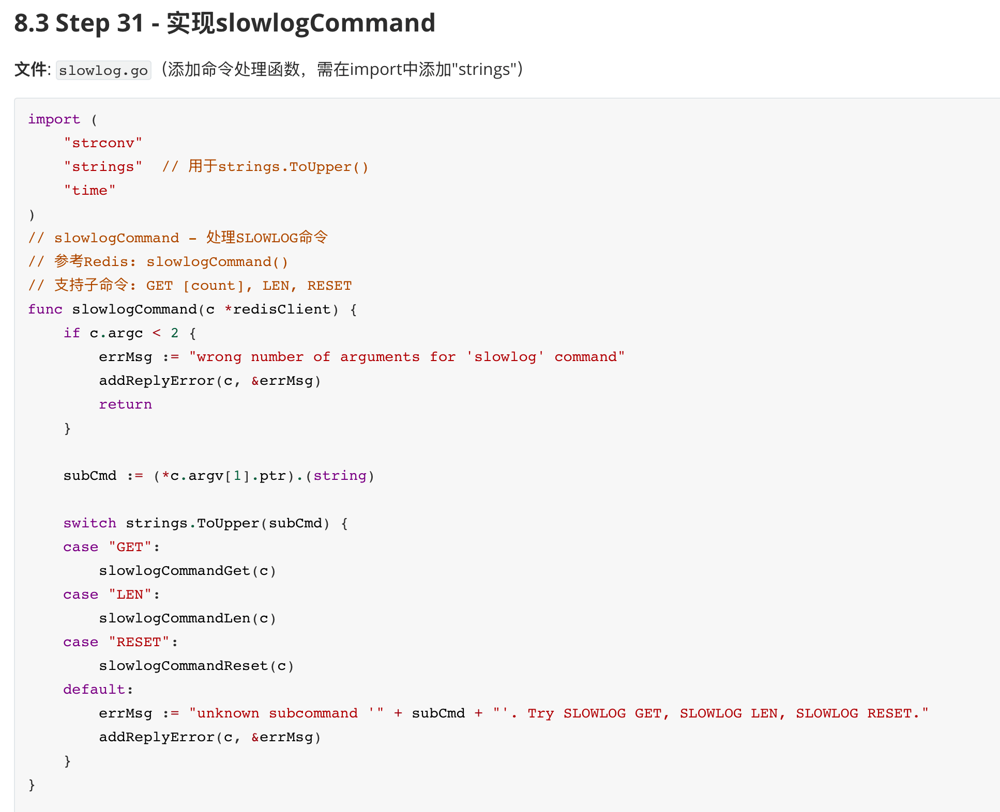

After carefully reviewing the design, I found the overall approach sound, but some code-organization details needed adjustment. For example, the model put `slowlog` commands in a separate file instead of following the project's convention of placing them in `command.go`. Since slow logging is not a core in-memory read/write command and its log management is relatively independent, this was a reasonable tradeoff. We kept the model's approach but adjusted some files to match the existing conventions before continuing implementation.

This shows that even when AI-generated architecture is reasonable, a person still needs to check how well it fits the project's conventions.

The model also produced code that did not match project conventions twice during the implementation, including error handling. These were minor issues, but they show why AI-generated code still needs review.

### Verification

Because I explicitly requested TDD, the model used test results and documentation to iteratively fix its implementation, eventually porting the slow-log commands in the style of `mini-redis`.

AI's reasoning and refactoring capabilities also freed up time during verification. The work required to understand the source and validate the design had kept us from implementing `redis.conf` loading.

I needed to set the slow-log threshold to zero for final verification, so I also asked the model to implement configuration loading:

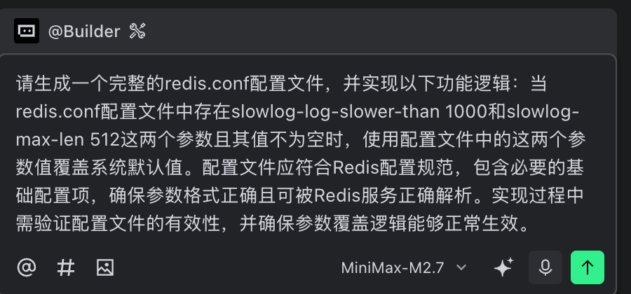

The analysis and implementation took less than an hour. I completed and verified the slow-log commands, then set the `mini-redis` slow-log threshold to zero for the demo:

```bash
# Slow-log threshold in microseconds.
# Commands that take longer than this are added to the slow log.
# A negative value disables the slow log; 0 records every command.
# Default: 10000 (10 milliseconds).
slowlog-log-slower-than 0
```

After starting the `mini-redis` server, `SLOWLOG GET` returns no entries:

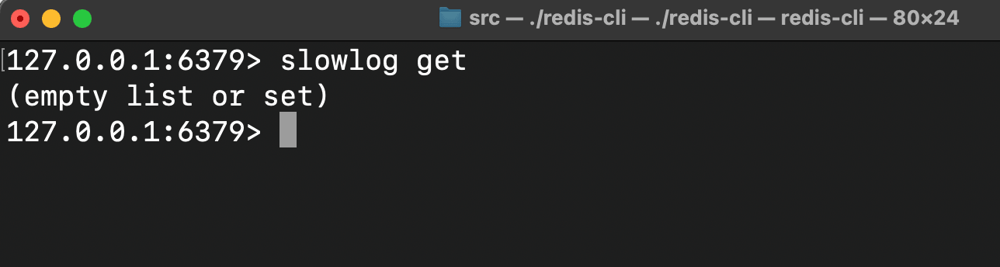

After running a simple `SET` command, `SLOWLOG GET` returns it as expected:

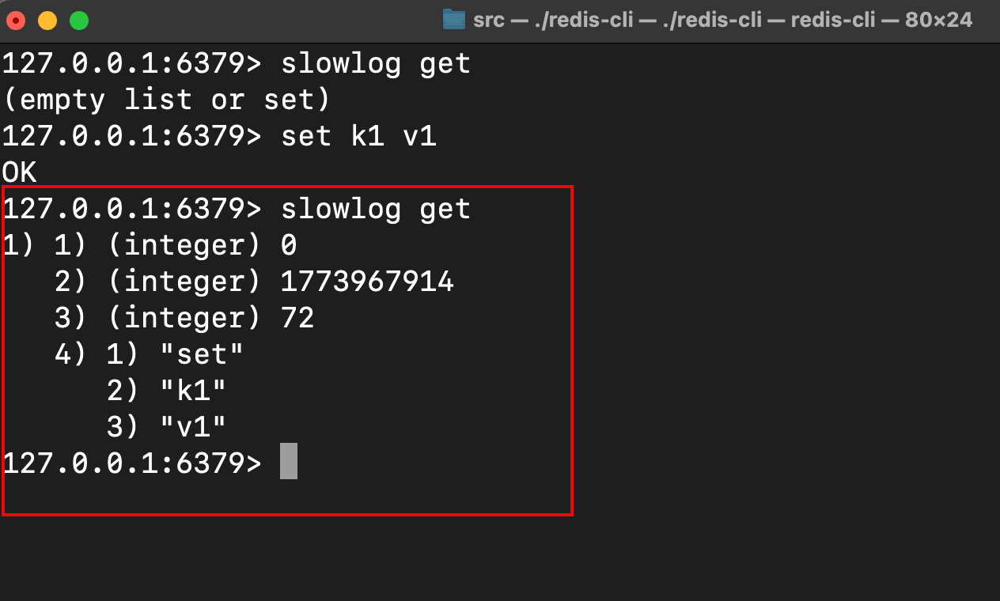

The following commands are recorded by inserting entries at the head of the linked list, so results are returned in descending time order:

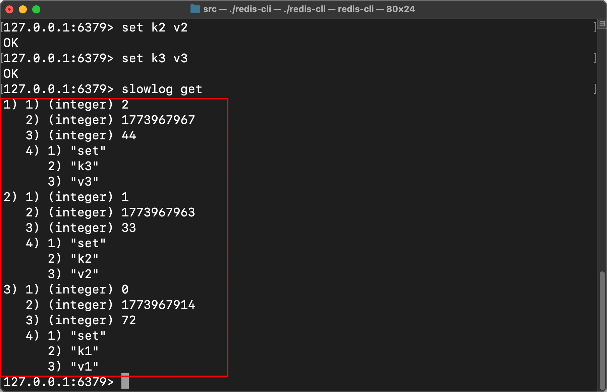

## Lessons: AI-assisted Coding Workflows

The two scenarios offer some lessons from using Trae and an LLM for coding.

### What AI-assisted Coding Can Do

The scenarios demonstrated several capabilities of AI-assisted coding:

| Capability                        | Example                                                                | Notes                                                                     |
| --------------------------------- | ---------------------------------------------------------------------- | ------------------------------------------------------------------------- |
| Incident diagnosis and mitigation | Scenario 1: Located a connection-pool problem and suggested a fallback | Traced the issue from the stack frame through the call chain              |
| Codebase context                  | Scenario 1: Used the database schema to analyze a query bottleneck     | Connected dependencies across modules rather than focusing on one file    |
| Cross-language porting            | Scenario 2: Ported Redis slow-log behavior from C to Go                | Preserved core behavior, with some project conventions needing adjustment |
| Understanding complex systems     | Scenario 2: Analyzed the Redis source code                             | Identified design intent and produced structured technical documentation  |

### Lessons and Pitfalls

**What worked well:**

- **Narrowed the search quickly:** In Scenario 1, the model reduced many Redis call sites to four possible causes, then identified the `SCAN` operation as the source of connection-pool exhaustion.
- **Proposed solutions at multiple levels:** It separated incident mitigation, root-cause analysis, and long-term optimization, matching a typical troubleshooting process.
- **Iterated with TDD:** In Scenario 2, the model used test results to fix its implementation, reducing manual work.

**What needs attention:**

- **Aggressive proposals:** Some suggestions, such as clearing the Redis cache, may be too risky for production and require human review.
- **Project conventions:** The generated structure may be reasonable but still need adjustment to match team conventions. For example, the `slowlog` command's file organization needed manual changes.
- **Edge-case handling:** Add defensive code for extreme cases as needed. AI can do much of the work, but the remaining details still need human judgment.
- **Consistency over long tasks:** Watch for context loss during extended work on a complex project.

### Tips for Using Trae with an LLM

1. **Provide context:** State constraints, coding conventions, and project structure to improve the output.
2. **Review in phases:** For complex architectures, do not ask AI to generate too much code at once. Review and adjust each phase.
3. **Keep critical decisions under human control:** Choose architecture details, such as caching and fallback strategies, based on the business context.
4. **Use TDD:** Specify a test-driven workflow so the model can use test results to refine its implementation.

## Final Thoughts

With an LLM connected, Trae provides a smooth AI coding workflow: context understanding, task breakdown, code generation, and test-based verification in Agent mode.

But a tool is still just a tool. Consider the two scenarios in this article:

- **Redis incident diagnosis in Scenario 1** required understanding Redis connection pools and the time complexity of `SCAN` to judge whether the model's analysis was sound.
- **Cross-language refactoring in Scenario 2** required understanding the Redis source design and Go engineering conventions to evaluate the proposed port.

AI coding tools can shorten the path from idea to implementation. Developers still need to build their own understanding of underlying principles and system architecture. Using AI well starts with understanding the work better than the AI does.
