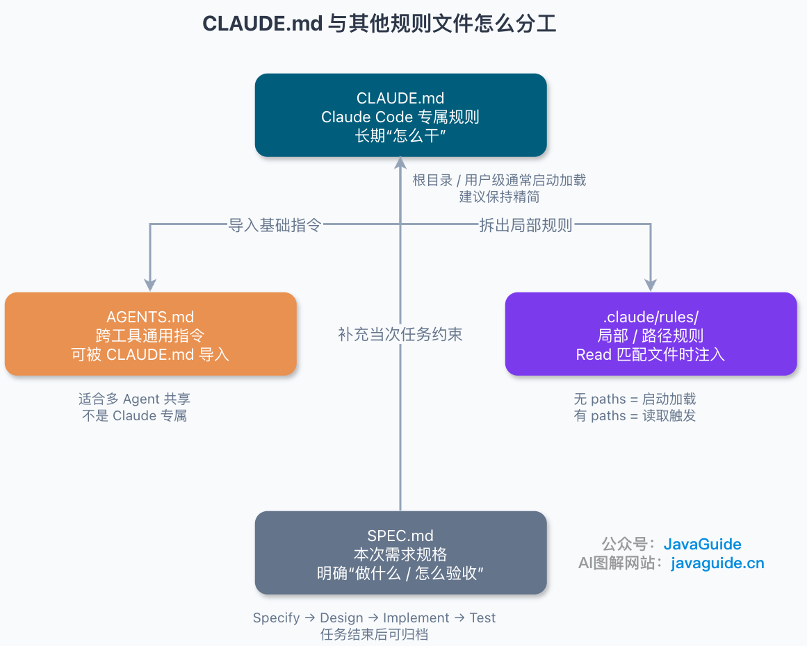
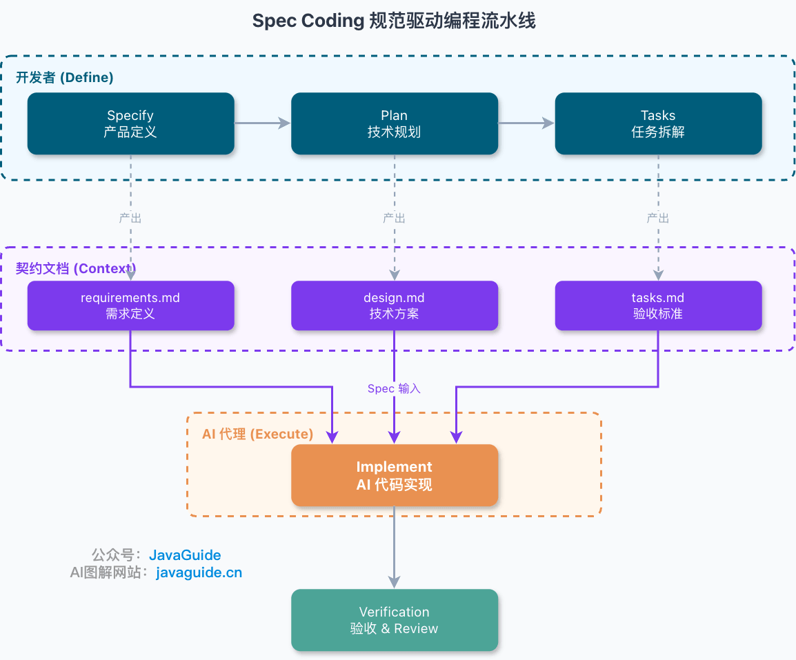
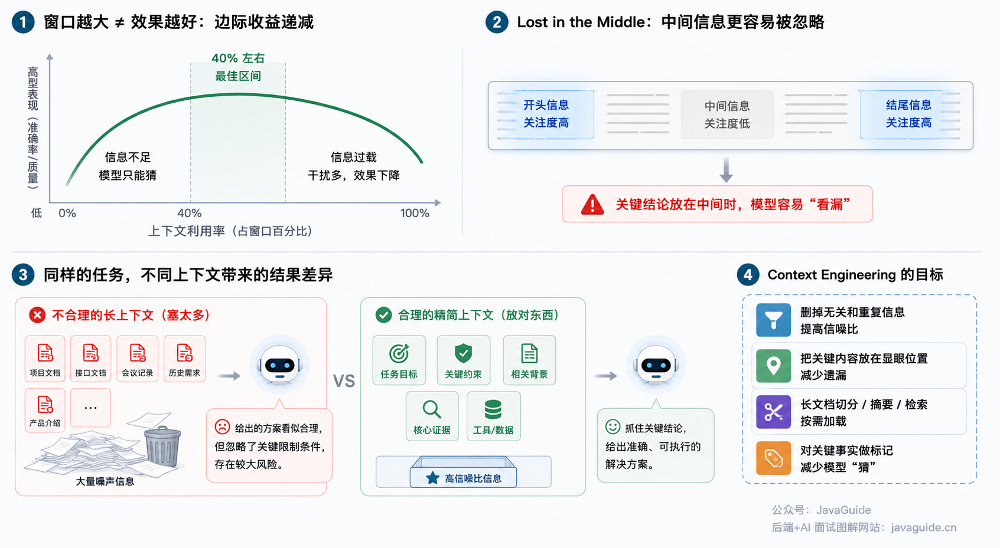
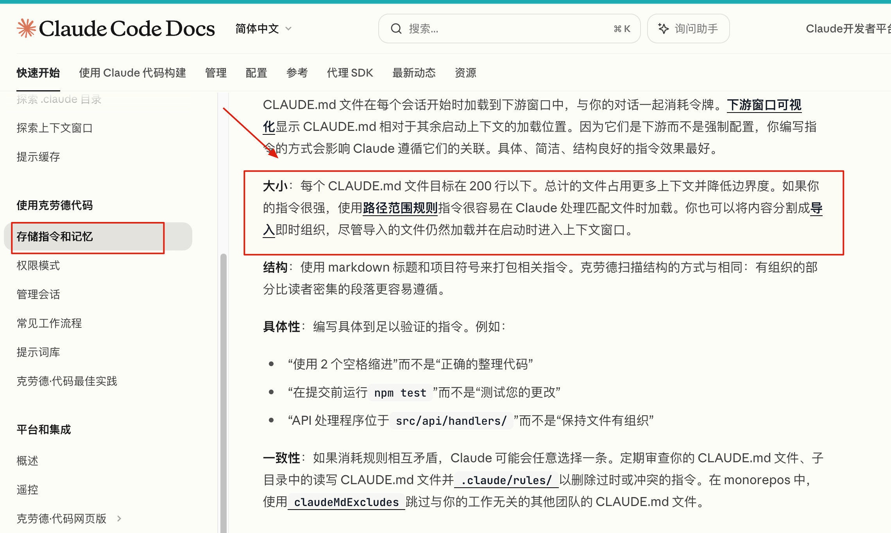
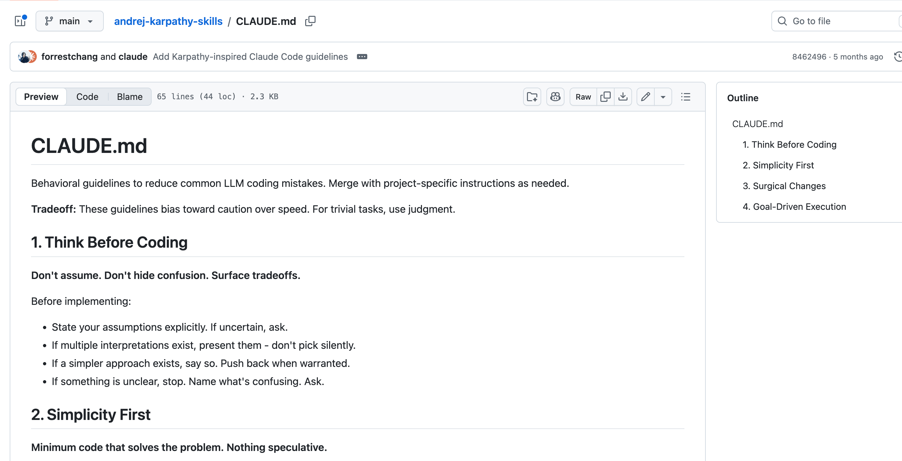
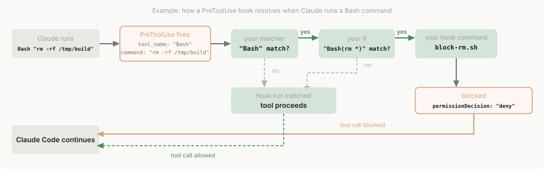
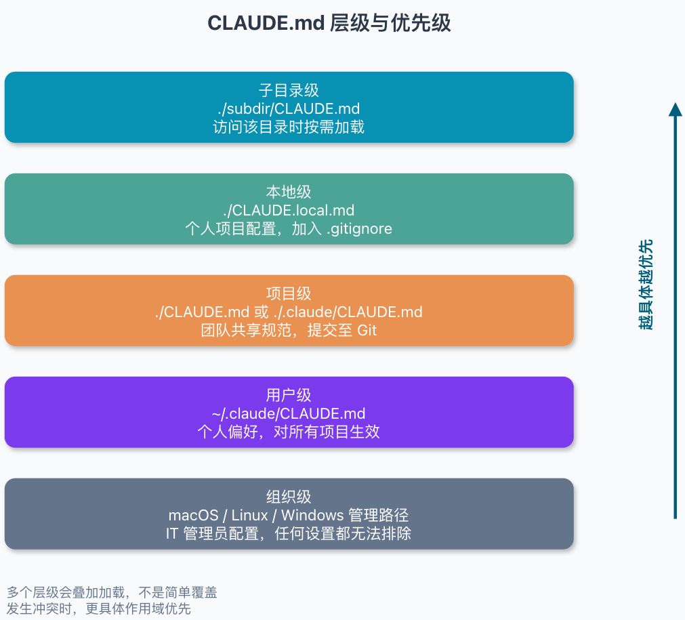
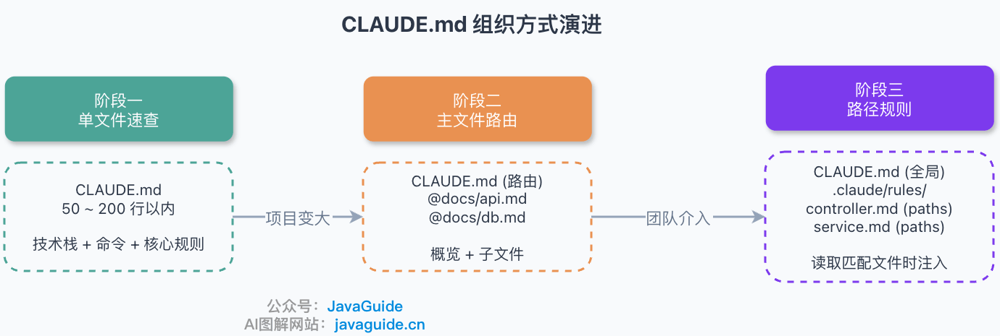
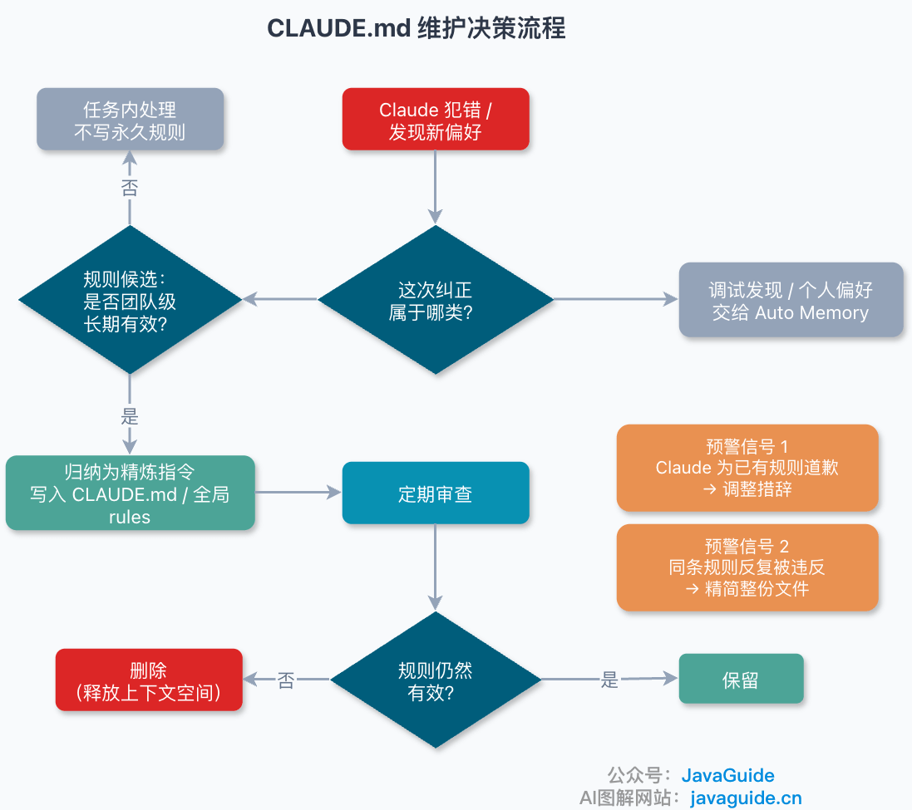

Hi, I'm Xiao G. A few days ago, I briefly introduced `CLAUDE.md` in [Claude Code Tips](https://javaguide.cn/ai-coding/practices/claudecode-tips.html). A reader asked whether I could write a separate article about it.

Many people initially treat `CLAUDE.md` as another README. A README introduces a project to people; `CLAUDE.md` gives Claude Code working instructions, such as how to start the project, which files not to change, the API response format, and which checks to run after making changes.

You can restate these details at the start of every session, but it is easy to miss something. Rules that remain valid over time and cannot be reliably inferred from the code are better recorded in `CLAUDE.md`.

This article combines the [Claude Code documentation](https://code.claude.com/docs/en/best-practices) with my own experience to explain what belongs in `CLAUDE.md`, how to organize it, and how to maintain it.

One caveat: Claude Code changes quickly, and `.claude/rules/` and Auto Memory can change between versions. This article was checked against the official documentation as of 2026-07-24. Before applying it, check your version with `claude --version` and use `/context` to see which instructions are loaded in the current session. Use `/memory` mainly to view and edit memory and rule locations and files.

## What Is CLAUDE.md?

`CLAUDE.md` is a persistent instruction file for Claude Code. It can be stored at the user, project, or other levels. Claude Code reads it and follows its commands, conventions, and constraints while working on the project.

It is suited to information such as:

- Rules Claude is likely to guess incorrectly.
- Conventions that cannot be inferred from the code.
- Requirements the team must follow.
- Technology versions, common commands, architectural decisions, and project-specific pitfalls.

To decide whether a rule is worth keeping, ask:

> If I remove this line, is Claude more likely to make a mistake?

If so, keep it. Otherwise, it is probably just using up context.

## How Does CLAUDE.md Differ from Other Rule Files?



### CLAUDE.md vs. AGENTS.md

|             | CLAUDE.md                                | AGENTS.md                                                                       |
| ----------- | ---------------------------------------- | ------------------------------------------------------------------------------- |
| **Read by** | Claude Code                              | Cross-tool standard also used by OpenAI Codex, Cursor, Google Jules, and others |
| **Role**    | Project instruction file for Claude Code | Tool-agnostic Agent instruction file                                            |


**AGENTS.md** targets multiple coding agents, while **CLAUDE.md** is the entry point specific to Claude Code. A repository can make both files reuse the same base instructions.

Teams can reserve a section in `AGENTS.md` for confirmed recurring mistakes. However, an Agent will not record mistakes automatically just because that section exists, and adding a rule does not guarantee the mistake will never recur. Define in the workflow who adds and reviews rules and when they should be removed.

If the repository already uses `AGENTS.md` to instruct other coding agents, create a `CLAUDE.md` that imports it. This lets both tools reuse the same base instructions without duplicating them.

```markdown
@AGENTS.md

## Claude Code-Specific Instructions

- Use plan mode for changes under `src/billing/`.
```

My article [Harness Engineering Explained](https://javaguide.cn/ai/agent/harness-engineering.html) describes an example where OpenAI's `AGENTS.md` is about 100 lines long and mainly points to more detailed design documents, architecture diagrams, execution plans, and quality ratings under `docs/`. The Agent reads the index first and loads details when a task needs them, instead of putting everything into the context up front.

### CLAUDE.md vs. .claude/rules/

|                 | CLAUDE.md                                                                                                     | `.claude/rules/`                                                                                 |
| --------------- | ------------------------------------------------------------------------------------------------------------- | ------------------------------------------------------------------------------------------------ |
| **Loading**     | Root and project files usually load at session startup; subdirectory files load when Claude reads files there | Rules without `paths` load at startup; rules with `paths` load when Claude reads a matching file |
| **Use case**    | General project rules                                                                                         | Rules for specific files or directories                                                          |
| **Context use** | Root and project rules continue to use context                                                                | Only path-scoped rules load on demand; global rules continue to use context                      |

Rules that apply only to specific directories, such as backend API conventions or test configuration, can go in `.claude/rules/` instead of the root `CLAUDE.md`.

Keep two details in mind:

1. Claude Code does not necessarily create `.claude/rules/` when installed; create it manually if needed.
2. Rules with a `paths` frontmatter field load when files match. Rules without `paths` still load globally. Creating a `.claude/rules/` directory alone does not reduce context use.

### CLAUDE.md vs. SPEC.md

|             | CLAUDE.md                                                          | SPEC.md                                                                     |
| ----------- | ------------------------------------------------------------------ | --------------------------------------------------------------------------- |
| **Purpose** | Project rules (how to work)                                        | Requirements specification (what to build)                                  |
| **Content** | Coding conventions, common commands, pitfalls, and team agreements | Scope, feature definition, and acceptance criteria; similar to a PRD for AI |
| **Used by** | AI coding assistants during day-to-day coding                      | Spec Coding workflow (requirements-driven development)                      |

`SPEC.md` is a filename some teams use for **Spec Coding**. `Specify → Design → Implement → Test` is one way to organize the process, not a universal four-stage standard. Different tools may use files and phases such as requirements, design, tasks, and plan.



In the diagram, `requirements.md` is produced during the `Specify` stage. Other teams may put the same kind of task specification in `SPEC.md`; the names are not universal aliases.

I explain this in more detail in [Spec Coding in Practice: From Vibe Coding to AI Coding Standards](https://javaguide.cn/ai-coding/practices/spec-coding.html).

The distinction is: **CLAUDE.md defines long-term working conventions; a Spec defines constraints for the current task.**

### Which One Should You Use?

- **CLAUDE.md**: Working conventions for Claude Code. Root and user files usually load at session startup; subdirectory rules load on demand.
- **AGENTS.md**: Cross-tool instructions about how to work; `CLAUDE.md` can import it for reuse.
- **`.claude/rules/`**: A directory for local rules. Rules without `paths` are global; rules with `paths` apply when Claude works on matching files.
- **SPEC.md**: A requirements specification that defines what to do for the current task as part of a Spec Coding workflow.

## What Should Go in CLAUDE.md?

First, consider a pattern I often see. Someone runs `/init`, sees the `CLAUDE.md` generated by Claude, thinks “something is better than nothing,” and commits it with few or no changes:

```markdown
# Project Overview

This is a Spring Boot project that uses Java 17 and Maven.

# Coding Style

- Write clean code.
- Follow best practices.
- Keep code readable.

# Workflow

- Run tests before committing.
- Keep the code well organized.
```

These instructions are not wrong, but they are unlikely to change Claude's behavior. For example, Claude will still try to write readable code if you remove “write clean code.” Leaving it in the file only uses context.

`CLAUDE.md` shares the context window with system instructions, conversation history, and files Claude reads. Anthropic's documentation notes: **Claude's overall performance degrades as the context window fills.**



The longer the file, the less room remains for later conversation and code, and the easier it is for important rules to get buried.

Anthropic recommends keeping `CLAUDE.md` concise and under 200 lines, with only information Claude cannot easily infer from the code. If the file keeps growing, move path-specific rules to `.claude/rules/` with `paths`, or put reference material that is not needed every session into Skills.



When reviewing `CLAUDE.md`, ask for each line: “If I remove this, is Claude more likely to make the same mistake?” Keep rules with a clear effect. Remove content that does not change behavior, and add it back later if a real issue comes up.

### What to Include

Five types of information are worth including in `CLAUDE.md`.

**1\. Technology stack and versions.**

Framework version differences often affect generated code. For example, some configuration differs between Spring Boot 2 and 3. Without the version, Claude may suggest usage that does not match the project. Dependencies such as MyBatis-Plus are visible in `pom.xml`, but the reason for choosing it over JPA may need to be stated.

**2\. Common commands.**

List the exact commands for building, testing, linting, and starting the project. Use code blocks or inline code to preserve the arguments, so Claude does not have to translate natural language into commands.

```markdown
# Commands

- Build: `mvn clean package -DskipTests`
- Test: `mvn test -pl module-name`
- Start: `mvn spring-boot:run -pl bootstrap`
- Run code checks: `mvn checkstyle:check`
```

**3. Architectural decisions and why they were made.**

The reason behind a rule affects how Claude handles related cases. In one of my projects, I initially wrote only, “Do not write SQL directly; use QueryWrapper.” Claude still wrote SQL for some queries. I later added the reason: “The SQL auditing system relies on parsing Wrapper objects to record operation logs.” This clarified the scope of the constraint: other queries should also use Wrapper.

**4. Team conventions and project-specific pitfalls.**

Commit message formats (such as `feat(scope): message`), branch naming conventions, and environment variable requirements are difficult to infer from code. This information is also useful to new team members and belongs in `CLAUDE.md`.

**5. Task information that must persist across sessions.**

If task descriptions, acceptance criteria, priorities, dependencies, and blockers need to persist across sessions, put them in a separate task file and link to it from `CLAUDE.md` or `AGENTS.md`. This preserves task progress without mixing frequently changing details with long-term rules.

### What Not to Include

**1. Code style rules.**

Leave details such as indentation, import ordering, and semicolon use to formatting tools.

If the project does not have Checkstyle or Prettier configured, set up a tool instead of using natural-language instructions to enforce formatting.

**2. Default language or framework behavior.**

For example:

- “Use `ref` / `reactive` for reactive state in Vue.”
- “JPA entity classes correspond to database tables.”
- “Use `WHERE` clauses to filter SQL results.”

These statements add little value and only make the AI process more context.

**3\. Long reference documents.**

Do not paste large sections of external API documentation or SDK parameter tables into the file. A link is enough; Claude can read the material when it needs it.

### Good CLAUDE.md Examples

#### User-Level Example: Prevent Common Bad Habits

[`andrej-karpathy-skills`](https://github.com/multica-ai/andrej-karpathy-skills) is a third-party collection of Claude Code rules and Skills inspired by Andrej Karpathy's public observations about LLM coding issues. Its rules are repository-independent, so they are better suited to the user level and can help prevent common coding missteps.

The image below shows an example `CLAUDE.md` from that repository:



This file addresses a few recurring issues: check assumptions before coding, avoid over-abstraction, keep changes within the task scope, and run tests and check acceptance criteria afterward. It has few rules, each tied to an observable behavior.

Read the original on GitHub; I will not reproduce it here.

#### Project-Level Example: A Quick Reference for Repository Conventions

My [interview-guide](https://javaguide.cn/zhuanlan/interview-guide.html) uses a project-level `CLAUDE.md`. The root file keeps the technology stack, common commands, layer boundaries, exception handling, transaction rules, and prohibited actions. Detailed conventions go in `.claude/rules/`.

The root file can be shortened to something like this:

```markdown
# AI Interview Platform Rules

Interview platform built with Spring Boot 4.0, Java 21, Spring AI 2.0, and React.

## Tech Stack

- Backend: Spring Boot 4.0 / Java 21 / Gradle / Spring AI 2.0
- Database: PostgreSQL + pgvector (1024 dimensions, COSINE)
- Cache & MQ: Redis / Redisson / Redis Stream
- Frontend: React 18 + TypeScript + Vite + TailwindCSS 4 (`frontend/`)
- Mapping & Docs: MapStruct / OpenAPI / iText 8 / Apache Tika

## Commands

- Build: `./gradlew build`
- Test: `./gradlew test`
- Start the backend: `./gradlew bootRun`
- Start the frontend: `cd frontend && npm run dev`
- Lint the frontend: `cd frontend && npm run lint`

## Architecture

- Single-module Gradle project, organized by feature packages.
- Backend follows the `Controller -> Service -> Repository` layers.
- Shared infrastructure belongs in `common/`, including rate limiting, AI calls, async tasks, configuration, exceptions, and common responses.
- Frontend code belongs in `frontend/`.
- See `docs/architecture.md` for the project structure.

## Must Follow

- Controllers handle parameter validation and response wrapping only; do not put business logic in them.
- Services orchestrate business logic; place `@Transactional` only in the service layer.
- Repositories handle data access only; do not put business logic in them.
- Use `Result<T>` for all external responses.
- Throw business errors with `BusinessException(ErrorCode.XXX, "description")`.
- Use MapStruct for entity mappings; do not write repetitive mapping code by hand.
- Do not call LLMs, S3, or external HTTP services inside database transactions.
- Obtain `ChatClient` through `LlmProviderRegistry`.
- Wrap structured-output retries with `StructuredOutputInvoker`.
- Use the `AbstractStreamProducer` / `AbstractStreamConsumer` templates for Redis Stream producers and consumers.
- Use `@RateLimit`; do not scatter hand-written Redis rate-limiting logic throughout the codebase.
- Use PostgreSQL + pgvector for database vector search with 1024 dimensions and COSINE distance.

## Never Do

- Do not `throw new RuntimeException(...)`; use `BusinessException`.
- Do not return entities directly to the frontend.
- Do not scatter `@Value` throughout services; group configuration in `@ConfigurationProperties`.
- Do not inline fully qualified class names; use imports.
- Do not call LLMs, S3, or external HTTP services inside transactions.
- Do not call an `@Transactional` method from another method in the same class.
- Do not silently ignore errors with `catch (Exception e) {}`.
- Do not make database calls in a loop; prefer batch operations.
- Do not hard-code secrets.
- Do not use `Executors.newXxxThreadPool()`; use an explicit `ThreadPoolExecutor`.

## More Rules

- Error codes: `.claude/rules/error-handling.md`
- Rate limiting: `.claude/rules/rate-limit.md`
- Redis Streams: `.claude/rules/redis-stream.md`
- AI service calls: `.claude/rules/ai-service.md`
- Database: `.claude/rules/database.md`
- Frontend: `.claude/rules/frontend.md`
```

## How Can You Write Rules Claude Will Follow?

Rules should specify clear actions whose results can be checked.

### Make Rules Specific and Verifiable

“Keep the code readable” gives no measurable standard. Replace it with “Start function names with a verb, and keep each function under 40 lines.” Claude then knows what to do, and reviewers can check the result.

### Pair Prohibitions with Alternatives

When prohibiting an approach, give an alternative: do not do X; use Y in that situation.

For example, Claude often used `@Autowired` field injection in one of my projects, even though the team required constructor injection.

At first, I wrote only “Do not use `@Autowired` field injection.” The result was mixed: Claude avoided field injection, but sometimes wrote constructors by hand or used a different injection approach. I later made the rule more complete:

```markdown
# Dependency Injection

- Do not use `@Autowired` field injection.
- Use constructor injection with Lombok's `@RequiredArgsConstructor`.
- Follow the example in `UserController.java`.
```

The complete rule gives both a recommended approach and a project file to use as a reference, so Claude has a concrete pattern to follow.

### Use Emphasis Labels Sparingly

If Claude repeatedly violates a rule, you can prefix it with `IMPORTANT:` or `YOU MUST:`. Reserve these labels for a few critical rules; if every rule is emphasized, none stands out.

If Claude keeps ignoring a rule, check whether the file is too long or the rule is in the wrong place. Adding more emphasis usually does not solve either problem.

### Use Conventional Headings

Common headings such as Commands, Structure, Conventions, and Testing already describe their contents clearly. They help Claude find commands, directory structure, and test requirements, and are familiar to project members.

### Hooks

`CLAUDE.md` can provide instructions, but it cannot block a tool call. Use Hooks to check actions such as editing sensitive files or running dangerous commands. For example, `PreToolUse` receives tool-call details before execution and can allow or reject the call based on permissions and risk.

The Claude Code documentation shows the following execution flow:



Give mechanically verifiable requirements to a linter, Hook, or CI. For example, to prevent Claude from editing `.env`, a `PreToolUse` Hook can check the target path and reject the operation. A reminder in `CLAUDE.md` alone can still be missed.

Good uses for Hooks include:

- Automatically formatting files after edits.
- Running tests before a session ends.
- Blocking edits to `migrations/` or `.github/workflows/`.
- Blocking commands such as `curl | bash` and `rm -rf`, or preventing sensitive data from being sent to external endpoints.
- Adding extra context when a subagent starts.

Use a Hook to enforce a requirement when missing it could cause significant risk. Keep conventions that simply help Claude understand the project in `CLAUDE.md`.

## Where Should CLAUDE.md Go?

Claude Code supports `CLAUDE.md` files at several levels, each with a different scope:



| Level            | Path                                                                                                                                                  | Purpose                                                                                                                                              |
| ---------------- | ----------------------------------------------------------------------------------------------------------------------------------------------------- | ---------------------------------------------------------------------------------------------------------------------------------------------------- |
| **Organization** | macOS: `/Library/Application Support/ClaudeCode/CLAUDE.md`, Linux/WSL: `/etc/claude-code/CLAUDE.md`, Windows: `C:\Program Files\ClaudeCode\CLAUDE.md` | Organization-wide coding rules, compliance requirements, and data-handling instructions managed by IT/DevOps. Personal settings cannot exclude them. |
| **User**         | `~/.claude/CLAUDE.md`                                                                                                                                 | Your personal preferences, applied to all projects.                                                                                                  |
| **Project**      | `./CLAUDE.md` or `./.claude/CLAUDE.md`                                                                                                                | Team-shared conventions, committed to Git.                                                                                                           |
| **Local**        | `./CLAUDE.local.md`                                                                                                                                   | Project-specific personal settings; add this file to `.gitignore`.                                                                                   |
| **Subdirectory** | `./subdir/CLAUDE.md`                                                                                                                                  | Loaded on demand when Claude accesses files in that directory, not at session startup.                                                               |

`CLAUDE.md` files at different levels are loaded together; a later file does not replace everything in an earlier one. Rules closer to the current project and task have a more specific scope.

For example, if a user-level rule requires spaces for indentation but a project-level rule requires tabs, Claude is more likely to follow the project rule in that repository. Conflicting instructions still add uncertainty, so remove conflicts when you find them.

My approach is simple: commit the project-level `CLAUDE.md` with rules the whole team must follow. Put personal preferences, such as using Chinese for commit messages in this repository, in `CLAUDE.local.md` and add it to `.gitignore`.

## How Should You Organize CLAUDE.md as a Project Grows?

Small and medium-sized projects usually need only one `CLAUDE.md`. As the number of modules grows, keeping every rule in the root file makes each session load information unrelated to its current task.



### For Small Projects: Keep One File

Keep global information such as the technology stack, common commands, and architecture boundaries in the root file. This is enough for most small and medium-sized projects; my own `CLAUDE.md` files are usually under 50 lines.

### As the File Grows: Use It to Point to Detailed Rules

Keep the project overview and common commands in the root `CLAUDE.md`. Put architecture rules, API conventions, and test requirements in separate files, then reference them with `@path/to/file`:

```markdown
## Project

Order management service built with Spring Boot 3.2, MyBatis-Plus, and MySQL 8.0.

## Commands

- Build: `mvn clean package`
- Test: `mvn test`

## Rules

- API conventions: @docs/api-conventions.md
- Database rules: @docs/database-rules.md
```

### For Rules That Apply to Some Files: Load by Path

Use frontmatter in `.claude/rules/` to match file paths:

```markdown
---
paths:
  - "src/main/java/**/controller/**/*.java"
---

# Controller Conventions

- Wrap all responses in `Result<T>`.
- Add Swagger annotations to all endpoints.
```

The Controller rules load when editing a Controller, so they do not occupy context while working on a Service. In practice, there are three limitations to when these rules load.

**Path-scoped rules may not load when creating a file.** They are injected when Claude **reads** a matching file, not checked before every tool call. When Claude directly creates a file in a matching path, the rule may not yet be in context. Put requirements such as “new Controllers must include a specific header” in global rules without `paths`, the root `CLAUDE.md`, or a Hook.

**After compacting context, local rules must be triggered again.** After `/compact`, the root `CLAUDE.md` is injected again. Subdirectory `CLAUDE.md` files and path rules load only when Claude reads a matching file again. Use `/context` to check the instructions in the current session before continuing to edit.

**Check whether rules actually loaded.** Use `/context` to see the `CLAUDE.md`, `CLAUDE.local.md`, and rules files loaded in the current session. Use `/memory` to view and edit memory and rule locations. To record detailed loading events, configure an `InstructionsLoaded` Hook.

I currently use a root file plus path-matched rule files. I am still exploring more advanced approaches, such as dynamically loading capabilities with Skills and MCP.

> **Engineering note:** `@path/to/file` embeds the entire file in context. Referencing a file with hundreds of lines uses a large part of the instruction space at the start of every session. The official documentation currently limits recursive imports to four levels. For large files, use a note such as “See `docs/architecture.md` for architecture details” so Claude can read it when needed.

## How Should You Maintain It?

When the project structure, commands, or workflow changes, update or remove outdated rules in `CLAUDE.md` as well.

Use `CLAUDE.md` for actively maintained, long-term instructions, such as rules the team must follow and project facts needed in every session. Auto Memory is built into Claude Code v2.1.59 and later; it can record debugging findings, preferences, and work habits from collaboration.

My rule of thumb is to put information that affects team collaboration and should be followed in every session in `CLAUDE.md`. Leave small findings learned during troubleshooting to Auto Memory.

For example, “All endpoints return `Result<T>`” belongs in `CLAUDE.md`. A troubleshooting note such as “Redis must be running locally before testing Redis Streams in this project” can go in Auto Memory. Auto Memory is enabled by default and can be viewed, edited, or disabled with `/memory`. It keeps a separate memory directory for each project, but it is not a shared team convention and cannot replace a `CLAUDE.md` committed to the repository.



### When Should You Add a Rule?

Consider adding a rule after Claude makes a particular mistake, if a clear instruction can reduce the chance of it happening again. Rule files only provide instructions; use tests, a linter, a Hook, or CI for requirements that can be checked mechanically.

### When Should You Remove a Rule?

Remove a rule when the project constraint no longer applies or when removing it does not change Claude's behavior. There is no need to repeat facts in the rules file if they are already clear from the code.

### How Can You Tell a Rule Needs Adjustment?

If Claude says, “Sorry, I ignored rule X,” first check whether the file loaded, then see whether the rule specifies a clear action. Replace vague instructions such as “pay attention” or “try to” with actions that can be followed and verified.

If the same rule is repeatedly violated across sessions, check whether the file is too long, rules conflict, or the rule is in the right scope. More bold text or exclamation marks usually will not fix these problems.

### How Can You Review Rules Periodically?

Periodically select a few rules and ask Claude, “What would you do differently if this rule were removed?” Use the answer only as an initial screen because Claude cannot always predict its own behavior reliably. If you are unsure, compare two parallel sessions using versions of `CLAUDE.md` with and without the rule, and give them the same prompt.

When an error occurs, do not immediately ask Claude to add the lesson to `CLAUDE.md`. First decide whether it is long-term, affects the team, and is likely to recur. If similar errors happen repeatedly, summarize them as a rule. Keep machine-specific preferences and one-off debugging findings in Auto Memory.

## Common Pitfalls

- **Adding rules without removing old ones.** Adding a line to `CLAUDE.md` for every mistake while keeping obsolete rules makes the file grow quickly. If Claude starts missing rules, bold text and exclamation marks are unlikely to help; remove outdated and duplicated content first.
- **Importing large files with `@`.** An `@` reference places the entire file in context. Importing a document with hundreds of lines uses context before the session even begins. For rarely needed material, a note such as “See `docs/architecture.md` for architecture details” is enough; Claude can read it when needed.
- **Putting all new-file requirements in path-scoped rules.** Path rules load only after Claude reads a matching file. When it creates a file directly, those rules may not yet be in context. Put requirements that must be followed during creation in global rules, the root `CLAUDE.md`, or a Hook.
- **Conflicting rule files.** If user, project, and directory-level rules conflict, Claude may not alert you or make the same choice every time. When changing project rules, check the other levels and remove duplicates and conflicts.
- **Making a permanent rule after one occasional mistake.** A rare issue does not justify using context in every later session. Add a rule after similar issues recur and a clear instruction can address them.

## Summary

Do not try to put every project convention in `CLAUDE.md`; that defeats its purpose.

I often ask myself: can Claude infer this correctly from the code alone? If it cannot, and guessing wrong could lead it off track, the information belongs in the file.

Technology versions, startup and test commands, architecture boundaries, and less obvious project constraints are usually worth recording. Leave indentation and import ordering to formatting tools.

For a small project, do not rush to build a complex rule system. Start with a short `CLAUDE.md` in the root and add only what is needed. When the content grows, move local rules to `.claude/rules/` or separate documents. Afterward, check `/context`; putting a file in the right place does not guarantee Claude has loaded it.

`CLAUDE.md` is not a manual to write once and forget. Add a rule when Claude repeatedly makes the same mistake, remove old rules when the project changes, and let tests, a linter, Hooks, or CI enforce what they can check. A shorter file with precise rules is often more useful than an exhaustive one.
