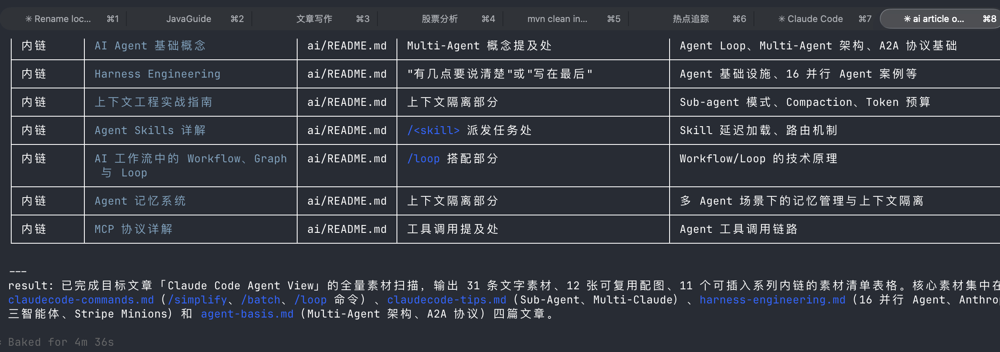
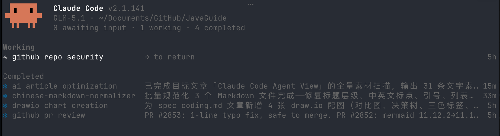
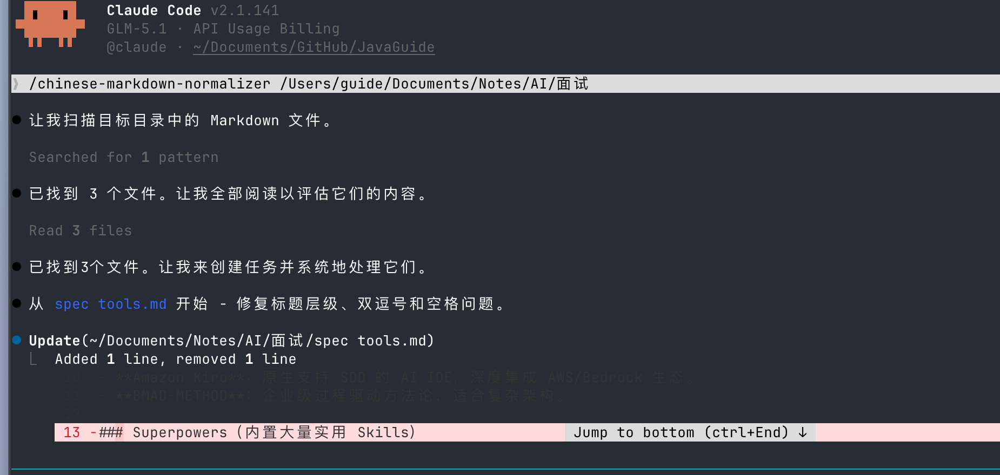
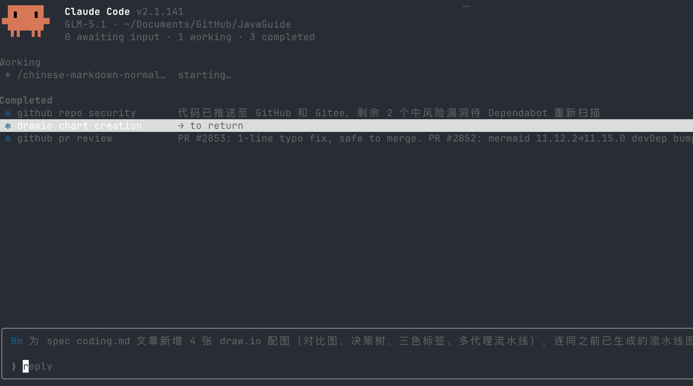
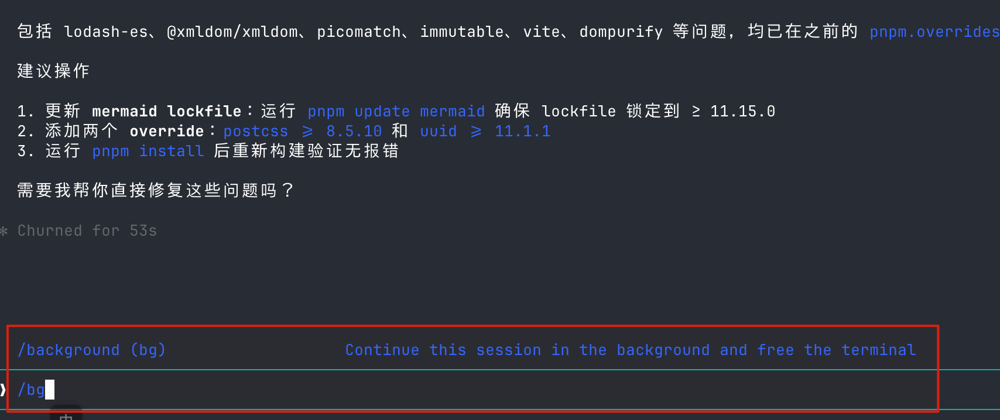

Hi, I'm Xiao G.

I often use several Claude Code sessions at once: one to develop a feature, one to refactor, one to run tests, one to investigate an error, and another to organize PR comments or update documentation.



This used to be tiring. I would open several panes and terminal tabs in Ghostty. My screen looked busy, but I had to remember which session was running, which had finished, which was waiting for permission, and which had failed.

The worst part was missing an agent that had already stopped to ask for confirmation. By the time I switched back, it might have been waiting for ten minutes.

Anthropic's **Agent View** takes care of this. It puts background sessions in one list and shows which are working, waiting for input, complete, or failed. Claude is still Claude, but I no longer have to keep a “session status table” in my head.

In [“AI Coding: CLI or IDE?”](https://mp.weixin.qq.com/s/6a3f2U6ZAJa2N7Cp10S01Q), I mentioned how new AI coding workflows often appear in CLI tools first. Agent View is one example. It is closer to a background session manager than a multi-agent orchestration platform that automatically decomposes tasks, assigns work, and resolves conflicts.

If you are new to Claude Code, start with these guides:

- [Claude Code User Guide](https://javaguide.cn/ai-coding/practices/claudecode-tips.html): subagents, multiple Claude instances, `CLAUDE.md` configuration, and more.
- [Claude Code Commands](https://javaguide.cn/ai-coding/practices/claudecode-commands.html): practical uses for commands such as `/simplify`, `/loop`, and `/batch`.

## Opening Agent View

Agent View is currently a Research Preview and requires Claude Code `v2.1.139` or later. Check your version first:

```bash
claude --version
```

The simplest way to open Agent View is to run:

```bash
claude agents
```



Each background session appears on one row. The left side shows its status icon, the middle shows the session name and a recent summary, and the right shows how long it has been running. Sessions are grouped by status, with those needing attention at the top.

Regular Claude Code sessions that are already open do not appear here automatically. To send the current session to the background, enter:

```text
/bg
```

You can also press the left arrow `←` when the input box is empty. Both actions detach the session and put it in the background without ending the task. Use the arrow keys to select it, then press `Enter` or `→` to return to the full conversation.



## Check Yellow, Then Red

When Agent View opens, I scan the status icons on the left. They matter more than the session names because they show where I need to step in.


| Status        | Display  | What to do                                                              |
| ------------- | -------- | ----------------------------------------------------------------------- |
| `Needs Input` | Yellow   | Waiting for an answer, permission, or sign-in. Handle this first.       |
| `Working`     | Animated | Still calling tools or generating a response. You can leave it running. |
| `Completed`   | Green    | The task ended normally. Review the diff, tests, and result.            |
| `Failed`      | Red      | Something went wrong. Open the summary or logs to find the cause.       |
| `Idle`        | Dimmed   | No current task. You can send another message.                          |
| `Stopped`     | Gray     | The session was stopped manually or its process ended externally.       |

One detail is easy to misread: the `Completed` group can also contain failed or stopped sessions. The group name does not mean every task succeeded. Check the icon and execution result.

Yellow is especially useful. I used to think a session was still running, only to find it waiting at “Allow this command?” When I see yellow now, I handle it; when I do not, I work on something else.

## Reply Without Switching Sessions

Select a session and press `Space` to open the Peek Panel at the bottom. It shows the latest output or the question Claude is waiting on.



If Claude is asking whether it can edit a file or continue running tests, reply in the panel. The session receives the message and continues without opening the full conversation.

Previously, I had to find the right terminal tab, see what it was waiting for, reply, and then switch back. Handling it with one key press is a small convenience that adds up.

Press `Enter` or `→` to open the full context, and `←` to return to Agent View.

You do not need to memorize the shortcuts. The interface shows hints at the bottom, and `?` opens the full list. These are the ones I use most:

| Shortcut           | Action                                                        |
| ------------------ | ------------------------------------------------------------- |
| `↑` / `↓`          | Move through the session list                                 |
| `Space`            | Open or close the Peek Panel                                  |
| `Enter`            | Open a session, or dispatch a task when the input has text    |
| `Shift+Enter`      | Dispatch a task and immediately open a new session            |
| `Alt+1` to `Alt+9` | Open the corresponding session directly                       |
| `Ctrl+T`           | Pin or unpin the current session                              |
| `Ctrl+R`           | Rename the current session                                    |
| `Ctrl+X`           | Stop the session; press again within two seconds to delete it |

Be careful when pressing `Ctrl+X` twice. If the session uses a Worktree created automatically by Claude Code, deleting it may also delete uncommitted changes in that Worktree.

## Send Tasks to the Background

Enter `/bg` in an existing session to move its current task to the background:

```text
/bg
```

This backgrounds the current session and returns to Agent View.



You can also include an instruction before backgrounding it:

```text
/bg Run the tests and fix any failures.
```

If the task has not started yet, create a background session directly from the shell:

```bash
claude --bg "Fix all failing unit tests in the auth module until they pass"
```

Background sessions work well for tasks that take time but do not need constant supervision:

- Run a group of failing tests and attempt to fix them.
- Check a module for type errors.
- Update multiple documents.
- Analyze PR comments and suggest changes.
- Make small changes across several repositories.

Mitchell Hashimoto, co-founder of HashiCorp and creator of Ghostty, described an interesting habit in [“My AI Adoption Journey”](https://mitchellh.com/writing/my-ai-adoption-journey): he spends the last 30 minutes of the workday delegating deep research, exploring vague ideas, and sorting issues and PRs to agents, then reviews the results the next morning.

He is also realistic about it. The ideal is to always have agents doing useful work, but in practice this is possible for only about 10–20% of the workday, and usually with just one agent. That is closer to everyday development; you do not need to invent tasks just to appear parallel.

## Shell Commands

You can also manage background sessions from the shell without opening Agent View:

```bash
claude agents          # Open Agent View

claude attach <id>     # Switch to a specific session

claude logs <id>       # Print recent output from a session

claude stop <id>       # Stop a session; claude kill also works

claude respawn <id>    # Restart a session and keep its conversation history

claude respawn --all   # Restart all running background sessions

claude rm <id>         # Remove a session from the list
```

I use `respawn` less often, but it is easy to misunderstand:

```bash
claude respawn <id>
```

It restarts the specified session while retaining its conversation history. Use it after updating Claude Code if a background session should use the new version, or if a session process exited unexpectedly.

`respawn` is not a context reset and does not create a clean context. If the old session is full of irrelevant logs and stale plans, restarting its process will not fix context contamination. In that case, start a new session with a verified task summary.

Also, `claude rm <id>` mainly removes a session from the background list. The conversation history remains on the local machine and can be recovered with `claude --resume`. A Worktree created automatically by Claude Code is cleaned up only when it is safe to do so.

## Dispatch Tasks from Agent View

Agent View has an input box at the bottom. Enter a task and press `Enter` to create a new background session. Entering another task creates another session; it does not ask a follow-up question in the previous session. To message an existing session, reply in the Peek Panel or open that session first.

The input box also supports special syntax:

| Input                   | Effect                                                                    |
| ----------------------- | ------------------------------------------------------------------------- |
| `<agent-name> <prompt>` | If the first word matches a custom subagent, use it as the primary agent. |
| `@<agent-name>`         | Specify a custom subagent in the prompt.                                  |
| `@<repo>`               | Select another repository or directory for the session.                   |
| `/<command>`            | Search for and use a dispatchable Skill or command.                       |
| `! <command>`           | Start a background shell task without calling a model.                    |
| `#<number>` or a PR URL | Select an existing session if it is already handling that PR.             |

Custom subagents usually live in the project's `.claude/agents/` directory or the user's `~/.claude/agents/` directory. A dedicated agent for recurring tasks such as code review or test analysis saves you from repeating its tools and constraints each time.

`#<number>` and PR URLs are useful, too. If a session is already handling a PR, Agent View selects it to avoid duplicate work.

For more on Skills, see [Six Recommended Skills](https://mp.weixin.qq.com/s/55YhKrMAHsbrAgf4P2ezRA) and [Agent Skills Explained in Depth](https://mp.weixin.qq.com/s/5iaTBH12VTH55jYwo4wmwA).

## When to Use It

To decide whether to put a task in Agent View, I ask two questions: can it make progress independently while I am away, and can I verify it later through a diff, tests, or logs? If both are true, backgrounding it is usually convenient.

### Handle Several Independent Small Tasks

For example, you could assign five small requests to five sessions: fix tests, check for type errors, update documentation, and fix two unrelated bugs. Then work on something else and review the statuses later: reply to yellow sessions, check logs for red ones, and review the green ones together.

This works only if the tasks are genuinely independent. If five sessions modify the same files, Worktree isolation may help, but you will still need to resolve implementation conflicts and duplicate work. The time saved may be lost merging the changes.

[Nicholas Carlini's C compiler experiment](https://www.anthropic.com/engineering/building-c-compiler) scaled parallel work much further: 16 Claude Opus 4.6 instances ran nearly 2,000 Claude Code sessions over two weeks, producing about 100,000 lines of code at a cost close to $20,000. The experiment used Agent Teams and a custom execution framework; it was not a demonstration of Agent View.

For day-to-day development, the useful lessons are task decomposition, role assignment, and test constraints. Without that preparation, opening more sessions only creates conflicts faster. For parallel workflows such as `/simplify` and `/batch`, see [Claude Code Commands](https://javaguide.cn/ai-coding/practices/claudecode-commands.html).

### Wait for CI, Tests, and PRs

CI, integration tests, and PR reviews often depend on external results. If you keep a session in the foreground, you may check it every few minutes. Background it and return when the status changes or the work completes.

Use `/loop` to check CI periodically. Use `/goal` when a task has a clear completion condition, such as “keep fixing until all tests pass.” Agent View displays session status; these commands handle the scheduled checks and continued execution.

[Stripe's Minions](https://stripe.dev/blog/minions-stripes-one-shot-end-to-end-coding-agents) is an internal system for this kind of workflow: developers dispatch tasks from Slack, agents write code, validate it, and create PRs. More than 1,000 such PRs are merged each week, with humans still reviewing the code. Minions and Agent View are different systems, but both depend on tests, CI, and code review. A green status in the list does not mean code is ready to merge without those steps.

### Work Across Multiple Repositories

`@<repo>` can dispatch a task to another repository or directory. One session can change a backend API, another can update the frontend, and a third can revise the documentation, all in one list instead of several groups of terminal windows.

In a Git repository, Claude Code moves a background session to a separate Worktree under `.claude/worktrees/` the first time it is ready to edit files. This prevents sessions from directly writing to the same working directory. Behavior can differ for non-Git directories, directories already in a Worktree, or projects that disable background Worktree isolation.

If frontend and backend tasks depend on the same API contract, agree on request parameters, response structure, and acceptance criteria first. Agent View does not synchronize these changes between sessions.

## When Not to Force It

### Tasks That Need Frequent Coordination

Each session has its own context and reports progress only to you. One session will not automatically know that another has changed an API. Two sessions editing the same core module will not decide between themselves who owns the work.

Delegate side tasks such as research or running tests to subagents. For agents that need a shared task list and communication, consider Agent Teams. Agent View is better for a person to assign independent tasks and review the results together.

Parallel sessions also consume subscription usage independently. The more tasks you launch, the faster you use tokens and hit limits. If the tasks depend on each other, handling them sequentially may be simpler.

### Tasks That Must Run Without Your Machine

Background sessions are managed by a local Supervisor process. They can continue after you close Agent View, the shell, or the terminal window. If the machine sleeps, the session is retained and reconnects when it wakes.

Shutting down or restarting the machine stops running tasks. The next time you open Agent View, those sessions appear as failed. You can open, preview, or reply to them to continue the conversation. For work that must keep running while your machine is offline, use a cloud environment. See the [Agent View documentation](https://code.claude.com/docs/en/agent-view).

For more on parallel agent approaches, see [Claude Code's official parallel agents guide](https://code.claude.com/docs/en/agents), [Context Engineering in Practice](https://javaguide.cn/ai/agent/context-engineering.html), and [Harness Engineering](https://javaguide.cn/ai/agent/harness-engineering.html).

## Keep Preview Workflows Flexible

Agent View is still a Research Preview, so its interface, status groups, and shortcuts may change. If you add it to a team workflow, review the official documentation after upgrading Claude Code. Avoid hard-coding today's shortcuts into long-lived team standards.

To disable it, add this setting to `.claude/settings.json`:

```json
{
  "disableAgentView": true
}
```

## Summary

I think of Agent View as a task panel for Claude Code. It puts background sessions from multiple terminals into one list, so I can see which are running, waiting for a reply, or ready for review.

Task decomposition, coordination between agents, and result verification still depend on Worktrees, tests, CI, and people.

For me, the most useful change is the small problem from the beginning of this article: I no longer have to search through five or six terminal tabs for a permission request that has been waiting for ten minutes.
