Hi, I'm Xiao G. Claude Code has several useful commands for code review, code cleanup, and scheduled tasks, but many regular users do not know they exist or how to use them.

Some people think chatting with Claude Code is enough. After using it for a while, I have found that knowing these commands is still useful.

You do not need to memorize the commands. Just know they are available; when you need one, type `/` and select it from the list.

> **Version note:** This article reflects the official documentation and client behavior for Claude Code v2.1.218 (2026-07-25). Commands change frequently; check `/help`, the `/` command list, and the official Commands page for the current behavior.

## The `/` Menu Includes More Than Built-in Commands

Typing `/` in Claude Code shows the available entry points in the current environment. Along with built-in commands, the menu lists Bundled Skills, user-created Skills, and commands provided by plugins and MCP servers. The entries vary by version, platform, plan, and environment.

The [official Commands documentation](https://code.claude.com/docs/en/commands) describes most built-in commands as having behavior implemented directly in the CLI. Examples include `/clear`, `/compact`, `/model`, `/diff`, `/context`, and `/permissions`. [Bundled Skills](https://code.claude.com/docs/en/slash-commands#bundled-skills) work through Prompts: Claude loads the relevant instructions, then calls tools or coordinates subagents to complete the task. `/simplify`, `/batch`, `/debug`, `/loop`, `/run`, `/verify`, `/code-review`, and `/claude-api` belong to this category. The official command table labels these entries `Skill`; a few capabilities that schedule multiple subagents in parallel and run in the background are labeled `Workflow`.

`/review` is a built-in command for a quick, read-only review of a GitHub Pull Request. Without arguments, it lists open PRs to choose from. Use `/code-review` to check the current diff for correctness issues and cleanup opportunities. To run a multi-Agent PR review at a chosen level, use `/code-review <level> <PR number>`. For an in-depth cloud review, use `/code-review ultra`; `/ultrareview` is currently an alias.

## `/simplify`: Code Cleanup and Refactoring

Changes may work but still contain duplicate helpers, deeply nested branches, or business logic in the wrong layer. Run `/simplify` to review the changes and apply cleanup fixes.

Since Claude Code v2.1.154, `/simplify` has been described as a **cleanup-only review**. Use it for reuse, simplification, efficiency, and abstraction level; use `/code-review` for logic bugs.

### How It Reviews Changes

Without arguments, `/simplify` usually reads the incremental changes from `git diff`. If the working tree has no uncommitted changes, it checks the most recent commit instead. You can also specify a class, such as `/simplify MarketDataService`, to focus on a file. Check the current client behavior for the exact supported targets.

Four Agents review the same diff in parallel:

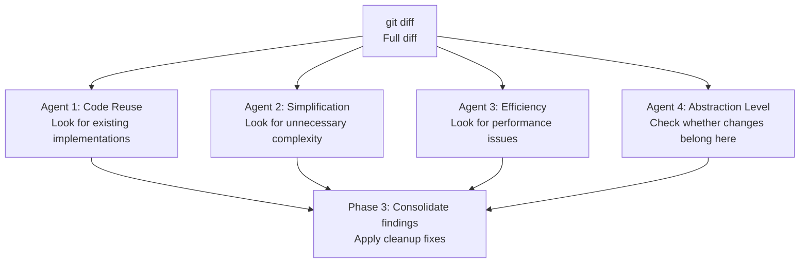

The Code Reuse Agent looks for existing implementations. For example, if a new `requireNonBlank()` duplicates `InputValidator.requireNonBlank()`, it may recommend reusing the existing method. The Simplification Agent looks for duplicate methods, unnecessary temporary state, and deeply nested branches. The Efficiency Agent checks for repeated object creation in loops, unnecessary concurrent collections, and repeated calculations.

The Abstraction Level Agent checks where code belongs. Examples include business rules in a Controller, shared validation duplicated across Services, or low-level utilities depending on business objects. After receiving all four reports, Claude Code filters false positives and applies cleanup it considers safe.

> **Caution:** `/simplify` changes code but does not guarantee business correctness. For transactions, security, concurrency, or payment flows, run `/code-review` or `/security-review` first, then inspect the diff and run tests.

### Specify a Focus

You can specify an area to focus on:

```bash
/simplify duplicate helpers
/simplify SQL performance
/simplify unnecessary abstraction
/simplify MarketDataService
```

If you already know the likely file or code smell, adding an argument can produce a more focused review.

### Example: A Spring Transaction That Does Not Roll Back

This example reflects earlier `/simplify` behavior, when it looked more actively for correctness bugs. Based on its current official description, this kind of issue should go to `/code-review` or `/security-review`, with `/simplify` used afterward for cleanup and refactoring.

I once finished a user authentication module and was ready to submit it after testing it myself. Out of habit, I ran a review command first. It found six potential issues, all of which turned out to be real.

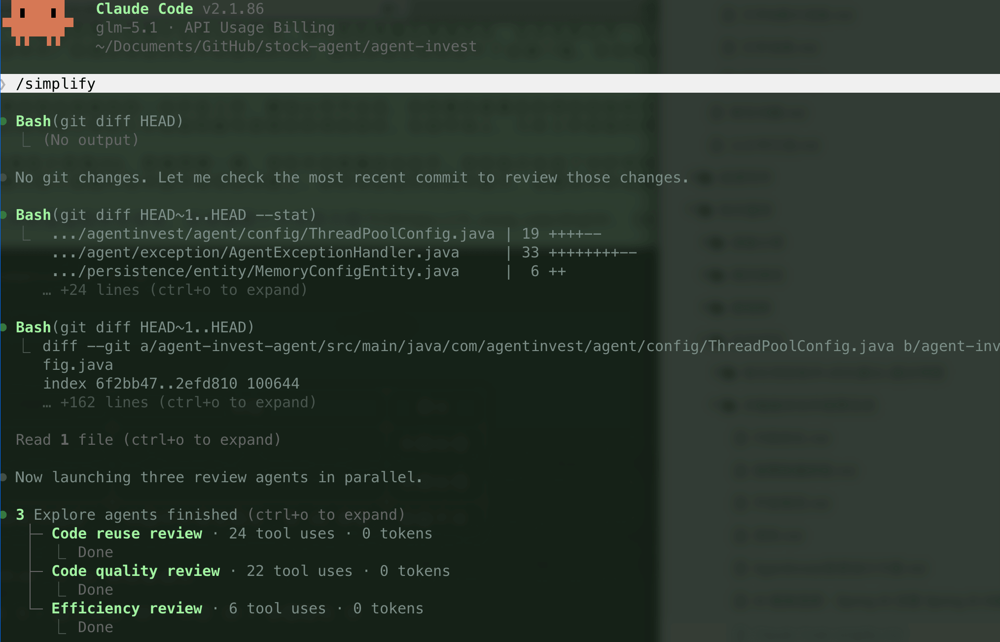

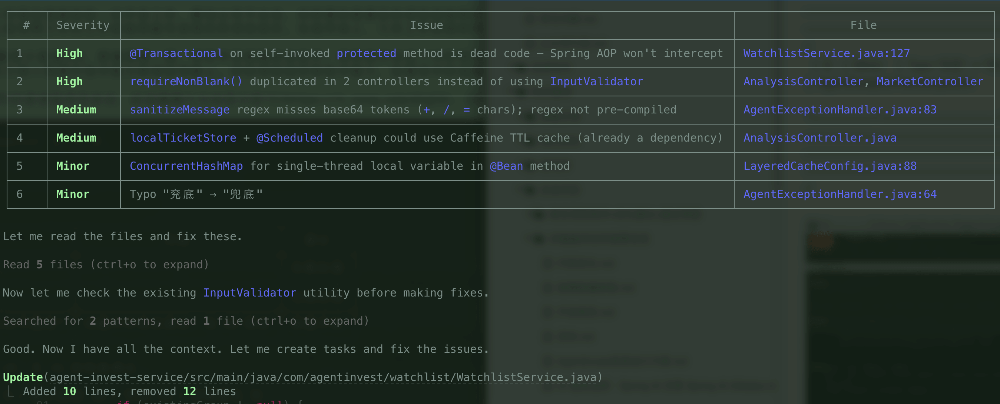

One issue involved a **Spring transaction that did not roll back**, and multiple review perspectives pointed to the same code.

The outer method in `WatchlistService` first acquires a Redis distributed lock and performs a double-check, then calls a `protected` method to write to the database:

```java
public void initializeDefaultWatchlist(Long userId) {
    // Redis distributed lock + double-check (idempotency)
    // ...
    doInitializeDefaultWatchlist(userId);  // Internal call within the same class
    // ...
}

@Transactional(rollbackFor = Exception.class)
protected void doInitializeDefaultWatchlist(Long userId) {
    groupService.save(defaultGroup);        // Insert group
    stockService.saveBatch(initialStocks);  // Insert five stocks
}
```

Adding `@Transactional` to this method does not solve the problem. Spring uses proxy-based AOP by default, and a direct call to `doInitializeDefaultWatchlist()` from within the same class bypasses the proxy. The transaction interceptor never receives the call.

If `saveBatch` throws an exception partway through, the group record already written by `save` is not rolled back, leaving a group with no stocks in the database.

> **Assumption:** With Spring's default proxy-based AOP, an internal call within the same class bypasses the proxy, so `@Transactional` does not take effect. The result differs with AspectJ weaving or a call through the proxy object.

- **Quality / correctness perspective** identified the self-invocation that bypassed `@Transactional` and rated it high severity.
- The **Efficiency Agent** ruled out an insufficient lock TTL and narrowed the issue to the transaction.
- The **Code Reuse Agent** confirmed that the custom distributed lock had no reusable alternative and was reasonable.

The suggested fix was to replace the declarative transaction with a **programmatic transaction** using `TransactionTemplate` to control the transaction boundary. Other options include moving the transactional method to another Spring Bean, calling it through the proxy, or moving the transaction boundary to the outer public method.

```java
@RequiredArgsConstructor
public class WatchlistService {

    private final TransactionTemplate transactionTemplate;

    private void doInitializeDefaultWatchlist(Long userId) {
        transactionTemplate.executeWithoutResult(status -> {
            groupService.save(defaultGroup);
            stockService.saveBatch(initialStocks);
        });
    }
}
```

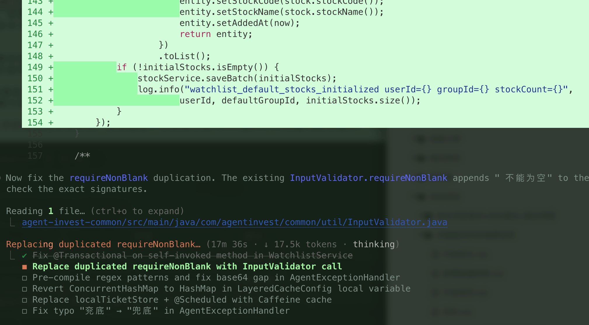

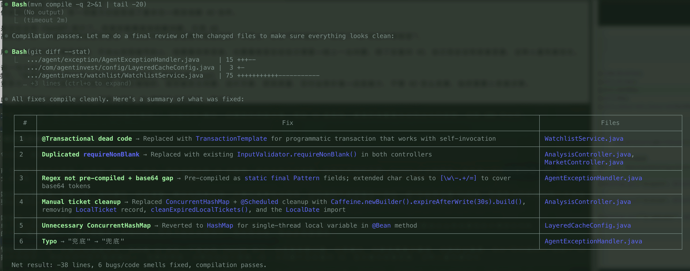

The scan found five more issues involving code reuse, security, and efficiency:

| Finding                                                                                                                                     | Agent                | Fix                                                                               |
| ------------------------------------------------------------------------------------------------------------------------------------------- | -------------------- | --------------------------------------------------------------------------------- |
| Two Controllers each defined `requireNonBlank()`, duplicating the existing `InputValidator`                                                 | Reuse                | Remove the private methods and use `InputValidator.requireNonBlank()`             |
| The exception handler recompiled a regex on every `replaceAll`; its character class omitted `+/=`, so Base64 tokens were not fully redacted | Quality + Efficiency | Extract a `static final Pattern` and include Base64 characters                    |
| `ConcurrentHashMap` and `@Scheduled` manually cleaned up Tickets after 30 seconds                                                           | Efficiency           | Use the project's existing Caffeine cache with TTL expiration                     |
| A local `Map` in a `@Bean` method used `ConcurrentHashMap`                                                                                  | Efficiency           | Use `HashMap`; a single thread populates it, so concurrency safety is unnecessary |
| A comment misspelled the Chinese term for “fallback”                                                                                        | Quality              | Correct the spelling                                                              |

The final result: five files changed, 38 net lines removed, six issues fixed, and the project compiled successfully on the first attempt.

### Example: Review a Specific Module

You can also use `/simplify` to review a specific class or module:

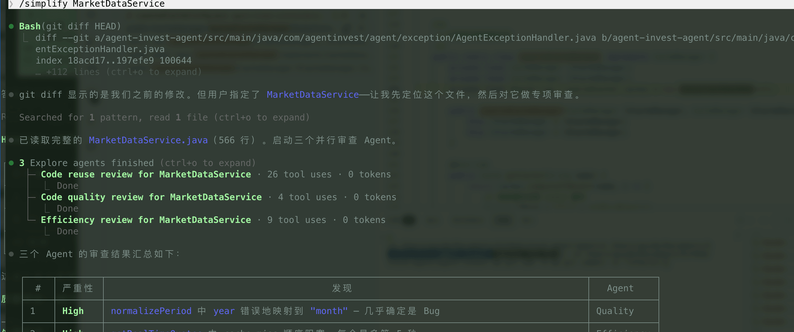

```bash
/simplify MarketDataService
```

I once ran a focused review of `MarketDataService`, a roughly 570-line market-data service. It combines multiple data sources and provides a Caffeine local cache, Redis distributed cache, and circuit breaking with fallback. The review found eight issues, including two high-severity correctness bugs. Based on the current command descriptions, `/code-review` should handle this kind of issue first.

**Bug: The `year` interval was silently mapped to `month`.** The `normalizePeriod` method contains a switch:

```java
case "year", "yearly", "y" -> "month";  // Bug: should be "year"
```

The other intervals map correctly (`day → "day"`, `week → "week"`, `month → "month"`), but `year` maps to `month`. A caller requesting yearly candlestick data receives monthly data, with no error or warning.

### When to Use `/simplify`

Before submitting a PR or after a multi-file refactor, use `/code-review` to check the logic, then `/simplify` to remove duplicate implementations and local complexity. It can suggest reusing an existing helper or moving business logic from a Controller back to a Service.

It is not a substitute for a full-project audit. Without arguments, it mainly checks the current diff. Use a formatter for code style, and `/code-review`, `/security-review`, or SAST tools for correctness and security issues.

## `/code-review` and `/review`: Code Review

For an uncommitted local diff, use `/code-review` to check correctness, edge cases, and potential bugs. For an existing Pull Request, use `/review` to select or specify the PR. Sensitive areas such as login, payments, permissions, and uploads also need `/security-review`.

`/simplify` addresses a different need: the logic is known to work, and you want to remove duplication, inefficient implementations, or misplaced abstractions. A common order is `/code-review` followed by `/simplify`.

### How `/code-review` Produces a Report

`/code-review` reads `git diff` or a specified PR, analyzes the changes in parallel, and filters findings by confidence. The report groups findings by Critical, High, Medium, and Low severity. Each finding points to a line and includes a reason and suggested fix. By default, the command only reports issues; pass `--fix` to let it try to fix some of them.

### Usage

```bash
/code-review high    # Show only high-severity issues
/code-review --fix   # Review and automatically fix some issues
/code-review ultra   # In-depth cloud review
```

Use `/review` to review a specific PR:

```bash
/review              # List open PRs in the current repository
/review 123          # Review the specified PR
```

For a file-level review, use a natural-language request such as “review src/auth/login.service.ts”.

After receiving the report, you can ask Claude to “fix all Critical issues” based on its findings.

### Choosing Between `/code-review`, `/review`, and `/security-review`

- Current diff or local changes: `/code-review`
- Existing Pull Request: `/review 123`
- Sensitive areas such as login, payments, permissions, uploads, and webhooks: `/security-review`
- In-depth cloud review before merging a critical PR: `/code-review ultra`

### `/code-review ultra`: In-Depth Cloud Review

`/code-review ultra` runs the review in a cloud sandbox, where multiple Agents analyze the same PR. It can provide an additional check before merging a critical PR. The older `/ultrareview` command remains an alias, but the official recommendation is now `/code-review ultra`.

```bash
/code-review ultra        # Deeply review the current diff or PR context
/code-review ultra 123    # Deeply review the specified target (check /help for support)
```

Cloud execution does not depend on the local environment, but takes longer and uses more tokens. It is still marked as a research preview; check the official documentation and local `/help` for current features and pricing.

### Ordering `/code-review` and `/simplify`

If you are not sure a change is correct, run `/code-review` first. After fixing logic errors, edge cases, and security issues, use `/simplify` to remove redundant code. If you have just finished a prototype and tests confirm its behavior, you can run `/simplify` directly.

### Example

I once finished a user authentication module and was ready to submit it after testing it myself. I ran `/code-review` and it flagged three issues:

**Critical: The password-reset endpoint had no rate limit.** An attacker could call it repeatedly and flood a user's inbox. I had not considered this in my own testing; there was only one user in the test environment.

**High: The Token expiration time came from configuration with no fallback.** If the setting was missing, the expiration time became 0, so each Token expired immediately. `/code-review` suggested a fallback such as `Math.max(config.tokenExpiry, 3600)`.

**Medium: The logs printed `userId` in plaintext.** It may not be sensitive, but redaction is preferable in environments with strict compliance requirements.

Two of the three issues were security-related. My own tests had not covered repeated password-reset requests or missing configuration.

### Do Not Use It as a Substitute for Static Analysis

By default, `/code-review` only provides suggestions; it modifies code only when you pass `--fix`. It also reads `CLAUDE.md`, so specific coding standards, technology choices, and security requirements give it more project context for the review.

Tools such as SonarQube scan consistently against defined rules. `/code-review` can use context to analyze Spring proxies, transaction boundaries, and authorization flows. They cover different issues and do not replace each other.

## `/loop` and `/goal`: Recurring Tasks and Completion Criteria

Boris Cherny has shared examples of using `/loop` several times.

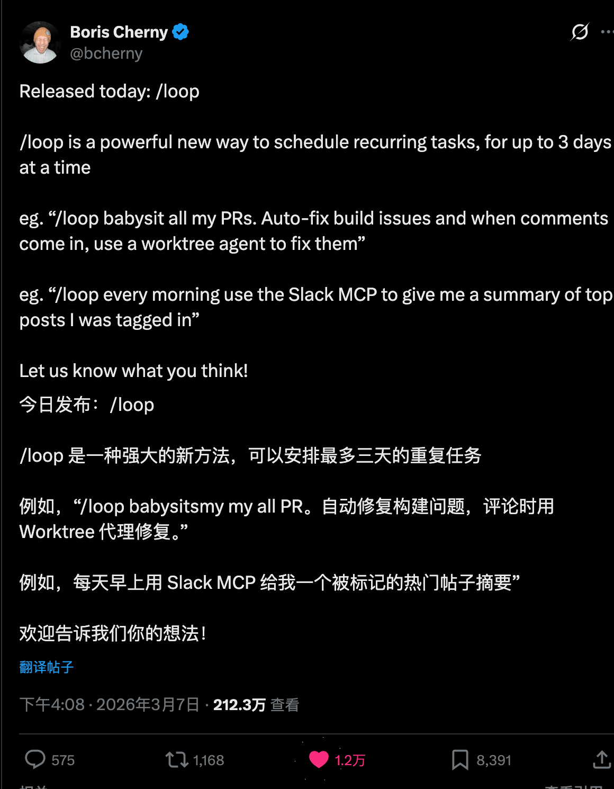

Use `/loop` when the schedule matters, such as checking a PR every 30 minutes. Use `/goal` when the completion criteria matter, such as fixing failing tests until they all pass.

`/loop` creates a recurring task in the current session. `/goal` starts work immediately and keeps planning, acting, and verifying against a completion condition. Using `/loop` for a migration can create a recurring task with no clear stopping point.

### Choosing Between the Three Scheduling Options

The available scheduling options are Cloud tasks, Desktop tasks, and `/loop`:

|                           | **Cloud tasks**     | **Desktop tasks**                     | **/loop**                                                                                                                     |
| ------------------------- | ------------------- | ------------------------------------- | ----------------------------------------------------------------------------------------------------------------------------- |
| Runs on                   | Anthropic cloud     | Your machine                          | Your machine                                                                                                                  |
| Requires machine to be on | No                  | Yes                                   | Yes                                                                                                                           |
| Requires active session   | No                  | No                                    | **Yes; keep it in the foreground or run it under a supervisor**                                                               |
| Survives restart          | Yes                 | Yes                                   | Session-scoped; does not run while closed; unexpired recurring tasks can resume within 7 days with `--resume` or `--continue` |
| Can access local files    | No (clones again)   | Yes                                   | Yes                                                                                                                           |
| MCP servers               | Configured per task | Configured in settings and connectors | Inherits the current session                                                                                                  |
| Minimum interval          | 1 hour              | 1 minute                              | 1 minute                                                                                                                      |

Choose Cloud tasks when your machine cannot stay online. Desktop tasks are better when local files and MCP configuration are needed. Use `/loop` for temporary polling in the current session, not for work that must run reliably over the long term.

### `/loop`: Run at an Interval

Specify what to do and how often in the Prompt:

```bash
/loop 30m "Review the current diff for correctness issues"       # Run the review Prompt every 30 minutes
/loop 1h "Run the unit tests and report failures"                # Check tests every hour
/loop 5m "Check the status of open PRs on GitHub"                # Check PRs every 5 minutes
```

Do not write `/loop 30m /code-review`. The model is not allowed to invoke `/code-review`, so a recurring task treats it as plain text. For scheduled reviews, describe what to check or use a tool that is allowed in that environment.

You can put the interval first, as in `/loop 30m check the build status`, or after the Prompt, as in `/loop check the build status every 2 hours`. If you omit the interval, Claude chooses the next run time dynamically, usually between 1 minute and 1 hour. On Bedrock, Vertex AI, and Microsoft Foundry, the interval is fixed at 10 minutes.

### `/goal`: Work Until Completion Criteria Are Met

Use `/goal` when you need Claude to “start now and keep fixing until the tests pass.” It continues planning, acting, and verifying against the completion criteria. Still specify when to stop, permission boundaries, and when it must ask for approval:

```bash
/goal "Fix all failing unit tests in the auth module until they pass; stop and ask before changing production configuration"
/goal "Migrate components under src/legacy to Tailwind CSS; finish when the existing visual regression tests pass"
/goal "Complete the ESM migration; finish when the build and all tests pass"
```

Clear, testable acceptance criteria determine when `/goal` finishes. High-risk actions such as payments, deployments, data deletion, and production configuration changes should not be implicitly authorized; state in the Prompt that Claude must stop and ask first.

### Applying These Commands to Real Tasks

PR status, test results, and documentation updates can be checked on a schedule. Keep scheduled tasks read-only at first and report any issues:

```bash
/loop 5m "Use gh to check open PRs and flag conflicts or PRs that appear safe to merge"
/loop 2h "Run the test suite and report new failures and related commits; do not modify code"
/loop 2h "Check recent code changes and update the relevant public documentation"
```

If tests fail and you want Claude to fix them, start a separate `/goal`. Handle large migrations the same way: make build and test results the completion criteria.

```bash
/goal "Convert all CommonJS require/module.exports in the project to ESM import/export; finish when the build and all tests pass"
```

If a project has several routine checks, add the `/loop` commands to a custom command file and create them together when starting the project.

### Managing Tasks

After creating a task, you can query or stop it in natural language:

```bash
What scheduled tasks do I have?
Stop the task that checks deployments.
```

These requests use three tools:

| Tool         | Purpose                                                              |
| ------------ | -------------------------------------------------------------------- |
| `CronCreate` | Create a task with a cron expression, Prompt, and recurrence setting |
| `CronList`   | List active tasks with their IDs, schedules, and Prompts             |
| `CronDelete` | Delete a task by ID                                                  |

### Runtime Limitations

The scheduler checks for due tasks every second, but tasks queue while Claude is busy with the current conversation. Recurring tasks also have jitter: runs may currently be delayed by up to 30 minutes, or by up to half the interval when the interval is under an hour. Do not use `/loop` when timing must be precise to the minute.

Recurring tasks expire automatically after seven days and run once more before deletion. They depend on the current session. A session managed by a supervisor can continue after the terminal closes; otherwise, tasks do not run or catch up while it is closed. Unexpired tasks can resume when you restore the same session with `--resume` or `--continue`.

Frequent `/loop` tasks and long-running `/goal` tasks consume tokens continuously. Commit a recoverable version before working on critical paths, and make scheduled checks report issues without modifying anything by default. For `/goal`, specify acceptance criteria, approval requirements, and how to stop if blocked. Use Cloud or Desktop Scheduled Tasks for reliable long-term execution; `/loop` is not a CI/CD system.

## `/debug`: Diagnose Claude Code Runtime Issues

An unreachable MCP server, a Hook that did not run, or a rejected tool call often points to Claude Code configuration or the current session. Check the state first: use `/mcp` for connections and authorization, `/hooks` for loaded Hooks, and `/permissions` for effective permission rules and their sources. Run `/debug` if this information does not explain the problem.

`/debug` is a Bundled Skill. It enables debug logging for the current session, reads the logs and relevant settings paths, and analyzes the issue you describe:

```bash
/debug The MCP server shows as connected, but no tools are available
/debug Why was this tool call blocked by a permission rule?
/debug Why did the Hook not run?
```

Debug logging is not enabled in advance by default. If Claude Code was not started with `--debug`, reproduce the issue after running `/debug` so it can inspect new logs; earlier errors are not recorded retroactively. For startup issues such as MCP initialization, exit and restart with `claude --debug "mcp"` to collect more complete logs.

`/debug` diagnoses Claude Code runtime and configuration issues. Use the project's debugger, application logs, and tests to investigate bugs in application code.

## `/run` and `/verify`: Run and Check Your Changes

Claude Code v2.1.145+ includes the `/run` and `/verify` Bundled Skills. `/run` starts the application and observes its behavior; `/verify` focuses on build and runtime checks.

### `/run`: Start and Observe the Application

```bash
/run
```

`/run` tries to identify how to start the project and launch the application. After changing login logic, you can ask it to start the service and check whether the login flow works as expected.

### `/verify`: Validate Changes with a Build or Run

```bash
/verify
```

`/verify` does not require a complete interactive walkthrough. It mainly runs build and runtime checks, making it useful for catching compilation errors and obvious runtime issues.

### `/run-skill-generator`: Record How to Start the Project

```bash
/run-skill-generator
```

Claude usually infers how to start a project from files such as `README`, `package.json`, and `Makefile`. It can get this wrong for multi-module projects, custom environment variables, or custom startup scripts. Run `/run-skill-generator` first to confirm and record the correct steps; `/run` and `/verify` can reuse that configuration.

## `/batch`: Coordinate Multiple Tasks in Parallel

Use `/batch` to deliver several relatively independent changes together. This example covers pages, components, Prompt management, and history:

```bash
/batch  1. Remove the watchlist page. Manage watchlists from the analysis page, with delete and grouping options at the end of each stock row.
  2. Extract the watchlist, candlestick chart, and discussion room into separate components.
  3. Improve Prompt management, including support for deletion and renaming.
  4. Improve the history design, which currently supports 10 records.
```

Claude first splits the request into Units, usually 5 to 30, and starts background Workers after you confirm the plan. Each Worker uses its own Git Worktree to modify the relevant module, avoiding multiple Agents writing to the same working directory.

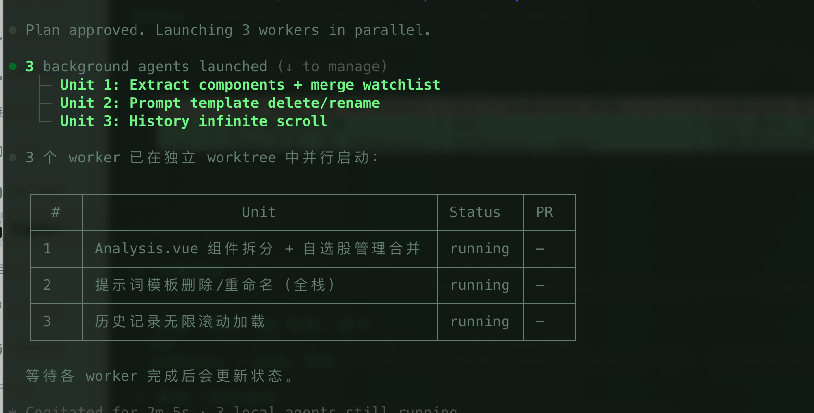

After the Workers finish, the main process reviews the changes one by one. Each Unit usually corresponds to a separate PR.

> **Caution:** `/batch` suits large tasks with clear boundaries and relatively independent modules. It is not a good fit for a single large change to a tightly coupled critical flow. Shared files such as `package.json`, route tables, common types, and database migrations can conflict. Commit a clean working tree before using it.

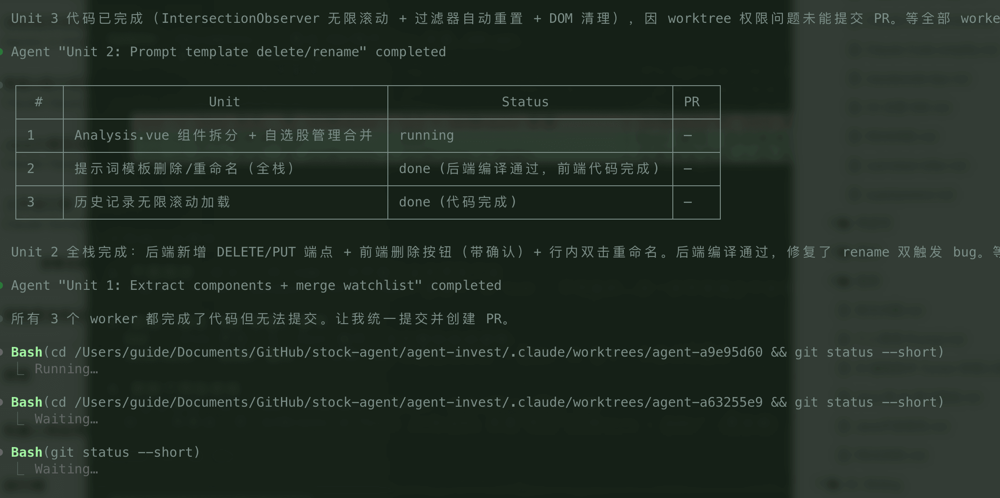

## Commands to Use Before and After Changes

`/context`, `/permissions`, and `/diff` answer three questions: how much context remains, which actions Claude is allowed to take, and what it actually changed.

### Check `/context` During Long Sessions

If a long task starts missing constraints or rereading files, check context usage first:

```bash
/context
```

`/context` lists the space used by tool output, conversation history, and rules files. If you want to continue the current session, specify what to preserve when you run `/compact`:

```bash
/compact Keep only the current refactoring goal, completed changes, remaining TODOs, and key constraints
```

Running `/compact` without instructions may compress constraints that are still needed. The example explicitly preserves the refactoring goal, completed changes, remaining TODOs, and key constraints so you can continue more easily.

### Tighten `/permissions` Before Automated Tasks

`/loop`, `/goal`, and `/batch` can keep Claude working for an extended period. Before starting, run:

```bash
/permissions
```

This interactive view lists the active permission rules and the configuration file each rule came from. Rules fall into three categories:

- `allow`: Run a matching action without asking.
- `ask`: Request confirmation for each matching action.
- `deny`: Block the action.

Rules are checked in the order `deny → ask → allow`, with `deny` taking priority. Predictable, low-risk actions such as builds and tests can be added to `allow` when appropriate. Set actions such as pushing a remote branch or running a deployment script to `ask`. Production database writes and destructive actions outside the task scope should be `deny`.

Permissions are enforced by the Claude Code client, not by whether the model remembers your instructions. A Prompt such as “do not deploy” is only a reminder; use a `deny` rule or PreToolUse Hook to prohibit an action.

### Review `/diff` After Changes

Claude's written summary may omit files it changed along the way. Run:

```bash
/diff
```

The interactive diff viewer shows the files and lines actually changed in the working tree. After `/simplify` or `/batch`, use this diff to decide what to keep, change further, or revert.

`/statusline` can keep the model, directory, context, and cost visible in the status line. Use `/usage` or `/cost` to check consumption before and after a long task.

## Combine Commands Based on Task Size

You do not need every command for a routine feature change. Run `/code-review` on the current diff; after confirming the logic, run `/simplify`; then use `/verify` for the build and any necessary runtime checks. Finally, inspect the changes with `/diff`.

Consider `/batch` for work across multiple modules. Check `/permissions` first, review each Worker’s changes, and add `/security-review` for sensitive modules. Once there is a PR, use `/review` for a pre-merge check.

`/loop` and `/goal` are not part of a fixed workflow. Use the former for recurring checks and the latter for ongoing tasks with clear completion criteria. Check `/context` when a session grows long, and use `/compact` with explicit preservation instructions if needed.

## Non-interactive Mode: Use Claude Code in Scripts and CI

Scripts and CI usually need to run a Prompt once, return the result, and exit; they do not need an interactive session.

### `claude -p`: Non-interactive Mode

```bash
claude -p "summarize this diff" --output-format json
```

`-p` accepts a Prompt and prints the result when execution finishes. Add `--output-format json` so scripts can parse the structured response.

### `--bare`: Skip Automatic Loading

For a one-off analysis that does not need Hooks, Skills, MCP, Auto Memory, or `CLAUDE.md`, use `--bare`:

```bash
claude --bare -p "explain this function"
```

`--bare` skips automatic loading, which speeds up startup but also removes this project context. It is not suitable for complex code changes.

### `--teleport`: Continue a Web Session Locally

```bash
claude --teleport
```

If a task in Claude Code on the web needs access to a local repository or command line, use `--teleport` to continue the web session in a local terminal.

## Appendix: Connect Claude Code to Third-party Models

Some providers offer Anthropic API-compatible endpoints, allowing Claude Code to connect to third-party models such as MiniMax and GLM. Anthropic API compatibility is required, but tool use, streaming, long-context support, and other capabilities must still be verified individually. Before connecting, check the terms of service, data processing location, and API key storage. Avoid proxies from unknown sources.

### 1. Get an API Key

- MiniMax platform: [API key](https://platform.minimaxi.com/user-center/basic-information/interface-key)
- GLM platform: [API keys](https://www.bigmodel.cn/usercenter/proj-mgmt/apikeys)

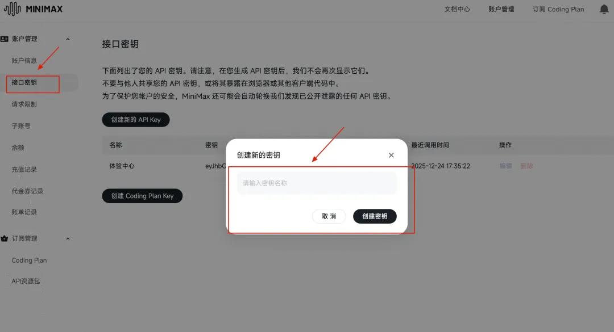

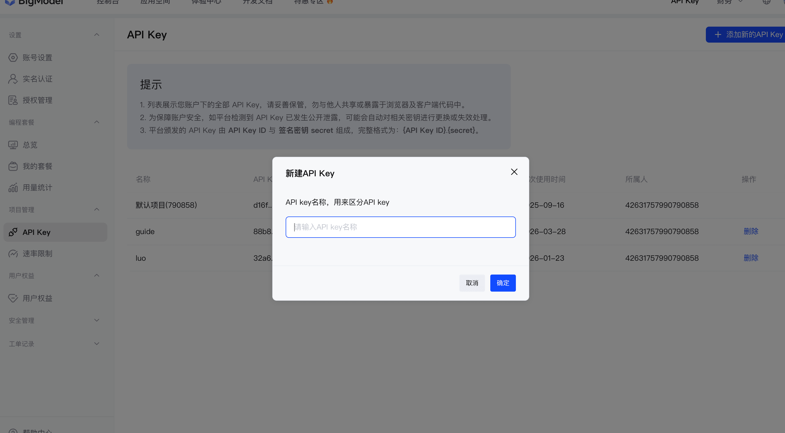

### 2. Use a Provider Configuration Tool

**CC Switch** is a community configuration manager for Claude Code providers, Skills, MCP, and Prompts. Whether to use it depends on your team's security requirements for third-party tools, API key storage, and proxy logs.

Project: [https://github.com/farion1231/cc-switch](https://github.com/farion1231/cc-switch)

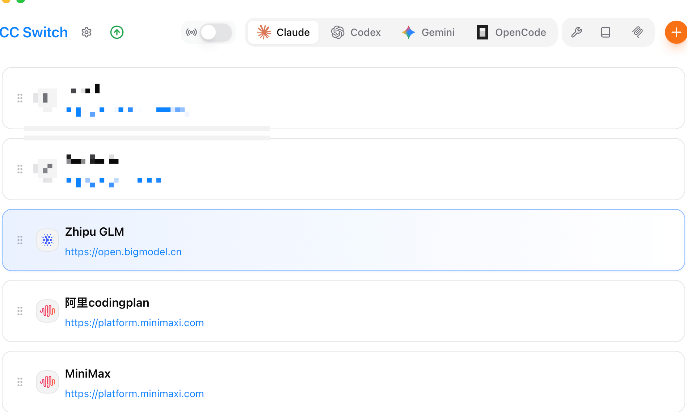

Open CC Switch, click `+` in the top-right corner, select a preset MiniMax or GLM provider, enter the API key and model, then add it.

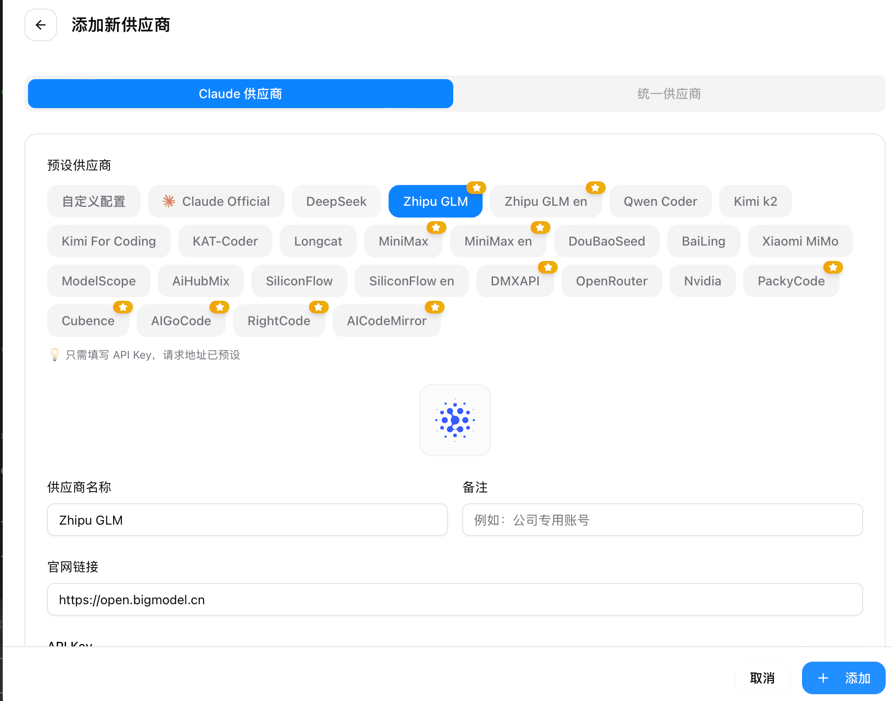

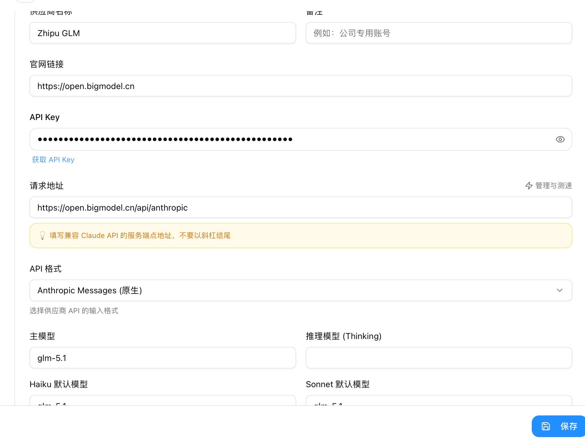

### 3. Verify the Configuration

Run `claude` from any directory to start Claude Code, then select **Trust This Folder**.

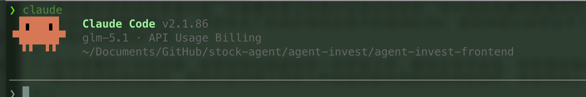

### 4. Integration Checklist

Successful chat only confirms that basic requests work. Claude Code also relies on tool use and multi-step execution, so verify each item in a test repository:

- [ ] Can it stream output reliably?
- [ ] Can it call Bash / Read / Edit / Write?
- [ ] Can it run subagents?
- [ ] Can it handle long contexts and compaction?
- [ ] Does it support MCP tool calls?
- [ ] Can it complete a real project cycle of “change code → run tests → fix issues”?

## Choosing Between Command Groups

Use `/code-review` for the current diff and `/review` for an existing PR. After confirming the logic, run `/simplify` if duplicate or complex code remains.

`/loop` runs at a time interval, while `/goal` continues until its completion criteria are met. Use the former for scheduled checks and the latter to fix failing tests or complete a migration.

Use `/run` to start the application and observe its behavior. `/verify` runs build and runtime checks. For complex projects, use `/run-skill-generator` to record the correct startup process first.

`/batch`, `/simplify`, and `/goal` can make broad changes. Check `/permissions` first, then inspect `/diff` and run tests afterward. If the session gets too long, use `/context` to identify what is using space before deciding whether to run `/compact`.

## References

- [Claude Code commands](https://code.claude.com/docs/en/commands)
- [Claude Code CLI reference](https://code.claude.com/docs/en/cli-usage)
- [Debug your configuration](https://code.claude.com/docs/en/debug-your-config)
- [Best practices for Claude Code](https://code.claude.com/docs/en/best-practices)
- [Configure permissions](https://code.claude.com/docs/en/permissions)
- [Extend Claude with skills](https://code.claude.com/docs/en/skills)
- [Automate with hooks](https://code.claude.com/docs/en/hooks)
