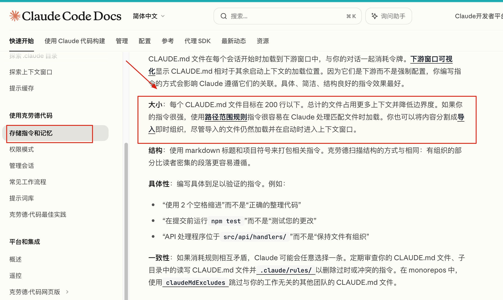
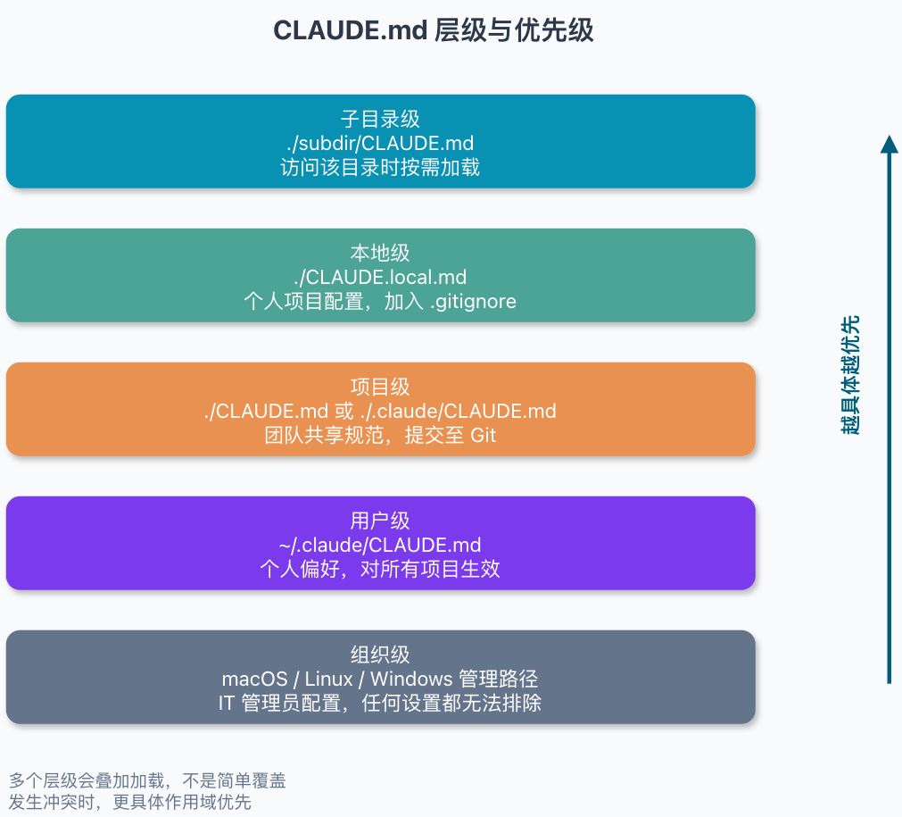
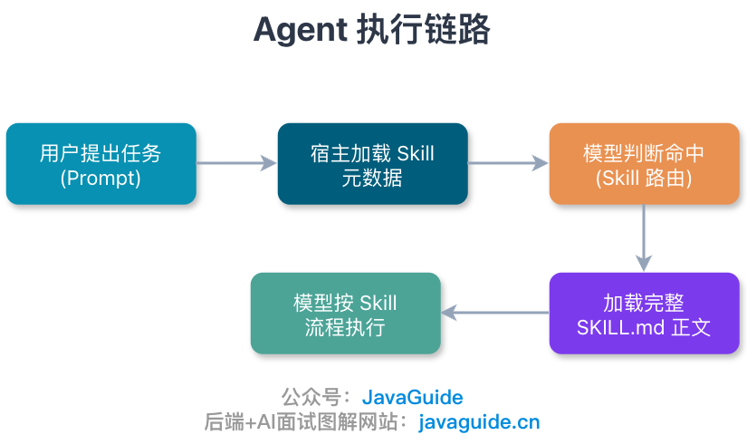
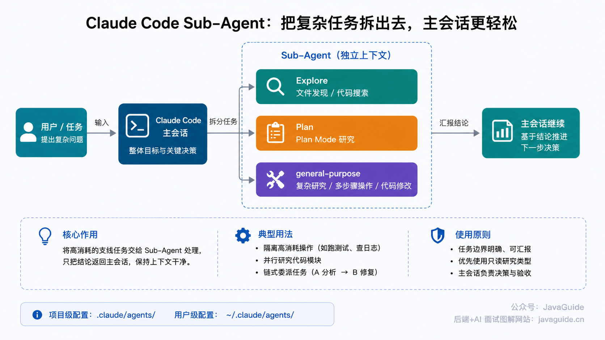
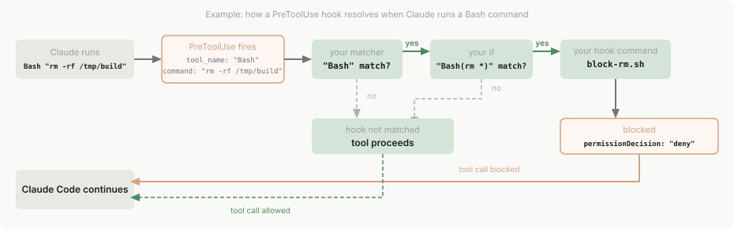
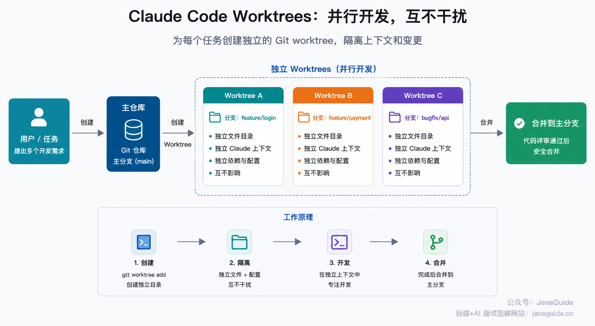

Hi, I'm Xiao G. My recent article, [Practical Vibe Coding Tips](./the-cool-tricks-for-vibe-coding.md), received more than 60,000 reads on my WeChat public account in two days. Many readers asked about Claude Code.

This article focuses on Claude Code.

When I first tried it, I found the experience awkward and even resisted it. After getting used to the sidebars, file trees, and diff panels in Cursor and IntelliJ IDEA, working with AI in a terminal felt unfamiliar.

After using it more, I found the CLI well suited to long-running tasks. It can run locally, on a remote machine, in a temporary environment, or in CI/CD. The same commands, permissions, and checks can be reused without adapting the workflow for a GUI.

Now I start by stating the directories, goal, and acceptance criteria. Claude Code can then read the code and run commands, and I review the diff and test results.

There are trade-offs. An overloaded `CLAUDE.md`, overly broad permissions, a crowded context window, or poorly scoped Sub-Agents can all send it off track.

The advice below comes mostly from more than a year of hands-on use. It focuses on practice rather than repeating the official documentation.

**Note:** Claude Code changes quickly. This article reflects the official documentation and my experience with v2.1.218 as of 2026-07-24. Commands, permission modes, plugins, Auto Mode, Sub-Agent, and Worktree behavior may vary by version, platform, account plan, provider, and installation method. Before using a feature, check `claude --version`, `claude --help`, `/help`, and the official documentation. For example, `/run` and `/verify` require v2.1.145 or later; `/code-review` supports effort levels, `--comment`, and `--fix`; `/simplify` is currently best understood as a cleanup-only review, not a full correctness or bug review.

In China, also consider account availability, network access, cost, and the reliability of third-party relays. Models such as GLM, MiniMax, Kimi, and DeepSeek can serve as alternatives or complements. Claude is still worth evaluating for large code changes, complex refactoring, and long debugging sessions.

## `CLAUDE.md` Matters

Do not turn `CLAUDE.md` into a second README. Treat it as a project guide for Claude Code: record rules that cannot be inferred from the code, commands it often gets wrong, directories it must not touch, and tests to run after changing certain code.


I usually keep only these items in the file: **rules Claude is likely to guess incorrectly, conventions that cannot be inferred from code, requirements the team must follow, technology versions, common commands, architectural decisions, and project-specific pitfalls.**

The official documentation recommends keeping each `CLAUDE.md` under 200 lines. Longer files use more context and may make rules harder to follow. If the file keeps growing, move path-specific rules to `.claude/rules/` with `paths`, and put reference material that is rarely needed into Skills.



To decide whether a rule belongs in the file, I ask:

> If I remove this line, is Claude more likely to make a mistake?

If so, keep it. Otherwise, remove it.

### Where to Put It

`CLAUDE.md` can be stored in several locations. The official loading order goes roughly from global to local, so consider more than just the file in the project root:



The outermost level is organization-wide and is usually managed by IT or DevOps. The paths are `/Library/Application Support/ClaudeCode/CLAUDE.md` on macOS, `/etc/claude-code/CLAUDE.md` on Linux or WSL, and `C:\Program Files\ClaudeCode\CLAUDE.md` on Windows. These rules are generally not managed in an individual project.

Next is the user-level `~/.claude/CLAUDE.md`, which is suited to your general preferences. Put project-level files at `./CLAUDE.md` or `./.claude/CLAUDE.md` and commit them so the team can use them. Keep personal settings in `./CLAUDE.local.md` and add it to `.gitignore`. Subdirectory `CLAUDE.md` files are loaded on demand when Claude accesses the corresponding directory, not all at session startup.

These files are loaded together; a later file does not replace everything in an earlier one. Rules closer to the current project and with a more specific scope are loaded later and are more likely to take precedence.

For example, a user-level rule might require spaces for indentation while a project-level rule requires tabs. Claude will usually follow the project rule in that repository. The documented order also runs from organization-level and user-level rules to project-level and local rules.

I commit the project-level `CLAUDE.md` with rules the whole team must follow. Personal preferences, such as using Chinese commit messages in one project, go in `CLAUDE.local.md`, which I add to `.gitignore`.

For a larger project, you can split the instructions by directory:

```text
my-project/
├── CLAUDE.md
├── backend/
│   └── CLAUDE.md
├── frontend/
│   └── CLAUDE.md
└── .claude/
    ├── rules/
    ├── skills/
    └── agents/
```

Keep global conventions in the root file and local rules in subdirectories. When Claude reads files in a subdirectory, it loads the instructions for that directory as needed. This works well for monorepos because backend, frontend, and admin-console rules do not have to share one file.

Do not mistake `@path` references for context savings. The referenced content still enters the context; the reference only makes the instructions easier to organize. If rules apply only to certain directories, use path-based rules in `.claude/rules/` instead of adding them to the root file.

### Initializing and Maintaining It

For a new project, start by running:

```bash
/init
```

Claude reads the repository and generates an initial `CLAUDE.md`. Treat it as a draft rather than committing it as is: it may guess the build command incorrectly or repeat information already covered in the README.

The main risk during maintenance is letting the file grow without limit.

Do not add a rule after one occasional mistake. Wait until a similar issue occurs two or three times and you can prevent it with a clear instruction. Remove facts that are obvious from the code, behavior the model already handles, and obsolete conventions. Too many rules can bury the ones that matter.

If Claude reads a rule but does not follow it, check whether it is too vague. “Try to keep tests complete” is unclear; “After changing a Service, run the related unit test and report the command and result” is actionable. If the same rule fails across several sessions, check whether the file is too long or the rule is in the wrong place.

I separate rules into two groups: put long-term requirements shared by the team in `CLAUDE.md`; leave personal preferences, temporary debugging findings, and reminders to Auto Memory or local settings. Base `CLAUDE.md` rules on real mistakes and periodically remove obsolete content.

Do not assume a rule is active just because you wrote it. Use `/context` to see which `CLAUDE.md`, `CLAUDE.local.md`, and rules files loaded in the current session. Use `/memory` mainly to view and edit memory and rule locations. If a file does not appear in `/context`, Claude cannot see it in that session. In complex projects using `.claude/rules/` with `paths`, an `InstructionsLoaded` Hook can record when and why a rule file loaded.

## Manage Permissions Carefully

### Grant Permissions in Layers

By default, Claude Code asks for confirmation before sensitive actions such as writing files, running Bash commands, or calling MCP tools. The prompts can be inconvenient, but keeping them enabled is safer while you are learning how it behaves.

I start by allowing commands that are safe to inspect and run. Read-only commands such as `git diff`, `git status`, and `rg` can require fewer prompts. Fixed validation commands such as `mvn test`, `pnpm test`, and `npm run lint` can also be allowed, depending on the project.

By contrast, do not allow commands such as `rm -rf` and `git push --force`, or edits to `.git/`, by default. Use deny rules to block access to `.env`, `secrets/`, build artifacts, certificate directories, and dump files.

Configure permissions with `/permissions` or in `.claude/settings.json`:

```json
{
  "permissions": {
    "allow": ["Bash(git status*)", "Bash(git diff*)", "Bash(rg *)"],
    "deny": [
      "Read(./.env)",
      "Read(./.env.*)",
      "Read(./secrets/**)",
      "Bash(rm -rf *)"
    ]
  }
}
```

Claude Code enforces these rules at the execution layer. A prompt saying “never read `.env`” is only a request; a deny rule blocks the operation.

Auto Mode's classifier also considers the boundaries stated in the conversation, but this is not a guarantee. Put critical boundaries in `permissions.deny` or enforce them with a Hook before tool calls. Temporary restrictions mentioned in a long conversation may be lost when context is compacted.

### Auto Mode

If frequent confirmations slow you down, consider Auto Mode.

According to the current documentation, use `Shift+Tab` in the CLI to cycle through permission modes. `auto` appears in the cycle only when the account, model, provider, and organization settings support it. In Team or Enterprise environments, an administrator may enable or lock the setting.

Auto Mode uses a separate classifier to assess risk and automatically allows low-risk actions. It blocks or requests human approval for actions such as downloading and running unfamiliar code, sending sensitive data to external endpoints, deploying to production, force pushing, or pushing directly to `main`.

Auto Mode does not provide a security sandbox and may misclassify actions. It reduces confirmation prompts; it does not isolate the file system, network, or credentials. Use containers, temporary accounts, least privilege, deny rules, Hooks, and human review for high-risk tasks.

To make Auto Mode the default, do not set `"defaultMode": "auto"` in project-level `.claude/settings.json` or `.claude/settings.local.json`. Version 2.1.142 and later ignore `auto` settings from these files so a repository cannot enable Auto Mode for itself. Set it in the user-level `~/.claude/settings.json` or organization-managed settings. Providers such as Bedrock, Vertex AI, and Microsoft Foundry may also require `CLAUDE_CODE_ENABLE_AUTO_MODE=1`.

Do not hard-code startup options. Support for permission modes can vary by version, installation method, and provider, so check `claude --help` or the official documentation for valid values before using them in a script. For interactive use, I prefer cycling modes with `Shift+Tab` in the session instead of putting a high-permission mode in a script.

I do not recommend using `--dangerously-skip-permissions` for everyday projects. Unless the file system, network, and credentials are isolated, one mistake could change the wrong files or expose credentials.

## Security Boundaries

Do not expose production credentials, database passwords, or long-lived cloud tokens to Claude. Do not give it direct access to production unless the task has proper approval and auditing.

Restrict Git access as well. Do not allow pushes to `main` by default, and do not make force-pushing a remote branch an easy action. Test remote scripts from unknown sources, especially commands such as `curl | bash`, only in an isolated environment.

Control which files Claude can read. `.env`, `secrets/`, certificate directories, SSH keys, database dumps, and production logs should not be accessible by default.

This includes more than `.env`: do not expose `~/.aws/`, `~/.gcp/`, `~/.kube/`, `~/.ssh/`, Maven `settings.xml`, npm tokens, production logs, or database dumps without a clear need. If Claude needs to inspect logs, redact sensitive data, extract only relevant lines, and limit the scope.

When automating a high-privilege task, run it in a container with temporary credentials and a least-privilege account. This limits the impact if a command goes wrong.

## MCP, Skills, Sub-Agents, and Plugins

Claude Code has many related features that can be confusing at first. Here is how I distinguish them:

| **Feature** | **Purpose**                       | **Good for**                                                          | **Not for**                                |
| ----------- | --------------------------------- | --------------------------------------------------------------------- | ------------------------------------------ |
| `CLAUDE.md` | Context needed in every session   | Build commands, directory conventions, team rules                     | Multi-step task procedures                 |
| Rules       | Path-scoped instructions          | Frontend, backend, and security rules                                 | Core conventions needed across the project |
| Skills      | Reusable task procedures          | TDD, code review, writing, frontend implementation                    | Permanent background information           |
| MCP         | Connect to external systems       | GitHub, Sentry, Notion, Figma, databases                              | Rules for ordinary local files             |
| Sub-Agent   | Isolate context for side tasks    | Code search, focused reviews, parallel research                       | Small, one-off changes                     |
| Hooks       | Enforce fixed actions             | Block dangerous commands, format after edits, test before session end | Suggestions for reference only             |
| Plugins     | Package and distribute extensions | Combinations of Skills, MCP, Hooks, and scripts                       | Unreviewed third-party permission bundles  |

For example, `CLAUDE.md` can remind Claude to run a formatter after every edit, but a Hook can trigger formatting automatically. Similarly, instructions for fixing a GitHub Issue would clutter every session in `CLAUDE.md`; they fit better in a Skill.

### Code Intelligence: Reduce Reliance on Text Search

If your project supports Code Intelligence, configure it. It gives Claude access to language-server features such as checking type errors, finding symbol definitions, and looking up references, so it does not have to search through many files with `rg` each time.

In a Java or TypeScript project, Claude does not have to search for a keyword and open files one by one to find where a class is defined or used. With LSP, it can jump to definitions, inspect references, and catch type errors after code changes.

Code Intelligence does not replace text search, but it can reduce how many irrelevant files Claude reads. In a large project, that keeps context focused and makes it less likely to be distracted by candidate files. Claude Code recommends installing a Code Intelligence plugin for typed languages; one symbol jump can replace a search and several file reads.

However, installing the Code Intelligence plugin is not enough. The corresponding language-server binary must also be installed locally, such as `jdtls` for Java or `typescript-language-server` for TypeScript. If the Errors page in `/plugin` shows `Executable not found in $PATH`, this dependency is usually missing.

### MCP: Connect Claude to External Systems

MCP (Model Context Protocol) connects Claude to external systems. An external system provides an MCP server, and a client such as Claude Code can connect to it and call its tools.


MCP is the main way to connect Claude Code to external tools. Common uses include querying databases, reading Sentry errors, accessing a browser, retrieving Notion documents, and fetching Figma designs.

Add a remote MCP server with a command like this:

```bash
claude mcp add --transport http notion https://mcp.notion.com/mcp \
  --header "Authorization: Bearer your-token"
```

`your-token` is a placeholder. Avoid putting real tokens in your shell history.

For team projects, shared MCP settings can go in `.mcp.json` and be committed to the repository. For example, if the project uses Notion, Sentry, and an internal documentation system, record their shared server names, URLs, and transports there.

Do not commit tokens, keys, or database connection strings in `.mcp.json`. Store them in user-level settings, local environment variables, or a secrets manager, or use the MCP server's OAuth flow.

Use MCP servers selectively. The more tools available, the more likely Claude is to choose the wrong one, and the harder usage is to audit. Use `/mcp` to check connections and enable or disable servers. Use `/usage` to review costs and usage by Skill, subagent, plugin, and MCP server. Disconnect servers you rarely use.

### Skills: Save Reusable Workflows

Do not use rule files and Skills for the same purpose.

Use rule files for long-term constraints such as technology versions, startup commands, directory structure, error-code formats, and files Claude must not touch.

Use Skills for task procedures such as code review, writing tests, changing frontend pages, web research, and writing technical articles. These tasks follow similar steps each time, so you do not have to repeat the instructions in chat.

I have written two related articles: [What Are Agent Skills, and How Do They Differ from Prompts and MCP?](https://javaguide.cn/ai/agent/skills.html) and [A Selection Guide to AI Coding Skills](https://javaguide.cn/ai-coding/practices/programmer-essential-skills.html).

A Skill is a task guide that loads on demand. Put the procedure, constraints, checks, and lessons learned for a type of task in `SKILL.md`.

One difference from `CLAUDE.md` is when the content loads. Claude initially sees only a Skill's name and description and uses them to decide whether to invoke it. The `SKILL.md` body and related resources enter the context only when the Skill is invoked. User-level Skills go in `~/.claude/skills/`; project-level Skills go in `.claude/skills/`.

One version change to note: Claude Code has merged custom commands into Skills. Both `.claude/commands/deploy.md` and `.claude/skills/deploy/SKILL.md` can define a command such as `/deploy`. The older `.claude/commands/` directory still works, but new commands are better organized as Skills.



You can turn repeatable procedures into Skills. For feature work, follow TDD by writing a failing test first. For code reviews, check security, transactions, performance, and edge cases. For technical articles, verify sources, citations, heading structure, and signs of AI-generated prose.

This is more reliable than adding a long list of reminders to every prompt. The official definition of a Skill is similar: reusable instructions, scripts, and resources that guide Claude through a task.

You can also use existing Skills. For example, Superpowers packages workflows for TDD, code review, spec-driven development, Git Worktrees, and Sub-Agent collaboration.

See my [AI Coding Skills Selection Guide: Requirements, TDD, Code Review, and UI Design](https://javaguide.cn/ai-coding/practices/programmer-essential-skills.html) for recommendations.

Do not run third-party Skills without reviewing them. `SKILL.md` contains instructions that an Agent may follow, including dangerous commands, unfamiliar scripts, or overly broad permissions. Before installing a Skill, review its instructions, `scripts/`, and `references/` for actions that exceed its intended scope.

### Plugins: Start with the Official Marketplace

If you do not want to configure Skills, MCP, and Hooks from scratch, browse Claude Code's official plugin marketplace, [`claude-plugins-official`](https://github.com/anthropics/claude-plugins-official).

Install a plugin with:

```bash
/plugin install <name>@claude-plugins-official
```

Plugins save setup time. A plugin may bundle a Skill, an MCP server, Hooks, and helper scripts into a ready-to-use workflow.

Plugins still run on your machine, and some may access the file system, browser, GitHub, databases, or third-party services. Review the documentation, permissions, and source before installing one. Uninstall plugins you no longer need to reduce unnecessary tool access. See the official [Discover plugins](https://code.claude.com/docs/en/discover-plugins) documentation for how to find and install them.

### Sub-Agents: Keep the Main Session Focused

I use Sub-Agents often.



When investigating a complex problem, Claude may need to read dozens of files, search a lot of code, and run several commands. Logs, search results, and file contents can quickly fill the main session and make later coding less focused.

Delegate this kind of side task to a Sub-Agent. It has its own context and can inspect code, check logs, and analyze the problem independently, then report its findings back to the main session.

The built-in Claude Code subagents I use most often are Explore, Plan, and general-purpose. They inherit the parent session's permissions, with additional tool restrictions:

| **Subagent**        | **Model**                                  | **Tools / permissions**                          | **Use**                                             |
| ------------------- | ------------------------------------------ | ------------------------------------------------ | --------------------------------------------------- |
| **Explore**         | Haiku, optimized for speed and low latency | Read-only; no Write or Edit                      | File discovery, code search, repository exploration |
| **Plan**            | Inherits the main conversation's model     | Read-only; no Write or Edit                      | Repository research in Plan Mode                    |
| **general-purpose** | Inherits the main conversation's model     | Inherits available tools, subject to permissions | Complex research, multi-step tasks, code changes    |

Explore and Plan are intended for read-only research, not direct code changes. One detail in the documentation: they skip `CLAUDE.md` files and the parent session's Git status, which makes them useful for quick code searches and context gathering. Other built-in and custom subagents load this information.

The general-purpose subagent has broader scope and may explore, run commands, and modify code. Before using it, specify which directories it can read, which files it cannot change, whether it may write files, and whether you want findings or an implementation. For strict limits, do not rely on prompts alone; configure the subagent's `tools` or `disallowedTools`, permission mode, `permissions.deny`, or Hooks.

You can also create custom subagents. Put project-level definitions in `.claude/agents/` to share them with the team, or user-level definitions in `~/.claude/agents/` to reuse them across projects. Each subagent can have its own system prompt, tool permissions, model, and triggering conditions.

I often ask a subagent to run the test suite and return only failing tests and error messages. Another option is to have separate subagents investigate authentication, database, and API modules, then combine their findings in the main session. For a more complex task, a code-reviewer subagent can identify performance issues before an optimizer subagent attempts fixes.

Do not split work into subagents when the task is small, its scope is unclear, or the code is changing rapidly. Keep the goal, decisions, and acceptance criteria in the main session; delegate only well-scoped tasks with reportable results.

Think of Agent teams as collaboration across multiple sessions. Sub-Agents isolate side tasks, while Agent teams coordinate separate sessions around shared work. There is no need to rush into them; first get comfortable with Worktrees, small commits, and a steady verification workflow.

A custom security-review subagent might look like this:

```markdown
---
name: security-reviewer
description: Reviews Java and Spring Boot code for security risks.
tools: Read, Grep, Glob, Bash
model: opus
---

Review the target diff for:

- SQL injection and unsafe dynamic queries.
- Authentication and authorization bypass.
- Secrets or credentials committed to code.
- Unsafe deserialization or command execution.

Return concrete file and line references. Do not rewrite code unless explicitly asked.
```

In practice, keep a subagent's tools as limited as possible. A code-review task usually does not need `Edit` or `Write`. If both `tools` and `disallowedTools` are set, `disallowedTools` is applied first; any tool listed in both is removed.

### Hooks: Enforce Required Actions

Hooks are easy to overlook, but useful in real projects. They run actions at specific points in Claude Code's lifecycle, such as before a tool call, after a file edit, before a session ends, or around context compaction.

For example, suppose Claude Code is about to run:

```bash
rm -rf /tmp/build
```

The `PreToolUse` Hook receives this Bash call and checks whether it is dangerous. If it matches a rule, the Hook returns `deny`; Claude Code cancels the tool call and reports the reason to Claude.

The following diagram from the Claude Code Hooks documentation shows this flow.



I use Hooks to automate formatting after edits, run tests before a session ends, block changes to `migrations/` or `.github/workflows/`, intercept `curl | bash` and `rm -rf`, prevent sensitive data from being sent to external endpoints, or add context when a Sub-Agent starts.

Put actions that must always run in a Hook. Keep background information in `CLAUDE.md`.

One caveat for HTTP Hooks: returning a 4xx or 5xx response does not block a tool call. Non-2xx responses, connection failures, and timeouts are treated as non-blocking errors, so execution continues. To block a call, return 2xx and set `decision: "block"` in the JSON, or set `permissionDecision: "deny"` in `hookSpecificOutput`.

## Common Workflows

### Explore, Plan, Execute, Verify

For a complex task, do not ask Claude to start coding immediately. Have it inspect the repository first without changing files:

```text
Enter plan mode. Read src/auth and the related tests to understand the session refresh flow.
Do not write code. Report the current flow, relevant files, and likely change points.
```

After it has finished reading, ask it for a plan:

```text
I need to fix token refresh failing after a user's session expires.
Based on your review, list the files to change, test strategy, and risks.
```

After you approve the plan, ask Claude to implement it:

```text
Implement this plan. First add a test that reproduces the issue, then update the implementation.
When finished, run the relevant tests and report the commands and results.
```

This process is slower at first but avoids rework later. When you are unfamiliar with the codebase or the change spans several modules, ask Claude to explain the call flow, risks, and test strategy before coding. This reduces the chance of finding out too late that it took the wrong approach.

Skip planning for small changes such as updating copy, adding a log message, or fixing an obvious null check. Over-planning also wastes context.

### Test-Driven Development

One challenge with AI-generated code is that it can look plausible without being correct. TDD defines the expected behavior first and gives the implementation a test to satisfy.

Keep the prompt simple:

```text
Do not change the implementation yet. Write a failing test for TokenRefreshService
that covers an expired session with a still-valid refresh token.
After the test fails, update the implementation until it passes.
```

If the test did not fail first, it is hard to confirm that the implementation fixes the intended problem. Otherwise, Claude might change a lot of code and simply report that the issue is fixed.

Superpowers, recommended in the [AI Coding Skills Selection Guide](https://javaguide.cn/ai-coding/practices/programmer-essential-skills.html), includes a TDD workflow.

### Let Claude Verify Its Work

One recommendation in Anthropic's best practices stands out to me: **give Claude a way to verify its work.** This can be a test, build, linter, screenshot comparison, or script output.

For example, do not just say:

```text
Write an email validation function.
```

This version leaves less room for guesswork:

```text
Write an email validation function. Test cases:

- `hello@gmail.com` should pass.
- `hello@` should fail.
- `@domain.com` should fail.
- `a@b.co` should pass.

Run the tests after implementation and report the commands and results.
```

The more specific the acceptance criteria, the less likely Claude is to stop at something that merely looks complete.

For a long-running task, add a limit such as “Try at most three times; if it still fails, stop and report the blocker.” This prevents Claude from spending too many tokens going in the wrong direction.

### Ask Questions About the Codebase

When taking over an unfamiliar project, I first use Claude Code as a guide. Before asking it to edit files, ask about the call flow:

```text
What is the complete user login flow, from the incoming HTTP request through the session write?
List the related classes and methods. Do not modify any files.
```

Or:

```text
Where is the order state machine defined in this project, and how does it transition between states?
Also point out any implicit constraints.
```

Still spot-check the summary. Cross-service calls, configuration switches, and backward-compatibility logic are easy to describe fluently while missing a branch.

### Provide Error Details When Fixing Bugs

When reporting a bug, avoid giving only:

```text
Login is broken. Please fix it.
```

That leaves Claude guessing. Providing the original evidence is more reliable:

```text
Here are the production error logs, reproduction steps, and related request parameters.
First identify the likely cause; do not change the code yet.
After finding the root cause, add a test that reproduces the issue and then fix it.
```

Logs, stack traces, Slack discussions, Docker output, and failing test results are more useful than a summary such as “it might be a cache issue.” The more you paraphrase, the more likely Claude is to follow your guess.

### Multiple Sessions and Worktrees

Do not make one Claude session handle everything. Independent tasks can run in parallel in separate sessions.

Claude Code can use Git Worktrees to isolate sessions:

```bash
claude --worktree feature-auth
claude --worktree bugfix-payment
```

`--worktree` is an officially supported Claude Code option. It creates an isolated worktree under the repository and starts a session. The default directory is `.claude/worktrees/<name>/`, and the branch is usually named `worktree-<name>`. To control the directory and branch yourself, create the worktree with Git first:

```bash
git worktree add ../project-auth -b feature-auth
cd ../project-auth
claude
```

Each Worktree has its own directory and branch. One session can change the authentication module while another fixes a payment bug without their files conflicting. The official desktop app also creates a Worktree for each new session, following the same approach as the CLI.



If you have several background sessions, run:

```bash
claude agents
```

Agent View shows background sessions in one interface, including which are running, waiting for confirmation, or complete. It is easier to manage than a row of terminal windows when you use multiple sessions regularly.

One caveat: before editing files, a background session automatically moves into its own Worktree under `.claude/worktrees/` to prevent sessions from changing the same working tree. This can be inconvenient in projects with many generated artifacts or path-sensitive pre-commit hooks. In that case, set `worktree.bgIsolation` to `"none"` in `.claude/settings.json` (requires v2.1.143 or later) so background sessions edit the working tree directly. The trade-off is that concurrent sessions may conflict, so decide based on the project.

If `.worktreeinclude` copies ignored files such as `.env`, `.env.local`, or `config/secrets.json` into a new Worktree, confirm that they contain only local development credentials, not production credentials. Worktrees isolate file changes, not secret exposure.

### Keep Commits and Pull Requests Small

Do not ask Claude to submit a large batch of changes all at once.

I prefer small commits, each focused on one change. Before committing, ask Claude for a diff summary, verification commands, and remaining risks. Then review `git diff --stat` and the diffs of key files yourself.

Claude can quickly write commit messages and PR descriptions, but do not rely only on its summary. Reviewing the diff yourself is more reliable than taking “only the authentication logic changed” at face value. A PR description should state what changed, how it was tested, and what remains unresolved.

## Common Commands

You do not need to memorize commands; type `/` to browse them when needed. I group them into two categories.

First are the basic commands: use `/help` to see available commands and `/diff` to review which files and lines Claude changed. If a long task slows down or drifts, check `/context` and use `/compact` if the context is too full. Use `/permissions` for permissions, `/memory` for memory and rule locations, `/mcp` for MCP connections, and `/usage` for usage breakdowns.

The second category includes commands for bundled Skills and workflows. `/code-review` checks the current changes for correctness bugs, edge cases, and potential risks. You can set the effort level, for example `/code-review high`; `--comment` posts findings as inline comments on a GitHub PR, and `--fix` applies review findings to the working tree.

`/simplify` is currently best understood as a cleanup-only review for reuse, simplification, and efficiency improvements, with fixes applied automatically. It is not a full bug-hunting review. The relationship between `/simplify` and `/code-review --fix` has changed across versions; if the behavior differs from this article, check the current `/help` and official commands documentation.

Use `/batch` for well-scoped changes across multiple modules. It splits the work into units and runs background Workers in isolated Worktrees. `/loop` repeats a prompt at an interval, which is useful for polling CI or scheduled maintenance. Use `/goal` for continuous work toward a condition such as passing tests or completing a migration, and state clear acceptance and stopping criteria. `/run` starts the application to check whether changes work; `/verify` focuses on build and runtime checks for quick feedback on compilation or runtime issues.

These commands and bundled Skills change quickly, and the available list may vary by version, platform, and subscription plan. This article describes my experience; before using a command on your own machine, check `/help` and the official commands documentation. Behavior in one version may not remain the same.

One detail about `/compact` is easy to miss: some rules may not return to the context immediately after compaction. The root `CLAUDE.md` is injected again, but nested rules in subdirectories may not be. After compacting a long task, ask Claude to restate the current goal, changed files, remaining risks, and next verification command before continuing.

For details, see my article [Claude Code Commands: code-review, loop, goal, batch, run, and verify](https://javaguide.cn/ai-coding/practices/claudecode-commands.html).

## Writing Prompts

### Use English and Chinese Where They Fit

For programming tasks, English is often more reliable. This does not mean Chinese is unsuitable; code, library names, error messages, and API documentation are already largely in English. Translating terms such as `modal`, `debounce`, `retry policy`, and `transaction boundary` can make them less precise.

Chinese is still more precise for business context, product rules, and Chinese copy. My approach is to use English for code actions, technical constraints, and terminology, and Chinese for business meaning, acceptance criteria, and Chinese copy.

### Limit the Scope

Be careful with vague requests such as “investigate this project.” Claude may search widely and fill the context as it reads.

Be specific instead:

```text
Inspect only the src/payment and src/order directories.
Find where inventory is deducted after an order payment succeeds.
Do not edit files. List the call flow and related classes.
```

Clear scope, goals, and restrictions help limit which files Claude searches and changes.

### Provide a Good Example

To get code that follows the project's style, do not just say “follow best practices.” That is too broad and can produce code that looks good but does not fit the project.

Providing an existing example usually works better:

```text
Read UserController.java, UserService.java, and UserDTO.java.
Follow their layering, constructor injection, Result<T> response format, and exception handling.
Add an OrderController for order queries without introducing a new response structure.
```

Existing project conventions often matter more than generic “best practices.” This is especially true in older projects, where layers, response formats, exception handling, and log formats reflect history and team habits. Have Claude read examples first, then follow them to make the output fit the repository.

### Be Specific About Frontend Design

When asking Claude to build a frontend, do not just say “modern, simple, and polished.”

Those terms are vague and often lead to the same familiar design: Inter, purple gradients, rounded cards, and a marketing-page look. Admin tools are especially prone to this; a page meant for frequent operational use can end up looking like a product landing page.

I make the requirements more specific:

```text
Use the existing Ant Design components; do not add a UI library.
This is an admin tool. Prioritize information density and avoid a marketing-page style.
Use the project's existing CSS variables for colors; do not add a purple gradient background.
Follow the filters and table layout in src/pages/UserList.tsx.
```

You can also put design conventions in a Skill so Claude reads the project's visual constraints before each frontend task. First rule out patterns that do not fit. An admin tool should prioritize information density, scanability, and action feedback over a vague sense of style.

The [AI Coding Skills Selection Guide](https://javaguide.cn/ai-coding/practices/programmer-essential-skills.html) also recommends open-source Skills for frontend work.

## Common Failure Modes

The problem I encounter most often is a session with too many topics. When one session covers requirements, debugging, refactoring, and releases, Claude may carry assumptions from one task into the next. Use `/clear` when switching tasks, and write a `HANDOFF.md` if needed instead of forcing the same context to continue.

Another failure mode is a correction loop. If Claude gets the same point wrong after three corrections, stop working in the same context. Start a new prompt that clearly states the goal, evidence, and restrictions.

Another common problem is an oversized `CLAUDE.md`. If Claude ignores rules because there are too many, do not add more. Remove information that is clear from the code and keep constraints based on real mistakes.

Unbounded investigation is another risk. Asking Claude to “look at this project” may lead it to read hundreds of files and quickly fill the context. Set directories, goals, and restrictions, or delegate the task to a Sub-Agent.

Passing tests do not prove the behavior is correct. Ask Claude to show evidence, compare the `main` and feature branches, inspect logs, or run manual checks when needed.

Overly broad permissions are the most dangerous failure mode. Bypassing confirmations for convenience can make mistakes difficult to investigate. Configure allow/deny rules, Auto Mode, container isolation, and temporary credentials based on risk.

## Summary

It is easy to focus on getting Claude to write more code. Over time, ordinary engineering practices prove more important: document project conventions in `CLAUDE.md`, plan complex tasks, verify changes, delegate long investigations to Sub-Agents, isolate parallel tasks with Worktrees, and grant permissions carefully.

In a real project, start with one directory, one module, or one verifiable task flow. Let Claude complete small tasks reliably before increasing their complexity.
