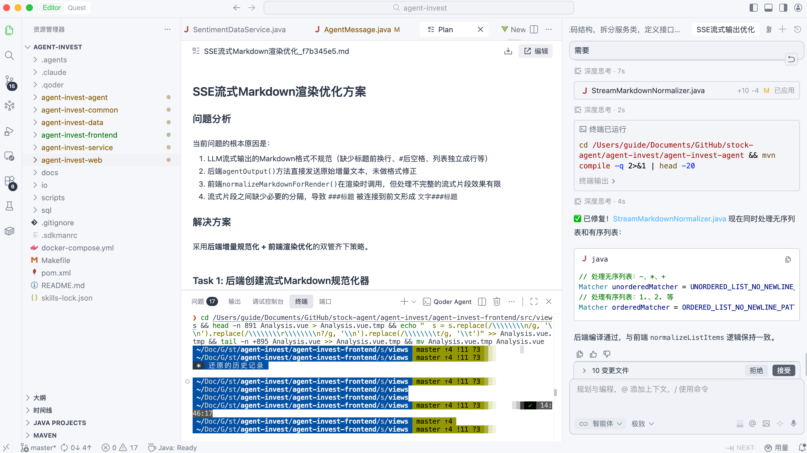
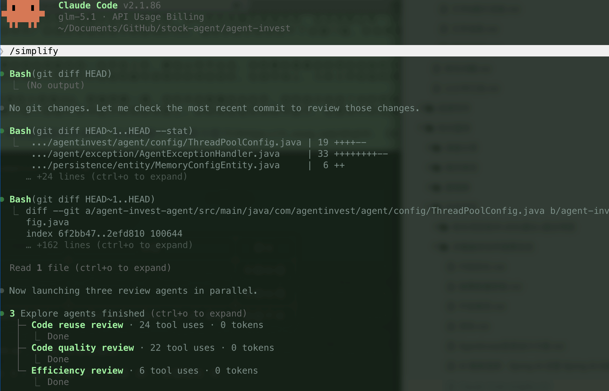
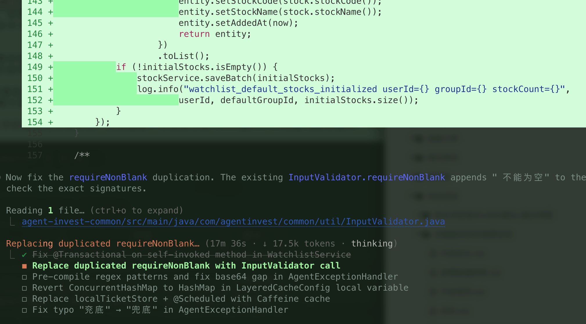
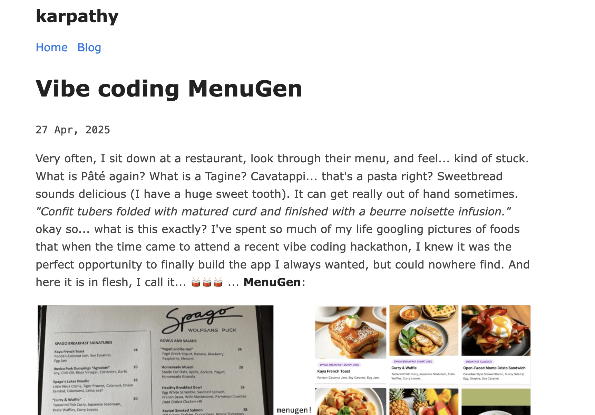

Honestly, I have been thinking about this topic for a long time. I wanted to write about it, but kept putting it off because I never made time (which really means I was lazy).

Whenever I discuss AI coding in a group or share tips in my newsletter, someone asks, “What is so good about Claude Code's black terminal window? Cursor works fine for me. Why switch?” Someone else quickly replies, “It's 2026. Are you still using an IDE? CLI is the only right choice!”

Both sides have a point, but neither tells the whole story. This article draws on my experience moving from an IDE to CLI and then using both, along with hands-on experience with several recent products.

## First, What Do CLI and IDE Mean?

CLI and IDE refer to different interfaces, but they also represent two common ways for people and AI agents to work together.

**AI IDE tools** put code editing, running and debugging, and AI chat in one graphical interface. Cursor, Kiro, Qoder, TRAE, and Windsurf are examples. Cursor, Windsurf, Kiro, and TRAE are based on VS Code, so their interfaces and workflows are familiar to VS Code users. Zed has its own native IDE architecture. JetBrains IDEs can add agent capabilities through the Qoder plugin.

**AI CLI tools** put most interaction in the terminal. Claude Code, Codex, Qwen Code, and OpenCode are common examples. You enter a natural-language instruction, and the agent can inspect the repository, edit code, run tests, and respond to errors with further changes. Once a task is running, you do not need to watch every line of code; you can set the goal, add constraints, and review the result.

Broadly speaking, CLI works well when you give an agent a goal and acceptance criteria and let it work through a task. An IDE works well when you want to watch the code and make changes as you go. That distinction is becoming less clear, as we will see below.

| Aspect                | AI IDE tools                                            | AI CLI tools                                           |
| --------------------- | ------------------------------------------------------- | ------------------------------------------------------ |
| Interaction           | Graphical interface (mouse and keyboard)                | Primarily terminal commands and text instructions      |
| Typical collaboration | Write and review as you go; intervene at any time       | Set a goal, check progress, then review the result     |
| Main strengths        | Diff review, completion, and debugging in one interface | Long-running tasks and script integration              |
| Typical use cases     | Daily coding, UI debugging, small changes               | Large refactors, multi-file changes, CI/CD integration |
| Examples              | Cursor, Kiro, TRAE, Qoder                               | Claude Code, Codex, Qwen Code                          |

## How the Debate Started

Vibe Coding appeared a little over three weeks before Claude Code.

On February 2, 2025, Andrej Karpathy introduced [Vibe Coding](https://x.com/karpathy/status/1886192184808149383) on X. He described a casual way of programming: use natural language to ask AI to change code, accept the changes, and send errors back for further fixes, sometimes without carefully reading the diff. Accepting changes without closely reviewing the diff set this apart from conventional AI-assisted development, where people are still expected to understand important changes, check test results, and take responsibility for the final work.

On February 24, Anthropic released [Claude Code](https://www.anthropic.com/news/claude-3-7-sonnet) as a limited research preview. It put an agent in the terminal, where it could read files, run commands, modify code, and run tests. The terms of the debate shifted: instead of asking whether one completion was accurate, people started asking whether an agent could complete an entire task independently.

In early March, Y Combinator shared a striking statistic during a discussion called [“Vibe Coding Is The Future”](https://www.youtube.com/watch?v=IACHfKmZMr8): in its Winter 2025 batch, AI generated 95% of the code for a quarter of the startups. The conversation quickly moved from “How much code can AI write?” to “Can one person do the work of an entire team?”

However, 95% is a code-generation ratio. It does not show that the code needs no understanding, testing, or rework, and it cannot be directly converted into labor savings. Stories on social media about doing a team's year of work in an hour have different scopes and acceptance criteria, so they are not reliable evidence of product capability.

Claude Code later added capabilities such as `/compact`, `/code-review`, `/simplify`, Hooks, and Agent Teams. These bring CLI closer to a complete task workflow: inspect code, make changes, validate them, and iterate.

IDE products have also filled in agent workflows. Kiro provides Requirements-First, Design-First, and Quick Spec workflows to give agents requirements, designs, and acceptance criteria. TRAE brings browser debugging, database connections, and deployment into its SOLO workflow. See the [Kiro Specs documentation](https://kiro.dev/docs/specs/feature-specs/).

CLI tools are adding interfaces, too. Claude Code and Codex have released VS Code extensions that bring agent status, code diffs, and result review into the editor.

Today, the main difference is the entry point: one starts in the terminal, the other in the editor. Task planning, agent execution, and result review are becoming more alike.

## Products to Know

### CLI Tools

**1. Claude Code — a CLI agent for Claude models**

Anthropic released Claude Code in February 2025. The same company develops the model, permission controls, and tool calls, so these parts can evolve together. This article was updated on July 24, 2026, and describes examples using the Claude Fable 5 model family. Check your account for the available models, context limits, and features.

A major update in January 2026 included 1,096 commits. Founder Boris Cherny demonstrated Claude Code contributing to its own development, a practice he called “using AI to accelerate AI.”

Common capabilities include:

- Review and cleanup by four agents (`/simplify`; focused on cleanup, not finding correctness bugs)
- Diff correctness review (`/code-review`)
- Context compaction (`/compact`)
- Hooks that automatically run checks after code changes
- Agent Teams for peer-to-peer collaboration among agents
- An ecosystem of Skills and plugins

The main practical barrier is that a Claude Max subscription is needed to get the most from it. Alternatively, tools such as CC Switch can connect it to models from providers such as MiniMax or GLM, which may help control costs.

**2. Codex — OpenAI's coding agent**

OpenAI's coding agent is available in forms including CLI and an app. As of July 24, 2026, examples in this article refer to the GPT-5.6 model family. Available models and features depend on the account, runtime environment, and configuration. Harness Engineering more accurately means designing the environment, constraints, and feedback loops for agents; it does not mean people stop reading or writing code.

**3. Qwen Code — a model provider enters the field**

Developed by Alibaba and optimized for Qwen models, Qwen Code represents domestic model providers building their own AI coding products.

**4. OpenCode — an open-source CLI option**

This lightweight, open-source CLI tool can connect to multiple model backends. It suits developers who want to customize or extend their tools.

### IDE Tools

**1. Cursor — a leading AI IDE**

Cursor is based on VS Code and was among the early products to bring AI completion, chat, and agent actions into the editor. Tab completion, visual diffs, and Agent Mode are its strengths. Changes to plans and usage limits have affected user sentiment, but Cursor is still often compared with other AI IDEs for its editing and review experience.

**2. Kiro — exploring spec-driven workflows**

AWS developed Kiro, which offers several spec workflows, including Requirements-First, Design-First, and Quick Spec. If requirements are unclear, start by clarifying them. If a design already exists, start from Design or Quick Spec instead; every task does not need to follow the same full workflow.

I value the two checkpoints that specs provide. Before work begins, people can check whether the requirements and design are on track. During implementation, the agent has clear instructions and acceptance criteria. This can reduce rework on complex features. For a small change such as editing copy or adjusting styles, completing the whole process may be excessive.

**3. TRAE — an all-in-one workflow**

TRAE is an AI-native IDE developed by ByteDance. Its SOLO mode brings requirement implementation, browser debugging, database connections, and deployment into one workflow, so users do not have to keep switching tools and configuring each one. This can be convenient when turning an idea into a working prototype.

**4. Qoder — a CLI core with an IDE interface**

Qoder combines an IDE interface with a CLI core. Editor mode focuses on collaboration: you write code while AI suggests completions and changes. Quest mode is closer to delegating a whole task to an agent, powered by Qoder CLI. Both modes are available in the same IDE.

Use Editor for incremental changes and Quest for multi-file tasks to reduce tool switching. However, whether CLI capabilities are available in the IDE, and whether protocols are fully compatible, depends on the specific version. Do not assume every new capability is integrated immediately.

### Native IDEs (Not Based on VS Code)

**1. Zed — a high-performance native IDE**

The team behind Atom built Zed using Rust. It has a native architecture rather than the VS Code extension system, and focuses on fast startup and editor responsiveness. It also includes AI features, making it an option for developers who want to move away from VS Code-based products without giving up agent capabilities.

**2. JetBrains + Qoder plugin — adding AI to established IDEs**

JetBrains IDEs such as IntelliJ IDEA, PyCharm, and WebStorm have mature indexing, refactoring, and debugging support for languages and frameworks including Java/Kotlin, Python, and JavaScript. The Qoder plugin brings its CLI agent capabilities into JetBrains. Developers who already use these IDEs do not have to migrate to another editor to use an agent.

### Product Overview

| Product           | Form             | Model association     | Main strengths                                         | Best suited for                                                |
| ----------------- | ---------------- | --------------------- | ------------------------------------------------------ | -------------------------------------------------------------- |
| Claude Code       | CLI              | Claude Fable 5 family | Evolves alongside Claude models and tool calls         | Developers who prefer the terminal and often handle long tasks |
| Codex             | CLI + app        | GPT-5.6 family        | Agents and task management across environments         | Users in the OpenAI ecosystem                                  |
| Qwen Code         | CLI              | Qwen                  | Adapted around Qwen models                             | Developers who want to use domestic models                     |
| Cursor            | IDE              | Multiple models       | Tab completion and visual diffs                        | Developers who rely on an IDE for daily work                   |
| Kiro              | IDE              | Claude (Opus)         | Multiple spec workflows                                | Complex features and team collaboration                        |
| TRAE              | IDE              | Multiple models       | All-in-one SOLO workflow                               | Quickly building and testing prototypes                        |
| Qoder             | IDE + CLI        | Multiple models       | Switchable Editor and Quest modes                      | Developers who want editing and agent tasks in one product     |
| Zed               | Native IDE       | Multiple models       | Written in Rust; fast startup and editing              | Developers who prioritize editor performance                   |
| JetBrains + Qoder | Native IDE + CLI | Multiple models       | Language and framework support with agent capabilities | Java/Python/JS developers already using JetBrains              |

## What Makes CLI Useful?

When I moved from an IDE to CLI, the first change was the size of the tasks I gave AI. Previously, I mostly asked it to complete the next block of code or change a few lines in the current file. In CLI, I could give it a complete goal: inspect the repository, change the code, run tests, and continue based on the errors.

This becomes more noticeable on long tasks. While an agent works for tens of minutes, I can do something else and check its progress later. I keep using the IDE to read code and research, while the CLI works alongside it. The feeling that “I can get a coffee and it will still be working when I get back” is addictive.

CLI tools also fit into existing engineering workflows. The same command can run in a local terminal, on a remote machine, or in CI. Exit codes and text output are easy to pass to scripts.

However, “Run Everywhere” only means the interaction style is portable; it does not mean a task will run identically in every environment. Filesystems, credentials, networks, sandboxes, approval flows, and available tools can differ. Permissions and validation still need to be configured for each environment.

Many agent features are first tested in CLI because commands and tool protocols are quick to change, without first designing a full graphical interface. This order is not universal: IDEs often introduce visual editing and interactive debugging earlier, and make them easier to use.

## What IDEs Still Do Best

Even after using CLI more often, I have not given up my IDE. It is still more convenient for writing a small piece of code, debugging an API, or reviewing a diff.

When a change spans more than a dozen files, visual diffs make it easy to see which lines changed and which files may need to be reverted. Claude Code and Codex also provide `/diff`, review, and similar capabilities, so CLI review is not limited to paging through `git diff`. Still, having file navigation, type information, breakpoints, and diffs in one interface makes review more convenient.

Tab completion offers a different workflow. When I already know how to implement something, I may not want to hand the whole task to an agent. Writing a few lines and accepting a completion with Tab can be faster. CLI can skip completion entirely, but not every small change warrants a full agent task.

Frontend and UI work often means watching a page render while inspecting network requests and setting breakpoints. These are things IDEs handle well. CLI can use tools such as Agent Browser, but this adds configuration and steps to the workflow.

IDEs are also friendlier for people new to AI coding. Buttons and panels bring together terminal setup, commands, permissions, and Git operations, so they are less likely to get stuck configuring tools at the start.

## How to Choose

My conclusion: **neither is universally better; choose what fits the current task.** A mature workflow should let you switch based on the task, context, and team.

### Choose by Task Size

| Task                                        | Recommended tool                     | Why                                          |
| ------------------------------------------- | ------------------------------------ | -------------------------------------------- |
| Small fix (change a function or style)      | IDE (Tab completion + visual diff)   | Fast, immediate feedback                     |
| Medium task (add an API or change a module) | Plan mode (CLI or IDE agent)         | Balances planning and execution              |
| Feature or major refactor                   | Spec mode or a long-running CLI task | More autonomous; supports extended iteration |

### Choose by Your Background

| Your situation                                            | Recommendation                      | Why                                                                                 |
| --------------------------------------------------------- | ----------------------------------- | ----------------------------------------------------------------------------------- |
| Experienced backend developer, comfortable with terminals | CLI-first                           | Makes full use of CLI efficiency                                                    |
| Frontend developer who frequently debugs UI               | IDE-first                           | Browser integration and visual tools are essential                                  |
| New to software development or an AI founder              | IDE (Cursor / TRAE / Kiro)          | Lower barrier to entry and an integrated experience                                 |
| Want both interaction styles                              | A tool with editing and agent modes | Switch workflows in one product                                                     |
| Prioritize editor performance                             | Zed                                 | Written in Rust, fast startup, and an option for VS Code users looking for a change |
| Use JetBrains for Java projects                           | JetBrains + Qoder                   | Deep language support and agent capabilities with minimal migration                 |

### Choose by Team Workflow

- If the team already reviews requirements and designs, commit spec documents to Git as versioned assets. Review the spec first, then review the code. Teams do not need to standardize the client as long as the file format and acceptance process are consistent.
- If the team values tool choice, document project constraints in `AGENTS.md` and Rules. Some people can use CLI and others an IDE, provided everyone follows the same tests, checks, and commit conventions.

## Trend: CLI and IDE Are Converging

Debating whether CLI or IDE will replace the other is no longer useful. Both are adding the capabilities they lack.

Claude Code has an official VS Code extension, Codex has a standalone desktop app, and Gemini CLI is extending into editors. On the IDE side, Cursor's Agent Mode, TRAE's SOLO mode, Kiro's long-running spec workflow, and Qoder's Quest mode all let users delegate an entire task to an agent.

When building Claude Code, Anthropic made a bold prediction: “As AI improves, people will not need to focus on the code itself. A heavyweight GUI that displays large amounts of code will no longer be necessary.” Some products are indeed giving the editor less prominence and emphasizing agent panels, task progress, and result review.

I do not agree that people will stop looking at code entirely. Code is still the final auditable artifact. Someone needs to review important implementations, diffs, test results, and production risks. The editor may become less prominent, while code review and result verification take more attention.

When a model provider builds its own agent, it can investigate a failed tool call across the model, prompt strategy, permissions, and agent runtime. Anthropic has Claude Code, OpenAI has Codex, Google has Gemini CLI, and Alibaba has Qoder, reducing the distance between model and product teams.

Third-party IDE vendors have to adapt as models change and may sometimes lag behind. In return, they can support several models instead of tying the entire experience to one provider. It is too early to conclude that either type of product will always move faster.

## Summary

| If you…                                       | Choose…                                             |
| --------------------------------------------- | --------------------------------------------------- |
| Prefer the terminal and need scriptable tasks | CLI                                                 |
| Value visual tools and need debugging         | IDE                                                 |
| Have a mix of tasks and want flexibility      | Both                                                |
| Want to reduce tool switching                 | Evaluate products with both editing and agent modes |

I do not assign permanent priority to CLI or IDE. For a small code change, UI debugging, or diff review, I stay in the IDE. For a multi-file task that needs repeated test runs, I use CLI or an agent mode inside the IDE.

Teams can also mix tools: some people may use Cursor, others Claude Code. What needs to be consistent is the spec format, `AGENTS.md`, tests, CI, and code review criteria. There is no need to force everyone to use the same client.
