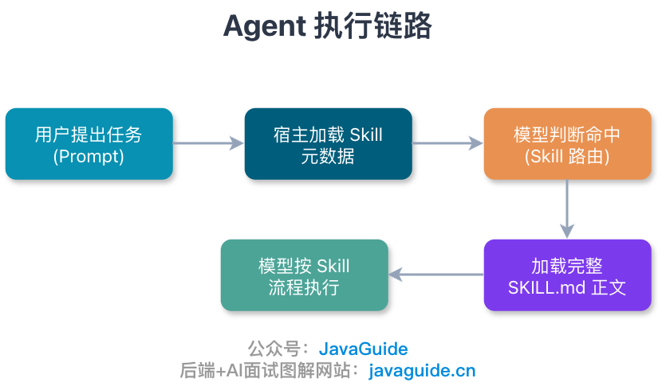

Hi, I'm Xiao G. After I published [Claude Code: Configuration, Workflows, and Advanced Tips](./claudecode-tips.md), a reader asked how to use Codex reliably after I had written so much about Claude Code.

When I first started using Codex, I did not expect much from it.

From the name, it is easy to think of it as a command-line assistant that is simply better at writing code. After using it for a while, I saw it differently: Codex is more like an engineering assistant that can inspect a repository, edit files, run commands, and report back. It is not just for filling in a few lines of code; it is better suited to tasks with clear goals, verifiable results, and well-defined boundaries.

That comes with one condition.

Set up the workbench first: define task boundaries, permissions, project rules, and acceptance criteria.

Vague tasks leave it guessing. Broad permissions may allow actions you did not authorize. If `AGENTS.md` reads like a project brochure, Codex still has to figure out the repository each time. Without acceptance criteria, it may stop when the changes merely look complete.

This article does not trace Codex's release history or focus on a particular model. Models, plans, and command details change quickly and can become outdated. The more durable lessons come from real projects: how to describe tasks, when to use Plan mode, what belongs in `AGENTS.md`, what `config.toml` controls, how permissions, Rules, and Hooks fit together, and when to use MCP, Skills, subagents, and scheduled tasks.

One scope note: this article focuses on everyday use of **Codex CLI and the Codex app**. Available commands and features may differ in the IDE extension and web or cloud environments.

## Do Not Describe a Task in One Sentence

Many people describe a task to Codex like this:

```text
Improve the login logic.
```

That is not enough context for a person, let alone Codex. Where is the login logic? Does “improve” mean performance, readability, security, or a production bug? Which files must not change? What will prove the fix works?

OpenAI's official best practices offer a practical framework: Goal, Context, Constraints, and Done when. In everyday terms, specify what to do, where to look, what not to touch, and what counts as finished. Do not write only “the feature works” under Done when; name verifiable evidence such as tests, builds, lint results, screenshots, logs, or command output.

For the same login issue, I would write:

```text
Goal: Fix the issue where a refresh fails after the user session expires, even though the refresh token is still valid.
Context: Focus on src/auth, src/session, and AuthControllerTest.
Constraints: Do not change the database schema or add dependencies. Preserve the existing Result<T> response format.
Done when: Add a test that reproduces the issue, update the implementation, run the relevant tests, and report the commands and results.
```

This gives Codex less room to guess.

Small tasks can use a shorter description. For a copy change, an added log, or a parameter rename, state the goal directly. For work involving permissions, payments, order states, data migrations, concurrency, or compatibility, include the extra context. A couple of minutes spent upfront can prevent a lot of confusing diffs later.

One more useful habit: **give Codex the source evidence, not just your conclusion.**

For a production error, do not just say, “The cache probably was not cleared.” Provide the stack trace, request parameters, reproduction steps, failing tests, and browser console output so Codex can investigate. If you give it a conclusion first, it may follow your guess and turn a configuration issue into a business-logic change.

## Let It Plan Complex Tasks First

Codex can edit code directly, but that does not mean it should always start editing immediately.

I first consider the task's risk. For copy changes, adding a field, or an obvious null check, I let it work directly. It can read and edit files, then run tests efficiently.

Other tasks are different. You may need to change an order state machine, split a function with more than 600 lines, or investigate an intermittent timeout. If you have not traced the call chain yet, asking Codex to start coding can make the problem more tangled.

For these tasks, I start in Plan mode:

```text
Enter Plan mode and do not modify files.
Read src/payment, src/order, and the relevant tests to trace how inventory is deducted after a successful payment.
List the key files, current flow, likely changes, risks, and suggested verification commands.
```

After it has inspected the repository, ask it to break the work into a plan:

```text
Based on your analysis, provide a phased plan.
For each phase, list the files to change, tests to add, and how to verify the result.
Do not start implementation. Wait for my approval.
```

This process spends more time in the first 10 minutes and saves time later.

The hard part of a legacy project is often not writing a specific piece of code, but untangling compatibility logic, rollout flags, configuration fallbacks, and boundaries that should not change. Plan mode helps surface these details first.

The plan is a proposal, not a final source of truth. For high-risk changes, a person still needs to verify key call chains, transaction boundaries, and compatibility.

Do not turn Plan mode into a ritual. For small tasks with clear acceptance criteria, direct execution may be better. I agree with a view shared in the community: standard Codex on a small task can produce more reliable results than a complex workflow.

## `AGENTS.md` Matters

### Do Not Turn It into a Second README

Like `CLAUDE.md` in Claude Code, it is a project-level instruction file for an Agent. More simply, `AGENTS.md` is an **Agent work guide**: it tells Codex how to start and test the project, which directories to avoid, and what evidence to provide after making changes.


However, the two files do not have exactly the same role.

`CLAUDE.md` is an entry point specific to Claude Code; `AGENTS.md` is an open instruction-file format for coding agents and is officially supported by OpenAI Codex. Check each tool's documentation to see whether and how it reads the file. Do not assume every Agent loads the same instructions.

If the repository already has an `AGENTS.md`, you usually do not need to maintain a nearly identical `CLAUDE.md`. Have `CLAUDE.md` import `AGENTS.md`, then add Claude Code-specific instructions:

```markdown
@AGENTS.md

## Claude Code-specific instructions

- Use Plan mode for changes under `src/billing/`.
```

This keeps the shared rules in one place for both Claude Code and Codex. If your team has only `CLAUDE.md` and wants tools such as Codex and Cursor to use the same conventions, move the general instructions to `AGENTS.md` and keep Claude Code-specific commands in `CLAUDE.md`.

I recommend keeping `AGENTS.md` focused on information the Agent needs:

- Rules Codex is likely to get wrong
- Conventions that cannot be inferred from the code
- Requirements the team must follow
- Technology versions, common commands, architectural decisions, and project-specific pitfalls

### Organize Instructions by Directory

At startup, Codex builds an instruction chain. The current documentation says it first reads `AGENTS.override.md` in the Codex home directory, or `AGENTS.md` if no override exists. It then walks from the project root to the current directory. In each directory, it reads at most one file, in this order: `AGENTS.override.md`, `AGENTS.md`, then fallback filenames. Instructions closer to the current working directory appear later in the chain and are more likely to affect the current task.

Use `AGENTS.override.md` to temporarily override the `AGENTS.md` in the same directory. It is useful for a short-term rule change when you do not want to edit the base file.

One less obvious but practical limit: `project_doc_max_bytes` caps the size of the merged project instructions. The documented default is 32 KiB. Even if you can raise it, do not turn the file into an exhaustive README. Important rules can get buried in a long file, and adding more instructions does not guarantee better results.

My rule of thumb is simple:

> Would removing this line make Codex more likely to make a mistake?

If yes, keep it. If not, remove it.

Some teams also use `AGENTS.md` to record recurring Agent mistakes. If Codex repeatedly uses the wrong test command, edits generated files, or skips a check, record the cause and correct procedure. This can help, but do not paste every failure verbatim. Turn it into an actionable rule, or the file will quickly become a logbook.

`/init` can generate a starter `AGENTS.md`, but treat it as a draft. Generated content often repeats the README or guesses the wrong test command. Review it and keep only instructions that affect Codex's behavior.

For large projects, `AGENTS.md` can serve only as an index.

As I noted in [Harness Engineering Explained](https://javaguide.cn/ai/agent/harness-engineering.html), OpenAI's own `AGENTS.md` is about 100 lines and works more like an index. It gives the Agent the most important repository rules, then points to more detailed design documents, architecture diagrams, execution plans, and quality assessments under `docs/`. The Agent follows those links when it needs more detail about a module.

This is progressive disclosure.

Do not load all project context at once. Put the most important work rules in the root `AGENTS.md`, local conventions in module-level `AGENTS.md` files, and longer design notes, migration history, and architecture decisions in separate documents. Link to them so the Agent can load details as needed. This saves context and makes the instructions easier to maintain.

## `config.toml` Controls Client Behavior

`AGENTS.md` documents the project; `config.toml` configures the Codex client.

Common locations include the user configuration at `~/.codex/config.toml`, project configuration at `.codex/config.toml`, profiles at `~/.codex/<profile>.config.toml`, and system configuration, usually `/etc/codex/config.toml` on Unix.

According to the current official configuration documentation, precedence from highest to lowest is: CLI flags and `--config` overrides, project-level `.codex/config.toml`, the profile selected with `--profile`, user-level `~/.codex/config.toml`, system-level `/etc/codex/config.toml`, and built-in defaults. Project configuration is loaded only for trusted projects. If a project is marked untrusted, its `.codex/` configuration, Hooks, and Rules are skipped.

For everyday use, permissions and sandbox settings matter more than a specific model name.

```toml
approval_policy = "on-request"
sandbox_mode = "workspace-write"
```

These settings suit everyday development: Codex can edit files and run checks in the workspace, but pauses to ask before running more sensitive commands.

`approval_policy = "never"` or a broader sandbox can be appropriate in an isolated environment, such as a temporary worktree, container, one-off script, CI job, test account, or setup with least-privilege credentials. Broadening permissions just to avoid a few confirmations is rarely worthwhile in a real project.

Hooks are currently enabled by default. To disable them, set this in `config.toml`:

```toml
[features]
hooks = false
```

This follows a sensible security principle: configuration, Rules, and Hooks in someone else's repository can affect local execution, so do not trust them by default.

The roles of these files and mechanisms can be summarized as follows:

| Mechanism          | What it controls                                | What belongs there                                                         |
| ------------------ | ----------------------------------------------- | -------------------------------------------------------------------------- |
| `AGENTS.md`        | Agent work instructions                         | Project rules, common commands, directory conventions, acceptance criteria |
| `config.toml`      | Codex client configuration                      | Model, sandbox, approval, profile, and MCP settings                        |
| Rules              | Command-level allow / prompt / forbid decisions | Which commands are allowed, require confirmation, or are forbidden         |
| Hooks              | Lifecycle scripts                               | Checks, audits, formatting, and context injection                          |
| sandbox / approval | Final execution boundaries                      | Filesystem, network, command execution, and confirmation policies          |

## Permissions, Rules, and Hooks Have Different Roles

Codex has several layers of security controls. When getting started, it is easy to put all of them in `AGENTS.md`.

That is not reliable because `AGENTS.md` provides instructions, not hard enforcement at runtime.

`AGENTS.md` provides guidance; the sandbox and approval policy define runtime boundaries; Rules determine whether a command can run; Hooks enforce actions at lifecycle points.

For example, “Do not run `rm -rf`” in `AGENTS.md` is only a suggestion. A Rule can block Codex before execution. Rules are still experimental, and their syntax and maturity may change. The example below follows the current Codex Rules documentation. If your version does not support Rules, use `/permissions`, the sandbox, approval policies, or Hooks instead.

```python
prefix_rule(
    pattern = ["rm", "-rf"],
    decision = "forbidden",
    justification = "Do not let Codex recursively delete files; confirm the target directory and handle it manually.",
    match = [
        "rm -rf dist",
    ],
)
```

Hooks address a different need.

Use a Hook when you want Codex to run a validation script before stopping, check a Prompt for accidentally pasted API keys before a tool call, or format files after editing. Check the official documentation for the current supported Codex Hook events, such as `PreToolUse`, `PermissionRequest`, `PostToolUse`, `PreCompact`, `PostCompact`, `UserPromptSubmit`, `SessionStart`, `SubagentStart`, `SubagentStop`, and `Stop`.

Hooks ultimately run local scripts, so a broken script can still cause problems. The official documentation notes that unmanaged command Hooks require review and trust, and changes trigger another confirmation. Multiple command Hooks matching the same event start concurrently, so do not rely on their execution order for security enforcement. This restriction may seem strict, but it is useful.

## Ask Codex to Prove the Change Works

The hardest part of AI-generated code is not getting code; it is code that looks plausible but may be wrong.

So I rarely say only “make the change and tell me.” I include verification steps in the task:

```text
Add a failing test that reproduces the issue.
Confirm that the test fails before changing the implementation.
Run the relevant tests after the change.
If they still fail after two or three attempts, stop and report the blocker and evidence instead of making more blind changes.
```

This sequence prevents many false fixes. Codex must reproduce the issue, change the implementation, and verify the result with tests.

When Codex finishes, I usually check three things: which files changed, which commands it ran, and which risks remain. Use `/diff` for a quick review of the changes. `/review` can inspect current uncommitted changes, a commit, or a set of custom criteria.

For a more detailed review, ask for evidence using this checklist:

- Show that the failing test fails before the fix and passes afterward.
- Summarize `git diff` and explain the key files.
- List the test, lint, and build commands with their results.
- Identify risks that remain untested.
- Highlight areas that need human review.
- Explain how to roll back if something goes wrong.

These two prompts from community practice can also be useful:

```text
Prove to me this works. Compare the diff against main and show the evidence.
```

```text
Knowing everything you know now, scrap this approach and propose the simpler implementation.
```

The first asks Codex for evidence instead of conclusions. Use the second when the first implementation works but feels convoluted. After reading the context once, Codex can often find a cleaner approach when asked to reconsider it.

Still, inspect the diff yourself. Codex's summary does not replace review. If it says “only the tests changed,” open the key files and check. If it says “there are no risks,” consider whether it missed transactions, concurrency, permissions, or compatibility.

## Use MCP Only for Tools That Save Real Effort

MCP (Model Context Protocol) is like a wiring standard: **an external system exposes capabilities through an MCP server, and an MCP-enabled AI application can connect to discover and use them.**


In real development, useful context is not limited to the repository.

Errors may be in Sentry, requirements in Linear, API details in internal docs, designs in Figma, reproduction steps in a browser, and PR discussions on GitHub. You can copy each item to Codex, but doing that repeatedly gets tedious.

MCP can help with this. According to the current Codex MCP documentation, Codex supports STDIO and Streamable HTTP servers; Streamable HTTP servers support Bearer token or OAuth authentication. Check the current MCP documentation for supported server types, authentication fields, and configuration details.

For example, add the Context7 documentation MCP server:

```bash
codex mcp add context7 -- npx -y @upstash/context7-mcp
```

After adding it, use `/mcp` in the TUI to check the server status.

Keep in mind: **more MCP servers are not always better.**

Connect tools that you use often and whose purpose is clear; read-only tools are best to start with. If you often investigate production errors, connect Sentry or a logging platform. For frontend work, connect a browser, Playwright, or Figma. For PR work, connect GitHub. Be cautious with MCP servers that have write access, use tokens, or can change external systems.

You can group them into three risk levels:

- **Read-only MCP:** Search documentation and error logs, read Sentry, and view PR details.
- **Limited-write MCP:** Create issues, comment on PRs, generate drafts, or update non-production documentation.
- **High-risk MCP:** Release software, change production settings, delete resources, or operate cloud platforms or databases.

Start with read-only tools. Limit the scope of tools with write access; require separate approval and auditing for high-risk tools. Use the least-privileged, shortest-lived tokens available.

More tools give Codex more options and increase the chance of misuse.

When building an MCP server, document more than its tool parameters. The current Codex MCP documentation says Codex reads the `instructions` field returned during MCP initialization and recommends putting the most important guidance in the first 512 characters. Explain when to use the server, when not to use it, and how to interpret its output.

## Use Skills to Capture Repeatable Workflows

Rule files and Skills serve different purposes.

Rule files are better for conventions that always apply to a project, such as technology versions, startup commands, directory structure, error-code formats, and files that must not be changed.

Skills are better for instructions on how to perform a type of task. If code review, writing tests, changing a frontend page, web research, or technical writing follows a repeatable process, you do not need to restate it in every conversation.

I have also written two related articles: [What Are Agent Skills? How Do They Differ from Prompts and MCP?](https://javaguide.cn/ai/agent/skills.html) and [A Guide to Choosing AI Coding Skills](https://javaguide.cn/ai-coding/practices/programmer-essential-skills.html).

In short, a Skill is a set of task instructions that an Agent can load when needed. It is neither a plugin nor an MCP tool. It records a task's workflow, constraints, checks, and lessons learned in a `SKILL.md` file.

Unlike `AGENTS.md`, a Skill does not load its full contents into context every time. By default, Codex sees the Skill's name and description to decide whether it applies. The body of `SKILL.md` and related resources enter the context only when the Skill is used.



Repeatable workflows are good candidates for Skills. For example, follow TDD by writing a failing test before implementing a feature; check security, transactions, performance, and edge cases during code review; or verify sources, citations, heading levels, and generic AI-sounding prose when writing technical articles.

That is the value of a Skill: it turns repeated reminders into a reusable playbook. Codex Skills and Claude Skills share this idea, but their file structures, activation methods, supported platforms, and security models differ. Check each product's official documentation.

A minimal `SKILL.md` can start with this level of detail:

```markdown
---
name: java-service-review
description: Review Java service-layer changes for transaction boundaries, null handling, logging, and regression tests.
---

Use this skill when reviewing Java service-layer changes.

Input materials:

- Current diff or target files.
- Related tests and error logs, if available.

Steps:

1. Read the changed service methods and related tests.
2. Check transaction boundaries, null handling, logging, and regression coverage.
3. Return findings with file and line references.

Do not rewrite code unless the user explicitly asks.

Done when:

- Findings are ordered by severity.
- Each finding explains the risk and a concrete fix direction.
```

You can also use existing Skills. For example, Superpowers packages workflows for TDD, code review, spec-driven development, Git Worktrees, and subagent collaboration.

See my recommendations in [A Guide to Choosing AI Coding Skills: Requirements, TDD, Code Review, and UI Design](https://javaguide.cn/ai-coding/practices/programmer-essential-skills.html).

Do not run third-party Skills without reviewing them. `SKILL.md` contains instructions, and an Agent may follow dangerous commands, unfamiliar scripts, or overly broad permissions. Before installing a Skill, inspect its contents and the `scripts/` and `references/` directories to make sure it does not exceed its intended scope.

## Use Subagents for Parallel Investigations

In a long task, the investigation often uses more context than the final solution.

For a complex bug, Codex may read dozens of files, inspect many logs, and test several hypotheses. The final useful findings may be brief, but the main conversation can fill up with search results and intermediate reasoning.

Subagents can help in this situation.

According to the current Codex documentation, the subagent workflow is enabled by default, but Codex spawns subagents only when explicitly asked. Each subagent runs its own model and tool calls, so this uses more tokens than a single Agent.

The current documentation lists these built-in agents: `default` for general tasks, `worker` for implementation and fixes, and `explorer` for read-only exploration. Custom agent configuration formats, built-in names, and entry points may change by version; check `/agent`, the official Subagents documentation, and your local version. You can also define custom TOML agents under `~/.codex/agents/` or `.codex/agents/`.

Tasks that are good candidates for delegation look like this:

```text
Review current branch against main.
Spawn one subagent for each topic: security, concurrency, tests, maintainability.
Wait for all agents, then summarize findings with file references and severity.
Do not modify files.
```

The tasks have clear boundaries and can run in parallel.

Small changes are not good candidates. Starting four subagents to change one DTO field may cost more in coordination than the change itself. I use the main session to set goals, make tradeoffs, and perform final acceptance; subagents handle focused tasks they can report on independently.

One more point: subagents inherit the current sandbox policy. In the interactive CLI, approval requests from other threads may also appear. Check which agent made the request before approving it.

## Do Not Automate Everything with Scheduled Tasks Right Away

The Codex app feature previously known as Automations is now generally labeled **Scheduled Tasks** in the UI. It suits recurring work such as reviewing recent commits daily, generating release notes weekly, checking CI failures, or summarizing unresolved alerts.

It is not meant to “automatically fix everything.”

Scheduled Tasks have different run modes. A task linked to the current session can resume checks in the same context; standalone or project-level tasks start on a schedule. For project-level tasks, the machine running the Codex app must be on, Codex must be running, and the project path must still exist. Git repository tasks can run in the local project or a dedicated background worktree. Scheduled Tasks use the default sandbox settings, so granting full access also increases the risk of background tasks.

I recommend this order: write the workflow as a regular Prompt and run it manually a few times. If you keep repeating the same steps, turn them into a Skill. Once the Skill is stable, schedule it as a Scheduled Task.

In other words, a Skill defines the method, while a Scheduled Task defines when it runs. Write the task Prompt so it can run independently; do not rely on unstated context from a previous conversation.

For example, “automatically fix every bug and submit a PR each day” sounds convenient, but in a real project it will likely produce diffs that someone has to clean up. “Scan CI failures from the last 24 hours and summarize their causes” is more reliable. Start with reports, then decide whether to make changes.

## Learn a Few Command Categories

Codex CLI slash commands change, and the commands available in the CLI, Codex app, and IDE extension may differ. Treat the following as practical examples; check the `/` menu and `/help` in your environment for the current list.

I group them into a few categories:

- Session and plan controls: `/permissions`, `/model`, `/fast`, `/status`, `/clear`, `/plan`, `/goal`.
- Context, memory, and change review: `/diff`, `/compact`, `/copy`, `/memories`.
- Extensions: `/agent`, `/mcp`, `/hooks`, `/plugins`, `/apps`, `/skills`.
- Review and recovery: `/review`, `/fork`, `/resume`.

Commands are entry points, not workflows by themselves. Results still depend on task boundaries, project rules, verification criteria, and permissions.

## Workflows I Use

When I join an unfamiliar project, I first ask Codex to act as a guide:

```text
Do not modify files.
Explain the user login flow from the incoming HTTP request through the session write.
List key classes, methods, configuration, and any implicit constraints that need human confirmation.
```

Spot-check its summary, especially cross-service calls, rollout configuration, and legacy compatibility logic. Asking it to list files and methods is more reliable than relying on a natural-language summary alone.

When fixing a bug, do not just say “please fix it.” Provide the evidence:

```text
Here are the failing tests, error logs, and reproduction steps.
Find the root cause before changing code.
After finding it, add a test that reproduces the issue, then update the implementation.
Run the relevant tests and explain how they cover the issue.
```

If it goes in the wrong direction twice in a row, do not keep asking it to “try again.” Ask it to review what is known, which assumptions have been disproved, and what evidence is still missing.

TDD is useful for AI-assisted coding too:

```text
Do not change the implementation yet.
Write a failing test for OrderStatusService to ensure that repeated callbacks for a paid order do not deduct inventory more than once.
After confirming the test fails, update the implementation until it passes.
```

This order defines the expected behavior before Codex implements it.

Be more specific with frontend tasks. Words like “modern,” “clean,” and “premium” are vague and can produce purple gradients, oversized rounded cards, or a marketing-page layout. Admin systems are especially prone to this.

```text
This is an operations dashboard. Prioritize information density; do not use a marketing-page style.
Use the existing Ant Design components; do not add a UI library.
Follow the filters, table, and pagination layout in src/pages/UserList.tsx.
Use the existing CSS color variables; do not add gradient backgrounds.
After implementation, start the page locally and check for text overlap on mobile and desktop.
```

The same applies to PR reviews: keep the scope narrow:

```text
Review current branch against main.
Focus only on correctness, transaction boundaries, null handling, and missing tests.
Return findings ordered by severity with file and line references.
Do not comment on style unless it can cause a bug.
```

Codex may present something that “could be better” as something that “must be fixed.” Prioritize review findings that can cause bugs, security issues, inconsistent data, compatibility breaks, or missing tests.

## Security Boundaries

Codex can read and write files, run commands, connect to MCP, and control a browser. The more capable it is, the clearer its boundaries need to be.

At a minimum, I recommend these limits:

- Do not expose production database passwords, long-lived cloud tokens, or SSH keys to Codex.
- Do not let it read `.env` files, certificates, database dumps, production logs, or private-key directories by default.
- Do not let it operate directly on production unless temporary credentials, approval, and auditing are in place.
- Do not allow pushes to the main branch or force pushes by default.
- Do not run remote scripts from unknown sources in an unisolated environment.
- Do not connect every write-enabled MCP server at once.

If you need high-privilege automation, use a container, temporary account, least-privilege credentials, and a separate worktree. Incorrect AI-generated code can be reviewed; excessive permissions are much harder to contain. Keep operation logs, command output, diffs, and approval records, and make sure you can roll back quickly.

## Common Failure Modes

Vague tasks are the most common problem. If you only say “improve this,” Codex has to guess and may search and change many unrelated files. Add the goal, context, constraints, and completion criteria to avoid wasted exploration.

Overplanning also wastes time. Small changes do not need a long plan; make the change, inspect the diff, and verify it. Plan mode is better for cross-module, high-risk tasks or tasks with unclear call chains.

An oversized `AGENTS.md` can make results worse. Too many rules dilute the important ones. Build it from real mistakes: add rules for recurring Codex errors and remove facts that are obvious from the code.

Do not grant too many tools or permissions at once. With too many MCP servers, Codex may choose the wrong one; broad permissions can let background tasks do more than expected. Isolate high-privilege tasks and use least privilege for everyday development.

Finally, do not skip verification. Plausible-looking code may still behave incorrectly. Use at least one source of evidence, such as tests, lint, a build, screenshots, or logs. If a long session becomes slow or unfocused, use `/compact`, or start a `/fork` or new thread if needed. The same applies to multiple agents: the main session makes decisions, while subagents handle focused research.

## Use Codex According to Risk

Keep small tasks simple. For copy changes, adding a log, or an obvious field mapping, let Codex make the change, then inspect `/diff` and run the relevant unit tests.

For medium-sized tasks, plan first, then implement and verify. For example, before changing a module's business flow, adding an endpoint, or refactoring a service, ask Codex to read the relevant files and list the changes and verification commands. Review its plan before implementation.

For high-risk tasks, start with read-only analysis. For payments, permissions, data migrations, production configuration, or concurrency and consistency changes, ask Codex to identify call chains, risks, and missing tests. After a person verifies the key decisions, proceed with TDD or small commits. Use a worktree, container, temporary credentials, and tighter permissions where possible.

Do not automate a task all at once. Run it manually once or twice, turn the process into a Skill, and schedule it only after the Skill is stable. High-privilege automation also needs audit records and a rollback plan.

## Summary

With a good workflow, Codex feels less like “asking AI to write code” and more like coordinating an engineering assistant that can inspect a repository, run commands, and deliver a diff.

That makes it even more important to look beyond the Prompt.

Task boundaries, project rules, permissions, verification criteria, external tools, and reusable workflows all affect the quality of Codex's work. My advice remains the same: first make it reliable on a small scope, then expand its scope gradually.

Do not automate everything from the start.
