Hi, I'm Xiao G. The impact of AI on my work often becomes clear through small things.

It used to take me at least a week to write a technical article, and sometimes a month. About a third of that time went into the tedious work of creating diagrams.

Readers who know my work may have noticed that many diagrams on [JavaGuide](https://mp.weixin.qq.com/s/MP8_Td9h72jAhTntVV4DxQ) are drawn manually in draw.io. Each article has many diagrams to help explain its concepts.

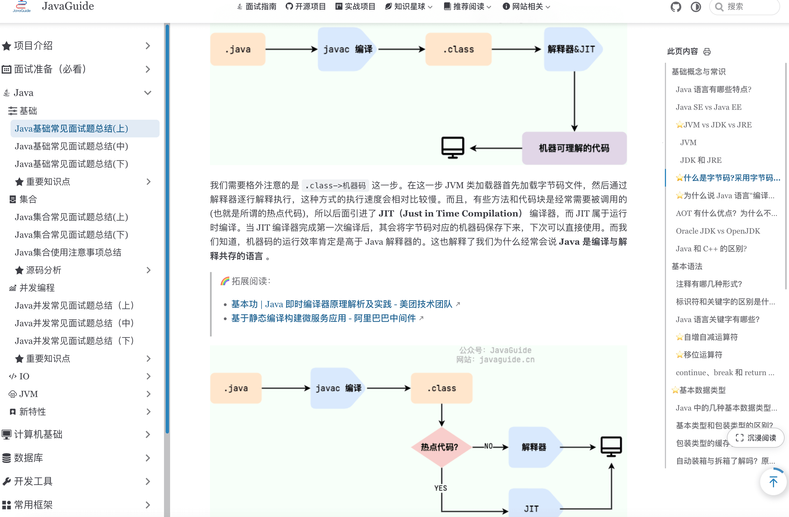

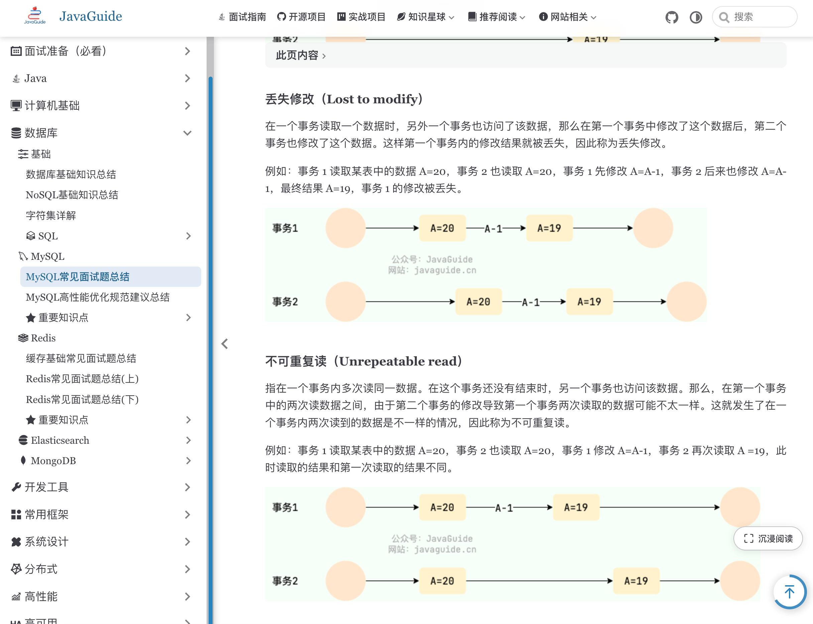

AI has changed the process, especially for draw.io diagrams.

Before Skills became popular last year, I used AI to generate XML and then imported it into draw.io.

Today, Skills have made draw.io diagram generation more automated.

This article introduces the custom draw.io Skill I use: [`drawio-chart`](https://github.com/Snailclimb/AIGuide/tree/main/skills/drawio-chart). I will also explain why I have not switched entirely to image-generation models and still keep editable `.drawio` source files.

## Why Choose draw.io?

A diagram should not only look good when it is generated; it should also be easy to edit later.

After a technical article is published, its title, nodes, arrows, and terminology may change. If you only have a PNG, you must either generate it again or edit the image manually—and the style may no longer match.

That is why I prefer to keep an editable source file.

I keep `.drawio` source files in a local assets directory. When I need to change a diagram, I can open its source directly.

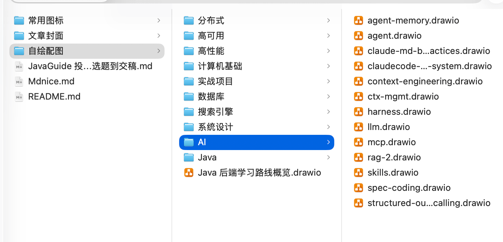

That is the advantage of `draw.io`: you can continue editing `.drawio` files in diagrams.net or the draw.io desktop app, and export them as PNG, SVG, or PDF. Technical diagrams such as flowcharts, architecture diagrams, and state diagrams usually have small source files, so storing them in a repository or assets directory is easy.

You can also export common formats such as PNG, JPEG, WebP, SVG, and PDF directly from the menu.

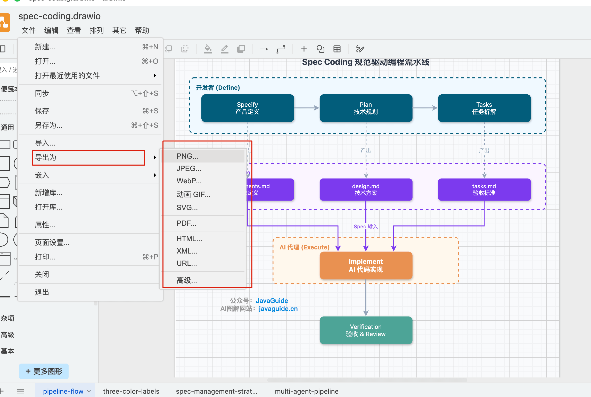

When Skills first appeared, I organized this workflow into a Skill: [`drawio-chart`](https://github.com/Snailclimb/AIGuide/tree/main/skills/drawio-chart).

Many diagrams in recent AI coding, Spec Coding, and Claude Code articles on [javaguide.cn](https://javaguide.cn/) use this approach:

- Ask the agent to identify the structure, arrange the nodes, and generate a `.drawio` file; then export it in the format needed for the article.
- For stronger visual presentation, refine the result with GPT-IMG2.

## Why Not Use Image Generation Alone?

I have tried several alternatives.

[`tt-a1i/archify`](https://github.com/tt-a1i/archify) generates self-contained technical diagrams in HTML from natural-language prompts. It supports theme switching and multiple export formats, along with validation and rendering workflows.

[`coleam00/excalidraw-diagram-skill`](https://github.com/coleam00/excalidraw-diagram-skill) uses an Excalidraw style, which suits whiteboard-like explanations and visualizing ideas. It also uses Playwright to check for overlapping text, misaligned arrows, and uneven spacing.

[`DayuanJiang/next-ai-draw-io`](https://github.com/DayuanJiang/next-ai-draw-io) is closer to a standalone AI drawing product. It connects AI to draw.io and offers an online demo, desktop app, Docker, local installation, an MCP server, and multi-model configuration. When I tried it, it felt a little slow and drawing was not very efficient. The project is still being updated, but I have not benchmarked it again, so I cannot comment on its current performance.

Each project has a different focus. Archify produces a more finished result, Excalidraw suits whiteboard-style explanations, and next-ai-draw-io is more like a standalone product.

For JavaGuide's technical articles, I more often need to:

- Use Chinese technical terms in diagrams and revise them later.
- Keep colors, fonts, and node styles consistent across a set of articles.
- Insert diagrams into Markdown, WeChat articles, webpages, and repository documentation.
- Update a few nodes when an article changes instead of redrawing the whole diagram.

Editable `.drawio` source files work better for these needs.

Opening a separate drawing system can add overhead when making article illustrations. A coding agent already reads articles, edits files, runs commands, and organizes assets. Letting it call a Skill to generate `.drawio` files and export them in batches shortens the workflow.

Image-generation models are useful for improving visual presentation, but the results are harder to maintain over time. If you change a term or add a branch, it is difficult to ask the model to update only that part while keeping the rest of the diagram unchanged.

draw.io may not produce a spectacular image in one step, but its nodes, connectors, containers, and text remain editable. That matters for technical diagrams.

## My Diagram Workflow

My current workflow is roughly:

1. Write the article, or at least outline its main thread, process, and relationships between concepts.
2. Ask the agent to identify which parts would benefit from a diagram.
3. Use `$drawio-chart` to generate `.drawio` source files.
4. Export them as PNG, SVG, or PDF when preparing to publish.
5. Refine a diagram with GPT-IMG2 if it needs stronger visual presentation.

I prefer to separate structure from presentation.

`drawio-chart` handles structured diagrams: process flow, module connections, state transitions, and grouping. GPT-IMG2 is better for bitmap-level presentation, such as making an image feel more complete as an article illustration.

The structure stays in the `.drawio` file, so it remains editable.

The example below shows the Skill generating a `.drawio` file. After reading the request, the agent writes the source file and returns its path with a description of the structure.

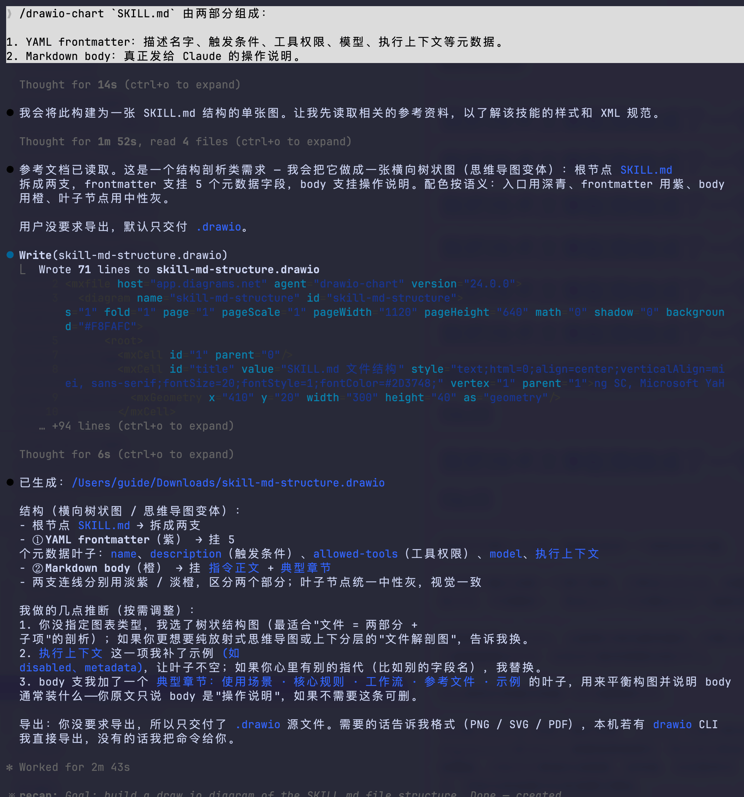

When opened, it is still a standard draw.io file. Nodes, connectors, and text can all be adjusted manually instead of being locked into an image.

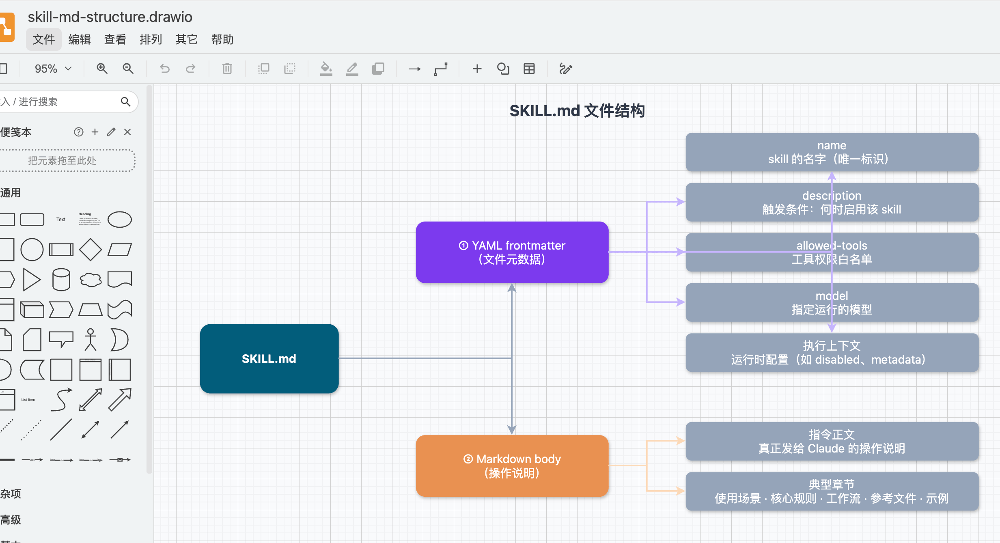

This is the diagram before any manual edits. Some details in the connectors still need adjustment, which is normal.

Here are some diagrams created with the Skill.

This decision flowchart for maintaining `CLAUDE.md` is a typical process diagram:

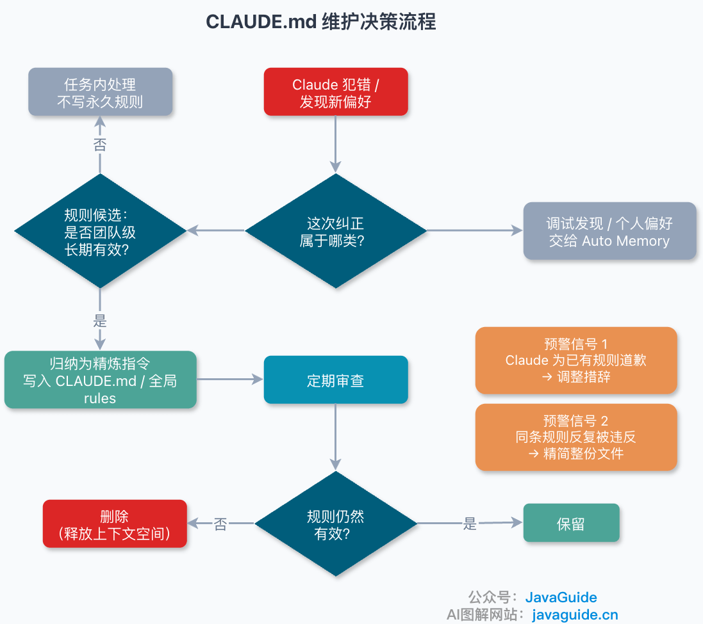

When explaining multi-agent collaboration in text alone, readers may see only a list of role names. A pipeline diagram makes each agent's responsibilities and information flow much clearer.

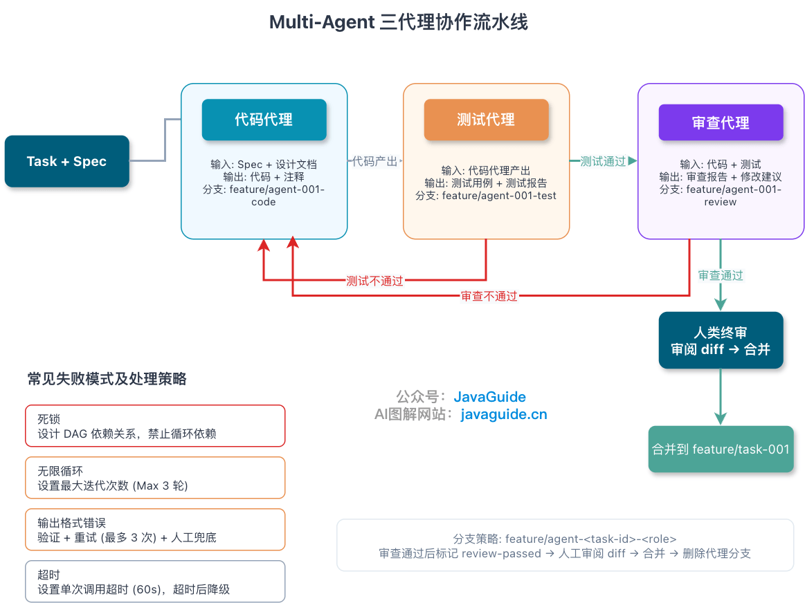

Spec Coding articles also describe a workflow rather than a single concept. The diagram connects requirements, specs, implementation, and verification, helping readers grasp the whole process before returning to the details.

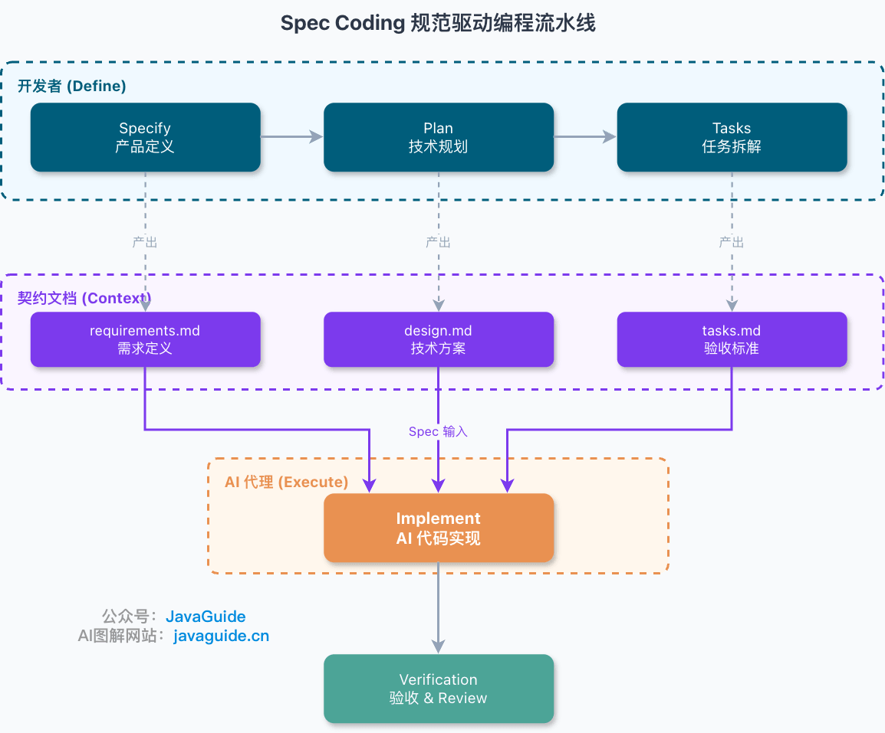

Strategies for managing specs can be hard to explain in prose. A diagram of layered filtering, precise retrieval, and context control can make these ideas easier to understand.

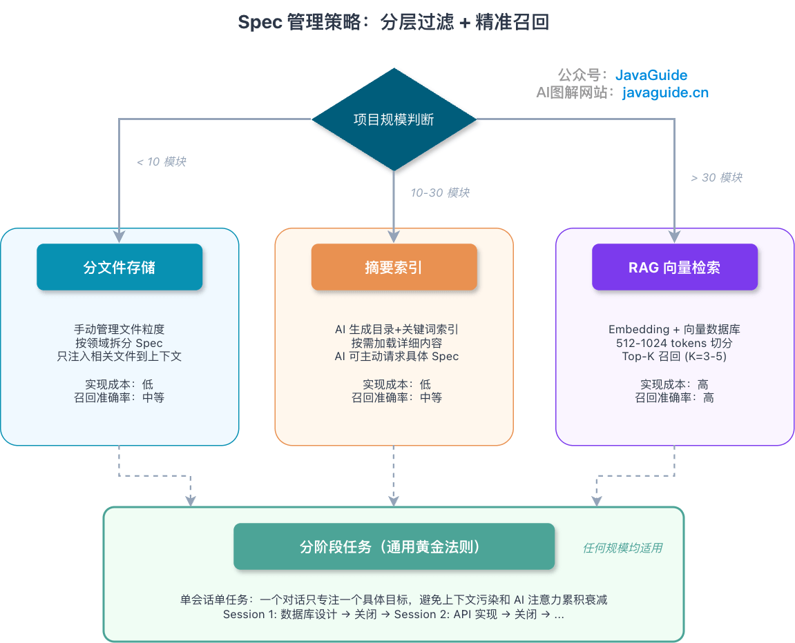

Not every diagram needs to be generated entirely by AI. The main time savings come early in the process: the agent drafts the structure, then a person refines it for the article.

Diagrams become a problem when they drift away from the article. No matter how polished a diagram looks, it is not useful if its nodes, title, and arrows do not match the text.

## What Does the `drawio-chart` Skill Do?

In [“What Are Agent Skills, and How Do They Differ from Prompts and MCP?”](https://javaguide.cn/ai/agent/skills.html), I described a Skill as task instructions that load when needed.

A Skill does not create a new tool, nor is it the same as Function Calling or MCP. It explains how and when to perform a task, which steps must not be skipped, and which references are needed.

`drawio-chart` captures the workflow for creating draw.io diagrams for technical articles.

Its main file is [`SKILL.md`](https://github.com/Snailclimb/AIGuide/blob/main/skills/drawio-chart/SKILL.md), which contains a few types of guidance:

- When to use it: for draw.io, diagrams.net, flowcharts, architecture diagrams, sequence diagrams, ER diagrams, state diagrams, and mind maps.
- When not to use it: when the user only wants Mermaid code, or needs a bitmap illustration, poster, or whiteboard-style image.
- What to clarify before drawing: the topic, diagram type, key nodes and relationships, and whether the diagram should be exported.
- In what order to generate a `.drawio` file: title, containers, main nodes, connectors, and labels.
- What to check before delivery: whether all nodes are present, relationships are correct, connector labels are short enough, and the filename follows conventions.

The `SKILL.md` file does not contain every detail.

Instead, it refers to files under `references/`:

| File                  | Contents                                                                                 |
| --------------------- | ---------------------------------------------------------------------------------------- |
| `style-spec.md`       | Colors, fonts, node meanings, and connector styles                                       |
| `xml-and-layout.md`   | draw.io XML structure, node and connector templates, and layout guidance                 |
| `export-and-files.md` | PNG, SVG, and PDF export commands, filenames, and delivery rules                         |
| `use-cases.md`        | Common prompts, patterns for illustrating multiple articles, and page naming suggestions |

This follows the design of Skills.

The main file should not become a long README. The agent first learns what the Skill does, then reads the relevant reference when a task calls for it.

For example, generating a flowchart does not require reading the full export guide. If the user asks for a PNG, read `export-and-files.md`. If the style needs to be controlled, read `style-spec.md`.

This keeps irrelevant details out of the context and makes execution more consistent.

## Constraints I Added

Diagram generation can easily get out of hand.

Common problems include long node labels and connector labels overlapping arrows; arbitrary color choices that make the diagram look random; long explanations on every connector; and HTML tags in XML that can cause rendering or editing problems.

So `drawio-chart` includes specific constraints.

For styles, the agent should not choose colors arbitrarily. Rules assign colors by meaning: entry points, business services, infrastructure, clients, external dependencies, databases, caches, message queues, and error states each have defined colors. This keeps diagrams in the same article consistent and helps readers interpret them.

For text, `mxCell.value` should use plain text by default. Use XML line-break entities for new lines, and do not put HTML tags such as `<br>` or `<b>` inside node values.

Connector labels should be short. Do not put long explanations on short connectors. Put text in a node when possible, or use a side note. Many cluttered technical diagrams start with the desire to explain something on every line.

For export, keep the `.drawio` source first and export other formats as needed. Never delete the source file if export fails.

## How to Install and Use It

I have added the Skill to the [AIGuide: AI Application Development, AI Coding Practice, and Interview Guide](https://github.com/Snailclimb/AIGuide) repository:

- Repository: **<https://github.com/Snailclimb/AIGuide/tree/main/skills>**
- Skill directory: **<https://github.com/Snailclimb/AIGuide/tree/main/skills/drawio-chart>**

If you use the `npx skills` ecosystem, install it with:

```bash
npx skills add Snailclimb/AIGuide/skills/drawio-chart
```

To install it only for Codex, specify the agent:

```bash
npx -y skills add Snailclimb/AIGuide/skills/drawio-chart --agent codex --yes
```

If you mainly use Codex, you can also install it from GitHub:

```bash
python3 ~/.codex/skills/.system/skill-installer/scripts/install-skill-from-github.py \
  --repo Snailclimb/AIGuide \
  --path skills/drawio-chart
```

Note that in versions such as `skills@1.5.15`, running `npx skills add Snailclimb/AIGuide --path skills/drawio-chart` may still scan all Skills in the repository first. A more reliable approach is to include `skills/drawio-chart` directly in the source path, as in `Snailclimb/AIGuide/skills/drawio-chart` above.

During installation, the CLI detects the repository, finds `drawio-chart`, and asks which agent and scope to install it for.

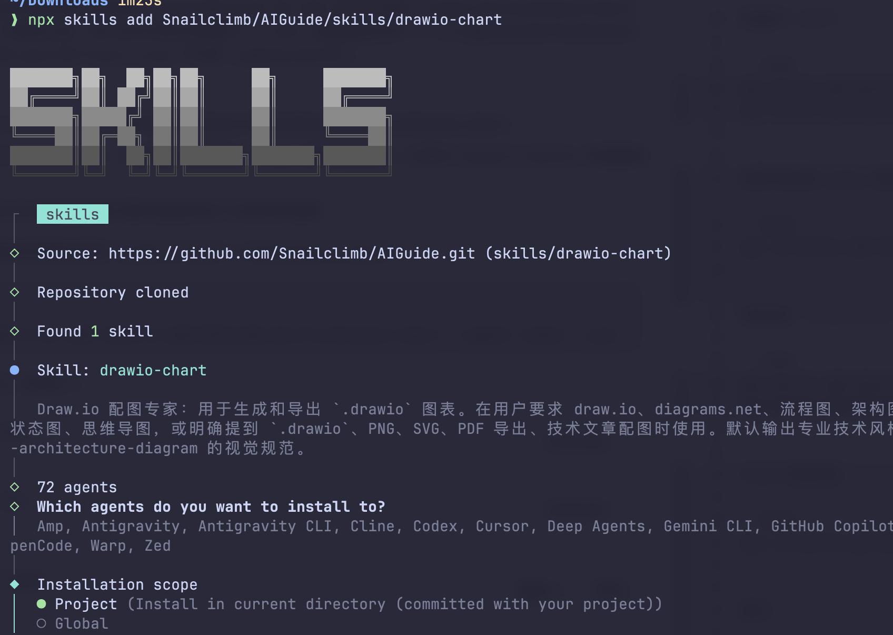

Codex does not always rescan newly installed Skills immediately, so I usually restart it before use.

At first, name `$drawio-chart` explicitly instead of asking the agent to guess. For example, to draw a login flowchart:

```text
Use $drawio-chart to draw a user login flowchart with these steps:
Enter username and password -> Validate credentials -> On success, go to the home page -> On failure, show an error and allow a retry.
Export the diagram as PNG.
```

When illustrating a whole article, I usually do not prescribe a number of diagrams. It works better to give the agent the article and let it identify the structures worth illustrating, then specify the output format:

```text
Use $drawio-chart to read this article and create appropriate technical diagrams.
Put all diagrams in one draw.io file, with each diagram as a separate page.
Use the same base filename as the article and lowercase kebab-case page names.
Follow the shared style rules in drawio-chart.
```

Do not just say, “Draw an architecture diagram.” A microservice architecture diagram should specify its services, data stores, and external dependencies; where requests enter; which calls are synchronous; and which flows use asynchronous messaging.

Give the agent a clear diagram specification to get a useful draft. A vague title will probably require substantial manual rework.

## Which Diagrams Suit draw.io?

I mainly use `drawio-chart` for three types of diagrams.

First, flowcharts in articles, such as Spec Coding workflows, `CLAUDE.md` maintenance strategies, and agent collaboration pipelines. These have clear steps and branches, and are easy to refine in draw.io.

Second, architecture and module diagrams. Consistent styles are important: use one color for service nodes, another for storage, and a separate style for external dependencies. This makes the diagram easier to read.

Third, diagrams that will be revised repeatedly. After an article is published, its title, node labels, arrow direction, and export dimensions may change. As long as the `.drawio` file remains, these edits are manageable.

I would not use it for cover images, posters, or product mood boards; GPT-IMG2 is more suitable for those. Excalidraw is a better fit for a hand-drawn whiteboard style. For themed, self-contained HTML and interactive webpages, Archify is also worth exploring.
