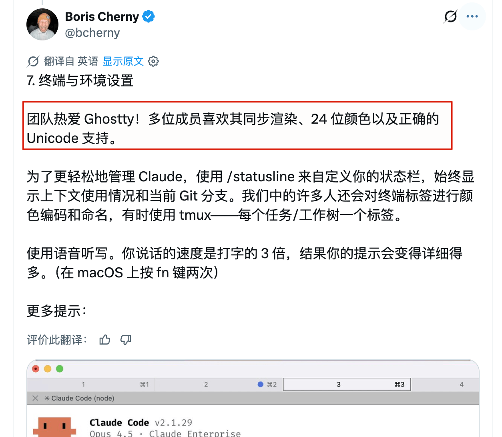
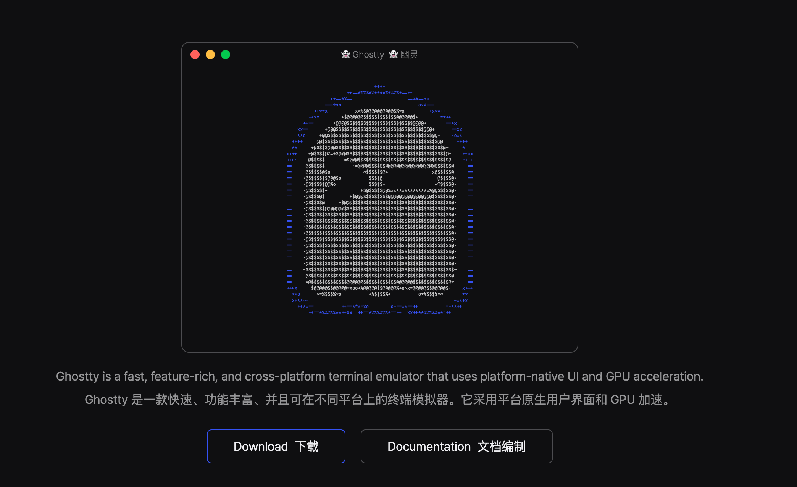
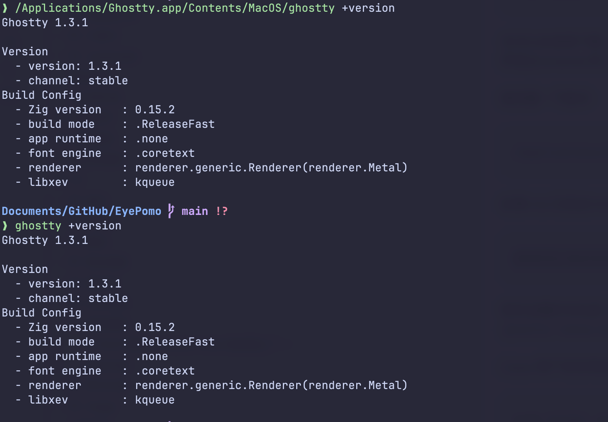
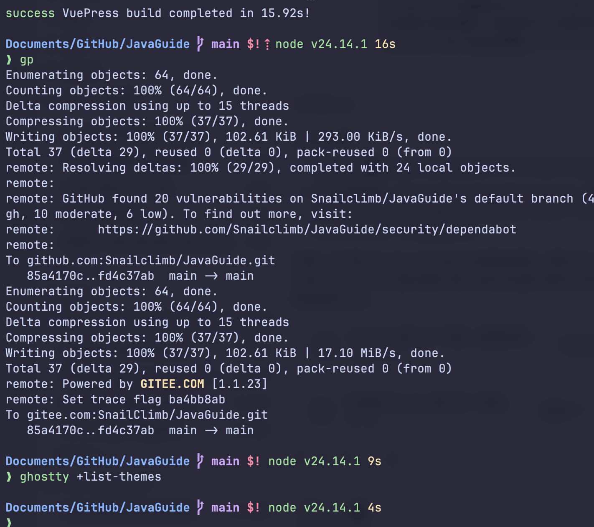
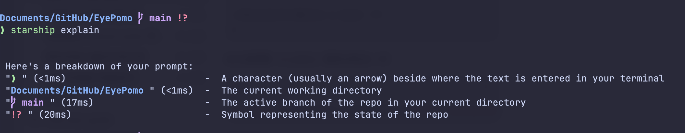
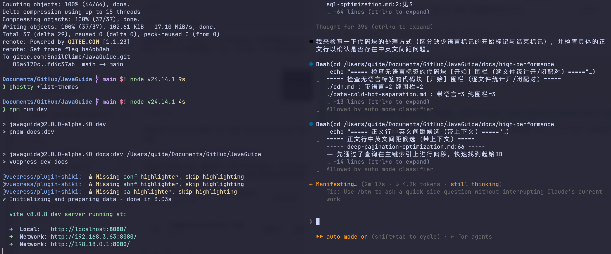

Hi, I'm Xiao G. I've been using Ghostty instead of iTerm2 for three months.

The experience has been good overall, so I wanted to share it here.

Ghostty is not an officially recommended terminal for Claude Code, but Claude Code has helped raise its profile. When discussing his team's workflow, Claude Code creator Boris Cherny said that his engineering team really likes Ghostty.



I saw that post too, and switched after getting frustrated with iTerm2.

After using Claude Code or Codex CLI for a while, the terminal becomes a small workbench: you watch the agent's output while running tests, checking logs, and working with Git. iTerm2 can do this too, but getting it comfortable often takes time spent configuring fonts, themes, shortcuts, and splits. Ghostty is usable soon after installation, and only needs a few personal adjustments.

Ghostty focuses on being a good terminal emulator without unnecessary extras. It has no built-in AI and is not a server manager.

Of course, iTerm2, Warp, Kitty, and other terminals are also good. I hope this article does not start another argument about them. What matters most is using the one that works best for you.



## Installation

On macOS, install it with Homebrew:

```bash
brew install --cask ghostty
```

You can also download the `.dmg` from the official website and drag the app into Applications. The official macOS package is signed by the Ghostty project and notarized; the Homebrew cask also uses the official `.dmg`.

After installation, check the version:

```bash
/Applications/Ghostty.app/Contents/MacOS/ghostty +version
```

If the CLI is already in your `PATH`:

```bash
ghostty +version
```



> Version note: I checked these settings against Ghostty 1.3.1 (the 1.3.x series) on my machine. Ghostty changes quickly, so use `ghostty +show-config --default --docs` on your system as the source of truth. Ghostty 1.4.0 is expected to provide `ghostty +ssh`. The SSH instructions below are for 1.3.x; if you use 1.4, read the [Ghostty SSH documentation](https://ghostty.org/docs/features/ssh) first instead of copying the older configuration.

The installation method on Linux depends on your distribution. On Arch Linux, run:

```bash
sudo pacman -S ghostty
```

For other distributions, check the official installation page first. Ghostty directly distributes a prebuilt macOS package; Linux packages are mostly maintained by distribution maintainers or the community. Avoid running untrusted installation scripts on work or company machines.

## Try the Defaults for a Day

You can use Ghostty without any configuration. Its defaults are sufficient for most people.

Ghostty includes JetBrains Mono by default and supports Nerd Fonts. Most people can use it without changing the font.

When you first try it, do not start by copying hundreds of lines of configuration. Use it for a day, then adjust the font, theme, window padding, opacity, clipboard, Shell Integration, and split shortcuts as needed. Longer terminal configurations are harder to troubleshoot. One advantage of Ghostty is that it needs little configuration.

## Configuration File Location

Ghostty settings use `key = value` syntax. The recommended filename is now `config.ghostty`; the older filename `config` is still read. Common paths:

```text
~/.config/ghostty/config.ghostty
~/.config/ghostty/config
```

On macOS, Ghostty also reads:

```text
~/Library/Application Support/com.mitchellh.ghostty/config.ghostty
~/Library/Application Support/com.mitchellh.ghostty/config
```

If both locations contain a configuration file, macOS loads the Application Support path later, and its conflicting values override the earlier ones. If a setting does not take effect, check this first.

Useful inspection commands:

```bash
ghostty +list-fonts
ghostty +list-themes
ghostty +list-keybinds --default
ghostty +validate-config
```

After editing the configuration, press `Cmd + Shift + ,` on macOS or `Ctrl + Shift + ,` on Linux to reload it. Window settings such as opacity may not update live; restart Ghostty if they do not change.

## My Minimal Configuration

Create the directory:

```bash
mkdir -p ~/.config/ghostty
```

Edit the configuration:

```bash
nano ~/.config/ghostty/config.ghostty
```

You can start with this configuration:

```ini
# Font
font-family = "JetBrainsMono Nerd Font Mono"
font-size = 14
font-thicken = true
font-thicken-strength = 80
font-codepoint-map = U+2E80-U+9FFF,U+F900-U+FAFF,U+FF00-U+FFEF=PingFang SC

# Theme
theme = Catppuccin Mocha

# Window
window-padding-x = 12
window-padding-y = 10
window-save-state = always
background-opacity = 0.95
background-blur = 20

# Cursor and scrollback
cursor-style = bar
cursor-style-blink = true
scrollback-limit = 10000000
scrollbar = never

# Shell Integration
shell-integration = detect
shell-integration-features = cursor,sudo,title

# macOS
macos-option-as-alt = left
macos-titlebar-style = transparent
macos-titlebar-proxy-icon = hidden

# Splits
split-divider-color = #45475a
unfocused-split-opacity = 0.92

# Clipboard
copy-on-select = false
clipboard-paste-protection = true
clipboard-paste-bracketed-safe = true
```

This uses JetBrainsMono Nerd Font Mono so Git branch symbols, the Starship prompt, and Powerline icons do not render as boxes. If it is not installed:

```bash
brew install --cask font-jetbrains-mono-nerd-font
```

Do not simply add `PingFang SC` as a second `font-family` for Chinese. If the primary font does not match, English text may also fall back to the Chinese font and have awkward spacing. `font-codepoint-map` assigns only Chinese code points to `PingFang SC`, which is more reliable.

`copy-on-select = false` is my preference. Ghostty copies selected text by default, which Linux users may like. On macOS, I prefer to press `Cmd + C` so I do not accidentally overwrite the clipboard.

I recommend keeping `clipboard-paste-protection = true`. Pasting a multiline command copied from a webpage into a terminal should trigger an extra confirmation.

`scrollback-limit` is measured in bytes, not lines. `10000000` is about 10 MB, and each split or tab has its own limit.



## Themes

List the built-in themes:

```bash
ghostty +list-themes
```

Change the theme with one line:

```ini
theme = TokyoNight
```

I usually use:

```ini
theme = Catppuccin Mocha
```

To follow the system's light and dark modes:

```ini
theme = dark:Catppuccin Mocha,light:Catppuccin Latte
```

Ghostty already includes plenty of themes. A custom theme is essentially a configuration fragment loaded by Ghostty, and most only change colors. If you download one from an unfamiliar source, inspect it to make sure it does not also change fonts, opacity, or keybindings.

## Optional: Starship

Ghostty handles the terminal window, fonts, themes, and protocols; Starship handles the shell prompt.

To match the prompt to the Catppuccin theme, install Starship:

```bash
brew install starship
```

Add this to the end of `~/.zshrc`:

```bash
command -v starship >/dev/null && eval "$(starship init zsh)"
```

To see which modules Starship displays, run this in a Git repository:

```bash
starship explain
```



I do not recommend enabling every Starship module at first. The directory, Git branch, Git status, and command duration are usually enough. Add Kubernetes, cloud accounts, or containers only when you need them. The prompt is recalculated after every command, and too much information can slow it down.

## Splits and Common Shortcuts

On macOS, start with these shortcuts:

| Shortcut               | Action                               |
| ---------------------- | ------------------------------------ |
| `Cmd + T`              | New tab                              |
| `Cmd + W`              | Close the current terminal or split  |
| `Cmd + D`              | Split right                          |
| `Cmd + Shift + D`      | Split down                           |
| `Cmd + [` / `Cmd + ]`  | Switch to the previous or next split |
| `Cmd + Option + Arrow` | Switch splits by direction           |
| `Cmd + Shift + Enter`  | Zoom or restore the current split    |
| `Cmd + F`              | Search scrollback                    |
| `Cmd + Shift + ,`      | Reload configuration                 |
| `Cmd + Shift + P`      | Open the command palette             |

When running Claude Code, a three-pane layout works well:

1. Press `Cmd + D` to split the terminal vertically.
2. Focus the right pane, then press `Cmd + Shift + D` to split it horizontally.
3. Run Claude Code on the left, tests in the upper-right pane, and logs or Git in the lower-right pane.
4. If Claude's output is too long, press `Cmd + Shift + Enter` to zoom in temporarily.

This layout avoids the need for tmux or rearranging multiple windows.



To define your own shortcuts, use this format:

```ini
keybind = trigger=action
```

For example:

```ini
keybind = cmd+shift+e=equalize_splits
keybind = cmd+shift+f=toggle_split_zoom
```

## Quick Terminal

Quick Terminal is a temporary terminal that slides down from the top of the screen. It is useful for running occasional commands, but not for your main all-day workflow.

Configure it with:

```ini
quick-terminal-position = top
quick-terminal-screen = main
quick-terminal-autohide = true
quick-terminal-animation-duration = 0.15
keybind = global:ctrl+grave_accent=toggle_quick_terminal
```

Quick Terminal has no default shortcut, so you must bind `toggle_quick_terminal` yourself. `global:` is not supported on every platform. On macOS, Ghostty needs Accessibility permission. On Linux, Quick Terminal requires Wayland and a compositor that provides `wlr-layer-shell-v1`; X11 is not supported. The slide-in animation currently works only on KDE. You must also enable KWin's “Sliding Popups” plugin and fully restart Ghostty. Other environments, such as GNOME, will not show the animation even if `quick-terminal-animation-duration` is set. If the configuration is valid but the shortcut does nothing, check the display protocol, desktop environment support, system permissions, and shortcut conflicts.

On macOS, you must fully restart Ghostty after changing `quick-terminal-position`.

## Shell Integration

I recommend keeping this setting:

```ini
shell-integration = detect
```

Ghostty adds an integration script for zsh, fish, bash, nushell, and elvish. With it enabled, new splits use the current directory. For example, if you open a split on the right from the project root, it will not start in your home directory. It also reduces line-wrapping and resize issues with complex prompts, and lets you navigate scrollback by prompt.

There are two caveats.

The version of `/bin/bash` included with macOS is too old to support automatic injection, according to the official documentation. Users of the default zsh shell usually do not need to worry about this. Also, if you switch shells manually inside Ghostty, such as entering `nix-shell`, the integration may be lost and you may need to load the relevant script manually.

## SSH: Configure It Only If Needed

Ghostty 1.3.x has its own terminfo and protocol capabilities. If a remote host does not recognize them, TUIs such as Neovim and htop may render incorrectly.

If you only use SSH occasionally, leave this alone. If you run into display issues on a remote host, consider:

```ini
shell-integration-features = cursor,title,ssh-env,ssh-terminfo
```

SSH environments are already complex, so avoid adding another layer when everything works.

After Ghostty 1.4.0 is released, evaluate its `ghostty +ssh` integration first, then decide whether to keep the 1.3.x configuration above.

## Troubleshooting

If settings do not take effect, check both directories and then validate the configuration:

```bash
ls -la ~/.config/ghostty
ls -la "$HOME/Library/Application Support/com.mitchellh.ghostty"
ghostty +validate-config
```

Some configuration examples online use separators such as `=== Font ===`, which Ghostty does not recognize. Write comments with `#`, such as `# Font`.

If English text has odd spacing, check whether the font name matches an installed font:

```bash
ghostty +list-fonts | rg -i "JetBrains|Mono|Nerd"
```

If you set `font-family = JetBrains Mono` but do not have that font installed, Ghostty will use a fallback. If it falls back to a Chinese font, English text may look poor. Install the font or use a family name that Ghostty recognizes on your system.

Use the output of `ghostty +list-themes` as the source of truth for theme names. If it lists `Catppuccin Mocha`, use that exact name in the configuration:

```ini
theme = Catppuccin Mocha
```

If opacity does not change, fully restart Ghostty. Neovim or tmux may also draw their own background colors. By default, Ghostty makes the window background transparent, but does not guarantee transparency for every cell with an explicit background color. To make those cells transparent too, see `background-opacity-cells`.

If selecting text overwrites the clipboard, disable this setting:

```ini
copy-on-select = false
```

If the Quick Terminal global shortcut does nothing, check three things: whether `global:` is present in the configuration, whether system permissions or the desktop environment support it, and whether another application has claimed the shortcut.

## Summary

If you just want a better-looking terminal, iTerm2 can also be configured with themes and opacity. On my machine and in my workflow, Ghostty feels lighter thanks to its native window, built-in splits, readable configuration, and handling of long output. This is a personal impression, not a general performance claim.

Try the defaults for a day, then adjust fonts, themes, and shortcuts to address actual issues. Once you are comfortable with splits, decide whether to enable Quick Terminal. You can also ask a coding agent to draft a configuration based on this guide, but check your Ghostty version, platform, and existing settings before applying it so your personal keybindings are not overwritten.
