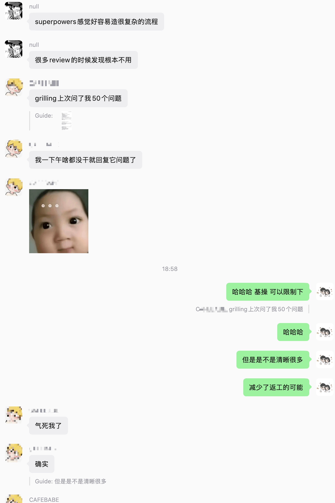
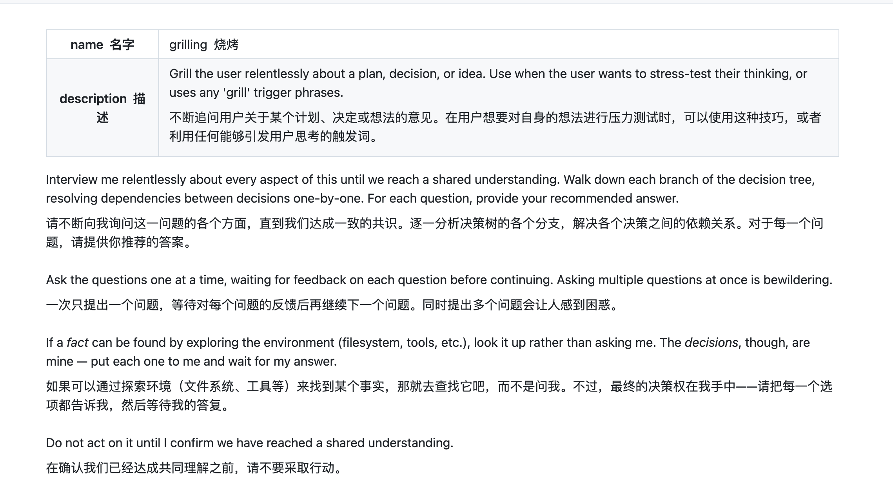
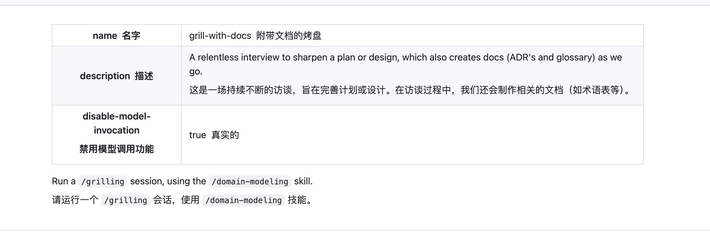
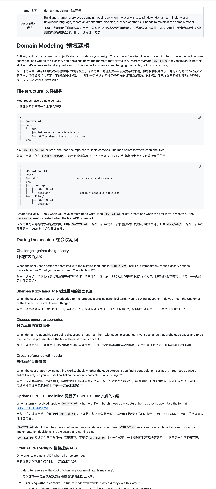
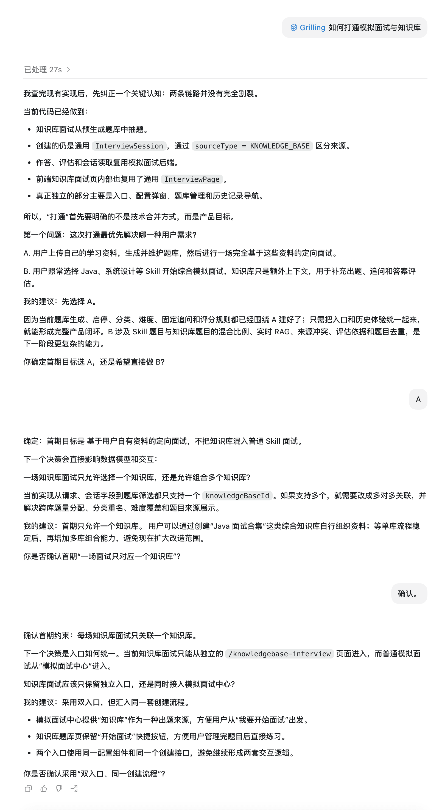
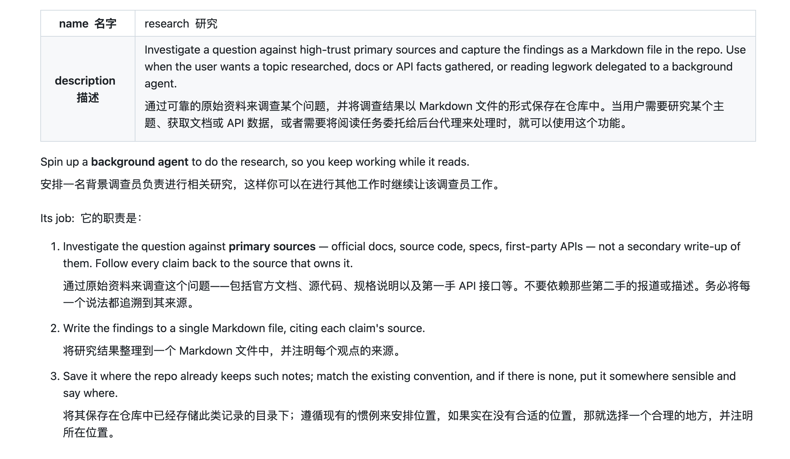
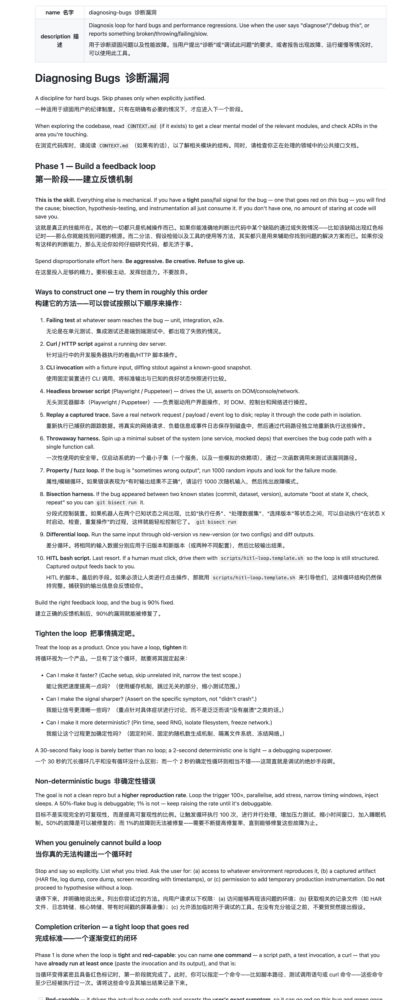
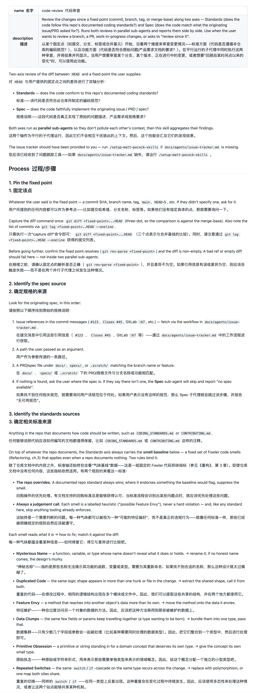
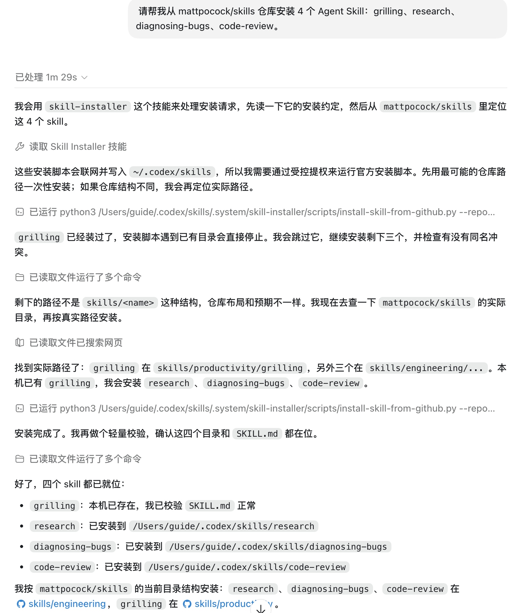

Hi, I'm Xiao G.

I mentioned [mattpocock/skills](https://github.com/mattpocock/skills) in both [AI Coding Skills: A Selection Guide](https://javaguide.cn/ai-coding/practices/programmer-essential-skills.html) and [Do AI Coding Skills Still Matter with Strong Models?](https://javaguide.cn/ai-coding/practices/skill-selection-and-pruning.html). I also used a real project to show `grilling` in the latter article.

Several readers were interested in `grilling`. Looking back, though, I covered it too briefly in both articles. They left readers with the impression that it simply makes an agent ask questions, without explaining that it asks one question at a time, what information the agent should look up itself, or when it can start implementing.

So I reread the repository's `SKILL.md` files. `mattpocock/skills` breaks common engineering problems into small, editable, composable Skills: clarify unclear requirements, add a diagnostic workflow for a difficult bug, and run a code review before delivery.

This approach suits how I work. Codex and Claude Code can already handle basic actions reliably, so I do not need to teach them the same things repeatedly. I add a small workflow only to the step that keeps causing rework.

People in our group raised similar points: a full suite can impose too much process on small tasks, while `grilling` can clarify requirements even though it asks a series of questions.



Besides `grilling`, `research`, `diagnosing-bugs`, and `code-review` are also useful. This article covers all four.

## `grilling` Does More Than Ask a Few Questions

In my earlier articles, I oversimplified `grilling`: tell the agent not to rush into coding and to ask a few more questions first. A regular prompt can do that too.

The current version of [`grilling`](https://github.com/mattpocock/skills/blob/main/skills/productivity/grilling/SKILL.md) is short, but it specifies the interview process in detail.



It follows a decision tree and handles one decision at a time. Earlier answers may change which branch comes next, so the agent should not ask a dozen questions at once and make the user fill out a questionnaire.

It also distinguishes facts from decisions. The agent should inspect the code and documentation to find out which framework the project uses, how an existing API is designed, or whether a database has a particular field. The user should decide which approach to take in the first release, whether to support old behavior, and how much complexity to accept.

The agent must not begin implementation based on its own judgment before both sides confirm that they have reached a shared understanding.

## How Do `grilling`, `grill-me`, and `grill-with-docs` Differ?

`grilling` is a reusable, lower-level interview Skill. The model can call it proactively, the user can invoke it directly, and other Skills can reuse it. `/grill-me` is a more explicit user entry point; its job is simply to start a `/grilling` session.

When a discussion produces domain terminology or architectural decisions that will be used over time, you can switch to [`/grill-with-docs`](https://github.com/mattpocock/skills/blob/main/skills/engineering/grill-with-docs/SKILL.md). It also calls `domain-modeling`: once terminology is settled, it writes it to `CONTEXT.md`; a small number of difficult-to-reverse decisions that may look surprising later are recorded as ADRs.





The relationships look like this:

```text
grill-me ──────────> grilling
grill-with-docs ───> grilling + domain-modeling
```

Interview rules live in `grilling`, and the other Skills reuse them.

In [v1.1.0](https://github.com/mattpocock/skills/releases/tag/v1.1.0), the confirmation step became an explicit stop condition, and the Skill began distinguishing environmental facts from user decisions. Older rules could lead an agent that called this Skill to make product decisions on the user's behalf. Now each such decision must be asked about explicitly.

## How I Used `grilling` to Clarify a Knowledge-Base Interview Feature

This example comes from my open-source project, the [SpringAI Interview Platform](https://javaguide.cn/zhuanlan/interview-guide.html).

I wanted to connect mock interviews with the knowledge base. I chose `grilling` and gave it a single task: help me think through the feature.

The existing implementation had already integrated some of the pieces: ordinary mock interviews and knowledge-base interviews both used `InterviewSession`, and answers, asynchronous evaluations, and some frontend pages were already shared. Continuing to design the lower-level implementation could have changed code we could keep, while leaving the first-release scope undecided.



The first decision `grilling` asked about was the knowledge base's role in an interview.

One option was to generate a targeted interview entirely from the user's materials. Another was to let users continue choosing a Skill such as Java or system design, with the knowledge base only adding context. I chose the first option, which let us keep the existing question generation, categories, difficulty levels, fixed follow-up questions, and scoring rules. The second option would have raised questions about the mix of the two question types, live RAG, duplicate questions, conflicting sources, and evaluation criteria.

Once I confirmed that choice, it moved to the next branch: should an interview use one knowledge base or combine several?

The request parameters, session field, and question filtering were all designed around a single `knowledgeBaseId`. Multiple knowledge bases would also require handling merged retrieval results, weighting, duplicate content, and access checks. So we limited the first release to one knowledge base instead of changing the association tables and API structure early.

The third decision was the entry point. Knowledge-base interviews already had a dedicated page, while ordinary mock interviews started from the “Mock Interview Center.” We decided to keep both entry points but continue sharing `InterviewSession`, the configuration component, and the creation API to avoid maintaining two similar flows.

No code had been changed yet, but we had narrowed the first-release scope to three decisions: knowledge-base-only interviews, one `knowledgeBaseId`, and two entry points sharing the session and creation functionality.

`grilling` did not make the product decisions for me. It proposed options and gave supporting code evidence, while I confirmed the trade-offs. If my first answer had been “general Skill plus knowledge-base context,” the next question would not have been one knowledge base or several; it would have focused on mixing and evaluating the two question types.

Today's models already write code quickly. Even when requirements are unclear, an agent can quickly produce code, tests, and documentation. If it goes in the wrong direction, all those artifacts need rework.

Of course, not every task needs an interrogation first. If the acceptance criteria are clear—for example, changing a label, adding an explicit null check, or adding a field following an existing pattern—doing it directly is usually faster. `grilling` does not replace tests or code review; it exposes unresolved questions before implementation.

The current `grilling` also has no limit on the number of questions, so a complex requirement may take a long time to discuss. If you are concerned that the interview will drag on, set a budget of three to five questions per round. At the end of each round, summarize the decisions that are confirmed and unresolved, then let the user decide whether to continue.

Do not simply say “ask at most five questions.” Once it reaches the limit, the agent must still not fill in the remaining decisions itself or start implementation.

## `research`: Delegate the Research Work

When upgrading an SDK, the current supported parameters, deprecation dates, and changes to streaming events should not depend on the user's memory. Nor should the main agent have to read long documentation while changing code.

[`research`](https://github.com/mattpocock/skills/blob/main/skills/engineering/research/SKILL.md) sends the question to a background agent that consults only official documentation, source code, specifications, and first-party APIs. It writes the findings and sources to a Markdown file in the repository, so the main agent can continue other work.



What I like is that it fixes both the sources and the deliverable: do not use secondhand tutorials in place of official material, and do not dump dozens of pages of search history into the main session. Keep only conclusions that can be checked.

This approach has two prerequisites: the agent must support background or Subagent research, and the project must accept an additional research document. For a single method signature, opening the official docs directly is faster. Delegate the research when dealing with a version migration, protocol differences, or an unfamiliar dependency.

## `diagnosing-bugs`: Start with a Reproducible Feedback Loop

When debugging, an agent can settle on a theory too early. It sees a suspicious branch, changes the code, and runs the tests. If that does not fix the issue, it tries another guess. The changes accumulate while the original failure remains unreproduced.

[`diagnosing-bugs`](https://github.com/mattpocock/skills/blob/main/skills/engineering/diagnosing-bugs/SKILL.md) puts most of its effort into the first stage: create a feedback loop that reliably captures the bug.



The loop could be a failing test, a `curl` command, a CLI with fixed input, a Playwright script, or a replay of a production request. It must capture the original failure, run reliably and quickly, and be executable by the agent on its own.

If the issue truly cannot be reproduced, the Skill lists what was tried and asks the user for a reproducible environment, HAR file, logs, `core dump`, or permission for temporary production instrumentation.

Once the loop is ready, reproduce the issue and reduce the input. Then list three to five falsifiable hypotheses and explain what should change if each is the cause. Use those predictions to add breakpoints or targeted logs.

For the fix, turn the minimal reproduction into a regression test and confirm that it fails at the correct module boundary before applying the fix. Before finishing, rerun the original scenario, remove temporary logs and debugging programs with a unique prefix, and record the root cause in the commit or PR.

This workflow suits hard-to-reproduce bugs, performance regressions, and cases where several guesses have already failed. A compile error or an obvious field-name typo does not need a full diagnostic process. If the project has no suitable test seam, the minimal reproduction may not become a reliable test. The Skill records that architectural problem instead of forcing a unit test that does not match real usage.

## `code-review`: Review Standards and Requirements Separately

Code reviews often focus on implementation quality: Are names clear? Is logic duplicated? Are errors handled properly? Are there enough tests? The code can look fine but still implement the wrong requirement.

[`code-review`](https://github.com/mattpocock/skills/blob/main/skills/engineering/code-review/SKILL.md) separates review into two tracks: `Standards` and `Spec`.



`Standards` reads the repository's `CONTRIBUTING.md` and coding conventions, then checks whether the change follows them. The current version also includes a collection of `Fowler Code Smells`. Explicit repository rules take precedence; a smell is a prompt for investigation, not automatically a violation.

`Spec` goes back to the original issue, PRD, or technical proposal and checks whether the deliverable actually meets the requirements. Parallel Subagents perform the two reviews separately, then combine the findings, so the code-style review does not bias the requirements review.

Before reviewing, choose a comparison point such as a `commit`, branch, `tag`, or `main`. The Skill examines the `diff` from the merge base to `HEAD` instead of making vague comments about the entire repository.

If the project has no PRD, issue, or acceptance criteria, the `Spec` track must be skipped. If there are no repository conventions, `Standards` relies more on general code smells. Parallel review also requires the host agent to support Subagents. Keep CI, static analysis, and human domain review in place.

## Installation

You can install this repository with the `skills.sh` installer, which supports Codex, Claude Code, and other tools that implement Agent Skills:

```bash
npx skills@latest add mattpocock/skills
```

The installer lets you choose the Skills and target agents. To try requirements interviews, start with `grill-me` and `grilling`. If you want to maintain `CONTEXT.md` and ADRs during discussions, also choose `grill-with-docs` and `domain-modeling`.

According to the project's current instructions, before using its engineering workflows, run `/setup-matt-pocock-skills` once in the target repository. Confirm whether the project uses GitHub, Linear, or local task management, and choose the `Triage` label and agent documentation directory.

You can also ask a coding agent to install the Skills. For example, with Codex:

```text
Please install four Agent Skills from mattpocock/skills: grilling, research, diagnosing-bugs, and code-review.
```



The Skills usually appear in the available list in the next conversation.

`tdd`, `to-spec`, and `to-tickets` are not listed separately here. TDD, specification writing, and task breakdown are common engineering practices, and many agents can already handle their basic forms. Combine those Skills when your project follows the full workflow “discussion → Spec → tickets → implementation → review.”

The four Skills in this article address the failure points I care about most: starting before the direction is clear, relying on unreliable sources, guessing at a bug without reproducing it, and finishing code without checking it against the original requirements.

Do not enable everything globally on the first installation. Limit the trial to one repository and observe two or three real tasks. Compare rework, execution time, and output quality. If the model works reliably without a Skill, remove it. If the same problem keeps recurring, keep only that small part of the workflow.

A third-party Skill is a set of instructions for an agent. Before installing one, read `SKILL.md` and inspect `scripts/`, `references/`, and its permission requirements. A shorter list is fine; knowing why each Skill is there makes them easier to use well.
