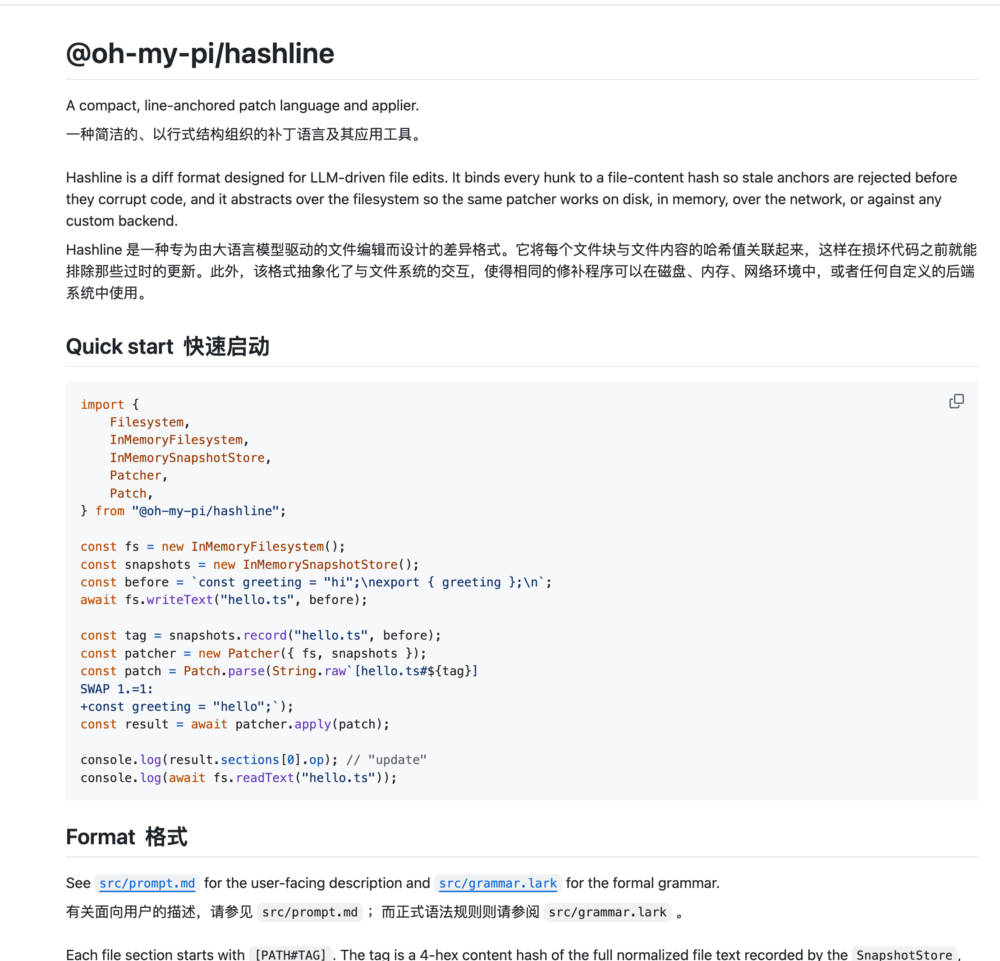
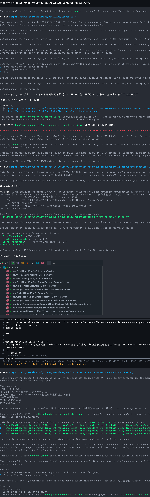
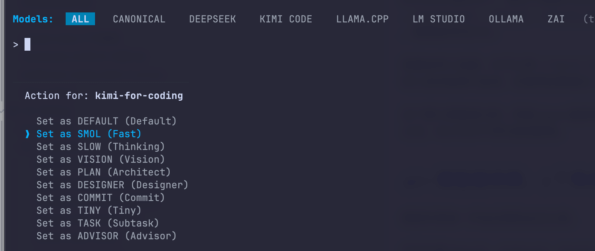
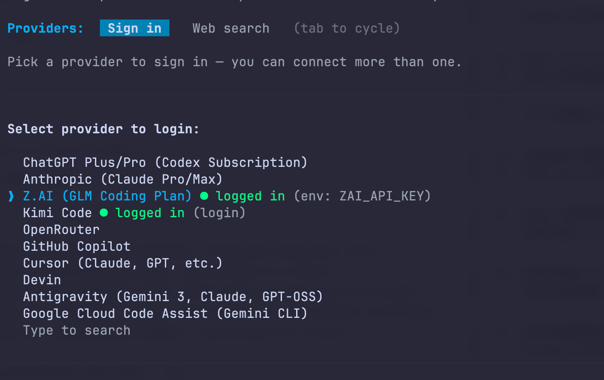
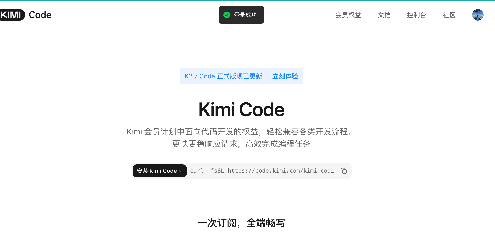
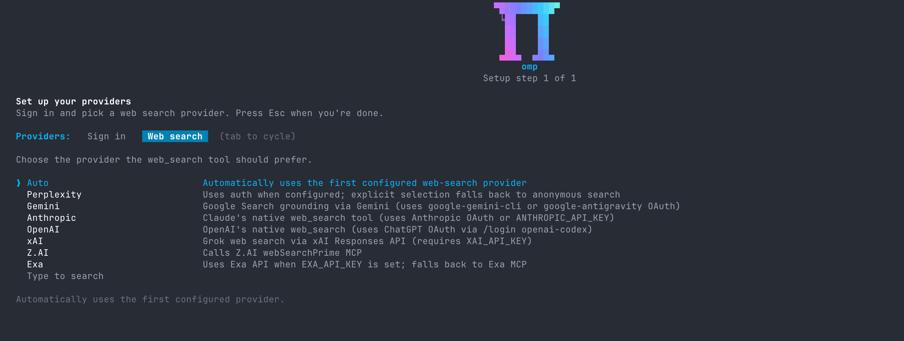
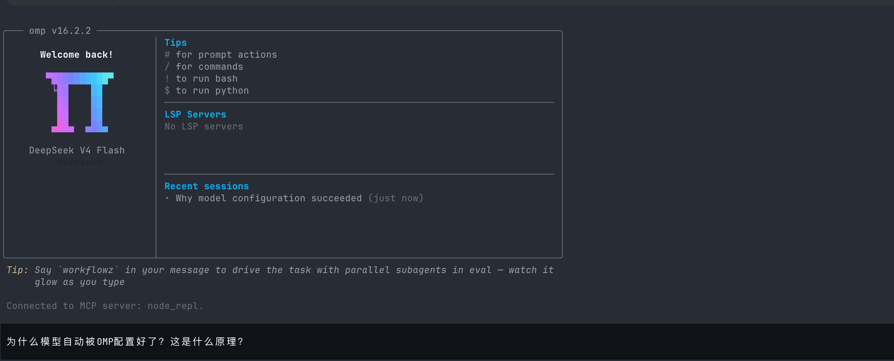
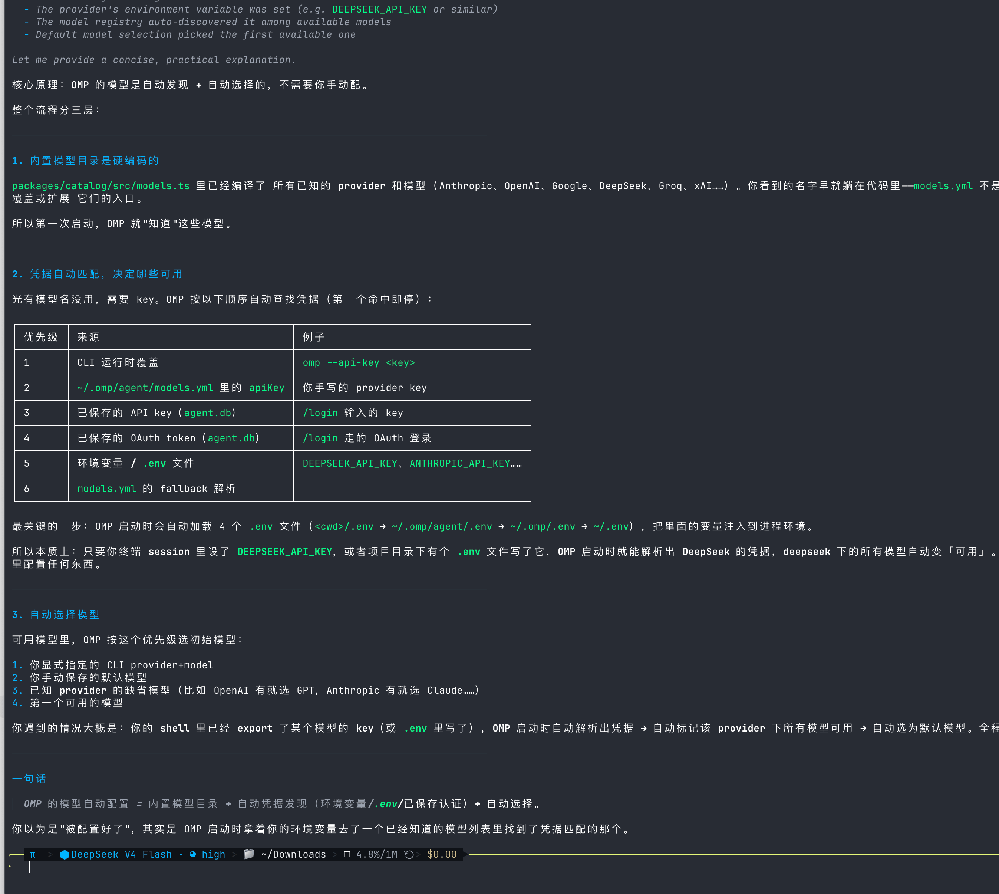
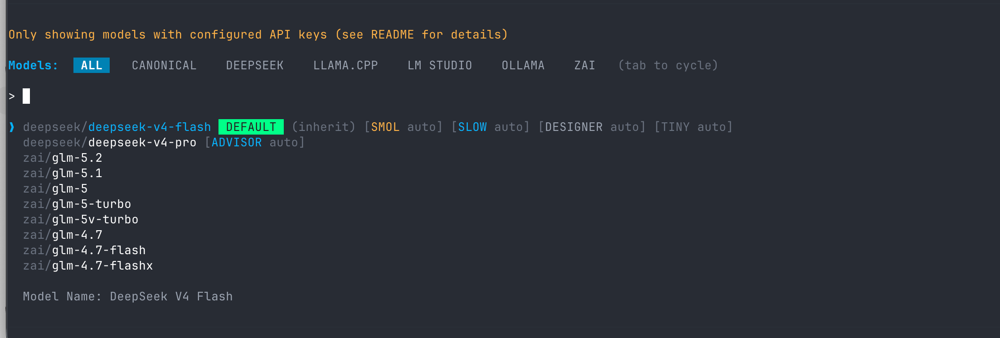

I confirmed with a contact at Alibaba that, starting July 10, the company would classify Claude Code as high-risk software and recommend Qoder as an alternative for employees.

I will not discuss that further here.

Anthropic's business decisions can be frustrating, but its Claude models and Claude Code are well made. Among similar products, Claude Code remains one of the most reliable. It is a commercial product backed by a strong team, and new releases arrive quickly.

Other well-known tools in this category include OpenCode, Codex CLI, Cline, TRAE, and Qoder. DeepSeek TUI was later renamed CodeWhale.

A few days ago, someone in a group shared a GitHub link to **oh-my-pi**, saying they had been enjoying it.

I did not think much of it at first. My inner monologue was: **Another terminal agent? How is it different from Claude Code, OpenCode, or Codex CLI?**

After using it for a few days, I changed my mind.

## What Is It?

oh-my-pi is an open-source AI coding agent for the terminal.

After installing it, run `omp` in a project directory. It can read and edit code, run commands, explain errors, and draft commit messages.

This is similar to what Claude Code and Codex CLI can do.

The main difference is in the **tool layer**.

It brings LSP, DAP, Hashline, browser and GitHub integrations, subagents, and multi-model routing into the terminal.

For example, when renaming a function, it can use a language server to find references instead of guessing with `grep`. When debugging a crash, it can inspect stack frames and variables. When reviewing a PR, it can treat the PR as a readable resource.

One subjective detail: I like its terminal UI. It suits my taste.

This is not a core capability, but anyone who spends all day in a terminal knows that a pleasant interface can improve your mood.

## Hashline

Many agents still edit files using an `old_string -> new_string` approach.

They read part of a file, ask the model to reproduce the original text, then have a tool find and replace that text.

Most people have run into problems with this approach.

A missing space, an extra newline, or slightly different indentation can prevent a patch from matching. Worse, if you have just edited the file manually, the model may still use stale context. Mixing the old and new content can leave the file in a mess.

oh-my-pi's `edit` tool includes a feature called **Hashline**.

`@oh-my-pi/hashline` describes it as a compact, line-anchored patch language. When a file is read, each line gets a content hash. The model can make changes anchored to those hashes, so it does not need to reproduce a whole block of source text.



If the file changes in the meantime and the hashes no longer match, the patch is rejected.

This is not just about shorter patches; it adds a more reliable way to locate and validate changes. Models cannot reproduce source text perfectly every time, so the tool layer provides an extra safeguard.

The project benchmark says Grok 4 Fast used 61% fewer output tokens on comparable tasks. I have not reproduced this result, so treat it as the project's claim and focus on the trend.

I care more about catching a bad patch early than saving tokens. In a real project, preventing one damaging edit matters more than saving a few hundred tokens.

## Where It Feels Most Like an IDE

oh-my-pi feels most like an IDE because it brings two common IDE capabilities, LSP and DAP, directly into the agent's toolset.

The project divides them into two groups:

- `lsp` handles diagnostics, navigation, symbols, renames, code actions, and raw requests.
- `debug` handles breakpoints, stepping, threads, stack frames, and variables in a DAP session.

These terms may sound low-level, but their use in everyday coding is easy to understand.

**LSP describes the structure of the code.** It can find where a function is defined and referenced, list diagnostics in the current file, and show which imports and re-exports are affected by a rename.

When an agent wanted to rename a function, it often had to start with `grep` and ask the model to decide whether the matches referred to the same symbol. Comments, strings, and variables with the same name can be mixed in. In TypeScript projects, barrel exports, path aliases, and re-exports quickly make plain-text search inadequate.

Using LSP operations such as rename, references, and diagnostics gives the agent the relationships as understood by the language server. The model can still make mistakes, but it is no longer guessing from plain text alone.

That matters to me.

When an agent writes code, I worry that it will confidently guess how functions relate, get it wrong, and continue. LSP gives it a map closer to what an IDE provides.

**DAP handles something else: runtime behavior.**

Agents can fall into a repetitive debugging loop: add a log, run the program, inspect the output, and add another log. This can work, but it is slow for native crashes, a hung Go service, or a stuck Python process.

With DAP, the agent can set breakpoints, step through execution, inspect threads and call stacks, and read variables. It can observe runtime state instead of relying only on text search.

This does not mean it will always fix a bug. It means it can debug in a way closer to a human developer: see where execution stopped, inspect how variables changed, and then decide what patch to write.

I think of this as “IDE capabilities in the terminal.” It is a different dimension from the number of tools discussed below.

Tools such as `eval`, `task`, `browser`, and `github` make up more of an agent workbench. LSP and DAP are what make it feel like an IDE.

## A Rich Toolset

Most agents keep their built-in toolsets small: read files, search text, edit files, and run commands. Heavier tasks are usually delegated to MCP servers.

omp takes a different approach. It has 32 built-in tools, which may feel like a lot, but some are particularly notable.

First, `eval`. It includes persistent Python and Bun JavaScript kernels, rather than disposable sandboxes. More importantly, both kernels can call omp tools such as `read`, `search`, and `task`. An agent can read a CSV in a Python cell, switch to a JavaScript cell to process the data, and stay in the same session.

The current multi-agent coordination tools are `task`, `hub`, `todo`, and `ask`, rather than `task` / `irc` listed in older documentation. `task` fans work out to subagents, each of which can use its own toolset or an isolated worktree. `hub` supports collaboration and messaging among live agents, `todo` tracks task status, and `ask` sends structured questions. Fields change frequently, so refer to the current tool descriptions.

`browser` is based on Puppeteer, includes stealth-related handling, and can drive Electron applications through CDP. Stealth can reduce some common automation signals, but cannot guarantee that a site will treat it as a regular user or bypass site terms, login restrictions, or anti-automation policies.

`github` is one of my favorite parts. Instead of making the model learn a collection of tools such as `gh_issue_view`, `gh_pr_view`, and `gh_search`, it lets the agent read a PR as a filesystem path. `read pr://1428` follows the same idea as `read src/foo.ts`, and `search` can traverse a diff much like a directory. The abstraction also extends to internal schemes such as `pr://`, `issue://`, `agent://`, `skill://`, `rule://`, and `conflict://`.

I tried it on a JavaGuide issue. It read the issue, found the corresponding Markdown file in the repository, then followed the image links.



There is also `advisor`, which can use a reviewer model. It reviews the main agent's output on each turn and injects inline reminders. It has its own context and model, focusing on things the main agent missed. It is a bit like having someone beside you whose only job is to find problems.

These tools may not all be novel on their own, but combining them in one toolset is different. Reading a local file, a PR, or a subagent's result all share a similar “read resource” action, so the model has fewer unusual interfaces to learn.

More tools also make routing more complex and increase the chance of accidental calls. I would not configure everything at once.

Multiple models, tools, and memories may sound appealing, but configuration effort, cost, and permissions all increase. Before enabling tools such as `bash`, `write`, `edit`, `browser`, `github`, and `ssh`, consider what they will be able to access.

Some tools are disabled by default, and the list changes between versions. Check `/tools` or the current help output instead of relying on a static list in this article.

To narrow the toolset, expose only selected tools with `--tools read,edit,bash,...`. Currently, hidden capabilities are exposed on demand through the `xd://` resource discovery mechanism; older documentation's `search_tool_bm25` is no longer used.

This is a sensible default. A terminal agent's biggest problem is often not a lack of capabilities, but having so many permissions that you lose track of what it can access.

## Multiple Model Providers and Role-Based Routing

I did not expect the model list to be this extensive.

It includes not only popular providers such as OpenAI, Anthropic, and Gemini, but coding subscriptions such as Cursor, Copilot, Kimi Code, Moonshot, Tongyi, Qwen Portal, GLM, Xiaomi MiMo, and Qianfan. Local options include Ollama, LM Studio, llama.cpp, vLLM, and LiteLLM.

It also supports five role routes: `default`, `smol`, `slow`, `plan`, and `commit`.

I would use `default` as the primary model for reading and editing code and answering questions. `smol` is better for small subagent tasks such as searching many files or collecting information; a cheaper, faster model is enough, since it is not expected to make complex judgments.

For architectural decisions, difficult bugs, or long-context reasoning, use `slow` with a stronger, more expensive model. Use `plan` to decide which files to change and how to break down the work, and `commit` for structured writing such as changelogs and commit messages.



This way, everyday chat, subagents, deep reasoning, planning, and commit messages do not all have to use the same model. It is a way to route work by cost and quality, not a way to make the models themselves more capable. Press `Ctrl+P` in the main session to cycle through them, or switch manually with `/model`.

I would not configure all of this at the start. First get `default` working reliably, then consider `smol` and `slow`. Fallback chains, model scoping by path, and key rotation may be appealing, but enabling them all on day one makes problems harder to diagnose.

## Getting Started

Installation takes one command:

macOS / Linux：

```sh
curl -fsSL https://omp.sh/install | sh
```

Homebrew：

```sh
brew install can1357/tap/omp
```

Bun：

```sh
bun install -g @oh-my-pi/pi-coding-agent
```

Windows PowerShell：

```powershell
irm https://omp.sh/install.ps1 | iex
```

The project requires `bun >= 1.3.14`, and the root `package.json` specifies `packageManager: bun@1.3.14`. If you install with Bun, check your version first to avoid environment issues.

After installation, try it in a project that is not critical.

```sh
cd your-project
omp
```

The first time you launch it, setup runs before you can start chatting.

First, choose which providers to sign in to. You can connect several, including ChatGPT Plus/Pro, Anthropic, Z.AI, Kimi Code, OpenRouter, Copilot, and Cursor. Providers configured through environment variables will already show as logged in.





Next, go to Web Search and choose the preferred backend for the `web_search` tool. The project currently supports about 25 backends, so a static list would quickly become outdated. With `Auto`, it selects from configured backends; for manual selection, use the current Setup screen.



Do not spend too long on this step. It is safer to get one primary model and one search provider working before connecting every account.

After setup, the model was already selected on the main screen; in my case, the left panel showed `DeepSeek V4 Flash`.



I was surprised at first: I had not selected DeepSeek. Why was it already configured?

I asked the agent. Its explanation was that oh-my-pi has a built-in model catalog and searches for credentials at startup, including command-line arguments, `models.yml`, keys or OAuth credentials saved through `/login`, environment variables, and several `.env` files. If it finds a matching variable such as `DEEPSEEK_API_KEY`, it marks the provider's models as available and selects an initial model.



You do not need to restart to switch models; use `/model`. It only displays models with available credentials and lets you switch between provider tabs. In my setup, I could see DeepSeek, Z.AI, Ollama, LM Studio, and llama.cpp.



To see the commands and options available in your version, run:

```sh
omp --help
```

If you have used Claude Code, Codex CLI, Cursor, Windsurf, Gemini, or Cline, it can also read existing rules, skills, and MCP servers from disk. It checks directories such as `.claude`, `.cursor`, `.windsurf`, `.gemini`, `.codex`, `.cline`, `.github/copilot`, and `.vscode`.

## Summary

oh-my-pi's main strengths are in its tool layer: Hashline makes patch positioning more reliable, LSP and DAP expose code structure and runtime state, and tools such as `github`, `browser`, `task`, and `eval` bring different resources into one session.

More tools also mean a broader permission surface. Enable capabilities such as `github`, `browser`, `memory`, and `ssh` as needed for each task. For accounts, direct messages, repository writes, and remote hosts, first check permission scope, audit logs, and applicable terms of service.

If you are comfortable with terminal workflows and willing to experiment with models, tools, and permissions, try it on a personal project. If you want a reliable tool that works with little setup, Claude Code is still more convenient.

What interests me most about oh-my-pi is how it advances the tool layer for open-source agents. It has many capabilities and clear ambitions, but trust needs to be earned through careful use.

Project: [https://github.com/can1357/oh-my-pi](https://github.com/can1357/oh-my-pi)

Website: [https://omp.sh](https://omp.sh)
