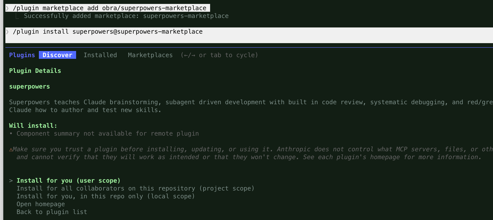
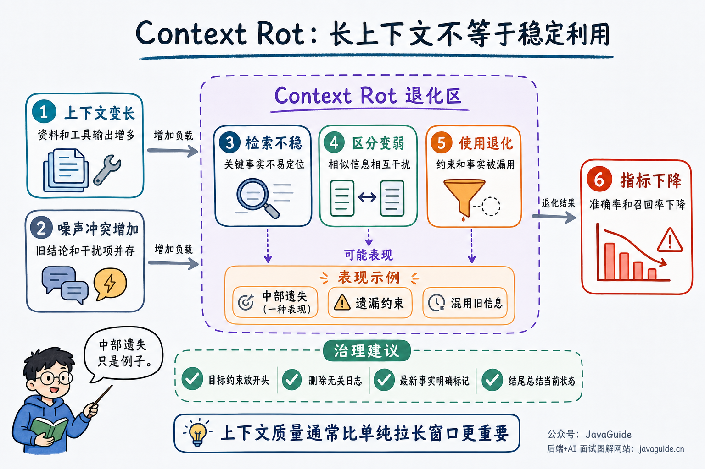

Hi, I'm Xiao G. A friend recently asked me, “Which Skills do you use regularly? Could you share some with us?”

Of course. I started using Skills soon after they appeared, and later built quite a few custom ones for my company. My colleagues and friends found them useful.

Putting together a list sounded simple, but once I started, I found that few Skills were worth including. The process also reminded me how quickly technology is moving in the AI era. It can be hard to keep up.

When Skills first appeared, models were less capable. They often started coding before understanding a project, skipped tests, or forgot earlier requirements in a long conversation.

So we added development steps to Skills one by one: clarify requirements, make a plan, write tests first, and review the changes. More detailed rules felt safer.

But models improved quickly.

Now, when given the same task, Codex or Claude Code can usually inspect the project, trace call paths, edit files, add tests, and run checks on its own. Many things we used to repeat in `SKILL.md` have become standard behavior.

Installing every Skill at this point is like handing a stack of manuals to someone who already knows how to work. If even a small change requires a plan, review, and a full verification cycle, the process can take more time than the task.

This list is intentionally selective. The Skills I keep tend to provide project-specific conventions the model cannot infer, or include specialized workflows, scripts, templates, and reference material. I generally no longer recommend Skills that only say “read the code, make a change, then run tests.”

My earlier guide, [A Detailed Guide to Agent Skills](https://javaguide.cn/ai/agent/skills.html), explains the differences between Skills, prompts, and MCP. For why I started trimming my Skills, see [Are AI Coding Skills Still Useful with More Capable Models?](./skill-selection-and-pruning.md).

## Superpowers

Superpowers combines requirements clarification, planning, TDD, Git worktrees, subagent collaboration, code review, and pre-completion verification into one development workflow. It suits unfamiliar codebases, complex features, and high-risk changes. The workflow is usually too heavy for copy edits, null checks, or a small validation change.

Superpowers runs these Skills in sequence:

| Skill                                             | Main action                                                                  |
| ------------------------------------------------- | ---------------------------------------------------------------------------- |
| `brainstorming`                                   | Clarify requirements, compare options, and save a design before coding       |
| `using-git-worktrees`                             | Create an isolated workspace and check the test baseline                     |
| `writing-plans`                                   | Break the design into small tasks with file locations and verification steps |
| `subagent-driven-development` / `executing-plans` | Delegate to subagents or execute the plan in batches                         |
| `test-driven-development`                         | Follow RED-GREEN-REFACTOR                                                    |
| `requesting-code-review`                          | Review the implementation by severity                                        |
| `verification-before-completion`                  | Check the evidence before declaring the work complete                        |
| `finishing-a-development-branch`                  | Verify tests and handle merging, a PR, or keeping the branch                 |

This workflow supports Claude Code, Codex, Cursor, and OpenCode. Install the Claude Code plugin with:

```text
/plugin install superpowers@claude-plugins-official
```

In the Codex app, search for Superpowers under Plugins in the sidebar. In the Codex CLI, enter `/plugins` and search for it there. Each agent has its own installation method, so install it separately if you use multiple agents.

The Claude Code installer asks where to enable the plugin:



| Option                             | Scope                             | Recommendation                                                           |
| ---------------------------------- | --------------------------------- | ------------------------------------------------------------------------ |
| Install for you                    | Applies to all projects           | Choose this if you have decided to use the full workflow long term       |
| Install for all collaborators      | Shared with project collaborators | Choose this if the team has agreed to use the same development workflow  |
| Install for you, in this repo only | Applies only to this repository   | Best for a first trial, so you can see whether it slows down small tasks |

I no longer recommend that newcomers install it globally right away. Try it on two or three real tasks in one repository first, and see whether requirements clarification, TDD, and review actually reduce rework before expanding its scope.

Project: <https://github.com/obra/superpowers>

## mattpocock/skills

If you only want to improve one part of your development workflow, take a look at [mattpocock/skills](https://github.com/mattpocock/skills). It breaks engineering practices into small, editable, composable Skills instead of requiring every task to follow the same process.

Modules that may be useful to developers include:

| Skill                    | What it helps with                                                                                                                           |
| ------------------------ | -------------------------------------------------------------------------------------------------------------------------------------------- |
| `grill-me` / `grilling`  | Ask follow-up questions to clarify requirements, decisions, and dependencies before starting                                                 |
| `diagnosing-bugs`        | Investigate by reproducing the bug, narrowing its scope, forming hypotheses, adding instrumentation, fixing it, and running regression tests |
| `tdd`                    | Develop features or fix bugs with the RED-GREEN-REFACTOR cycle                                                                               |
| `code-review`            | Check coding standards and whether the implementation meets the original requirements                                                        |
| `to-spec` / `to-tickets` | Turn existing discussions into a specification and break it into tasks with dependencies                                                     |
| `domain-modeling`        | Align domain terminology and record key decisions in `CONTEXT.md` and ADRs                                                                   |

Install it across agents with:

```bash
npx skills@latest add mattpocock/skills
```

The installer lets you choose which Skills to install and for which agents. According to the project's current instructions, also select `/setup-matt-pocock-skills`, then run it once in the target repository to configure the issue tracker, documentation location, and other settings.

You do not need to install everything at first. If requirements are often unclear, start with `grill-me` and `grilling`. If you often struggle to locate bugs, add `diagnosing-bugs`.

These Skills suit developers who already have sound development practices and want to improve a few weak areas. If a project already has established requirement templates, TDD standards, and code review workflows, installing Skills that duplicate them will add little value.

I wrote a separate guide to using these Skills and understanding their limits: [mattpocock/skills: My 4 Recommended AI Coding Skills](https://javaguide.cn/ai-coding/practices/mattpocock-skills.html).

Project: <https://github.com/mattpocock/skills>

## ECC (formerly Everything Claude Code)

Everything Claude Code has been renamed **ECC**.

The project has grown from a Claude Code configuration into a cross-agent harness system that supports Codex, Claude Code, Cursor, OpenCode, and other tools.

The ECC repository includes Skills, agents, hooks, rules, memory management, security scans, continuous learning, and engineering rules for multiple languages. It now contains hundreds of Skills and is closer to a team-level harness configuration library. Centralizing these settings can reduce duplicated configuration when a team needs consistent agent behavior, memory policies, and security checks.



More components also mean more choices. If a project only needs code review or TDD, use ECC's selective installation to add only the relevant components, such as Java code review, context persistence, or security scanning, instead of adding the whole system to every repository.

Project: <https://github.com/affaan-m/ECC>

## Doc Co-Authoring

One of the most underestimated steps before writing code is clarifying the requirements.

When requirements are unclear, an AI coding agent may make a lot of progress in the wrong direction. It might implement an idea whose scope has not been defined. The code, tests, and documentation may all be complete, yet still miss the actual need.

Anthropic's official Skills repository includes **doc-coauthoring** for this kind of work. It turns writing PRDs, technical proposals, decision records, and RFCs into a collaborative workflow. The focus is first on context, structure, and reader understanding; polishing sentences comes later.

doc-coauthoring works through a document in three stages:

| Stage                      | What it does                                                                                                      |
| -------------------------- | ----------------------------------------------------------------------------------------------------------------- |
| **Context Gathering**      | Collect background, constraints, prior discussions, architectural dependencies, and stakeholder concerns          |
| **Refinement & Structure** | Iterate section by section: ask questions and explore ideas, select the useful content, then write readable prose |
| **Reader Testing**         | Test the document with Claude in a fresh context to find likely misunderstandings or omissions                    |

Consider an order refund module. Before implementation, use doc-coauthoring to draft a short technical proposal covering the refund state machine, API idempotency, inventory and coupon rollback, and manual compensation for failures.

Once the document is agreed on, give the technical proposal and acceptance criteria to the agent for a small task. For changes across multiple modules, add Superpowers to plan the work, write tests, and review the code. The goal is to resolve disagreements during the documentation stage instead of changing scope after implementation.

Install it in Claude Code with:

```bash
/plugin marketplace add anthropics/skills
/plugin install example-skills@anthropic-agent-skills
```

`example-skills` is a collection of example Skills, and doc-coauthoring is one of them. Installing this plugin also provides skill-creator, mentioned later in this guide, so you do not need to install it separately.

Project: <https://github.com/anthropics/skills/tree/main/skills/doc-coauthoring>

## UI UX Pro Max

This is a specialized UI/UX design Skill for AI coding agents such as Claude Code, Cursor, and Windsurf.


It generates a design system based on the product type and industry, then gives the agent guidance on colors, typography, layout, motion, and anti-patterns. Unlike lightweight Skills with only a few aesthetic prompts, it includes a searchable design knowledge base.

The current public version includes:

| Resource type              | Amount | Description                                                         |
| -------------------------- | ------ | ------------------------------------------------------------------- |
| UI styles                  | 84     | Includes Glassmorphism, Neumorphism, Bento Grid, and AI-native UI   |
| Product types and palettes | 192    | Matches scenarios such as SaaS, finance, healthcare, and e-commerce |
| Font pairings              | 74     | Includes Google Fonts combinations                                  |
| Chart types                | 25     | For dashboards and analytics pages                                  |
| Reasoning rules            | 161    | Generates design systems by industry                                |
| UX guidelines              | 98     | Covers anti-patterns, interaction, and accessibility                |
| Supported stacks           | 22     | Includes React, Next.js, Vue, Nuxt, SwiftUI, Flutter, and JavaFX    |

For example, given the request “Build a landing page for a beauty spa,” it classifies the page under health and wellness, suggests a Soft UI direction, uses pale pink with sage green and gold accents, and selects Cormorant Garamond. It also lists anti-patterns, such as avoiding the common purple-pink gradient.

Install it in Claude Code from the plugin marketplace:

```text
/plugin marketplace add nextlevelbuilder/ui-ux-pro-max-skill
/plugin install ui-ux-pro-max@ui-ux-pro-max-skill
```

For Codex, Cursor, Windsurf, and similar tools, use the current official CLI. The package is `ui-ux-pro-max-cli`; the old `uipro-cli` package is no longer maintained:

```bash
npx ui-ux-pro-max-cli init --ai codex
npx ui-ux-pro-max-cli init --ai cursor
```

Its search scripts require Python 3. After installation, describe the page type and industry to use it:

```text
Build a landing page for a SaaS product.
Design a healthcare analytics dashboard.
Create a dark-themed finance app.
```

Its delivery checklist also checks icons, hover states, text contrast, and `reduced-motion`, including specific rules such as “do not use emoji as icons.” Use its recommendations carefully in projects with an existing design system; generated palettes, fonts, and component guidelines may conflict with established rules. In that case, encode the team's design standards in a project-level Skill instead.

Project: <https://github.com/nextlevelbuilder/ui-ux-pro-max-skill>

If you do not need a full design knowledge base, consider Anthropic's official **frontend-design** Skill instead.

The current version emphasizes choosing a distinctive visual direction first, then expressing it through typography, colors, layout, motion, and details while avoiding a generic “AI-generated” look. It no longer imposes fixed rules against Inter, Roboto, or purple-and-white gradients. Font and color choices should follow the brand, content, and existing design system.

## Vercel React Best Practices

Getting an agent to build a working React page is not difficult. Performance issues are easier to miss: requests that could run in parallel execute in sequence, the client receives data it does not need, components rerender because dependencies are handled poorly, or an added package makes the bundle much larger.

Vercel's official **vercel-react-best-practices** Skill focuses on these issues. As of July 2026, it had about 570,000 total installs on [skills.sh](https://skills.sh/vercel-labs/agent-skills/vercel-react-best-practices). It contains 70 React and Next.js performance rules in eight categories, ranked by impact.

| Priority   | Main checks                                                                                                                        |
| ---------- | ---------------------------------------------------------------------------------------------------------------------------------- |
| CRITICAL   | Eliminate request waterfalls and control bundle size                                                                               |
| HIGH       | Server-side caching and request deduplication, parallel data fetching, and reducing React Server Components serialization overhead |
| MEDIUM     | Client-side request deduplication, dependency management, fewer unnecessary rerenders, and hydration issues                        |
| LOW-MEDIUM | DOM batching, caching repeated computations, and using Set or Map for frequent lookups                                             |

Each rule includes an error code, corrected code, and conditions for applying it. When building a page, reviewing performance, or refactoring React code, asking the agent to check these rules is more specific than a vague request to “optimize performance.”

Install it with:

```bash
npx skills add https://github.com/vercel-labs/agent-skills --skill vercel-react-best-practices
```

These rules are for React and Next.js projects; Vue, Svelte, and backend projects do not need them. A checklist alone is not enough to optimize performance. For caching, serialization, and rendering issues, verify the results against build artifacts, the React Profiler, and real request traces.

Project: <https://github.com/vercel-labs/agent-skills/tree/main/skills/react-best-practices>

## sanyuan-skills

`sanyuan-skills` currently includes six independent Skills that can be installed separately. If you only want a code review before committing, install Code Review Expert without adding workflows for requirements clarification, TDD, and other tasks.

| Skill              | Use case                                                                     |
| ------------------ | ---------------------------------------------------------------------------- |
| Code Review Expert | Review code for SOLID, security, performance, error handling, and edge cases |
| Sigma              | Learn technical concepts through Socratic questions                          |
| Skill Review       | Check a Skill's structure, description, workflow, and token usage            |
| Skill Forge        | Create a Skill                                                               |
| Wiki Ingest        | Organize articles, documents, or notes into a cross-referenced wiki          |
| Book Study         | Reading guidance, mastery checks, and spaced review                          |

Code Review Expert may be the easiest one for Java developers to adopt. It can provide an independent review before a commit, but it cannot replace project-specific checks. Transaction boundaries, error-code conventions, log fields, and compatibility requirements still belong in the repository's `AGENTS.md`, review instructions, or tests.

Install each Skill separately:

```bash
npx skills add sanyuan0704/sanyuan-skills --skill code-review-expert
npx skills add sanyuan0704/sanyuan-skills --skill sigma
npx skills add sanyuan0704/sanyuan-skills --skill skill-review
npx skills add sanyuan0704/sanyuan-skills --skill skill-forge
```

After installation, call them with:

```text
/code-review-expert    # Review current Git changes
/sigma <topic>         # Start a study session, e.g. /sigma React Hooks
/skill-review          # Review an existing Skill
/skill-forge           # Create a Skill
```

Project: <https://github.com/sanyuan0704/sanyuan-skills>

## Supabase Postgres Best Practices

**supabase-postgres-best-practices** is maintained by Supabase. It focuses on PostgreSQL and also works for general PostgreSQL projects. As of July 2026, it had about 300,000 total installs on [skills.sh](https://skills.sh/supabase/agent-skills/supabase-postgres-best-practices).

It groups PostgreSQL guidance into eight areas: query performance, connection management, security and RLS, schema design, concurrency and locks, data access patterns, monitoring and diagnostics, and advanced features. Each rule explains the problem and provides incorrect and corrected SQL, `EXPLAIN` analysis, and performance metrics.

For example, when reviewing a query for orders by user, status, and creation time, the agent checks the order of columns in a composite index, whether the conditions use the index, whether the connection pool is appropriate, and whether the change affects writes or lock contention. It will not just say “add an index.”

Install it with:

```bash
npx skills add https://github.com/supabase/agent-skills --skill supabase-postgres-best-practices
```

Java backend projects that use PostgreSQL can use it to review SQL, schemas, and database configuration. Do not copy its RLS, index, or database settings directly into a MySQL project. When adding indexes, changing columns, or adjusting the connection pool, consider data volume, `EXPLAIN ANALYZE`, and load-test results. Do not let an agent change the production database directly.

Project: <https://github.com/supabase/agent-skills/tree/main/skills/supabase-postgres-best-practices>

## Claude API

This Skill is for AI application development. Skip it if you only use a coding agent in your IDE. It can help verify SDK and API details when building customer-support assistants, code-generation platforms, document analysis tools, or internal agent platforms.

Model names, parameters, and streaming events can change between versions, so relying on memory when writing API calls can lead to outdated code. Anthropic's official **claude-api** Skill covers model selection, pricing, parameters, streaming, tool use, MCP, agents, caching, token counting, and model migration. Its documentation is organized by language:

| Language / method | Notes                                     |
| ----------------- | ----------------------------------------- |
| **Python**        | Uses the official Python SDK              |
| **TypeScript**    | Uses the official TypeScript SDK and Zod  |
| **Java**          | For Java, Kotlin, and Scala projects      |
| **Go**            | For Go server applications                |
| **Ruby / PHP**    | For projects using these languages        |
| **C#**            | For .NET projects                         |
| **cURL**          | For raw HTTP, shell scripts, or debugging |

When handling SDK method names, parameters, streaming events, or tool-call structures, this Skill checks the relevant documentation before generating code. Its main purpose is to keep the agent from guessing based on outdated information.

Project: <https://github.com/anthropics/skills/tree/main/skills/claude-api>

## skill-creator

This is a meta-Skill in Anthropic's official Skills repository for creating, editing, and evaluating Skills.

It provides a Skill development workflow:

| Stage                  | Work                                                                            |
| ---------------------- | ------------------------------------------------------------------------------- |
| **Capture intent**     | Understand what the Skill should do and define its scope and goals              |
| **Draft SKILL.md**     | Write the Skill's core instruction file, including frontmatter and instructions |
| **Test and verify**    | Create test cases and run comparisons with and without the Skill                |
| **Iterate**            | Improve the instructions based on test feedback                                 |
| **Refine description** | Improve the Skill description so it triggers more accurately                    |

It also includes evaluation tools that compare outputs with and without the Skill, record time, token usage, and assertion results, then generate a visual report. If the model already completes the task reliably without the Skill, there is no need to maintain an extra workflow.

A useful starting point for developers who want to build custom Skills for their teams.

Project: <https://github.com/anthropics/skills/tree/main/skills/skill-creator>

## Choosing a Skill

| Recurring problem                                                          | Consider first                   | When not to install                                                                  |
| -------------------------------------------------------------------------- | -------------------------------- | ------------------------------------------------------------------------------------ |
| Complex features often miss requirements or tests                          | Superpowers                      | Most work is small changes that the current agent handles reliably                   |
| Need help with requirements, bug diagnosis, TDD, or code review            | mattpocock/skills                | The project already has a stable equivalent workflow                                 |
| Need consistent agents, hooks, memory, and security policies across a team | ECC                              | Only need code review or TDD                                                         |
| PRDs and technical proposals are often unclear                             | Doc Co-Authoring                 | Only editing a small part of an existing document                                    |
| No design system, and AI-generated pages look generic                      | UI UX Pro Max                    | The project already has a mature component library and design standards              |
| React / Next.js pages work but have performance issues                     | Vercel React Best Practices      | The project does not use React                                                       |
| Need a general code review before committing                               | Code Review Expert               | Project risks are mostly governed by internal rules that general checks cannot cover |
| PostgreSQL queries and schemas often need rework                           | Supabase Postgres Best Practices | The project uses MySQL or another database                                           |
| Building a Claude API application                                          | Claude API                       | Only use a coding agent in an IDE                                                    |
| Want to turn recurring task failures into a Skill                          | skill-creator                    | Have not tested a baseline without the Skill                                         |

I first try a similar task without a Skill. If the model already handles it reliably, I do not install one. If the same problem keeps recurring, I inspect the candidate project's `SKILL.md`, `scripts/`, and `references/` to confirm that it addresses the gap and does not contain dangerous commands or overly broad permissions.

For the first trial, limit installation to the current repository. After two or three real tasks, compare rework, execution time, and consistency. Remove it if there is no clear improvement; consider enabling it globally only after confirming its long-term value.

Where to start depends on the problem that causes the most rework. If code reviews repeatedly miss the same risks, try Code Review Expert. If the agent starts before requirements are clear, try Doc Co-Authoring or the lighter [`grilling`](https://github.com/mattpocock/skills/blob/main/skills/productivity/grilling/SKILL.md).

There are no must-install Skills on this list. A Skill is worth keeping only if you can explain what problem it solves, when it should trigger, and how to remove it if it does not work.
