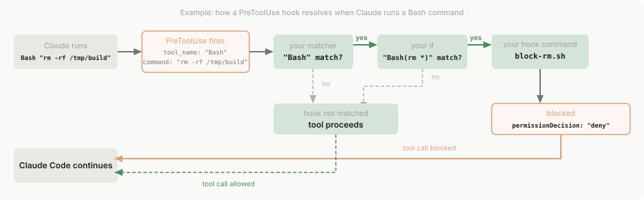
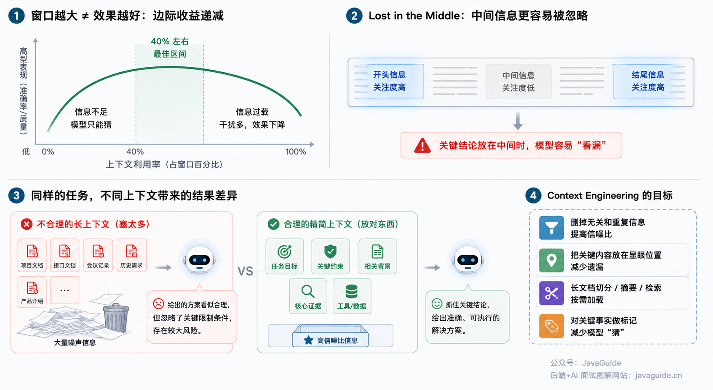
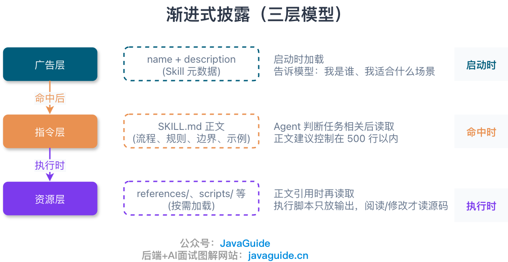
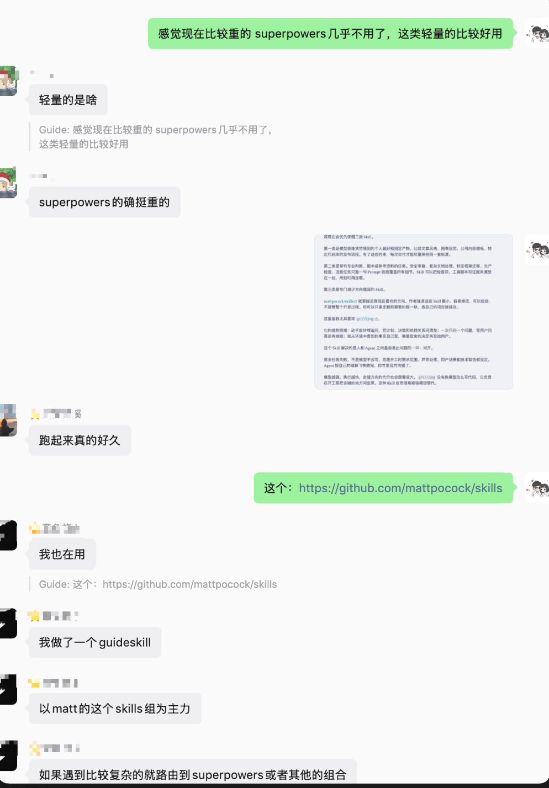
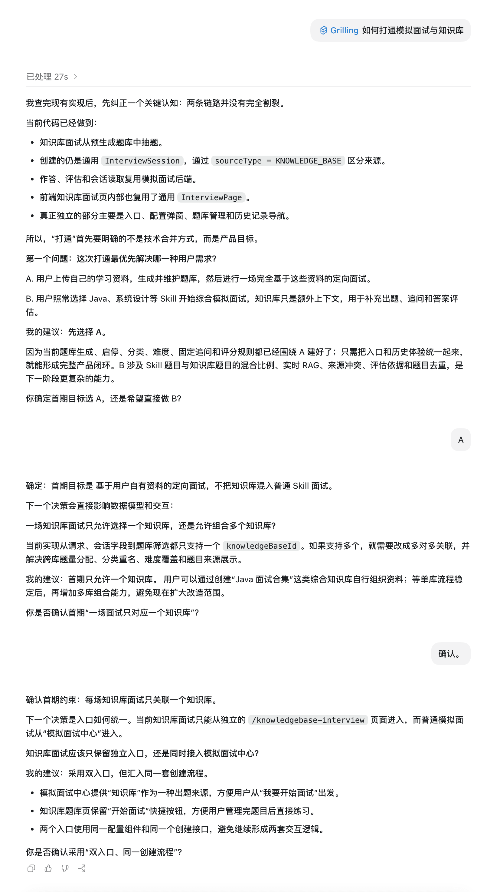

A few days ago, I saw a question on Zhihu: **Now that Codex uses GPT-5.6, how necessary are Skills?**

One question and changes in my own workflow do not represent an industry-wide trend. More precisely, I have noticed that some of my development Skills are becoming less useful, so I wanted to reconsider which ones to keep and which to remove.

When I encounter a Skill now, I first ask what capability it actually provides. If it has no clear purpose, I do not install it.

Two years ago, models often skipped steps, so a detailed Skill was reassuring. Models such as GPT-5.6, Kimi K3, and Claude Fable 5 can now handle many basic actions, so I have started reviewing the Skills I use.

> The examples below use Codex as the coding agent, but the ideas also apply to other agents.

## Many Basic Steps No Longer Need to Be Taught Separately

Development Skills used to be written like checklists: how to read a project, trace a call path, choose tests after changing code, and review everything before opening a PR. When models were less reliable, these reminders were useful.

Now, if I ask Codex to fix a bug and clearly describe the symptoms, expected behavior, and acceptance criteria, it can usually read the relevant code, trace the call path, implement a fix, and perform basic verification on its own. For a complex project structure, an unusual test setup, or a high-risk change, I still need to specify which checks to run. I should not let the model guess the entire verification plan.

Codex also has built-in support for long-running tasks, approvals, and multi-agent collaboration. Skills, Plugins, MCP, and Hooks can extend its workflow or external capabilities. The old problem—“if every step is not spelled out, the model will go off track”—has become much less common.

If a `SKILL.md` contains no project-specific constraints, scripts, templates, or checks, and merely repeats routine development steps, I usually remove it. It adds little new information for the model and may add unnecessary steps to a small task.

## Too Many Skills Have a Cost

Codex does not read the full text of every `SKILL.md` at the start of a session. It first receives each Skill's name, description, and path, then loads the body only when a task matches. This is called progressive disclosure.

According to the [Codex Skills documentation](https://learn.chatgpt.com/docs/build-skills), the initial Skill list can use at most 2% of the model's context window; if the window size is unknown, the limit is 8,000 characters. If the list exceeds the budget, Codex shortens descriptions first. As the number of Skills grows, some may be removed from the initial list.

With 100 Skills installed, the agent may not even see 100 complete descriptions before it starts working.

Descriptions that are too broad may cause several Skills to match an ordinary change. If their rules conflict, Codex has to decide which workflow to follow. Add a few outdated instructions and it may be difficult to tell why a task went off track.

A larger context window does not eliminate this problem. Old conversations, tool instructions, and Skill descriptions can all fit, but the project's most important constraints may only be a few sentences. The more clutter there is, the easier it is for key requirements to get buried.

Skills are a bit like browser bookmarks. At first, you want to save everything because it might be useful later. Six months afterward, you find that you still use only a few of them.

Since Skills became available, I have used and maintained fewer than 20 regularly. One example is the [draw.io diagram Skill](https://mp.weixin.qq.com/s/rAKCSFHB407v6fe35ix0rg) I use when writing. It keeps diagrams consistent and avoids layout problems I have encountered repeatedly. Skills like this capture personal preferences and practical experience—things a model may not reproduce consistently on the fly.

## Where Should Rules Live?

Many Skills grow too large because people put every rule into them. I now organize rules by scope:

- Put project conventions that apply to every task in `AGENTS.md` or another project rules file.
- Write workflows used only for specific tasks as Skills.
- Delegate lengthy investigations that produce lots of intermediate information to a Subagent.
- Package Skills, Hooks, MCP, and connectors as a Plugin when the team needs a unified way to distribute them.
- Enforce mechanical constraints where omissions are costly through a Hook, CI, linter, or test.

Rules files govern how work is done across a project; Skills govern how to handle a particular kind of task. Mix them together and you may end up with a long, hard-to-maintain `SKILL.md` that tries to control everything.

A Skill can include scripts, reference material, and templates, which are loaded as needed when a task matches. Use a Plugin to package those capabilities when the team needs a consistent way to install and distribute them.

For a broader explanation of how Skills relate to prompts, MCP, and function calling, see [What Are Agent Skills? How Do They Differ from Prompts and MCP?](https://javaguide.cn/ai/agent/skills.html). This article focuses on choosing and pruning Skills rather than explaining their implementation.

## Why I Use Superpowers Less Often

I now use comprehensive development Skill suites such as [Superpowers](https://github.com/obra/superpowers) less often.

I asked a group about it and heard similar feedback: **Superpowers can impose too much process on small tasks. `grilling` asks a series of questions, but it can make requirements much clearer.**

Superpowers provides a complete software development methodology: clarify requirements through brainstorming, break the work down with writing-plans, use test-driven-development to write tests and implementation, isolate work in a Git worktree, delegate steps to Subagents, then review the code and verify completion.

This workflow still suits complex projects, unfamiliar codebases, and high-risk changes.

But if you only need to change one validation rule or add a small test, following “clarify requirements → design → plan → implement → review → verify” from the start can make the process itself consume too much time. The more complete a workflow is, the more important it is to choose the right time to use it. For a simple task, it can become a burden instead of a safeguard.

Codex can now adjust its steps while working and ask for clarification when important information is missing. Many small tasks only need a few project-specific constraints; there is no reason to apply an entire operations manual every time.

Third-party Skills also carry security risks. A `SKILL.md` contains instructions for an agent. If it hides a dangerous command, an unexpected script, or an overly broad permission request, the agent may follow it. Before installing one, at least inspect `SKILL.md`, `scripts/`, and `references/`. The larger the suite, the more important it is to understand what it will ask the agent to do.

## Why I Prefer a Lightweight Set Like mattpocock/skills

Superpowers uses one complete methodology for the development process. [mattpocock/skills](https://github.com/mattpocock/skills) is more like a toolbox you can use one piece at a time.

The Skills in this repository are designed as small, easy-to-edit, composable modules. If requirements are unclear, use `grilling` to ask questions. If a bug is difficult to locate, enable `diagnosing-bugs`. If you need to follow red-green-refactor strictly, use `tdd` on its own. Before merging, ask `code-review` to review the change. The tools do not require every task to follow the same workflow.

This modular approach works well with strong models. Codex already knows how to perform many steps, so there is no need to teach them again. Add guidance only for the steps that repeatedly go wrong. When a task becomes more complex, combine several Skills.

I particularly like [`grilling`](https://github.com/mattpocock/skills/blob/main/skills/productivity/grilling/SKILL.md).

Its rules are short: keep asking questions before starting until the plan, decisions, and dependencies are clear; ask one question at a time and wait for the answer before continuing; look up facts available in the environment yourself, and ask the user only about decisions that require a choice.

## Which Skills Are Still Worth Keeping?

I prioritize three kinds of Skills.

The first captures personal preferences and specific outputs that a model cannot infer, such as article style, diagram conventions, internal company templates, or a particular codebase's release process. These constraints help keep each result consistent.

The second supports tasks that require specialized judgment, scripts, or reference material. Security reviews, complex document processing, framework migrations, and production checks involve details that a single prompt may not cover. A Skill can bring the checklist, scripts, and sources together and load them when needed.

The third provides a workflow that prevents mistakes. `grilling` is an example: it does not write code for Codex; it makes requirements clarification before implementation a repeatable step. The faster a model executes, the more useful it can be to confirm the direction first.

## How I Used Grilling to Clarify a Real Requirement

This example comes from my open-source project [SpringAI Interview Platform (version 2.0 is open source)](https://javaguide.cn/zhuanlan/interview-guide.html). I wanted to connect mock interviews with the knowledge base. The task I gave `grilling` was simple: help me think through the change.

The current implementation was already closer to being integrated than I expected: both knowledge-base interviews and ordinary mock interviews used `InterviewSession`, and answering, evaluation, and some frontend pages were already shared. There was no need to change the underlying implementation first. I needed to define the initial product scope.

Its first question was whether the initial release should provide interviews based entirely on user-provided materials, or let users continue to choose a Skill such as Java or system design while the knowledge base only adds context.

It recommended starting with the first option. Existing question generation, categorization, difficulty levels, fixed follow-up questions, and scoring rules already fit that workflow. We only needed to unify the entry point and history. The second option would also raise questions about the mix of Skill and knowledge-base questions, live RAG, conflicting sources, evaluation criteria, and duplicate questions, expanding the scope considerably.

After I confirmed the initial goal, it asked whether an interview should use a single knowledge base or combine several. The current request, session field, and question filtering all use a single `knowledgeBaseId`, so it recommended limiting the first release to one knowledge base and considering multiple bases after the workflow is stable.

Next, we discussed entry points. Knowledge-base interviews already had a dedicated page, while ordinary mock interviews started from the “Mock Interview Center.” The final decision was to keep both entry points but share the configuration component and creation API, avoiding two separate interaction flows.

Before changing any code, we had settled the product scope, data model, and approach to reusing the entry points.

I want to keep `grilling` because the model already writes code quickly. Rework usually happens because implementation starts too soon: the scope is unclear, exceptions have not been discussed, or user scenarios and technical trade-offs remain vague. The agent can complete a change based on its own assumptions, only for us to throw it away and start again.

**The stronger and faster the model, the more costly a wrong direction can be.**

`grilling` does not teach the model how to code. It makes “clarify the task before starting” a repeatable workflow. Strong models do not automatically make that step unnecessary.

## My Criteria for Removing Skills

When I install a Skill, I ask:

- Can the model already do this without the Skill?
- Without it, do I keep running into the same problem?
- Does it capture scripts, templates, specialized references, or personal preferences?
- If its rules become outdated, will I notice and remove them?

I now remove Skills that only remind the model to “read the project, write code, and run tests.” Project-specific requirements belong in `AGENTS.md`; checks that can be enforced mechanically, such as tests, formatting, and security rules, belong in CI, Hooks, or a linter.

Create a separate Skill only when the same problem keeps recurring, especially when mistakes are costly. Keep only the key decisions and verification steps. Stop once it solves the problem instead of expanding it into an all-purpose workflow.

To explore available Skills and what tasks they suit, see [AI Coding Skills: A Selection Guide](https://javaguide.cn/ai-coding/practices/programmer-essential-skills.html). For how `AGENTS.md`, permissions, MCP, Skills, and Scheduled Tasks fit together in Codex, see [OpenAI Codex Best Practices](https://javaguide.cn/ai-coding/practices/codex-best-practices.html).

Although the title asks whether Skills are still necessary, I do not plan to delete all of mine. I simply will not install every new one I see.

When I find a new Skill, I first try the task without it. If the model handles the task well, I do not install it. If the same issue keeps coming back, I keep only that small part of the workflow. The list is shorter afterward, and I know why each remaining Skill is there.
