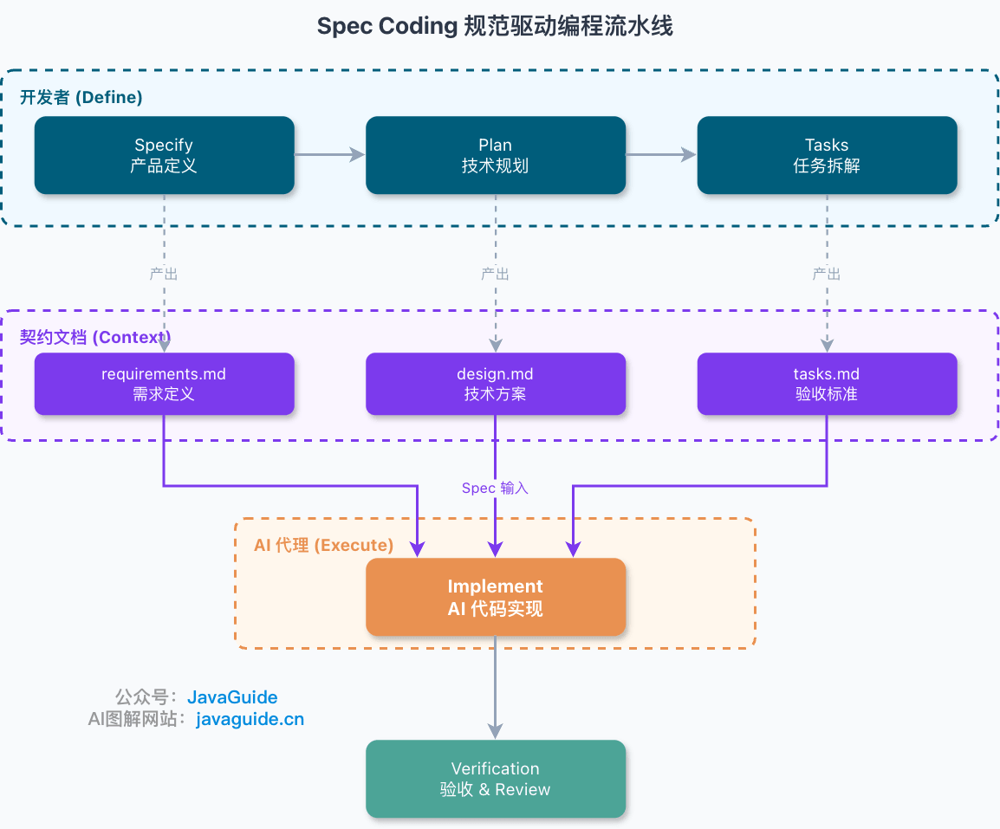
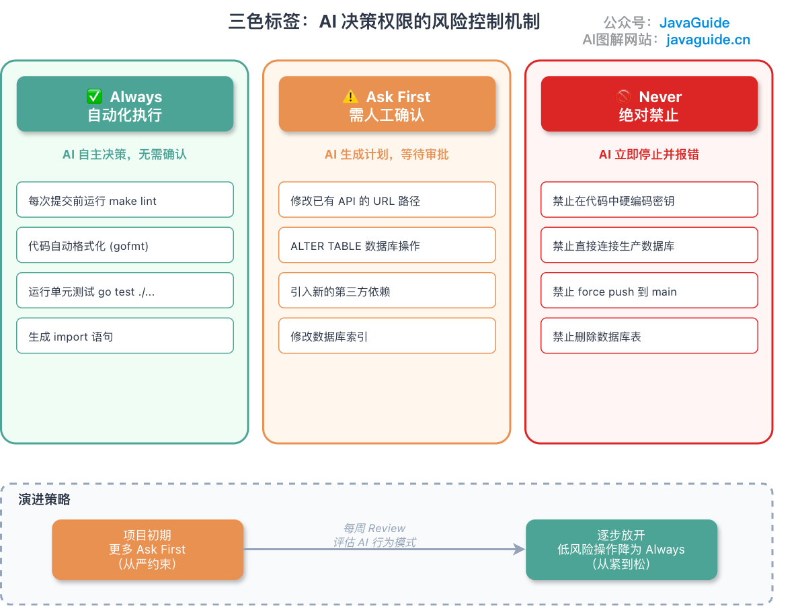
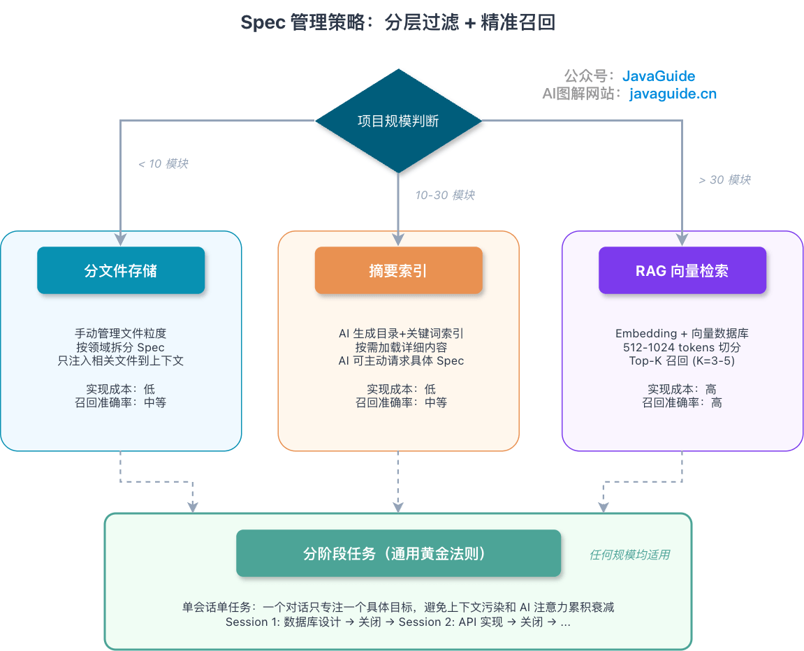
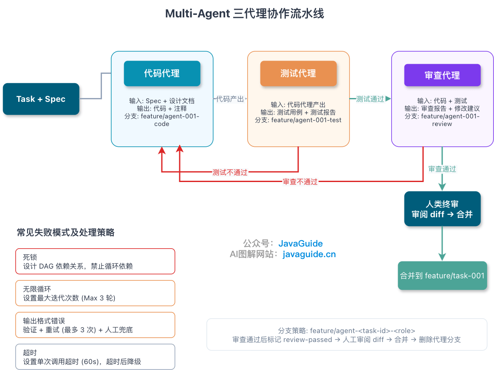

Hi, I'm Xiao G. This article took me a while to write, but here it is.

Readers have been asking me to write about Spec Coding for a while. It is useful at work, and interviewers are starting to ask about it too.


Last week, a colleague asked me about Spec Coding: “Claude Code can write code on its own, so why spend time writing specifications?”

It is a practical question. AI can write code quickly, and demos, scripts, and one-off pages can be tested with few constraints.

But applying the same approach to a team project that must be maintained over time turns missing information into risk. The model fills gaps in the requirements, infers edge cases from common patterns, and may not know the team's error-code and permission conventions. Its output comes from learned patterns and the context provided; it does not automatically discover the project's actual constraints.

This article covers three questions:

1. How Vibe Coding and Spec Coding differ in practice, and when to use each.
2. An end-to-end Spec Coding workflow, from writing requirements to guiding AI implementation.
3. How to configure and manage Specs in popular AI IDEs such as Cursor, Claude Code, and Copilot, and how to keep AI within scope.

## Vibe Coding Still Has Its Place

Vibe Coding means going by feel. Give AI a vague intent, and it starts generating code.

When Karpathy first used the term, he described giving AI a request, iterating by feel, and sometimes not worrying about the code details at first.

Vibe Coding is not inherently bad. It can work well for:

- Testing an idea with a quick demo.
- Writing a one-off script that will be discarded after use.
- Building an internal tool with limited impact.
- Generating code that has full test coverage and is not exposed directly to external users.

In these cases, writing a detailed Spec can waste time.

The real problem is that people often validate an idea and then ship the Vibe-coded implementation to production.

That changes the stakes.

You can work by feel on a demo because you can fix or discard mistakes. Production code is different: it connects to databases, payments, user data, and other people's maintenance work. The half-hour saved today may turn into days of debugging later.

I use one criterion: **How long will this code live?**

- **A script that will be discarded in two days:** Vibe Coding is enough; a Spec would slow things down.
- **A task that will last three to five days:** Use a lightweight Spec. Skip the full design and write only key constraints and acceptance criteria; it should take about half an hour.
- **Code that will last more than a week:** If others must maintain it, it persists data, or it integrates with external APIs, do not rely on Vibe Coding alone. At minimum, define the constraints, boundaries, and acceptance criteria.

You can also pair Vibe Coding with a lightweight Spec; there is no need to be rigid.

For example, a lightweight Spec can be as simple as:

```markdown
## Goal

Implement an order export endpoint that exports CSV files for a given time range.

## Key Constraints

- Export no more than 5,000 records per request.
- Limit the time range to 31 days.
- Validate user permissions; users can export data for their current tenant only.
- The query must use the `order_tenant_time_idx` composite index.
- Record the reason for export failures; do not return only `unknown error`.

## Acceptance Criteria

- Export valid CSV files with fields in the order specified by the product.
- Return a clear error when the result exceeds 5,000 records.
- Prevent exporting data from unauthorized tenants.
- Cover empty time ranges, out-of-range dates, missing permissions, and empty results in unit tests.
```

## What Is Spec Coding?

Spec Coding means spec-driven development: define the specifications first, then ask AI to implement them.

When asking AI to write code, many people start with:

> Build a user system for me.

AI can produce something that looks plausible. The problem is that you have not explained what the user system should do, so it has to guess.

How do users register? Can email addresses repeat? How are passwords stored? What format should failed requests return? Which features are out of scope? Can administrators disable users? If these details are not specified, AI is unlikely to stop and ask; it will probably fill in what it considers reasonable.

Spec Coding puts these rules in writing before implementation.

A Spec is more than a brief request. It is a technical agreement that AI can follow. It can define APIs, data structures, error codes, edge cases, security requirements, technology constraints, and operations that must not be performed.

That is the difference from Vibe Coding.

Vibe Coding gives AI a broad direction and lets it improvise. You review the generated code, fix bugs, and fill in details afterward. This can be effective for small, quick scripts.

But it becomes risky as a project grows more complex. By the time you notice a misunderstanding, a lot of code may already be written. It can then be hard to tell whether the requirements were unclear or the AI went beyond them.

The difference between Spec Coding and Vibe Coding comes down to one question: **Did you define the AI's behavior, or did it have to guess?**

## A Four-step Workflow

This article uses the four steps shown in GitHub's [Spec Kit](https://github.github.com/spec-kit/index.html) example: Specify, Plan, Tasks, and Implement. This is a practical workflow, not a standard followed by every Spec Coding tool. Some teams combine the design and task phases; some tools add clarification, verification, or change-management phases.

| Stage         | Purpose             | Output            | Key activity                                                          |
| ------------- | ------------------- | ----------------- | --------------------------------------------------------------------- |
| **Specify**   | Define the product  | `requirements.md` | Define features, users, and pain points; decide what to build         |
| **Plan**      | Technical planning  | `design.md`       | Define the stack, architecture, and contracts; decide how to build it |
| **Tasks**     | Break down the work | `tasks.md`        | Create atomic tasks with acceptance criteria                          |
| **Implement** | AI implementation   | -                 | AI follows the Spec; a person reviews the result                      |

The workflow is simple: **define what to build, decide how to build it, break the work into tasks, then let AI implement it**.



### Specify: Define What to Build

The first step is `Specify`, which usually produces `requirements.md` or `spec.md`.

This step is similar to writing a PRD, but its reader is AI.

So it must define boundaries as well as direction.

For example, if you write:

> Build a user system.

That may be understandable to a person, but it leaves AI guessing: How do users register? Can email addresses repeat? What are the password requirements? Is third-party login in scope? Can an administrator disable a user? What happens to a disabled user's data?

If you do not specify these details, it decides for itself.

Be more specific:

> Support email registration and login; email addresses must be unique; single-factor passwords must be at least 15 characters; third-party login is out of scope; administrators can disable users; disabled users cannot log in, but their historical data is retained.

This tells AI what it can do, what is out of scope, and which boundaries it must respect.

### Plan: Choose the Technical Approach

The second step is `Plan`, usually recorded in `design.md` or `plan.md`.

Many people skip this step, assuming AI can choose the implementation details itself.

That is where problems start.

If you do not specify the Java version, it may write Java 8 code. If you omit the Spring Boot version, it may use outdated patterns. Without an error-code format, endpoints may return different structures. Without a layering convention, it may put business logic in a Controller. If you do not specify database column naming, it will choose its own style.

`design.md` does not need to be exhaustive, but it should set a few key constraints.

This is enough to get started:

```markdown
## Technology Stack

- Language: Java 21 (LTS)
- Framework: Spring Boot 3.2.x (an existing legacy-project snapshot; choose a supported version for new projects)
- Database: PostgreSQL 16
- Cache: Redis 7.x

## Architecture

- Layers: Controller → Service → Repository
- Communication: REST API + gRPC (internal services)
- Deployment: Docker + Kubernetes

## API Conventions

- API specification: OpenAPI 3.0
- Error response: Use a consistent format, such as {"code": "USER_NOT_FOUND", "message": "..."}
- Log format: JSON with a `trace_id` field
```

You may be thinking: Isn’t this just a design document?

It is similar.

The difference is that traditional design documents are mainly for people. People understand the general direction and can fill in many details from team conventions. Mature teams may not need repeated reminders to avoid plaintext passwords, use consistent error codes, or include `trace_id` in logs.

AI is different.

If you do not specify a detail, it guesses. If the guess is wrong, you have to rework the implementation.

Consider password storage. “Make login secure” is too broad; the model may choose an outdated approach or one that does not fit the system.

For a new system, specify requirements like these, then choose parameters based on benchmarks on the target server:

```text
Store passwords as Argon2id hashes. Choose parameters by benchmarking on the target server, and record the algorithm version for future migration.
If an existing system must support bcrypt, keep verifying existing hashes and migrate users to Argon2id after successful login.
Store salted hashes, never plaintext passwords. Use a maintained password library to generate random salts.
Require at least 15 characters for single-factor passwords and support a maximum length of at least 64 characters. Do not require a mix of uppercase, lowercase, digits, or symbols.
Check passwords against a breached-password blocklist during registration and password changes, and rate-limit login requests.
```

These requirements are based on the [OWASP Password Storage Cheat Sheet](https://cheatsheetseries.owasp.org/cheatsheets/Password_Storage_Cheat_Sheet.html) and [NIST SP 800-63B-4](https://pages.nist.gov/800-63-4/sp800-63b.html). Security parameters still require architecture review and testing; do not copy example values into a Spec without validation.

The same applies to error handling. “Return a friendly message when the endpoint fails” is not specific enough. AI may return `error` from one endpoint, `message` from another, and throw exceptions elsewhere.

Specify the response directly:

```json
{
  "code": "USER_NOT_FOUND",
  "message": "User not found",
  "trace_id": "xxx"
}
```

Then define the status-code conventions:

```text
Return 400 for invalid parameters.
Return 401 when the user is not authenticated.
Return 403 when the user is not authorized.
Return 404 when a resource does not exist.
Return 409 for conflicts such as a duplicate email address or username.
```

This gives AI a clear direction for implementation.

Ultimately, `design.md` reduces the assumptions AI has to make. Specify the stack, API format, error codes, logging, concurrency, and security rules in advance to keep the implementation on track.

### Tasks: Keep Tasks Small Enough to Verify

The third step is `Tasks`, usually recorded in `tasks.md`.

Do not ask AI to “complete the user module” in one task; that scope is too large. Registration, login, queries, deactivation, permissions, validation, error handling, and unit tests in a single task make it easy for AI to miss something. You may end up adding each omission by hand during review.

But do not split the work too finely either. Creating a `UserDTO`, adding an `email` field, and writing an empty Service method as separate tasks creates busywork. Maintaining the task list may take longer than having AI write the code.

I prefer tasks that each cover one API, a core operation on one table, or a small feature that can be verified independently.

For example, a user registration endpoint could be specified like this:

```markdown
### Task-001: User Registration Endpoint

Description: Implement user registration, including input validation, password hashing, and saving the user to the database.

Acceptance criteria:

- [ ] Return 201 when `POST /api/v1/users` succeeds.
- [ ] Hash new passwords with Argon2id parameters benchmarked on the target system.
- [ ] Require single-factor passwords to be at least 15 characters and support a maximum length of at least 64 characters; check a breached-password blocklist.
- [ ] Rate-limit login and registration endpoints.
- [ ] Require unique email addresses; return 409 for duplicate registration.
- [ ] Include `user_id`, `email`, and `created_at` in the response body.
- [ ] Meet the project's branch-coverage baseline (80% in this example) and assert critical security branches.

Estimated effort: 2 hours
```

The acceptance criteria are the valuable part. Phrases such as “make it secure,” “write clean code,” or “make it fast” provide little guidance. AI cannot know what you mean by secure or how clean the code should be.

By contrast, using Argon2id parameters benchmarked on the target system, returning `409` for duplicate emails, including `user_id`, `email`, and `created_at` in the response, and testing critical branches can all be verified objectively.

Do not apply a coverage threshold mechanically. Set the baseline based on module risk, past defects, and test types. Effective assertions for critical branches—permissions, amounts, state transitions, retries, and failure compensation—matter more than a single percentage.

### Implement: Let AI Do the Work

You do not need elaborate prompt engineering. Provide the relevant Specs directly:

```text
Implement Task-001 according to the following Specs.

Requirements:
[Paste the relevant section from requirements.md]

Technical constraints:
[Paste the relevant section from design.md]

Acceptance criteria:
[Paste Task-001 from tasks.md]
```

One pitfall: do not dump every Spec into the context at once.

In a single session, I prioritize three types of information:

- Global constraints, such as code style, error formats, and logging conventions.
- Requirements for the current task.
- Acceptance criteria for the current task.

Add other material as needed. Do not paste every document just to make the context “complete.”

There is no universal 3,000–8,000 token limit that works for every model and task. A more practical approach is to provide the global constraints, current task, and acceptance criteria first, then use indexes or file paths to load supporting evidence as needed. Split the session when irrelevant context starts to interfere or the work can be divided into independent tasks.

Do not expect the model to keep track of everything in a very long context. The longer it gets, the easier it is for key information to be buried and critical constraints to be missed.

I follow three principles:

First, put conventions in documents, not only in chat. The next conversation may not have the same history, while documents provide reusable context.

Second, quantify acceptance criteria where possible. “High performance” is not verifiable; `QPS > 1000`, `P95 < 200 ms`, and `branch coverage >= 80%` are measurable.

Third, commit Specs to Git alongside the code. Update them when the code changes, or AI may rely on outdated instructions later.

This will not make AI smarter, but it will leave much less room for guesswork.

That raises a practical question: where should these Specs live, and how can you make sure the tools load them?

## Using Specs in AI IDEs

After writing a Spec, teams often overlook a practical question: **Where should these files go, and how can AI load them automatically?**

Popular tools have their own instruction-file mechanisms:

| Tool               | Instruction files                                                                        | Scope               | How they are loaded                                                                                          |
| ------------------ | ---------------------------------------------------------------------------------------- | ------------------- | ------------------------------------------------------------------------------------------------------------ |
| **Cursor**         | `.cursor/rules/*.mdc` (current) or `.cursorrules` (legacy)                               | Project / global    | Rules can be set to Always apply or attached by glob                                                         |
| **Claude Code**    | `CLAUDE.md`, `.claude/rules/*.md`                                                        | Project / directory | Root rules are always loaded; subdirectory or `paths` rules load for matching files                          |
| **GitHub Copilot** | `.github/copilot-instructions.md`, `.github/instructions/*.instructions.md`, `AGENTS.md` | Repository / path   | Repository instructions, path-specific instructions, and Agent instructions load according to client support |
| **Windsurf**       | `.windsurf/rules/*.md`, `AGENTS.md` (`.windsurfrules` may remain in older projects)      | Project / directory | Workspace Rules and directory-level `AGENTS.md` load according to scope                                      |
| **Aider**          | `CONVENTIONS.md` (repository root)                                                       | Project             | Load with `--read CONVENTIONS.md` or configure `read:` in `.aider.conf.yml`                                  |

This raises another question: Cursor, Claude Code, and Copilot are everyday coding tools, but how should you choose among Spec-focused tools such as Superpowers, Spec-Kit, Open Spec, Kiro, and BMAD-METHOD?

That deserves a separate article. Here, I will focus on how to write and organize Specs and keep AI within their boundaries.

Once you know where to put them, another question remains: **Which Specs should load every time, and which should load only when needed?**

I usually divide them into two layers.

**Include in almost every session (always loaded):**

- **Technology stack:** Specify versions and key libraries, such as Go 1.21, Gin, GORM, and PostgreSQL 14. Do not make AI guess versions.
- **Code style:** Provide a few “gold standard” file paths or short code snippets for naming, error handling, and response formats. Do not load 150–200 lines of code into every session.
- **Boundaries:** Use the three-color labels described below to define what AI can do, must ask about, or must never touch.

Put these in the tool's always-on instruction files so they load in every session.

**Include only when relevant to the task (loaded on demand):**

- **Project purpose:** Explain the reason for the project in one or two sentences, such as “Split the user service out of the monolith and rewrite it in Go while preserving API compatibility.” Include this at the start of a new task.
- **Command list:** List build, test, and run commands, such as `make build` and `go test ./...`. Include them for implementation tasks.
- **Directory structure:** Show where code, tests, and documentation live. Include it when adding files.
- **Git conventions:** Specify branch names, commit-message format, and PR requirements when the task involves Git operations.

This split is based on frequency. Global constraints apply to nearly every task, so keep them loaded. Add other information as needed to avoid filling the context with unrelated details. The more Specs you include, the easier it is for AI to miss the important ones.

## Three-color Labels: What AI Can and Cannot Do

When AI encounters an uncertain operation, should it decide or stop and ask?

Use three colors to define three levels of permission.



- ✅ **Always (run automatically):** AI can run checks, tests, and formatters without asking. For example, run `make lint` before a commit.
- ⚠️ **Ask first (requires approval):** For changes that may affect other modules, AI proposes a plan and waits for review. Database-index and API-route changes are examples.
- 🚫 **Never (prohibited):** Connect directly to production databases, commit secrets, or delete production data. AI must stop and report if a task requires one of these actions.

There are a few details to keep in mind when applying these labels.

**Start with stricter rules.** Put more actions under Ask first. After a week, move actions that AI has handled reliably to Always.

**Be specific.** AI cannot act on “confirm important changes” because it does not know what “important” means. Write “Confirm before changing the URL path of an existing API.” “Be careful with the database” is also too vague; write “Confirm before running `ALTER TABLE`.”

**Do not rely on AI to enforce Never rules.** Writing “Do not connect directly to production” in a document does not actually block the action. AI will not reliably check its own output for violations. Enforce Never rules in multiple layers:

1. **State it in the Spec:** This influences AI's output but does not block an action.
2. **Use configuration templates:** Keep real secrets out of `.env.example` so AI has nothing sensitive to copy.
3. **Add a pre-commit hook:** Scan for hard-coded secrets and production connection strings, then block the commit.
4. **Configure the AI IDE:** Use permission rules and a sandbox to limit access. `.cursorignore` can reduce indexing and context access, but it is not a complete security boundary.
5. **Isolate credentials:** Keep production credentials outside the Agent's accessible workspace; use short-lived, least-privilege credentials.

The more important a Never rule is, the more important it is to enforce it in CI. Relying on documentation alone will eventually cause problems.

**Review the rules weekly.** If AI keeps stopping to ask, move some Ask first actions to Always. If it performs a prohibited action, add a Never rule. Add any new sensitive operations to the policy.

## Managing Specs as a Project Grows

Small projects have few Specs, so you can add them to the context manually. As the number of modules grows, loading everything becomes counterproductive: irrelevant constraints can distract AI from the task.

Choose a strategy that fits the project size.



### Few Rules: Store Them in Separate Files

Organize the files by domain:

```text
specs/
├── global/              # Global constraints
│   ├── conventions.md   # Coding conventions
│   └── architecture.md  # Architecture overview
├── backend/             # Backend specifications
│   ├── api/
│   ├── service/
│   └── persistence/
├── frontend/            # Frontend specifications
└── shared/              # Shared contracts
    └── dto.md
```

Include only the two or three files relevant to the current task.

### Manual Selection Becomes Difficult: Add a Summary Index

If selecting files manually becomes tedious, ask AI to create an index with keywords:

```markdown
## Spec Index

- [Database design](specs/db/schema.md) - Keywords: PostgreSQL, index optimization
- [User API](specs/backend/api/user.md) - Keywords: REST, JWT, authorization
- [Order service](specs/backend/service/order.md) - Keywords: transactions, idempotency
```

Ask AI to request more detail when needed instead of loading everything in advance.

### Keyword Search Misses Relevant Specs: Evaluate RAG

The number of modules alone should not determine whether to use RAG. Look for signals such as concepts scattered across many documents, keyword search missing synonyms, manual context selection slowing delivery, and a team able to maintain permissions, index updates, and an evaluation set. If these conditions apply, evaluate full-text search, vector search, or a hybrid approach.

Tune chunk size, Top-K, and similarity thresholds against the embedding model, document structure, and task evaluations. Similarity distributions differ across models, so values such as `Top-K 3–5` or `> 0.7` cannot be reused unchanged. Before launch, evaluate recall, false retrievals, latency, and cost on a set of real queries. Apply permission filters before results reach the model.

### A Rule for Any Project Size: One Task per Session

```text
Session 1: Database design
├── Input: global/conventions.md + backend/db/
├── Output: Entity design completed
└── Close session

Session 2: API implementation
├── Input: Session 1 output + backend/api/
├── Output: Controller completed
└── Close session
```

Clean context keeps AI from being distracted by leftovers from earlier tasks. This is often more useful than a sophisticated retrieval strategy.

## Why Domain Knowledge Matters

No matter how much training data AI has, it cannot know your project's specific rules unless you tell it.

For example, an online store may not allow coupons to be combined with flash-sale discounts. If this rule is missing from the Spec, AI may apply both discounts. The code may run and the tests may pass, but the business logic is wrong.

This knowledge usually falls into a few categories:

- **Business rules:** Coupons and flash-sale discounts cannot be combined; each user can claim a reward only once per day.
- **Technical constraints:** Order pagination must use a specified composite index; use cursors beyond page 100 and avoid full table scans.
- **Legacy limitations:** A third-party upload API supports only 5 MB, so validate file size before sending it.
- **Performance baselines:** Keep single-table queries under 50 ms; consider fallback or degradation when a critical endpoint exceeds 200 ms.

These rules define the boundaries for AI-generated code.

Many Spec-Driven Development approaches turn Specs from “documents written for people” into “rules that constrain AI-generated code.”

Specs are not just for the planning phase; they also matter during implementation, verification, and maintenance.

Writing down the rules is not enough. Add a self-review checklist too, because AI may stop after implementing the feature without checking these constraints.

## Completion Checklist

Do not let AI finish by simply saying “Done.”

Ask it to review a checklist. After completing `Task-001`, for example, it should confirm each item:

- [ ] All API errors use the required response format.
- [ ] Database queries use the specified composite index.
- [ ] Coupon and flash-sale discounts cannot be combined.
- [ ] Unit tests cover null values, out-of-range input, concurrency, and other edge cases.
- [ ] Branch coverage meets the project baseline, with assertions for critical edge cases.
- [ ] Cyclomatic complexity stays within the project's static-analysis threshold, or an exception has been reviewed.

If any item cannot be verified, state why instead of marking it complete.

AI may treat finishing the code as finishing the task. In a real project, making the feature run is only the first step. Consistent error formats, index usage, edge-case tests, and complexity limits help prevent later problems.

## Pitfalls of Multi-agent Collaboration

You may ask: if one AI is not enough, can you use several?

Yes, but it brings more pitfalls than you might expect.



In a three-agent workflow, separate implementation, testing, and review. The coding Agent implements the task, then hands it to the testing Agent to create and run tests. After the tests pass, a review Agent checks code quality. A person performs the final review and merges the changes.

One issue needs to be handled up front: the testing Agent may write tests on its own branch while the implementation is on the coding Agent's branch. Since these branches are separate, the testing Agent must merge the implementation branch first or it cannot run the tests.

Two patterns work:

**Sequential work on one branch (recommended to start).** The three Agents commit in sequence on the same feature branch. Use commit-message prefixes to identify each role. This is simple, avoids merge conflicts, and works for most projects.

```bash
git commit -m "[code] implement user registration API"
git commit -m "[test] add unit tests for user registration"
git commit -m "[review] fix null check in email validation"
```

**Chained branches (after validating the agents).** The testing Agent checks out the coding branch, and the review Agent checks out the testing branch. Finally, merge the review branch into the main branch. Each branch builds on the previous one, so every Agent can see the earlier output.

Multi-agent workflows can fail in several ways: deadlocks (A waits for B while B waits for A; make dependencies a DAG), infinite loops (agents keep iterating; set a maximum of three rounds), and invalid output (JSON parsing fails; add validation and retry up to three times). These safeguards prevent many problems.

I am still exploring multi-agent workflows. So far, sequential work on one branch covers most cases. Complex orchestration is likely to fail unless someone on the team maintains it.

## Keep Specs Up to Date

After working on several projects, I settled on a few practices.

**Refine gradually.** Do not try to write a perfect Spec all at once. Start with a high-level outline, have AI build the skeleton, then add details module by module.

**Organize by module.** Keep APIs, database design, style conventions, error codes, and permission rules in separate files. Give AI only the context it needs for the current task.

**Iterate continuously.** Update the Spec when Code Review finds an issue or AI repeats a mistake. If you change the code but not the instructions, the same problem may happen again.

One common failure is worth calling out: when Task-001 was completed, the Spec required errors in the format `{"code": "USER_NOT_FOUND", "message": "..."}`. Two weeks later, the Spec added a `trace_id` field, but nobody updated the code for Task-001. The specification and implementation quietly drifted apart.

The solution is to assess the impact of every Spec change. Each Spec file can list the modules that depend on it. When a Spec changes, run regression tests for the affected modules. Add a CI rule to run those tests whenever a Spec file changes.

## Spec Templates

I use these three templates; choose one based on the task.

**Template 1: OpenAPI style, for API development**

````markdown
## API: POST /api/v1/users

### Overview

- **Endpoint:** `/api/v1/users`
- **Method:** POST

### Request Parameters

| Field    | Type   | Required | Constraints                                                                    | Example          |
| -------- | ------ | -------- | ------------------------------------------------------------------------------ | ---------------- |
| email    | string | Yes      | Valid email address                                                            | user@example.com |
| password | string | Yes      | At least 15 characters; support a maximum of at least 64; no composition rules | -                |

### Response Format

- **201 Created**: User created successfully.

  ```json
  { "id": "uuid", "email": "user@example.com", "created_at": "..." }
  ```

- **409 Conflict**: Email address already exists.
  ```json
  { "code": "EMAIL_ALREADY_EXISTS", "message": "Email already exists" }
  ```

### Acceptance Criteria

- [ ] Hash new passwords with Argon2id parameters benchmarked on the target server.
- [ ] Check passwords against a breached-password blocklist; rate-limit registration and login endpoints.
- [ ] Enforce email uniqueness with a database unique index.
- [ ] Meet the project's branch-coverage baseline (80% in this example) and assert critical security branches.
````

**Template 2: Gherkin style, for BDD**

```gherkin
Feature: User login

  Scenario: Log in with valid credentials
    Given a user is registered with email "test@example.com" and password "CorrectHorse123!"
    When the user submits a login request
    Then return status 200 and a JWT token
    And the token expires in 24 hours

  Scenario: Log in with an incorrect password
    Given a user is registered with email "test@example.com"
    When the user submits a login request with an incorrect password
    Then return status 401
    And the error message is "Invalid credentials"
    And do not reveal whether the email or password was incorrect
```

**Template 3: Checklist style, for code review**

```markdown
## Code Review Checklist

### Functionality

- [ ] The implementation matches the Spec.
- [ ] Edge cases are handled: null values, out-of-range input, and concurrency.
- [ ] Error handling is complete.

### Quality

- [ ] Functions are no longer than 50 lines.
- [ ] Cyclomatic complexity meets the project's static-analysis threshold; exceptions have review records.
- [ ] No duplicate code (DRY).

### Security

- [ ] No hard-coded sensitive information.
- [ ] Inputs are validated or escaped.
- [ ] Authorization checks are in place.
```

## Lessons from Past Mistakes

Here are a few mistakes I have made.

Overly rigid constraints can prevent AI from using reasonable judgment. If you specify every Service method signature, it may hesitate to change even a parameter name. A Spec defines boundaries; it should not be line-by-line pseudocode.

More commonly, the constraints are too vague. If key boundaries are missing, AI guesses. A correct guess is luck; a wrong one is routine. In one project, AI stored passwords with MD5 because the Spec did not specify a hashing algorithm.

Failing to update the implementation when a Spec changes is more subtle. The code and documentation gradually diverge, and AI later generates code from an outdated specification.

Another mistake is writing Specs without verifying them. If they are not connected to CI, they can become a formality. An unchecked Spec is nearly as useful as no Spec.

You should always keep control of the merge button.
