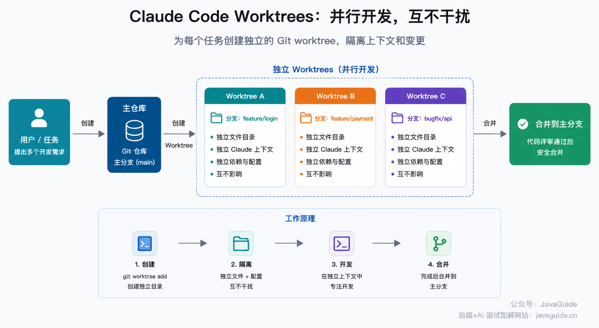
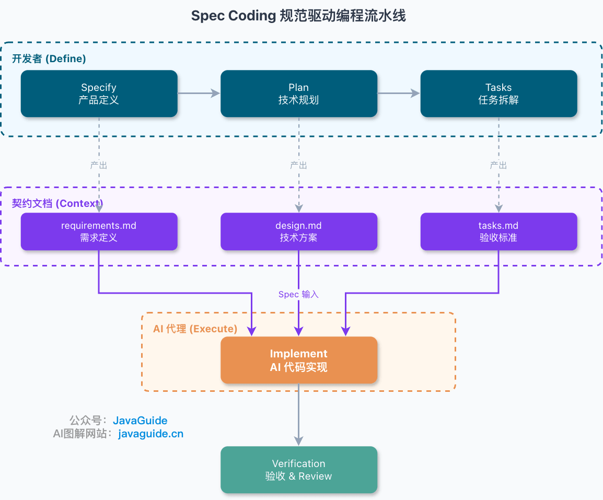
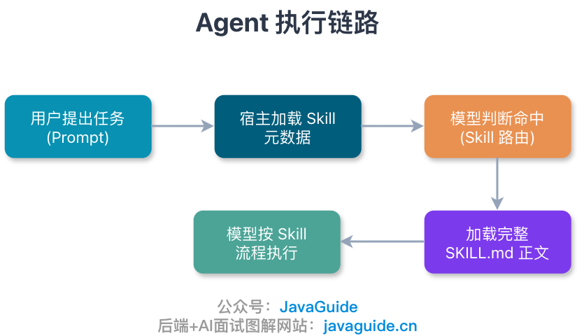
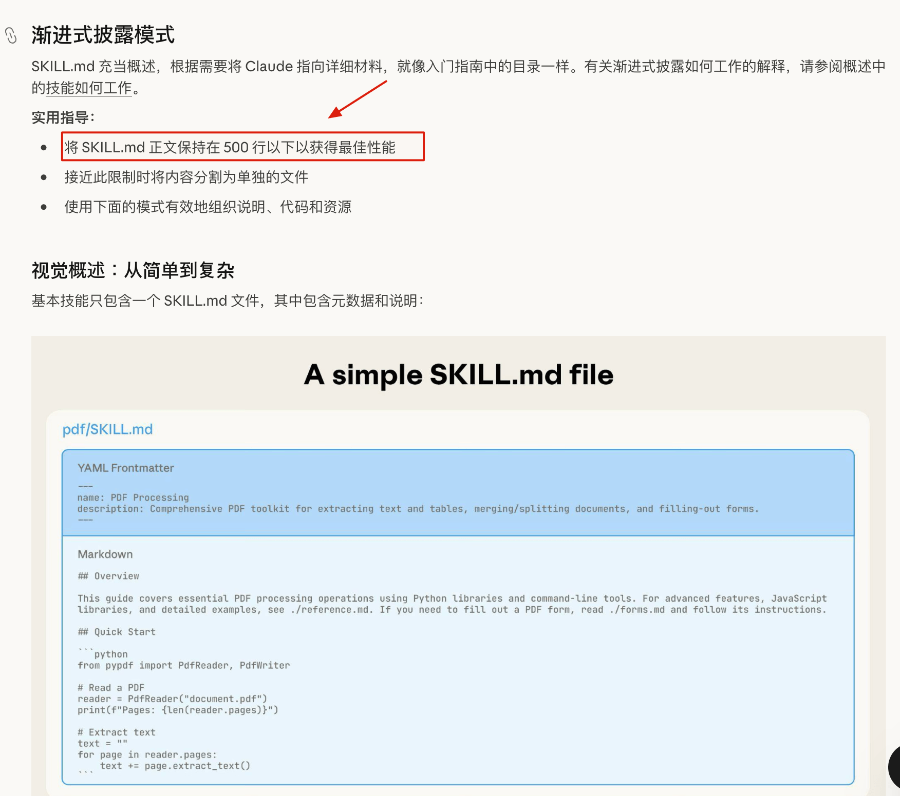
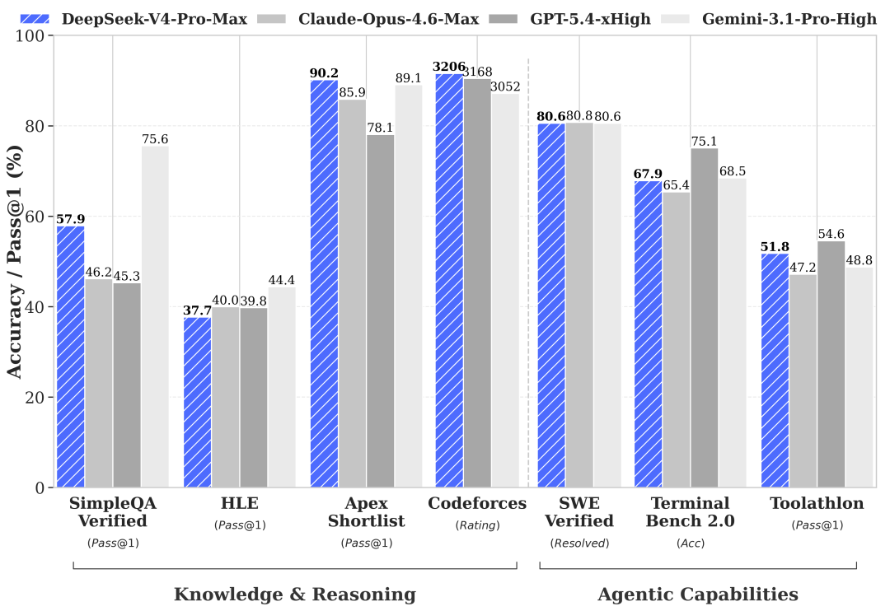
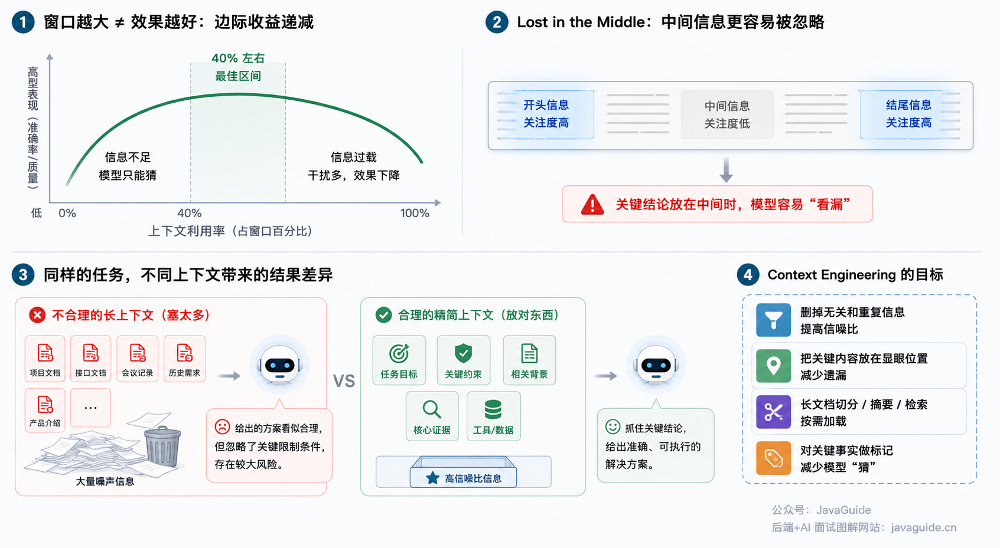
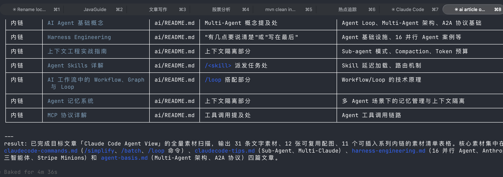
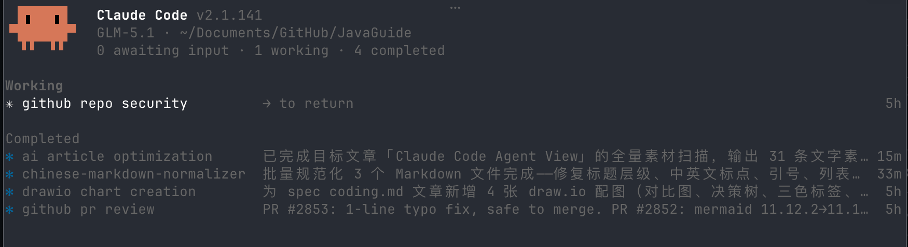
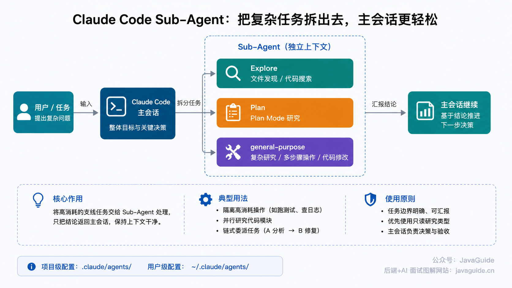
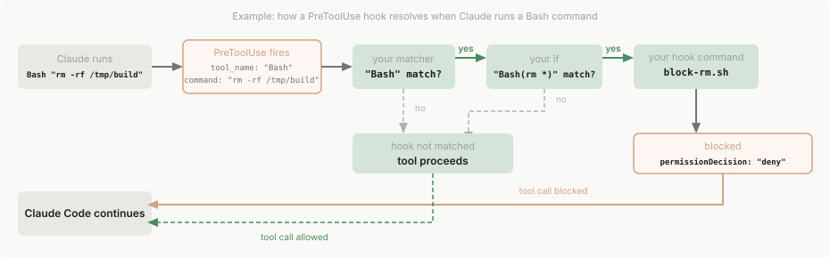

Hi, I'm Xiao G. Last weekend, I shared a few Vibe Coding tips in a message. This article expands on the points I left out and summarizes lessons from several years of using AI to code.


Before we begin, do you remember your first experience with Vibe Coding?

I was hooked. I first tried Cursor in 2024, and it felt incredible. It was like discovering video games as a kid, but even more exciting. Vibe Coding became the best part of my day: watching code appear line by line made me feel like I could do more in a day than I had done in a week before.

For a while, I did not even want to play games. I just wanted to see how much more work AI could do for me.

But the failures started piling up too, and I often ran into baffling problems. I realized that relying on intuition alone is not a reliable way to do Vibe Coding.

Here are some lessons I learned from using AI to code over the past few years. They are not fancy, but they work.

## Set Up Git First

If I had to choose the most important Vibe Coding practice, I would choose Git.

The reason is simple: one incorrect line of AI-generated code is not a big deal. The real problem is when it changes 20 files at once and you cannot tell what to keep after realizing it went in the wrong direction. Git is not a ritual to perform after coding; it should be in place before the AI starts working.

Before asking an Agent to change code, check the working tree:

```bash
git status --short
```

If the working tree already has changes, find out who made them and whether they should be kept. This is especially important when working with other people or running multiple agents. Do not let AI revert work it did not create, and do not mix someone else's unfinished work into your task.

Once you have a clean working tree, create a branch for the task:

```bash
git switch -c feat/order-export
```

I recommend creating a branch even for small tasks. Running Vibe Coding directly on the main branch becomes stressful; isolating the work means a bad AI change stays on the task branch.

After the AI finishes, do not start with its summary. Check what the repository shows:

```bash
git diff --stat
git diff
```

Use `git diff --stat` to see the scope and `git diff` to review the details. After checking the changes, stage and commit them in chunks:

```bash
git add -p
git commit -m "feat: add order export"
```

Keep each commit focused on one change. Smaller commits make review, rollback, and debugging easier. The diff is more reliable than an AI claim such as “I only changed the export logic.”

If something goes wrong, use a controlled rollback:

```bash
# Discard changes to a specific uncommitted file
git restore path/to/file

# Unstage a file
git restore --staged path/to/file

# If the commit has been pushed, prefer creating a revert commit
git revert <commit>
```

`git reset --hard` is not forbidden, but do not hand it to an Agent casually. Unless the branch is disposable, it can wipe out changes that have not been saved.

Use `git worktree` to isolate parallel tasks:

```bash
git worktree add ../project-order-export -b feat/order-export
git worktree add ../project-refactor-user -b feat/refactor-user
```

Give each Agent its own directory, branch, and task. Even if it makes a mess, it stays in its own working tree.



## Narrow the Scope Before You Start

Be specific about what you want the AI to do. Do not make it guess.

For example, suppose you ask: “Implement order export.”

That request is too broad. The AI does not know how many orders to export, which format to use, which fields to include, or what order they should appear in.

When details are missing, it guesses. The result may run, but it may not be what you wanted.

Spend a few minutes writing a lightweight spec before implementation. It is usually cheaper than rework later:

```markdown
## Goal

Implement an order export endpoint that exports CSV data for a specified time range.

## Constraints

- Export no more than 5,000 records per request.
- Limit the time range to 31 days.
- Export data for the current tenant only.
- Use the `order_tenant_time_idx` index for queries.
- Log the reason for export failures; do not return only `unknown error`.

## Acceptance Criteria

- Export a valid CSV with fields in this order: `order_no`, `amount`, `status`, `created_at`.
- Return a clear error when the export exceeds 5,000 records.
- Do not export data belonging to another tenant.
- Add unit tests for no data, unauthorized tenant access, exceeding the record limit, and exceeding the time range.
```

This does not need to read like a design review document.



For a small task, define the goal, constraints, and acceptance criteria. For a medium task, add API formats, error codes, and table structures. For a larger feature, split the work into `requirements.md`, `design.md`, and `tasks.md`. Do not over-engineer the process from the start, or the documentation itself may become a barrier.

For more on Spec Coding, see [Spec Coding in Practice: From Vibe Coding to AI Coding Standards](https://javaguide.cn/ai-coding/practices/spec-coding.html).

Another technique works better than abstract rules: show the AI well-written code from the project.

```text
Read `UserController`, `UserService`, `UserRepository`, and their tests first. Follow their layering, exception handling, response wrappers, logging style, and testing patterns. Then implement `OrderExportController`.

Do not introduce a new response format.
Do not add a global exception handler.
Do not bypass the existing authorization checks.
```

Instructions such as “make the code elegant, maintainable, and consistent with best practices” may sound serious in a prompt, but they provide little practical guidance.

Models are better at imitating concrete examples. Showing them code that already meets the project's standards makes it easier to follow the same style.

## Record Project-Specific Pitfalls in Rule Files

For a long-running project, put rules somewhere the AI tool can reliably read them. For example:

- Claude Code: `CLAUDE.md`
- Codex: `AGENTS.md`
- Cursor: Project Rules and `.cursor/rules/*.mdc`, optionally alongside `AGENTS.md`
- GitHub Copilot / VS Code: repository-level `.github/copilot-instructions.md` and path-specific `.github/instructions/*.instructions.md`; `AGENTS.md` is also supported.

Do not turn the file into a project manual. Record rules that Claude might guess incorrectly, cannot infer from the code, and the team must follow. Focus on technology versions, common commands, architectural decisions, team conventions, and project-specific pitfalls. Avoid filler, default behavior, and long documentation passages.

The test is simple: if you remove this line, is Claude more likely to make a mistake?


When AI repeats a mistake, do not just correct it in chat.

Chat history gets scattered, while rule files stay with the repository. Record the pitfall in a rule file so the AI is more likely to avoid it next time.

## Use Skills to Capture Reusable Workflows

Rule files and Skills solve different problems.

Rule files are best for conventions that always apply to a project, such as technology versions, startup commands, directory structure, error formats, and files that must not be changed.

Skills describe how to handle a particular type of task. If code review, writing tests, changing a frontend page, web research, or writing a technical article follows a similar workflow each time, you do not need to repeat the instructions in every chat.

I have written two related articles: [What Are Agent Skills, and How Do They Differ from Prompts and MCP?](https://javaguide.cn/ai/agent/skills.html) and [A Guide to Choosing Skills for AI Coding](https://javaguide.cn/ai-coding/practices/programmer-essential-skills.html).

In short, a Skill is a task guide that an Agent can load when needed. It is neither a plugin nor an MCP tool; it describes the workflow, constraints, checks, and lessons for a particular type of task in `SKILL.md`.



These are good candidates for Skills:

- Follow TDD before implementing a feature: write a failing test, then implement the feature.
- Check security, transactions, performance, edge cases, and project conventions during code review.
- Check responsive behavior, hover states, accessibility, and the design system when building frontend pages.
- Follow a consistent order for search, scraping, and browser automation during web research.
- Check sources, citations, heading hierarchy, and AI-generated style when writing technical articles.

**Why use a Skill?** Repeating the same instructions in chat is tedious. You might remind the AI to write tests first today, then it forgets in another session tomorrow. You might ask for an authorization review this time, but next time it checks only naming and formatting. Skills turn repeated reminders into reusable playbooks.

However, a Skill should not read like a README.

READMEs are for people and can explain background, concepts, and installation. Skills are for Agents carrying out tasks. They should say when to use them, what steps to follow, when not to use them, and how to recover from failures.

Longer Skills consume more context. When writing one, ask: will this passage directly affect the Agent's next action? If not, leave it out.

Anthropic recommends keeping the body of `SKILL.md` under 500 lines. If it grows longer, move details into separate files and use progressive disclosure so the Agent can read them as needed.



You can also use existing Skills. For example, Superpowers packages workflows for TDD, code review, spec-driven development, Git worktrees, and subagent collaboration.

See [Choosing Skills for AI Coding: Requirements, TDD, Code Review, and UI Design](https://javaguide.cn/ai-coding/practices/programmer-essential-skills.html) for more recommendations.

Do not run third-party Skills without reviewing them. `SKILL.md` contains instructions, and an Agent may follow dangerous commands, suspicious scripts, or overly broad permissions. Before installing one, inspect the main file, `scripts/`, and `references/` for unauthorized actions.

## Do Not Waste Expensive Models on Routine Work

Do not send every task to the most expensive model.

That is like hiring a senior architect to rename fields, add getters, and adjust CSS every day. You pay for expertise without using it. The opposite can be just as costly: assigning system design, security boundaries, and complex refactors to a cheaper model may lead to expensive rework.

I usually let a strong reasoning model define the approach, assign well-scoped tasks to a lower-cost model, and use an independent model for review.

```text
Step 1: Ask a model with strong reasoning and code-review skills to read the requirements and codebase.
Have it propose an approach, identify risks, and break down the work without writing code yet.

Step 2: Once the approach is approved, give individual tasks to an implementation model with suitable cost and latency.
Have it implement each task, add tests, run commands, and provide a diff summary.

Step 3: Give the `git diff` to an independent review model.
Ask it only to review for bugs, authorization risks, transaction boundaries, performance issues, and missing tests.
```

Models change quickly. As of 2026-07-24, available model families included Claude Fable 5, GPT-5.6, DeepSeek V4, GLM-5.2, MiniMax M3, and Kimi K3. This is a snapshot, not a fixed recommendation. Choose based on availability, task performance, cost, context limits, and tool compatibility.

The same approach works for code audits. Ask a lower-cost model to scan the project and list potential issues, then have a stronger model verify them. You can use an expensive model for the entire audit, but the cost may not be justified by the results.



## Check the Evidence, Not the Claim

AI often says “fixed,” “optimized,” or “looks good.”

Do not take those claims at face value.

I prefer to see three things: tests, command output, and the diff.

For example, if you ask it to fix a bug in order export, do not just ask, “Is it fixed?” Give it instructions like these:

```text
Do not change the implementation yet.
First, add tests based on the Spec for the happy path, invalid parameters, insufficient permissions, empty results, and concurrent duplicate requests.
The tests should fail at first.
After I confirm that the tests are correct, change the implementation until they pass.
```

This resembles TDD, but there is no need to be dogmatic. The key is to prevent AI from changing the code and adding tests that always pass at the same time. Seeing the tests fail first, then pass after the implementation, gives you more confidence.

If you do not want to use full TDD, at least list the acceptance criteria clearly:

```markdown
- [ ] The new endpoint enforces authorization.
- [ ] Error responses follow the standard format.
- [ ] Database queries use the required index.
- [ ] Tests cover null values, out-of-range values, and duplicate requests.
- [ ] Logs do not expose tokens, passwords, or API keys.
- [ ] All tests pass.
```

Ask it to include the commands it ran and their results:

```bash
mvn test
npm test
go test ./...
pnpm lint
```

If it did not run a command, it should say “not run” and explain why. Missing dependencies, a stopped database, or incomplete test configuration are reasonable explanations. The problem is claiming “verified” when nothing was run.

Do not take performance claims at face value either. If it says “performance improved significantly,” ask for evidence: the SQL before and after, `EXPLAIN` output, test data volume, P95/P99 latency, or endpoint duration. Without real benchmark results, it should state expected benefits and what remains to be verified instead of inventing numbers.

## Keep Context Focused

I wrote about [Context Engineering](https://javaguide.cn/ai/agent/context-engineering.html), including a point that also applies to Vibe Coding: **a larger context window does not guarantee better results. It can hold more information, but that does not mean the model will consistently find what matters.**



If one session implements login, changes payments, refactors caching, and then investigates a failing test, the model can mix up old constraints, failed attempts, and discarded approaches. What looks like complete history to you may be noise to the model.

In Vibe Coding, manage context in three ways.

**First, do not dump the entire repository into context.** The current task needs only its Spec, relevant files, error logs, acceptance commands, and a few reference implementations. Point to other material by path, filename, or directory and let the Agent read it when needed. Claude Code uses a similar approach for large repositories: search and inspect the directory structure, then read specific files instead of ingesting all the code at once.

**Second, compact long-running tasks regularly.** Claude Code provides `/compact` to compact context and `/clear` to clear it; see [Claude Code Commands](https://javaguide.cn/ai-coding/practices/claudecode-commands.html) for details. Codex and other Agents have similar ways to summarize, compact, or start a new session. A summary should preserve key points such as architecture decisions, changed files, unresolved issues, failed commands, and next steps, while dropping repeated discussion and tool output that has already been processed.

**Third, record important progress in a file.** For example, ask the Agent to maintain a `NOTES.md` file or task handoff during a long task:

```markdown
## Completed

- Files changed.
- Tests already run.
- Issues confirmed not to be bugs.

## Remaining Tasks

- Failing test cases that still need fixing.
- Edge cases that still need investigation.
- Files the next Agent should read first.
```

This avoids having to re-explain everything when you start a new session. Chat history grows, gets messy, and becomes outdated; structured notes are more reliable.

My habits are to handle one task per session, start a new session if more than two corrections fail to get things on track, and provide only the current Spec, relevant files, failing logs, acceptance commands, and previous handoff to the new session. There is no universal context size. Start with the minimum necessary information and add more if the model cannot reliably find the constraints, complete the task, and meet acceptance criteria.

The context package can be simple:

```markdown
## Current Task

Implement the order export endpoint.

## Files to Read

- src/main/java/.../UserController.java
- src/main/java/.../OrderRepository.java
- docs/spec/order-export.md

## Do Not Modify

- Existing database column names.
- The global error response format.
- Authentication and authorization logic.

## Acceptance Commands

- mvn test
- mvn -Dtest=OrderExportServiceTest test
```

Documentation is also useful context. After AI changes multiple modules, ask it to add a change summary: new endpoints, modified tables or indexes, key business rules, how to verify the changes, and how to roll them back. The next session can use this summary directly.

In a project with a lot of legacy behavior, document rules that might otherwise be passed along by word of mouth: which fields cannot change, which endpoints must remain compatible with older clients, and which enum values are hard-coded in external systems.

## Start with Sequential Multi-Agent Work

Multi-agent collaboration can be useful, but I do not recommend starting with parallel agents—for example, one writing code, one adding tests, one reviewing, and one writing documentation. It is easy to make a mess of the project.

Start by running the agents sequentially:

1. The Plan Agent reads the code and produces an approach and task breakdown.
2. The Code Agent handles one task and leaves other tasks alone.
3. The Test Agent adds tests and runs verification.
4. The Review Agent inspects the diff for issues without making broad changes.

Do not start by having multiple Agents edit code at the same time. Have them commit in sequence on the same feature branch:

```bash
git commit -m "[plan] add order export design"
git commit -m "[code] implement order export api"
git commit -m "[test] add order export tests"
git commit -m "[review] fix tenant permission check"
```

Once the workflow is reliable and the team is comfortable with it, consider techniques such as **parallel worktrees and [Agent View](https://javaguide.cn/ai-coding/practices/claudecode-agentview.html)**.





Git conflicts are not the biggest risk in parallel work; at least they are visible. The harder problem is when changes do not conflict. Two Agents might edit the same shared DTO: one adds a field for export, while another removes a field for queries. The merge may look fine even though the API semantics, serialized output, or frontend dependencies have changed.

Multi-agent work should be controlled through task boundaries, branch isolation, and acceptance criteria rather than luck. Specify which files can be changed, which modules are off limits, which tests to run, and which diffs need human review.

## Use Subagents for Specialized Tasks

Subagents are also useful here.

In Claude Code, a subagent is a helper dedicated to a particular kind of work. It has its own context, system prompt, and tool permissions, making it suitable for well-scoped tasks such as code review, adding tests, log analysis, and documentation. The official documentation notes that subagents can run in separate contexts to reduce pressure on the main session, with different tool access configured for each task.



This is different from the parallel multi-agent workflow discussed above. Multi-agent work is about collaboration; subagents are for delegation. For example, while the main session implements order export, you can ask a Review subagent to check the diff for authorization bypasses and a Test subagent to add unit tests based on the current code. They return their findings to the main session when finished.

Do not overuse subagents. Delegating work can increase communication overhead when tasks are too small, poorly scoped, or the code is changing rapidly. A reliable pattern is for the main Agent to manage the overall context and decisions while subagents handle specific, bounded tasks with clear acceptance criteria.

## Control Permissions

AI coding cannot rely on a prompt that says, “Be careful and avoid dangerous actions.”

Tools such as Claude Code do more than answer questions: they read files, edit code, run commands, and may call internal tools or external services through MCP. The risks go beyond incorrect code. They can delete files, break configuration, run the wrong migration, push to a remote, or access sensitive information such as keys, certificates, and production settings.

Restrict permissions in advance.

By default, AI should not read or modify files such as `.env.production`, keys, and certificates. Require human confirmation before deleting files, running database migrations, pushing to a remote, or changing CI configuration. Run a separate security review after changing authentication, payments, authorization, uploads, or webhooks.

Claude Code provides a permission system for this. Use `/permissions` to inspect and manage tool permissions. Permission rules can use `allow`, `ask`, or `deny`: run the action, ask before running it, or reject it. Low-risk commands such as `git diff` and unit tests can have broader permissions. Put operations such as `git push`, file deletion, reading `.env`, and accessing `secrets/**` under `ask` or `deny`.

If permission rules are not enough, add hooks and a sandbox. Hooks can run checks before or after tool calls, such as blocking dangerous commands, checking changes to sensitive paths, or running formatters and tests before a commit. A sandbox isolates command execution by restricting which files and network resources Bash can access.

For example, suppose Claude Code is about to run:

```bash
rm -rf /tmp/build
```

The `PreToolUse` hook receives the Bash call and checks whether it is dangerous. If it matches a rule, the hook returns `deny`; Claude Code cancels the tool call and reports the reason to Claude.

The diagram below illustrates this process; it comes from the Claude Code documentation on hooks.



For a more reliable setup, encode these rules in the project:

- Which commands can run automatically.
- Which commands require human approval.
- Which paths must not be read or modified.
- Which MCP tools require approval.
- Which CI jobs need manual approval.
- Which tests must pass before merging.

One easy-to-miss detail is that permission rules are not foolproof. Blocking `rm *` does not necessarily block variants such as `/bin/rm` or `find -delete`. Do not rely on a single command blacklist for high-risk operations; combine path restrictions, hooks, a sandbox, CI, and human review.

Engineering safeguards should be enforced through commands, scripts, permissions, tests, CI, and approval workflows—not just written in a prompt.

## A Workflow I Use

When working on a feature, I usually follow this process:

1. Create a branch and check that the working tree is clean.
2. Write a lightweight Spec that defines the goal, constraints, and acceptance criteria.
3. Check for a suitable Skill, such as TDD, code review, frontend design, or web research.
4. Ask a capable model to propose an approach; discuss the plan before writing code.
5. Once the plan is approved, ask a lower-cost model to implement tasks one at a time.
6. After each task, run tests, inspect the diff, and commit a small change.
7. When the diff is stable, ask an independent model to review it.
8. Fix valid review findings and run the tests again.
9. Before merging, review critical changes manually. For changes involving data, permissions, payments, or scheduled tasks, add documentation, rollback steps, or a rollout plan as needed.

This process is slower than generating code from a one-line prompt.

But that time is usually recovered later through less rework, fewer rollbacks, and fewer production incidents.

For a short-lived prototype, Vibe Coding can help you get something running quickly. For code that will be maintained long term, use an engineering workflow. GitHub Flow organizes collaboration around branches, pull requests, reviews, and merges rather than direct changes to the main branch. Tools such as Codex also support project-level rules in `AGENTS.md`, so AI can follow repository conventions without relying on reminders in every chat.

In short, the faster AI writes code, the more important Git, tests, reviews, and Specs become.

They used to keep people on track; now they help keep AI on track too.
