Hi, I'm Xiao G. Recently, several readers in my community have shared interview experiences for Agent roles. Context management comes up often.

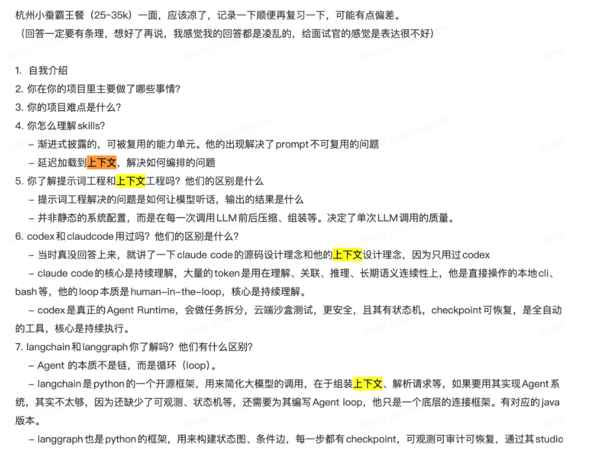

I previously published [What Is Context Engineering, and How Does It Differ from Prompt Engineering?](https://javaguide.cn/ai/agent/context-engineering.html), which covers the fundamentals of context management.

This article uses Claude Code, a leading coding agent, to explore the underlying ideas in more detail.

Context management is about more than compressing chat history. It also determines where task goals, tool output, file records, and handoff notes should live.

When Claude Code runs `/compact`, it replaces earlier conversation history with a structured summary and reloads some persistent instructions.

The summary usually keeps the task goal, key constraints and decisions, current progress, and relevant code pointers. It does not guarantee that full file contents, search results, or test output will be retained. Read or run them again when you need the exact details.

Long tasks require putting information in the right place: keep only what is needed now in the context window, write reusable and reviewable information to files, and hand off only the findings and pointers needed for the next step. Tool-output cleanup, history compaction, persistent files, subagents, and session handoffs all support this goal.

This article draws on two kinds of material. Behaviors confirmed by official documentation are described as documented. References to reverse engineering or source code are based mainly on non-public source material and community research around Claude Code 2.1.x; they are not stable, officially supported interfaces.

## Claude Code Architecture Overview

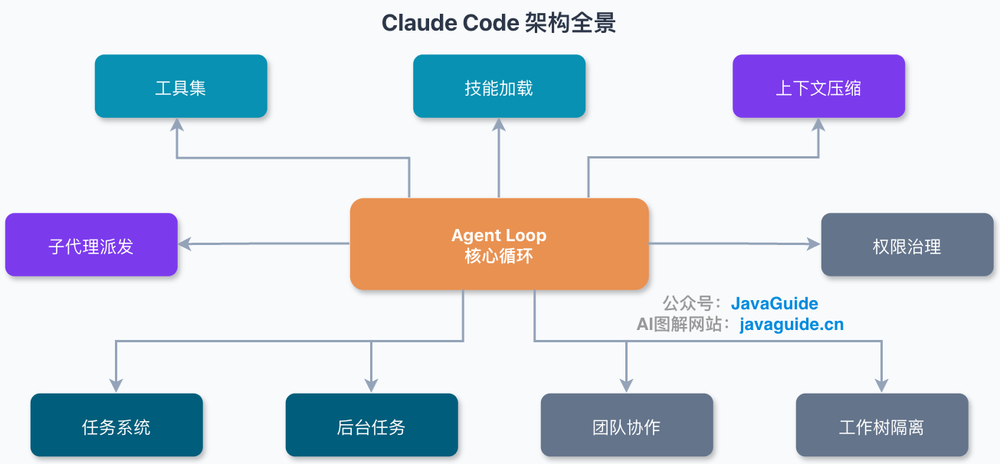

When the context window is under pressure, you can clear tool results, compact history, reset the context, or isolate side tasks in subagents. On-demand Skill loading, writing task state to the file system, and running background tasks independently also affect the available budget.

Claude Code needs direct access to the system prompt, tool definitions, project rules, conversation history, tool results, and recently read files. The context window is the working memory that holds them.

Stale logs, duplicate search results, and conflicting earlier conclusions can make an Agent miss constraints, repeat exploration, or stop too soon.

In the formula `Agent = Model + Harness`, the model provides reasoning, while the Harness gathers information, calls tools, and advances the task. Context management is part of the Harness: it decides which state stays in the window, which temporary results to clear, and what to store outside it.

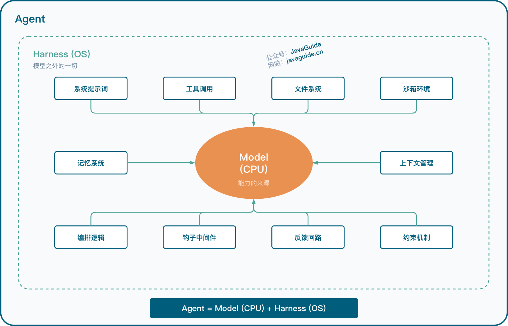

Interviewers asking about this often want to know whether you can treat an Agent as a stateful system. It has some similarities to traditional backend systems (these analogies aid understanding; the mechanisms are not equivalent):

| Agent concept       | Backend analogy               | Similarity                                      |
| ------------------- | ----------------------------- | ----------------------------------------------- |
| Context window      | JVM heap                      | Limited capacity; quality can decline when full |
| Compaction          | Garbage collection            | Reclaims old content while keeping live state   |
| Context Reset       | Restart + checkpoint recovery | Drops stale history and resumes from a handoff  |
| Subagent isolation  | Microservice separation       | Handles a local task in an independent context  |
| Context Rot         | Cache pollution / memory leak | Accumulated stale information slows decisions   |
| Tool-result cleanup | LRU cache eviction            | Keeps recent content and removes stale content  |

This also shows the difference between Prompt Engineering and Context Engineering. The former focuses on writing a single input; the latter focuses on how information flows through an entire session.

Making the system prompt more detailed does not solve context management. It can make things worse by increasing fixed overhead and pushing the window into a high-pressure state sooner.


## Context Budgets and Information Loading

### What Uses the Context Window

In an ordinary chat, a user usually sends one message per turn and occasionally pastes code. Claude Code starts with tools and rules, then reads files, runs tests, checks Git history, and calls MCP tools as it works.

File contents, command output, and conversation history keep adding to the window. Discussing one question adds far less context than reading dozens of files and running a full test suite. The latter makes Claude more likely to miss earlier constraints, repeat searches, or revisit rejected approaches.

More capable models may delay this degradation, but they do not stop the input from growing.

Window usage has two parts: the system prompt, rules, and registered tools present at startup, and the tool results and conversation history added as the task proceeds. The first part determines the initial headroom; reading files, running commands, and collecting logs increase the second.

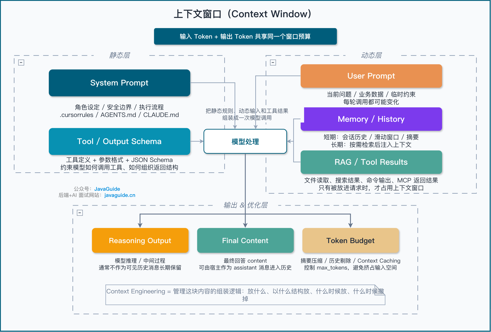

Startup overhead mainly comes from the system prompt, `CLAUDE.md`, Skill descriptions, and some tool information. In observed implementations, some MCP tool definitions are loaded lazily:

- When ToolSearch is enabled and a tool is not configured to load at startup, some MCP tools initially expose only their names;
- The full JSON Schema is loaded after the model selects one of those tools;
- Other tools load their full descriptions at startup.

The longer the rule files and the more Skills and MCP servers there are, the less context space remains at startup.

Use `/context` to inspect current session usage. It shows the model's context window, used tokens, remaining space, and usage by category, including the system prompt, tools, Skills, and messages.

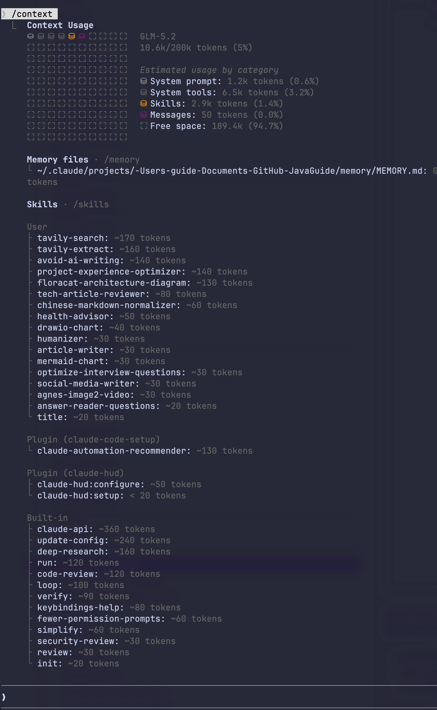

Tool calls usually account for most dynamic content. A source file with a few hundred lines can take thousands of tokens; search results and test logs can be longer. Tool arguments and results enter the current session, and file contents, command output, and search results accumulate as the task proceeds. Near the context limit, Claude Code first clears older tool results, then compacts the session if more space is needed.

Longer context also affects how well information is used. More input usually increases latency and cost. Models may not use every part of the window equally; retrieval and question-answering can degrade when relevant information is buried in the middle of a long context. This position-sensitive effect is often called Lost in the Middle. A larger window holds more information, but does not guarantee that the model will use it reliably.

This is the context degradation often called Context Rot. **As context grows longer and noisier, the model may use it less reliably.**

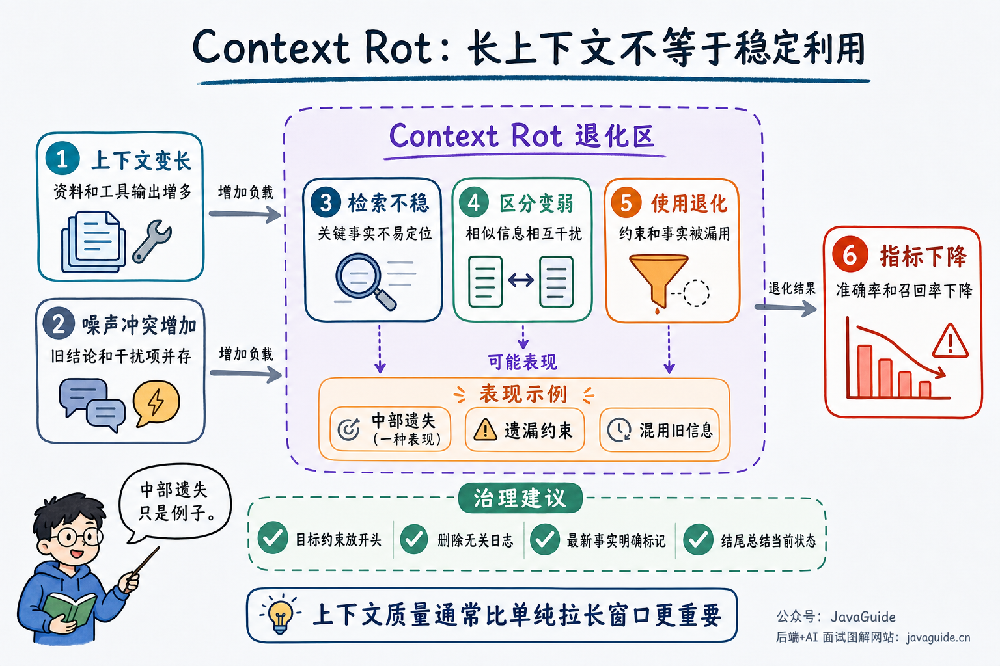

Each time Claude Code calls an LLM, the context window usually contains:

| Component                 | Contents                                                                 | Behavior                            |
| ------------------------- | ------------------------------------------------------------------------ | ----------------------------------- |
| Session startup context   | System prompt, `CLAUDE.md`, unconditional `.claude/rules/`, Auto Memory  | Fixed overhead                      |
| Path-specific rules       | `.claude/rules/` files with `paths`                                      | Loaded when matching files are read |
| MCP and tool descriptions | Built-in tool definitions, MCP tool names, and loaded schemas            | Fixed or on demand                  |
| Hook-injected content     | `additionalContext`, prompts, or tool feedback returned by hooks         | Injected dynamically                |
| Skills                    | Short descriptions load by default; the body enters context when invoked | On demand                           |
| Conversation history      | User messages and Claude's replies                                       | Grows over time                     |
| Tool calls and results    | Arguments, return values, logs, and file contents                        | Grows over time                     |
| Environment and IDE state | Workspace, selected code, and other client-provided information          | Injected by configuration           |
| Subagent reports          | Summaries and limited metadata returned by subagents                     | On demand                           |

Fixed overhead usually does not grow with the number of turns, but it determines how much space remains when a task starts. Dynamic content drives most growth in long tasks. Two 20-turn sessions can use very different amounts of context if one is chat-only and the other reads files and runs tests every turn. Turn count alone is therefore a poor measure of context pressure.

Prompt caching can reduce cost and latency, but it does not free context space. Even when the system prompt, tool definitions, and `CLAUDE.md` are cached, they remain part of the current request's input.

Extended Thinking also uses the budget. The current turn's thinking budget is part of `max_tokens`, is billed as output tokens, and counts toward rate limits.

Historical Thinking Blocks are easier to overlook. According to the current API documentation, Opus 4.5 and later, Sonnet 4.6 and later, Fable 5, Mythos 5, and Mythos Preview retain historical Thinking Blocks by default.

Earlier Opus and Sonnet models, as well as Haiku models, automatically remove these historical blocks from context. Whether Thinking continues to use window space in a long session therefore depends on the model and configuration.

Tool use adds a stricter requirement: when returning a `tool_result`, include the Thinking Block associated with that turn's tool call exactly as received, including its `signature`. After the tool loop ends, retention follows the model's default behavior or the context-editing configuration.

### Effective Window and Trigger Thresholds

Conceptually, estimate the effective window as:

```text
Effective context ≈ total window capacity - fixed overhead - history overhead
```

The source logic is roughly:

```typescript
function getEffectiveContextWindowSize(
  modelWindowSize: number,
  maxOutputTokens: number,
): number {
  const reservedForSummary = Math.min(maxOutputTokens, 20000);
  return modelWindowSize - reservedForSummary;
}
```

The returned value is used for warnings, automatic compaction, and blocking. `getEffectiveContextWindowSize()` only subtracts the reserved summary-output space from the model window. The system prompt, rules, message history, and tool results are already included in actual token usage; this function does not subtract them individually.

These thresholds also come from the material described above. They are not public, stable interfaces and may change in later versions.

The implementation uses these constants:

| Constant                          | Value  | Purpose                                                                             |
| --------------------------------- | ------ | ----------------------------------------------------------------------------------- |
| `AUTOCOMPACT_BUFFER_TOKENS`       | 13,000 | Starts AutoCompact before the effective window is full, leaving room for compaction |
| `WARNING_THRESHOLD_BUFFER_TOKENS` | 20,000 | Warns before a request and suggests manual `/compact`                               |
| `ERROR_THRESHOLD_BUFFER_TOKENS`   | 20,000 | Marks the context as being in a danger zone                                         |
| `MANUAL_COMPACT_BUFFER_TOKENS`    | 3,000  | Minimum safety margin for manual compaction                                         |

Two values here are easy to confuse.

`reservedForSummary = min(maxOutputTokens, 20000)` **reserves space for summary output**. A source comment says the summary's p99.99 is about 17.3K tokens, so the 20K cap covers such extreme outputs.

`AUTOCOMPACT_BUFFER_TOKENS` (13K) leaves a buffer before the effective-window limit and starts AutoCompact while space remains. The separate 20K reservation covers summary output.

The 13K value is only the AutoCompact buffer; the p99.99 summary comment refers to the 20K summary-output reservation. This design is predictable: increasing the model window from 200K to 500K does not proportionally increase the summary-output budget.

The independent stages are warning, AutoCompact, and the blocking limit. `isAboveAutoCompactThreshold` triggers AutoCompact; `isAtBlockingLimit` blocks new requests until the context is compacted or reset.

The reference implementation also has `isAboveWarningThreshold` and `isAboveErrorThreshold` state fields. In the observed version, both use the same 20K threshold and therefore trigger at the same token count. They may serve different purposes in different UI or call paths, but they do not represent separate usage ranges.

The checks before a request are roughly as follows (this implementation comes from a community-extracted source mirror; it is not an API that Anthropic guarantees to be stable). This describes the flow with AutoCompact enabled. If AutoCompact is disabled, warning and error thresholds are based on the effective window instead:

```typescript
reservedForSummary = min(maxOutputTokens, 20_000)
effectiveWindow = modelWindow - reservedForSummary

autoCompactThreshold = effectiveWindow - 13_000
warningThreshold = autoCompactThreshold - 20_000
errorThreshold = autoCompactThreshold - 20_000
blockingLimit = effectiveWindow - 3_000

if currentUsageEstimate >= warningThreshold:
  issue a context warning

if currentUsageEstimate >= autoCompactThreshold:
  trigger AutoCompact

if currentUsageEstimate >= blockingLimit:
  block new requests and require manual compaction or a reset
```

For a 200K window with 20K reserved for summaries, the effective window is 180K. AutoCompact triggers at 167K, the warning and error thresholds are 147K, and the blocking limit is 177K. The warning and error thresholds are each 20K below the AutoCompact threshold.

### How Information Enters Context

To find callers of `TokenRefreshService`, first use `Grep` to locate the symbol, then infer each file's role from paths such as `tests/test_utils.py` and `src/core_logic/test_utils.py`. Use `Read` to inspect relevant sections after confirming they matter. Run `ls`, `find`, `git log`, and tests when more evidence is needed.

Read, Glob, Grep, Bash, and subagents gather information as the task progresses; there is no need to build a vector index of the entire repository first. Paths, symbols, imports, and current file state narrow the search. Verify call relationships against the source and test results.

Natural-language questions and concept searches can use RAG (Retrieval-Augmented Generation) through MCP, a plugin, or a custom Skill. For code exploration, verify retrieved snippets with keyword searches, symbol analysis, and direct reads.

This workflow starts with directories and file names, then narrows down to relevant lines; read the full content only when needed:

| Design choice                  | Approach                                                                       | Benefit                                                                      |
| ------------------------------ | ------------------------------------------------------------------------------ | ---------------------------------------------------------------------------- |
| Metadata as information        | File paths, directory structure, timestamps, and file sizes are useful signals | Make an initial assessment without reading contents                          |
| Load on demand                 | Read specific files only when needed instead of preloading everything          | Keep only necessary information in context                                   |
| Explore iteratively            | Narrow the search: directory → file name → relevant lines → full contents      | Reduce context spent on unproductive exploration                             |
| Inspect the workspace directly | Use Glob, Grep, Read, Git, and tests to investigate                            | No separate index to maintain; results usually reflect the current workspace |

Skills follow a similar pattern: load only metadata at startup and fetch the specific document after the model decides to invoke one. See [What Are Agent Skills, and How Do They Differ from Prompts and MCP?](https://javaguide.cn/ai/agent/skills.html "What Are Agent Skills, and How Do They Differ from Prompts and MCP?") for details.

RAG works well for retrieving documents, knowledge bases, and historical records. Code repositories contain changing paths, configuration, dependencies, and test results, so search, read, and verify them as you go. Poor search terms can require extra rounds; cross-repository or concept searches and large monoliths may benefit from semantic indexes.

| Scenario                                                      | Better fit             |
| ------------------------------------------------------------- | ---------------------- |
| Search knowledge bases, documents, and history                | RAG                    |
| Explore repositories, configuration, and directory structures | Progressive Disclosure |
| Large projects with both documents and code                   | Combine both           |

AI IDEs such as Cursor use codebase indexing for low-latency completion and quick questions. Claude Code tasks also involve reading, reasoning, and verification, so they rely more on iterative, tool-driven exploration.

## Why Context Degrades

In long tasks, a larger window can contain more constraints, logs, and earlier conclusions, making the information needed for a current decision harder to use reliably. Some community practices use roughly 40% as a prompt to clean up or compact context. The point at which quality changes varies by model, task, and context structure.

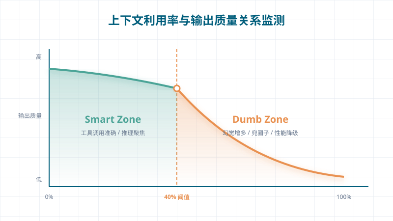

If someone says "do not change the database schema" in turn 3, search results and test logs may bury that constraint by turn 30. This tendency to notice the beginning and end more readily than the middle is commonly called **Lost in the Middle**.

The root `CLAUDE.md` and rules without path restrictions are injected again after compaction. The current user input and recent tool results are near the end of the messages, while older tool results and stale conversation are cleared first. Together, these reduce the chance that old content buries a key constraint. Rules are still model instructions; enforce security constraints with permission rules, the sandbox, or a `PreToolUse` hook.

Near the context limit, space must also remain for output and error recovery. If history keeps growing, the model may wrap up before finishing the task. Anthropic calls this **Context Anxiety**.

The article [Harness Design for Long-Running Application Development](https://www.anthropic.com/engineering/harness-design-long-running-apps "Harness Design for Long-Running Application Development") describes it as follows:

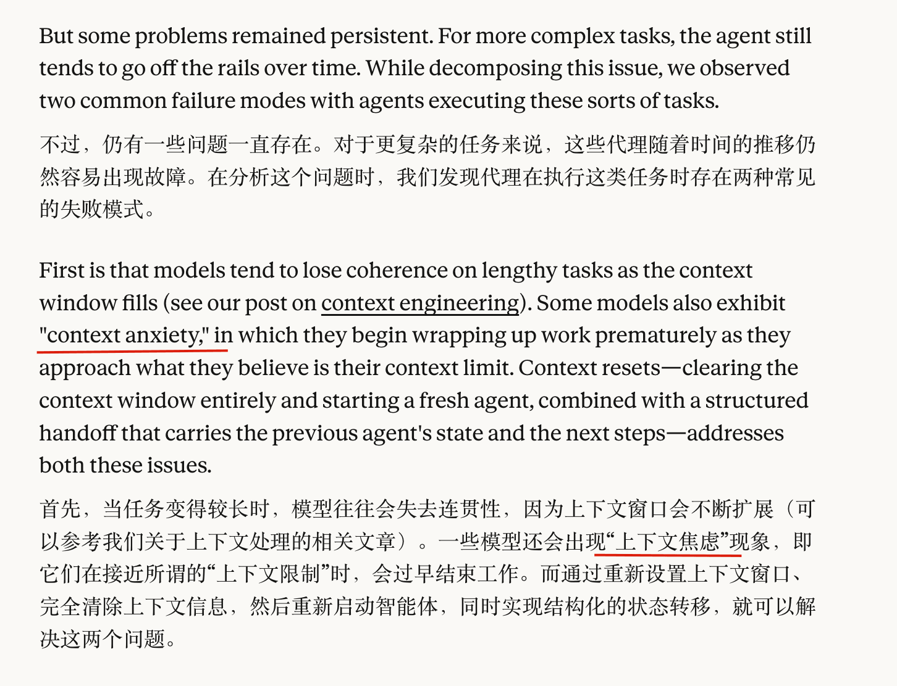

Earlier conclusions, duplicate search results, resolved issues, and useless logs consume attention even before the window is full. They recur in each request, while a new decision may be only one sentence. This declining signal-to-noise ratio is called **Context Rot**. A larger window only delays the pressure: too much information can still bury constraints in the middle and eventually lead to Context Anxiety.

## How Claude Code Manages Context

If tool results can be retrieved again, they do not need to occupy the window indefinitely. Claude Code handles these results first, then compacts history. If that is not enough to continue the task, reset the context or delegate side tasks to subagents.

### Clear Tool Results First

One `Read` call may return 500 lines, and a test run may produce thousands of log lines. These use substantial space, but the original content can be retrieved again. Clearing them first causes relatively little information loss and requires no additional model call.

In the 2.1.x implementation examined for this article, large tool results are written to `tool-results` in the session store, usually under the session data in `~/.claude/projects/...`. The window keeps only a preview and a file reference.

The default threshold is about 50,000 characters, not 50 KB. Some tools may have lower limits: about 30,000 characters for Bash or PowerShell and 20,000 for Grep. If tool results in one message exceed about 200,000 characters in total, the largest results are also written to disk first.

There is an exception: `Read` results use `maxResultSizeChars = Infinity`. Tools without a finite threshold are generally not treated as oversized by the Tool Result Budget. Otherwise, the process could loop: read a file → write it to disk because it is too large → include its path in the summary → read it again.

Tool Result Budget may also process tool results. This path depends on the version and experimental flags, so it is not enabled in every environment. Its states include `mustReapply`, `frozen`, and `fresh`.

`mustReapply` means a previously persisted or replaced result needs its replacement applied again. `frozen` is a result already processed and temporarily excluded from further handling. `fresh` is a new result that may be written to disk and replaced when a single-message budget is exceeded.

The reference implementation also includes Snip and MicroCompact. Snip removes a range of history, reconnects the message chain, and passes the number of freed tokens to later AutoCompact checks, avoiding an unnecessary compaction immediately after space is freed.

MicroCompact replaces old tool results with `[Old tool result content cleared]`. Calls and references remain in the message chain, while large result bodies are removed.

**Why not delete the entire message?**

Later messages may still reference an earlier `tool_use` ID. Deleting the call record would break the message chain and prevent the model from knowing which operations completed. The tradeoff is losing the exact content; reread the file if you later need precise line numbers.

Before a request or when context pressure is reported, MicroCompact keeps several recent tool results and replaces earlier ones. If the current environment, model, or subagent path does not support it, this step is skipped and AutoCompact handles the context later.

Another entry point is Prompt Cache expiration. If enough time passes between API calls for the server-side cache to expire, clearing old tool results before sending can prevent the full request from growing further. This path is disabled by default and controlled by a GrowthBook gate.

The reference implementation also has cache-prefix and cache-sharing paths. Compaction attempts to reuse a cached prefix and falls back to regular compaction if that fails. This is a version-specific cache optimization, not a stable capability.

Decide what to clear based on whether the information can be retrieved again. Outputs from Read, Grep, Glob, and log queries can usually be generated again. For side-effecting tools such as Edit and Write, do not restore state by replaying output; check the file system. One-off artifacts such as subagent analysis and task-state snapshots cannot be casually cleared because they may be lost. Preserve them in a summary or attachment.

### Compact History Next

Compact history only after clearing tool results proves insufficient. AutoCompact is not the only compaction method. As the context limit approaches, Claude Code first tries to clear older tool output; if that does not free enough space, it summarizes the session.

Conversation history continues to grow after tool results are cleared. At some point, earlier history must be rewritten as a state summary. The implementation examined here uses a multistage pipeline. Official documentation confirms that older tool results are cleared first as the limit approaches, followed by session summarization if needed.

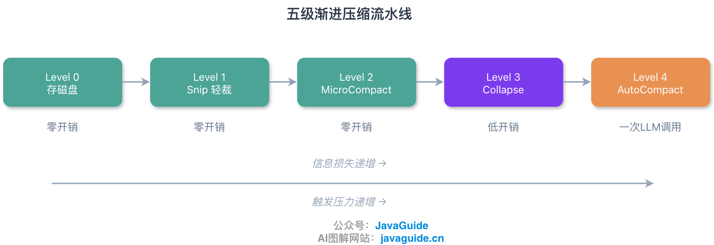

| Stage | Name                  | Action                                                       | Information loss    | API cost |
| ----- | --------------------- | ------------------------------------------------------------ | ------------------- | -------- |
| 0     | Persist large results | Write oversized tool output to session storage               | Very low            | None     |
| 1     | Snip                  | Remove a history range and reconnect the message chain       | Very low            | None     |
| 2     | MicroCompact          | Clear old tool-result content or use API-level cache editing | Low to medium       | None     |
| 3     | Collapse              | Fold completed message groups into a state snapshot          | Medium              | Low      |
| 4     | AutoCompact           | Use Session Memory or an LLM to summarize the full session   | Depends on the path | High     |

Persisting large results, Snip, and MicroCompact can handle some sessions. The process moves to Collapse or AutoCompact only if context usage continues to rise.

Collapse is another part of this implementation and is lighter than AutoCompact. For an API call, it creates a compacted view dynamically: the full history stays local while the model receives the folded version.

This is similar to **separating the view from storage**. In the observed implementation, Collapse starts processing completed message groups at about 90% utilization. At about 95%, it prevents new subagents from spawning to avoid adding more context pressure.

Because Collapse loses less information, it usually activates before AutoCompact. If folding does not free enough space, the system proceeds to a heavier full summary. Do not treat implementation details such as Collapse as public, stable interfaces.

AutoCompact replaces old chat history with a new state summary. It retains goals, progress, decisions, and pending tasks, but usually not which files were read, which keywords were searched, or full test output. The Agent must retrieve those details from the file system when needed.

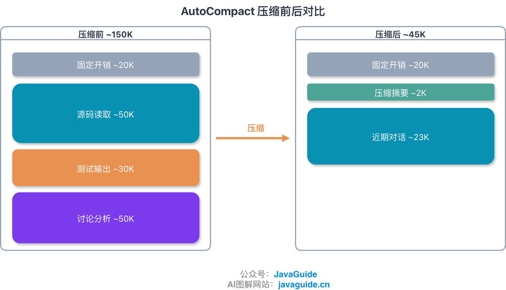

Manual `/compact` and automatic compaction use similar capabilities but different inputs. A manual command can specify what the summary must retain. Automatic compaction sets `suppressFollowUpQuestions` so the summarizer does not interrupt with questions.

At the end of a phase, when `/context` shows high usage, or when tool calls start repeating, run `/compact` and specify what to retain:

```text
/compact Keep the database schema, payment state machine, and current failing tests.
```

### Recovery and Fallbacks

The third layer restores context after compaction and handles failures.

**Session Memory** is a fast path before Full Compact. Here, Session Memory means internal session state used for compaction; it is not the Auto Memory described in Claude Code's official documentation. It refreshes structured session notes based on token growth and tool-call cadence. When AutoCompact triggers, Full Compact can be skipped if the notes, recent messages, attachments, and hook results fit below the threshold.

These names are easy to confuse. The distinction is:

| Aspect  | Session Memory                                                   | Auto Memory                                                             |
| ------- | ---------------------------------------------------------------- | ----------------------------------------------------------------------- |
| Purpose | Current-session notes that support compaction                    | Project knowledge that persists across sessions                         |
| Source  | Refreshed internally based on token growth and tool-call cadence | Written by Claude from corrections, preferences, and project experience |
| Role    | Reused by AutoCompact to reduce the chance of Full Compact       | Loaded at session start to provide long-term preferences and experience |
| Storage | Internal, version-specific implementation detail                 | `~/.claude/projects/<project>/memory/`; `MEMORY.md` is the index        |

It also has a cost: updating Session Memory requires a background model call. It reduces the chance of a large summary near the context limit by spreading compaction work across the session.

In the implementation examined here, Session Memory does not start at the beginning of a session. It is initialized after usage first reaches about 10,000 tokens.

Updates follow a cadence: notes are usually refreshed after another 5,000 tokens and a certain number of tool calls, or at a natural pause with no active tool calls.

The notes use fixed sections such as Current State, Task Specification, Files and Functions, and Errors & Corrections. Each section has a soft limit of about 2,000 tokens; the hard limit for the full document is 12,000 tokens. When it is exceeded, the model is told it `MUST condense`.

When Session Memory compaction is enabled and valid Session Memory exists, AutoCompact first tries to reuse it. It assembles a new message chain from the notes, recent messages, attachments, and hook results, then estimates token usage. If it falls below the threshold, Full Compact is skipped. If the notes are empty, the message boundary cannot be found, or the assembled chain is still too large, the system falls back to a full summary.

**Full Compact** can itself fail with `prompt_too_long` if its input is too long. If the summary request fails this way during manual `/compact` or AutoCompact, the system uses the **PTL (Prompt Too Long)** fallback.

Grouping by API round keeps `tool_use` and `tool_result` together. If the error includes `tokenGap`, the system can remove content based on the excess token count. Without `tokenGap`, it uses a rougher proportion, such as dropping about 20% of older message groups. Reactive Compact is another recovery path for an API `prompt_too_long` error; it truncates messages and retries. The truncation direction and strategy are version-specific and should not be treated as fixed.

In this implementation, **Partial Compact** addresses two concerns: it compacts only part of the history to reduce state loss, and in some directions preserves the cached prefix where possible. Full Compact usually rebuilds the main message chain and invalidates most of the cached prefix. Partial Compact compacts a section while retaining one end of the messages for cache reuse. Compaction should balance cache reuse, task continuity, and information loss, not just compression ratio.

Partial Compact has two directions:

1. `from`: compact messages after the pivot and retain the earlier portion. This suits long sessions that already have an earlier summary and can better preserve the cached prefix.
2. `up_to`: compact messages before the pivot and retain the recent portion. This suits an Agent working on a file or bug where intermediate state should not be interrupted by a summary. Since the summary is inserted before the retained messages, the original cached prefix is usually invalidated.

Full Compact uses a structured summary prompt rather than simply asking the model to "summarize this."

The Full Compact prompt restricts tool calls before and after summarization: this step should produce text only and must not run `Read`, `Write`, or `Bash`, which would add new tool results. The model first organizes information in `<analysis>`, then writes what the next session needs in `<summary>`. Only the latter becomes the handoff material.

`<summary>` uses fixed sections: Primary Request and Intent, Key Technical Concepts, Files and Code Sections, Errors and Fixes, Problem Solving, All User Messages, Pending Tasks, Current Work, and Optional Next Step.

`All User Messages` is more than a transcript: additional user requirements, direction, and constraints affect later decisions. If they are omitted, the Agent may continue the wrong task. `Current Work` should also specify file and function names, failing tests, and the next command. "Investigating a module issue" is not enough for the compacted Agent to continue.

The reference implementation also shows that different model versions may follow the compaction prompt differently. For example, under a specific configuration, a newer model tried to call tools much more often than an older one. Compaction rules therefore need to be revalidated for each model version; do not assume that "do not call tools" works equally well across models.

After compaction, Claude Code writes a system record with `subtype: "compact_boundary"` to the local session events or JSONL. The sample `compactMetadata` mainly records values such as `trigger` and `preTokens`; some paths also include `preservedSegment`. The post-compaction token count may appear in the result or telemetry, so it should not be treated as a stable boundary-metadata field. The boundary tells later loaders that history here was replaced by a summary and should not be appended as ordinary conversation.

The local record may look like this; fields vary by version:

```json
{
  "type": "system",
  "subtype": "compact_boundary",
  "content": "Conversation compacted",
  "compactMetadata": {
    "trigger": "manual",
    "preTokens": 160442,
    "preservedSegment": {
      "headUuid": "...",
      "anchorUuid": "...",
      "tailUuid": "..."
    }
  }
}
```

After Full or Partial Compact, the new message chain usually contains the boundary marker, summary message, attachments, and hook results. Session Memory compaction restores a narrower set, mainly the summary, retained messages, plan, and hooks. Recently accessed files, active plans, the current Skill, and background-task state are subject to count and token budgets. The system prompt is not summarized; the latest tool list, permissions, and MCP server list are assembled again after compaction.

Do not reload every file read before compaction. That can easily restart the cycle of compaction → context growth → compaction. Restore only the files needed for the current task.

The system recalculates the actual message payload from the boundary marker, summary, restored attachments, and hook results. If it remains near the threshold, compaction may run again immediately on the next turn. Some temporary state and caches are also reset depending on the implementation path; the exact cleanup varies by version.

Restore attachments based on relevance. Recently accessed files, active plans, the current Skill, and background-task state can help the Agent continue, but they also use window space. The source path often filters by recency, file-count and token budgets, exclusion rules, and deduplicated preserved tails. For example, when working on a payment state machine, restore its source file, failing tests, and relevant plan—not logs or unrelated modules read earlier.

The project-root `CLAUDE.md` and rules without path restrictions are injected again from disk after compaction, so they do not need to be repeated in the summary. Nested `CLAUDE.md` files and rules with `paths` are reloaded when matching files are read again.

When choosing a cheaper model for compaction, also evaluate summary fidelity, the cost of additional exploration, and cache hits. Model price is only one factor; the key is whether the task can continue accurately after compaction.

### Reset, Isolation, and Circuit Breakers

The fourth layer stops trying to "save the old window." Compaction patches the old context, and repeated patches accumulate detail loss. At some point, starting over is better than further compaction. Context Reset clears the window, writes the current state to a handoff document, and lets a new Agent resume from it.

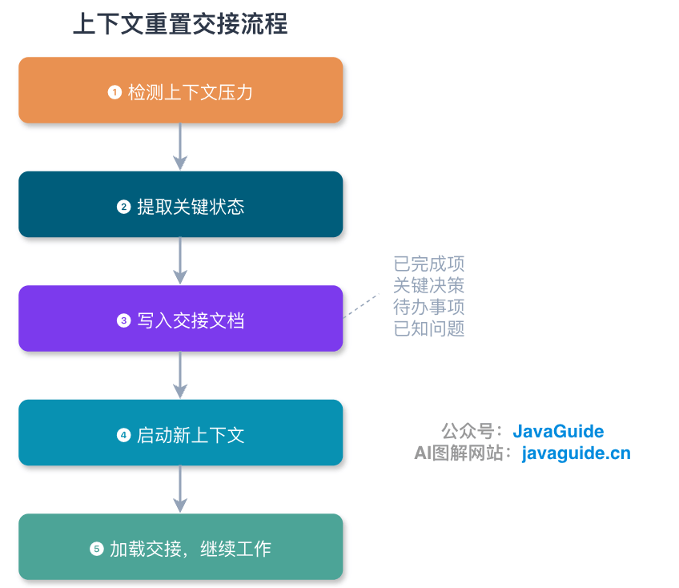

In a specific long-task Harness based on Sonnet 4.5, Anthropic observed that the model wrapped up hastily near the context limit. This is Context Anxiety, and compaction alone was not enough in that scenario.

Reset paired with a structured handoff discards the old context while preserving key information in the handoff for a new Agent to continue.

However, Reset is not a required step for every long task. After switching to Opus 4.5, the same Harness could remove Reset and rely on automatic compaction. Reset is an engineering technique for specific models and tasks, not a universal workflow.

The main risk of Reset is the handoff material, which forms the bridge to the new session. It can include more than one Markdown file: progress notes, failing-test records, a Git diff, a task list, and key logs can all help. If edge cases, temporary decisions, or failure reasons are omitted, the new Agent resumes without necessary information.

To resume from the previous stopping point, the handoff should include the goal and acceptance criteria, completed work, current files and functions, rejected approaches, failing tests or error logs, and the first step for the next session:

```text
1. Task goal: State the expected deliverable in one sentence.
2. Completed work: List what has been changed and verified.
3. Current stopping point: Name the file, function, test, or command.
4. Key constraints: What must not change, what must remain compatible, and what the user emphasized.
5. Rejected approaches: What was tried and why it was discarded.
6. Current failure: Include logs, stack traces, and reproduction steps.
7. First action: Tell the next session which file to inspect or command to run.
```

If the only handoff says "continue the remaining work," the new session will not know which files changed, which tests failed, or which approaches were ruled out.

When analyzing thousands of log lines, tracing behavior across files, or performing an independent review, the main session usually does not need the full process. A subagent can handle the side task in its own window and return only a summary and necessary evidence; full logs and intermediate attempts remain in its history.

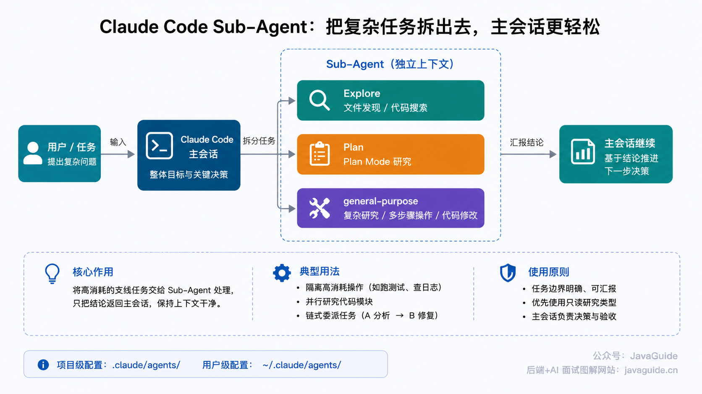

Delegate log tasks when the main session needs only the root cause and evidence. When a task takes only a few steps, subtasks frequently depend on each other, or boundaries are unclear, scheduling and summarization add overhead instead.

Subagents also start with different context depending on the mode:

| Mode                      | Context behavior                                                                                                                            | Suitable use                                                     |
| ------------------------- | ------------------------------------------------------------------------------------------------------------------------------------------- | ---------------------------------------------------------------- |
| Named / non-fork subagent | Does not inherit the parent message history, but still loads runtime context such as tools, permissions, `CLAUDE.md`, memory, and Git state | Isolate noisy searches, log analysis, and independent reviews    |
| Fork                      | Inherits the parent context instead of starting with an empty window                                                                        | Side tasks that depend on substantial background or parent state |

Both modes return only their results to the main session. A subagent with the `Agent` tool can spawn other subagents; that tool is no longer available at depth 5. A Fork cannot create another Fork.

After the main session is compacted, it does not reload a subagent's full transcript; it restores only the summary and limited metadata.

### Circuit Breaker

The circuit breaker protects automatic compaction. Official documentation says that if a large file or tool output quickly fills the window again after each summary, Claude Code stops automatic compaction after several attempts to avoid repeated API calls.

The reference implementation counts consecutive failures. A successful AutoCompact resets the count. After `MAX_CONSECUTIVE_AUTOCOMPACT_FAILURES` (3) consecutive failures, subsequent requests skip AutoCompact.

```text
AutoCompact
  -> The window fills again soon after a summary, or compaction fails
Increase the consecutive-failure count
  -> Skip AutoCompact after 3 failures
```

Without this protection, a session can loop through "compact → fill up immediately → compact again." If AutoCompact does not run in time and the API returns `prompt_too_long`, Reactive Compact recovers from the error by truncating messages and retrying.

### Summary

Choose the order of operations based on whether the information can be retrieved again:

| Source of context pressure                      | First response                                           | Cost                                                                  |
| ----------------------------------------------- | -------------------------------------------------------- | --------------------------------------------------------------------- |
| Tool output is too large                        | Persist it, use MicroCompact, and Snip history if needed | Low information loss; usually no extra model call                     |
| Conversation history is too long                | Collapse, AutoCompact, or Full Compact                   | Some process details are lost; summary quality matters                |
| Searches and logs clutter the main session      | Isolate side tasks in subagents                          | Adds a dispatch step; the main session receives only a summary        |
| The task still cannot continue after compaction | Handoff + Context Reset                                  | Omissions in the handoff leave the new session without needed context |

In practice, clear retrievable tool results first and compact only when history is too long. Delegate searches, reviews, and log analysis to subagents so the main session receives only a summary. If the task still cannot continue reliably after compaction, write a handoff and start a new session. Later steps incur greater information loss and scheduling cost, so do not reset at the outset.

## Applying This to Long Tasks

### Two Extreme Examples

In 2026, Anthropic Labs published a three-agent architecture inspired by **GANs (Generative Adversarial Networks)**:

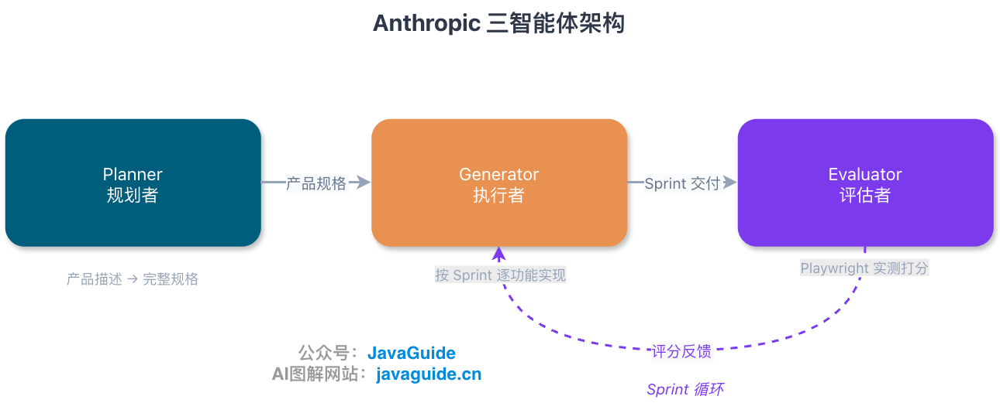

The Planner expands a one- to four-sentence product description into a full specification. The Generator implements features in sprints. The Evaluator uses Playwright MCP to operate the running application and score product depth, functionality, visual design, and code quality. Separating roles gives planning, implementation, and evaluation their own contexts.

An earlier long-running Harness based on Sonnet 4.5 used Context Reset to mitigate Context Anxiety. In the three-agent Harness with Opus 4.5, Anthropic switched to continuous sessions and used automatic compaction in the Claude Agent SDK to control context growth.

- The Planner handles planning and does not carry implementation details.
- The Generator uses automatic compaction after each sprint to keep history from slowing later implementation.
- The Evaluator works independently and is not affected by the Generator's context.

The two configurations had these costs and results:

| Configuration                               | Time       | Cost  | Result                           |
| ------------------------------------------- | ---------- | ----- | -------------------------------- |
| Solo Harness: one Agent + minimal tools     | 20 minutes | \$9   | Incomplete app that does not run |
| Full Harness: three Agents + full toolchain | 6 hours    | \$200 | Complete, usable app             |

Carlini's case was more extreme: 16 parallel Claude Opus instances and about 2,000 independent sessions over roughly two weeks.

The project produced 100,000 lines of Rust code, passed 99% of the GCC torture tests, and cost about $20,000 in API usage.

The key was distributing work across many independent sessions. Logs went to files instead of the console, and tests were subsampled: each Agent ran only 1–10% of the test cases to keep output from filling the context window.

Carlini later wrote in [Building a C Compiler with a Team of Parallel Claudes](https://www.anthropic.com/engineering/building-c-compiler "Building a C Compiler with a Team of Parallel Claudes"):

> “I had to constantly remind myself that I was writing this test harness for Claude and not for myself.”

In Carlini's setup, different roles gradually took responsibility for the core compiler, deduplication, performance optimization, code quality, and documentation. LLMs can reimplement existing features; a dedicated deduplication role reduces the main Agent's burden of coding, finding duplicates, and maintaining context at the same time.

Model upgrades also change Harness tradeoffs. After Anthropic moved from Opus 4.5 to Opus 4.6, it removed the original sprint mechanism and replaced strict per-sprint evaluation with final QA and a small number of evaluation rounds. Task decomposition, checks, and resets all rely on assumptions about model capabilities, so validate them again after a version change.

Everyday projects do not need three agents or 2,000 separate sessions. Start by estimating how much code context the task will consume.

### Choosing an Approach for Everyday Projects

I ran into this while working on an interview-platform project. A task spanned several modules, and I thought one Agent could handle it. Claude Code stopped halfway through because the context filled up. I switched to parallel subagents, each limited to its own module, and had them return summaries to the main Agent. That completed the task.

| Task size                                            | Recommended approach                                                    | Context management                                                            |
| ---------------------------------------------------- | ----------------------------------------------------------------------- | ----------------------------------------------------------------------------- |
| Small: single-file change or one function            | One Agent                                                               | Automatic tool-result cleanup is enough                                       |
| Medium: one module or feature                        | One Agent + proactive compaction                                        | Run `/compact` at phase boundaries or when `/context` shows high usage        |
| Large: cross-module refactor or new subsystem        | Main Agent + subagents                                                  | Delegate searches, reviews, and log analysis                                  |
| Very large: long-term iteration or standalone system | Multiple Agents + handoff / Reset, or continuous sessions + AutoCompact | Write a handoff at phase boundaries; choose Reset based on the model and task |

For details on `/compact`, subagents, and `/context`, see the [Claude Code User Guide](https://javaguide.cn/ai-coding/claudecode-tips.html "Claude Code User Guide") and [Claude Code Command Reference](https://javaguide.cn/ai-coding/claudecode-commands.html "Claude Code Command Reference").

I do not wait for AutoCompact to reach its threshold. When `/context` shows about 70% usage, or repeated searches and forgotten constraints start to appear, I run `/compact` manually and specify what to keep. This gives the summarizer clearer priorities. By the time the system triggers compaction, the window may already contain stale logs, old conclusions, and temporary exploration results.

At the end of the exploration phase, include module boundaries, key files, rejected approaches, and failing tests in the compaction instruction:

```text
/compact Keep module boundaries, key files, rejected approaches, and current failing tests.
```

For a database issue, specify the schema, migrations, and failing SQL needed to continue:

```text
/compact Keep all database schemas, migration scripts, entity relationships, and current failing SQL.
```

For a cross-module task, compact once after reading files and confirming module boundaries, then again after settling on an approach, constraints, and risks. After changing and verifying the code, update the status. Keep key state in `PLAN.md` or `design.md`; let the summary carry the goal, tradeoffs, and next step while line numbers, failing SQL, and interface details remain in files.

For multi-file projects, choose an approach based on the situation:

| Scenario                                  | Recommended approach                                                     |
| ----------------------------------------- | ------------------------------------------------------------------------ |
| Read many files in one pass               | Use MicroCompact, Snip, or compaction to clear completed analysis        |
| Resume after a long interruption          | Let the system clear stale tool results; reread key files if needed      |
| Work through several independent features | Compact after each feature                                               |
| Make a large change across modules        | Split into phases; compact and update notes at each phase boundary       |
| Produce many logs or test results         | Keep only failure summaries, reproduction commands, and key stack traces |
| Need parallel search or review            | Delegate to subagents; return only summaries to the main Agent           |

After exploration, keep the conclusions rather than every file read. Preserve design constraints and tradeoffs; full reproducible failure logs do not need to remain in context. Compact once the information has stabilized.

### External State, Memory, and Hooks

Task APIs such as `TaskCreate` and `TaskUpdate` break large goals into task nodes, record states such as `pending`, `in_progress`, and `completed` and their dependencies, then persist them as a structured task list. (The internal storage format is not a stable interface.) Agents can use Task Tools to inspect progress instead of relying on conversation history to remember what is done.

When multiple Agents work in one repository, worktree isolation lets each one's `git status` show only its own changes. Run full tests, cross-file searches, and large-module analysis in the background, then return only a summary. Task states for jobs still running during compaction are re-injected into the new context as attachments.

Apply the same principle to memory: record only information that cannot be inferred from the source code.

| Store                                               | Do not store                                               |
| --------------------------------------------------- | ---------------------------------------------------------- |
| User preferences, such as coding style and language | Project directory structure, discoverable with `glob`      |
| Project-specific conventions, such as API prefixes  | Function signatures, available in the source               |
| The reason for a technical decision                 | Dependency versions, listed in `package.json` or `pom.xml` |
| Past problems and their fixes                       | Git history, available with `git log`                      |

Conversation history serves only the current session and may later be compacted. Store persistent user or project instructions in `CLAUDE.md` or Rules. Auto Memory stores experience notes by Git repository at `~/.claude/projects/<project>/memory/` by default. The path can be changed with `CLAUDE_COWORK_MEMORY_PATH_OVERRIDE` or `autoMemoryDirectory` in trusted settings. At session startup, only the first 200 lines or 25 KB of `MEMORY.md` are loaded.

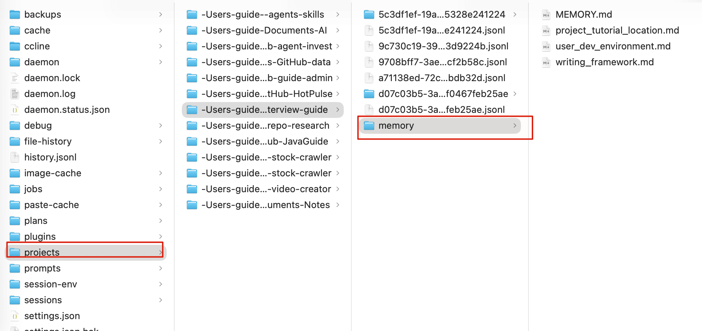

As the number of memory files grows, load only the index at startup and open individual files when their details are needed.

Some Agent projects also use `AGENTS.md` as an index.


See [Harness Engineering: Why Coding Agents Need Infrastructure](https://alexlavaee.me/blog/harness-engineering-why-coding-agents-need-infrastructure/ "Harness Engineering: Why Coding Agents Need Infrastructure"). These files tell an Agent where information is and when to read it; they should not preload everything into context.

Official Auto Memory is stored by Git repository, so different worktrees of the same repository share the same memory.

Personal, project, and organization rules accumulate in the context window. Do not assume a later rule automatically overrides an earlier preference. If a project rule must take precedence over a personal preference, state its priority explicitly.

If asked in an interview how an Agent implements cross-session memory, "store it in a file" is too vague. A stronger answer is to store only information unavailable in the source, organize it by scope, load a lightweight index at startup, and read details only when needed instead of putting all memory in the context window.

According to the official documentation, these three types of persistent information can be stored as follows:

| Type                 | Purpose                                                       | Storage                                                                                                                                                                                    |
| -------------------- | ------------------------------------------------------------- | ------------------------------------------------------------------------------------------------------------------------------------------------------------------------------------------ |
| Conversation history | Temporary state for the current task; may be compacted        | In-memory `messages[]`                                                                                                                                                                     |
| CLAUDE.md / Rules    | Persistent user, project, or organization instructions        | Project `.claude/` or `~/.claude/`                                                                                                                                                         |
| Auto Memory          | Experience notes maintained by Claude for each Git repository | `~/.claude/projects/<project>/memory/` by default; can be overridden by `CLAUDE_COWORK_MEMORY_PATH_OVERRIDE` or trusted settings. `MEMORY.md` is the index and is shared across worktrees. |

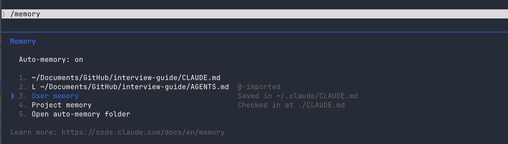

If a temporary bug workaround is saved to project memory, later sessions may keep relying on a false assumption. File paths, dependency versions, and function signatures can be read from the source and do not need to be stored. More entries increase fixed overhead, and incorrect entries can keep distorting decisions.

Configuration also contributes to fixed overhead. Ordinary Claude Code settings follow this precedence:

```text
Managed (organization policy) > CLI arguments > project-local > shared project > user settings
```

Array-valued settings such as permissions and sandbox paths are exceptions; they may be merged and deduplicated instead of simply overridden.

If project settings add five rules, user settings add three, and MCP adds two servers, the rules, permissions, and tool definitions can use thousands of tokens. Put general rules in global settings and project-specific rules at the project level to avoid repeated injection.

Hooks can modify context at specific lifecycle points: `SessionStart` injects memory, `PreCompact` adds compaction instructions, and `PostCompact` handles notifications or display. `PostToolUse` can adjust MCP tool output, while `PreToolUse` checks whether a tool call is allowed.

Hook output enters the context and therefore has a cost. Untrusted instructions from external webpages, script output, or temporary files can also introduce prompt injection. For ordinary coding projects, built-in cleanup, compaction, and circuit breakers are usually enough.

The table shows when these hooks affect context:

| Event                        | Trigger                     | Context-management role                                                 |
| ---------------------------- | --------------------------- | ----------------------------------------------------------------------- |
| `SessionStart`               | Session starts              | Inject memory and environment information                               |
| `InstructionsLoaded`         | After rules load            | Notification and audit observation                                      |
| `PreToolUse`                 | Before a tool call          | Check whether the tool call is allowed                                  |
| `PostToolUse`                | After an MCP tool returns   | Adjust MCP tool output                                                  |
| `PreCompact` / `PostCompact` | Before and after compaction | Add instructions before compaction; notify or display after the summary |

Each additional hook can add more output to the context. Configure hooks when a team project has strict domain constraints, compliance-audit requirements, or a need to sanitize tool output.

## Interview Answer

Context management is the governance of limited working memory. During a long task, an Agent must reason with the goal, project rules, code already read, tool output, plans, and intermediate conclusions. As the window grows, stale logs, duplicate search results, and resolved issues compete for attention. Near the limit, the model may also stop too soon because too little output space remains.

I first separate two kinds of information. Dozens of search results, full test logs, and long file contents can be retrieved again, so they do not need to stay in the window. The task goal, business constraints, key decisions, failing tests, changed files, and next step must be preserved. Summarize them in a form that supports continued work, then write them to `PLAN.md`, a design document, or a task file instead of leaving them only in one conversation turn.

In Claude Code, I would clear retrievable tool results first and run `/compact` when the history becomes too long, preserving the goal, constraints, decisions, and pending work. If the task still needs a new session after compaction, the handoff should state the current changes, failing tests, rejected approaches, and next verification step. I would delegate side tasks such as log analysis, cross-file searches, and independent reviews to subagents, returning only conclusions and necessary evidence to the main session.

Good context management is measured by whether work can continue after compaction, a session change, or task delegation—not by how much information the window contains. The window supports current reasoning; the file system stores reusable, traceable task state.

## Summary

When the window fills, clear retrievable temporary material such as tool results, test logs, and search output first. Compact long conversation history at the end of a phase. Delegate searches, reviews, and log analysis to subagents, and keep only their conclusions in the main session.

If the task still cannot continue after compaction, the handoff should describe failing tests, temporary constraints, files being changed, and rejected approaches for the next session. Store information that will be needed later—plans, specifications, failing SQL, and design tradeoffs—in `PLAN.md`, `design.md`, `NOTES.json`, or the project's task files. The window holds temporary material; the file system preserves task state.
