After using Claude Code or Codex to write code for a while, many people run into the same problem.

The problem is usually not the model's capability.

If anything, it can do too much. It can edit files, run commands, inspect project structure, generate scripts, and handle long sequences of tasks. Naturally, you start delegating more actions to it.

Then the questions start: Will it remember to format a file after editing it? Could it accidentally include `rm -rf` in a Bash command? Might it change `.env`, `.git/`, or production configuration? Can I avoid watching the terminal when it gets stuck on a permission prompt?

Prompts alone are not enough to solve these problems because they cannot guarantee that an instruction will always be followed.

Hooks help by automatically running actions at specific points in the workflow.

The diagram summarizes the difference:

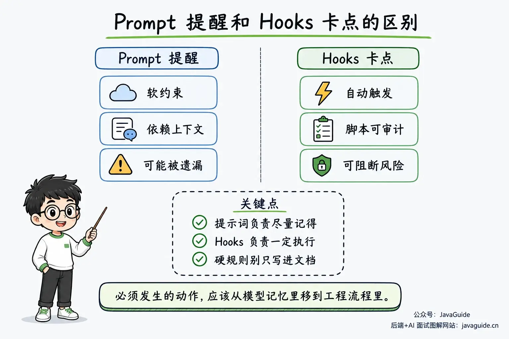

Think of Hooks as checkpoints in a Claude Code workflow. You can attach actions to session start, user prompt submission, before or after tool calls, and before or after context compaction.

## What Are Hooks?

Hook configuration consists mainly of an event and a handler. The event determines when a hook runs; the handler receives the event input and performs an action.

For example, attach a `command` handler to `PostToolUse`. After Claude successfully edits a file, Claude Code passes the tool-call JSON to a script, which can decide whether to run a formatter. Claude does not need to reread a prompt, and the script can be tested independently.

Handlers are not limited to shell commands. Officially supported types also include HTTP endpoints, MCP tools, and LLM prompts. See the "Hook handler fields" section in the official [Hooks reference](https://code.claude.com/docs/en/hooks).

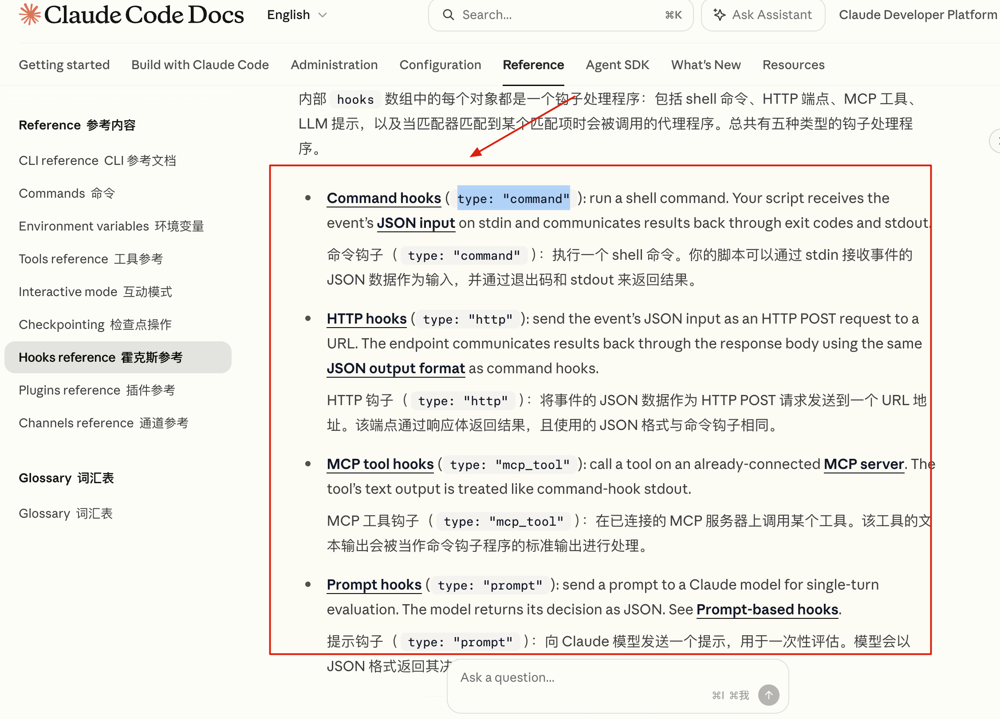

The diagram shows common trigger points:

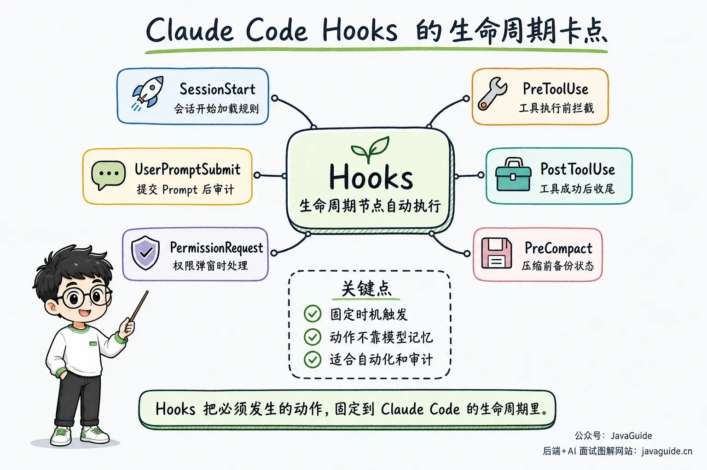

There are five main hook handler types:

| Type       | Action                                              | Suitable use                                                           |
| ---------- | --------------------------------------------------- | ---------------------------------------------------------------------- |
| `command`  | Runs a shell command                                | Formatting, logging, security checks, notifications                    |
| `http`     | Sends event JSON to a URL with POST                 | Team audit service, remote notifications, centralized policies         |
| `mcp_tool` | Calls a tool on a connected MCP server              | Reuse existing MCP capabilities                                        |
| `prompt`   | Uses a model to return a yes/no-style JSON decision | Lightweight checks, such as verifying task completion before Stop      |
| `agent`    | Starts a subagent with tool access for verification | Checks that require reading files, searching code, or running commands |

However, not every event supports all five handler types:

- Events such as `PreToolUse`, `PostToolUse`, `PermissionRequest`, and `Stop` support all five types.
- Events such as `Notification`, `PreCompact`, and `ConfigChange` do not support `prompt` or `agent`.
- `SessionStart` and `Setup` support only `command` and `mcp_tool`.

Before using a non-command handler, check which handler types the event supports.

You can ask your coding agent to check this against the official documentation by sharing this article or the documentation link.

Use `command` for rules that can be implemented deterministically in a script. Scripts can run outside Claude Code, and failures are easier to reproduce.

Consider `prompt` or `agent` only when verification requires reading code, running tests, and making a judgment. The official documentation still marks `agent` hooks as experimental, so account for the added debugging cost before adopting them.

The five handler types are summarized below:

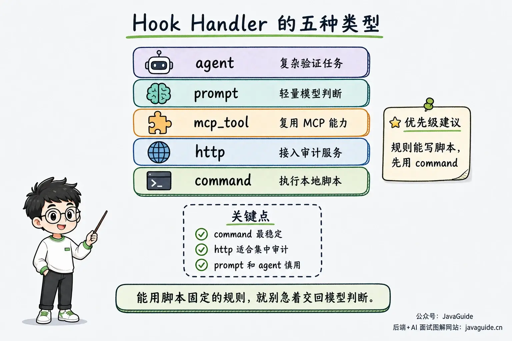

## What Problems Do Hooks Solve?

Suppose `CLAUDE.md` says, "Run Prettier after changing code." Claude will usually follow this instruction because it is in context, but may miss it when the task grows or new requirements appear. If your project rules need work, see [CLAUDE.md Best Practices](https://javaguide.cn/ai-coding/practices/claude-md-best-practices.html).

"Do not modify `.env`" has the same limitation. Natural language can express intent, but cannot enforce a path check before every file write. With the rule attached to `PreToolUse`, a script can inspect the target path and block sensitive files. Formatting can run at `PostToolUse` and process only the file that was just changed.

These mechanisms serve a role similar to pre-commit, CI, lint-staged, CODEOWNERS, and branch protection: they put fixed actions such as formatting, dangerous-command checks, and permission notifications into the workflow and leave auditable results. Hooks provide this layer in the Claude Code lifecycle.

## Minimal Hook Configuration

Hooks are configured in Claude Code settings files. The three common locations are:

| Location                      | Scope                             | Suitable for                                        |
| ----------------------------- | --------------------------------- | --------------------------------------------------- |
| `~/.claude/settings.json`     | All projects for the current user | Personal notifications and preferences              |
| `.claude/settings.json`       | Current project; can be committed | Shared team rules and project security restrictions |
| `.claude/settings.local.json` | Local to the current project      | Personal settings that should not be committed      |

Other supported locations include managed policies, plugin `hooks/hooks.json` files, and hooks in Skill or Agent frontmatter.

For everyday project work, start with these three locations.

A minimal configuration looks like this:

```json
{
  "hooks": {
    "PostToolUse": [
      {
        "matcher": "Edit|Write",
        "hooks": [
          {
            "type": "command",
            "command": "jq -r '.tool_input.file_path' | xargs npx prettier --write"
          }
        ]
      }
    ]
  }
}
```

This configuration has three parts:

- `PostToolUse` is the event name; it runs after a successful tool call.
- `matcher` is a filter. `Edit|Write` runs this hook only after Claude Code uses `Edit` or `Write` to change a file. Separate tool-name matchers with `|`. Starting with Claude Code v2.1.191, you can also use `,` with spaces around it. Exact matchers containing hyphens require v2.1.195 or later; on older versions, use `^...$` to match the full name.
- The `hooks` array contains the handler that runs. Here, a `command` reads the edited file path from the JSON on stdin and passes it to Prettier.

To keep the example short, the command is embedded in the JSON. In a real project, put longer commands or project scripts in a separate file and reference it with `${CLAUDE_PROJECT_DIR}`:

```json
{
  "type": "command",
  "command": "${CLAUDE_PROJECT_DIR}/.claude/hooks/format-after-edit.sh",
  "args": []
}
```

The official documentation recommends exec form when using placeholders for project or plugin paths. Each `args` element is passed to the script as a separate argument instead of being split by the shell, so spaces, parentheses, and special characters in paths are not split again.

Omitting `matcher`, setting it to an empty string, or using `.*` makes the hook group match every occurrence of that event. For formatting, this can start a formatter after every tool call. For permission events, it could send every permission prompt through the same automatic handler.

Match the actual inputs as closely as possible. Use `Edit|Write` for formatting files and `Bash` for shell-risk checks. Narrow matchers reduce unnecessary calls and make it easier to identify which rule produced a result in logs.

## How Hook Input and Output Work

When a hook runs, Claude Code passes the event context to the handler as JSON:

- For a `command` hook, the JSON is sent over stdin.
- For an `http` hook, the JSON is sent to the server as the POST body.

All events include common fields such as:

| Field             | Meaning                                               |
| ----------------- | ----------------------------------------------------- |
| `session_id`      | Current session ID                                    |
| `transcript_path` | Path to the session JSONL file                        |
| `cwd`             | Working directory when the hook ran                   |
| `permission_mode` | Current permission mode; present only for some events |
| `hook_event_name` | Name of the event that triggered the hook             |

Tool-related events also include `tool_name` and `tool_input`.

For example, when Claude Code is about to run `npm test`, `PreToolUse` may receive:

```json
{
  "session_id": "abc123",
  "cwd": "/Users/example/project",
  "hook_event_name": "PreToolUse",
  "tool_name": "Bash",
  "tool_input": {
    "command": "npm test"
  }
}
```

A common pattern in hook scripts is:

```bash
INPUT="$(cat)"
TOOL_NAME="$(echo "$INPUT" | jq -r '.tool_name // empty')"
COMMAND="$(echo "$INPUT" | jq -r '.tool_input.command // empty')"
```

Use `jq` to parse JSON instead of trying to extract fields with `grep`.

Do not assume hooks handle exit codes like ordinary scripts.

Claude Code checks stdout for every exit code. If the first non-whitespace character is `{`, it tries to parse the output as JSON. To return a structured decision, use `exit 0` and keep debug logs off stdout. Write errors and debug information to `stderr`. For most events, use `exit 2` to block; other non-zero exit codes often report a hook error while the workflow continues.

`exit 1` is an easy trap.

In ordinary shell scripts, `exit 1` usually means failure. In Claude Code Hooks, if stdout is empty, plain text, or invalid JSON, `exit 1` is a non-blocking error for most events and the workflow continues. If stdout contains JSON matching the event schema, events that use the standard decision model ignore the exit code and apply the fields in the JSON.

Now consider JSON output.

For more precise control, such as returning `allow`, `deny`, `ask`, or `defer` from `PreToolUse`, use `exit 0` and write only one JSON object to stdout.

For example, to deny a tool call:

```json
{
  "hookSpecificOutput": {
    "hookEventName": "PreToolUse",
    "permissionDecision": "deny",
    "permissionDecisionReason": "Database writes are not allowed"
  }
}
```

For `PermissionRequest`, the structure differs; the decision is in `decision.behavior`:

```json
{
  "hookSpecificOutput": {
    "hookEventName": "PermissionRequest",
    "decision": {
      "behavior": "allow"
    }
  }
}
```

Do not use stdout for logs.

If the hook returns JSON, stdout must contain only JSON. Write debug information to stderr or a log file. Otherwise, `JSON validation failed` can make it look as if the configuration is at fault.

If a script exits with `2`, Claude Code still reads valid JSON from stdout. For events that support blocking, the `exit 2` block cannot be overridden by JSON. Claude Code uses stderr as the block reason only when the JSON does not provide a valid reason. `PermissionRequest` is an exception: it cannot be blocked with `exit 2`; return approval or denial through the `decision` object.

If multiple hooks match the same event, Claude Code runs them all and then merges their results. One hook returning `deny` does not stop another from writing logs, sending an HTTP request, or changing a file. When `PreToolUse` decisions are merged, the stricter result wins.

Therefore, any hook that writes logs, sends requests, or changes files should check independently whether it should run. Do not assume another security hook will run first and block the risk.

Be cautious when modifying tool input. The official documentation warns that **if multiple hooks modify the same input, the last one to finish takes effect; hooks run in parallel, so which one finishes last is unpredictable.**

Also, a `command` hook runs a shell command with the current user's permissions. It can access, modify, or delete any files that user can access. Understand and test third-party scripts separately before adding them.

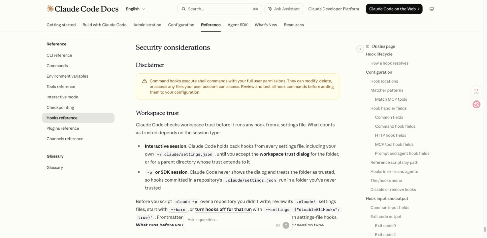

## Common Lifecycle Events

The official documentation lists many events covering sessions, tools, permissions, subagents, tasks, configuration changes, worktrees, and MCP elicitation.

There are many event names, but a few are most useful when getting started: session start, user prompt submission, before and after tool execution, permission decisions, response completion, and context compaction.

| Event               | Trigger                                                      | Suitable use                                                                    |
| ------------------- | ------------------------------------------------------------ | ------------------------------------------------------------------------------- |
| `SessionStart`      | When a session starts or resumes                             | Inject dynamic context, load the environment, or restore rules after compaction |
| `UserPromptSubmit`  | After a user submits a prompt and before Claude processes it | Audit prompts, apply lightweight checks, or add dynamic context                 |
| `PreToolUse`        | Before a tool call runs                                      | Block dangerous commands, protect sensitive files, or modify tool input         |
| `PermissionRequest` | When a tool call needs a permission decision                 | Audit permissions or apply narrowly scoped automatic approval                   |
| `PostToolUse`       | After a tool call succeeds                                   | Format files, log activity, run lint, or add context                            |
| `Notification`      | When Claude Code sends a notification                        | Desktop notifications or mobile push alerts                                     |
| `Stop`              | When Claude finishes a response turn                         | Completion notifications, quality gates, or reminders to continue               |
| `PreCompact`        | Before context compaction                                    | Back up state or block unsuitable compaction                                    |
| `PostCompact`       | After context compaction                                     | Record the summary or sync external state                                       |

There are also advanced events. Be aware of them and check the official reference or ask an AI assistant when you need one.

| Category                  | Events                                                                                                     |
| ------------------------- | ---------------------------------------------------------------------------------------------------------- |
| Session and configuration | `Setup`, `InstructionsLoaded`, `ConfigChange`, `CwdChanged`, `DirectoryAdded`, `FileChanged`, `SessionEnd` |
| Prompts and display       | `UserPromptExpansion`, `MessageDisplay`, `TeammateIdle`                                                    |
| Tools and permissions     | `PermissionDenied`, `PostToolUseFailure`, `PostToolBatch`                                                  |
| Subagents and tasks       | `SubagentStart`, `SubagentStop`, `TaskCreated`, `TaskCompleted`                                            |
| Worktrees and MCP forms   | `WorktreeCreate`, `WorktreeRemove`, `Elicitation`, `ElicitationResult`                                     |
| Stop follow-up            | `StopFailure`                                                                                              |

Several easily confused events should be distinguished by when they run.

`PreToolUse` runs before a tool executes. Put Bash command checks, `.env` protection, and restrictions on production configuration writes here so a script can deny the call before side effects occur.

`PostToolUse` runs after a tool succeeds, so it is suitable for cleanup, not as the first security gate. Formatting can go here, but sensitive-file protection cannot rely on it because the file has already changed. It can still provide feedback to Claude through JSON or replace tool output, but it cannot undo the tool call.

`PermissionRequest` runs when a tool call needs a permission decision and Claude Code is about to request one. It can approve or deny the request. Interactive sessions usually show a permission prompt; background non-interactive subagents still run this hook even though they cannot display a prompt. If no hook returns a decision, the tool call is denied. In `-p` non-interactive mode, only the Agent SDK's `canUseTool` callback provides this permission-request flow; for ordinary `claude -p`, use `PreToolUse` for automatic permission decisions. Put required risk checks in `PreToolUse`. Narrow both the matcher and input conditions for automatic approval to avoid allowing everything.

`Stop` does not mean "the task is complete"; it runs when Claude is about to finish a response turn. If you use a Stop hook as a quality gate, prevent loops. The `stop_hook_active` field indicates whether a Stop hook has already continued the response. After eight consecutive blocks, Claude Code ignores the hook's block and ends the turn.

`PreCompact` can block compaction; `PostCompact` cannot change a compaction that has already finished. To restore rules after compaction, a more common approach is to use `SessionStart` with the `compact` matcher. Context compaction and rule restoration are part of Context Engineering; see the [Context Engineering in Practice](https://javaguide.cn/ai/agent/context-engineering.html) guide for more.

## Three Minimal Examples

To get started, try three examples: one for notifications, one for post-edit cleanup, and one to block a tool call before it runs.

Together, they cover low-risk setup, useful automation, and basic safety.

### Notification: Alert When Claude Needs You

This is a good first hook because it does not modify code and has minimal risk.

On macOS, add it to `~/.claude/settings.json`:

```json
{
  "hooks": {
    "Notification": [
      {
        "matcher": "permission_prompt",
        "hooks": [
          {
            "type": "command",
            "command": "osascript -e 'display notification \"Claude Code needs your attention\" with title \"Claude Code\"'"
          }
        ]
      }
    ]
  }
}
```

The `permission_prompt` matcher sends a notification only when Claude needs approval for a tool call. This notification usually fires after the permission request has been pending for about six seconds; it does not fire as soon as the confirmation flow starts. To handle all notifications, omit the matcher or set it to an empty string. Other official Notification matchers include `idle_prompt`, `auth_success`, and `elicitation_dialog`.

If macOS does not show a notification, run this command in the terminal first:

```bash
osascript -e 'display notification "test"'
```

Then enable notifications for Script Editor in system settings. This is a common issue: the hook may have run, but the operating system may have suppressed the notification.

### PostToolUse: Format Files After Editing

In a frontend project, a common use is to run Prettier after `Edit` or `Write` changes a file:

```json
{
  "hooks": {
    "PostToolUse": [
      {
        "matcher": "Edit|Write",
        "hooks": [
          {
            "type": "command",
            "command": "jq -r '.tool_input.file_path' | xargs npx prettier --write"
          }
        ]
      }
    ]
  }
}
```

This configuration has three key details.

The `matcher` accepts only `Edit|Write`, so reading a file, running Bash, or calling an MCP tool will not trigger formatting.

The `command` reads `.tool_input.file_path` from the JSON on stdin and passes it to `npx prettier --write`.

This hook runs at `PostToolUse`, so it performs cleanup after the tool call. If the formatter fails, you can expose the error or use a script to select a formatter based on the file extension.

For example, a more robust script could be:

```bash
#!/usr/bin/env bash
set -euo pipefail

file="$(jq -r '.tool_input.file_path // empty')"

case "$file" in
  *.js|*.jsx|*.ts|*.tsx|*.json|*.md)
    npx prettier --write "$file"
    ;;
esac
```

Hooks are not magic. For a Java project, use `spotlessApply`, `google-java-format`, or an existing project formatter. For Python, that might be `ruff format`. Use the tools already in the project instead of introducing a new formatting setup just for a hook.

### PreToolUse: Block Dangerous Commands and Sensitive Files

`PreToolUse` provides `tool_name` and `tool_input` before a tool runs. A script can inspect the command and file path, then deny the call if it finds a risk.

First, create a script such as `.claude/hooks/guard.sh`:

```bash
#!/usr/bin/env bash
set -euo pipefail

input="$(cat)"
tool="$(jq -r '.tool_name // empty' <<<"$input")"
command="$(jq -r '.tool_input.command // empty' <<<"$input")"
file="$(jq -r '.tool_input.file_path // empty' <<<"$input")"

if [[ "$tool" == "Bash" ]] && [[ "$command" =~ rm[[:space:]]+-rf|chmod[[:space:]]+-R[[:space:]]+777 ]]; then
  echo "Blocked risky shell command: $command" >&2
  exit 2
fi

if [[ "$tool" == "Edit" || "$tool" == "Write" ]]; then
  case "$file" in
    *.env|*.env.*|*/.env|*/.git/*|*id_rsa*|*id_ed25519*)
      echo "Blocked sensitive file edit: $file" >&2
      exit 2
      ;;
  esac
fi

exit 0
```

Make it executable:

```bash
chmod +x .claude/hooks/guard.sh
```

Then add it to the project-level `.claude/settings.json`:

```json
{
  "hooks": {
    "PreToolUse": [
      {
        "matcher": "Bash|Edit|Write",
        "hooks": [
          {
            "type": "command",
            "command": "\"$CLAUDE_PROJECT_DIR\"/.claude/hooks/guard.sh"
          }
        ]
      }
    ]
  }
}
```

This script runs before the tool and communicates its decision through the exit code. When it detects a risk, it writes the reason to stderr and exits with `2`. Claude Code blocks the tool call and passes the reason back to Claude.

Adjust the sensitive-file list for your project. You can add production configuration, credential files, migration scripts, lockfiles, and CI configuration as needed.

Do not rely on a command blacklist alone. Blocking only `rm *`, for example, does not block variants such as `/bin/rm` or `find -delete`. Use path restrictions, permission settings, hooks, a sandbox, CI, and human review together for high-risk operations.

## Choosing a Non-Command Hook

Use `command` for deterministic tasks that can run locally, such as the formatting, notification, and command-blocking examples above. Scripts are easy to debug independently and review as code.

Use `http` when a team needs centralized audit records or remote policy enforcement. The server's JSON body is processed like JSON output from a command hook. The HTTP status code does not block a tool call; the server must return 2xx and include decision fields that match the schema in the response body.

Use `mcp_tool` to call an MCP server that is already connected. It does not trigger OAuth or establish a connection for you. Early events such as `SessionStart` and `Setup` may run before an MCP server is ready, in which case the call fails.

Use `prompt` for a model-based decision from hook input, such as checking whether a task is complete before Stop. Use `agent` when verification also requires reading files, searching code, or running commands, but note that it is still experimental.

Choose based on where the decision comes from. Use `command` when it can be determined from input fields and script logic; use `http` when a team service must process the result; use `mcp_tool` when an MCP tool is already available. Introduce `prompt` or `agent` only when semantic judgment cannot be expressed as a deterministic rule.

## Hooks vs. Skills

These two concepts are easy to confuse.

Skills extend a coding agent's capabilities through `SKILL.md`. During a task, the coding agent decides whether to use a relevant Skill; you can also invoke it explicitly with `/skill-name`.

The Skill body loads into context only when used (progressive disclosure), making Skills suitable for long workflows, checklists, project knowledge, scripts, and reference materials.

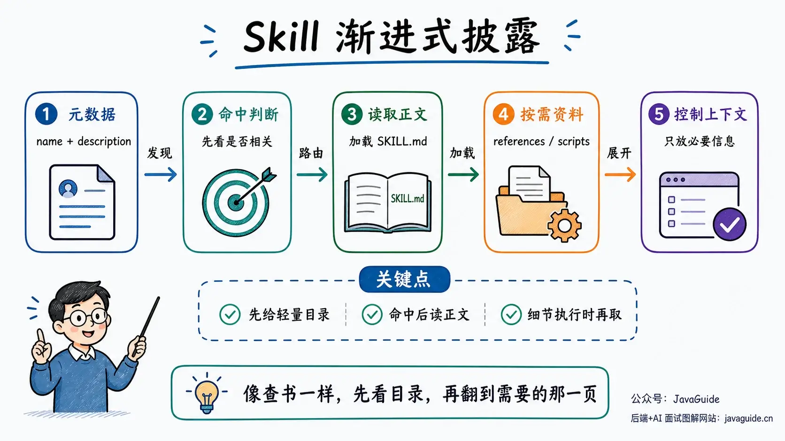

For a detailed comparison of Skills, prompts, MCP, and Function Calling, see [What Are Agent Skills, and How Do They Differ from Prompts and MCP?](https://javaguide.cn/ai/agent/skills.html).

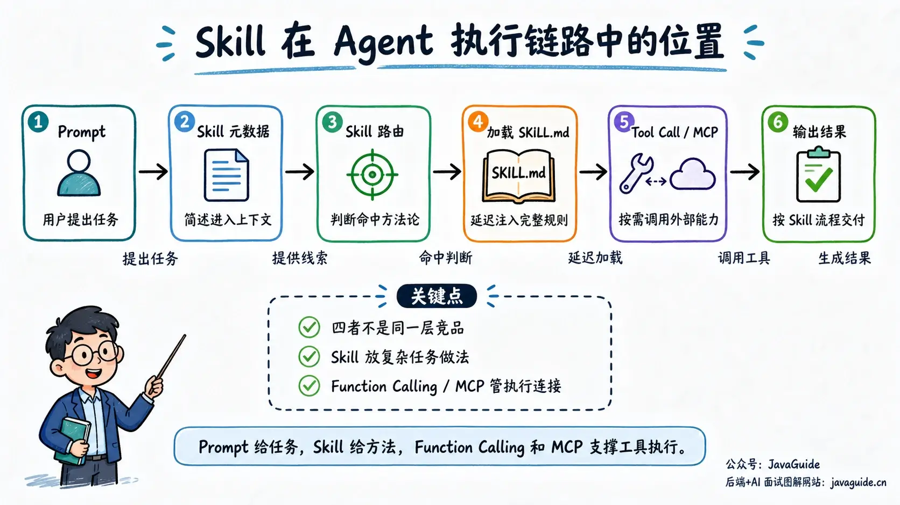

Hooks run actions automatically at lifecycle events. Skills provide Claude with instructions, scripts, and references for completing a type of task. The table compares them:

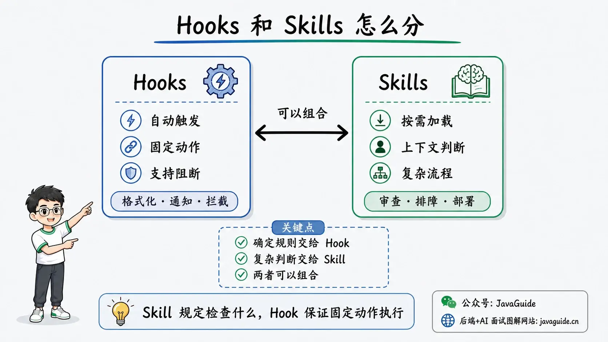

| Dimension                  | Hooks                                                                                            | Skills                                                                 |
| -------------------------- | ------------------------------------------------------------------------------------------------ | ---------------------------------------------------------------------- |
| Trigger                    | Runs automatically on Claude Code lifecycle events                                               | Loaded when Claude deems it relevant, or invoked with `/skill-name`    |
| Core value                 | Reliably runs fixed actions                                                                      | Gives Claude capabilities or workflow knowledge                        |
| Suitable use               | Formatting, dangerous-command blocking, permission audits, notifications, logging, quality gates | Code review, deployment SOPs, troubleshooting, research, complex tasks |
| Reliance on model judgment | Low, especially for `command` hooks                                                              | Higher; Claude must understand and follow the Skill instructions       |
| Suitable for blocking      | Yes, especially with events such as `PreToolUse`, `UserPromptSubmit`, and `Stop`                 | Not as a hard blocking mechanism                                       |
| Common risks               | Overly broad matchers, slow scripts, excessive auto-approval                                     | Unclear descriptions, unreliable activation, overly long workflows     |

Consider a real task. After `Edit` or `Write` changes a file, a hook can pass its path to Prettier. Before a tool writes to `.env`, another hook can inspect the path and deny the call. The event input provides this information, so the script does not have to guess.

Code reviews and API-timeout investigations are less predictable. Claude must first read the code, logs, and task requirements, then decide which files to inspect and commands to run. A Skill is a better fit for this workflow.

They can also work together: **a Skill defines what to check during code review, while Hooks run a formatter after file changes, block dangerous commands before execution, and check for test results before a response ends.**

## Rollout: Start with Three Hooks

The first version does not need to cover every lifecycle event. Add `Notification`, `PostToolUse`, and `PreToolUse` in that order.

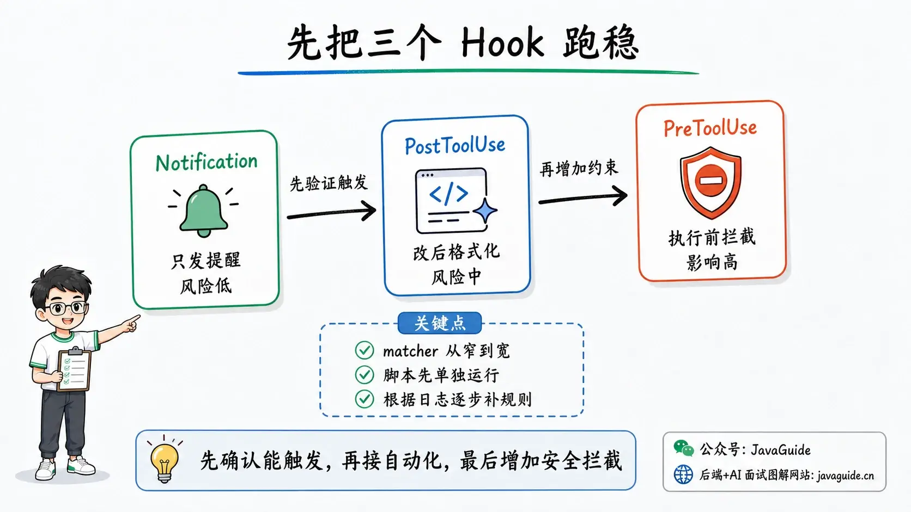

The more hooks you configure, the harder it is to locate a problem. If Claude suddenly stops responding, check whether `PreToolUse` returned `deny`, whether `PermissionRequest` returned a permission decision, whether `Stop` is firing repeatedly, or whether a `PostToolUse` script timed out. These problems can look similar but require different troubleshooting steps.

Start with `Notification`. The earlier example sends a notification only while waiting for permission and does not change project files. Receiving one confirms that the configuration loaded and that the event and matcher worked. Even if configured incorrectly, the impact is usually small.

Once notifications work, connect `PostToolUse` to the project's existing formatter. Use Prettier for frontend projects, Ruff for Python, and the existing formatting command for Java. Let the matcher restrict tool names and the script filter by file type; do not run a formatter after an unrelated Bash command or file read.

Test `PreToolUse` last because it can directly block tool calls. Start by blocking a few clearly high-risk actions, such as deletion commands, recursive permission changes, and access to `.env`, `.git/`, private keys, and production configuration. Review the logs, then adjust the rules based on false positives.

Command blacklists recognize only the command forms they contain; another form may bypass them. Keep path restrictions, permission settings, the sandbox, and human review in place. Adding `PreToolUse` is not a reason to remove them.

Once these three hooks work reliably, add events to address issues that actually occur in the project. If rules are often lost after compaction, use the `compact` matcher for `SessionStart` to inject them again, and use `PreCompact` to save the current state if needed. Add `ConfigChange` to track configuration changes. If changes to the working directory or files affect the environment, consider using `CwdChanged` or `FileChanged` with `CLAUDE_ENV_FILE`.

If you use `Stop` to check for completion, define an exit condition in the script. Otherwise, after a hook tells Claude to continue, the same rule may fire again at the end of the next turn, creating a loop. Claude Code force-ends the turn after eight consecutive blocks, but the repeated work still wastes time and tokens.

`PermissionRequest` is also easy to misuse. It runs when a tool call enters the permission-decision flow; that does not mean a prompt has appeared. A background, non-interactive subagent that cannot display a prompt may still run this hook.

Ordinary `claude -p` does not use this permission-request flow. Put rules in `PreToolUse` when you need automatic permission decisions. The official example automatically approves only `ExitPlanMode`. If you adapt it, keep the matcher and event input checks; do not replace them with a broad allow rule that takes over every permission request. Keep human approval for deleting files, changing production systems, reading credentials, or writing data through external APIs.

## Troubleshooting Hooks

You may have added the configuration but Claude Code does nothing, or the hook runs but a dangerous command still executes. Details such as event fields, supported handlers, and whether `stdout` enters context can change by version. When needed, ask an AI assistant to check the current official documentation.

When troubleshooting, I recommend this order:

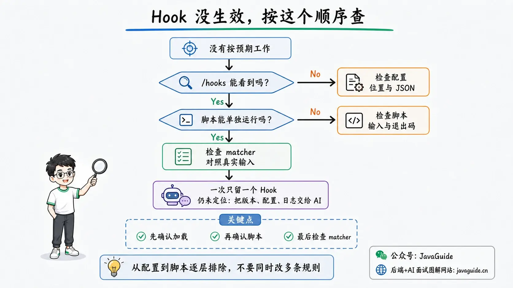

1. Run `/hooks` to confirm that the configuration loaded and is attached to the expected event. If it is not listed, check the settings file location and JSON syntax before investigating the script.

   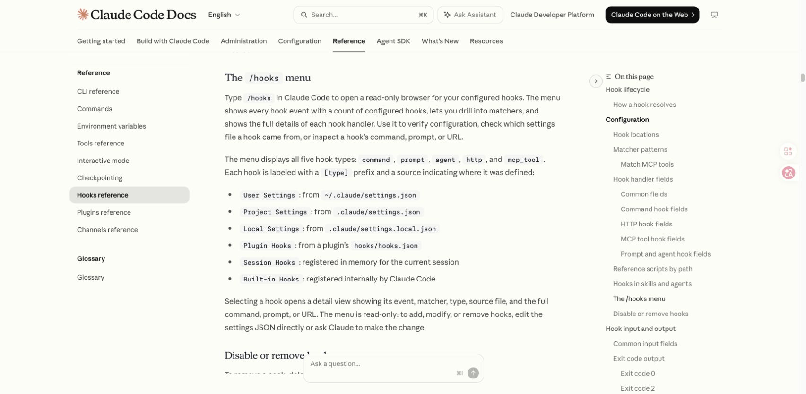

2. Run the script outside Claude Code. Hook scripts read JSON from `stdin`; confirm that the script can read the fields and return the expected exit code before reconnecting it to the configuration.

   ```bash
   printf '%s\n' '{"tool_name":"Bash","tool_input":{"command":"rm -rf /tmp/demo"}}' \
     | .claude/hooks/guard.sh

   echo $?
   # Expected output: 2
   ```

3. Once the standalone script works, log the event data that Claude Code actually passes in. Write debug information to `stderr` or a temporary log, not to `stdout` if it is expected to return JSON.

   ```bash
   input="$(cat)"
   printf '%s\n' "$input" >> /tmp/claude-hook-debug.log
   ```

   Logs may contain file paths, commands, or prompt contents. Delete them after troubleshooting and do not commit them to the repository.

4. Enable one hook at a time. Multiple matching hooks run in parallel, so the final behavior alone may not reveal which one caused the problem. Once a script works, restore the other rules one by one.

If you see a specific symptom, start with the corresponding check:

| Symptom                                             | Check first                                                                   |
| --------------------------------------------------- | ----------------------------------------------------------------------------- |
| Configuration is missing from `/hooks`              | Settings file location and JSON syntax                                        |
| Hook is registered but never runs                   | Correct event and whether the matcher matches the actual input                |
| Script reports an error but the tool call continues | Accidental use of `exit 1`; whether security checks run at `PreToolUse`       |
| Claude keeps continuing and will not stop           | Whether the `Stop` hook lacks an exit condition                               |
| Formatter runs after every action                   | Whether the matcher is missing or too broad                                   |
| Notification command runs but no alert appears      | Run the notification command manually, then check OS notification permissions |
| Interactive mode works but `claude -p` does not     | Do not rely on `PermissionRequest`; use `PreToolUse` for automatic decisions  |

If the cause is still unclear, give an AI assistant the output of `claude --version`, the hook configuration and script, and the observed behavior. Ask it to check these against the current official documentation. Remove secrets, tokens, and sensitive business information before sharing. The prompt can be simple:

```text
I configured the following hook in Claude Code <version>.

Expected behavior: <what it should do>
Actual behavior: <what happens instead>

Hook configuration:
<paste configuration>

Script:
<paste script>

Check the official documentation for my Claude Code version first. Then review the event, matcher, input fields, exit code, and JSON output format.
Point out only issues that could cause this problem. Do not suggest unrelated configuration changes.
```

## Summary

The key idea is that Hooks run fixed actions automatically at important points in Claude Code, such as formatting, dangerous-command checks, and permission notifications.

Put automatic formatting in `PostToolUse`, dangerous-command and sensitive-file checks in `PreToolUse`, and use `Notification` to receive alerts when you are away from the computer.

In my experience, do not configure too many hooks at the start. It adds little value and makes the setup harder to manage.

Get these three hooks working reliably first. For security and permission rules, start with a narrow scope and expand gradually; do not automatically approve every action. Hooks can enforce fixed workflows, but keep the sandbox, permission settings, CI, and human review in place.

One final distinction: put deterministic rules in Hooks. Keep context-dependent tasks such as code review and troubleshooting in Skills. This division keeps the configuration simpler and makes later debugging easier.
