You start a new Claude Code session, and it already knows how to run the project's tests, what its coding style is, which directories not to touch, and even remembers your correction: “Integration tests must use a real MySQL database, not H2.”

Did the model remember the entire previous conversation?

Probably not. An LLM still sees only the input provided for the current inference. Claude Code carries information across sessions through external files and loading logic: some rules are always included, some experience is listed in an index, and other details are loaded only when relevant to a task.

This article complements [AI Agent Memory Systems](https://javaguide.cn/ai/agent/agent-memory.html), which covers short-term memory, long-term memory, and memory evolution in general-purpose agents. For Claude Code, the questions are more specific: What belongs in `CLAUDE.md`? What does Auto Memory store? How should `.claude/rules/` work alongside third-party tools such as `claude-mem` and `memsearch`?

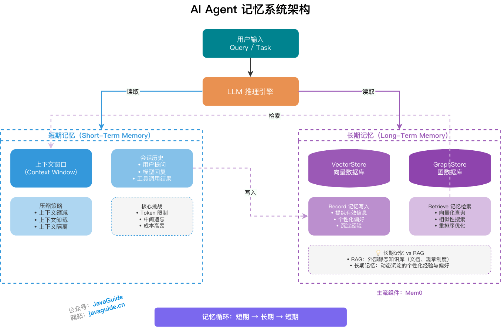

## LLMs Do Not Preserve State Across Sessions

Let's be clear: the model itself does not secretly preserve state between requests.

For each call, the client combines the system prompt, conversation history, tool results, and the user's new question. The model generates its next response from that input. If it remembers something in the next turn, the application has supplied the relevant context again.

Ordinary chat can hide this detail. If you talk for dozens of turns, the client includes the earlier messages and the model can continue naturally. Agent workflows are more difficult: reading files, running commands, calling tools, and collecting logs all consume context. After a few rounds, the context window can fill with temporary material, burying long-term rules.

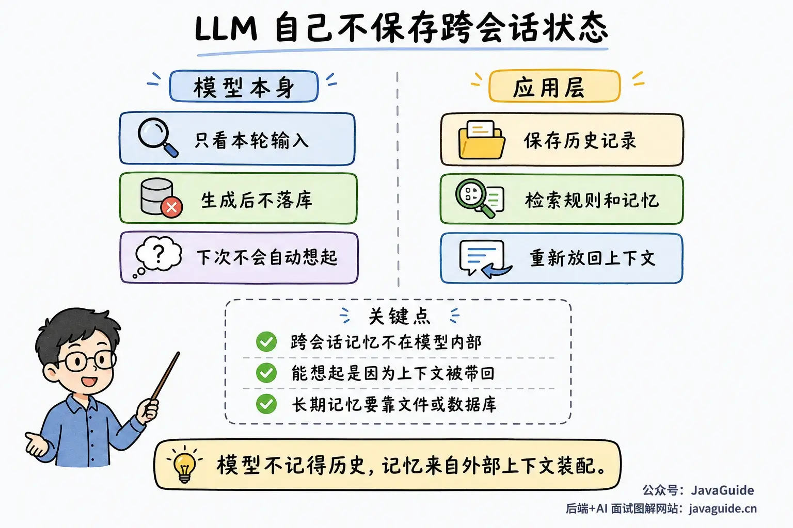

As an engineering analogy, Context Engineering is a kind of “memory management” for LLMs. The context window is limited, so the real question is which information stays loaded, which is retrieved on demand, and which is discarded when stale. Summarization, compression, retrieval, and prioritization all address the same problem: **do not let low-value content displace the context the current task needs.**

I cover how to organize, retrieve, and compress context in [What Is Context Engineering, and How Does It Differ from Prompt Engineering?](https://javaguide.cn/ai/agent/context-engineering.html), so I will not repeat that discussion here.

For Claude Code, a long-term memory system should answer these questions:

1. Which information is worth keeping long term?
2. Where should it be stored, and who can access it?
3. How much should be loaded at startup, and how should more be retrieved during a task?
4. How do we detect and clean up memories that are stale, conflicting, or disproved by the codebase?

Many problems come down to the first question: **what is worth writing down?**

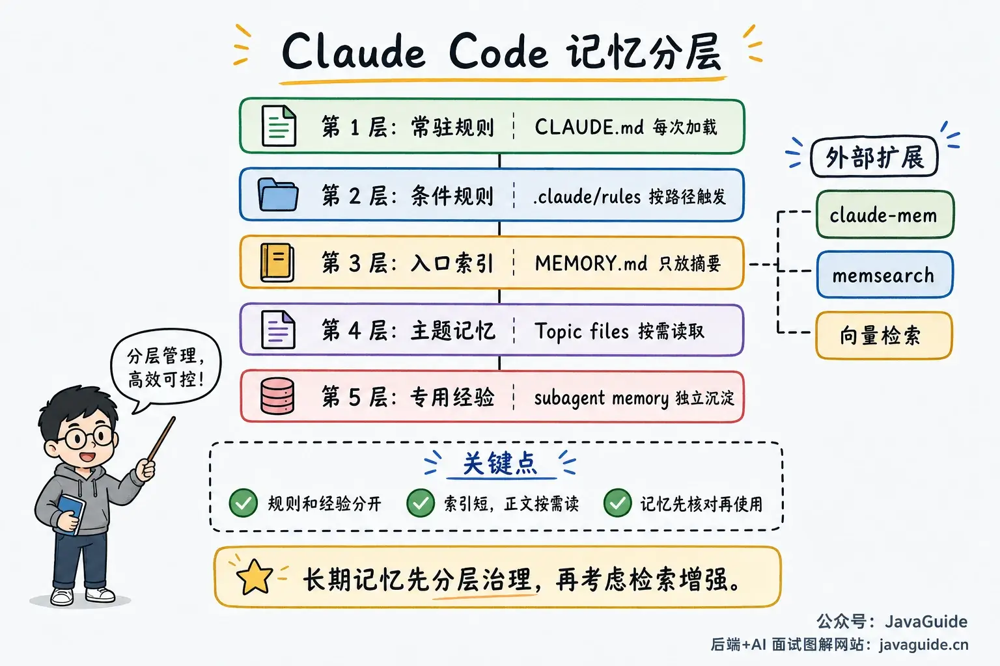

## Keep Rules and Experience Separate

Claude Code's long-term context can be divided into two categories: **rules written by people for Claude, and experience Claude accumulates while working.**

`CLAUDE.md` is the first category. It is a set of instructions for each session: coding conventions, common commands, directory constraints, team processes, and areas to avoid. The official documentation classifies it as instructions and rules.

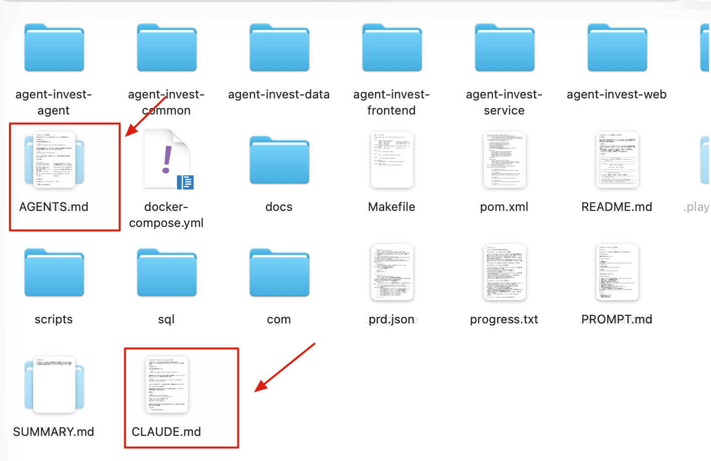

Auto Memory is the second category. It records patterns Claude encounters in a project, such as build commands, debugging experience, user preferences, and recurring pitfalls. The official documentation classifies it as learnings and patterns.

Both are included in sessions, but they serve different purposes:

| Mechanism   | Written by | Best for                                                       | Default loading behavior                                          |
| ----------- | ---------- | -------------------------------------------------------------- | ----------------------------------------------------------------- |
| `CLAUDE.md` | People     | Stable rules, project conventions, and collaboration processes | Loaded in every session                                           |
| Auto Memory | Claude     | Experience, preferences, and patterns discovered while working | Loads the first 200 lines or 25 KB of `MEMORY.md` in each session |

Keep these categories distinct. People should maintain rules because they represent team agreements. Claude can record experience, but verify it against the current code before relying on it.

### `CLAUDE.md`: Rules to Load Every Session

I covered how to write `CLAUDE.md` in [CLAUDE.md Best Practices: What to Include, What to Leave Out, and How to Split It as a Project Grows](https://javaguide.cn/ai-coding/practices/claude-md-best-practices.html). Here, I focus on its role in the memory system rather than repeating templates and examples.

The official documentation describes these locations in different sections. It is easier to think of them as five levels:

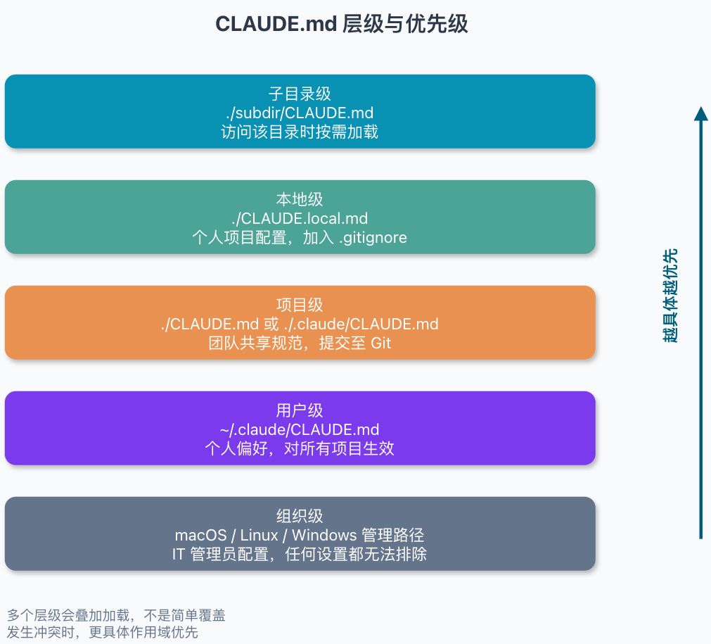

| Level        | Path                                                                                                                                                  | Suitable content                                                                          |
| ------------ | ----------------------------------------------------------------------------------------------------------------------------------------------------- | ----------------------------------------------------------------------------------------- |
| Organization | macOS: `/Library/Application Support/ClaudeCode/CLAUDE.md`; Linux/WSL: `/etc/claude-code/CLAUDE.md`; Windows: `C:\Program Files\ClaudeCode\CLAUDE.md` | Coding standards, security policies, and compliance requirements managed by IT/DevOps     |
| User         | `~/.claude/CLAUDE.md`                                                                                                                                 | Personal preferences and tool habits shared across projects                               |
| Project      | `./CLAUDE.md` or `./.claude/CLAUDE.md`                                                                                                                | Project architecture, commands, and coding standards shared by the team                   |
| Local        | `./CLAUDE.local.md`                                                                                                                                   | Personal settings for the current project, such as sandbox URLs and test data preferences |
| Subdirectory | `./subdir/CLAUDE.md` and a `CLAUDE.local.md` in the same directory                                                                                    | Rules for a module or subdirectory, loaded when Claude reads files there                  |

These files do not simply override one another. Claude adds the `CLAUDE.md` and `CLAUDE.local.md` files visible from the startup path to the context. Broader-scope files load first, and files closer to the current directory load later. Subdirectory files are not loaded at startup; Claude adds them when it reads a file in that directory. Organization-level managed policies cannot be excluded by personal settings.

Keep each `CLAUDE.md` under 200 lines where possible. The longer it gets, the more likely the model is to miss some instructions.

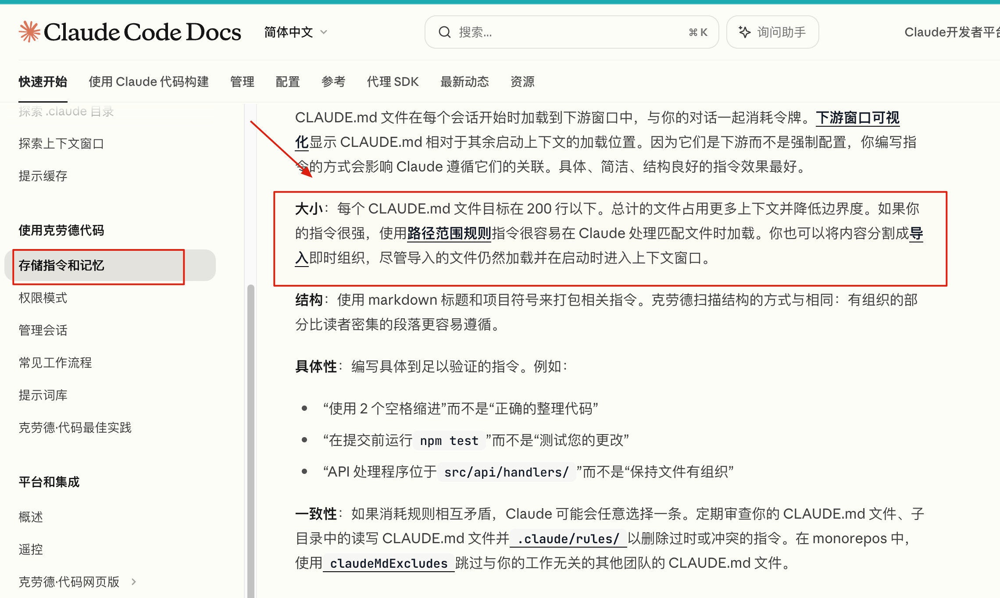

This is the context rot problem: **as context grows longer and more cluttered, the model is more likely to use it inconsistently.**

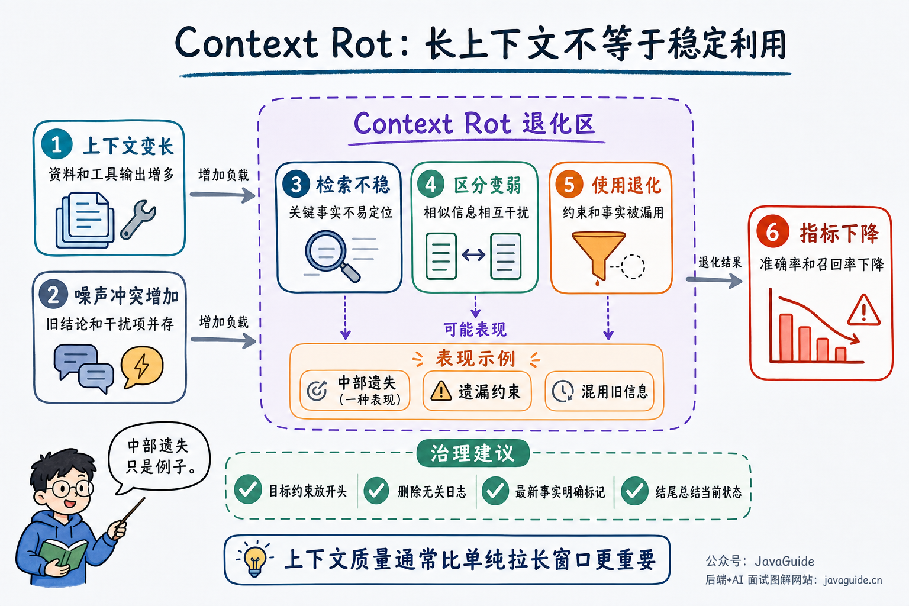

`CLAUDE.md` is easy to misuse, especially in these cases.

1. `CLAUDE.md` is not an enforcement mechanism.

`CLAUDE.md` is injected as a user message after the system prompt. It is useful, but vague or outdated instructions, or conflicts between files, can still lead the model to make the wrong choice.

1. Block-level HTML comments are stripped only before context injection.

You can add maintainer notes to `CLAUDE.md`:

```markdown
<!-- This note is for maintainers and is stripped before context injection. -->
```

However, the comment remains visible if Claude opens the file directly with a file-reading tool.

1. `@path/to/file` includes external files but does not save tokens.

Referenced files are expanded into the context at startup, up to four levels deep. The first reference to an external file may also require approval. Do not expect splitting large rules across files with `@` references to save context.

For rules that should load on demand, use `.claude/rules/`.

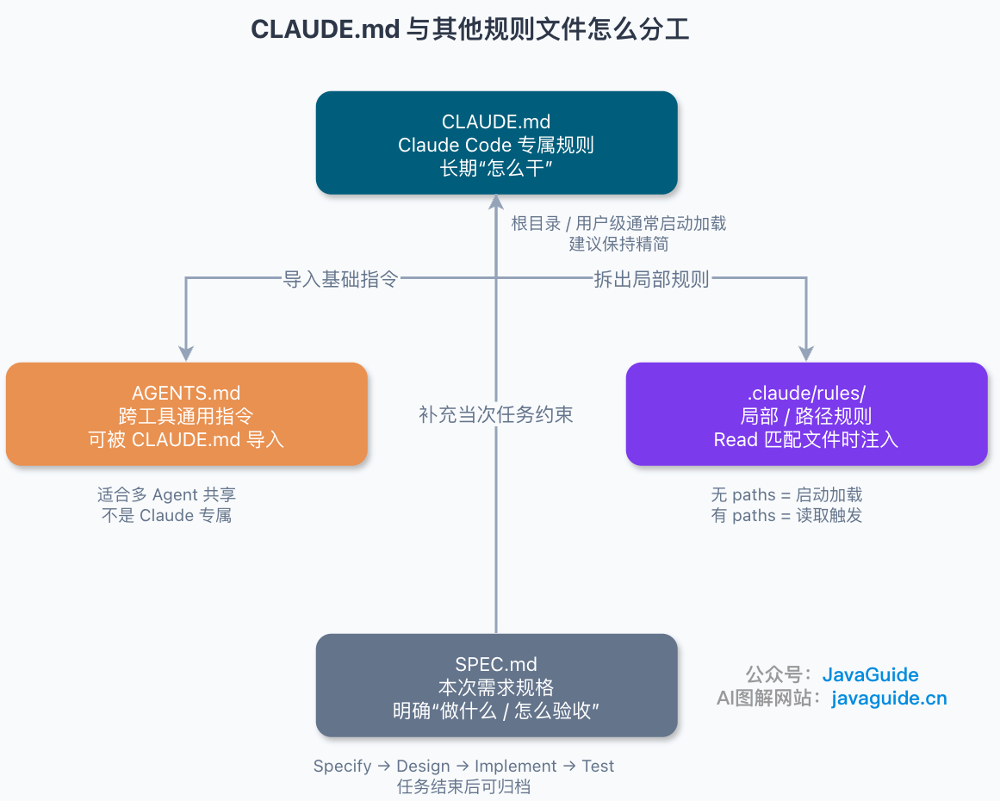

### `.claude/rules/`: Rules Triggered by Files

Suppose you have frontend rules that are needed only when working on `src/**/*.tsx`. Loading them during every backend task wastes context.

`.claude/rules/` is suited to these conditional rules. Each rule is a Markdown file, and its frontmatter can specify `paths`:

```markdown
---
paths:
  - "src/**/*.{ts,tsx}"
  - "tests/**/*.test.ts"
---

# TypeScript Rules

- Validate API inputs.
- Prefer existing fixtures in test files.
```

Rules with `paths` are not all loaded at startup. Claude applies a rule when it reads a file matching its glob. This keeps long-lived instructions that apply only to certain tasks out of the always-loaded `CLAUDE.md`.

In a project, I separate them by purpose:

- Put rules needed in every session in `CLAUDE.md`.
- Put rules that apply only to certain files or directories in `.claude/rules/`.
- Package reusable, multi-step procedures as skills and invoke them when needed.
- Enforce prohibited actions with hooks or permission settings; do not rely on Markdown alone.

Instructions such as “Never run `rm -rf`” or “Run this script before committing” are only reminders in `CLAUDE.md`. To actually block tool calls, use a hook, permissions, or external CI.

### Auto Memory: Experience Claude Records While Working

Auto Memory is Claude Code's built-in memory mechanism. “Automatic” means Claude can write notes while working, such as build commands, debugging experience, architecture details, coding preferences, and work habits.

It does not write notes in every session. Claude decides which information may be useful later. Use `/memory` to open the relevant folder.

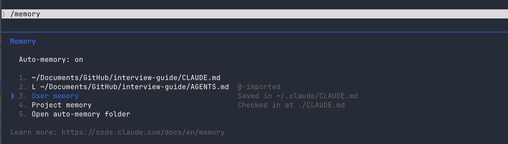

According to the official documentation, Auto Memory is available starting with Claude Code v2.1.59 and is enabled by default. It stores project memories in `~/.claude/projects/<project>/memory/` and reads the first 200 lines or 25 KB of `MEMORY.md` at startup. More detailed content lives in topic files and is opened as needed. Use `/memory` to view and edit these files.

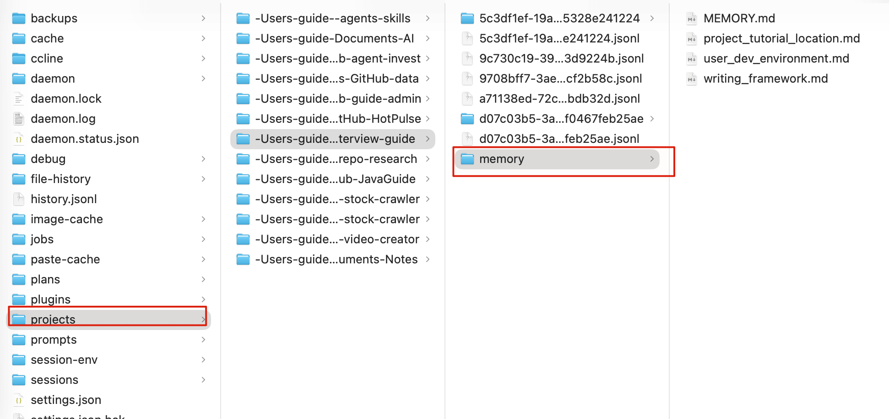

You can also disable it directly:

```json
{
  "autoMemoryEnabled": false
}
```

Or use an environment variable:

```bash
CLAUDE_CODE_DISABLE_AUTO_MEMORY=1
```

The default storage directory is:

```text
~/.claude/projects/<project>/memory/
```

The official documentation gives this example structure:

```text
~/.claude/projects/<project>/memory/
├── MEMORY.md
├── debugging.md
├── api-conventions.md
└── ...
```

`MEMORY.md` serves as an index. At startup, Auto Memory loads up to 200 lines or 25 KB, whichever limit is reached first. Detailed notes go in topic files, which Claude reads when needed.

This resembles the progressive disclosure approach used by Skills: let the model know what is available without loading everything into the context at once.

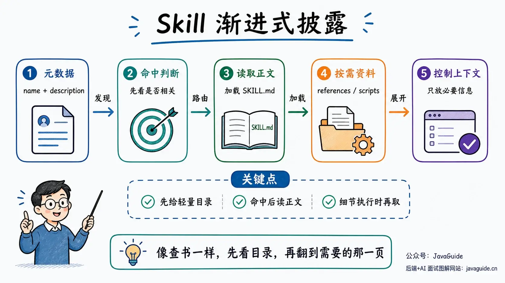

The official documentation does not require a particular schema for topic files or specify that memory types must be `user`, `feedback`, `project`, or `reference`.

The following four categories are based on analysis of previously leaked source code:

| Type        | Suitable for                                                          | Not suitable for                                              |
| ----------- | --------------------------------------------------------------------- | ------------------------------------------------------------- |
| `user`      | Long-term user preferences, technical background, communication style | One-off ideas the user just mentioned                         |
| `feedback`  | Practices the user explicitly corrected                               | Preferences guessed by the Agent                              |
| `project`   | Project phase, decision rationale, temporary freezes                  | Changing facts such as current code structure or line numbers |
| `reference` | Where to find information and which document is authoritative         | Large copied sections of documentation                        |

Auto Memory writes notes automatically, but that does not mean they should go unreviewed. Whether you ask Claude to remember something, review its notes later with `/memory`, or build a similar system yourself, use clear criteria. I would rather keep a few useful memories than accumulate noise.

Focus on three questions:

1. Will this be useful for a future decision?
2. Did the user explicitly confirm it?
3. Will someone notice when it becomes stale?

If you cannot answer these questions, leave it in the current session instead of saving it as long-term memory.

When saving a memory, do not put only a conclusion in the topic file. Include the fact, why the decision was made, when it was recorded or expires, and whether it must be verified before use. This gives the Agent a bounded record instead of an unconditional rule.

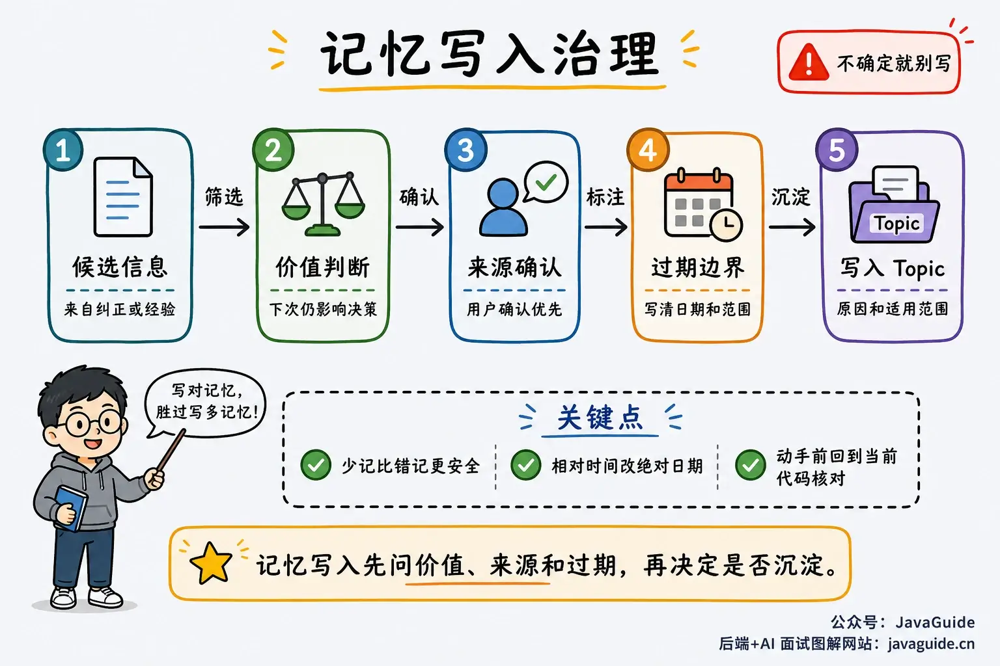

For example:

```markdown
---
type: feedback
created_at: 2026-06-17
updated_at: 2026-06-17
---

# Integration Tests Use a Real MySQL Database

Integration tests that verify database behavior must connect to a real MySQL database; do not substitute an in-memory H2 database.

Reason: A test once passed with H2, but differences in transaction behavior and SQL dialect became production issues with MySQL.

Scope: Parameter validation and tests of pure branching logic can still use lighter alternatives. Tests involving transactions, indexes, SQL dialects, or concurrency must use MySQL.
```

“Do not use H2 for integration tests” might work, but the Agent could apply it mechanically. Adding the rationale and scope helps it make the right choice for cases such as parameter validation and pure branching logic.

## What Not to Store in Long-Term Memory

The previous section covered what is worth remembering. Other information should stay in the current session.

I generally do not recommend saving these items in Auto Memory:

- The current number of lines in a file or the current location of a function.
- Command output, temporary logs, one-off errors, and intermediate debugging state from the current session.
- Change history available in Git, or stable information already in a README or API document.
- Preferences or conclusions inferred by the Agent but not confirmed by the user.

This information can be useful in the current context, but storing it in memory adds little value and may mislead the Agent later.

Use explicit dates for time-sensitive notes. If a user says “Don't touch the order module before the end of the month,” write “Do not modify the order module before 2026-06-30.” Terms such as “the end of the month,” “next week,” and “yesterday” become ambiguous when read later.

Once a memory is saved, its cost is more than a few dozen tokens. It must be reviewed, updated, or deleted. If no one maintains it, the Agent may keep making decisions based on an outdated assumption.

## How Auto Memory Retrieves Notes

The official documentation describes `MEMORY.md` and topic files: load the index at startup and retrieve details as needed.

The documentation does not explain whether Auto Memory uses grep, an LLM picker, vector search, or another retrieval strategy.


Based on leaked source fragments and decompilation analysis, Claude may read `MEMORY.md` and file summaries first, then select files relevant to the task. Others believe it relies more on keyword matching.

In practice, a few guidelines are enough: keep the index short, put details in separate files, and do not load the same memory twice in one session. Retrieving more is not always better; an outdated memory can mislead the Agent more than a missing one.

## Classify a Memory Before Using It

Treat retrieved Auto Memory as a timestamped clue. It can explain why something was done before and suggest where to investigate, but it does not prove that the information is still current.

For example, a memory might say “the order timeout job is in the `order-job` module.” That may have been correct when recorded. The code may later be split into modules, and the job may have moved or been renamed. If the Agent edits files based on the old memory, it may make the wrong change. A safer approach is to use memory as a lead, then verify it in the current repository, documentation, or command output.

Different types of memory should be trusted differently.

Long-term user preferences can usually be followed, but explicit instructions in the current session take precedence. Historical decision rationale explains why a choice was made at the time; it does not mean the same choice is still required. Treat file paths, module locations, and command arguments as leads and verify them in the current repository. Use absolute dates for project freezes, release windows, and schedules; update or delete them after they expire. Verify third-party documentation against the current official documentation or actual version as well.

Auto Memory reduces repeated explanations and helps the Agent avoid starting from scratch. Before making changes, current code, documentation, and command output remain the most reliable sources.

## Subagent Memory and Agent Teams

Subagent Memory and Agent Teams are easy to conflate. The former stores long-term experience for a subagent; the latter coordinates multiple Claude Code sessions during a task.

Subagent Memory is still file-based long-term memory, but it belongs to a subagent rather than the main session. The official subagent documentation supports three scopes for the `memory` field: `user`, `project`, and `local`.

Claude Code uses these directories for the corresponding scopes:

```text
~/.claude/agent-memory/<agent-name>/
.claude/agent-memory/<agent-name>/
.claude/agent-memory-local/<agent-name>/
```

These directories are created or used as needed. If `memory` is not configured for a subagent, it is normal for `agent-memory/` to be absent from `~/.claude/`.

Once enabled, a subagent reads the first 200 lines or 25 KB of the corresponding `MEMORY.md` at startup, whichever limit comes first. It also receives file tools to read and write its memory directory and maintain its experience.

This memory is useful for a specialized worker. For example, a subagent dedicated to database migrations can record migration script conventions, common failure causes, and past project decisions. The next time it handles a similar task, it knows where to start and which pitfalls to avoid.

Agent Teams focuses on collaboration and orchestration. The team lead, teammates, shared task list, and mailbox described in the official documentation coordinate work, communication, and task status across independent Claude Code sessions. They are not a shared long-term memory system.

Agent Teams can use a subagent definition to create a teammate, but that only means the teammate reuses some of the definition's configuration. The documentation explicitly says `tools` and `model` are used, and the body is added to the teammate's system prompt; `skills` and `mcpServers` are not applied through this path. Verify how `memory` works for teammates in the current version rather than assuming it becomes shared team memory.

I use them for separate purposes: Subagent Memory stores long-term experience for a specialized worker, while Agent Teams enables parallel collaboration on a task. Before giving team roles long-term memory, verify what they load at startup, where they write it, and whether it persists across sessions.

## What Third-Party Memory Plugins Add

Built-in Auto Memory stores preferences, commands, and project experience in local files for future use. It is convenient, but it does not preserve the full history of every session or provide a unified search across machines, developers, and different agents.

Third-party plugins mainly address these two gaps.

**[`claude-mem`](https://github.com/thedotmack/claude-mem) focuses on session history.** It uses lifecycle hooks to record sessions and tool observations, then processes them with a local worker.

Its main components include a Worker Service on port `37777` by default, sessions, observations, and summaries in SQLite, a Chroma vector database, the `mem-search` skill, and MCP tools.

This approach helps you review past work, such as why a change to the payment module was paused or which command was used to investigate a slow query.

The trade-off is additional maintenance for the worker, database, indexes, and permissions.

**[`memsearch`](https://github.com/zilliztech/memsearch) is more like an external memory store.** It saves raw content in daily Markdown files, uses Milvus to cache vector indexes, and combines semantic vectors, BM25, and RRF for retrieval.

It suits long-running projects with multiple tools and contributors, where Claude Code, OpenClaw, OpenCode, and Codex CLI can share a memory store.

This is much heavier than local Markdown. Someone must manage indexes, embedding models, Milvus Lite or cloud-hosted Zilliz, synchronization, and data access. It is usually unnecessary when there are only a few dozen memories.

**Which should you choose?**

For a solo project, start with `CLAUDE.md` and Auto Memory to retain test commands, commit habits, and project preferences. Put stable team rules in the repository's `CLAUDE.md`, `.claude/rules/`, or official documentation, and review changes through the usual process.

If you need to save session history automatically, consider a hooks-and-local-database solution such as `claude-mem`.

Consider `memsearch`, Mem0, or a custom database only when multiple agents, machines, or developers need to share long-term memory.

BM25, vector search, and rerankers are more useful when searching across tens of thousands of documents, tickets, and wiki pages.

## Building a Lightweight Memory System

To build a lightweight memory system for a team, start by defining its file structure and writing rules.

Use `CLAUDE.md` only for information needed in every session, such as test commands, commit conventions, and directories that must not be changed. Put rules for specific directories or file types in `.claude/rules/` and use `paths` to control when they load.

Store long-term memory separately in a `memory/` directory. Do not overcomplicate the structure at first; four categories are enough: `user` for long-term user preferences, `feedback` for practices the user explicitly corrected, `project` for phase-specific decisions and temporary freezes, and `reference` for links to resources. Add `created_at`, `updated_at`, the reason for recording the information, and its scope to each topic file. Verify anything that depends on the current code before using it.

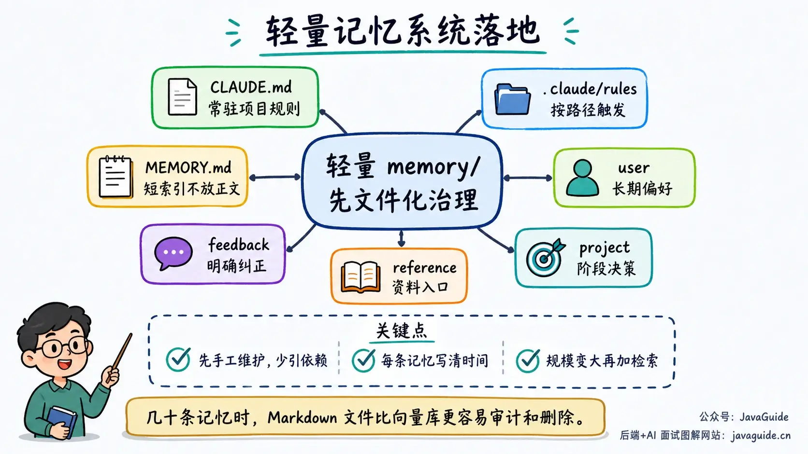

Start by maintaining this system manually. It may not be fancy, but it limits stale data, lets the team review changes, and makes accidental deletions recoverable through Git. Add automatic summaries, full-text search, or vector search only when a manual index becomes a real bottleneck.

The directory structure does not need to be complex at first. Separate the index, user preferences, explicit feedback, project decisions, and reference links:

```text
memory/
├── MEMORY.md
├── feedback/
│   └── integration-test-real-mysql.md
├── project/
│   └── payment-freeze-before-2026-06-30.md
├── reference/
│   └── slow-query-wiki.md
└── user/
    └── backend-preferences.md
```

`MEMORY.md` is an index, not a place for detailed explanations. It tells Claude which memories exist and which files to open for details:

```markdown
# Memory Index

- [Integration tests use real MySQL](feedback/integration-test-real-mysql.md): Integration tests for database behavior must connect to a real MySQL database.
- [Payment freeze before 2026-06-30](project/payment-freeze-before-2026-06-30.md): Do not merge new requirements into the payment module before 2026-06-30.
- [Slow query wiki](reference/slow-query-wiki.md): See the `db-slow-log` page in the internal wiki for production slow-query investigations.
```

Put explanations, background, and scope in topic files. This keeps `MEMORY.md` short enough to load every session. Updates and reviews can then focus on the diff for the relevant file.

## Summary

Claude Code memory works through external files, indexes, and loading rules; the model does not store conversation history in its own memory.

Use `CLAUDE.md` for stable rules, `.claude/rules/` for path-triggered rules, and Auto Memory for preferences and experience Claude discovers while working. Keep `MEMORY.md` as an index, not an essay; put the rationale, scope, and expiration date in topic files.

I am more concerned with what should be excluded than with improving search accuracy. Temporary logs, current line counts, one-off errors, and preferences guessed by the Agent should stay in the current context. Long-term memories need someone to verify, update, and delete them.

Add third-party tools only when needed; do not adopt them just for the sake of it. Keep the system simple where possible. For session history, `claude-mem` is a closer fit. For shared memory across tools and contributors, consider `memsearch`, Mem0, or a custom store. With only a few dozen memories, a file-based index is usually enough.

My recommendation is simple: write clear `CLAUDE.md` and `.claude/rules/` files, then use Auto Memory or a manually maintained `memory/` directory for a small number of high-value notes. Consider a database, BM25, vector search, and a reranker only when the number of memories makes manual indexing impractical or collaboration becomes more complex.

There is little value in asking an Agent to remember everything. A more reliable approach is to make sure it knows where to verify information.

## References

- Claude Code documentation: [How Claude remembers your project](https://code.claude.com/docs/en/memory)
- Claude Code documentation: [Subagents](https://code.claude.com/docs/en/sub-agents)
- Claude Code documentation: [Agent Teams](https://code.claude.com/docs/en/agent-teams)
- Claude Code documentation: [Hooks guide](https://code.claude.com/docs/en/hooks-guide)
- GitHub：[thedotmack/claude-mem](https://github.com/thedotmack/claude-mem)
- MindStudio：[Claude Code Memory Systems Explained](https://www.mindstudio.ai/blog/claude-code-memory-systems-compared)
- Milvus：[Claude Code Memory System Explained: 4 Layers, 5 Limits, and a Fix](https://milvus.io/zh/blog/claude-code-memory-memsearch.md)
