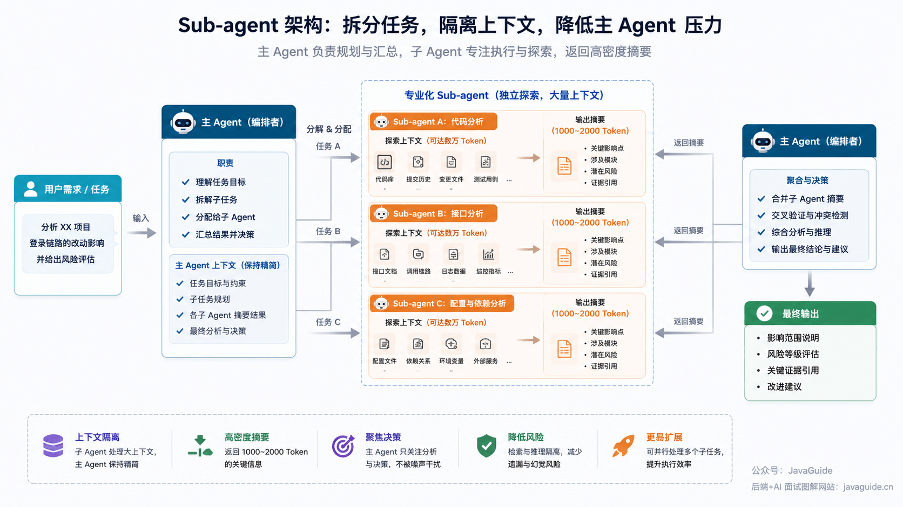
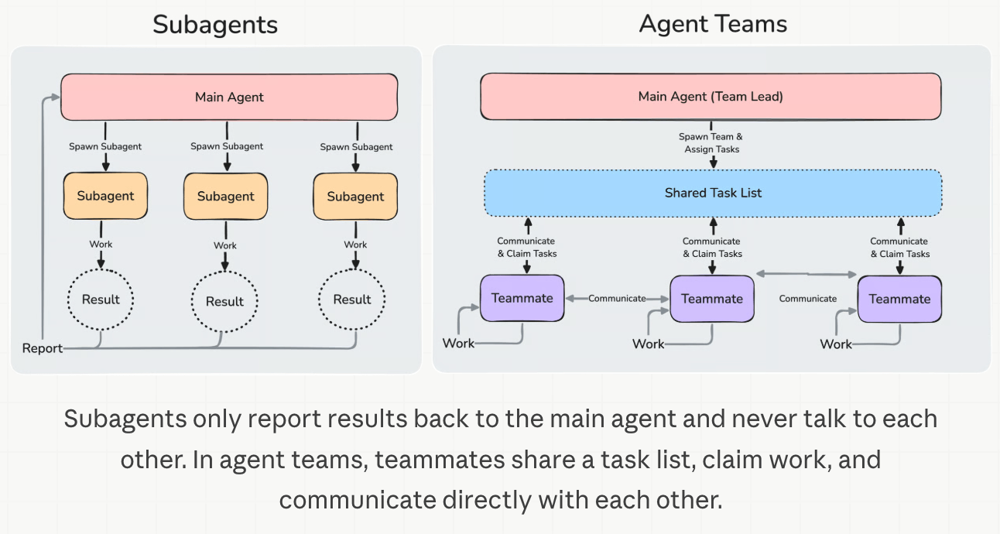
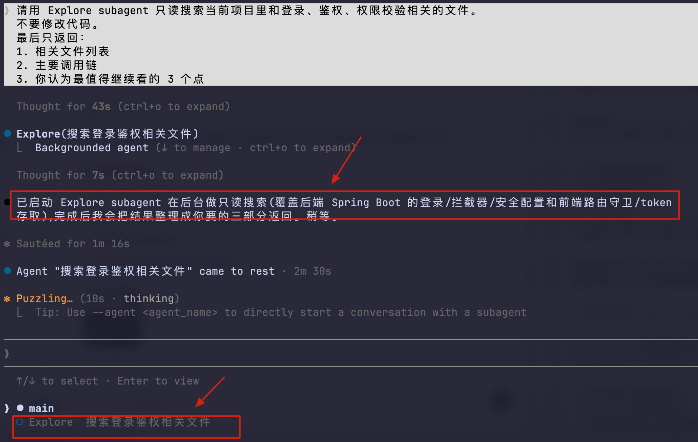
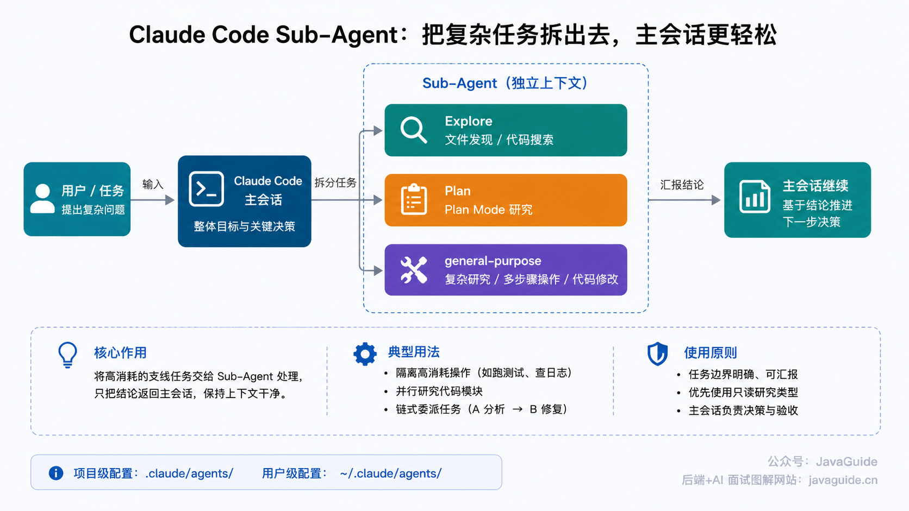
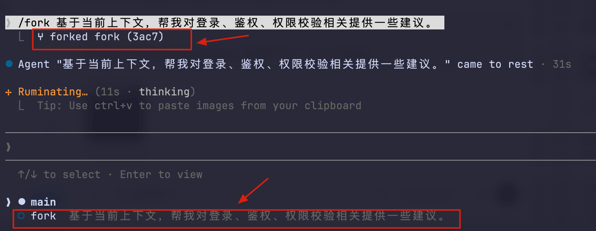
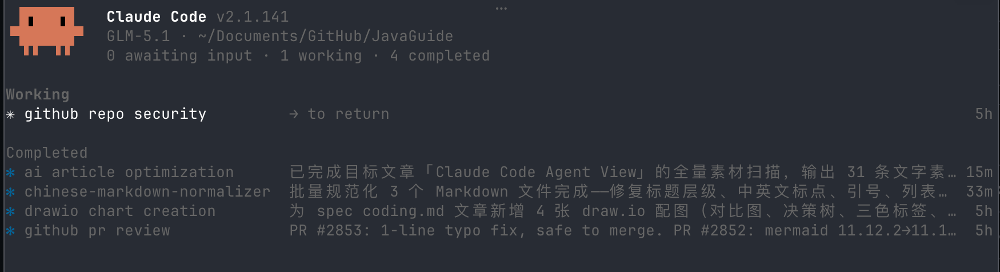
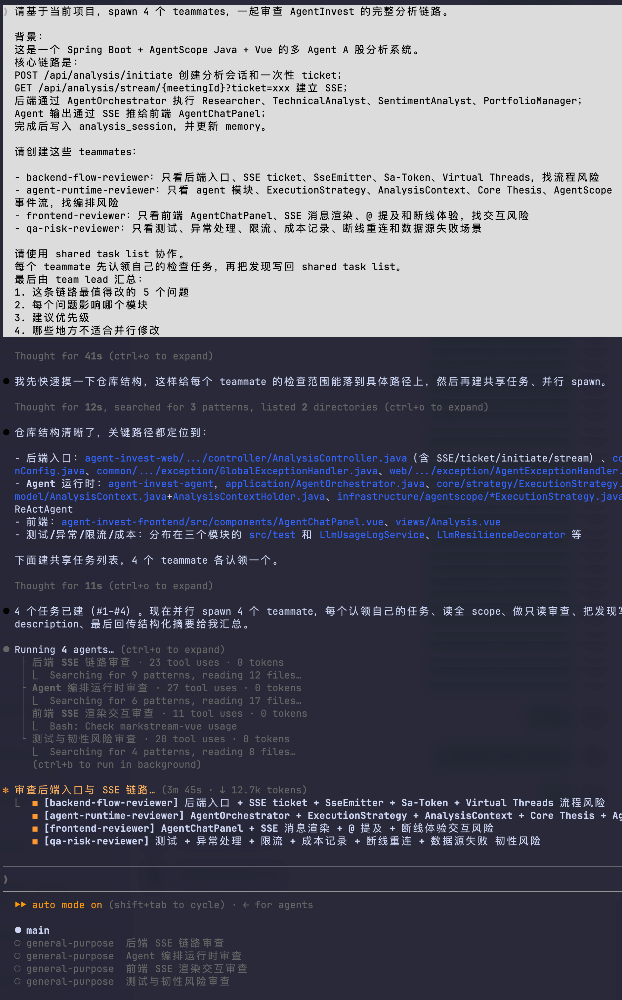
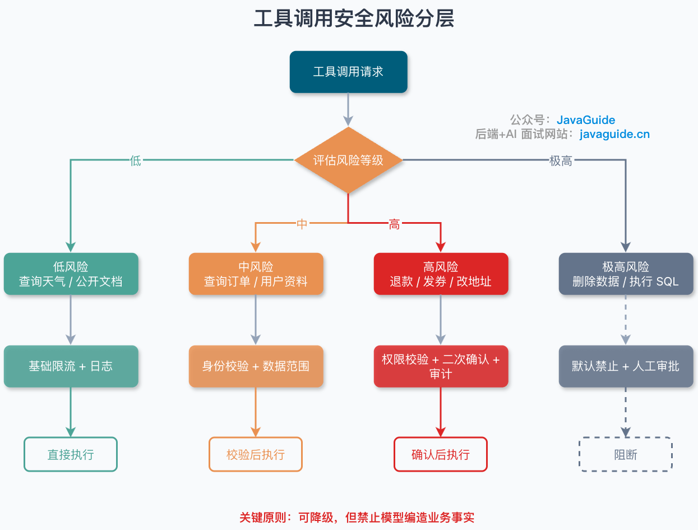
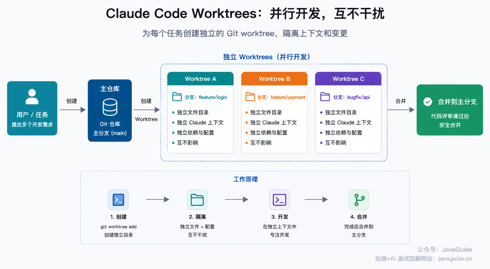
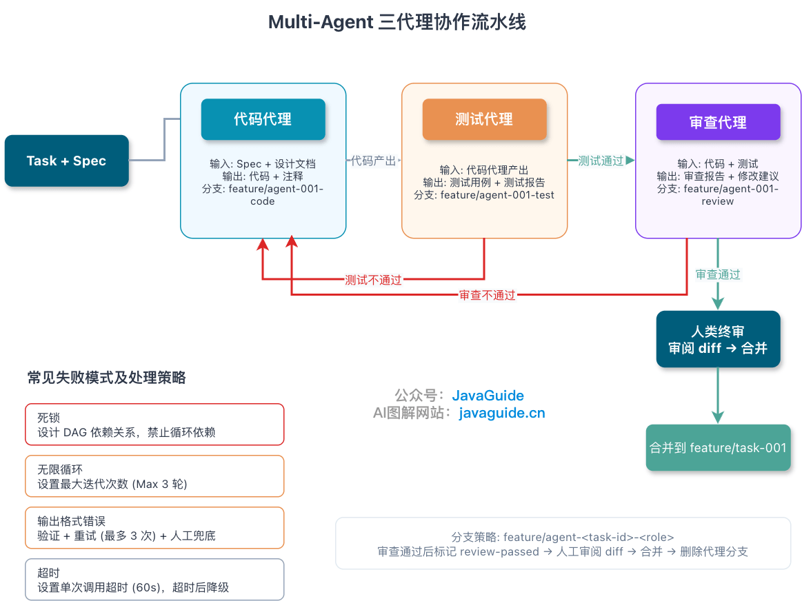

Hi, I'm Xiao G. Recently, a reader asked whether Subagents, Fork, and Agent Teams in Claude Code are the same thing—and how to explain Claude Code's multi-agent system in an interview.

At first, I thought they were just several names for the same idea. Comparing the official documentation, changelog, and community source analysis showed that they differ significantly.

Claude Code can already do a lot with a single Agent. For everyday code changes, troubleshooting, and tests, one is usually enough.

The problem is that real project tasks are rarely so clean. One session may need to search, read, experiment, and then make the final changes. As the conversation grows, its context becomes cluttered.

For example, investigating an API performance issue may involve searching for the endpoint, reading the Mapper, checking logs and indexes, and trying several SQL queries. By the time it is ready to change code, the conversation may be full of irrelevant files, old guesses, and rejected approaches.

That is tiring to read and can distract the model too.

Claude Code's multi-agent system addresses these **context and task-decomposition problems**.

Instead of putting all the work in one session, it separates tasks by their nature:

- Delegate one-off searches to a Subagent.
- Use `/subtask` for a side investigation that needs the current context; use `/fork` when you need to continue it independently.
- Use Agent Teams when multiple workers need to collaborate.

This article brings together the multi-agent features in Claude Code. It uses community source analysis to explain some implementation details, but current usage is based on the official documentation and changelog.

These features change quickly. This article was checked against Claude Code v2.1.218 (2026-07-24). Starting with v2.1.212, under normal conditions, use `/subtask` for a forked subagent within the current session. `/fork` copies the current conversation into a separate background session. With Agent View disabled, `/subtask` is unavailable and `/fork` still starts a forked subagent. Older articles call both behaviors Fork, which can be confusing.

## Why Does Claude Code Need Multiple Agents?

One Agent is usually enough to write a small function, change a setting, or add a test.

However, one Agent may not be enough for a cross-module task. For example, investigating a slow production query may require Claude Code to:

- Search for related endpoints and SQL.
- Read the ORM or Mapper code.
- Inspect indexes and the execution plan.
- Change the query logic.
- Add tests or a load-test script.
- Summarize the cause and changes.

Putting all these steps in one Agent's main session causes two main problems:

- Too much process information. Irrelevant search results, old logs, failed approaches, and temporary guesses remain in context. When writing code later, the model must find the current priorities among this stale material.
- Task inertia. After investigating a database issue, the model may carry the same assumptions into the next task, such as reviewing a frontend component.

In my view, Multi-Agent is **first about protecting the main session. The main session handles decisions and implementation; delegate noisy, repetitive, or side tasks when possible. Parallel speedup is a byproduct of sensible task decomposition.**

This follows the Context Engineering principle of isolating side-task processes: keep decisions, plans, and final choices in the main session, and delegate context-heavy searches, verification, and reviews to independent workers.



The table below summarizes the multi-agent options in Claude Code by the problem they address:

| Problem                                                         | Suitable mechanism | Description                                                                                  |
| --------------------------------------------------------------- | ------------------ | -------------------------------------------------------------------------------------------- |
| Too many side searches are cluttering the main session          | Subagent           | The subagent reads files and gathers information; the main session receives only the result. |
| A side investigation needs the current context                  | `/subtask`         | A forked subagent in the current session inherits context and returns its result.            |
| Copy the conversation and continue independently                | `/fork`            | Creates a separately resumable and manageable background session.                            |
| Multiple roles need to coordinate, communicate, and claim tasks | Agent Teams        | Each teammate is an independent Claude Code instance with a shared task list and messaging.  |

> **Environment note:** This table assumes Agent View is enabled. When Agent View is disabled, `/subtask` is unavailable and `/fork` starts a forked subagent in the current session.

Although their names all include Agent, they serve different purposes:

- A Subagent is like "go investigate this and report back."
- `/subtask` copies the current context for a side task; `/fork` creates a separate background session.
- Agent Teams brings several independent instances together to message, claim tasks, and coordinate a project.



One more detail: you do not always need to name a Subagent explicitly. According to the official documentation, Claude uses a Subagent's `description` to decide when to delegate. Built-in Subagents such as Explore, Plan, and general-purpose may also be selected automatically for suitable tasks.

The practical question is when to specify a Subagent and when to use Agent Teams.

Start by asking: **Do these workers need to communicate with each other?**

If a worker only needs to investigate and report back, a Subagent is enough. Code review, log analysis, and focused research fit this pattern.

Consider Agent Teams when workers need to message each other, claim tasks, and exchange intermediate results. For example, one teammate can inspect the backend API, another the frontend, and another handle testing and acceptance.

Cost matters too: each teammate has its own context window, so token usage grows with the number of active teammates. This can be worthwhile for research, review, or feature decomposition; a single session is usually cheaper for small everyday changes.

## Subagents: Lightweight Delegation from the Main Session

### What Is a Subagent?

A Subagent is one of the most common and easiest-to-control delegation mechanisms in Claude Code.

Think of it as a worker temporarily sent out by the main session. It has its own context window and can use specified tools. When the task ends, it returns the result without dumping its entire search process into the main session.

Reading a few extra files is often not the problem. The problem is bringing the full search process, temporary conclusions, and rejected guesses back to the main session. A Subagent can investigate independently and return only organized results.

This keeps the main session from carrying the extra context.



In the image above, the main session delegates searches related to login, authentication, and authorization to an Explore Subagent. The search runs in the background, keeping the main thread clean. When it finishes, the main session receives an organized file list, call chain, and follow-up points.



When should you create a custom Subagent?

Create a custom Subagent when the same kind of worker recurs and needs the same instructions each time. For example, if you regularly ask it to perform read-only code reviews, database query checks, security scans, or log analysis, and the role, tool permissions, and output format are stable, define a dedicated Subagent.

For an occasional file search or quick log check, use a built-in Subagent or delegate manually. Do not create a file just to make the setup look more professional.

Custom Subagent files are usually stored in:

```text
~/.claude/agents/
.claude/agents/
```

These directories may not exist by default. If you cannot find them, no custom Subagents have been created for that user or project yet.

The current documentation gives a simpler way to create one: ask Claude to write it, or create the directory and Markdown file yourself. Starting in v2.1.198, `/agents` no longer opens an interactive creation wizard; it reminds you to ask Claude or edit `.claude/agents/` directly. If the `agents` directory is first created during the current session, Claude Code may need to restart before it detects it.

User-level Subagents apply to all projects; project-level Subagents can be shared with the team.

Subagent files are Markdown with YAML frontmatter. They can specify the name, description, tools, model, permission mode, hooks, and Skills. `name` and `description` are required. The `description` is especially important because Claude uses it to decide when to delegate automatically.

### How Does a Subagent Run?

Runtime logs and community source analysis highlight these parameters for an `Agent` tool call:

| Parameter           | Purpose                                                                                                                            |
| ------------------- | ---------------------------------------------------------------------------------------------------------------------------------- |
| `description`       | Short task description for the main session                                                                                        |
| `prompt`            | Specific task assigned to the subagent                                                                                             |
| `subagent_type`     | Selects a Subagent type; if omitted, it remains `general-purpose` and does not become a fork automatically                         |
| `model`             | Model alias for the subagent                                                                                                       |
| `run_in_background` | Whether to run in the background; newer versions choose automatically if unset and default to background mode starting in v2.1.198 |
| `name`              | Addressable name for a background Subagent or Agent Teams teammate                                                                 |
| `team_name`         | Used by older Agent Teams versions; still accepted but ignored by newer versions                                                   |

This table lists call parameters for the `Agent` tool, not YAML frontmatter fields in `.claude/agents/*.md`. Subagent files use fields such as `background` and `isolation` for background execution and workspace configuration.

You do not need to memorize the table. The key point is not to rely on the old claim that omitting `subagent_type` implicitly creates a fork. An ordinary Agent call uses `general-purpose` when no type is specified. To inherit context, explicitly use `/subtask` or the appropriate fork configuration in the current version.

Internally, `AgentTool` handles entry and routing; `runAgent()` starts the subagent.

`runAgent()` first performs runtime setup:

- Initializes the MCP servers required by the agent.
- Creates a `ToolUseContext` for the subagent.
- Runs the relevant `SubagentStart` hooks.
- Writes a sidechain transcript and agent metadata.
- Enters the main `query()` loop.

These details show that a Subagent is not an ordinary function call in the main session. It reuses the Claude Code Agent runtime, with tools, permissions, context, message flow, and a transcript.

It can therefore handle substantial side tasks. Having it read a set of files, perform a review, and report its findings keeps the main session cleaner.

### Which Tasks Suit a Subagent?

I usually delegate tasks like these to a Subagent:

- Perform a read-only review of a module and return a list of issues.
- Search for a type of error in logs and return only the findings.
- Summarize how an external library is used without returning the search process.
- Independently verify a change, so the task can be delegated again if it fails.

Do not delegate tasks that require continuous decisions from the main session.

For example, if the main session and a subagent both change a core file, they may create conflicts instead of speeding up the work. I use Subagents more for read-only tasks and verification than for direct changes to the main line of work.

## `/subtask`, `/fork`, and Background Agents: When Is Context Inherited?

### `/subtask` vs. a Regular Subagent

A regular Subagent usually starts with a clear prompt from the main session. It does not inherit the full main-session history by default; otherwise, isolating process information would serve little purpose.

`/subtask` works differently: it starts a forked subagent in the current session, inherits the conversation context built by the parent, and returns its result to the current main thread. You must choose this path explicitly; omitting `subagent_type` does not trigger an implicit fork.

This suits a specific situation: the main session has useful context that you want to reuse while exploring several directions in parallel.

For example, after the main session has read the entire payment module, you may want to investigate several aspects:

- Review the state-machine design.
- Check the idempotency logic.
- Look for test-coverage gaps.

Here, `/subtask` is a better fit than a regular Subagent. Each child receives the context that the parent session just established and does not need to reread the project.



The image shows the older `/fork` behavior. In the naming used since v2.1.212, use `/subtask` for this kind of context branch within the current session when Agent View is enabled. The current `/fork` copies the entire conversation into a separate background session that can be viewed, resumed, and continued independently. With Agent View disabled, `/subtask` is unavailable and `/fork` retains the older forked-subagent behavior.

### When to Use Each Type of Fork and Its Limitations

Community analysis of the implementation suggests that a forked subagent within the current session reuses the system prompt and message history already rendered by the parent. This can improve prompt-cache reuse, but it is an implementation observation, not a stable external API.

This is mainly for prompt-cache reuse.

If each forked child regenerates the system prompt, details such as dynamic configuration, tool lists, or experimental flags may make the bytes differ even when the content looks the same.

Byte differences can reduce prompt-cache hits.

Reusing the parent context affects prompt caching and ties Multi-Agent behavior to lower-level mechanisms such as context construction and tool registration.

This is why `/subtask` suits a side task started right after the context is prepared. Use the current `/fork` when the side task needs independent management, later continuation, or separate resumption. To prevent file changes from interfering, configure the Agent with `isolation: "worktree"` so its changes go into a separate Git worktree.

**Background Agents reduce waiting.**

For example, one Agent can run a full code review while another analyzes logs. The main session can continue with design and task decomposition, then incorporate the background Agents' results when they finish.

Too many background tasks quickly increase management overhead. Use `/tasks` to view, take over, or stop `/subtask` and other background Subagents in the current session. Use `claude agents` to open Agent View and manage independent background sessions created by `/fork`. Both run in the background, but they are different task layers.



Background execution is not free. Background Agents still consume tokens and use context and task state. With too many of them, the main session may stay responsive while you end up managing a pile of tasks.

Claude Code also sets default limits: Claude can create up to 200 Subagents per session through the `Agent` tool, and up to 20 run concurrently by default. Configure the first with `CLAUDE_CODE_MAX_SUBAGENTS_PER_SESSION` and the second with `CLAUDE_CODE_MAX_CONCURRENT_SUBAGENTS`. Ultracode sessions do not enforce the default concurrency limit.

These limits mainly prevent the `Agent` tool from creating more Subagents. Manually invoked `/subtask` still counts toward the quota and uses a concurrency slot, but can still start after the limit is reached. `/fork` creates a separate session, does not count toward the current session's quota of 200, and has its own budget.

By default, a Subagent cannot create another Subagent. Set `CLAUDE_CODE_MAX_SUBAGENT_SPAWN_DEPTH` to configure nested delegation. In Agent Teams, an in-process teammate cannot create another teammate, and its own Subagents can run only in the foreground. These limits are safeguards, not targets; everyday tasks rarely approach them.

The shared cost of `/subtask` and `/fork` is that both copy the parent session's history.

The cleaner the parent session, the more useful the copied context. Start `/subtask` or `/fork` after reading a module and clarifying the task plan, key files, and constraints to avoid rereading them.

If the main session has been running for a long time and is full of irrelevant files, old guesses, failed approaches, and temporary conclusions, further forking copies that clutter into every child.

In that case, session copying duplicates confusion instead of distributing work.

## Agent Teams: Independent Claude Code Instances

### Agent Teams vs. Subagents

Agent Teams is a more involved multi-agent mechanism in Claude Code; do not think of it as an upgraded Subagent.

A session acts as the team lead (called the lead below), coordinating work, assigning tasks, and combining results. Teammates work independently, each with its own context window, and can communicate with each other.

This is easy to misunderstand: a teammate does not inherit the lead's conversation history. Like a new Claude Code session, it loads the current project's `CLAUDE.md`, MCP servers, and Skills, and receives the spawn prompt from the lead. Earlier discussions, temporary guesses, and rejected approaches are not carried over automatically.

The spawn prompt should not just say "look at the backend." Include key paths, known constraints, and the expected output. Otherwise, the teammate gets a clean window but may not know what was just discussed.

A Subagent usually "does the task and reports back." Teammates collaborate through a shared task list and mailbox: they claim tasks, share information, and let the lead assemble the results.

Teammates can also reuse an existing Subagent definition. For example, if you have a `security-reviewer`, you can specify that Agent type when spawning a teammate. It uses the definition's `tools` and `model` and appends its body to the teammate's system prompt. Note that the `skills` and `mcpServers` frontmatter fields do not take effect through this path; teammates load Skills and MCP servers from project and user settings as regular sessions do.

First enable the experimental flag. Agent Teams is still experimental and disabled by default. Set:

```json
{
  "env": {
    "CLAUDE_CODE_EXPERIMENTAL_AGENT_TEAMS": "1"
  }
}
```

Or set the same environment variable in the shell.

### Shared Task List, Mailbox, and Teammate Mode

Agent Teams is not a group chat where several teammates send messages into one large conversation. It relies on two main components:

| Component        | Purpose                                                                 |
| ---------------- | ----------------------------------------------------------------------- |
| Shared task list | Tracks team tasks that teammates can claim and complete                 |
| Mailbox          | Lets teammates message each other, request information, and sync status |

This adds more than reporting results. Agent Teams maintains a shared task list and mailbox so teammates can claim tasks, sync status, and share information.

Treating the shared task list as an ordinary TODO list misses some of its behavior. Tasks can be `pending`, `in progress`, or `completed`, and can have dependencies. A dependent task cannot be claimed until its prerequisites are complete. Claude Code uses file locking to prevent teammates from claiming the same task concurrently.

The messaging works similarly. The lead assigns each teammate a name, which can be used to send messages. Teammates also notify the lead when they become idle or fail, so the lead does not need to poll continuously.

Source analysis reveals more implementation detail: the mailbox is a file-based inbox with concurrency locks for writes. The task list lets teammates claim work items instead of merely receiving prompts.

A regular Subagent is more like a one-off delegation. Agent Teams maintains shared tasks and messages, making it more like a small work queue.

Prompt design also changes. For a Subagent, explain the task clearly up front. With Agent Teams, the lead can decompose a large task into the shared task list, then teammates can work through the tasks and messages.



The image shows a more realistic project example: the team lead splits AgentInvest's end-to-end analysis flow into four workstreams—backend SSE, Agent orchestration, frontend rendering, and testing and resilience risks—then spawns four teammates to claim them. The point is not to launch more searches, but to have teammates work from the same shared task list and let the lead summarize cross-module issues.

Use `--teammate-mode` to control how teammates are displayed:

| Mode         | Meaning                                                                                 |
| ------------ | --------------------------------------------------------------------------------------- |
| `in-process` | Default; displays teammates in the current process                                      |
| `auto`       | Uses split panes when tmux or iTerm2 is available; otherwise falls back to `in-process` |
| `tmux`       | Uses tmux or iTerm2 split panes                                                         |
| `iterm2`     | Uses native iTerm2 split panes; added in v2.1.186                                       |

The default for `teammateMode` changed from `auto` to `in-process` in v2.1.179.

Keep these version changes in mind when writing scripts and team documentation. Many online tutorials still recommend tmux by default or use the old team-creation workflow; copying them may not work with the current version.

### Changes Since v2.1.178

Older implementations include details such as `TeamCreate`, `TeamDelete`, team files, and `team_name`. They help explain how Agent Teams evolved, but should not be presented as current stable usage.

Since v2.1.178, enabling `CLAUDE_CODE_EXPERIMENTAL_AGENT_TEAMS` automatically creates an Agent Team for the current session when the first teammate is spawned. No separate creation step is needed. A session can have only one team at a time; additional named teams cannot be created.

The `TeamCreate` and `TeamDelete` tools have been removed. Runtime team configuration is cleaned up automatically when the session ends.

The `Agent` tool still accepts the `team_name` parameter but ignores it. The `team_name` field in `TaskCreated`, `TaskCompleted`, and `TeammateIdle` hook payloads is also retained for compatibility.

Agent Teams uses two local directories at runtime: the team configuration is in `~/.claude/teams/{team-name}/config.json`, and the task list is in `~/.claude/tasks/{team-name}/`.

Claude Code creates and updates both directories automatically. The config contains runtime information such as session IDs, pane IDs, and members; it is deleted when the session ends. The task list remains locally available after resuming the session, with cleanup controlled by `cleanupPeriodDays`. Do not edit these files manually or add `.claude/teams/teams.json` to a project expecting it to work.

When reading older source code, I keep these points separate:

- Older implementations help explain why Agent Teams has a task list, mailbox, and team directories.
- For current usage, follow the official documentation and do not tell users to call `TeamCreate`.

## Permissions, Costs, and Version Changes

**Permission requests return to the lead**

A key risk in multi-agent work is a worker bypassing the main session's permissions to edit files or run commands on its own.

Claude Code does not let a teammate decide on its own. Permission requests that need user confirmation return to the lead.

Source analysis shows a leader permission bridge: when an in-process teammate needs user confirmation, the request is first sent to the lead's `ToolUseConfirmQueue` and marked with the worker in the UI. If the bridge is unavailable, it falls back to the mailbox.

The user still makes permission decisions in one place instead of monitoring prompts from multiple teammates.

Subagents can also have their own tool scope and hooks.

The official Subagent documentation gives an example that allows only read-only database queries: a `PreToolUse` hook checks Bash commands and exits to block write operations such as `INSERT`, `UPDATE`, and `DELETE`.

This follows the principle of layered security for tool calls: low-risk operations can be less restricted, while high-risk operations require confirmation. Do not rely on a prompt alone for file deletion, commits, deployments, or database writes.



**Cost comes mainly from multiple independent contexts**

Agent Teams costs more mainly because each teammate is an independent Claude Code instance.

I use a few practices to control costs:

- Explicitly choose a model for teammates or set `Default teammate model` in `/config`; it may not follow the lead's `/model` automatically.
- Start most workflows with three to five teammates. Three focused teammates are often more useful than five working on scattered tasks.
- Avoid tasks that are too small or so large that they go a long time without a check-in. Prefer self-contained deliverables such as one function, one test file, or one review.
- If you are new to Agent Teams, start with tasks that do not modify code, such as research, review, and bug investigation.
- For parallel code changes, assign different files to each teammate where possible to avoid concurrent edits to the same file.

Ultimately, this is still context management.

Three teammates mean managing several windows at once; they do not divide one window into three. The cost can be worthwhile when tasks are truly parallel. For tasks with strong dependencies that repeatedly wait on each other's results, it may not be worthwhile and can add overhead.

**Treat version information as a snapshot**

This article was checked against Claude Code v2.1.218 (2026-07-24). Versions change, so consult the official documentation and changelog for current behavior. Commands and tool names in older articles may no longer work, especially for fast-moving features such as Agent Teams, Subagents, and Skills.

## How Should You Choose in Practice?

**Use one Agent for small tasks**

Use one Agent when the task is clear, the change is small, and the context is simple.

For example:

- Change one function.
- Add a unit test.
- Adjust a configuration.
- Explain a code snippet.

Starting a Subagent or Agent Team for these tasks only adds coordination overhead. A single session is usually the most reliable option for a small change.

**Use a Subagent for side tasks**

I think of a Subagent as someone who "goes out, investigates, and reports back."

For example, ask it to review a module without making changes, search a set of error logs, map out a module's context, or independently verify a recent code change.

These tasks share one characteristic: the process is less important than the result. The main session needs to know what is wrong, where the evidence is, and what to change next. It does not need every search result, temporary guess, and failed path.

For changes to core code, I prefer to stay in the main session. Let the Subagent find clues and verify results; the main session makes decisions and implements changes.

**Use Agent Teams when collaboration is needed**

I am more cautious with Agent Teams. Use it when "investigate and report back" is not enough.

For example, a new feature may involve the backend API, frontend interactions, test strategy, and an independent review. Teammates need to do more than inspect their own areas; they may need to ask each other whether the frontend must change with an API field, whether tests should be added, and who can claim the next task.

This is where the shared task list and messaging are useful. If workers only need to complete independent tasks and return summaries, Subagents are enough.

Do not force decomposition for a series of changes in one file, tasks with strict dependencies, or work that requires one person to retain all the context. Splitting these tasks only adds coordination overhead.

If multiple Agents need to change code, isolate their workspaces first. A reliable approach is one Git worktree per Agent and one clearly defined task per branch, followed by a human or lead merging and accepting the changes.



**Define the task before adding Agents**

When task boundaries are unclear, multiple Agents produce more intermediate results that point in different directions. First use one Agent to clarify the goal and dependencies. Delegate independent verification to a Subagent; choose `/subtask` or `/fork` when the current context is worth reusing; enable Agent Teams only when roles need to communicate.

More specifically, start with a sequential workflow: Plan creates a read-only plan, Code handles one task, Test adds verification, and Review checks only the diff. Once this workflow is stable, delegate steps that can run independently to different Agents.



## Summary

To return to the opening question: when should you choose a Subagent, Fork, or Agent Teams in Claude Code?

Do not start by asking whether multiple Agents will be faster. Think of this as context management: the main session handles decisions, planning, and implementation; delegate side searches, reviews, and verification that can clutter its context.

Subagents isolate the process. Let them read files, inspect logs, or perform read-only reviews, then return only findings and evidence to the main session.

Use `/subtask` to reuse prepared context in the current session, complete a side task, and return its result. With Agent View enabled, use `/fork` to copy the conversation into an independent background session for separate management. If the main session is already cluttered, both options will copy the clutter.

Agent Teams is a heavier option. Use it when multiple teammates truly need to claim tasks, communicate, and share a task list. It costs more because of the independent contexts and adds coordination overhead.

My usual order is: one Agent for small tasks; a regular Subagent for a clean side task; `/subtask` or `/fork` when context should be reused; and Agent Teams for genuine cross-module collaboration. The main benefits are process isolation and clear ownership. Parallelism follows only when the tasks can be split independently.

For further reading, see the [Context Engineering in Practice](https://javaguide.cn/ai/agent/context-engineering.html) and [Spec Coding](https://javaguide.cn/ai-coding/practices/spec-coding.html) guides in [AIGuide: AI Application Development, Coding Practice, and Interview Preparation](https://mp.weixin.qq.com/s/le3RzJsaAH22auUoB05y1Q). The first focuses on context isolation; the second focuses on multi-agent workflows.

## References

- [Claude Code Commands](https://code.claude.com/docs/en/commands)
- [Create custom subagents](https://code.claude.com/docs/en/sub-agents)
- [Run agents in parallel](https://code.claude.com/docs/en/agents)
- [Orchestrate teams of Claude Code sessions](https://code.claude.com/docs/en/agent-teams)
- [Claude Code Changelog](https://github.com/anthropics/claude-code/blob/main/CHANGELOG.md)
- [Claude Code Source Code Deep Research Report (unofficial community analysis)](https://claudeai.dev/docs/mechanics/development/claude-code-source-deep-research/)
