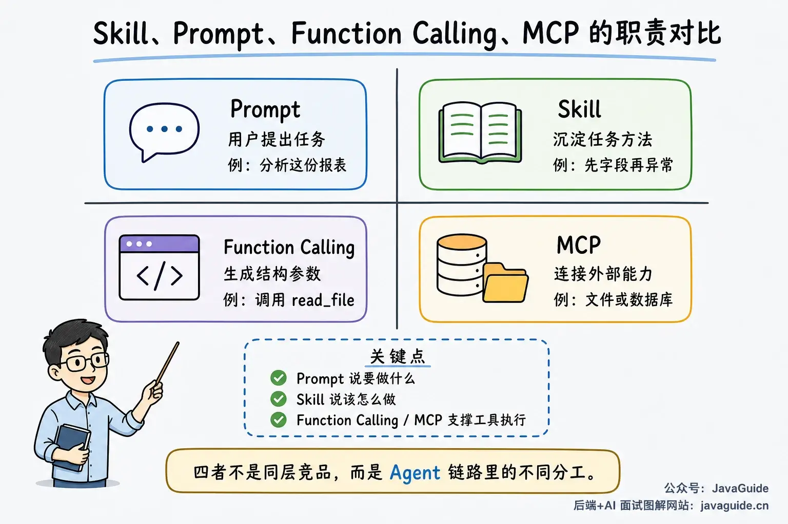
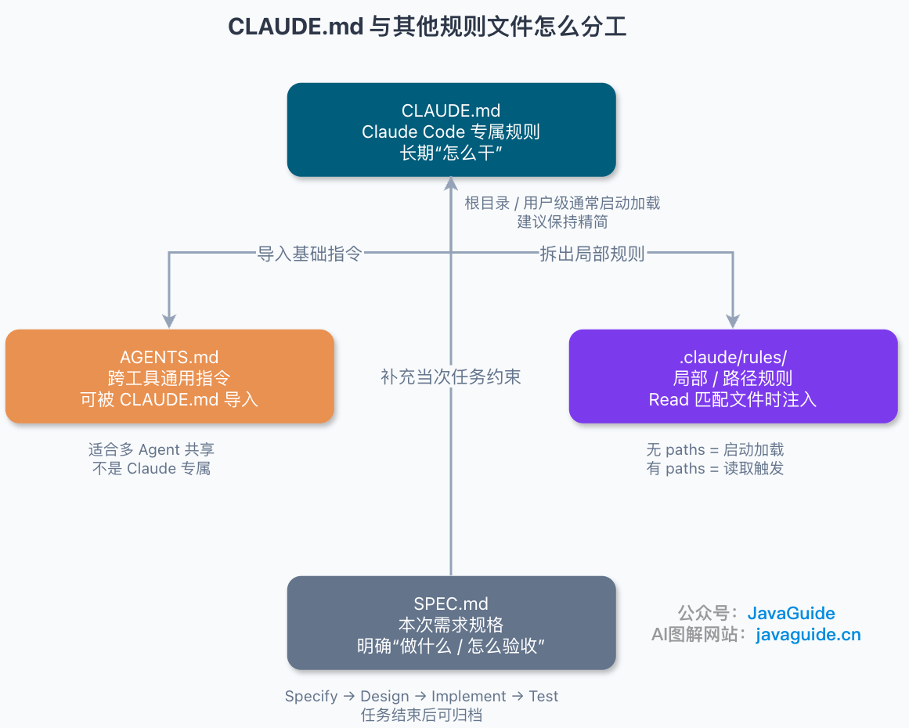
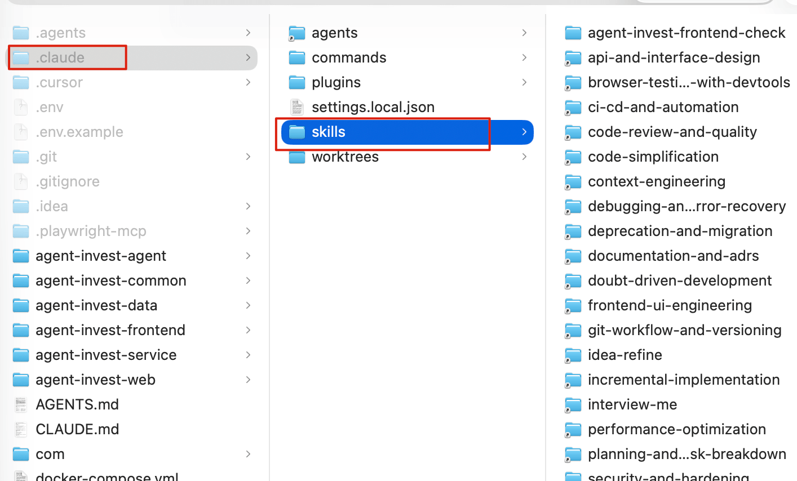
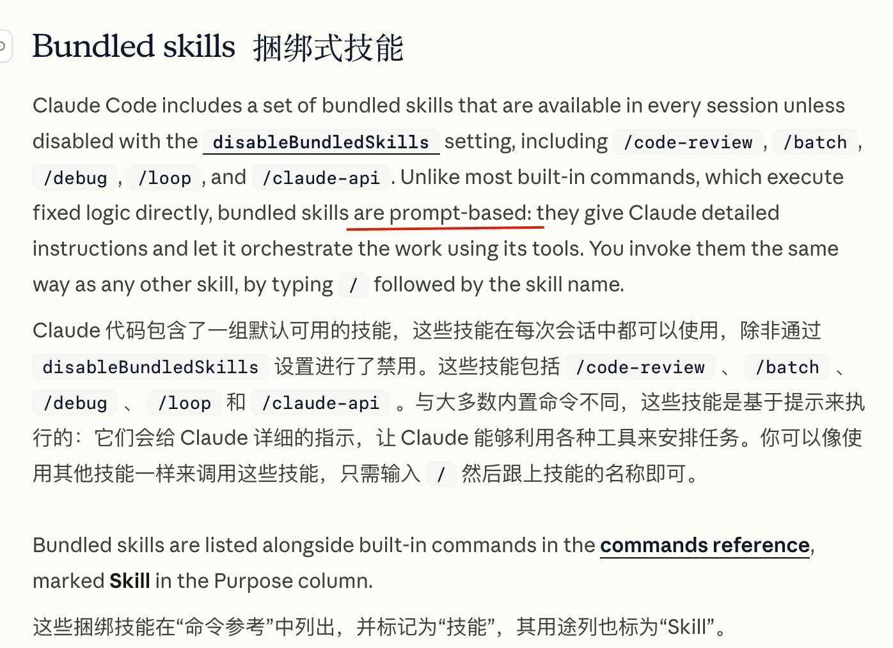
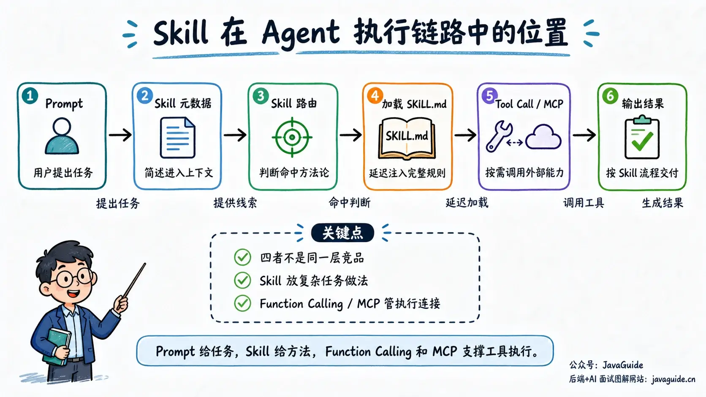
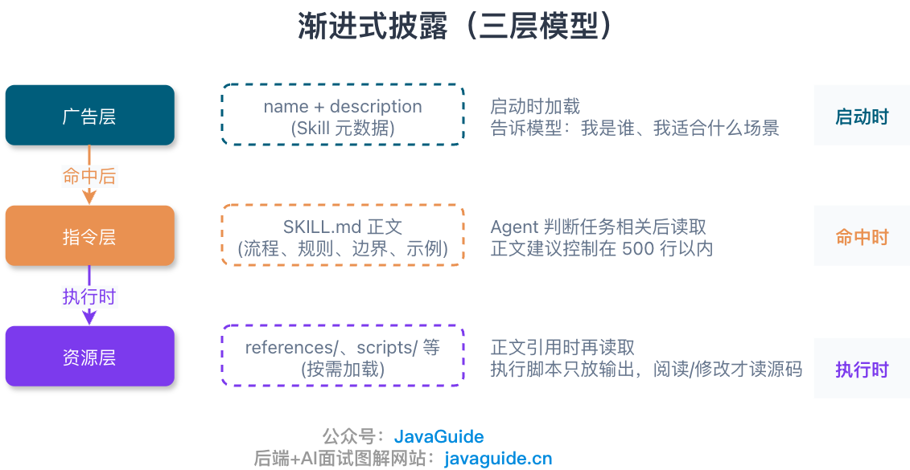
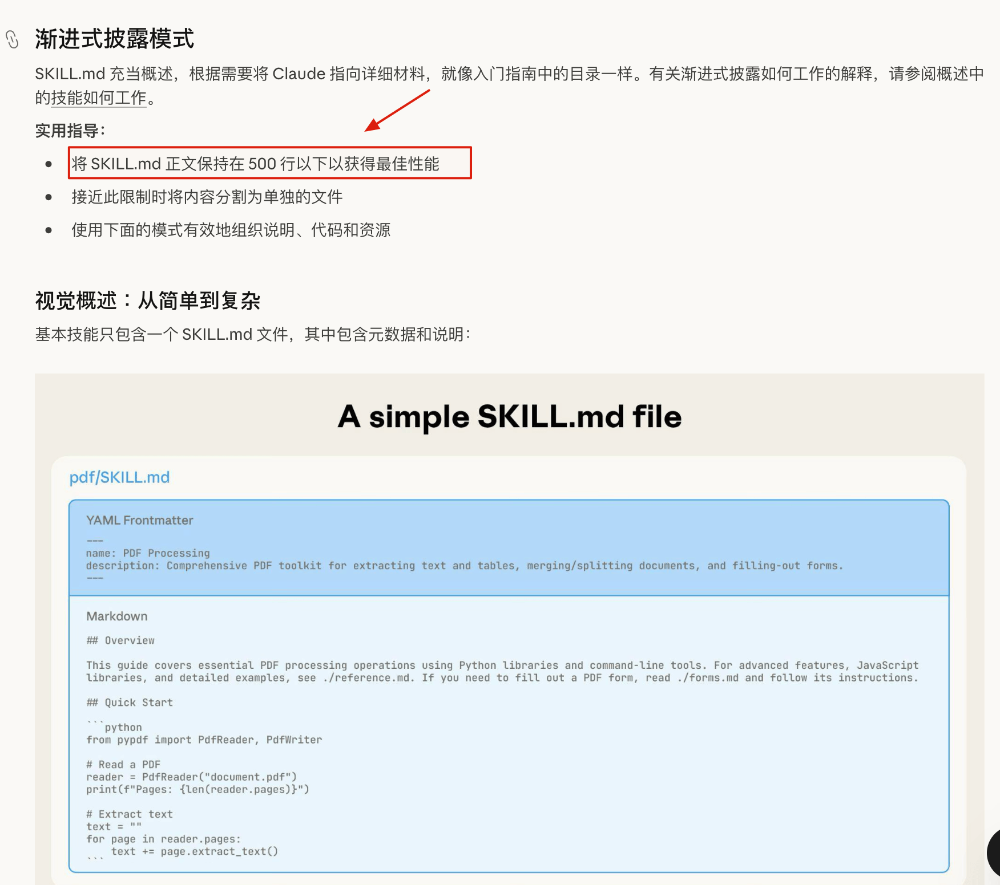

Many readers have said that Skills come up often in interviews, so after writing two earlier articles, I put together another one.

Here is the article.

When I first started using Claude Code, I tended to put every rule into `CLAUDE.md`.

It made sense to put coding style, directory conventions, and test commands there. But over time, I also started adding code review checklists, PR summary workflows, and UI acceptance steps.

That is when problems started.

These workflows are useful, but not for every task. Including them every time adds irrelevant context and can interfere with the model's judgment.

Do not keep putting this kind of content in `CLAUDE.md`. If you repeatedly copy the same instructions, checklist, or multistep workflow into conversations, or a section of `CLAUDE.md` has become a manual, consider splitting it out.

The main difference is how they are loaded. `CLAUDE.md` is usually loaded as persistent context at the start of a session. A Skill exposes only its name and description until it is relevant, at which point its full content is loaded. Long references, checklists, and script instructions do not need to fill the context from the start.

This article focuses on how Claude Code Skills are implemented and run. I refer to community source-code analysis for implementation details, but the official documentation and changelog are the source of truth for current behavior.

For a broader introduction to how Agent Skills differ from prompts, MCP, and function calling, see my earlier guide, [What Are Agent Skills? How Do They Differ from Prompts and MCP?](https://javaguide.cn/ai/agent/skills.html). If you want recommendations for ready-made Skills, see [Recommended AI Coding Skills: TDD, Code Review, Browser Automation, and MCP](https://javaguide.cn/ai-coding/programmer-essential-skills.html).

## What Problems Do Skills Solve?

First, consider the roles of `CLAUDE.md` and Skills.

Use `CLAUDE.md` for project facts and lasting rules needed in every session, such as coding style, directory conventions, common commands, and architecture notes.

Use a Skill for a workflow with a clear trigger. It should be reusable, but does not need to load at the start of every session.

Typical examples include:

- A code review checklist.
- Steps for investigating a production issue.
- A workflow for generating a PR summary.
- Design guidelines needed only when changing the UI.
- A TDD workflow used only when writing tests.

They share a few traits: the steps are fairly fixed, the content is substantial, and it is needed only for certain tasks. Putting all of it in `CLAUDE.md` adds context overhead at startup, and that overhead keeps growing.

Think of a Skill as a manual opened on demand. Claude knows that the capability exists, and loads its full instructions only when needed.



`CLAUDE.md` serves the opposite role. The official guidance is to reserve it for information needed in every session, such as build commands, project conventions, directory structure, and rules that must always be followed.

If content describes a multistep workflow or applies only to part of the codebase, it is better suited to a Skill or a path-scoped rule.

When splitting things up in a project, I focus less on what to call them and more on the problem each piece solves.

- If a rule must apply in every session, it probably belongs in `CLAUDE.md`. If a workflow keeps getting copied into conversations, it probably belongs in a Skill.
- Consider a subagent when the task is long enough that the full process would crowd the main conversation. Consider a plugin when everyone on the team needs the same set of capabilities.

This table summarizes the concepts above:

| Mechanism   | Main purpose                                                 |
| ----------- | ------------------------------------------------------------ |
| `CLAUDE.md` | Persistent project rules and conventions                     |
| Skill       | Workflows and checklists for specific tasks                  |
| Subagent    | Delegate long or parallel tasks to another agent             |
| Plugin      | Distribute extensions such as Skills, agents, hooks, and MCP |

In Claude Code, a Skill can be thought of as a prompt-based command.

Custom commands have also been incorporated into the Skills system. Both `.claude/commands/deploy.md` and `.claude/skills/deploy/SKILL.md` can define `/deploy`. Existing files in `.claude/commands/` remain compatible and do not need to be migrated right away.

A subagent answers “who does the work”; a Skill answers “how to do it.”

Plugins handle distribution. A plugin can include Skills, agents, hooks, and MCP servers. For organizations or teams that need to distribute capabilities consistently, a plugin is a better fit than copying Skill files individually.

If a project uses `CLAUDE.md`, `AGENTS.md`, scoped rules, specifications, and Skills, use the same division: put persistent rules in rule files, reusable workflows in Skills, and the current task's acceptance criteria in its specification.



Content that works well as a Skill is often reused, has a clear trigger, follows fairly fixed steps, and is too long to keep in persistent context. It may also benefit from supporting files or scripts, such as those in `scripts/`, `references/`, or `templates/`.

Code review, TDD, PR summaries, database change checks, UI acceptance reviews, and log investigations are examples.

Project-wide rules that must always be followed are not a good fit for Skills. For example, “Use Google Java Style for all Java code” belongs in `CLAUDE.md` or project rules.

For more on `CLAUDE.md`, see my guide [CLAUDE.md Best Practices: What to Include, What to Avoid, and How to Split It as a Project Grows](https://javaguide.cn/ai-coding/practices/claude-md-best-practices.html).

## How to Write `SKILL.md`

A filesystem-based Skill usually has this directory structure:

```text
.claude/skills/
  pr-summary/
    SKILL.md
    scripts/
      collect-pr-info.sh
    references/
      review-checklist.md
```

`SKILL.md` has two parts:

1. YAML frontmatter: Metadata such as the name, trigger conditions, tool permissions, model, and execution context.
2. Markdown body: The actual instructions sent to Claude.

A minimal example:

```md
---
name: pr-summary
description: Summarize a pull request and list key risks
allowed-tools: Bash(gh *)
---

Read the pull request diff and comments, then summarize:

1. Main changes
2. Risky files
3. Missing tests
4. Suggested follow-up
```

When you run `/pr-summary`, Claude Code renders the Skill as a prompt and sends it to the model.

The source code's `parseSkillFrontmatterFields()` supports many fields. Some common ones are:

| Field                      | Purpose                                                              |
| -------------------------- | -------------------------------------------------------------------- |
| `name`                     | Display name; the directory name usually determines the command name |
| `description`              | Helps the model decide when to use the Skill                         |
| `when_to_use`              | More specific trigger guidance                                       |
| `allowed-tools`            | Pre-approves tools the Skill can use                                 |
| `model`                    | Specifies a model alias                                              |
| `effort`                   | Specifies the reasoning effort level                                 |
| `user-invocable`           | Whether users can invoke it directly with `/skill-name`              |
| `disable-model-invocation` | Disables automatic invocation; allows only manual invocation         |
| `paths`                    | Paths that conditionally trigger the Skill                           |
| `context`                  | Supports `fork` to run the Skill in a subagent context               |
| `agent`                    | Binds the Skill to a specific agent                                  |
| `shell`                    | Selects bash or PowerShell for dynamic context commands              |

Do not add every field by default. Most Skills need only `description`, `allowed-tools`, and their body instructions. More fields mean more maintenance.

These fields are easy to confuse:

| Field           | What it is for                                               |
| --------------- | ------------------------------------------------------------ |
| `allowed-tools` | Limit which tools the current Skill can use directly         |
| `context: fork` | Run long workflows, research, or reviews in a forked context |
| `agent`         | Specify which agent runs the Skill                           |

For example:

```yaml
context: fork
agent: Explore
allowed-tools: Bash(gh *)
```

This configuration suits tasks such as PR summaries, module reviews, and document synthesis. The main session does not need to carry the full process; it only needs the result.

Skills also support argument substitution. The simplest option is `$ARGUMENTS`:

```md
---
name: fix-issue
description: Fix a GitHub issue
disable-model-invocation: true
---

Fix GitHub issue $ARGUMENTS following our coding standards.
```

Run it with:

```bash
/fix-issue 123
```

In the content Claude receives, `$ARGUMENTS` is replaced with `123`.

To access arguments by position, use `$ARGUMENTS[0]` or the shorthand `$0`:

```md
Migrate the $0 component from $1 to $2.
```

Run it with:

```bash
/migrate-component SearchBar React Vue
```

`$0`, `$1`, and `$2` are replaced with `SearchBar`, `React`, and `Vue`, respectively.

## How Claude Code Discovers Skills

Claude Code loads Skills from several sources. Common locations include:

```text
~/.claude/skills/
.claude/skills/
```

User-level Skills go in `~/.claude/skills/` and are available in all projects. Project-level Skills go in the project's `.claude/skills/` directory and can be shared with the team.



In the source code, Skills use this directory structure:

```text
skill-name/SKILL.md
```

In other words, a standalone `.md` file in a `/skills/` directory is not a standard Skill format; each Skill directory needs a `SKILL.md`.

Claude Code Skills generally come from these sources:

| Type                 | Source                                 | Description                                            |
| -------------------- | -------------------------------------- | ------------------------------------------------------ |
| User-level Skills    | `~/.claude/skills/`                    | Personal Skills reused across projects                 |
| Project-level Skills | `.claude/skills/`                      | Shared by a project or team                            |
| Managed Skills       | Managed policy directory               | Distributed centrally by an organization               |
| Bundled Skills       | Included with Claude Code              | Examples include `/code-review`, `/debug`, and `/loop` |
| Plugin Skills        | Provided by plugins                    | Installed and enabled with a plugin                    |
| MCP Skills           | Capabilities mapped from an MCP server | Provided by an MCP server                              |

Claude Code includes bundled Skills such as `/code-review`, `/batch`, `/debug`, `/loop`, and `/claude-api`. Unlike ordinary built-in commands, these are prompt-based Skills.



Nested `.claude/skills` directories are also supported.

Starting in v2.1.178, nested `.claude/skills` directories are also loaded when Claude Code works with files in those directories. If names conflict, a nested Skill appears as `<dir>:<name>` to avoid overriding an outer Skill with the same name.

This is similar to project rules: **the closer a configuration is to the current working directory, the more local context it can express.**

Avoid overusing nested Skills. Create them only when a subdirectory has its own workflow, for example:

- `frontend/.claude/skills/ui-review/SKILL.md`
- `backend/.claude/skills/api-contract-check/SKILL.md`
- `docs/.claude/skills/article-review/SKILL.md`

For categorization alone, ordinary directories and filenames are enough.

The older `.claude/commands/` format remains compatible. The source also includes a legacy commands loader: if the old command directory contains a `SKILL.md`, it is handled as a Skill; otherwise, it is loaded as a Markdown command.

The official documentation says that custom commands have been merged into Skills, but existing `.claude/commands/` files will continue to work. For new capabilities, use `.claude/skills/<name>/SKILL.md`.

## What Happens When a Skill Is Invoked?

Skills do not normally place their full body in the context.

Claude Code uses the Skill name, description, `when_to_use`, and other frontmatter to tell the model which capabilities are available.

The source also includes `estimateSkillFrontmatterTokens()`, which estimates tokens for only the name, description, and `whenToUse`, since the full content is loaded only when invoked.

Claude Code calls `getPromptForCommand()` to render the Skill body only when the user runs `/skill-name` or the model determines that a Skill is suitable for the current task.

This is the main reason Skills use less context than a long `CLAUDE.md`.



After a Skill is invoked, Claude Code gets the Markdown body and performs these steps:

1. Expand arguments such as `$ARGUMENTS` and `$0`.
2. Replace `${CLAUDE_SKILL_DIR}`.
3. Replace `${CLAUDE_SESSION_ID}`.
4. If the Skill is not from MCP, execute embedded shell commands.
5. Return the final prompt to the model.

In `createSkillCommand()`, `getPromptForCommand()` handles this work. It waits until a Skill is actually invoked rather than rendering every Skill at startup.

A Skill can include supporting files such as scripts, reference documents, and templates. For example:

```text
my-skill/
  SKILL.md
  scripts/
  references/
  templates/
```

Use `${CLAUDE_SKILL_DIR}` to reference a script from the body:

```md
Run this helper:

!`${CLAUDE_SKILL_DIR}/scripts/collect-context.sh`
```

This keeps the path valid if the Skill directory moves.

Do not copy all supporting files into the body. Instead, tell Claude in `SKILL.md` when to read each file. It can load a file when needed and leave it out of the context otherwise.

This is progressive disclosure: first let the model know that a capability exists, then load its body when relevant. Keep only the workflow outline in the body, and put longer materials in supporting files.



For this reason, `SKILL.md` should not become a very long README. Focus the body on when to use the Skill, what steps to follow, what to avoid, and how to handle failures. Put long checklists, templates, and script instructions in `references/`, `templates/`, and `scripts/`.



The difference between `CLAUDE.md` and a Skill can also be understood through their loading strategies:

| Content                                | Best location            |
| -------------------------------------- | ------------------------ |
| Project coding standards               | `CLAUDE.md`              |
| Directory structure notes              | `CLAUDE.md`              |
| Code review workflow                   | Skill                    |
| PR summary workflow                    | Skill                    |
| UI acceptance checklist                | Skill                    |
| Production issue investigation scripts | Skill + supporting files |

Do not treat a Skill as another, longer `CLAUDE.md`. Its value comes from loading content on demand, not from moving a pile of rules to another directory.

## Dynamic Context and Security Restrictions

Skills support dynamic context injection with this syntax:

```md
Current Git status:
!`git status --short`
```

The code block form is also supported:

````md
```!
git log --oneline -5
```
````

These commands run before the Skill content is sent to Claude. Their output replaces the placeholder, so the model sees the result rather than the command itself.

The official documentation describes this as preprocessing. Claude sees only the rendered prompt.

This differs significantly from Claude calling Bash.

When Claude calls Bash, the model decides to use the tool in the agent loop. This creates a tool call, and the result becomes part of the conversation history.

Dynamic commands in a Skill are prompt preprocessing. The command runs first and its output is inserted into the Skill prompt. The model does not see the process of deciding to run that command.

Dynamic context is best suited to stable, read-only, low-risk information gathering, such as:

- `git status --short`
- `git diff --name-only`
- `gh pr view --comments`
- Read-only scripts included with the project.

Do not put commands that modify files, commit code, or delete resources in dynamic context. It should collect information, not make changes.

MCP-provided Skills are handled differently. The source checks `loadedFrom !== 'mcp'` before executing embedded shell commands.

An MCP Skill comes from a remote MCP server and may not be trusted. Allowing a remote server to return a Skill with dynamic commands that then run locally would create a remote code execution risk.

MCP Skills therefore skip embedded shell commands. Skills from the filesystem, local projects, or other trusted sources can use this preprocessing path.

Even for a local Skill, commands go through the same tool permission checks before execution. `allowed-tools` can permit certain commands for the current Skill, but it does not enable unconditional execution.

Apply the same checks to third-party Skills. Before installing one, inspect `SKILL.md`, `scripts/`, and `references/` for dangerous commands, suspicious scripts, or overly broad permissions. Installing a Skill means giving an agent a workflow to execute, so do not add it to a project if its source is unclear.

For enterprise environments, the official settings documentation includes a governance option called `strictPluginOnlyCustomization`.

It can restrict the sources of Skills, agents, hooks, and MCP servers. For example:

```json
{
  "strictPluginOnlyCustomization": ["skills", "hooks"]
}
```

When this setting is enforced, user-level and project-level sources are skipped. Only capabilities provided by plugins, managed settings, or Claude Code itself are loaded.

This setting suits teams and enterprise environments. It is usually unnecessary for personal projects, but organizations that centrally manage extensions for AI coding tools need more than a verbal agreement.

## How Skills Work with Agents

A Skill can run in a subagent.

The official documentation explains how to run Skills in a subagent. Skill frontmatter also supports `context: fork` and `agent`.

For example, a PR summary Skill can run in a forked context with the Explore agent:

```yaml
context: fork
agent: Explore
allowed-tools: Bash(gh *)
```

This way, the main session does not need to carry the full PR diff, comments, and file list; it only needs the summary.

`context: fork` suits three types of tasks:

1. The Skill workflow is long.
2. The Skill needs to read many files or external sources.
3. The main session needs only the result, not the full process.

Consider a fork for tasks such as generating a PR risk summary, reviewing a module without making changes, summarizing documents and issues, or creating a migration plan.

Do not use a fork for tasks that require ongoing interaction with the main session. For example, if you are refining a core design and need to approve each step, keep the Skill in the main session.

Agent Teams also add context overhead. The official cost documentation notes that teammates automatically load `CLAUDE.md`, MCP servers, and Skills. Agent Teams do not just add a few prompts; each teammate has its own startup cost.

This does not mean you should avoid Skills. Keep their descriptions and trigger conditions focused:

- Write clear `description` values to avoid unintended activation.
- Put long content in supporting files instead of cramming it all into `SKILL.md`.
- Use `disable-model-invocation` to restrict a Skill to manual invocation.
- Use `strictPluginOnlyCustomization` to control sources in large team projects.

Skills are designed to load on demand. If a description is too broad and triggers too often, a Skill can become context overhead instead of saving context.

In practice, I usually divide things up like this:

| Content                                        | Where to put it                          |
| ---------------------------------------------- | ---------------------------------------- |
| Rules to follow in every session               | `CLAUDE.md`                              |
| Rules for specific paths                       | `.claude/rules/` or a Skill with `paths` |
| Reusable workflows                             | Skill                                    |
| Long reference materials                       | Skill supporting files                   |
| Side tasks for search, review, or verification | Subagent                                 |
| Tasks requiring multiple roles                 | Agent Teams                              |

For example, suppose you are refactoring a backend API.

Put project coding standards and test commands in `CLAUDE.md`. Put API compatibility checks in an `api-contract-check` Skill and the review checklist in a `code-review` Skill. Delegate searches for existing callers to a subagent. If frontend, backend, and testing work need to proceed in parallel, consider Agent Teams.

This keeps rules, workflows, and executors distinct. Do not put everything in the main session or start agents everywhere just to make the setup look sophisticated.

## Summary

I think of a Skill as an **on-demand manual**.

Keep rules that apply to every session in rule files. Turn workflows for specific tasks into Skills. Move long checklists, templates, and script instructions into supporting files.

The decision is simple: if you keep copying the same prompt or a section of `CLAUDE.md` has grown into a manual, it probably belongs in a Skill.

On the other hand, do not create a Skill just for rules that apply to every session, such as coding style, test commands, or directory conventions. Putting them in `CLAUDE.md` is more direct.
