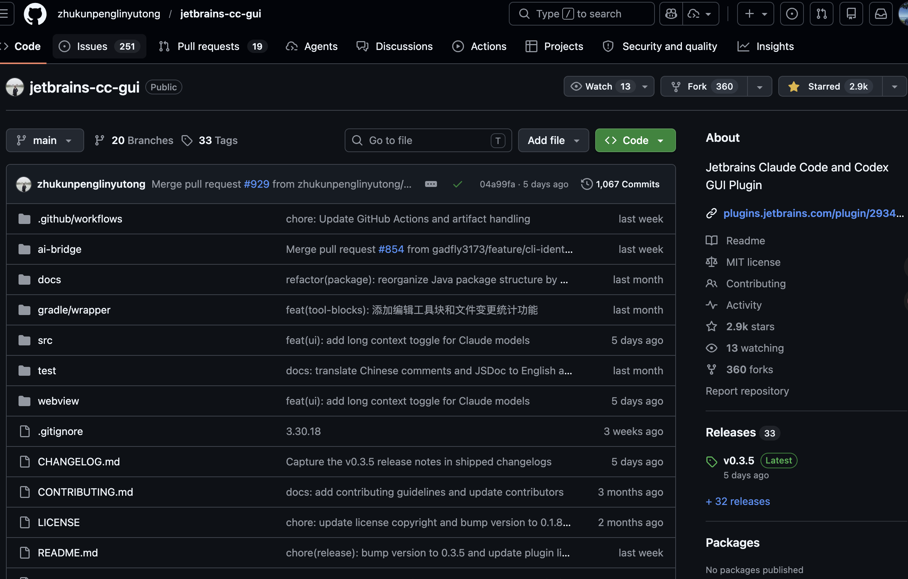
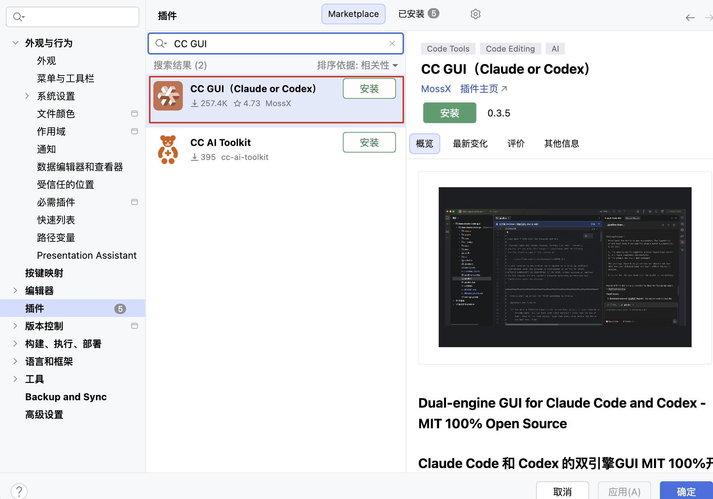
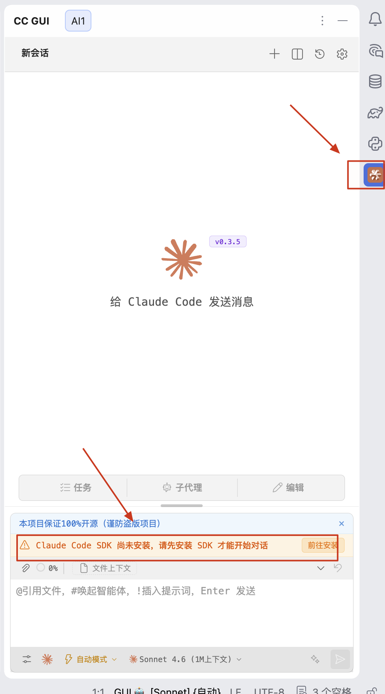
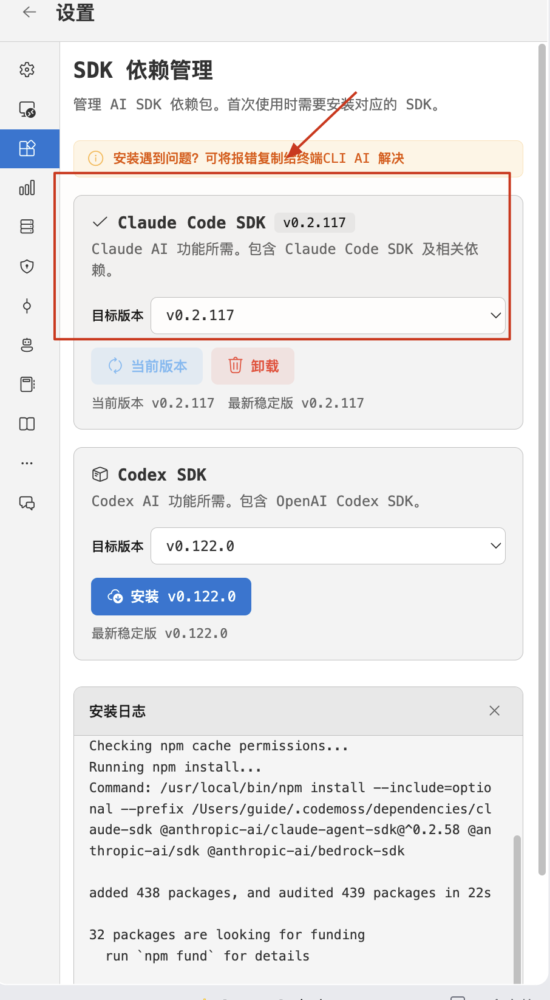
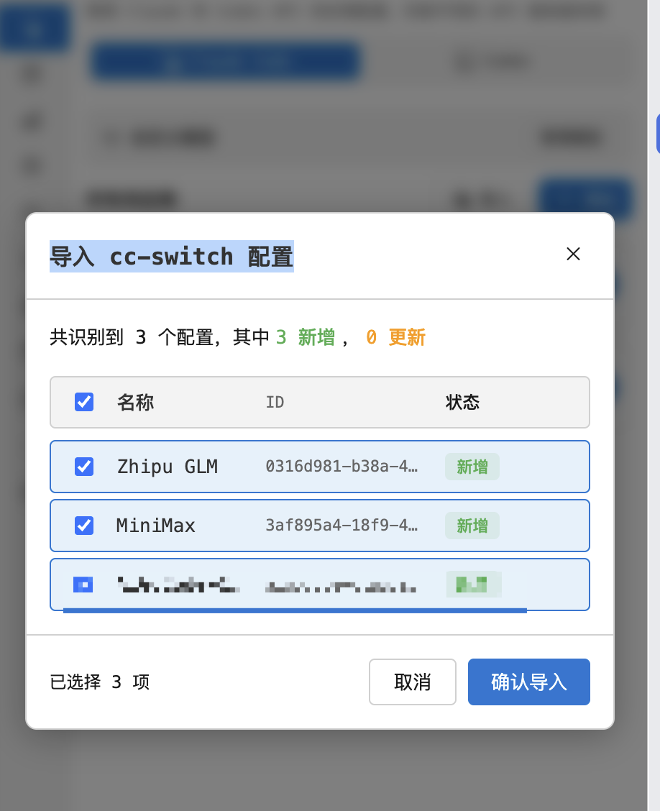
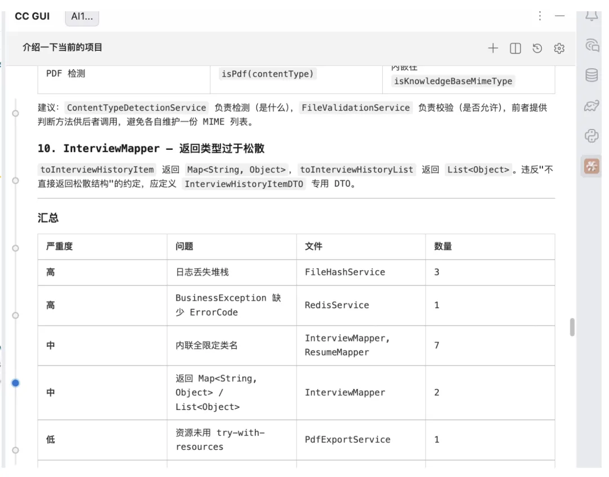
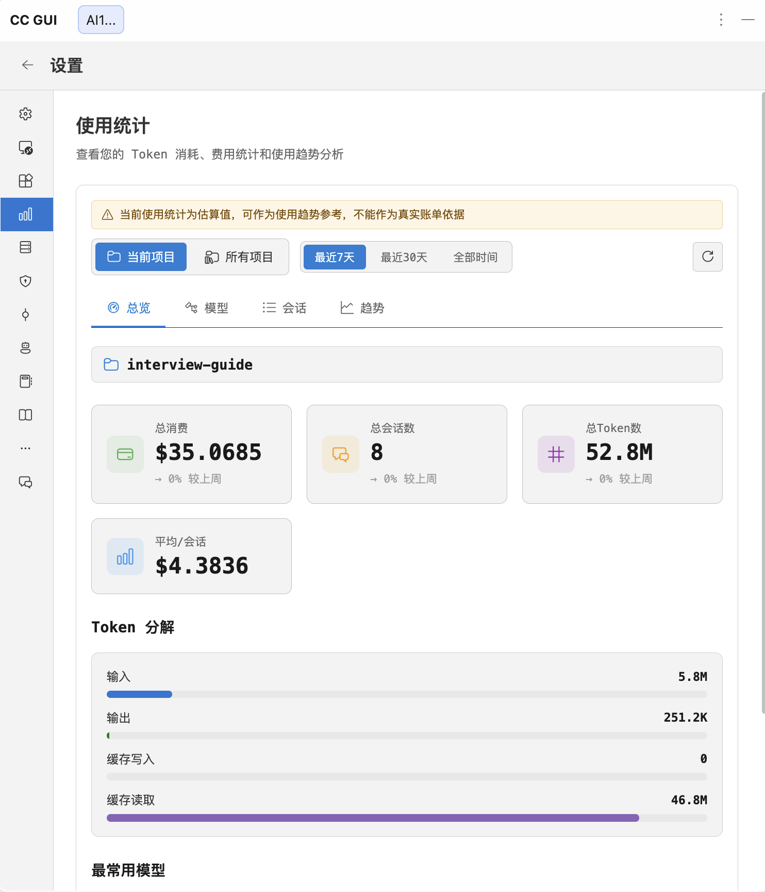
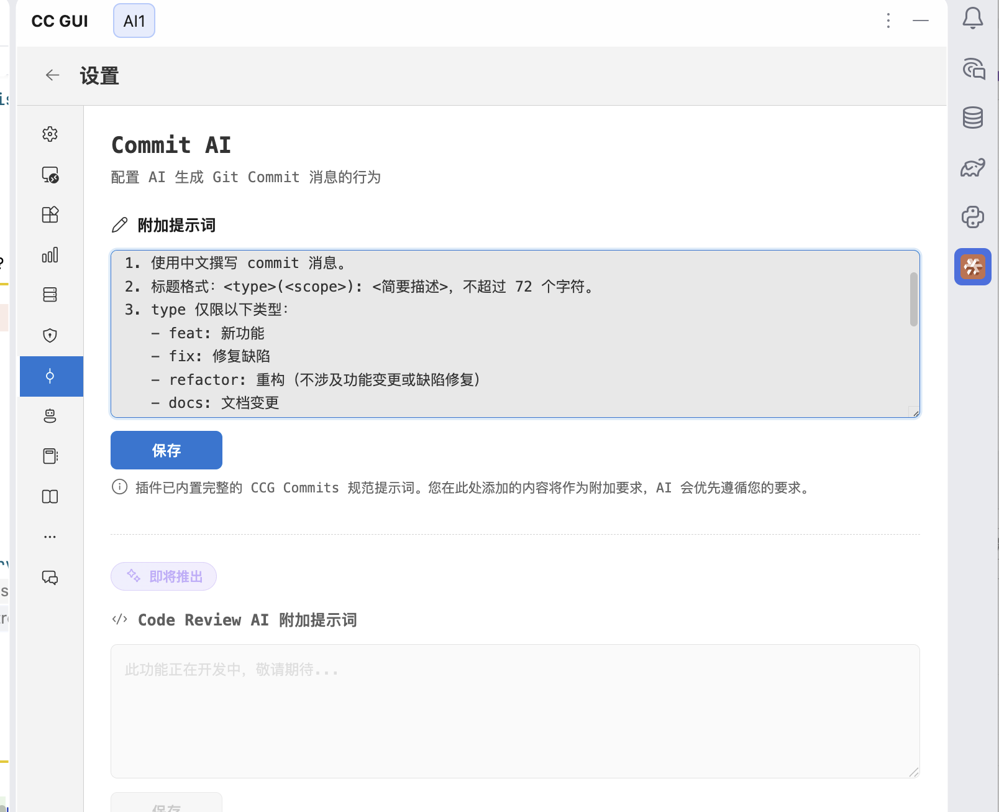
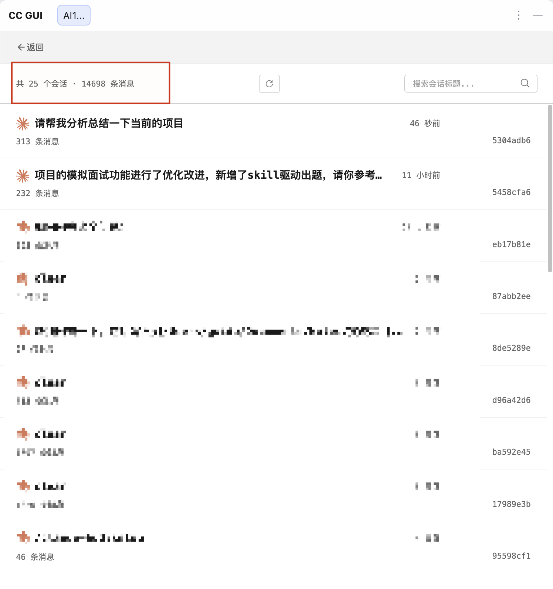

Hi, I'm Xiao G. I previously wrote about [using the Qoder plugin in IDEA](https://mp.weixin.qq.com/s/vz5A7fQh8WxqVBHscqHzQA). This article looks at another JetBrains plugin: **CC GUI**.

> **Version note:** Features and screenshots below are based on CC GUI v0.4.7 (2026-07-24). The plugin changes frequently, so refer to the project README and current interface for installation and authentication details.

## What Is CC GUI?

**CC GUI**, originally called Claude Code GUI, is an open-source JetBrains plugin under the MIT License. It provides a graphical interface for Claude Code and OpenAI Codex.



Project: [zhukunpenglinyutong/jetbrains-cc-gui](https://github.com/zhukunpenglinyutong/jetbrains-cc-gui).

If you have read my earlier articles, you may already know the **Agent Client Protocol (ACP)**. It defines an interface for communication between an agent and an IDE. Whether they can connect depends on the protocol versions, capabilities, and authentication methods implemented by both sides.

JetBrains' built-in agent integrations, agents in the ACP Registry, and ACP agents configured manually are different capabilities. They should not all be called “official plugins.” Available agents can also vary with the IDE version, plugins, and account.

CC GUI and ACP are two different approaches:

- **JetBrains/ACP:** Use the IDE's built-in integration, a Registry agent, or a custom ACP agent. The focus is on reusing JetBrains AI Chat, Diff, and context features; available functionality depends on the agent implementation.
- **CC GUI:** Use a separate community plugin to add GUI features such as session management, image input, agents, and MCP for Claude Code and Codex. Supported features depend on the current CC GUI version.

The approaches are compatible; choose based on your preferences.

Using v0.4.7 as the reference, this guide covers:

- **Two supported engines:** Connect Claude Code and OpenAI Codex, then switch between them in the provider settings.
- **Visual conversations:** Reference files with `@file`, send images, and rewind conversations through a more visual interface than the CLI.
- **Agents and MCP:** Use the built-in agent system and slash commands such as [/loop scheduling](https://mp.weixin.qq.com/s/apkuuxHmC1c6bR0kWhgmUA) and [/simplify code review](https://mp.weixin.qq.com/s/Np3oaBmdJAE319wuT7zHBw), and extend the plugin with MCP.
- **Diffs:** View code changes in IDEA, navigate files, and jump to code.
- **Session management:** Browse, search, favorite, and export conversation history.

## Installation and Configuration

### Step 1: Install the Plugin and SDK

In IDEA, open **Settings → Plugins** (shortcut: `Cmd + ,`), search for **CC GUI**, and install it.



After installation, find the CC GUI entry in the toolbar on the right side of IDEA and click the icon to open it.



The first time you use the plugin, it will prompt you to install the Claude Code/Codex SDK. The SDK is required to run the agents. Follow the interface to install it. Installation time depends on your network and local environment.



**Black screen?** Some users see a black screen when opening the CC GUI panel in IDEA 2026.1.

First try clearing the IDE's built-in browser cache. If that does not help, an issue reports that adding the following options under **Help → Edit Custom VM Options** can work around the problem:

```bash
-Dide.browser.jcef.out-of-process.enabled=false
-Dide.browser.jcef.gpu.disable=true
```

Restart IDEA after adding them and check again. This workaround only helps in some JCEF and graphics environments. As of 2026-07-24, the related issue remains open, so do not treat this as a confirmed fix. The options may also affect JCEF isolation or hardware acceleration. See <https://github.com/zhukunpenglinyutong/jetbrains-cc-gui/issues/813>.

### Step 2: Configure a Model Provider

Open the provider settings and configure one of the authentication methods currently supported by the plugin:

- **Claude.ai OAuth:** Authorize Claude Code through your Claude.ai account and subscription.
- **Anthropic API key:** Create an API key in the Anthropic Console; API usage is billed separately. A Claude.ai subscription does not automatically provide an API key.
- **Reuse a Claude Code CLI login:** If the current plugin version supports it, reuse an existing Claude.ai OAuth session. This does not mean importing credentials from `settings.json`.
- **Import local provider settings:** `settings.json` is a configuration file that may contain model, endpoint, or API settings. Before importing it, confirm which fields the plugin reads and how it stores secrets.
- **Import cc-switch settings:** cc-switch is a commonly used community tool for managing Claude Code providers. CC GUI supports its configuration, so you can import it directly.
- **Third-party proxy endpoint:** You can configure a custom endpoint, but compatibility, data handling, and key security depend on the proxy provider.

For Claude Code authentication options, see the [official authentication guide](https://code.claude.com/docs/en/authentication). Codex officially supports signing in with ChatGPT or using an API key; their plans and billing differ. Whether CC GUI supports a specific sign-in flow depends on the plugin version. See the [Codex authentication guide](https://developers.openai.com/codex/auth).

The screenshots in this article use the cc-switch import method.



### Step 3: Get Started

After configuration, start a conversation in the panel on the right. Begin with a simple task such as “Analyze the directory structure of this project” to try the context-aware features.

Here is a common development task: **check whether existing code follows the conventions and fix issues in batches**. Doing it manually is tedious: open each file, compare it line by line with the rules, find problems, fix them, and move to the next file.

CC GUI supports **Skills (slash commands)**, which let you package a specific review process into reusable instructions. For example, I configured a `java-coding-standards` Skill with review rules for Java and Spring Boot projects.

For this example, I used the [AI Interview Platform](https://javaguide.cn/zhuanlan/interview-guide.html). I entered the following in the conversation:

```
/java-coding-standards Check the code under @infrastructure
```

`/java-coding-standards` loads the review rules, and `@infrastructure` specifies the scope. In this demo, the agent read 14 Java files in that directory and produced a structured report:

| Severity | Issue                                                             | Files involved                | Count |
| -------- | ----------------------------------------------------------------- | ----------------------------- | ----- |
| High     | `log.error("xxx: {}", e.getMessage())` loses the stack trace      | FileHashService               | 3     |
| High     | BusinessException is missing an ErrorCode                         | RedisService                  | 1     |
| Medium   | Inline fully qualified class name (`java.util.function.Function`) | InterviewMapper, ResumeMapper | 7     |
| Medium   | Returns `Map<String, Object>` instead of a dedicated DTO          | InterviewMapper               | 2     |
| Low      | Font resource is not managed with try-with-resources              | PdfExportService              | 1     |
| Low      | DateTimeFormatter is recreated on every call                      | FileStorageService            | 1     |



After getting the report, you can ask the AI to generate candidate fixes file by file, then review each change and its rationale in the Diff panel.

This demo covered nine files and more than 20 changes. Reviewing the code, generating fixes, and completing one compile check took under five minutes. That time reflects only this example; results vary with the codebase, model, cache state, and acceptance criteria.

**What a Skill provides:** It packages what to review and the steps to follow in a reusable entry point, reducing repeated instructions. It can make the review criteria more consistent, but it cannot guarantee identical results across models or contexts. Team standards should still live in version-controlled rules, static checks, and review processes.

For recommended Vibe Coding Skills and answers to common questions about Skills, see these articles:

1. [AI Coding Skills: A Selection Guide—Requirements Clarification, TDD, Code Review, and UI Design](https://javaguide.cn/ai-coding/practices/programmer-essential-skills.html)
2. [What Are Agent Skills? How Do They Differ from Prompts and MCP?](https://mp.weixin.qq.com/s/5iaTBH12VTH55jYwo4wmwA)

## Built-In CC GUI Features

CC GUI also includes usage statistics, including token consumption, cost, and usage trends.



It also supports Commit AI, custom agents, a prompt library, and MCP server configuration.



You can also browse, search, and delete conversation history:



## CC GUI or Qoder?

These plugins serve different purposes. Here is a brief comparison:

| Dimension        | CC GUI                                              | Qoder                                   |
| ---------------- | --------------------------------------------------- | --------------------------------------- |
| **Role**         | GUI wrapper for Claude Code/Codex                   | Standalone AI coding agent              |
| **Open source**  | MIT License, fully open source                      | Closed source, made by Alibaba          |
| **Models**       | Claude Code + Codex; support depends on the version | Built-in and currently available models |
| **Context**      | `@file` references + image input                    | `@database` + `@file`                   |
| **Best for**     | Using existing CLI workflows in JetBrains           | Using an integrated agent               |
| **Java support** | General purpose                                     | Better tuned for the Java ecosystem     |

**My suggestions:**

- **Already use Claude Code or Codex?** Try CC GUI, but first confirm its authentication methods and feature mapping. The GUI does not guarantee full support for every CLI capability.
- **Want something ready to use without configuring API access?** Try Qoder; you can start after signing up.
- **You can install both.** They do not conflict, and you can switch depending on the task.

## Summary

CC GUI's main value is **adding a visual workflow for JetBrains users**. It brings actions that were spread across the terminal, editor, screenshot tools, and file manager into one place in the IDE where possible.

If you mainly use JetBrains and want to manage Claude Code or Codex sessions in the IDE, try CC GUI on a test project first. Then decide whether to use it regularly based on authentication, feature compatibility, and your team's security requirements.
