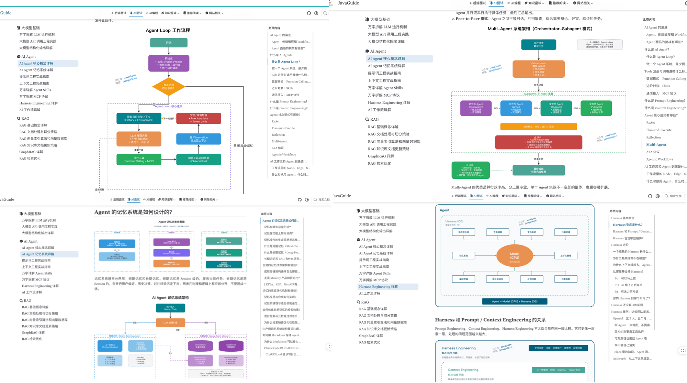

<!-- @include: @small-advertisement.snippet.md -->

Building an AI application involves more than putting a prompt behind an API. Real projects quickly run into context limits, structured output, RAG retrieval, tool permissions, evaluation regressions, cost, and reliability.

These problems cannot be handled in isolation. LLM fundamentals, agents, RAG, tool calling, and system design need to be understood together. Knowing only how to call an API is not enough for an architecture review; knowing RAG research without understanding incremental updates and version deduplication leaves practical knowledge-base maintenance unanswered.

If you are short on time, start with the [AI Application Development Interview Guide](./interview-questions/ai-interview-guide.md) and review common follow-up questions about LLMs, agents, RAG, skills, MCP, and AI system design. If you have not chosen a study order or are moving from backend development into AI, see the [2026 AI Application Development and Agent Roadmap for Java/Go Developers](../roadmap/java-to-ai-roadmap.md) and [2026 Guide for Backend Developers Moving into AI Agent Development](../roadmap/backend-to-ai-agent-roadmap.md). For a deeper study path, follow the order below.

This section is organized around LLM fundamentals, agents, RAG, and system design. The guides are connected through a suggested reading order and related links:

This section is also included in the open-source AIGuide project:

- **Repository:** [https://github.com/Snailclimb/AIGuide](https://github.com/Snailclimb/AIGuide)
- **Read online:** [https://javaguide.cn/ai/](https://javaguide.cn/ai/)

The guides are updated as APIs, frameworks, and model capabilities change. For versions, prices, and product capabilities, also check the relevant official documentation.

## Who Should Read This?

- Engineers moving from backend development to AI application development who want to learn LLMs, agents, RAG, and system design.
- Candidates preparing for AI engineering, AI application development, or backend-to-AI roles.
- Developers who have built prompt demos but want to better understand model-call workflows, structured output, RAG retrieval optimization, and evaluation loops.
- Readers who want to understand MCP, Function Calling, Tool Calling, vector databases, and model gateways in real projects.
- Team members who have integrated LLMs into projects and are starting to face reliability, cost, security, and quality-regression issues.

## Common Pitfalls

An LLM should not be treated as a black-box API. Token truncation, output variability when sampling parameters change, and malformed JSON responses cannot be fully addressed with prompts. Adding "Return strictly valid JSON" is only a first constraint. A production call path still needs format validation, retries, fallbacks, and error handling.

An agent is more than something that can call tools automatically. Memory and context engineering are the harder parts. Without good context management, an agent can lose track after a few turns: what was said, how far the task has progressed, and which tool results are still useful. This is even more apparent in long-running tasks. The agent may know how to proceed but get stuck in a loop and continue until its token budget is nearly exhausted.

When RAG gives an irrelevant answer, the model may not be the cause. Many problems start during retrieval: chunks are too coarse, the query is not rewritten, keyword and vector search are not combined, or reranking is ineffective. Checking the retrieval pipeline stage by stage is often more useful than switching to a more expensive model.

MCP, Function Calling, and Tool Calling address how tools are integrated. Standard protocols make integration easier, but production systems still need to decide who can call each tool, which data it can access, how calls are audited, and how failures are rolled back. A standard protocol alone does not solve these problems.

Once an AI application is live, reliability, observability, cost control, and quality regression become real concerns. They are easy to miss in a demo, where traffic is low and scenarios are simple. Teams building their first production AI application usually encounter these issues once real business traffic arrives.

## Suggested Reading Order

1. [AI Core Concepts](./ai-core-concepts.md): Connect LLMs, tokens, agents, RAG, MCP, skills, and ReAct in one workflow.
2. [AI Application Development Interview Guide](./interview-questions/ai-interview-guide.md): Build a list of common questions for interviews and project reviews.
3. [How LLMs Work](./llm-basis/llm-operation-mechanism.md) and [Engineering LLM API Calls](./llm-basis/llm-api-engineering.md): Understand model-call workflows, context, and structured responses.
4. [AI Agent Fundamentals](./agent/agent-basis.md), [Prompt Engineering](./agent/prompt-engineering.md), and [Context Engineering](./agent/context-engineering.md): Learn the fundamentals of agents, prompts, and context.
5. [Multi-Agent System Design](./agent/multi-agent.md): Continue with task decomposition, shared state, conflict handling, and failure recovery.

   For the full reading order for memory, MCP, skills, harnesses, workflows, and loops, see the [AI Agent section index](./agent/README.md).

6. [RAG Fundamentals](./rag/rag-basis.md), [RAG Document Processing and Chunking Strategies](./rag/rag-document-processing.md), and [RAG Retrieval Optimization](./rag/rag-optimization.md): Learn the core workflow for enterprise knowledge-base Q&A.
7. [AI Application System Design](./system-design/ai-application-architecture.md), [LLM and Agent Security in Practice](./system-design/llm-security.md), [LLM Gateways](./system-design/llm-gateway.md), and [AI Application Evaluation](./llm-basis/llm-evaluation.md): Take a demo into a real backend system and cover authorization, security, gateways, evaluation, and operations.

## Core Guides

### Interview Preparation and Roadmaps

- [2026 AI Application Development and Agent Roadmap for Java/Go Developers](../roadmap/java-to-ai-roadmap.md): A study path covering LLM fundamentals, APIs, prompts, RAG, agents, engineering, and project practice.
- [2026 Guide for Backend Developers Moving into AI Agent Development](../roadmap/backend-to-ai-agent-roadmap.md): Assess the transition, compare Java and Python AI development, review target roles, and plan your studies.
- [AI Core Concepts](./ai-core-concepts.md): Connects LLMs, tokens, MCP, skills, ReAct, embeddings, and GraphRAG across LLM, agent, and RAG fundamentals.
- [AI Application Development Interview Questions](./interview-questions/): Organizes interview preparation around LLM fundamentals, agents, RAG, and AI system design.
- [AI Application Development Interview Guide](./interview-questions/ai-interview-guide.md): A review path for common AI application development questions.
- [LLM Fundamentals Interview Questions](./interview-questions/llm-interview-questions.md): Covers tokens, context windows, sampling parameters, API calls, structured output, and evaluation.
- [AI Agent Interview Questions](./interview-questions/agent-interview-questions.md): Covers Agent Loops, memory, prompts, context, MCP, skills, harness engineering, and workflows.
- [How to Present an Agent Project in an Interview](./interview-questions/agent-project-interview-guide.md): Organizes real project experience around architecture, technology choices, evidence of results, and bad-case analysis.
- [RAG Interview Questions](./interview-questions/rag-interview-questions.md): Covers RAG fundamentals, vector databases, document processing, retrieval optimization, GraphRAG, knowledge-base updates, and evaluation.
- [AI System-Design Interview Questions](./interview-questions/ai-system-design-interview-questions.md): Covers production architecture, model gateways, observability, evaluation, security, and real-time voice agents.

### LLM Fundamentals

- [LLM Fundamentals](./llm-basis/): Learn model behavior, API calls, structured output, and AI application evaluation.
- [How Tokens, Context Windows, and Sampling Parameters Affect LLM Output](./llm-basis/llm-operation-mechanism.md): Turn tokens, context windows, and Temperature into clear, controllable engineering parameters.
- [Engineering LLM API Calls](./llm-basis/llm-api-engineering.md): Covers prompt assembly, model gateways, streaming responses, retries, rate limiting, and structured output.
- [Structured Output for LLMs](./llm-basis/structured-output-function-calling.md): Explains the underlying workflow for JSON Schema, Function Calling, Tool Calling, and MCP.
- [AI Application Evaluation](./llm-basis/llm-evaluation.md): Covers Golden Sets, LLM-as-Judge, RAG and agent metrics, trace replay, and online canary feedback loops.

### AI Agents

- [AI Agent Guides](./agent/): Covers agent fundamentals, memory, prompts, context, MCP, skills, and harness engineering.
- [AI Agent Fundamentals](./agent/agent-basis.md): Explains agents versus traditional programming and workflows, along with Agent Loops and tool registration.
- [AI Agent Memory](./agent/agent-memory.md): Covers short-term and long-term memory, memory lifecycles, and production optimizations.
- [Multi-Agent System Design](./agent/multi-agent.md): Explains when multiple agents are needed and how to implement task decomposition, shared state, conflict handling, and failure recovery.
- [Prompt Engineering](./agent/prompt-engineering.md): Covers the four elements of a prompt, common techniques, and prompt-injection defenses.
- [Context Engineering](./agent/context-engineering.md): Covers static rule orchestration, dynamic context, Token-budget fallbacks, and context persistence.
- [A Detailed Look at MCP](./agent/mcp.md): Explains MCP's layered architecture, capabilities, and production practices for MCP servers.
- [A Detailed Guide to Agent Skills](./agent/skills.md): Explains how skills differ from prompts, MCP, and Function Calling.
- [Harness Engineering](./agent/harness-engineering.md): Explains the Model + Harness architecture and engineering practices.
- [Workflow, Graph, and Loop in AI Workflows](./agent/workflow-graph-loop.md): Covers workflow nodes, edges, state, security boundaries, and implementation.
- [What Is Loop Engineering? Is It Just Old Wine in a New Bottle?](./agent/loop-engineering.md): Explains the triggers, context, verification, state, and stop conditions of the outer loop in coding agents.

### Retrieval-Augmented Generation (RAG)

- [RAG Guides](./rag/): Covers document processing, vector databases, GraphRAG, retrieval optimization, and knowledge-base updates for enterprise Q&A.
- [RAG Fundamentals](./rag/rag-basis.md): Learn what RAG is, why it is used, and its main benefits and limitations.
- [RAG Document Processing and Chunking Strategies](./rag/rag-document-processing.md): Covers document parsing, cleaning, structuring, chunking, and multimodal content.
- [RAG Vector Indexes and Vector Databases](./rag/rag-vector-store.md): Learn index algorithms such as HNSW and IVFFlat and how to choose a vector database.
- [RAG Retrieval Optimization](./rag/rag-optimization.md): Covers chunking, hybrid search, query rewriting, reranking, and context compression.
- [GraphRAG](./rag/graphrag.md): Learn about entities, relationships, community detection, and global and local retrieval.
- [RAG Knowledge-Base Update Strategies](./rag/rag-knowledge-update.md): Covers incremental updates, versioning, deduplication, and full rebuilds.

### AI System Design

- [AI System-Design Guides](./system-design/): Covers architecture, model gateways, voice workflows, observability, evaluation, and security for production AI systems.
- [AI Application System Design](./system-design/ai-application-architecture.md): Takes a prompt demo into production, covering prompt management, model gateways, RAG, memory, tool calls, observability, evaluation, and security compliance.
- [LLM and Agent Security in Practice](./system-design/llm-security.md): Covers direct and indirect prompt injection, tool privilege escalation, MCP authorization, sensitive data, code sandboxes, supply chains, and security regression testing.
- [LLM Gateways](./system-design/llm-gateway.md): Explains multi-model routing, fallbacks, rate limits and quotas, cost attribution, observability, auditing, and caching.
- [AI Voice Technology](./system-design/ai-voice.md): Covers VAD, ASR, LLM, TTS, streaming playback, interruption handling, and edge-cloud deployment choices.

## Common Questions

- How do tokens, context windows, Temperature, and Top P affect LLM output?
- Why is a prompt alone insufficient for structured output? What roles do JSON Schema, Function Calling, and server-side validation play?
- How do agents differ from workflows? How do observation, planning, action, and reflection work together in an Agent Loop?
- How do prompt engineering and context engineering differ?
- What problem does MCP solve, and how does it relate to Function Calling and Tool Calling?
- Why can RAG return irrelevant answers? Should you investigate retrieval, ranking, context compression, or generation?
- How should a vector database be selected? Which use cases suit indexes such as HNSW and IVFFlat?
- How should an AI application be evaluated? How do Golden Sets, LLM-as-Judge, online canary releases, and trace replay fit together?
- Why does a production AI application need a model gateway, and how should it handle rate limits, fallbacks, cost, and auditing?

## Related Topics

- [AI Coding in Practice](../ai-coding/)
- [System Design](../system-design/)
- [High Availability](../high-availability/)
- [High Performance](../high-performance/)
- [Distributed Systems](../distributed-system/)

<!-- @include: @article-footer.snippet.md -->
