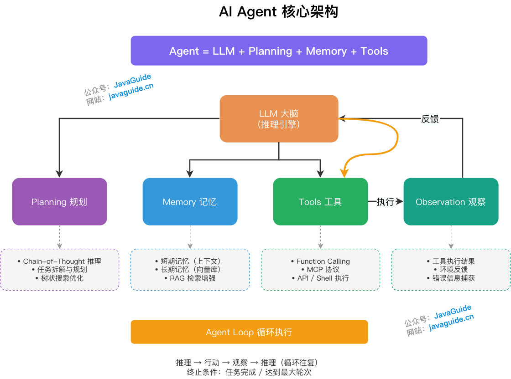
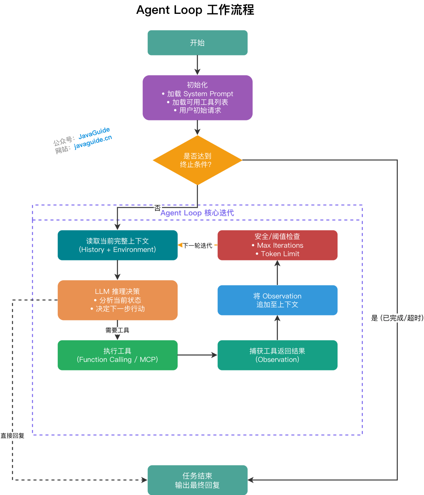
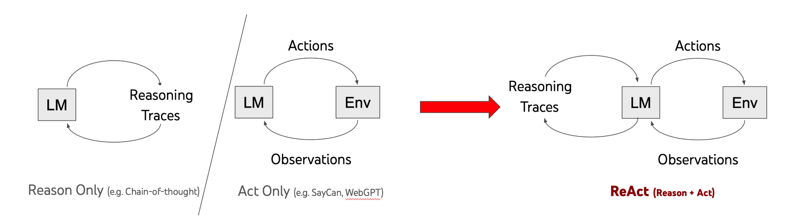
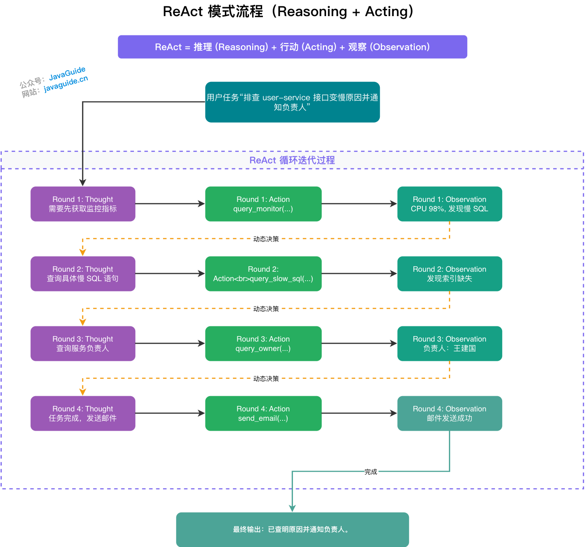
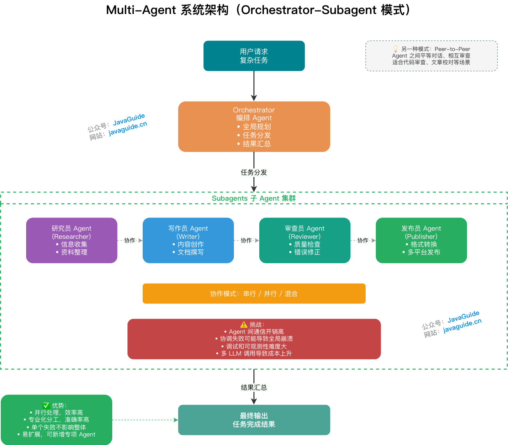
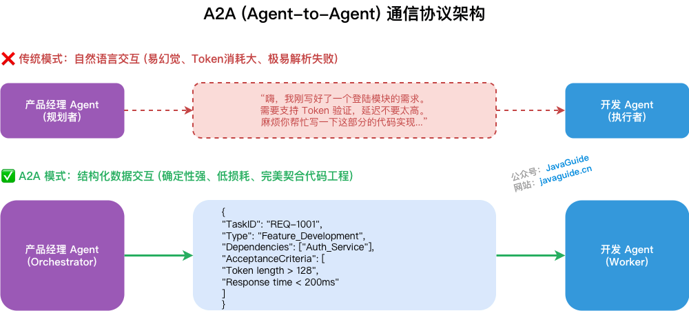
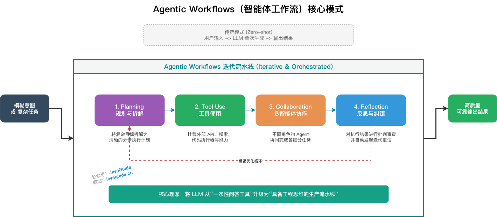

"Investigate why the user-service API slowed down this morning and send the findings to the owner." There is no fixed answer to this request: whether to check metrics, logs, or a Heap Dump depends on the evidence found in the previous step. Even after finding a slow SQL query, the Agent must decide whether to inspect the execution plan, how to organize its findings, and whether it can send a notification.

A chatbot can provide a troubleshooting checklist, but it will not carry out the entire process on its own. To complete the task, the model must select tools, read their results, and use them to decide what to do next or whether to stop. An AI Agent handles this continuous decision and execution process.

The more tools an Agent can access, the more carefully its execution path must be controlled. Tasks with explicit steps, such as deducting inventory or processing approvals, should still be controlled by traditional programs or Workflows. Use an Agent to make decisions only when intermediate steps depend on real-time evidence and cannot be predefined.

The following sections break down this process through its evolution, execution loops, tool integration, and common patterns, then explain when to use an Agent, a Workflow, or traditional programming.

## The Evolution of AI Agents

Agent capabilities did not emerge all at once. Models first gained the ability to call external tools, followed by the need for orchestration, long-running tasks, and continuous operation.

**In 2022, when products such as ChatGPT first became popular**, models mainly answered questions using existing knowledge. They could not proactively call external tools or perform operations. [Prompt Engineering](https://javaguide.cn/ai/agent/prompt-engineering.html) was the primary way to use them: clearly state constraints and context to get more consistent output.

**Things began to change in mid-2023 with the introduction of Function Calling.**

Function Calling enabled LLMs to call external APIs, while RAG brought external knowledge bases into the response process. Early experiments such as AutoGPT followed, but they often repeated calls in multi-step tasks and sometimes entered infinite loops.

**By late 2023, orchestration had become a focus.**

ReAct started to see widespread adoption: the model selects an action based on the current state, reads the tool's result, and continues reasoning. Multi-Agent role separation also entered practice, with planning, execution, and review assigned to different roles.

Platforms such as Coze and Dify used DAGs (directed acyclic graphs) to constrain execution paths, adding observable and controllable workflow boundaries to early fully autonomous systems.

**By late 2024, standardization and multimodality had become more important.**

[MCP](https://javaguide.cn/ai/agent/mcp.html) began addressing fragmented tool integrations, while Computer Use extended execution to graphical interfaces. Coding tools such as Cursor, Claude Code, and Codex also began connecting codebase reading, editing, testing, and commits into one task flow, and "Vibe Coding" became more widely discussed.

**In 2025, Agents began moving toward long-running task execution.**

At this stage, Agents began taking on tasks that extend beyond a single conversation: accepting a task, running a workflow, and recording results. A single Prompt cannot reliably cover this kind of work, so repeatable procedures, context, templates, scripts, and validation rules were packaged into Skills for on-demand use in similar tasks.

**By 2026, Agents were becoming more like always-on digital workers.**

Projects such as OpenClaw brought Skills and Heartbeat to the forefront.

Skills package capabilities. Heartbeat periodically wakes the Agent to check messages, handle tasks, or update state. This is scheduled wake-up, not continuous awareness; data sovereignty on a local machine does not mean absolute safety. An Agent that can install Skills, access files, and run scripts must account for permission, sandbox, and supply-chain risks.

This also drove Harness Engineering. It can be represented as `Agent = Model + Harness`: the model reasons and generates, while the Harness provides an executable, observable, recoverable, and verifiable runtime environment. The focus therefore expanded from model parameters, context length, and Prompt techniques to the engineering environment around the model.

Built-in memory, predictive capabilities, and expansion from digital environments to physical robots are still developing. These years are only convenient markers: real products often combine traits from multiple stages. The clearest turning point was still mid-2023, when models began moving beyond text generation toward performing external actions.

### How Do Agents Differ from Traditional Programming and Workflows?

The key distinction between an Agent, an automation script, and a Workflow is who determines the execution path:

```text
Traditional programming: Developer writes code → Execution result
Workflow: Product manager draws a flowchart → Execution result
Agent: User states an intent → AI decides → Dynamic execution
```

Traditional programs are suited to fixed, frequent logic such as deducting inventory, transitioning payment states, and consuming messages from a queue. Using an Agent for these tasks only adds latency and uncertainty.

Work with clear paths, such as approvals, content publishing, and lead assignment, is suited to a Workflow. A graph controls step order and branches, so problems can be traced to specific nodes.

"Investigate why the service slowed down this morning" is different. Whether to check metrics, logs, or a Heap Dump depends on intermediate evidence, so it is difficult to predefine every branch. Natural-language intent understanding and dynamic decisions are where Agents are useful. If only a few steps in a long process are uncertain, Plan-and-Execute can leave those subtasks dynamic within a fixed framework.

### What Challenges Do Agents Face?

It is important to discuss real problems as well as the promise of Agents.

- During long tasks, historical information may be truncated and the model may "forget." Longer context does not always improve reasoning; many models make limited use of information in the middle.
- Tool calls can reduce hallucinations but cannot eliminate them. The LLM may still make incorrect judgments during reasoning, and tool results may not correct them.
- Iterations, tool calls, returned logs, and context compression all consume Tokens. The bill for a complex task can be sobering.
- Agents that run code, call APIs, and read or write files face prompt injection and privilege escalation risks. Practical safeguards include least privilege, sandbox isolation, and human approval for high-risk actions.
- In complex multi-step reasoning, LLMs can still settle for a local optimum: they may appear to make progress while drifting off task.
- It can be difficult to determine why an Agent made a decision or called a tool, and which step caused the context to go off track.

Likely areas of progress include longer context, layered memory, multimodal GUI operation, sandbox and permission systems, and more efficient reasoning.

## What Is an AI Agent?

When a troubleshooting Agent receives a request about a slow service, it might read metrics, inspect logs based on an alert, and then send its findings to the owner. Each step depends on evidence from the previous one. Frameworks such as LangChain package this process, but underneath it is usually a loop that reads state, selects an action, and writes back the result.

An AI Agent is a software system that can perceive its environment, make decisions, and take actions. The LLM handles intent and decisions, tools perform external operations, and memory stores the current task and historical information. Unlike a chatbot that only generates replies, an Agent observes and adjusts throughout a task until a termination condition is met.

A common model is: **Agent = LLM + Planning + Memory + Tools**.



**Reasoning / Planning** determines the next goal and action. The LLM breaks down the goal based on the current task state. Chain-of-Thought (CoT) prompting divides the reasoning process into steps instead of jumping directly to a conclusion.

Short-term memory is usually kept in the conversation context to maintain continuity. Long-term memory is often managed by external knowledge bases, such as vector databases or knowledge graphs, to retrieve previously accumulated information.

**Tools** query data, call APIs, read and write files, or execute code. Their results must be appended to the context as the next iteration's Observation. Otherwise, the model cannot see the feedback from external operations or decide what to do next.

For the full tool-calling lifecycle, permissions, confirmation, idempotency, auditing, timeouts, and Java examples, see [Structured Output and Function Calling](../llm-basis/structured-output-function-calling.md). For evaluation metrics such as task completion, tool calls, and execution traces, see [How to Evaluate Agent Applications](../llm-basis/llm-evaluation.md#agent-应用怎么评测).

### What Is an Agent Loop?

An Agent Loop continuously runs this feedback cycle. In each iteration, the LLM selects an action based on the context, executes a tool, and writes back the result. The loop ends when the task is complete or a stop condition is met.



At initialization, the Loop loads the System Prompt, tool list, and user request. The model then chooses between replying directly and calling a tool. Tool results are written back to the context until the model no longer requests tools.

A common upper limit is 10 to 20 iterations; the loop can also stop based on Token usage. This boundary prevents incorrect decisions from sending a task into an infinite loop.

The context grows with each result, and as key information becomes diluted, the model is more likely to go off track. Context Engineering addresses how to filter and organize this information. LangChain, LlamaIndex, and Spring AI package things differently, but all rely on this underlying Loop.

### What Are the Three Minimum Layers in an Agent System?

Code that connects to a model usually belongs in **LLM Call**. This layer handles differences between OpenAI, Anthropic, Hugging Face, and other APIs, along with streaming, Token truncation, and retries.

**Tools Call** connects Function Calling, MCP, Skills, file access, web search, code sandboxes, and third-party APIs to the model. The availability and format of external capabilities affect the next decision.

**Context Engineering** organizes the Prompt, dynamic memory, session state, and tool descriptions sent to the model. If the context lacks information needed for the task or contains too much irrelevant content, the task may stall even when the model is capable.

## What Standard Formats Do Tools Use for Registration and Calls?

To call external tools accurately, an Agent relies on two things: the OpenAI Schema and MCP.

The OpenAI Schema defines the data format; MCP handles communication and integration.

### Data Format: Function Calling Schema

External tools can be complex, but the LLM reasons from structured descriptions.

Most common data formats are converging on the OpenAI Function Calling Schema. Providers such as Anthropic and Google support similar formats.

It uses JSON Schema to describe a tool's name, purpose, parameter types, and required fields. The model uses this description to decide whether to call the tool and how to fill in its parameters.

For example, a big data engineer might use a tool to query slow SQL logs:

```json
{
  "type": "function",
  "function": {
    "name": "query_slow_sql",
    "description": "Query slow SQL logs for a specified microservice and time range. Use this when a service responds slowly, a database times out, or CPU usage spikes. Do not use it for network or memory issues.",
    "parameters": {
      "type": "object",
      "properties": {
        "service_name": {
          "type": "string",
          "description": "Service name, such as user-service or order-service"
        },
        "time_range": {
          "type": "string",
          "description": "Time range in HH:MM-HH:MM format, such as 09:00-09:30"
        },
        "threshold_ms": {
          "type": "integer",
          "description": "Slow SQL threshold in milliseconds; defaults to 1000"
        }
      },
      "required": ["service_name", "time_range"]
    }
  }
}
```

The quality of a tool description directly affects the Agent's decisions.

The model mainly relies on `description` to decide whether to call a tool and how to fill in parameters. Include both when to use the tool and when not to use it. For example, explicitly excluding network and memory issues from a slow SQL query tool helps the model avoid calling it for the wrong problem.

### A Higher-Level Wrapper: Skills

A slow-query investigation often involves reading logs, running analysis scripts, and then organizing recommendations according to team conventions. If the Agent plans these steps from scratch each time, the process and output are difficult to reuse consistently.

A Skill stores the sequence, constraints, and lessons learned in this workflow as an instruction file that can be loaded on demand. The host adds the relevant content to the context only when the task matches.

There are two common ways to package these workflows:

**Traditional Toolkits (black boxes)** combine multiple atomic tools into a higher-level tool in code and expose only a JSON Schema. The LLM cannot see the internal process. This is suitable for fixed logic when reducing reasoning steps and Token usage is important.

**Agent Skills (white boxes)** expose the execution process and usually use `SKILL.md` as an entry point for natural-language instructions. A Skill typically has its own directory:

```text
.claude/skills/code-reviewer/
├── SKILL.md          ← YAML front matter and detailed instructions
├── scripts/xxx.py    ← Optional supporting scripts
└── reference.md      ← Optional reference material
```

The lightweight metadata at the top of `SKILL.md` makes the Skill discoverable and describes its purpose and activation conditions. The body contains procedures, constraints, and examples. The host reads the metadata first; the full instructions are loaded only if the model determines they are needed. This deferred loading is a key difference between Agent Skills and traditional Toolkits.

Tools such as Claude Code and Cursor scan the project's `.claude/skills/` directory and let the model decide whether to activate a Skill. Use Toolkits when the call path is fixed; Agent Skills are better when you want to preserve team knowledge while keeping the workflow flexible. See [Agent Skills Explained](https://javaguide.cn/ai/agent/skills.html) for routing design, writing `SKILL.md`, and auditing third-party Skills for security.

### Communication and Integration: The MCP Protocol

The Function Calling Schema describes a tool's name, parameters, and purpose. MCP defines how tools connect to the host application. They solve different problems.

Anthropic introduced MCP in November 2024. It addresses a straightforward problem: developers previously had to maintain mappings in code by hand, such as:

Tool name → implementation function + JSON Schema description

Each new tool required more glue code, and maintenance became harder as the number of tools grew.

MCP provides a unified communication protocol based on JSON-RPC 2.0. It is often called the "USB-C port" of AI. External systems expose capabilities through MCP Servers, and the host application can automatically discover and register tools after connecting to a Server.


This decouples the AI application from the underlying external code.

MCP defines three standard primitives:

| Primitive | Purpose                                           | Examples                                         |
| --------- | ------------------------------------------------- | ------------------------------------------------ |
| Tools     | Functions that the LLM can call                   | Query a database, send email, execute code       |
| Resources | Read-only data that an Agent can access on demand | Local files, database records, log streams       |
| Prompts   | Reusable prompt templates                         | Code review templates, incident report templates |

One point that can be confusing: an MCP Server still uses JSON Schema internally to describe the parameters of the tools it exposes.

JSON Schema is a data format; MCP is a communication protocol.

## What Is Prompt Engineering?

A Prompt is the instructions and context given to a large language model. Prompt Engineering defines task boundaries, output formats, and constraints. Without this information, the model has to guess; clear conditions make output more consistent. See [Prompt Engineering](https://javaguide.cn/ai/agent/prompt-engineering.html) for techniques.

## What Is Context Engineering?

When the context contains too much irrelevant information, task performance may decline even if the model has the necessary capabilities.

Context Engineering provides the most useful information to the model within a limited Token window while filtering out noise. It is easy to confuse with Prompt Engineering.

Prompt Engineering focuses on how to write prompts. Context Engineering covers more: rules, memory, tool descriptions, session state, external observations, and the Token budget.


There is much more to cover here; see [Prompt Engineering](https://javaguide.cn/ai/agent/prompt-engineering.html) and [Context Engineering](https://javaguide.cn/ai/agent/context-engineering.html) for separate guides.

## What Are the Core Agent Patterns?

### ReAct

ReAct combines Reasoning and Acting. Shunyu Yao and others introduced it in 2022 in the paper [ReAct: Synergizing Reasoning and Acting in Language Models](https://react-lm.github.io/).

Many Agent modules in frameworks such as LangChain, LlamaIndex, and AgentScope are influenced by this pattern.

The idea is straightforward: the model reasons for one step, receives feedback from the external environment, and reasons about the next step, repeating this cycle.

LLMs often lack real-time information and can hallucinate. ReAct lets the model "take one step at a time," using tool results to inform each subsequent decision.



For example, suppose the task is to investigate why the user-service API slowed down this morning and send the findings to the owner.

This is roughly how ReAct would handle it.

First, it checks the morning metrics for user-service and finds that CPU usage spiked to 98% between 9:00 and 9:30, along with many slow SQL alerts.

It follows this lead into the logs, retrieves the slow SQL query, and finds that it performed a full table scan without using an index.

Next, it looks up the service owner and finds Wang Jianguo in the contact directory at wangjianguo@company.com.

Finally, it prepares an investigation report and sends an email notification.

This process is not predefined. If the metrics showed an out-of-memory error instead, the next step should be to inspect the Heap Dump rather than continue searching for slow SQL.

That is the value of ReAct: it can adjust its approach as evidence arrives.

ReAct implementations generally need these components:

1. Historical context to store reasoning steps, actions, and observations.
2. Real-time environment input, such as system alerts and user feedback.
3. An LLM reasoning module for analysis and planning the next step.
4. A tool and Skill library, including atomic tools.
5. A feedback mechanism to collect tool responses and add them to the context.



Each ReAct step is driven by external observations, making its decisions easier to trace and less detached from the environment than one-shot generation. In return, multiple calls increase response latency, and effectiveness depends on reliable tools and Skills.

For example, checking metrics and logs and analyzing bottlenecks can be packaged into a `diagnose_service_performance` Skill that returns a structured diagnostic summary to the LLM. This avoids rebuilding the workflow from atomic steps for every investigation.

### Plan-and-Execute

The LangChain team introduced Plan-and-Execute in 2023. The LLM first creates a global step-by-step plan, then an executor completes each item. This approach helps maintain overall progress in long tasks with many steps and clear dependencies.

The plan is also a limitation. If an unexpected result occurs during execution, dynamic adjustment and error recovery are weaker than in ReAct, where the model decides as it goes. Its behavior is closer to a static Workflow.

The two patterns can be nested: use CoT to define global steps, then run a ReAct sub-loop within each step. The plan provides structure, while the sub-loops handle local uncertainty.

### Reflection

Reflection corrects Agent behavior through natural-language feedback without changing model weights. Common implementations handle different stages:

- Reflexion records reflections in a memory buffer after task failure. For example, if debugging reveals that `count` was not initialized before a call, the Agent can avoid the issue in the next iteration.
- Self-Refine has the model review and iteratively revise its answer, code, or copy after generating it.
- CRITIC verifies facts using external tools such as search engines and code executors, then revises based on the results.

Reflection is usually layered on top of ReAct or Plan-and-Execute: validation and adjustment are added during execution, while the underlying pattern still performs the task.

### Multi-Agent

When a task can be divided into relatively independent roles such as planning, execution, and validation, multiple Agents can collaborate. In the **Orchestrator-Subagent pattern**, an orchestrator Agent creates a global plan and assigns tasks to subagents, which execute in parallel or sequentially. The orchestrator then combines their results.

For debate, review, or mutual verification, use a **Peer-to-Peer pattern**, where Agents with equal roles communicate and review each other's work directly.



When a task can genuinely be split by specialization, Multi-Agent systems can run tasks in parallel, and failure of one subtask may not block the rest. The tradeoff is higher communication, coordination, debugging, and Token costs.

Implementation must also handle task contracts, shared state, parallel write conflicts, Worker takeover, and checkpoint recovery. See [Multi-Agent System Design: Task Decomposition, Shared State, Conflict Handling, and Failure Recovery](./multi-agent.md) for details.

### Structured Task Contracts

When moving from a single Agent to a Multi-Agent system, communication between Agents becomes an engineering problem.

Relying on natural-language conversations between Agents consumes many Tokens and can lead to parsing errors.

Structured task contracts can reduce these handoff problems.

They require roles to exchange results that follow a Schema rather than free-form text. For example, JSON or XML can express task fields, results, and state-transition instructions.

By analogy, backend microservices do not exchange data by parsing HTML pages; they use RESTful or RPC interfaces to send structured objects.

Structured task contracts define what each role receives, what it must deliver, and how its result is validated.

For example, after writing requirements, a "Product Manager Agent" should not simply say, "I finished; please implement this." It should return a standard JSON payload containing `TaskID`, `Dependencies`, and `AcceptanceCriteria`. The development Agent can deserialize it and start execution.

Structured delivery does not mean that the A2A protocol has been implemented. For capability discovery, task state, and artifact delivery between Agents in different processes, see the [A2A section in the Multi-Agent guide](./multi-agent.md#a2a-能解决什么-不能解决什么).



### Agentic Workflows

Agentic Workflows is a concept strongly advocated by Andrew Ng. It emphasizes engineering orchestration that connects reasoning, tools, memory, reflection, and multi-Agent collaboration into executable workflows instead of waiting for underlying models to improve.



Common design patterns include:

1. Reflection: have the model review its own work.
2. Tool Use: give the LLM tools such as web search and code execution.
3. Planning: have the model propose and execute a multi-step plan.
4. Multi-Agent Collaboration: have multiple Agents work together to complete a task.

These patterns are usually combined in real projects. For example, use Planning to decompose a task, run ReAct and call Tools in subtasks, then use Reflection to check the result. Agentic Workflows describes this combination, not a specific framework.

## How Do AI Workflows and Agents Relate?

In a workflow such as "generate a draft, review its quality, and revise based on feedback," the step order and retry conditions can be defined in a graph in advance; the LLM only generates or makes decisions at specific nodes. This makes it possible to trace problems to a specific node or edge.

In a pure Agent, the LLM decides at runtime whether to call a tool, which tool to call, and what path to take next. This suits tasks where what to investigate and how to investigate it depend on intermediate evidence.

Agentic Workflows combine the two approaches: a global Workflow fixes the main process and embeds Agent sub-loops only where the path is uncertain.

### What Are Nodes, Edges, and State in a Workflow?

At runtime, a Node performs work, an Edge determines control flow, and State shares context between nodes. Together they form a directed graph.

A Node should do one thing: read state, execute logic, and write back a result. It can call an LLM, invoke a tool, or run ordinary code. For an article-writing task, typical nodes are "generate a draft," "review quality," and "revise based on feedback." Nodes with focused responsibilities are easier to troubleshoot. An Edge determines where execution goes next: sequential edges follow a path, conditional edges branch based on runtime state, and loop edges return to an earlier node for another attempt. State stores items such as the current draft, score, and retry count; conditional edges often use these values to determine where to go.

"If the review fails, return to revision, with at most 3 retries" becomes a conditional edge from `ReviewNode` to `ReviseNode`, plus a guard that jumps to `ExitNode` when `iteration_count >= 3`. The `iteration_count` in State is what makes this logic work.

This graph structure is easier to extend than a hard-coded if-else chain and makes it easier to locate problems at a specific node or edge. LangGraph (Python) and Spring AI Alibaba Graph (Java) follow this approach. See [Workflows, Graphs, and Loops in AI Workflows](https://javaguide.cn/ai/agent/workflow-graph-loop.html) for detailed design and implementation.

### When Should You Use an Agent or a Workflow?

The simplest criterion is whether the execution path can be determined in advance.

If it can, use a Workflow. If not, use an Agent. If both are needed, use Agentic Workflows.

There is a common misconception: people may think a task's path is "uncertain" when its requirements have not been clearly decomposed. After breaking down a task carefully, many cases turn out to be "the LLM generates or makes a decision at fixed nodes." A Workflow is more reliable and easier to troubleshoot for these cases.

Pure Agents are best suited to tasks whose execution steps cannot be written in advance. For example, when investigating a production incident, it may be impossible to predefine what to check, how to check it, or how far the investigation should go.

Another criterion is fault tolerance. A Workflow's fixed execution path is easier to troubleshoot; an Agent's dynamic path can be an order of magnitude harder to debug. For B2B business scenarios, prefer Workflows or Agentic Workflows.

## Choosing Between Patterns

The previous sections covered ReAct, Plan-and-Execute, Reflection, Multi-Agent systems, and AI Workflows. Choosing between them can be overwhelming, so use this table as a starting point:

| Scenario                                                           | Recommended approach | Tradeoff                                                  |
| ------------------------------------------------------------------ | -------------------- | --------------------------------------------------------- |
| Execution path is known in advance, with LLMs needed at some nodes | AI Workflow (Graph)  | Stable and observable, but has higher upfront design cost |
| Execution path is uncertain and needs dynamic planning             | ReAct                | Flexible, but uses more Tokens and is harder to debug     |
| Long task with many clear steps                                    | Plan-and-Execute     | Easier to stay on track, but weaker at dynamic adjustment |
| High output-quality requirements with room for iteration           | Add Reflection       | Use with ReAct or Plan-and-Execute, not on its own        |
| Task naturally divides into specialized roles                      | Multi-Agent          | Communication and debugging costs can double              |
| Long task with some unpredictable subtasks                         | Agentic Workflows    | Global Workflow with local ReAct sub-loops                |

Start with the simplest approach that works, then decide which layer to upgrade based on actual failure patterns.

Starting with Multi-Agent, relying entirely on dynamic model reasoning, and ignoring context management can create problems that are difficult to recover from.

## Summary

Most unstable Agent projects are not unstable because the model is inadequate.

The foundations are incomplete. Omitting any of the four parts—LLM, Planning, Memory, or Tools—creates a clear weakness. Without Tools, the Agent can only give suggestions. Without Memory, it forgets during longer tasks. Poor context management makes it easy to go off track.

Pattern selection can also go wrong. ReAct is flexible but difficult to debug and consumes more Tokens. Workflows are stable but require clear requirements; insufficient upfront design makes later changes difficult. Multi-Agent systems can have unexpectedly high communication and debugging costs. Starting with the most complex solution is a common engineering trap.

Tool descriptions are easy to overlook. MCP handles integration and JSON Schema defines the description format, but the model relies on the few sentences in `description` to decide whether to call a tool and how to set its parameters. Skimping on this work creates more work later.

Choosing between an Agent and a Workflow is not complicated: write down the task's execution path first. If you can define it, use a Workflow; if you cannot, use an Agent. This decision is more useful than chasing frameworks.
