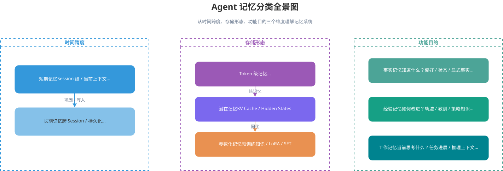
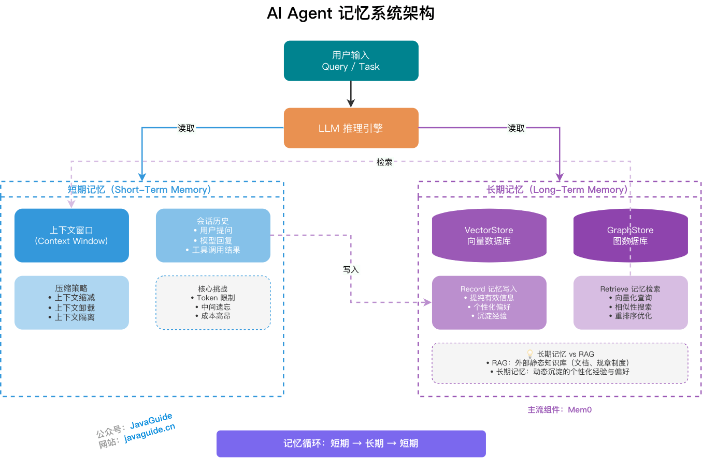
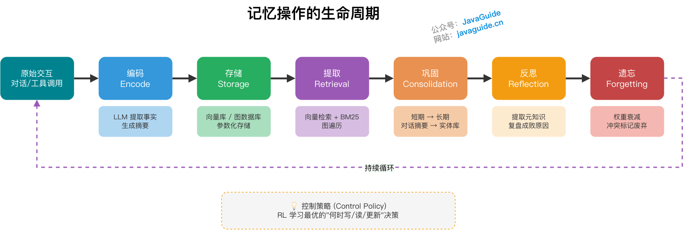
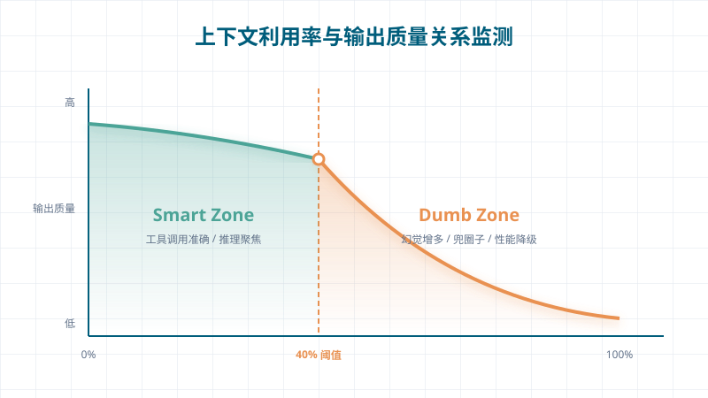
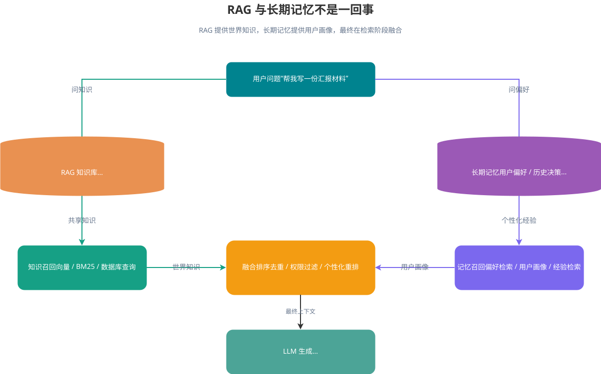
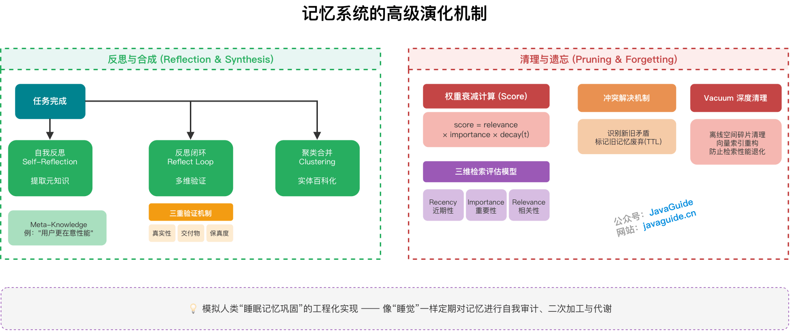
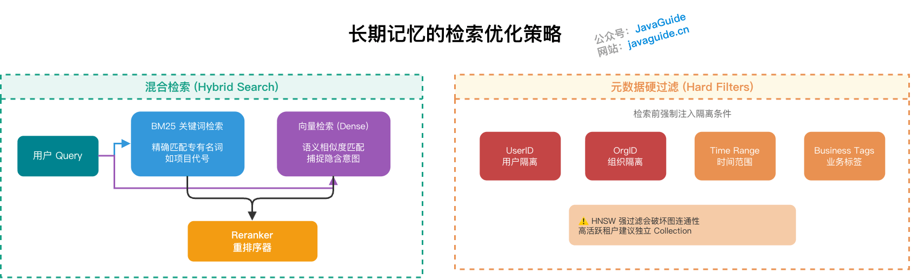
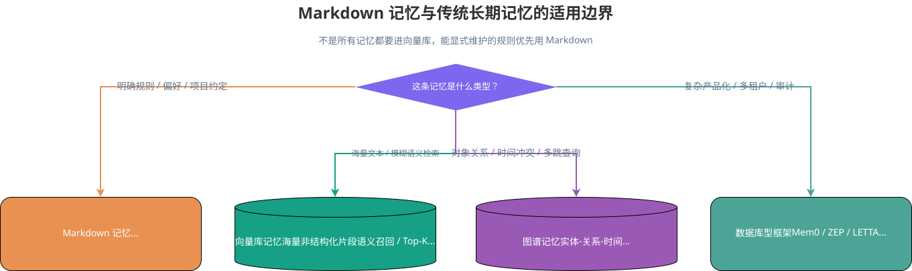

<!-- @include: @article-header.snippet.md -->

Long-running tasks quickly encounter several hard limits: the context window has a cap, Token costs keep rising, and when a Session ends, the previous trajectory disappears with the process unless it was persisted. Even if the model completes its current reasoning, it has nowhere to save and reuse historical records.

The memory layer must preserve key facts in the current conversation and let a new Session retrieve user preferences, background, and past decisions. This guide covers memory representations and functional categories, the read/write lifecycle, short- and long-term implementations, common products, retrieval optimization, and Markdown-based memory. Sliding-window trimming and offloading overlap with [Context Engineering: What Is It, and How Does It Differ from Prompt Engineering?](./context-engineering.md), so the two guides can be read together.

## How Is an Agent Memory System Designed?



Memory systems usually have two layers: short-term and long-term memory. Short-term memory exists at the Session level and serves the current task. Long-term memory persists across Sessions and stores user preferences, past decisions, and experience. Keep the two separate, both logically and physically.



### What Forms Can Memory Take?

In addition to grouping memory by time, it can be divided into three types based on storage location and representation:

| Storage form       | Description                                                          | Typical implementation                                |
| ------------------ | -------------------------------------------------------------------- | ----------------------------------------------------- |
| Token-level memory | Stored in external databases as natural language or discrete symbols | Text chunks in a vector database, structured JSON     |
| Parametric memory  | Information encoded in model parameters                              | Pretraining knowledge, LoRA adapters, SFT fine-tuning |
| Latent memory      | Implicitly represented inside the model                              | KV Cache, activations, Hidden States                  |

These forms are not completely separate. MemOS's "Memory Cube" framework supports dynamic transitions from plain-text memory to activation memory (KV Cache) and then to parametric memory. In simple terms, frequently used hot memory is kept closer, while stable, long-term cold memory is consolidated in a more permanent form.

### How Is Memory Classified by Function?

By function, Agent memory can be divided into three types:

| Type            | Core question                        | Stored content                                                          | Example use case                             |
| --------------- | ------------------------------------ | ----------------------------------------------------------------------- | -------------------------------------------- |
| Factual memory  | What the Agent knows                 | User preferences, environment state, explicit facts                     | Remember a user's preferred technology stack |
| Episodic memory | How the Agent can improve            | Past trajectories, lessons from success and failure, strategy knowledge | Learn from a failed code review              |
| Working memory  | What the Agent is thinking about now | Current reasoning context and task progress                             | Intermediate state in multi-step reasoning   |

Memory can be further classified by content:

- Episodic memory records specific events in a particular time and context, answering "What happened?" For example: "The user reported an order timeout last Wednesday."
- Semantic memory extracts general knowledge, facts, or patterns from multiple episodes, answering "What does it mean?" For example: "This user is more sensitive to performance issues than missing features."
- Procedural memory stores skills, rules, and learned behaviors so the Agent can perform a task sequence automatically instead of reasoning from scratch each time. For example: "When reviewing this user's code, check for OOM risks first."

### What Is the Memory Lifecycle?



From entering the system to eventual removal, a memory generally passes through these stages. Different papers may use different names, but their meanings are similar.

```text
Encoding → Storage → Retrieval → Consolidation → Reflection → Forgetting
```

| Operation     | Description                                                    | Engineering implementation                                      |
| ------------- | -------------------------------------------------------------- | --------------------------------------------------------------- |
| Encoding      | Convert raw interactions into structured, storable information | LLM extracts fact triples and generates summaries               |
| Storage       | Persist encoded information                                    | Write to a vector database, graph database, or model parameters |
| Retrieval     | Find relevant memories based on context                        | Vector search + BM25 + graph traversal                          |
| Consolidation | Convert short-term memory into long-term memory                | Async task: conversation summary → entity store                 |
| Reflection    | Review and assess memory to improve decisions                  | Extract Meta-Knowledge after a task                             |
| Forgetting    | Remove low-value or outdated memories                          | Weight decay + mark conflicts as obsolete                       |

If every conversation turn is sent for extraction, greetings, temporary guesses, and repeated descriptions will enter the store too. Using reinforcement learning to decide when to read or write can reduce this noise, but the costs of training, replay, and explaining retention decisions are high.

Many systems first filter low-value content with rules such as `importance`, then use offline jobs to handle conflicts, duplicates, and stale records. The rules should fit the business, and every write and cleanup should produce results that can be inspected.

### What Is Short-Term Memory (Working Memory)?

Short-term memory is the temporary information an Agent holds in the current session, including user questions, model responses from each turn, and intermediate tool results (Observations). This content goes directly into the current Prompt and carries most of the task state. Any host-side hidden state or `state` JSON should also be consistent with this model.

Short-term memory mainly relies on the LLM's context window. Limits vary widely between models and can change within the same product family. For example, the official context window for [Grok 4](https://x.ai/news/grok-4) is 256K Tokens; 2M Tokens applies to [Grok 4 Fast](https://x.ai/news/grok-4-fast). Do not reuse limits based only on a product-family name. When selecting a model, check the official model card or API documentation for the specific model ID and record the verification date. This guide does not maintain a context-window table that would quickly become outdated.

A larger window does not mean that you can fill it without limit. Reasoning costs grow linearly with the number of Tokens. The Lost in the Middle study also found that in multi-document retrieval tasks, models use information near the beginning and end more effectively than information in the middle. This positional bias becomes more pronounced as context grows, so Context Engineering should control how input information is distributed.



The 40% shown here was observed for a specific model and task, not a universal threshold. The positional bias in Lost in the Middle is different from declining information use as context grows; do not conflate them.

Frameworks commonly use three approaches to control short-term memory growth. They follow the same principles as Token-budget fallbacks and Just-in-Time offloading in Context Engineering.

The first is **Context Reduction**. When conversation history reaches a predefined Token threshold, the framework automatically drops the oldest N messages using a sliding window, or calls a lightweight model to summarize the history, trading some information for context space.

The second is **Context Offloading**. A tool or Skill call may return large amounts of data, such as a full web-page HTML document or CSV file. Store the large result in temporary external storage and keep only a short reference, such as a UUID or file path, in the Prompt. When the model needs details, it can use a corresponding Function Calling tool to retrieve them. Define timeouts and size limits for the retrieval interface; return truncated data or a clear fallback message when a limit is exceeded so a single tool call does not disrupt later steps.

The third is **Context Isolation**. The main Agent gives a Sub-agent only the task description and necessary excerpts. Passing the entire conversation history along with each task wastes Tokens and brings irrelevant messages into the Sub-agent's decisions.

### What Is Long-Term Memory?

Long-term memory is stored outside the Session. After a conversation, preferences, facts, and decisions are written to storage. A new Session retrieves only the entries relevant to the current question instead of bringing back the entire chat history.

Long-term memory can be understood as two workflows: Record and Retrieve.

Memory recording usually happens after the conversation. The framework starts a background asynchronous task that calls an LLM to distill the current short-term memory: filter redundant conversational noise, extract high-value structured facts such as "the user prefers Python + FastAPI" or "the user's report goes to the CFO and should avoid technical language," and write them to persistent storage.

Design this recording workflow on a best-effort basis. LLM extraction may miss key facts or mistake a hypothetical statement for a preference. The write operation also needs an idempotency key to prevent retries from creating duplicate memories. For LLM extraction, base the key on the source message ID and extraction batch ID rather than the extracted text: temperature sampling or Prompt tuning can produce different wording with the same meaning, making a string hash unreliable. For concurrent conversations across multiple clients, use optimistic locking or multiversion concurrency control (MVCC) when merging and overwriting entities.

Memory retrieval usually happens when a new Session starts. The system converts the user's Query into a vector, performs a semantic similarity search against the long-term memory store, then prepends the highest-ranked entries to the System Prompt or places them in a separate slot. A vector search is often on the first-response path, so VectorStore P99 latency directly increases TTFT. Common mitigations include prewarming with Redis, preloading shallow preferences and static profiles while reranking deeper memories asynchronously, or overlapping retrieval with generation to reduce perceived wait time.

### How Does Long-Term Memory Differ from RAG?



Long-term memory and RAG are technically similar: both can use vector databases and semantic retrieval. But they serve different purposes.

RAG often uses shared sources such as company policies, product documentation, and live database query results, but it is not inherently "non-personalized." Retrieval can filter data by tenant, user, role, or session, and user preferences can rerank results. Compared with long-term memory, RAG focuses on retrieving evidence from external knowledge sources. Whether those sources are shared or personalized depends on the index and permission design.

Long-term memory manages personalized information accumulated through an Agent's interactions with a particular user, such as preferences, habits, past decisions, and personal context. It is highly personalized and varies by user.

At retrieval time, external evidence such as company policies and product documentation can be retrieved separately from personal memories such as user preferences and past decisions, then ranked together. Entities in long-term memory can also expand a RAG query, while user preferences can rerank results.

## What Are the Main Memory Architectures?

Vector storage, semantic retrieval, and memory management are often separated into a dedicated component: the main Agent orchestrates, while the memory component handles writes, queries, and maintenance.

### What Layers Are Usually Included in the Storage Architecture?

The underlying system commonly has three layers of responsibility.

The VectorStore handles vector storage. It converts extracted memory text into Embeddings and stores them in a vector database. As a baseline, a single-node Qdrant 1.x instance with local SSD, HNSW index `ef=128`, and Recall@10 ≥ 0.95 can achieve P99 latency in the tens of milliseconds at low concurrency, such as QPS below 50. At the same QPS, P99 latency can differ by 5–10 times between products such as Pinecone Serverless, self-hosted Qdrant, and Milvus. For selection, consult [ann-benchmarks.com](https://ann-benchmarks.com/) or vendor benchmark reports. Common options include Pinecone, Weaviate, Chroma, and Qdrant.

The GraphStore handles graph storage. In advanced use cases, memory can be modeled as an entity-relationship knowledge graph, for example with Neo4j. This suits complex queries that need multi-hop reasoning, such as "What is the relationship between colleague A mentioned by the user and project B?"

The Reranker reorders results. Vector search provides an initial candidate set, but semantic relevance is not always ranked accurately. A Reranker typically uses a Cross-Encoder to rescore candidates and place more relevant memories first, reducing irrelevant context.

When selecting a vector database, compare indexing, filtering, isolation, consistency, and cost:

| Dimension               | Key consideration                                | Notes                                                                    |
| ----------------------- | ------------------------------------------------ | ------------------------------------------------------------------------ |
| Index type              | HNSW / IVF / DiskANN                             | Tradeoff between recall and latency                                      |
| Metadata filtering      | Pre-filter vs. post-filter                       | With highly selective filters, pre-filtering can harm graph connectivity |
| Multi-tenant isolation  | Namespace / Collection / physical isolation      | Affects recall and data security                                         |
| Persistence consistency | Strong vs. eventual consistency                  | Affects write reliability                                                |
| Cost model              | Serverless pay-as-you-go vs. self-hosted cluster | Affects operating costs                                                  |

Do not store a model-extracted "I might..." as a stable preference. Before writing, use JSON Schema to constrain fields and review low-confidence entries. For high-`importance` entries, also retain the source conversation and extraction result so the origin can be traced.

### How Do Popular Memory Products Compare?

The table below summarizes the focus of several public projects and products. Selection should also consider latency, compliance requirements, and data shape rather than relying only on feature names.

| Product                                | Core idea                                                | Technical features                                                                                                                                                                    | Suitable use case                    |
| -------------------------------------- | -------------------------------------------------------- | ------------------------------------------------------------------------------------------------------------------------------------------------------------------------------------- | ------------------------------------ |
| [Mem0](https://github.com/mem0ai/mem0) | Single-pass ADD-only extraction + multi-signal retrieval | One LLM call extracts entities and links memories across entries; parallel scoring with semantics, BM25, and Entity Linking; optional GraphStore backend enables graph memory (Mem0g) | General conversational memory        |
| LETTA (formerly MemGPT)                | Operating-system virtual memory paging                   | Dynamically swaps Main Context ↔ External Context; recursive summarization                                                                                                           | Long conversation context management |
| ZEP                                    | Temporal knowledge graph                                 | Graphiti engine; episodic, semantic, and community subgraphs; edge invalidation                                                                                                       | Enterprise multi-tenant use cases    |
| A-MEM                                  | Zettelkasten knowledge management                        | Note cards; automatically creates semantic links between memories                                                                                                                     | Knowledge-intensive tasks            |
| MemOS                                  | Dynamic transitions between three memory types           | Plain text ↔ activation memory (KV Cache) ↔ parametric memory (LoRA)                                                                                                                | Full-stack memory management         |
| MIRIX                                  | Collaboration across six specialized modules             | Meta-memory manager routing; different memory components use different storage structures                                                                                             | Complex decision support             |

### How Do LETTA, ZEP, and MemOS Differ?

LETTA treats context like pages in an operating system. Main Context holds system instructions and the current workspace, while FIFO preserves the newest messages. When it fills up, older passages are recursively summarized and moved to External Context. The idea is easy to understand, but it is lossy: after multiple rounds of recursive summarization, exact key literals, stack traces, and decimal precision are easily lost. What looks like "forgetting" is actually a side effect of compression.

ZEP adds three levels of granularity to a graph: episodic subgraphs retain the original payload, semantic subgraphs extract entity relationships, and community subgraphs group strongly connected entities into larger summaries. This resembles the community layer in GraphRAG. One notable feature is edge invalidation: when a new fact overlaps in time with an old edge, mark the old edge invalid and add a timestamp. This supports both tracking new facts and auditing old decisions.

MemOS describes a progression of "text → KV Cache (activation) → LoRA (parameters)" in its papers and materials. Preloading frequently used entries into the cache can reduce cold-start latency. To encode memory into weights, offline SFT is required, adding a separate training cost.

There is a practical limitation: information written into LoRA is difficult to remove. Deleting a row from a vector database is straightforward, but removing a fact from model parameters enters the still-developing area of Machine Unlearning. Parametric memory is therefore suitable only for slowly changing preferences. Multi-tenant deployments also need runtimes such as vLLM or TGI that support dynamically loading and unloading adapters.

```text
Plain-text memory ──(frequent use)──→ Activation memory (KV Cache) ──(long-term consolidation)──→ Parametric memory (LoRA)
     ↑                                                          │
     └──────────────(outdated / offloaded)─────────────────────────┘
```

## What Are the Advanced Memory Evolution Mechanisms?

Writing and retrieving memories is not enough. Production-grade Agent systems also need lifecycle mechanisms for reflecting on, merging, cleaning, and forgetting memories. Otherwise, noise grows along with the store.



### How Are Memory Reflection and Synthesis Implemented?

If the system only appends entries, long-term memory quickly becomes a logbook. The real value comes from extracting reusable rules, preferences, and lessons from that log.

Production systems usually add an offline or near-real-time reflection task.

The first type is **Self-Reflection**. After a task, the Agent starts an asynchronous job to review why it succeeded or failed and extract a lesson as Meta-Knowledge. Park et al.'s 2023 paper [Generative Agents] systematized this mechanism; it can be seen as an engineering implementation of human-like "memory consolidation during sleep."

For example, if code review records repeatedly show that a user prioritizes OOM risks, this can inform the order of checks in future reviews, while retaining the source and scope. One piece of feedback is not enough to establish a stable preference.

The second type is a **Reflect Loop**. After a high-risk subtask, separately verify that supporting facts, acceptance criteria, and key data were not lost between nodes. If something is missing, return to the execution node to fill the gap; write the memory only after it passes review. Applying this check to low-risk tasks also adds latency and cost.

The third type is **Clustering & Consolidation**. When a user repeatedly mentions the same project background, merge fragmented records into a sourced entity entry so retrieval results are not crowded with different phrasings of the same fact.

### How Are Memories Cleaned Up and Forgotten?

More memory is not always better. Useless noise and outdated information can seriously interfere with LLM decisions.

A common approach is weight decay. The system maintains a combined score for each memory:

```text
score = relevance × importance × decay(t)
```

Here, `decay(t)` is usually exponential, such as `e^{-λt}`. This mechanism comes from the three-dimensional retrieval model in [Generative Agents]. In practice, do not recalculate time decay over every memory in the vector database for each query. A more stable approach is static semantic retrieval followed by dynamic adjustment during reranking.

Another approach is conflict resolution. When a new fact contradicts an old one, such as a user upgrading from Java 8 last year to Java 21 this year, mark the old memory as obsolete. Note that soft deletion in common vector databases may affect the connectivity of an HNSW graph, so periodic Vacuum jobs may be needed to clean up and rebuild it.

Many teams underestimate this at first. They hesitate to "forget" and assume that keeping information is better than losing it. The vector database then accumulates hundreds of thousands of memories, Top-K results contain outdated noise, and the Agent gives advice based on information from three years ago. This is a poor experience that is difficult to fix by tuning the Prompt.

## How Can Long-Term Memory Retrieval Be Improved?

In addition to VectorStore and GraphStore, production systems usually need a hybrid retrieval strategy.



### How Do Hybrid Retrieval and Metadata Filtering Work?

Relying on vector search alone can produce "false associations." Dense Retrieval looks at semantic similarity and may retrieve content that sounds related but is not relevant to the business context.

Hybrid Search combines candidate sets from BM25 / sparse and dense retrieval. Increase the BM25 weight for queries with proper nouns; rely more on vector retrieval when intent is ambiguous. Common fusion methods include:

- RRF (Reciprocal Rank Fusion): Requires little tuning and suits cold starts; combines results using reciprocal rank weights.
- Linear weighted (`α·dense + (1-α)·sparse`): Tunable, but requires labeled data to calibrate the weights.
- Cross-encoder Reranker: Takes the union of candidates during retrieval and scores them together during reranking; useful for long-tail queries.

Multi-tenant requests should include hard filters such as UserID, organization ID, time range, and business tags when they enter the retrieval layer. Without these restrictions, one user's preferences might appear in another user's results. The data-access layer should inject isolation conditions consistently.

Strict filtering on HNSW also has a cost: retaining only a small number of tenant tags in a large graph reduces reachable paths and may lower recall. Physically isolate high-activity core tenants in separate Collections.

### Why Optimize Retrieval Before Changing the Write Strategy?

When the candidate store already contains the required information, fixing retrieval is usually more direct than increasing writes.

Mem0 scored 91.6 on LoCoMo, 20 points higher than the older algorithm; it scored 93.4 on LongMemEval, up 26 points; and 64.1 on BEAM (1M). Each retrieval used about 7K Tokens, compared with 25K+ for the full-context approach. See the [Mem0 benchmark](https://docs.mem0.ai/core-concepts/memory-evaluation).

When memory does not seem to work, inspect the Trace first: how the query was rewritten, whether filters were correct, which entries entered the candidate set, and how the Reranker scored them. Change extraction rules or increase the write budget only if the candidate store is actually missing the required information.

## What Matters in a Production-Grade Memory Architecture?

In production, consider more than whether the system can remember. Recall accuracy, compliance, performance, and cost also matter.

| Dimension              | Concern                  | Approach                                                                  |
| ---------------------- | ------------------------ | ------------------------------------------------------------------------- |
| Multiple indexes       | Retrieval accuracy       | Combine Vector, Graph, and Keyword indexes                                |
| Privacy and compliance | Regulations such as GDPR | Redact PII before writing                                                 |
| Hot/cold separation    | Performance and cost     | Cache frequent preferences; use RAG for infrequent background information |

Each item in the table has a cost. Multiple indexes increase maintenance work, PII policies need legal review, and teams may debate where to draw the hot/cold boundary. Before reaching multi-tenant scale, it is usually more cost-effective to make a single-vector workflow reliable, including write idempotency, retrieval traces, and reranking.

## How Can Markdown Store Agent Memory?

When a vector-based workflow is too heavy, there is a simple but useful alternative: write what the Agent needs to remember into Markdown files in the repository. Embeddings are not necessary if the information volume is manageable and readability matters more than semantic retrieval.

### Why Use Markdown for Agent Memory?

Markdown can serve as plain-text long-term memory written by both people and Agents. Vector retrieval is not required; directory structure and Claude Code's `@` / `rules` mechanisms may be enough.

It reduces costs related to visibility and operations:

- **Transparent and auditable:** Open the files at any time to see what the Agent remembers and writes; there is no black box.
- **Persistent:** Files live on disk and do not depend on a process lifecycle. They remain available after a crash or restart; moving to another machine requires Git, sync storage, or a shared filesystem.
- **Version-controlled:** Memory can be committed to Git, making rollback, branching, and Code Review straightforward.
- **No migration cost:** Markdown is a standard format without vendor lock-in. Copy the files when changing models or frameworks.
- **Low cost:** Hosted vector databases and full RAG pipelines have significant cost and operational complexity; local Markdown files have almost no additional cost.

Manus uses the file system as structured external memory, while Claude Code includes `CLAUDE.md` and Auto Memory as product features. Their mechanisms differ, but both keep some reviewable information in files. For a limited set of project conventions and operating preferences, the file system and Markdown may be sufficient; large volumes of free-form text still need a retrieval layer.

### How Does Claude Code's `CLAUDE.md` Mechanism Work?

Claude Code's memory system has two tracks: manually written `CLAUDE.md` files and automatically accumulated Auto Memory.

#### What Belongs in `CLAUDE.md`, and What Does Not?

The official recommendation is to keep each `CLAUDE.md` under 200 lines. Exceeding this may reduce Claude's instruction-following rate. Splitting files with `@` references can improve maintainability but does not reduce context usage because referenced files load in full at startup. For longer instructions, prefer path-scoped rules in `.claude/rules/`, which load only when editing matching paths.

Use `CLAUDE.md` to describe project conventions that cannot be inferred from general knowledge. When the file becomes bloated, important rules are diluted and the instructions become less useful.

Specify the technology stack and versions. For example, if the Spring Boot version is omitted, the Agent may use patterns that are more common in its training data. Put test, lint, and startup commands in code blocks to reduce the chance that they are altered when repeated.

Include reasons for architectural rules. For example, after "Use QueryWrapper," explain that "the SQL auditing system parses Wrapper objects to record operation logs." The Agent can then apply the convention to similar queries. Also document project conventions such as commit-message format, branch naming, and environment-variable dependencies.

Do not repeat code-style rules that a formatter can enforce. Language and framework defaults do not need to take up context either. Use links for large reference materials.

When reviewing `CLAUDE.md`, check each line by asking: if this rule were removed, could a recent problem happen again? Rules that do not address a concrete issue can usually be removed.

#### How Do You Write Rules Claude Will Follow?

Rules should be verifiable. "Keep the code readable" is hard to check, but "start function names with verbs and keep each function under 40 lines" provides clear criteria.

When field injection is prohibited, explicitly require constructor injection and point to an existing example:

```markdown
# Dependency Injection

- Do not use `@Autowired` field injection.
- Use constructor injection with Lombok's `@RequiredArgsConstructor`.
- Follow the example in `UserController.java`.
```

Use emphasis markers sparingly. If Claude repeatedly violates a rule, adding `IMPORTANT:` or `YOU MUST:` may draw attention to it. If every line is marked as important, none of them stand out.

If a rule is repeatedly ignored, check whether irrelevant content pushed it too far down or whether it conflicts with another rule. Adding exclamation marks will not fix load scope or priority issues. Removing ineffective rules and moving local conventions to the corresponding rules file is usually more effective.

Use familiar headings such as Commands, Structure, Conventions, and Testing. These match common README structures and make the purpose of each rule easier to recognize.

#### What Is the `CLAUDE.md` File Hierarchy?

| Level        | Location                                               | Scope                      | Use case                                                                                   |
| ------------ | ------------------------------------------------------ | -------------------------- | ------------------------------------------------------------------------------------------ |
| Organization | System directory, such as `/etc/claude-code/CLAUDE.md` | All users                  | Company coding standards and security policies; cannot be overridden by other settings     |
| User         | `~/.claude/CLAUDE.md`                                  | All of one user's projects | Code style preferences and personal tool habits                                            |
| Project      | `./CLAUDE.md` or `./.claude/CLAUDE.md`                 | Shared with the team       | Project architecture, coding standards, and workflows; committed to Git                    |
| Local        | `./CLAUDE.local.md`                                    | One user's current project | Sandbox URLs and test-data preferences; add to `.gitignore` manually or let `/init` add it |

Files load by walking up the directory tree from the current working directory. In the same directory, `CLAUDE.local.md` is appended after `CLAUDE.md`; rules closer to the working directory have higher priority.

Do not use `CLAUDE.md` for large logs or full conversation histories, and never store secrets, Tokens, or account information in it. Frequently changing runtime data and information that can be queried in real time also do not belong there.

As a project grows, manage instructions in layers. One `CLAUDE.md` is usually enough for a personal project; team projects should split the rules into separate files.

```markdown
# `CLAUDE.md` (project root)

## Project

Order management service using Spring Boot 3.2, MyBatis-Plus, and MySQL 8.0.

## Commands

- Build: `mvn clean package`
- Test: `mvn test`

## Rules

- API conventions: @docs/api-conventions.md
- Database rules: @docs/database-rules.md
```

Use `@path/to/file` to reference external files. Note that `@` references support a maximum recursion depth of 5. The first time a project uses an external reference, Claude Code displays an approval dialog. If it is rejected by mistake, the reference is disabled until manually reset. An `@` reference embeds the full file contents into the context, and referenced files load in full at startup, so it does not reduce context usage.

For finer-grained control, organize path-scoped rules in `.claude/rules/`. The difference from `@` references is important: rules load only for matching paths, on demand; `@` references load in full at startup. When rules apply only to particular files or directories, such as backend API conventions or test configuration, prefer rules instead of adding more content to `CLAUDE.md`.

```yaml
---
paths:
  - "src/main/java/**/controller/**/*.java"
---
# Controller conventions
- Wrap all return values with `Result<T>`.
- Add Swagger annotations to every endpoint.
```

This way, Controller rules load when editing a Controller, and Service rules load when editing a Service.

#### How Do `AGENTS.md` and `CLAUDE.md` Relate?

Claude Code automatically reads `CLAUDE.md`, not `AGENTS.md`. Put conventions shared by multiple coding Agents in `AGENTS.md`, then import it from `CLAUDE.md`. Keep Claude Code-specific rules in the latter so shared conventions need to be maintained only once.

```markdown
@AGENTS.md

## Claude Code-specific instructions

- Use plan mode for changes under `src/billing/`.
```

#### What Is Auto Memory?

Auto Memory stores debugging approaches, coding habits, and workflow preferences from conversations as notes. It lives under `~/.claude/projects/<project>/memory/`; `MEMORY.md` is the entry point, with details in separate files.

Only the first 200 lines or 25 KB of `MEMORY.md` are loaded into context. Details beyond that should go in topic files. After 20–30 sessions, notes may accumulate conflicts or become outdated. The community dream-skill consolidates notes through four stages—Orient, Gather Signal, Consolidate, and Prune—but it is not an official feature.

Disable Auto Memory with `/memory`, the `autoMemoryEnabled` setting, or the `CLAUDE_CODE_DISABLE_AUTO_MEMORY=1` environment variable. CI/CD runs usually do not need to retain temporary notes, so it can be disabled in that environment.

Auto Memory requires Claude Code v2.1.59 or later and is enabled by default.

### How Should Markdown Memory Be Layered?

A complete Markdown memory system usually has several layers:

- **User-level memory:** Personal preferences and long-term habits in `~/.claude/CLAUDE.md`, such as 2-space indentation, test-first development, or avoiding emoji.
- **Project-level memory:** Project conventions, technology stack, and directory structure in the repository-root `CLAUDE.md`, shared with teammates and synchronized through Git.
- **Subdirectory-level memory:** Rules specific to a module in a subdirectory's `CLAUDE.md`, such as API conventions under `backend/` or writing style under `docs/`.
- **Team-shared memory:** Shared conventions committed to the repository, usually in the project-level `CLAUDE.md` and versioned rule files under `.claude/rules/`.
- **Private memory:** Personal workflows that should not be committed, such as `CLAUDE.local.md`, which stays local after being added to `.gitignore`.

### Where Is the Boundary Between Markdown Memory and Traditional Long-Term Memory?



Markdown and vector databases each have suitable use cases; there is no one-size-fits-all choice.

| Dimension          | Markdown memory                                          | Vector-database memory                    | RAG knowledge base                  | Database frameworks (e.g. Mem0)               |
| ------------------ | -------------------------------------------------------- | ----------------------------------------- | ----------------------------------- | --------------------------------------------- |
| Retrieval accuracy | Entire file loaded at startup; no retrieval              | High; semantic similarity                 | High; semantic retrieval            | High; hybrid strategy                         |
| Context cost       | Grows linearly with file size; large files take up space | Efficient; retrieve as needed             | Efficient; retrieve as needed       | Efficient; retrieve as needed                 |
| Debugging          | Excellent; read and edit files directly                  | Moderate; requires vector-query tools     | Moderate; requires retrieval logs   | Complex; requires understanding the framework |
| Deployment cost    | Very low; file access only                               | High; requires operating a vector service | High; requires a RAG pipeline       | High; requires a framework runtime            |
| Version control    | Native Git integration                                   | Requires additional synchronization       | Requires additional synchronization | Requires additional synchronization           |
| Migration cost     | None; copy the files                                     | High; tied to a proprietary format        | High; tied to a pipeline            | Very high; tied to a framework                |
| Suitable use case  | Preferences, conventions, and lessons learned            | Diverse memory retrieval                  | Shared knowledge queries            | Complex, multi-source memory management       |

As the number and size of files grow, directories and manual naming cannot reliably locate relevant passages. Use vector retrieval to search large volumes of unstructured records by meaning; continuing to accumulate this data in Markdown only makes full loading and maintenance slower.

Conversely, for clear and structured information such as "remember this project's coding conventions" or "remember the user's report preferences," Markdown's simplicity and maintainability are often better than a complex system.

### How Should Markdown Memory Be Maintained?

Take `CLAUDE.md` as an example: rules should be reviewed as the project evolves.

Add a rule only after a concrete error has occurred and the rule can prevent the same type of error from recurring. Record each correction, confirm that the failures have the same cause, and then summarize them as one concise rule. There is no need to keep a rule "for completeness" if removing it does not change behavior.

If Claude apologizes for violating a rule that is already documented, check its wording, location, or loading scope. A rule that fails repeatedly across sessions may be buried in an overly long file. Shorten the file or split out local rules, then observe whether behavior changes.

For conversational review, ask Claude every few weeks, "Would your behavior change if I removed this rule from `CLAUDE.md`?" If it says no, the rule might be removable.

Treat this only as a heuristic; do not rely entirely on Claude's self-assessment. Claude cannot accurately predict whether its behavior would change without a rule. A more reliable approach is to back up the rules, remove one, and observe behavior across several real tasks.

You can also use `/init`, but do not accept its output without review. An automatically generated `CLAUDE.md` is a useful starting point, but it may contain inaccurate project descriptions. Review each item using the principles above, remove redundancy, and add anything missing.

Finally, manage team-shared memory through Git. Commit important updates so they can be rolled back and reviewed, with the reasons for changes traceable. Use a PR process for changes to shared content.

## Check the Retrieval Trace First When Troubleshooting Memory

Short-term memory is constrained by the context window and managed through sliding windows, summarization, and offloading large results. Long-term memory needs idempotent writes, conflict handling, expiration, and retrieval ranking.

Keep small amounts of information, such as project conventions and coding standards, in reviewable, version-controlled Markdown. Add vector retrieval when you need semantic search across large volumes of unstructured records. The two approaches can coexist.

When an Agent fails to use existing memory, the Trace can help isolate the problem: an error in query rewriting, filtering, candidate retrieval, or reranking can make a stored entry ineffective. Change extraction rules or the write budget only after confirming that the candidate store lacks the required information.

## Summary

Short-term memory serves the current task; long-term memory stores information that remains useful across Sessions. The first is limited by the context window. The second requires decisions about when to write, conflict resolution, expiration, and privacy; do not retain entire chat histories indefinitely.

Markdown suits a small set of project conventions maintained by people. Use vector retrieval or a dedicated memory framework when searching large volumes of unstructured records by meaning. Start troubleshooting with the retrieval Trace to distinguish a retrieval problem from a write problem.
