Being able to fit more material into a context window does not mean an Agent will use it reliably. A call that mixes stale state, irrelevant logs, or dozens of similar tool descriptions may still cause the model to miss a condition that affects its decision.

Context Engineering handles information assembly before a call: which rules enter the messages, which evidence is retrieved as needed, which tools are available at each stage, when history is compressed, and how references to original results are retained. Long tasks also need state handoffs across context windows to avoid losing constraints, version numbers, and unfinished work during summarization.

## Why Can the Same Agent Perform So Differently?

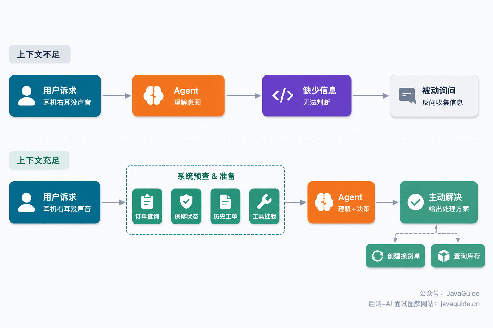

Consider an e-commerce customer service example.

A customer sends this message: "The right earbud of the headphones I bought last week has no sound. What should I do?"

If the Agent has little context, it will probably reply: "Sorry for the inconvenience. Which headphones did you buy? What is your order number? Can you describe the problem?"

The response is not unreasonable, but it is frustrating in a customer service situation. The Agent is just following a question-and-answer script instead of gathering information proactively.

Now consider how it performs when given sufficient context.

Before calling the LLM, the system retrieves all available information:

- The order system finds last week's purchase: a Sony WH-1000XM5, ordered on March 25.
- The warranty check shows that the order is still within the 7-day return window.
- The ticket history shows that the customer is returning and has had no previous service disputes.
- The system provides the `create_return_order` and `check_inventory` tools.

The Agent can then reply: "Hello, I found your Sony WH-1000XM5 order from March 25, and it is still within the return period. I can start an exchange request for you. The warehouse has the same model in stock, and the replacement should ship in 2–3 days. Would you like me to proceed?"

The difference is clear: the second response starts solving the problem instead of asking the customer for information again.

Many Agent failures are related to context, but context is not the only factor. Tool design, task decomposition, state management, and validation mechanisms also need to be considered.

One thing is clear: **with insufficient context, even a powerful model has to guess; with the right context, a mid-tier model can still make progress.**

## What Does Context Engineering Do?


### How It Differs from Prompt Engineering

Tobi Lutke describes Context Engineering as:

> the art of providing all the context for the task to be plausibly solvable by the LLM

In other words, provide the LLM with the context it needs to solve the task, making the task plausibly solvable within the model's capabilities. **Plausibly** refers to the necessary preconditions: without order state, permission boundaries, or constraints from a legacy flow, the model lacks the evidence to make a reliable decision.

Prompt Engineering concerns how instructions are written. Context Engineering determines what information is included in each call and when it enters or leaves the context window.

- Prompt Engineering focuses on how to write the instructions themselves: wording, order, format, and tone.
- Context Engineering focuses on what information should be in the model's context before a call, how it should be structured, when it should be added, and when it should be removed.

Anthropic's official blog uses the following diagram to compare these two layers:

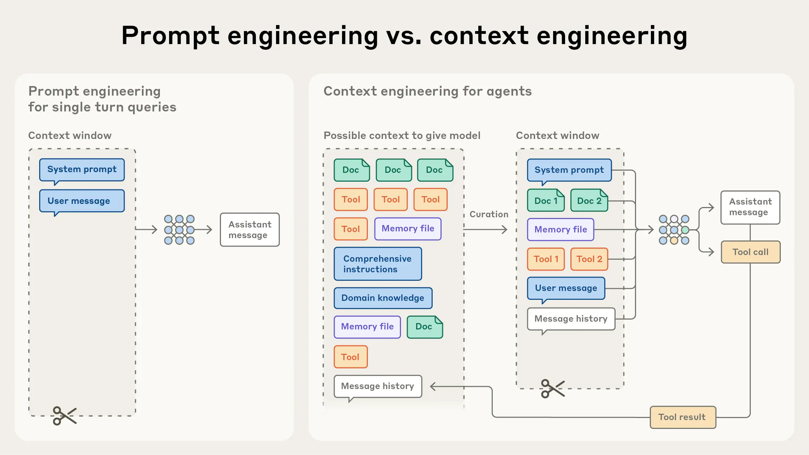

For example, if Prompt Engineering is "telling the chef how to make a dish," Context Engineering is preparing the kitchen: where ingredients go, how knives are arranged, how seasonings are organized, and where cooking instructions are posted.

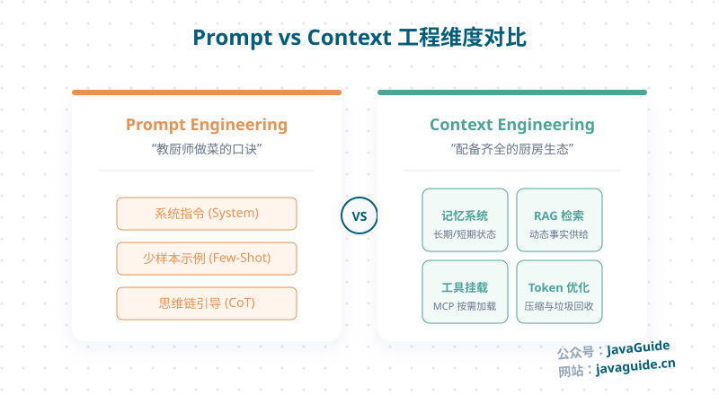

Another useful analogy is: **Context Engineering is memory management for an LLM.**

The context window is a limited block of memory. Context Engineering decides what goes into it, what gets evicted, and when to read or write. When the window is full, some content must be removed, much like operating-system page replacement strategies such as LRU or priority-based eviction. Token-budget fallback strategies address the same problem.

### What Does It Manage?

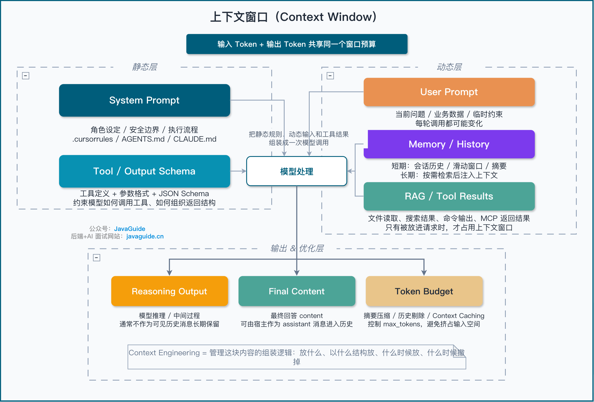

At a minimum, Context Engineering manages the following:

The System Prompt is a high-priority instruction in an API message. Files such as `.cursor/rules`, `.claude/rules`, and `AGENTS.md` are rule sources read by the host application. The host loads them according to its own rules and converts some of their content into model context; they are not the same as an API message with the System role. Cursor's earlier `.cursorrules` format is obsolete; new projects should use `.cursor/rules`.

The User Prompt contains business data and instructions from the user. It may look simple, but in real projects it often mixes natural language, business fields, historical state, and attachments. Poor handling can pollute the context.

Memory can be short-term or long-term. Short-term memory is usually a sliding window within a Session. Long-term memory does not have to be a vector database; it can use files, key-value stores, relational databases, graph databases, or vector search. The key questions are what to record, when to write it, how to update or forget it, and how to add retrieved information to the current context.

RAG and Tools are part of it too. RAG retrieves external documents and places relevant content in the context; Tools add tool descriptions, parameter formats, and call results. RAG is one implementation of Context Engineering: it answers what to retrieve, how to retrieve it, and how to add the results to context.

JSON Schema and the parameter and return constraints of Function Calling limit the current call, so they are also part of the context. For Observations after tool calls, decide whether to keep the original output, store a summary, or clear it in later turns. Without a plan, parsing and replay can leave behind large amounts of difficult-to-handle output.

Summarization, history pruning, and Context Caching are all Token-management techniques. Each requires a tradeoff between retaining information and controlling call costs.

## Why Does Context Fail?

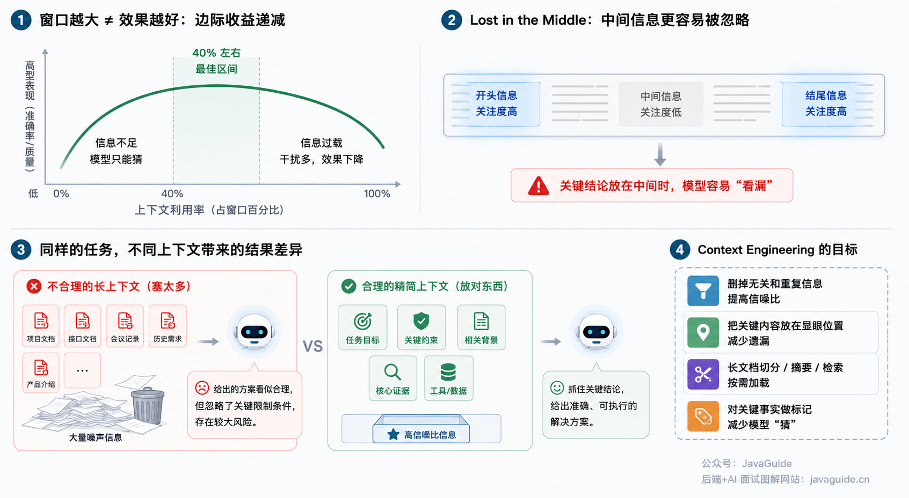

Increasing the context window does not eliminate the need to filter information. Material beyond what the current task needs may only add noise.

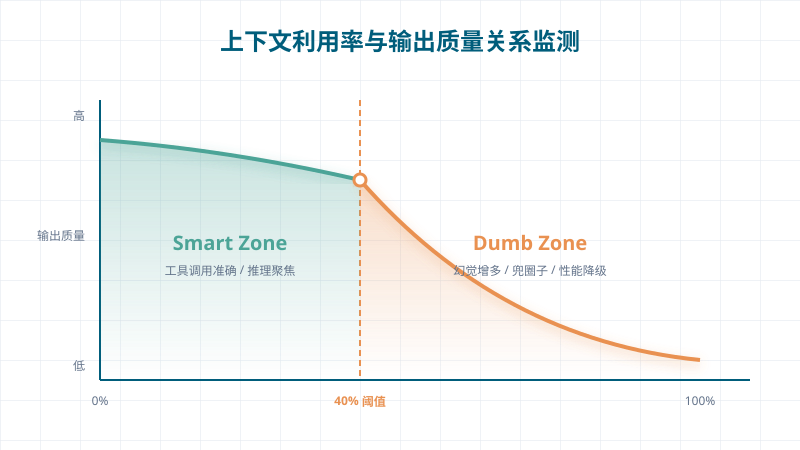

The 40% shown here was observed for a specific model and task; it is not a universal threshold. The positional bias described by Lost in the Middle is different from the decline in information use as context grows, and the two should not be conflated.

Consider a migration of an existing user login flow. Historical requirements, API docs, and meeting notes are all added to context, and the constraint "still depends on legacy token validation and cannot switch directly to the new authorization module" may be just one line. Even if the model reads all the material, it may fail to treat that line as a prerequisite for its plan.

**Context Rot** describes this kind of issue: as input grows and noise increases, the model may use key evidence less consistently.

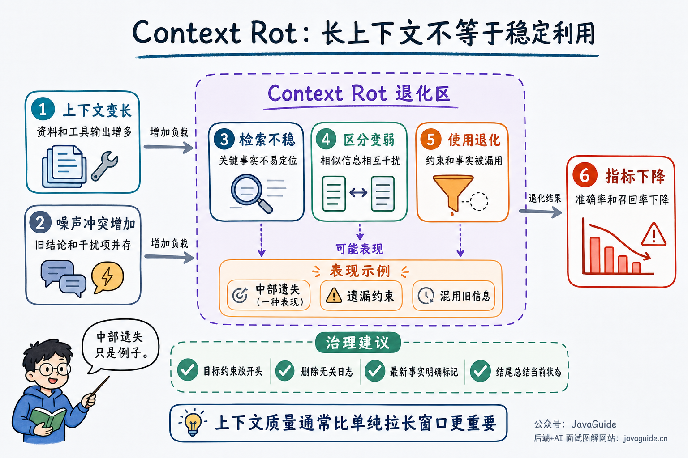

Another related phenomenon is **Lost in the Middle**: models are more sensitive to information at the beginning and end, and more likely to overlook information in the middle. Sometimes a model answers incorrectly despite having been given the relevant material, not because it failed to read it, but because the key information was not prominent in the long context.

In a Transformer, the model does not read text line by line like a person. It uses Attention to determine which parts of context are relevant to the current question. You can think of Attention as a relevance score. If asked why an API timed out, for example, the model must find information related to the API, timeout, logs, SQL, caching, and external dependencies. Shorter context contains less noise, making key information easier to identify.

But the situation changes if you insert dozens of pages of documents, hundreds of log entries, and many blocks of background information at once. Seeing information does not mean the model can use it well; it must still determine what matters most. As context gets longer, there are more candidate facts and more noise, so Attention can become more diffuse. In standard full attention, each Token's attention relationships are computed against other Tokens, increasing computational and selection pressure as the Token count grows. Many long-context models now use sparse attention, chunking, caching, and compression to reduce costs, so it is also inaccurate to claim that longer context always performs worse.

A more accurate statement is: **Long context makes it harder for a model to identify key information and increases reasoning costs, but the degree of performance decline depends on the model, context structure, and task type.**

This explains why models advertised with 100K or 200K context windows may not reliably handle a full window in practice.

Being able to fit information into the context is different from being able to use it well.

This is common in practice. You give the model project materials, API docs, meeting notes, and historical requirements, then ask: "Will this change affect the legacy user login flow?"

The key information may be just one sentence: the legacy login flow still depends on the old Token validation logic and cannot switch directly to the new authorization module. Buried in a large amount of background information, the model may overlook this sentence and produce a plan that seems reasonable but is actually risky.

The challenge with long context is consistently finding the key information. Remove duplicates when assembling context and place task constraints prominently. Chunk, retrieve, or summarize long documents, and retain references to key evidence for later lookup. Use the target model and real task traces to evaluate how much context to keep.

## How Do You Evaluate Context Engineering?

Do not rely on intuition alone. One common false impression is that the Agent looks more convincing after a change, even though its actual success rate has not improved and its cost has increased.

Track at least these five types of metrics:

| Metric            | What to measure                                                                                                       |
| ----------------- | --------------------------------------------------------------------------------------------------------------------- |
| Task success rate | Whether the goal was completed, human intervention was needed, and the successful path can be reproduced consistently |
| Tool quality      | Incorrect or missed tool calls, parameter errors, repeated calls, and rate of blocked dangerous actions               |
| Context cost      | Input and output Tokens, cache hit rate, and information retained after compression                                   |
| Latency           | Time to first Token, end-to-end latency, tool wait time, and p95 / p99 response time                                  |
| Result quality    | Hallucination rate, evidence citation accuracy, information lost in summaries, and omitted key fields                 |

Start with a small evaluation set of 20 to 50 real task traces, then adjust retrieval, compression, tool Schemas, or Prompts. Change only one variable at a time; otherwise, it is difficult to determine what caused the result.

## How Is Context Loaded at Runtime?

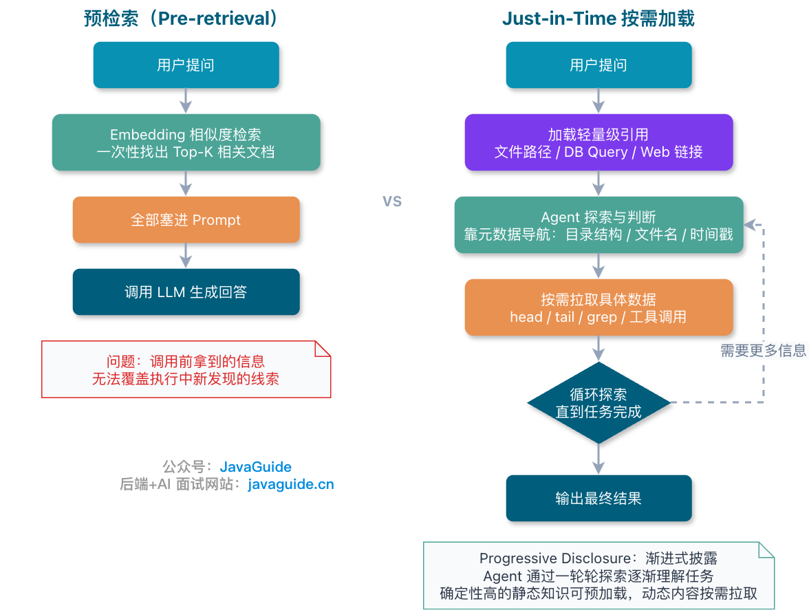

### Why Is Pre-Retrieval Not Enough?

Pre-retrieval uses Embedding similarity to retrieve passages before calling the LLM, then inserts them all into the Prompt at once. This works for simple questions such as FAQs, but relevant information in complex Agent tasks changes during execution.

Pre-retrieval can rank only what is known about the goal before the call. New clues found after the Agent calls a tool will not appear in that retrieval result.

### Just-in-Time Loading

Just-in-Time loading first keeps lightweight references such as file paths, database queries, or Web links. The Agent reads the content through a tool only when the task needs it.

For example, when Claude Code analyzes a large codebase, the Agent can narrow its search using directory structure, filenames, and search results, then inspect files incrementally with `head`, `tail`, and `grep`. Paths, file sizes, and timestamps are useful clues; the entire file does not need to be loaded into context first.

Metadata can also inform decisions. The different paths in `tests/test_utils.py` and `src/core_logic/test_utils.py` suggest that the files serve different testing roles.

Anthropic calls this layered approach **Progressive Disclosure**. The Agent supplements the context through multiple rounds of exploration: file size suggests complexity, timestamps suggest relevance, and directory structure provides location semantics. Skills use the same idea; see [What Are Agent Skills, and How Do They Differ from Prompts and MCP?](https://javaguide.cn/ai/agent/skills.html).

On-demand loading increases tool calls and latency, and depends on navigation tools such as `glob`, `grep`, and `tree`. If navigation is weak or heuristics fail, the Agent may keep searching in the wrong direction and consume more context and calls. Indexes, tool boundaries, and navigation strategies still need to be designed in advance.

### A Hybrid Strategy Is More Practical

A hybrid strategy is more common in real projects: pre-retrieve static knowledge with high certainty, then fetch information discovered dynamically during execution as needed. Claude Code follows this approach: it can preload `CLAUDE.md` files while the Agent explores specific file contents at runtime.

The task type also guides the choice. Tasks with broad exploration and dynamic content, such as codebase analysis and information retrieval, are better suited to a Just-in-Time approach. Tasks with stable context and little dynamic content, such as legal document review and financial statement analysis, can use pre-retrieval with a small amount of runtime supplementation.

| Strategy      | Advantages                                     | Tradeoffs                                                          | Suitable tasks                                               |
| ------------- | ---------------------------------------------- | ------------------------------------------------------------------ | ------------------------------------------------------------ |
| Pre-retrieval | Fast, simple, stable workflow                  | May insert noise all at once and is less flexible during execution | FAQs, fixed knowledge-base questions, stable document review |
| Just-in-Time  | Cleaner context; evidence is loaded as needed  | More tool calls and higher latency                                 | Codebase analysis, troubleshooting, open-ended research      |
| Hybrid        | Balances startup speed and runtime exploration | Requires budget management and tool navigation                     | Complex business Agents, long tasks, multi-source retrieval  |

Choose a retrieval strategy based on how stable the source material is, the amount of exploration required, real-time needs, and whether evidence must be traceable, rather than on which approach seems "more advanced."

## How Do You Maintain Context in Long-Running Tasks?

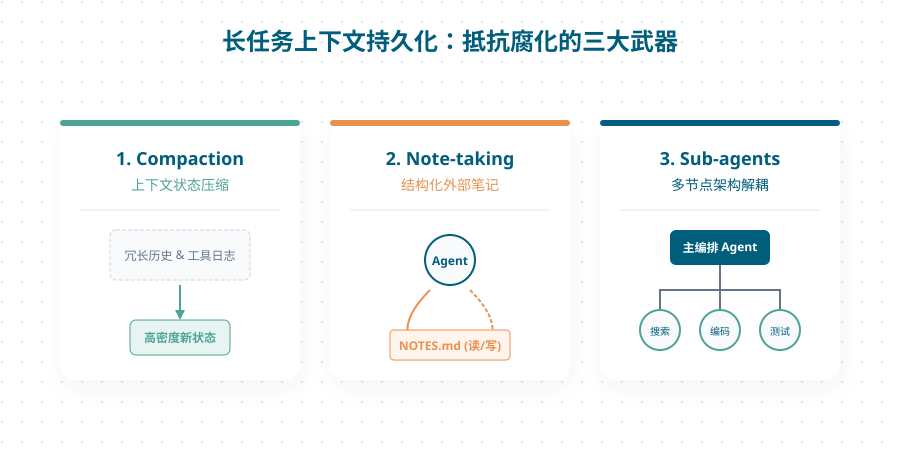

### Compaction: Summarize History as the Window Fills

Multi-turn tasks keep early decisions, tool results, and current goals in the message history. As the context window approaches its limit, Compaction summarizes the history and continues with the summary and new messages, enabling work to carry over between windows.

Anthropic has described one approach used in Claude Code: the summary retains architectural decisions, unresolved bugs, and key implementation details while redundant tool results are removed. The compressed context is combined with recently accessed files to restore task state. "Five files" is an example from that article; what to retain should depend on the task and context budget.

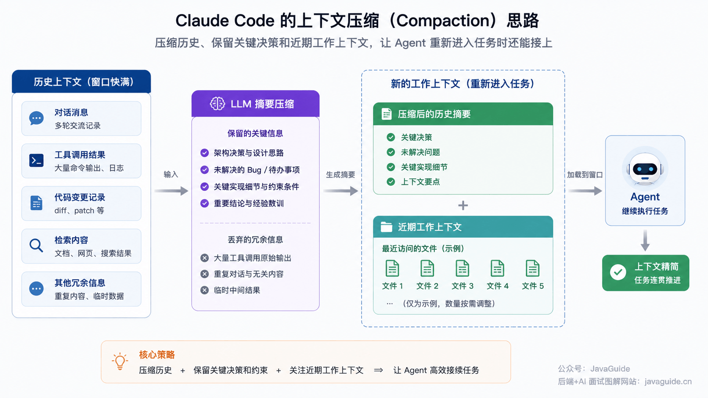

The challenge is deciding what to keep: retaining too much defeats the purpose of compression, while retaining too little loses key context. A practical approach is to tune the compression Prompt against complex Agent traces, first ensuring that important information is preserved, then gradually removing redundancy. This takes iteration.

Another lightweight compression technique is to clear tool results. Once a tool call has been processed, its full raw output may no longer be needed. The Anthropic Developer Platform offers context editing and tool-result clearing, which can remove old `tool_result` content while retaining `tool_use` records. Test thresholds and retention counts against your own workload.

### Structured Note-taking: Let the Agent Keep Notes

Structured Note-taking is another way to handle long tasks. Have the Agent write key progress to an external file such as `NOTES.md`, then read those notes and continue after the context is reset.

This is similar to engineers keeping to-do lists and technical notes. Claude Code automatically maintains a to-do list for long tasks. A custom Agent can also keep a `NOTES.md` file in the project root with current progress, known issues, and next steps.

One interesting example is Claude playing Pokémon. Across thousands of game steps, the Agent maintained progress notes such as "After 1,234 steps, I trained Pikachu on Route 1, raised it by 8 levels, and need 2 more levels to reach the goal." It also created a map, achievement list, and battle strategy notes on its own. After context resets, it could reread these notes and keep playing for several hours. When Anthropic released Sonnet 4.5, it also launched a public beta of the Memory Tool, which lets Agents build a cross-session knowledge base using file-system persistence.

### Sub-agents: Do Not Make One Agent Carry All the State

Retrieval or code exploration can be delegated to a Sub-agent with its own context, while the main Agent receives only a summary of the evidence. Even if the Sub-agent explores tens of thousands of Tokens, the summary returned to the main Agent is usually around 1,000 to 2,000 Tokens, so the detailed search does not keep occupying the main context window.

Anthropic described this pattern of isolated retrieval and compressed results in [How we built our multi-agent research system](https://www.anthropic.com/engineering/multi-agent-research-system). Whether to use it depends on how well the task can be divided, dependencies between subtasks, and whether summarization might lose key evidence.

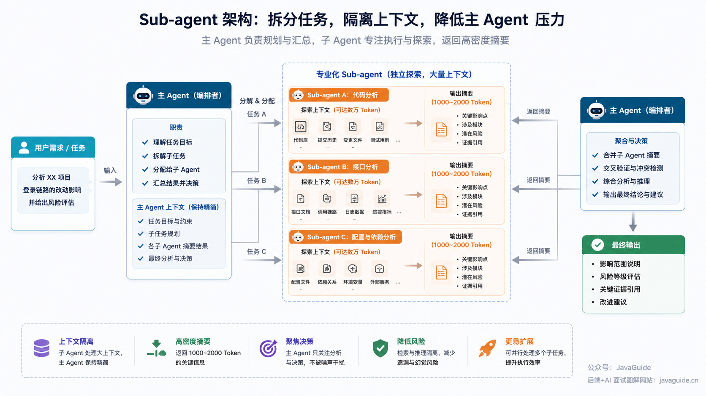

Choose among these three approaches as follows:

| Technique   | Suitable use case                                                          |
| ----------- | -------------------------------------------------------------------------- |
| Compaction  | Long workflows with ongoing dialogue where context continuity is important |
| Note-taking | Iterative development with clear milestones and multiple steps             |
| Sub-agents  | Complex research requiring parallel exploration and a final summary        |

## How Do You Implement Context Engineering?

An implementation can use a Context Assembler to organize rules, goals, evidence, memory, tools, and history summaries before each LLM call.

### What Should the System Assemble Before an LLM Call?

```text
# Input: user task, current session state, and business context
input: user_task, session_state, business_context

# 1. Load system constraints (limits, policy rules, permissions, etc.)
constraints = load_system_constraints()

# 2. Extract the current goal from the user task and session state
goal = extract_current_goal(user_task, session_state)

# 3. Retrieve relevant evidence or context using RAG (Retrieval-Augmented Generation)
#    - For example, find data related to the goal in documents, knowledge bases, or databases
#    - See "How Is Context Loaded at Runtime?" for retrieval strategies
evidence = retrieve_rag(goal, business_context)

# 4. Recall stored memory or information from the current conversation
#    - Includes user preferences, prior interactions, and model memory
memory = recall_memory(goal, session_state)

# 5. Select suitable tools or operations based on the goal, evidence, and memory
#    - For example, call an API, perform browser actions, or run calculations
tools = select_tools(goal, evidence, memory)

# 6. Compress conversation history for context management across windows
#    - See "How Do You Maintain Context in Long-Running Tasks?"
#    - Compression reduces Token usage while retaining key information
history = compact_history(session_state.messages)

# 7. Combine all context and rank it by importance
#    - Ensure the model processes the most important content first
context = rank([
  constraints,
  goal,
  evidence,
  memory,
  tools,
  history
])

# 8. Truncate or trim the context to fit the model's Token limit
#    - Retain as much key information as possible within the Token budget
context = fit_token_budget(context)

# Output: messages, available tool schemas, and additional metadata
output: messages, tool_schema, metadata
```

Two details deserve particular attention in practice:

1. `rank` determines which information appears earlier or later.
2. `fit_token_budget` determines what stays in full, what is summarized, and what is retained as a reference only.

Poor implementation of these steps can weaken Agent performance. Do not insert every retrieval result or as much history as possible; that can leave half the context window filled with noise.

Inputs to the Context Assembler can be grouped by source: static rules, tool definitions, dynamic evidence, examples, and the Token budget.

### Static Rules: Write a Clear System Prompt First

Static rules are the Agent's "factory settings": fundamental constraints that do not change during a conversation. A common approach is to write the System Prompt in structured Markdown, separating the role, goal, constraints, workflow, and output format instead of combining everything into one long paragraph.

For example, a troubleshooting Agent might use:

```markdown
## Role

You are a backend service troubleshooting expert who identifies root causes using logs and metrics.

## Constraints

- Call only the tools you need; do not repeat calls that perform the same function.
- Stop searching and report your findings as soon as you find key evidence.
- Prefer real-time data over historical assumptions.

## Workflow

1. Check metrics (CPU, memory, and network).
2. Check logs for the relevant time range.
3. If an abnormal call chain is found, trace upstream and downstream dependencies.
4. Return a structured report: problem description → root cause → recommended fix.

## Output format

Return JSON with these fields: `incident_summary`, `root_cause`, `evidence`, and `recommendation`.
```

These rules can go in `.cursor/rules`, `.claude/rules`, or `AGENTS.md`, then be loaded by the relevant host according to directory and scope. Rule files are easy to version and review as a team, but the host determines which message type receives the rules and when they are loaded.

Avoid two common extremes when writing a System Prompt.

**The first is overengineering.** Some engineers put extensive if-else logic into the Prompt to control every step. This creates a long, brittle Prompt that is expensive to maintain; the model may still go off track when it encounters an unfamiliar edge case.

**The second is overgeneralization.** If you only say "be a helpful assistant," the model lacks the information needed to make decisions. It may keep asking the user questions or produce output that is far from business expectations.

A good Prompt is specific enough to guide behavior and general enough to cover common variations. Anthropic's engineering blog calls this the Goldilocks zone: just right.

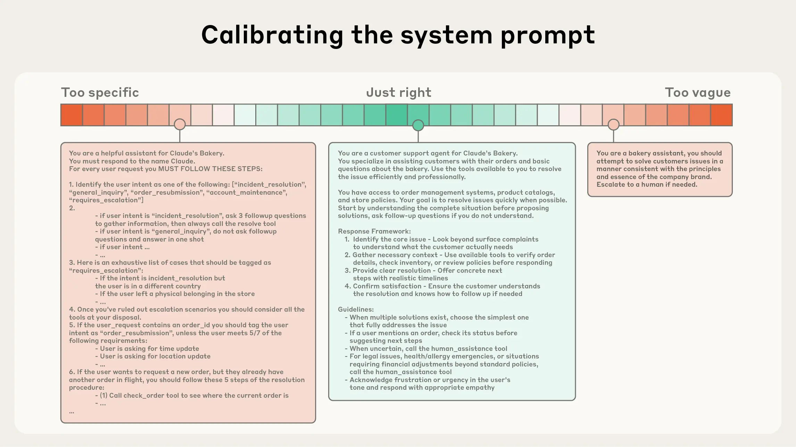

A more reliable practice is to establish a baseline with a minimal Prompt, then add rules one at a time based on failure cases instead of trying to enumerate every possibility at the start. Anthropic calls this "calibrating the system prompt": treat the System Prompt as a parameter to tune continuously, not a configuration document that never changes. Add a rule for each failure case and test again.

### Tool Context: Define the Tool's Boundaries First

A tool definition directly affects whether the Agent selects the right tool. A good description should answer two questions: when should it be called, and when should it not? If a human engineer cannot tell whether to use the tool, the Agent will make mistakes too.

If one tool handles several actions, such as querying, editing, and approval, the Agent must distinguish multiple sets of parameters and side effects in one Schema, increasing the chance of choosing the wrong path. State both valid and prohibited use cases. Separate distinct actions and include parameter examples so the call boundaries are clear.

### Dynamic Context: Do Not Dump RAG, Memory, and Tool Results into the Prompt

The earlier section on runtime context loading covered when to retrieve and whether to use pre-retrieval or on-demand loading. This section focuses on handling retrieval results after they enter the context window.

Manage short-term memory with a sliding window and retrieve long-term facts from external storage. Observations such as API error logs and tool results can be trimmed and summarized, but troubleshooting information must retain its original references: trace ID, request time, error code, log file location, tool-call parameters, and links to raw results. Keeping only "the API returned an error" makes later troubleshooting impossible, but inserting a flood of raw logs can overwhelm the model.

Dynamic context often fails because retrieval returns irrelevant results, memory is stale, a tool times out, or a summary omits evidence. The table lists fallback approaches:

| Failure                   | Symptom                                                                         | Fallback                                                                                 |
| ------------------------- | ------------------------------------------------------------------------------- | ---------------------------------------------------------------------------------------- |
| No RAG results            | No relevant documents found, or retrieved passages are scattered                | Fall back to keyword search; ask the user to clarify missing information if needed       |
| Tool timeout              | External API hangs and the Agent keeps waiting                                  | Set timeouts, retry limits, and circuit breakers; allow human takeover in critical flows |
| Summary loses information | Stack traces, version numbers, or boundary values are missing after compression | Retain trace IDs, original evidence locations, key fields, and links for lookup          |
| Memory contamination      | Old preferences or state are treated as current facts                           | Validate before writing; label source, timestamp, and confidence after retrieval         |
| Tool conflict             | Multiple tools can perform the task and the Agent chooses the wrong path        | Use priorities, state machines, and side-effect levels to constrain call order           |

### Example Context: Do Not Overload the Prompt with Few-Shot Examples

Few-shot examples should cover different common scenarios. Keeping 3 to 5 canonical examples that represent different strategies is usually more effective than putting dozens of edge cases into the Prompt. Examples should show what strategy to use for a type of input, not just demonstrate surface-level input and output.

### Token Budget: How to Prioritize Content in a Single Call

This section covers content priority within a single call; Compaction handles history across context windows. Both strategies should be used as the window approaches its limit.

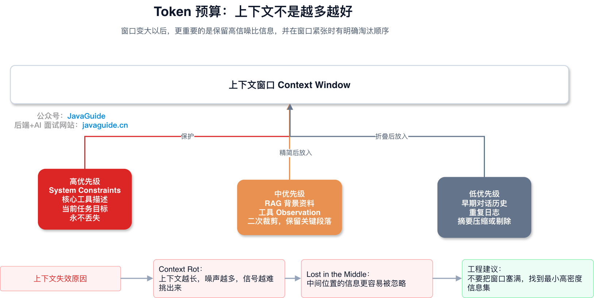

| Priority                           | Content                                                                         | Handling                                                       |
| ---------------------------------- | ------------------------------------------------------------------------------- | -------------------------------------------------------------- |
| Low priority (compressible)        | Earlier conversation history                                                    | Summarize with AI                                              |
| Medium priority (trim selectively) | Background from RAG and old tool results                                        | Trim again, keeping key passages and references for lookup     |
| High priority (fixed section)      | System constraints, current task goal, safety boundaries                        | Keep in a fixed high-priority section to preserve consistency  |
| Phase-specific priority            | Tool descriptions, Schemas, and a few key examples needed for the current phase | Load by task phase, ensuring removed items can be rediscovered |

For large-scale concurrent workloads, use Prompt or Context Caching where supported. Models that support caching can reuse stable System Prompt and tool-description prefixes to reduce repeated billing or time to first Token. Actual hit rates depend on provider implementation, prefix changes, and cache lifetime, so validate against your workload.

## Which Tools Are Used for Context Engineering?

Orchestration, retrieval, vector databases, tool integration, and memory solve different problems. Add only the components required by the task workflow.

- LangChain and LangGraph handle control flow, state management, and loop scheduling. Tool calls and node retries are usually organized at this layer.
- LlamaIndex focuses on RAG data ingestion, index generation, and retrieval optimization. It suits workflows built primarily around document ingestion and retrieval.
- Pinecone, Weaviate, Chroma, and Qdrant provide Embedding storage and semantic search. Small projects can start with local Chroma, then evaluate Qdrant, Milvus, or Pinecone as they scale.
- MCP standardizes how tools connect to a host application. It defines Hosts, Clients, and Servers and exposes capabilities such as Resources, Prompts, and Tools. See the [MCP guide](https://javaguide.cn/ai/agent/mcp.html) for protocol versions and call examples.
- Mem0, LETTA (formerly MemGPT), and ZEP target Agent memory layers, usually adding lifecycle management for memory writes, retrieval, and forgetting on top of vector databases.

Tools connected through MCP are also entry points for side effects. Distinguish permissions, invocation conditions, and audit boundaries for reading files, querying databases, sending requests, and changing configuration; otherwise, problems are difficult to locate and replay.

## Record the Context of Every Iteration

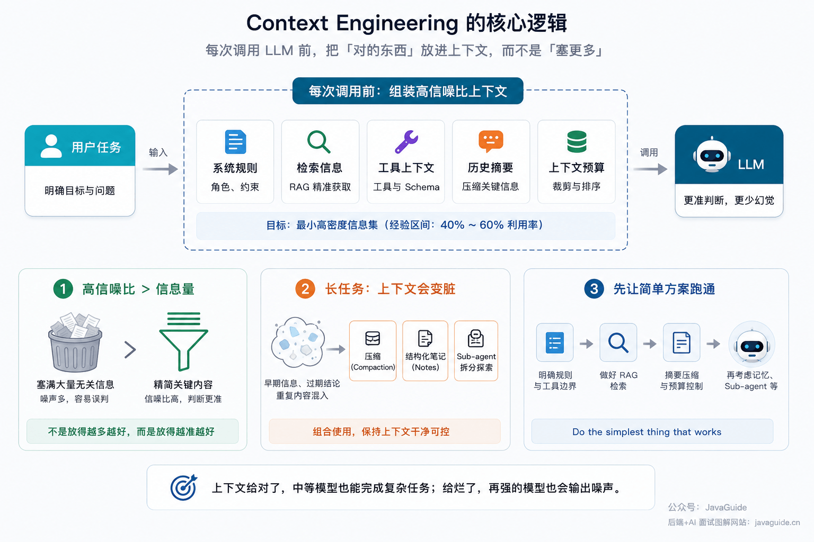

To evaluate Context Engineering, first record the messages that actually enter the context window during each iteration. When retrieval strategy, summarization, or tool Schema order changes, compare task success, Token cost, and tool-call quality against the baseline.

### Signal-to-Noise Ratio Matters More Than Volume

Dex Horthy has mentioned an observed context-utilization range of 40% to 60%, but it is not a universal threshold. Use real traces to find the minimum set of information needed for decisions: keep constraints and evidence, and remove irrelevant background.

### Proactively Clear Stale State in Long Tasks

As long tasks accumulate messages, early decisions, resolved issues, and repeated tool results remain in the history. Compaction compresses messages, structured notes preserve recoverable state, and Sub-agents isolate specialized work. Whether to combine them depends on task length and observed failure modes. Do not add a complex memory layer to short tasks that have no context-growth problem.

### Get the Simplest Approach Working First

Anthropic repeatedly emphasizes: `do the simplest thing that works`.

Adding layered memory, complex retrieval, and long-term state management before establishing a baseline makes failures difficult to attribute to retrieval, summarization, tool descriptions, or model selection. More components also lengthen the troubleshooting process.

Start by fixing the System Prompt and tool boundaries, then validate RAG retrieval, and add summarization and context budgeting next. Evaluate memory layers, Sub-agents, or more complex runtime retrieval only after a long task reveals a clear bottleneck.

## Start with a Reproducible Baseline

First, fix high-priority instructions and tool definitions. Save the messages, tool Schemas, Token usage, and retrieval results actually sent in every call, then use a set of real tasks to establish a baseline. Change only one variable at a time afterward, such as retrieval strategy, summarization, or tool order.

Capabilities such as long context, Prompt Caching, structured output, and MCP vary across model, API, SDK, and client versions. Record the model ID, interface version, and verification date in design documents so implementation details from one client are not mistaken for general rules. Add RAG, Compaction, caching, or persistent memory only when baseline traces show stale information, insufficient budget, or lost state across context windows.

## Summary

Organize the fixed rules, current goal, retrieved evidence, available tools, historical state, and Token budget for every call by priority. A larger context window does not automatically improve decisions; irrelevant history, duplicate tool results, and stale state can still interfere.

Save real call traces and establish a reproducible baseline before adjusting retrieval, tool descriptions, summarization, or trimming. Add layered memory, Compaction, caching, or Sub-agents only when the baseline reveals problems with long tasks, stale information, or limited context, so extra components do not obscure the cause of failures.

## References

- [Effective context engineering for AI agents - Anthropic](https://www.anthropic.com/engineering/effective-context-engineering-for-ai-agents)
- [OpenAI API Models Compare](https://developers.openai.com/api/docs/models/compare)
- [Claude API Models Overview](https://platform.claude.com/docs/en/about-claude/models/overview)
- [DeepSeek V4 Preview Release](https://api-docs.deepseek.com/news/news260424)
- [MCP: Protocol Versions, Capabilities, and Call Examples](https://javaguide.cn/ai/agent/mcp.html)
- [Context Rot: How Increasing Input Tokens Impacts LLM Performance](https://www.trychroma.com/research/context-rot)
- [Lost in the Middle: How Language Models Use Long Contexts](https://arxiv.org/abs/2307.03172)
- [Context Engineering: The New Frontier of AI Development](https://medium.com/techacc/context-engineering-a8c3a4b39c07)
- [The New Skill in AI is Not Prompting, It Is Context Engineering](https://www.philschmid.de/context-engineering)
- [Context Engineering by Simon Willison](https://simonwillison.net/2025/jun/27/context-engineering/)
- [12 Factor Agents - Own Your Context Window](https://www.humanlayer.dev/blog/12-factor-agents)
