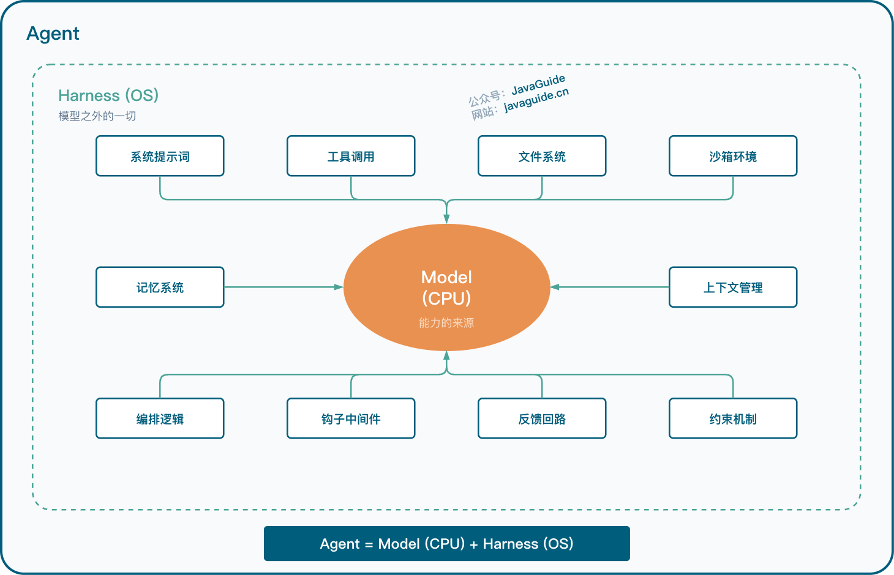
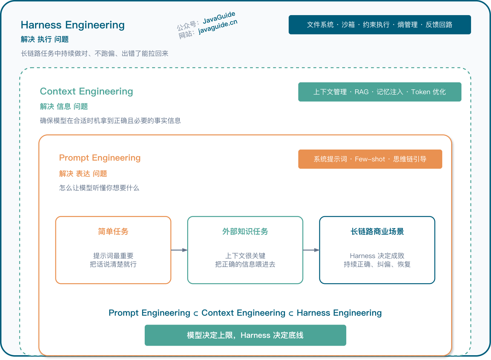
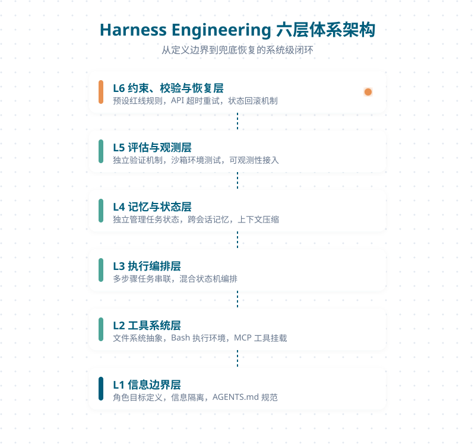
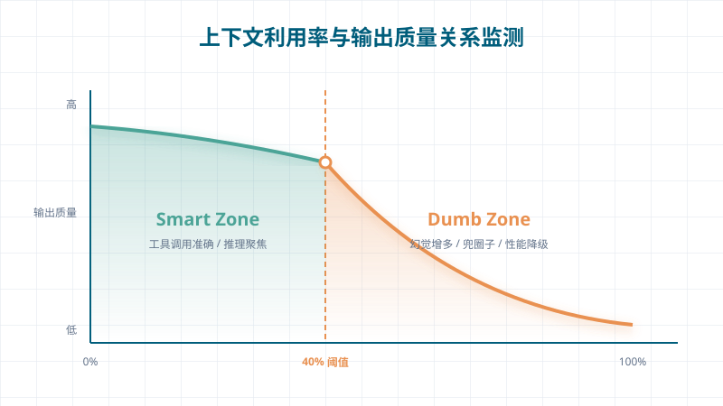
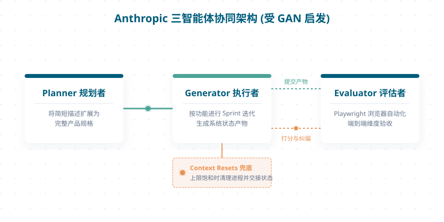
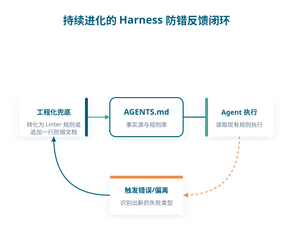

An Agent Harness is an execution system that runs outside a large language model. It organizes context, provides tools and an execution environment, and incorporates permission controls, state management, result validation, and failure recovery into the task workflow. Harness Engineering is the study of how to design this system.

In a coding evaluation by Can.ac, Grok Code Fast 1's score [rose from 6.7% to 68.3%](https://blog.can.ac/2026/02/12/the-harness-problem/) after changing only the file-editing interface. The model parameters stayed the same. The difference came from which operations the interface exposed, how it returned results, and whether the next step could use errors.

This kind of difference also explains common Agent failures. Repeated tool calls, ignored constraints, or lost state during a long task often cannot be fixed just by changing the model or adding a line to the Prompt. Tool interfaces, the execution environment, feedback, and recovery mechanisms also determine whether a task can proceed.

The following sections cover Harness components and layers, then compare the design choices made by OpenAI, Anthropic, Stripe, and Mitchell Hashimoto.

## What Is a Harness?

### Agent = Model + Harness

In engineering, `Agent = Model + Harness` is a common way to distinguish the two parts. The model handles reasoning and generation; the Harness manages system prompts, tool calls, the file system, sandbox, orchestration logic, hook middleware, feedback loops, and constraints.

The model itself does not retain state across sessions, execute commands, or read test results. The Harness connects task state, action interfaces, the execution environment, and safety boundaries so model output becomes verifiable action.

Vivek Trivedi of LangChain uses a practical approach in [The Anatomy of an Agent Harness]: list what the model can do, then fill in the things it cannot do. This helps pinpoint concrete gaps, such as whether tool results are readable, task state is persistent, and failures provide actionable repair information.



### How Harness, Prompt, and Context Engineering Relate

Prompt Engineering, Context Engineering, and Harness Engineering are not best compared at the same level. They are nested layers that address increasingly broad problems.



| Layer               | Problem addressed                                         | Focus                                                                       | Typical work                                                               |
| ------------------- | --------------------------------------------------------- | --------------------------------------------------------------------------- | -------------------------------------------------------------------------- |
| Prompt Engineering  | How to make instructions clear                            | Help the model understand intent and reduce local ambiguity                 | System prompt design, few-shot examples, chain-of-thought guidance         |
| Context Engineering | What the Agent should see                                 | Provide the right information when needed                                   | Context management, RAG, memory injection, Token optimization              |
| Harness Engineering | How the system executes, corrects, observes, and recovers | Sustained correctness, error correction, and recovery in long-running tasks | File system, sandbox, constraint enforcement, feedback loop, observability |

For simple tasks, a Prompt may be enough. For example, asking a model to revise one sentence usually works if the prompt is clear. When external knowledge is needed, Context becomes more important: reference material, retrieval results, and historical state must be provided in the right place. In long-running, executable business workflows with little tolerance for error, the Harness becomes critical because the Agent must do more than answer; it must execute, validate, roll back, and continue.

A Prompt can clarify local instructions, but it cannot provide file access, run tests, save state, or recover from failure. The Harness handles these execution needs.

### What Components Does a Harness Include?

To determine what belongs in a Harness, ask the reverse question: what can the model not do?

An LLM can appear capable, but from a system perspective it is still primarily an input-output function: it receives context and returns text or a structured call. It does not inherently remember history, run commands, know whether code passed tests, or distinguish which information to keep and discard.

| What the model cannot do                                              | How the Harness fills the gap                                      | Component                     |
| --------------------------------------------------------------------- | ------------------------------------------------------------------ | ----------------------------- |
| Remember multi-turn conversation history                              | Maintain conversation history and add it to each request's context | Memory system                 |
| Execute code and commands                                             | Provide Bash and a code execution environment                      | General execution environment |
| Get current information, such as new library versions and API changes | Integrate Web Search and MCP tools                                 | External knowledge retrieval  |
| Operate on files and environments                                     | Abstract the file system and use Git version control               | File system                   |
| Determine whether its work is correct                                 | Provide a sandbox, test tools, and browser automation              | Validation loop               |
| Stay coherent during long tasks                                       | Summarize context, maintain memory files, and track progress       | Context management            |

Filling in the things "the model cannot do, but you want the Agent to do" gives you a list of Harness components. LangChain also divides them into several parts: the file system provides persistence, Bash execution provides general-purpose tools, the sandbox isolates risk, memory accumulates information across sessions, and context compression mitigates quality loss in long contexts.

## Harness Design in Practice

### What Does a Mature Harness Look Like?

The previous section viewed the Harness as filling gaps in the model. From a system design perspective, a mature Harness usually has clear layers.

To make it easier to check for missing components, this guide groups them into six layers. This is an analytical framework, not a protocol or an industry standard:



| Layer | Name                                  | Problem addressed                                     | Key design                                                                                                 |
| ----- | ------------------------------------- | ----------------------------------------------------- | ---------------------------------------------------------------------------------------------------------- |
| L1    | Information boundary                  | What the Agent should and should not know             | Define roles and goals, remove irrelevant information, and structure task state                            |
| L2    | Tool system                           | How the Agent interacts with the outside world        | Select tools, control when they are called, and summarize and return tool results                          |
| L3    | Execution orchestration               | How to connect a multi-step task                      | Guide the model through understanding the goal, assessing information, analyzing, generating, and checking |
| L4    | Memory and state                      | How to manage intermediate results in long tasks      | Manage current task state, intermediate artifacts, and long-term memory separately                         |
| L5    | Evaluation and observability          | How the Agent knows whether it did the task correctly | Establish validation independent of the generation process                                                 |
| L6    | Constraints, validation, and recovery | What to do when something goes wrong                  | Block errors with predefined rules; provide retries, rollback, or fallback on failure                      |

Think of it as setting up a work environment for a new employee. L1 is the job description, which defines what to focus on; L2 is the set of work tools; L3 is the standard operating procedure; L4 is the project tracker and notebook; L5 is quality assurance; and L6 is the set of guardrails and emergency procedures.

These six layers cover the path from information boundaries to failure recovery. OpenAI, Anthropic, and Stripe implement them differently, but their designs can all be examined through this framework.

You do not need to build all six layers at the start. Begin with L1 and L6: define task boundaries and inputs, then block and recover from permission violations, failures, or unacceptable results. Add tool orchestration, state management, and observability when tasks become multi-step or require intermediate artifacts and repeated validation.

### Why Is the Model Often Not the Bottleneck?

Can.ac's results show that the tool-call format alone can change task completion rates. LangChain adjusted system prompts, tools, and middleware, then used traces to optimize its validation loop. On Terminal Bench 2.0, it moved from outside the top 30 into the top 5, with its score [rising from 52.8% to 66.5%](https://www.langchain.com/blog/improving-deep-agents-with-harness-engineering); the model was unchanged.

When an Agent performs inconsistently, first check its tool interfaces, error output, and validation loop. If the interface makes it difficult to express an action or a failed test returns only a vague error, a stronger model may simply repeat the same trial and error.

Also consider model-Harness coupling. Products such as Claude Code and Codex tune both models and tool logic. Once a model is adapted to one set of tools, its performance may decline with another Harness. LangChain observed on the Terminal Bench 2.0 leaderboard that Opus scored lower with the Claude Code Harness than with other Harnesses.

The Harness best suited to a task may not be the one used during the model's post-training. Choose based on the task's tools, constraints, and validation needs rather than defaulting to the model's built-in Harness.

### Why Can More Context Make an Agent Perform Worse?

In a public demonstration, Dex Horthy observed that an Agent's output quality began to decline after using about 40% of a 168K Token context window. This ratio came from a specific model and task; it should not be generalized into a universal threshold for all Agents.



| Zone       | Share      | Behavior                                                                                 |
| ---------- | ---------- | ---------------------------------------------------------------------------------------- |
| Smart Zone | 0–~40%     | Focused reasoning, accurate tool calls, high code quality                                |
| Dumb Zone  | Above ~40% | More hallucinations, circular reasoning, inconsistent formatting, and lower code quality |

Anthropic encountered a similar issue, which it called "context anxiety." As Sonnet 4.5 approached its context limit, it became hesitant and sometimes tried to finish early even when the task was incomplete. Summarization alone was not enough, so the team adopted context resets: clear the context window while retaining key state in a structured handoff document.

Context management should keep the material needed for the current task and remove obsolete or irrelevant history. Teams use progressive disclosure and layered context to prevent tool logs, old decisions, and duplicate information from consuming the model's attention.

In production, monitor context utilization and use internal evaluations to find when to summarize, split execution into stages, or hand off the task. Treat 40% as an initial observation to validate, not an alert threshold to adopt without replay data.

### Where Should You Start Building a Harness?

Based on practices from teams in the field, group action items by priority. There is no need to build a large system at the beginning; completing P0 items can often improve Agent performance significantly.

#### P0: Do These First

| Action                                         | Why                                                                                | Example                                                     |
| ---------------------------------------------- | ---------------------------------------------------------------------------------- | ----------------------------------------------------------- |
| Create and maintain `AGENTS.md`                | The Agent loads it at startup; update it after failures to form a feedback loop    | Each line in Hashimoto's file corresponds to a past failure |
| Write a custom Linter with repair instructions | Error messages tell the Agent how to fix the issue                                 | OpenAI's Linter includes suggested fixes in its errors      |
| Put team knowledge in the repository           | Knowledge in Slack, Wikis, and Docs may not be consistently available to the Agent | OpenAI uses the repository as the source of truth           |

One pitfall: do not turn `AGENTS.md` into a massive System Prompt. Teams often try to put every rule into it, which can overwhelm the context and make the Agent more likely to go off track. OpenAI takes a more restrained approach: use `AGENTS.md` as an index of about 100 lines, with detailed rules in subdocuments loaded as needed.

#### P1: Add These After P0 Is Stable

| Action                                  | Why                                                                               | Example                                                                     |
| --------------------------------------- | --------------------------------------------------------------------------------- | --------------------------------------------------------------------------- |
| Layer context                           | Avoid putting everything in one file; disclose information as needed              | OpenAI uses `AGENTS.md` as an index of about 100 lines                      |
| Create progress files and feature lists | Track feature state in JSON, which is less prone to accidental structural changes | Anthropic's two-stage setup with an initialization Agent and a coding Agent |
| Give the Agent end-to-end validation    | Let the Agent test features like a user                                           | Anthropic uses Playwright / Puppeteer MCP                                   |
| Control context utilization             | Use internal evaluations to set summarization and handoff thresholds              | Dex Horthy's Smart Zone / Dumb Zone observation                             |

#### P2: Consider These When You Have Capacity

| Action                              | Why                                                                | Example                                                         |
| ----------------------------------- | ------------------------------------------------------------------ | --------------------------------------------------------------- |
| Specialize Agent roles              | Each Agent has less irrelevant context and stays in the Smart Zone | Carlini's deduplication, optimization, and documentation Agents |
| Schedule regular garbage collection | Cleanup must keep pace with generation                             | OpenAI's background cleanup Agent                               |
| Integrate observability             | Make performance optimization measurable rather than subjective    | OpenAI's Chrome DevTools integration                            |

### What Stage Is Your Harness At?

Use the table below to identify your current Harness stage. Moving from Level 0 to Level 1 adds `AGENTS.md`, a basic Linter, and manual tests that can catch some common errors. You do not need to start at Level 4.

| Stage                       | Characteristics                                             | Engineer's role                             |
| --------------------------- | ----------------------------------------------------------- | ------------------------------------------- |
| Level 0: No Harness         | Give the Agent a Prompt directly; no structured constraints | Write code manually; use AI occasionally    |
| Level 1: Basic constraints  | `AGENTS.md`, basic Linter, manual tests                     | Primarily write code with AI assistance     |
| Level 2: Feedback loop      | CI/CD integration, automated tests, progress tracking       | Focus on planning and review                |
| Level 3: Specialized Agents | Multiple Agent roles, layered context, persistent memory    | Design the environment and manage execution |
| Level 4: Autonomous loop    | Unattended parallel tasks, automatic cleanup, self-repair   | Architecture and quality oversight          |

## Problems Harnesses Have Not Solved Yet

Alongside these practices, it is important to describe the problems that remain. Many public case studies are available, but there are still few convincing methodologies, especially for adopting Harnesses in existing projects.

| Problem                                        | Current state                                                                               | Who is addressing it                                                                                                                                                                           |
| ---------------------------------------------- | ------------------------------------------------------------------------------------------- | ---------------------------------------------------------------------------------------------------------------------------------------------------------------------------------------------- |
| Adapting legacy projects                       | Public examples exist, but reusable methods across teams are still immature                 | Stripe Minions runs in a large existing codebase. Böckeler notes that Ambient Affordances such as type systems, module boundaries, and framework abstractions affect migration cost.           |
| Verifying that an Agent did the right thing    | Teams are better at preventing errors than verifying functional correctness                 | Böckeler criticizes using AI-generated tests to verify AI-generated code as "checking your own homework with the same eyes."                                                                   |
| Long-term maintainability of AI-generated code | LLMs often reimplement existing functionality, and long-term effects are unclear            | Greg Brockman has raised the issue, but there is no clear answer yet.                                                                                                                          |
| Whether a Harness should be thick or thin      | Manus simplified its design over five rewrites; OpenAI's grew more complex over five months | It depends on the use case. General-purpose products tend toward minimalism; specialized products can be customized. Reassess and simplify Harnesses as models improve, as Anthropic has done. |
| Single Agent or multiple Agents                | Hashimoto prefers one Agent; Carlini used 16 parallel Agents                                | It depends on scale. One Agent is often enough for small projects; larger projects are more likely to need specialized roles.                                                                  |

Greenfield and brownfield are common software engineering terms. A greenfield project starts from scratch without legacy constraints, like building on an empty site where the design is flexible. A brownfield project modifies an existing codebase with legacy architecture, technical debt, and old logic, like renovating an established neighborhood where infrastructure cannot be moved freely.

Stripe Minions runs in a large existing codebase. For a decade-old project with weak module boundaries and substantial technical debt, first make compilation and tests reproducible. Then add local rules and structural checks for frequently changed directories before expanding the scope of automation.

## Harness Case Studies: How Teams Use Them

These teams work at different scales, but all must handle context, constraints, and validation. Some add mechanisms after problems appear; others build constraints and feedback into the execution flow from the beginning.

### OpenAI: Three People, Five Months, One Million Lines, No Handwritten Code

First, consider the [figures reported by OpenAI](https://openai.com/index/harness-engineering/):

| Metric                 | Value                                                                            |
| ---------------------- | -------------------------------------------------------------------------------- |
| Team size              | 3 engineers, later expanded to 7                                                 |
| Duration               | 5 months, starting August 2025                                                   |
| Codebase               | About 1 million lines                                                            |
| Handwritten code       | 0 lines; engineers focused on constraints and design                             |
| Merged PRs             | About 1,500                                                                      |
| Daily PRs per engineer | 3.5                                                                              |
| Efficiency gain        | The team estimated the work took about one-tenth as long as writing code by hand |

These figures depend on the team's level of investment and should not be treated as typical expectations. The sections below focus on the engineering practices behind them.

#### Give the Agent a Map, Not a Thousand-Page Manual

OpenAI's `AGENTS.md` is about 100 lines and serves as an entry point to design documents, architecture diagrams, execution plans, and quality ratings in `docs/`. The Agent first reads the index relevant to the task, then loads details by path instead of putting every rule into each session.

Agent Skills use the same progressive disclosure approach: keep metadata such as names and descriptions in context, then load detailed rules and procedures when a matching task appears. Skills standardize the index-like approach used by `AGENTS.md`. See [Agent Skills Explained: What Are They, How to Use Them, and How They Differ from Prompts and MCP](https://javaguide.cn/ai/agent/skills.html).

#### Enforce Architectural Constraints with Tools

OpenAI defines a fixed set of layers for each business domain:

```text
Types → Config → Repo → Service → Runtime → UI
```

Dependencies must flow in one direction. Custom Linters and structural tests enforce this. When a rule is violated, the tools not only report the error but also tell the Agent how to fix it. Repeatedly fixing these errors also steers the Agent toward patterns that follow the team's conventions.

OpenAI puts it directly: "If it cannot be enforced mechanically, agents will deviate." Constraints written only in documentation are insufficient; if they cannot be enforced mechanically, Agents will eventually deviate.

#### Give the Agent Access to Observability

The team integrated the Chrome DevTools Protocol into the Agent runtime so the Agent could capture DOM snapshots and screenshots. Logs, metrics, and traces were also exposed through a local observability stack.

This turned "reduce startup time to below 800 ms" into a goal that the Agent could measure and verify itself.

#### Entropy Does Not Go Away on Its Own

As AI-generated code accumulates, so do low-quality implementations, duplicated logic, and inconsistent documentation. At first, the OpenAI team spent 20% of every Friday manually cleaning up generated artifacts. They later automated the work: background Agents regularly scan for inconsistent docs, architectural violations, and redundant code, then submit cleanup PRs.

When generation outpaces cleanup, duplicate logic and outdated documentation keep accumulating in the repository, degrading the context retrieved by later Agents.

#### Knowledge in Slack Is Hard for Agents to Use Reliably

Knowledge in Slack discussions or Google Docs may not be reliably available to an Agent. OpenAI's approach is to store team knowledge in the repository as version-controlled artifacts, making it a traceable and referenceable source of truth.

OpenAI also notes that its results cannot be assumed to be reproducible without a comparable investment. For most teams, it is more practical to start with index-style documentation, mechanically enforced constraints, and cleanup processes than to copy the entire workflow.

### Anthropic: From Context Anxiety to a Three-Agent Architecture

Anthropic has two notable practices in this area: Carlini used multiple Agents to write a C compiler, and Anthropic Labs drew on the idea of GANs to build a three-Agent collaboration pattern.



#### Writing a C Compiler with 16 Agents

Over about two weeks, Nicholas Carlini ran 16 parallel Claude Opus instances across about 2,000 Claude Code sessions and built a C compiler that passed 99% of the GCC torture test.

| Metric                | Value                                                                    |
| --------------------- | ------------------------------------------------------------------------ |
| Duration              | About 2 weeks                                                            |
| Parallel Agents       | 16 Claude Opus instances                                                 |
| Sessions              | About 2,000                                                              |
| Output                | 100,000 lines of Rust code                                               |
| GCC torture test      | 99% pass rate                                                            |
| Projects that compile | 150+, including PostgreSQL, Redis, FFmpeg, CPython, and Linux 6.9 Kernel |
| API cost              | About $20,000                                                            |

The project demonstrates several Harness design choices:

- Write logs to files rather than the console, using grep-friendly single-line formats such as `ERROR: [reason]`. Search the relevant files only when diagnosing a problem so irrelevant logs do not keep consuming context.
- Have each Agent run only 1–10% of the test subset. Keep subsampling fixed for an individual Agent so it runs the same tests each time; use different samples across VMs to cover the full suite. This avoids blocking one Agent on tests for hours.
- Gradually specialize Agent roles for compiler implementation, deduplication, performance, code quality, and documentation. Since LLMs tend to reimplement existing functionality, deduplication became a separate task.

Carlini later said, "I have to constantly remind myself that I am writing this test harness for Claude, not for myself." The key idea is to make the test framework's logs, test partitioning, and feedback consistently usable by the Agent, not just comfortable for people to read.

#### Why Did Anthropic Draw on GANs?

In March 2026, the Anthropic Labs team published a three-Agent architecture inspired by the idea behind GANs. The original phrase is "Taking inspiration from GANs"; it means borrowing the concept, not performing adversarial training.

```ebnf
Planner (planner) → Generator (executor) ⇄ Evaluator (evaluator)
```

The Planner receives a one-to-four-sentence product description and expands it into a full specification, with instructions to "be ambitious in scope." The Generator implements features one Sprint at a time, each with explicit completion criteria. The Evaluator uses Playwright MCP to interact with the running application and scores it on product depth, functionality, visual design, code quality, and other dimensions.

This architecture addresses two main problems:

| Problem              | Symptom                                                              | Approach                                                                    |
| -------------------- | -------------------------------------------------------------------- | --------------------------------------------------------------------------- |
| Context anxiety      | Sonnet 4.5 rushes to finish near its context limit                   | Context resets and structured handoffs; summarization alone is insufficient |
| Self-evaluation bias | The Agent confidently praises its work even when quality is mediocre | Assign generation and evaluation to separate Agents                         |

For frontend tasks, design quality and originality receive higher weights than functionality and code quality to counter the model's tendency to produce work that is "feature-complete but visually mediocre."

#### Anthropic Responds to Context Anxiety by Restarting

Anthropic found that Sonnet 4.5 became hesitant near its context limit and sometimes stopped before completing a task, so the team adopted context resets.

Before a reset, the system extracts the current task state, completed work, and outstanding items into a structured handoff document. It then starts a new Agent and provides only that document and the materials needed to continue. The previous conversation no longer takes up context in the new session.

This approach depends on a complete handoff document. If it omits changed files, failure causes, or the next validation command, the new Agent will continue from an incorrect state. Carlini's compiler project also kept its roughly 2,000 Claude Code sessions relatively independent; Anthropic made restarts and state handoffs an explicit mechanism.

The costs of two configurations are compared below:

| Configuration                                   | Duration   | Cost | Result                                 |
| ----------------------------------------------- | ---------- | ---- | -------------------------------------- |
| Solo Harness: one Agent + minimal tools         | 20 minutes | $9   | Incomplete prototype that does not run |
| Full Harness: three Agents + complete toolchain | 6 hours    | $200 | Complete, usable application           |

The gap grows for more complex tasks. For example, building a browser-based digital audio workstation (DAW) with a Full Harness took nearly 4 hours and cost $124.70. The result was a usable application with an arrangement view, mixing console, and playback controls.

The team made another important discovery: after switching from Sonnet 4.5 to Opus 4.6, it could remove the Sprint mechanism entirely and have the Evaluator check only once at the end instead of after every Sprint. Anthropic summarized this well: "Every component in a harness encodes an assumption about what the model can't do on its own, and those assumptions are worth stress testing."

Removing Sprints and per-iteration Evaluator checks after switching from Sonnet 4.5 to Opus 4.6 shows that Harness components depend on assumptions about model capabilities. Revalidate those assumptions after a model upgrade and remove safeguards that have become redundant.

### Stripe: An Unattended Workflow with 1,300+ PRs a Week

Stripe's Minions system is another extreme: highly automated and unattended. A developer sends a Slack message, and the Agent handles everything from writing code and running CI to opening a PR. A person reviews it only at the end. More than 1,300 PRs produced entirely by Minions, with no human-written code, are merged each week.



That number may seem startling at first. Looking closer, it depends on a mature engineering environment, not on some "super Agent."

| Component                   | Role                    | Key design                                                                                                                                                                                  |
| --------------------------- | ----------------------- | ------------------------------------------------------------------------------------------------------------------------------------------------------------------------------------------- |
| Devbox                      | Development environment | AWS EC2 instances have source code and services preinstalled; assigned from a warm pool and start in about 10 seconds. "Cattle, not pets."                                                  |
| Orchestration state machine | Workflow control        | Combines deterministic nodes, such as lint and push, with Agent nodes, such as implementing features and fixing CI. Use deterministic steps where possible and flexible steps where needed. |
| Toolshed MCP                | Tool service            | Centralized MCP service with nearly 500 tools; each Minion receives a filtered subset.                                                                                                      |
| Feedback loop               | Quality assurance       | Pre-push hooks fix lint issues in seconds; after pushing, CI runs at most twice across 3+ million tests.                                                                                    |

Stripe's orchestration resembles a hybrid pipeline. Steps such as linting and pushing code follow deterministic procedures; tasks that require judgment, such as implementing features and fixing CI errors, go to the Agent. Keep the deterministic parts deterministic and the flexible parts flexible.

The team also follows the principle "What's good for humans is good for agents." Devboxes, toolchains, and developer experience built for human engineers also benefit Agents. Agents do not necessarily need completely separate infrastructure; they should be treated as first-class citizens in the development environment.

Minions is based on a fork of Block's open-source project [goose](https://github.com/block/goose), customized by Stripe for unattended use.

### Mitchell Hashimoto: Harness Engineering for One Person

Mitchell Hashimoto created Vagrant, Terraform, and the Ghostty terminal emulator. His approach differs greatly from Stripe's: he runs only one Agent at a time and stays deeply involved. He has said plainly, "I don't want to run multiple Agents. I don't want to."

His practices can be summarized in six steps:

| Step | Practice                                 | How                                                                                                                                 |
| ---- | ---------------------------------------- | ----------------------------------------------------------------------------------------------------------------------------------- |
| 1    | Move beyond chat                         | Let the Agent work directly in an environment where it can read files, run programs, and make HTTP requests.                        |
| 2    | Reproduce your own work                  | Do each task twice, once yourself and once with the Agent. He described this as "extremely painful."                                |
| 3    | Start an Agent before ending the workday | Use the last 30 minutes each day to assign research, open-ended exploration, or Issue triage.                                       |
| 4    | Delegate deterministic tasks             | Run tasks that the Agent is highly likely to complete in the background. Turn off desktop notifications to avoid context switching. |
| 5    | Engineer the Harness                     | Each time the Agent makes a mistake, build a mechanism to prevent the same type of error in the future.                             |
| 6    | Keep an Agent running                    | Aim to have a background Agent running for 10–20% of working time.                                                                  |

The `AGENTS.md` file in the Ghostty project is a good example. Each line corresponds to a past Agent failure. It is a continuously growing error-prevention system: when an Agent makes a new type of mistake, add a rule to reduce similar problems in the future.



### Birgitta Böckeler's Framework for Harnesses

Birgitta Böckeler is a Distinguished Engineer at Thoughtworks. In her analysis of OpenAI's practices on the Martin Fowler website, she groups the work into three engineering activities instead of listing product features: control the information an Agent receives, enforce constraints through tools, and handle the redundant artifacts generated over time.

She groups Harness components into three categories:

| Category                  | Focus                                          | Typical practice                                                         |
| ------------------------- | ---------------------------------------------- | ------------------------------------------------------------------------ |
| Context Engineering       | Control what the Agent sees and when           | Replace a massive `AGENTS.md` with an index and layered documentation    |
| Architectural Constraints | Keep the Agent within architectural boundaries | Custom Linters, structural tests, or LLM Agents that enforce constraints |
| Garbage Collection        | Counter accumulating entropy                   | Run cleanup Agents regularly to find inconsistencies and violations      |

This classification explains why the earlier case studies look so different. The index structure of `AGENTS.md` is Context Engineering; Linters, structural tests, and state machines are Architectural Constraints; background cleanup Agents perform Garbage Collection. They address different needs and cannot be replaced by one long Prompt.

She also suggests that Harnesses may become templates like existing service scaffolds. An organization that maintains only a few technology stacks can preset development environments, checks, and available tools, then load relevant rules based on a new service's directories and tasks. Templates reduce repeated configuration, but cannot replace a project's own tests, module boundaries, or runtime data.

Brownfield projects expose this boundary most clearly. When an Agent is introduced into a long-running codebase with few architectural constraints, type errors, dependency violations, and test failures may appear all at once, creating a long list of issues. Böckeler uses Ambient Affordances to describe capabilities provided by the codebase itself: a strongly typed language provides type checking, clear module boundaries allow dependency rules, and frameworks such as Spring encapsulate implementation details. Stripe's case shows that Agents can work in existing codebases, but these conditions still need to be checked in each repository.

Independent validation of functional correctness remains an open problem. Architectural checks can prevent dependency violations, and cleanup tasks can remove duplicate implementations, but neither proves that user flows behave as expected. When the same type of model generates both tests and implementation, passing tests only shows that their shared assumptions were not broken. Böckeler writes, "This approach puts a lot of faith in AI-generated tests, and I don't think that's enough yet." See her discussion of [validating functional behavior](https://martinfowler.com/articles/harness-engineering.html).

## Summary

For an Agent's output to become a deliverable engineering result, information boundaries, tool interfaces, execution state, and validation results must all work together. Can.ac's interface experiment, OpenAI's index-style documentation and mechanically enforced constraints, Anthropic's state handoffs, and Stripe's deterministic orchestration all address execution after model generation.

In practice, start with the smallest feedback loop: define the task entry point and constraints, let the Agent compile and run tests, then feed failure causes back as actionable next steps. As tasks grow longer, add state files, context summarization, and end-to-end validation. As code generation continues, include duplicate logic, outdated documentation, and architectural violations in regular cleanup.

Reassess the Harness as model capabilities change. A Linter, evaluator, or multi-Agent step that was once necessary may not need to remain forever. Keep mechanisms that catch real errors and remove components that only add context and orchestration costs so the Agent can work reliably in a specific project.

## References

- [Can.ac: A coding evaluation that changed only the Harness](https://blog.can.ac/2026/02/12/the-harness-problem/)
- [LangChain: Improving Deep Agents with Harness Engineering](https://www.langchain.com/blog/improving-deep-agents-with-harness-engineering)
- [OpenAI: Harness Engineering in Practice](https://openai.com/index/harness-engineering/)
- [Birgitta Böckeler: Harness Engineering for Users of Coding Agents](https://martinfowler.com/articles/harness-engineering.html)
