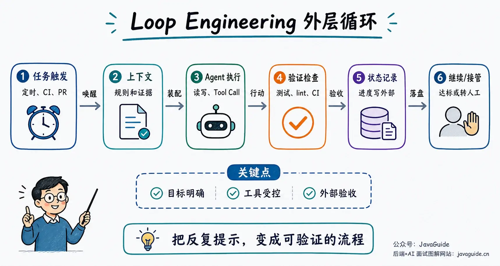
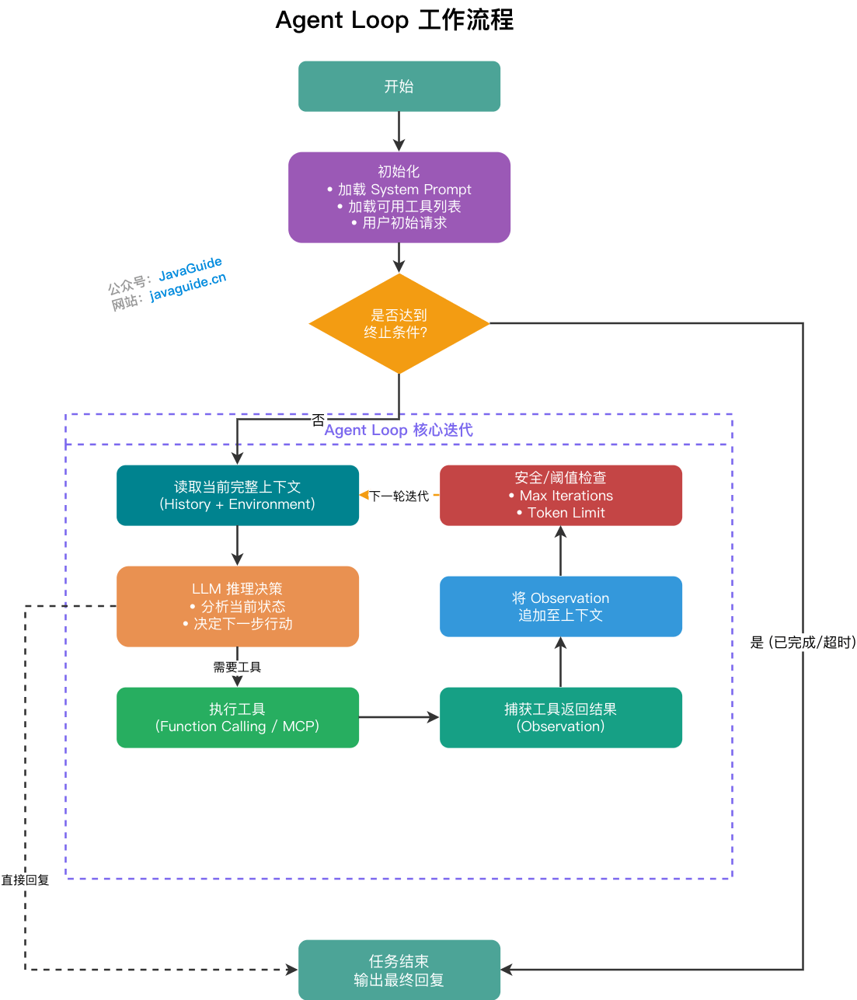
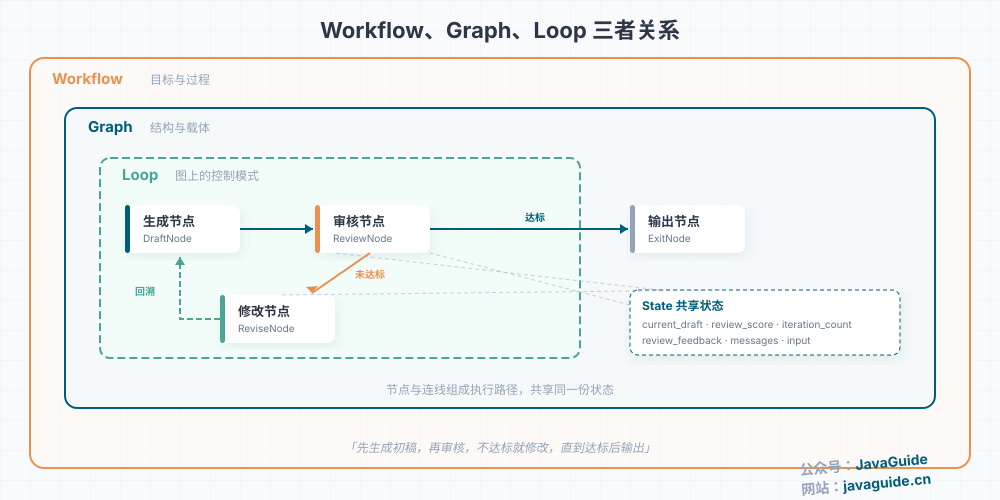
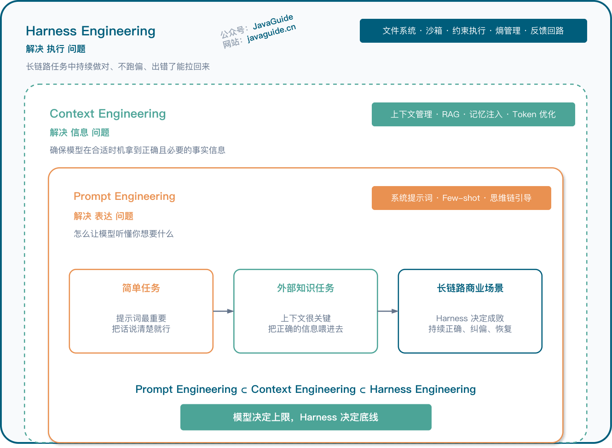
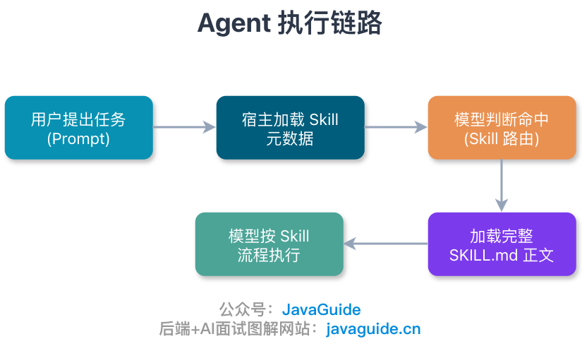
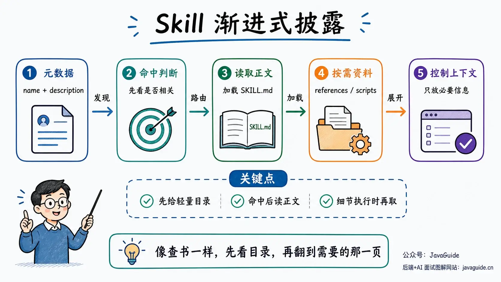
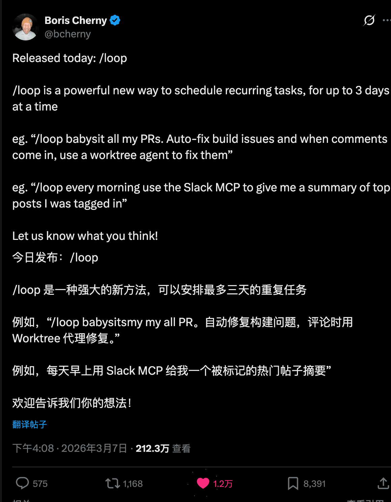
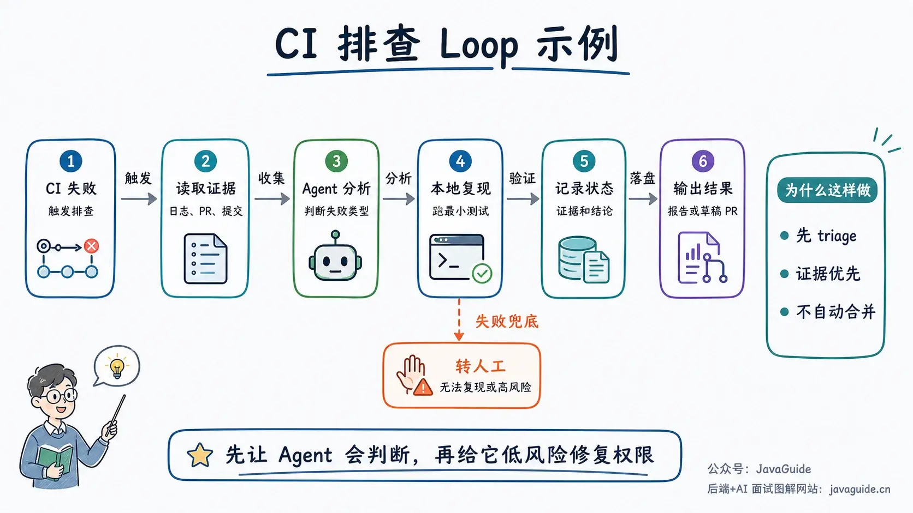
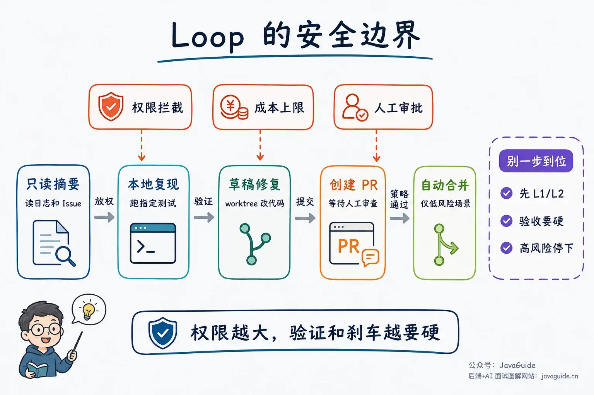

After a CI failure, an Agent can read the failure logs, locate the relevant files, run a minimal test suite, and write its findings back to an Issue. If the first investigation does not resolve the problem, more practical questions arise: who starts the next iteration, what context should it read, and when should it stop and hand the task to a person?

Loop Engineering deals with this outer workflow. It connects repeated Agent runs: CI, a PR, or a scheduled task triggers the next iteration; project rules and relevant evidence enter the context; tests and reviews determine whether the result is trustworthy; and saved state lets later runs resume where the last one stopped.

Public discussion of the term picked up in **early June 2026**, when Addy Osmani published a related article on June 7. Features such as `/loop`, `/goal`, and Automations in Claude Code and Codex can be combined with Skills, Sub-agents, workspace isolation, and MCP/Connectors to build similar workflows.

## What Is Loop Engineering?

Loop Engineering coordinates tasks that take multiple Agent runs. One workflow defines how the task is triggered, what each run can read and do, how results are checked, where state is saved, and when to stop or hand control to a person.

For example, a goal for the `auth` module could be "pass all tests, with at most 5 attempts." The same task configuration can record the trigger, accessible files and rules, permitted changes, and where results should be written.

Suppose CI triggers this task. The Agent first reads the project rules and failure logs, locates the relevant files, and runs the target tests. Test output, lint results, type checks, screenshots, or review comments feed into the next run to help decide whether to continue. Tried approaches, failure causes, and next steps are saved to an external file, Issue, Linear ticket, or database. The workflow stops and hands control to a person when it reaches the attempt or budget limit, lacks permission, or needs a business decision.



The Prompt, context, and tool descriptions still determine how an individual model call runs. The Loop adds task scheduling, context preparation, result validation, and state recovery around each call so the next run can continue from the previous one.

## Which Existing Ideas Does It Build On?

### Agent Loop and ReAct: The Inner Loop Is Not New



The basic Agent Loop remains the same: read the current context, let the LLM decide what to do, call a tool or generate a result, then write tool output back into the context. Stop when a termination condition is met.

ReAct follows the same idea: Reasoning and Acting alternate. The model takes a step, observes the external feedback, and uses it to decide what to do next.

[AI Agent fundamentals](https://javaguide.cn/ai/agent/agent-basis.html) introduces this loop. Production incident investigation, codebase exploration, and test-failure diagnosis do not have a fully known path in advance, so the model must adjust its next step based on the evidence it receives.

Distinguish between two levels of loops. The Agent Loop runs within one task: the model reasons, calls tools, reads results, and decides what to do next. The outer Loop runs after that task, for example by waiting for another CI event, checking test results, saving investigation notes, and deciding whether to start the Agent again.

| Level                  | What runs the loop                      | What happens in each iteration                                        | Typical stop condition                                       |
| ---------------------- | --------------------------------------- | --------------------------------------------------------------------- | ------------------------------------------------------------ |
| Inner Agent Loop       | The Agent                               | Reasons, calls tools, observes results, and decides the next step     | No more tools are needed; return the final result            |
| Outer Engineering Loop | A scheduler or a human-written workflow | Starts the Agent, assigns tasks, validates results, and records state | Goal reached, budget exceeded, or failure handed to a person |

### Workflows, Graphs, and Loops: Controlled Back Edges Already Exist

In a workflow graph, a Loop is usually represented by a back edge.

A back edge is a directed edge from a later node to an earlier one. For example, a workflow reaches the "Review" node, but a condition is not met, so it follows the edge back to "Revise" and runs the subsequent steps again.



In "Draft → Review → Revise if rejected → Review again," the condition for a failed review creates a back edge from "Review" to "Revise." A successful review exits the loop. [Workflows, Graphs, and Loops in AI Workflows](https://javaguide.cn/ai/agent/workflow-graph-loop.html) explains this structure in more detail. Runtime configuration should also define the maximum iterations, timeout, Token budget, and fallback behavior so the back edge always has an exit.

Code Agents extend the same back edge across Claude Code, Codex, CI, GitHub, Issue trackers, and local repositories: after a test fails, they read the error, modify files, rerun commands, and use external signals to decide whether to continue.

### Context Engineering: What the Agent Should See in Each Iteration

By the third iteration of an unresolved CI investigation, raw logs, test output, change records, and conflicting conclusions can pile up. Putting all of them into the context can bury project rules and cause the Agent to repeat approaches that have already been ruled out.


Before each run, load persistent rules such as `AGENTS.md`, `CLAUDE.md`, and coding standards. Then load files, test output, Issue descriptions, or design documents relevant to the current failure. Keep investigation keys such as trace IDs, error codes, and log paths unchanged; condense verified steps into conclusions and save them in external state.

When the context window approaches its limit, choose whether to summarize history, remove old tool results, or save progress externally. This lets the next iteration continue from the evidence instead of rereading the project, guessing its rules, or revisiting the same error.

### Harness Engineering: The Environment Around the Model

As described in [Harness Engineering](https://javaguide.cn/ai/agent/harness-engineering.html), an Agent can be viewed as Model + Harness. The model handles reasoning and generation; the Harness provides the environment, tools, feedback, sandbox, permissions, observability, and recovery.



Think of the Harness as the runtime environment for one task iteration. It determines which logs CI triage can read, whether it can modify files, and which test commands it can run. The Loop then decides when to start this environment, where to save results, and whether another Agent should review them. A goal without file permissions, validation commands, and failure handling cannot run unattended.

### Skills: Record Instructions That Would Otherwise Be Repeated



When CI investigations recur, there is no need to explain the repository's test commands, directories that must not be changed, formatting requirements, PR template, and database migration approval rules every time.

Put these instructions in a Skill: use its `description` to match CI investigation tasks, and its `SKILL.md` to record readable directories, test commands, the PR template, and migration approval rules. Load the instructions when a task matches so later failures follow the same constraints.



A Skill records instructions that are repeatedly useful in a project instead of assembling a temporary Prompt for each conversation.

### MCP: Connect the Loop to Real Tools

GitHub Actions, logging platforms, Linear, and Slack each have their own APIs. CI investigation, PR monitoring, and task triage move between these systems. Integrating every one separately would give the Agent multiple tool descriptions and calling conventions.


MCP Servers expose GitHub, Issue trackers, logging platforms, internal documentation, and databases as discoverable tools. The Agent Runtime selects tools, while the business systems remain responsible for permission and data validation.

Configure tool permissions according to their side effects. Excessive write access in an unattended Loop can lead to incorrect data changes, misdirected messages, repeated calls to expensive APIs, or prompt injection that induces the Agent to read unrelated files. Deploy permissions, auditing, rate limits, redaction, and human approval together with MCP tools.

## What Is Actually New About It?

TDD, CI, ReAct, and workflow graphs already use loops. Code Agents bring in outer steps that people used to perform manually: reading errors, locating files, rerunning commands, updating tasks, and passing results to the next iteration.

For example, a scheduled task or CI event can create an isolated worktree, load a project Skill, let an implementation Agent make changes, and have a validation Agent check them before writing results to external state. If tests still fail, the next iteration continues based on the logs and test results. The workflow hands off to a person if it lacks permissions, makes no progress, or encounters a high-risk action.

Loop Engineering therefore focuses on three questions: **what evidence the next iteration needs, which actions must pause, and where the previous iteration's state is saved.**


## How to Think About /loop and /goal in Claude Code

`/loop` runs a Prompt again on a schedule, while `/goal` uses completion criteria to decide whether to continue. See [Claude Code Commands Explained](https://javaguide.cn/ai-coding/practices/claudecode-commands.html) for more details.



`/loop` is for checking again later. It repeatedly runs a prompt in the current session. You can specify a fixed interval, such as checking a deployment every 5 minutes, or leave it unspecified so Claude can choose how long to wait before checking again.

Running `/loop` without arguments uses the built-in maintenance prompt or reads `.claude/loop.md` or `~/.claude/loop.md` as the default prompt.

```bash
/loop 5m "Check whether the deployment has finished and report its current status."
/loop 30m /code-review
/loop "Check the PR's CI and review comments. Handle any changes; otherwise, check again later."
```

`/goal` is for determining whether an objective has been completed. Give it a verifiable completion condition, and Claude will work through successive iterations. At the end of each one, an independent small model uses evidence already present in the conversation to check whether the condition is met. It continues if not and stops when it is.

```bash
/goal All unit tests in the auth module pass and npm test -- tests/auth exits with code 0; try at most 5 times, and stop and report if the same failure occurs twice in a row.
/goal Finish migrating the components under src/legacy, pass npm run build, and ensure git diff contains only src/legacy and its corresponding test files.
```

In short: `/loop` decides when to wake up again; `/goal` decides when the task is done.

A Stop hook or Agent SDK can delegate continuation criteria to a script, Prompt, or external evaluator, then run deterministic checks, enforce permission gates, and save state at the end of each iteration.

Use `/goal` to check a condition such as "keep making changes until the tests pass, for at most 5 attempts." Use `/loop` to periodically recheck deployments, monitor PRs, check long-running builds, or review code on a schedule.

`/loop` is temporary, session-scoped scheduling. Tasks trigger only while Claude Code is running and idle. Closing the terminal, ending the session, or starting a new session affects them. `--resume` or `--continue` can restore only tasks that have not expired, and loop tasks expire after 7 days at most.

For tasks that must run reliably across machines and restarts over a long period, consider Routines, Desktop scheduled tasks, GitHub Actions, CI/CD, or a dedicated scheduling system.

Before running `/loop`, restrict permissions and specify what to check and when to stop. Before running `/goal`, define verifiable completion criteria and ask Claude to show test, build, or diff-check results. Commit critical work first so you can return to a known commit if something goes wrong.

## What Types of Loops Are There?

Loops mainly differ in what triggers the next iteration. `/loop` represents a time-based trigger; `/goal` continues based on completion criteria. CI events and human approvals can also trigger a run. The table groups loops by trigger:

| Type                | Trigger                                              | Suitable tasks                                     | Examples                                      |
| ------------------- | ---------------------------------------------------- | -------------------------------------------------- | --------------------------------------------- |
| Time-driven Loop    | Every N minutes, daily, or weekly                    | PR monitoring, CI checks, log inspection           | `/loop`, Codex Automations, cron              |
| Event-driven Loop   | CI failure, Issue creation, or PR update             | Incident triage, comment handling, alert summaries | GitHub Actions, Webhook, Claude Code Channels |
| Goal-driven Loop    | Check whether the goal is met after the previous run | Fix tests, migrate APIs, increase coverage         | `/goal`, Stop hook, Agent SDK                 |
| Human-approval Loop | Pause for confirmation before a critical action      | High-risk changes, releases, permission changes    | Approval gate, draft PR, review queue         |

This table also explains the "old idea in new packaging" phrase: triggering, scheduling, validation, and approval are not new engineering practices; they are now arranged around code Agents.

## What Does a Practical Loop Look Like?

Consider a workflow that automatically handles CI failures each day. This example follows a common investigation process; it is not a complete case study published by a specific company. The first version performs triage only: it neither changes code nor merges automatically.

The first version checks only three things: whether the Agent can find the right evidence, distinguish facts from guesses, and record state in a consistent format. Consider granting permission for low-risk fixes only after all three are reliable.

CI triage can run at 9 a.m. each day or when CI fails. It reads the latest failure, related PR, recent commits, and failed test logs. It loads the project's `AGENTS.md` and `ci-triage` Skill, reads only relevant module files, and classifies the failure as an environment issue, flaky test, code regression, or dependency problem.

If the failure can be reproduced locally, run the smallest relevant test suite; otherwise, preserve the evidence. Write the findings to `TODO.md`, a GitHub Issue, or a Linear ticket, and label them "safe to fix automatically," "owner confirmation required," or "possibly intermittent." The workflow does not push code or change production configuration, and retries no more than 3 times in a row.



After this version is stable, add automatic fixes gradually:

- For low-risk issues such as dependency version conflicts, formatting failures, or obvious test snapshot updates, create an isolated worktree for the Agent to try a fix.
- Run the target tests after making changes.
- If they pass, create a PR but do not merge it automatically.
- Have another review Agent check the diff against the project Skill.
- Return failures or uncertain cases to a human queue.

This Loop uses several of the components described above:

| Component           | Role in this example                                                         |
| ------------------- | ---------------------------------------------------------------------------- |
| Automation          | Starts the task daily or after a CI failure                                  |
| Skill               | Stores the CI investigation steps, test commands, and repository rules       |
| MCP / Connector     | Reads GitHub, CI, Issues, and the logging platform                           |
| Context Engineering | Loads only the relevant failure logs, files, and rules                       |
| Worktree            | Isolates the automatic fix branch from the main workspace                    |
| Sub-agent           | One implements; another validates                                            |
| Memory / State      | Records tried approaches, failure causes, and next steps                     |
| Stop Condition      | Tests pass, the retry limit is reached, or a high-risk action is encountered |

"Run at 9 a.m. every day" only defines when to start. The CI link and failure logs provide the investigation entry point; the minimal reproduction command and test results determine whether to continue; the PR diff and human approval determine whether changes can proceed. Without this external evidence, a scheduled task can only repeat the same Prompt.

## When Is a Loop Useful?

Loops work best for recurring tasks with verifiable acceptance signals. Logs, exit codes, coverage, and diffs can determine whether to continue or stop. These tasks often have such conditions:

- Initial CI failure investigation: logs, test results, and clear failure signals are available.
- Dependency upgrades: make changes on an isolated branch and validate with test exit codes and build results.
- Increasing test coverage: define a measurable target, such as raising a module's coverage from 62% to 75%.
- Documentation updates: update user or API docs based on the latest diff, then request human review.
- Large mechanical migrations: for example, CommonJS to ESM, replacing an old component API, or fixing formatting.
- PR / Issue triage: read, categorize, summarize, and assign priorities.

These tasks are harder to verify using external signals alone:

- Vague goals such as "improve the product experience" or "come up with a growth strategy."
- Weak verification signals where the Agent can only say, "I think this is done."
- High-impact operations such as writing to production databases, changing permission systems, or modifying payment flows.
- Work that depends heavily on human taste or business judgment, such as setting a brand voice or making complex product tradeoffs.
- Major changes to legacy projects without tests, logs, or a rollback plan.

"Improve the experience" or "keep optimizing" cannot support reliable stop decisions. Before starting a loop, break the goal into checkable tasks and define acceptance criteria.

## Common Pitfalls

### Vague Goals

"Keep optimizing" gives the Agent no scope, validation command, or stop condition, so it cannot determine when the task is complete.

An example with only a goal:

```text
/goal "Optimize this project and improve code quality."
```

An example with a scope and exit conditions:

```text
/goal "Make all failing unit tests in the auth module pass. Only modify src/auth and tests/auth. After each change, run npm test -- tests/auth and show the exit code. Try at most 5 times; if the same failure occurs twice in a row, stop and report."
```

The paths `src/auth` and `tests/auth`, test exit code, 5-attempt limit, and repeated-failure condition can all be checked. The second command does not leave the acceptance criteria for the Agent to guess.

### Treating the Agent's Self-Assessment as Acceptance

Test exit codes, CI status, lint, type checks, and screenshot comparisons provide evidence of completion; the Agent's explanation is only supplementary. For semantic review, one Agent can implement while another checks in a separate context. Add human approval for steps close to production.

### Forgetting Cost Limits

Each iteration may reread files, call tools, interpret errors, summarize context, or start a review Agent. Task configuration should define both budgets and stop conditions:

- Maximum number of iterations.
- Maximum number of tool calls.
- Daily or per-task Token or monetary budget.
- A no-progress check, such as stopping when the same failure occurs twice.
- For low-value tasks, generate a summary without applying automatic fixes.

No-progress checks prevent the system from continuing to consume Tokens when the failure has not changed.

### Granting Excessive Permissions

Reading logs, opening a PR, and automatically merging a PR have different levels of risk and should not use the same permissions. Actions such as deleting files, changing production configuration, sending external messages, and writing to a database should require human approval by default.

Review MCP Server sources, tool descriptions, returned content, and Prompt templates because any of them can carry prompt injection. Permissions can be granted gradually by execution stage:

| Stage                 | Agent permissions                       | Human responsibility  |
| --------------------- | --------------------------------------- | --------------------- |
| L0 Read-only summary  | Read logs and Issues; generate reports  | Decide whether to act |
| L1 Local reproduction | Run specified tests; locate failures    | Decide whether to fix |
| L2 Draft fix          | Change code in a worktree; run tests    | Review the diff       |
| L3 Create PR          | Push a branch; write the PR description | Review and merge      |
| L4 Automatic merge    | Merge after policy checks pass          | Handle exceptions     |

L1 and L2 cover reading logs, reproducing issues, and making draft changes. L4 requires a fixed issue type, tests that cover the main risks, and a verified rollback path. Keep human approval for tasks involving business judgment, permissions, or data writes.



## Do Not Rush to Automate Fixes in the First Version

For your first Loop, do not start with unattended automatic fixes. Begin with read-only triage, and make the task description explicit:

```text
Task: Review CI failures from the past 24 hours each day and prepare an investigation summary for a person to handle.

Allowed:
- Read GitHub Actions, recent commits, failed test logs, and files directly related to the error.
- Run the relevant test to confirm reproduction once the failure is traced to a specific test.
- Write findings to TODO.md with the CI link, key error, and suggested owner.

Before starting:
- Read AGENTS.md.
- Load the ci-triage Skill for CI investigation tasks.

Not allowed:
- Do not change code, create PRs, or send Slack messages or email.
- Do not read unrelated files across the repository or paste full logs.
- Stop if there are more than 10 failures; reproduce each failure no more than twice.
- Mark the task for human handling if permissions are insufficient, logs are missing, or business judgment is needed.
```

This version is tightly scoped: it reads CI evidence and relevant files, does not change code or send external messages, and limits the number of failures and reproductions. Check the investigation summaries for three issues: unrelated files, repeated tool calls, and unauthorized actions. Do not grant fix permissions until these issues have been addressed.

When a task spans multiple days, a new session will not automatically know what was tried the day before. Save the information needed to resume in external state: the goal, scope, evidence, actions taken, results, next steps, and stop conditions must all be available to the next iteration.

```yaml
loop_id: ci-triage-2026-06-17
goal: "Investigate CI failures from the past 24 hours"
status: running
scope:
  repos: ["backend-service"]
  max_items: 10
attempts:
  - item: "auth-test failure"
    evidence: "GitHub Actions run #12345"
    action: "ran npm test -- tests/auth"
    result: "reproduced locally"
next_step: "ask auth owner to review"
stop_condition:
  max_attempts: 3
  require_human_when:
    ["permission_missing", "production_change", "uncertain_root_cause"]
```

After this triage workflow is stable, add four strict limits before enabling automatic fixes:

- Create an isolated worktree or branch before making changes.
- Allow changes only in a specified path list.
- Permit only specified tests and formatting commands.
- Open a draft PR after checks pass; do not merge it automatically.

## Before Integrating a Loop into Production

### What Triggers the Next Iteration?

A daily scheduled task can find failures from a recent time window. A CI failure event can pass the failed job, related PR, and recent commits directly to triage. Pass the task scope, readable files, and available commands with the task so a new session can prepare the context.

### When Should It Continue or Stop?

The CI link, failure logs, minimal reproduction command, and test exit code show whether the investigation has made progress. The `attempts` and `stop_condition` fields save actions already tried and reasons for stopping in external state. Return the task to a human queue if permissions are insufficient, the failure cannot be reproduced, business judgment is needed, or the consecutive-failure limit is reached. Creating a PR, changing production configuration, and automatic merging should not be the default next steps in the same Loop.

## Summary

Loop Engineering connects each call to the evidence, state, and constraints left by the previous iteration.

The CI triage example starts by reading logs, locating failures, and recording findings. Its YAML state stores `evidence`, `action`, `result`, and `next_step`, allowing the next iteration to continue directly and giving a human visibility into what has already been done. Once read-only investigation is reliable, gradually grant permission to change code, create PRs, and merge automatically.
