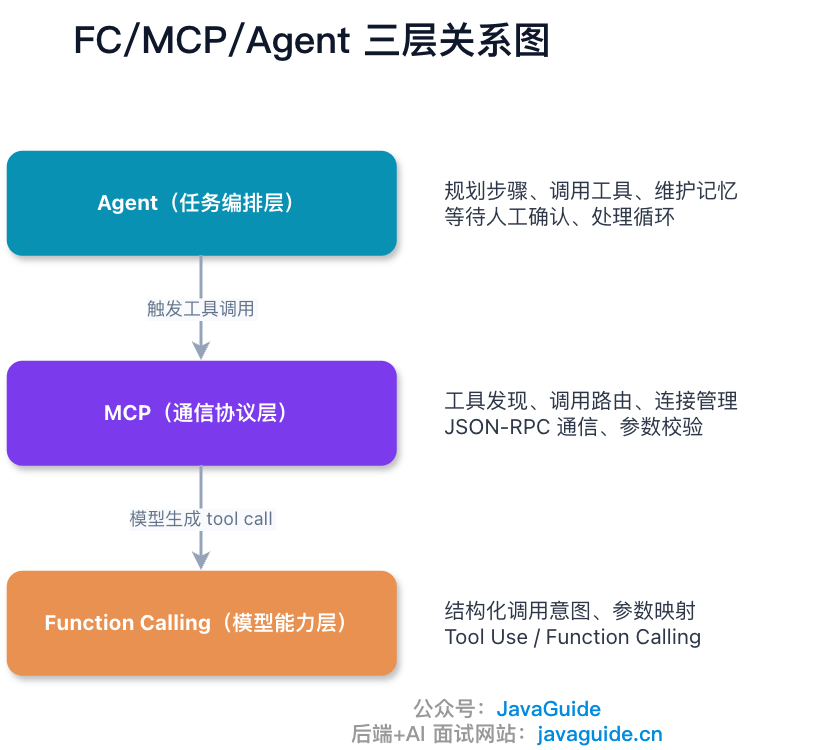
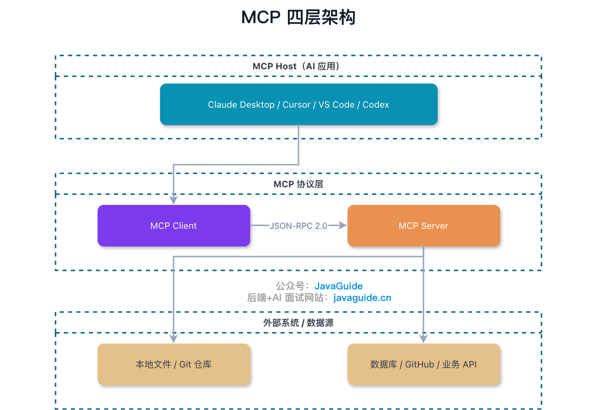
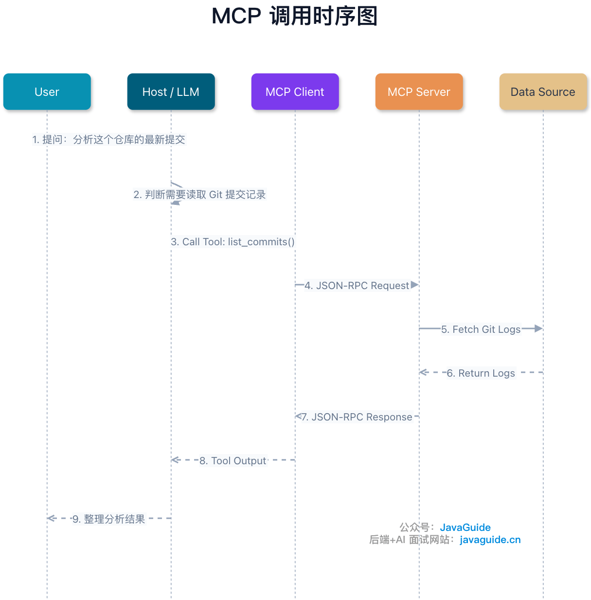
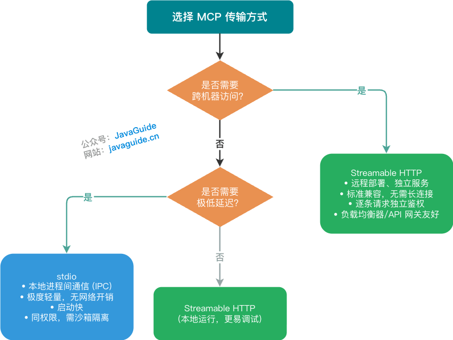

Connecting the same Git tool to Claude Desktop, Cursor, and a custom Agent often requires a separate adapter for each. When tool parameters, authentication, or versions change, every client integration must be updated.

MCP standardizes how external systems expose capabilities as Servers. A compatible Host discovers and calls them through a Client. MCP handles tool and data-source integration; Function Calling and the Agent still determine whether to call a tool and how to orchestrate the task.


> This guide focuses on the current stable [2026-07-28 revision](https://modelcontextprotocol.io/specification/2026-07-28). The previous `2025-11-25` revision used an initialization handshake and transport-level sessions. Revision `2026-07-28` switches to stateless, self-describing requests, removes the `initialize`/`initialized` handshake and `Mcp-Session-Id`, and moves Tasks to the `io.modelcontextprotocol/tasks` extension. Clients and SDKs that support older revisions may still use `2025-11-25`. Before integration, confirm the protocol revision, SDK version, and Host capabilities.

## What Is MCP?

MCP stands for Model Context Protocol.

The name describes its purpose:

- **Model:** It is designed for applications built around large language models.
- **Context:** It brings external context, tools, and data sources to the model.
- **Protocol:** It standardizes how these components interact.

However, MCP is more than a way to add plugins to a model.

More precisely, MCP is a **communication protocol between an MCP Client and an MCP Server**. The Host handles user interaction and model calls, the Client communicates with Servers, and Servers expose specific capabilities.

Consider a common scenario.

A user asks, "Show me what changed in the latest commit to this project."

The model or Agent cannot see the commit history in your local Git repository. It needs an external capability to read the Git log.

Without MCP, every AI application must define its own way to connect to Git tools, pass parameters, and receive results.

With MCP, Git capabilities can be packaged as an MCP Server. The Host's MCP Client connects to it, discovers the available tools, calls them using the protocol, and returns the results to the model for further analysis.

Protocol adaptation for Git tools is handled on the Server side. The Agent or AI application only needs to understand the user's question, select a tool, and organize the result. Each client does not need its own private interface.

## How Do MCP, Function Calling, and Agents Relate?

Function Calling, MCP, and an Agent may all be involved in a task such as "read the latest commit," but at different points: the model produces a structured call intent, the Host routes it to a tool, and the Agent uses the result to decide whether to continue.

For example, the model might return this call intent:

```json
{
  "name": "read_file",
  "arguments": {
    "path": "/repo/README.md"
  }
}
```

OpenAI calls this mechanism Function Calling, while Anthropic calls it Tool Use. The model can return structured data such as "call `read_file` with this path."

MCP connects this intent to an external system: it defines which Server exposes the tool, how the request is sent, and how the result is returned.

The Agent manages the next step of the task. It reads tool results and decides whether to make another call, finish, or wait for human approval. Planning, memory, and loops also belong to this layer.


The request flow makes their roles clear: Function Calling produces the command, MCP carries it to the tool, and the Agent decides whether the flow continues or ends.

The primary concern varies by scenario:

| Scenario                                          | Primary concern  | Reason                                                                |
| ------------------------------------------------- | ---------------- | --------------------------------------------------------------------- |
| Let the model decide whether to check the weather | Function Calling | The model must turn intent into structured parameters                 |
| Let Claude Desktop read local files               | MCP              | A standard interface is needed between the Host and local file system |
| Have AI investigate a production incident         | Agent            | The task requires multi-step decisions, tool calls, and feedback      |

Real projects usually use all three. The table distinguishes their primary responsibilities.

## What Are the Components of MCP?

The MCP communication flow consists of a Host, Client, and Server.



The Host is the AI application used by the user, such as Claude Desktop, Cursor, an AI extension in VS Code, or a custom Agent platform.

The Client runs inside the Host and exchanges protocol messages with MCP Servers. For revision `2025-11-25` and earlier, the Client establishes a session through an initialization handshake. Revision `2026-07-28` uses stateless requests and does not establish an MCP transport session. A Host can connect to multiple Servers, usually with one Client per Server.

Developers primarily build Servers. A Server can expose capabilities such as reading files, querying SQL, searching GitHub Issues, and looking up internal tickets.

Behind the Server are the actual data sources: local files, databases, internal platforms, GitHub, or third-party APIs. These are not MCP protocol roles. The Host calls the Server through the Client; implementation details such as database queries and API requests remain inside the Server.

## How Does an MCP Call Work?

Consider the task "analyze the latest commit in this repository."



When the model recognizes that it needs the Git log, it generates a tool call. The Host passes the call to the MCP Client, which sends a JSON-RPC request to the Server. The Server queries Git and returns the result along the same path, and the model uses it to form a response.

Tool names, `description` fields, parameter explanations, and prohibited use cases directly affect the model's choices. Treat parameters received by a Server as untrusted input: restrict file access to allowed directories, parameterize SQL, require approval for high-risk operations, and redact returned data.

In revision `2026-07-28`, MCP no longer requires the `initialize`/`initialized` handshake or `Mcp-Session-Id`. Each request includes the protocol version and client capabilities. The [specification](https://modelcontextprotocol.io/specification/2026-07-28/basic/versioning) requires Servers to implement `server/discover`, but Clients are not required to call it and can send other requests directly. Compatible Clients using revision `2025-11-25` or earlier still perform the initialization handshake. If a tool does not appear, first confirm the revision selected by the Client and Server, then inspect capability metadata in modern requests or the legacy handshake result.

## Does MCP Expose Only Tools?

Many discussions of MCP focus only on Tools, which is understandable because tool calls are the most visible feature. MCP also exposes other capabilities.

### Resources, Tools, and Prompts

A Server can provide three types of capabilities: Resources, Tools, and Prompts.

Resources provide read-only context, such as local files, log excerpts, database Schemas, or configuration records.

Tools perform actions such as querying databases, sending messages, creating tickets, or calling business APIs. Capabilities that execute logic or may change external state belong in Tools.

Prompts are reusable prompt templates, such as "review code using team conventions" or "turn API documentation into test cases."

The model usually selects and calls Tools. The Host, user interface, or application logic can determine how Resources and Prompts are presented and selected.

Consider a household example to understand Resources, Tools, and Prompts.

A user says, "I want to make cucumber salad."

The LLM acts as the chef. It knows roughly how to make cucumber salad, but still needs external information and capabilities:

- Resources are like ingredients and recipes: what is in the fridge, whether there are cucumbers, and where the seasonings are.
- Tools are actions: chop ingredients, mix them, turn on the stove, or order groceries.
- Prompts are household preferences: use less chili, always add cilantro, or do not use garlic.

If a tool description is wrong—for example, if it describes a cucumber as a tomato—the model may choose the wrong item.

In production, tool names, parameter descriptions, and return structures all affect the Agent's choices and later decisions. Starting a Server is only the first step; the model must also understand its capability boundaries accurately.

### Roots, Sampling, and Elicitation

In addition to Server-side capabilities, the Client can provide capabilities for the Server to use, such as Roots, Sampling, and Elicitation. Revision `2026-07-28` marks Roots, Sampling, and Logging as deprecated (they will remain available for at least twelve months); Tasks moved to the `io.modelcontextprotocol/tasks` extension. New implementations should first confirm that the target Client/Host supports these capabilities or extensions.

Roots tell the Server, through the Client, which file-system root directories are expected to be in scope. For example, a Host can expose only the current project directory, not the user's home directory. Roots provide capability negotiation and scope hints; they do not create a file-system sandbox. The Server still needs path normalization, boundary checks, and operating-system-level permission isolation.

Sampling is unusual because it lets a Server request a generation from the Host-side LLM. For example, after reading a log excerpt, a Server may request a model-generated summary or classification.

Elicitation lets a Server ask the user for additional information during execution. The Host can present an interaction when parameters are missing, options are ambiguous, or confirmation is needed before execution.

Choose these capabilities based on the use case. Most MCP Servers can start by providing Tools only; add Resources and Prompts when read-only context or reusable task entry points are needed. Roots, Sampling, Elicitation, and the Tasks extension depend on implementation by the relevant Client/Host; support in a Server SDK alone is not enough.

## Why Does MCP Use JSON-RPC?

MCP uses JSON-RPC 2.0 for communication.

REST is resource-oriented, with endpoints such as `/users/1` and `/orders/100`. JSON-RPC is method-oriented, with calls such as `tools/call` and `resources/read`. Since AI tool use is naturally about "performing an action," JSON-RPC is a good fit for MCP.

According to the [request metadata fields in the 2026-07-28 specification](https://modelcontextprotocol.io/specification/2026-07-28/basic/index), a tool-call request can look like this. `_meta` is inside `params`, at the same level as `name` and `arguments`. `my-app` and `1.0` are example client name and version; an empty capability object means this request does not declare optional client capabilities:

```json
{
  "jsonrpc": "2.0",
  "method": "tools/call",
  "params": {
    "name": "read_file",
    "arguments": {
      "path": "/path/to/file.txt"
    },
    "_meta": {
      "io.modelcontextprotocol/protocolVersion": "2026-07-28",
      "io.modelcontextprotocol/clientInfo": {
        "name": "my-app",
        "version": "1.0"
      },
      "io.modelcontextprotocol/clientCapabilities": {}
    }
  },
  "id": 1
}
```

The response may look like this:

```json
{
  "jsonrpc": "2.0",
  "id": 1,
  "result": {
    "resultType": "complete",
    "content": [
      {
        "type": "text",
        "text": "File contents..."
      }
    ]
  }
}
```

An `error` is returned only on failure:

```json
{
  "jsonrpc": "2.0",
  "id": 1,
  "error": {
    "code": -32602,
    "message": "Invalid params"
  }
}
```

Successful responses return only `result`; failed responses return `error`. Do not add `error: null` to a successful response.

JSON-RPC messages are text-based, easy to log, and independent of a specific transport. The tradeoff is that JSON-RPC lacks the strong IDL and compile-time type constraints of gRPC. Although MCP uses JSON Schema to describe tool parameters, the Schema is both a runtime validation rule and a prompt to the model; the Server must still validate all parameters strictly.

## Choosing Between stdio and Streamable HTTP

Local Servers usually use stdio. The Host starts the Server as a subprocess and exchanges messages through stdin/stdout. Many local Servers in Claude Desktop use this method. It avoids network deployment costs, but the Server runs on the user's machine, so file, Shell, and database permissions must be restricted separately.

Avoid running a third-party Server without isolation. At a minimum, review its source code or isolate it with Docker, cgroups, or namespaces. This is especially important for Servers that access file systems, Shells, or databases; excessive permissions are difficult to take back later.

In stdio mode, stdout is the JSON-RPC message channel and must not be used for debug logs. A single `print()` can corrupt the message format, causing the Host to fail parsing or disconnect from the Server. Write debug logs to stderr or a file. When investigating a Server startup failure, check that logs have not leaked into stdout.

Remote Servers are better suited to Streamable HTTP. Early MCP remote transports commonly used HTTP + SSE, then moved to Streamable HTTP; the older HTTP+SSE transport is deprecated. Revision `2026-07-28` continues to use Streamable HTTP with stateless requests and requires `Mcp-Method` and `Mcp-Name` headers. Authentication, load balancing, and gateway integration can follow standard HTTP service operations.

```http
POST /mcp HTTP/1.1
Authorization: Bearer xxx
Content-Type: application/json
Accept: application/json, text/event-stream
MCP-Protocol-Version: 2026-07-28
Mcp-Method: tools/call
Mcp-Name: read_file
```

These are the HTTP headers for the earlier `read_file` call; the request body uses the JSON shown above. `Mcp-Method` matches the method name, and `Mcp-Name` matches the tool name. See the [official revision notes](https://blog.modelcontextprotocol.io/posts/2026-07-28/). The response may be regular JSON or an SSE stream, depending on the request type.

Choose a transport based on deployment location and access scope:

- For local tools, local files, and personal use, prefer stdio.
- For team services, remote APIs, and multi-user access, prefer Streamable HTTP.
- For write operations and sensitive data, add authentication, rate limiting, and auditing regardless of transport.



## Is MCP Only About Letting Models Call APIs?

Function Calling already lets a model express which API to call. MCP addresses the duplicated integration work when the same tool must be made available to multiple Hosts.

For example, after an internal ticketing system is connected to one Agent, moving it to another Host may require rewriting the connection, parameter handling, and result processing. Package the capability as an MCP Server, and any application with an MCP Client can discover and call it in the same way.

This separation resembles how frontend and backend teams collaborate through API contracts: Agent developers focus on tasks and interaction, while tool developers focus on capability implementation, data permissions, and operation boundaries.

Team runbooks, on-call documentation, incident reviews, and troubleshooting scripts are often scattered across document stores, Wikis, or script repositories. Organize authorized query and investigation capabilities into a Server so the Agent can search documents, read configuration, or run tools within a defined scope instead of returning only generic advice.

## Is an MCP Integration Ready for Production?

No. A demo's flow—install a Server, ask a question, and get a result—is short. Production systems also need API constraints, auditing, and operational controls.

Specify whether time fields use ISO 8601 or timestamps, whether monetary values are in dollars or cents, and what the default pagination is in the Schema, field descriptions, and examples. The Server must validate parameters accordingly and return errors that help the model correct its request.

An Agent response may pass through multiple Servers and tools. Trace IDs, structured logs, and call traces should record parameters, duration, result summaries, and error codes so you can identify which step affected the final answer.

Local stdio Servers may access files on the user's machine, while remote Servers may connect to internal systems. Explicitly authorize file directories, queryable tables, write access to production APIs, and email sending. Write operations such as deleting, modifying, sending, or calling production systems need additional confirmation, auditing, and rollback plans.

Review the Server's `description`, Prompt templates, and returned content too: malicious or poorly written content may contain prompt injection that directs the model to read additional files or expose information. Server provenance, dependencies, permission scope, and update history are all part of deployment review.

Model Tokens, vector retrieval, third-party APIs, and cloud resources all incur costs. Calls should be attributable to a user, business unit, and tool; otherwise, it is difficult to identify the source of increased costs.

Incompatible changes to tool fields, enums, or return structures can also affect the model's decisions. Maintain tool-level versions, staged rollouts, old-version support, and automated compatibility tests together with the Server.

## What Should You Check Before Deploying MCP in an Organization?

### Schema and Versioning

- Does every tool have a clear input and output Schema?
- Are field units, time formats, enum values, and defaults documented?
- Are tool interfaces versioned?
- Is there a staged rollout and rollback plan for incompatible changes?
- Can the Schema be used for automated validation?

### Permissions and Security

- Which files, directories, databases, and APIs can the Server access?
- Are read-only tools separated from write-operation tools?
- Do high-risk operations require human confirmation?
- Are returned results redacted?
- Are path traversal, SQL injection, and command injection prevented?
- Have third-party MCP Servers been reviewed for source, dependencies, and permissions?

### Observability

- Does every user request have a Trace ID?
- Are tool parameters, duration, result summaries, and error codes recorded in structured logs?
- Can you reconstruct the full tool-call chain behind an Agent response?
- Are there timeout, rate-limiting, circuit-breaker, and retry policies?

### Cost Attribution

- Can each call be associated with a user, business unit, tool, and session?
- Can Token, API, and cloud-resource costs be tracked separately?
- Are quota and budget alerts configured?
- Are there call limits when the model loops through tools?

### Dependency Governance

- Do MCP SDKs, third-party libraries, and third-party Servers have maintainers and update records?
- Who handles security vulnerabilities?
- Do Server upgrades have a test environment and rollback plan?
- Are core capabilities kept independent of unmaintained third-party extensions?

These checks are no different in principle from those for ordinary backend services. MCP changes how tools are integrated; it does not replace authentication, auditing, logging, versioning, or rate limiting.

## What Should You Consider When Building an MCP Server?

### Do Not Start by Building a General-Purpose Server

A common mistake is to use a few "do-everything tools" for every operation:

```text
execute_sql(sql)
file_operation(op, path, data)
call_api(url, method, body)
```

Interfaces such as `execute_sql` and `file_operation` leave the model to guess the operation scope and permissions. The more parameters they have, the greater the chance of misuse or privilege escalation. Split tools by business action so Schemas, permissions, and auditing rules can be defined for each:

```text
get_user_by_id(id)
list_active_orders(user_id)
read_file(path)
write_report(path, content)
```

Name tools with a verb and noun. Use `description` to specify valid conditions, required parameters, and prohibited use cases.

For example, a slow-SQL query tool should say more than "query slow SQL logs." It should specify when to use it: a slow service response, database timeout, or CPU spike suspected to be database-related. It should also say not to call the tool for network or memory questions. Such constraints reduce the chance that the model routes a similar-sounding problem to the wrong tool.

### Handle Large Files and Long Text Carefully

Logs, Markdown documents, web-page HTML, and CSV files may exceed the model's context window. A resource endpoint can first return the filename, size, last-modified time, summary, and readable ranges; retrieve the content in chunks only when needed.

Choose chunk sizes based on the context budget, response-size limit, and Server resource budget. For large resources, initially return only a reference, summary, and retrieval options; fetch chunks as needed instead of returning the full content. This prevents one request from filling the context and avoids excessive memory or network use by the Server.

Do not tie limits to a specific model's tokenizer. Tokenization differs between models, so the Server can use character or byte counts for coarse control; context trimming is the responsibility of the Host or an upper-level application.

### Do Not Rely on the Model to Handle Security

For file reads, normalize paths and verify directory boundaries so `../` cannot escape the allowed scope. Use parameterized SQL queries; never execute a string generated by the model directly.

Redact returned data such as phone numbers, email addresses, Tokens, keys, and internal links. Restrict write operations such as deleting files, modifying databases, sending email, or calling production APIs by default; require human confirmation and auditing.

The model may repeatedly call the same tool in a loop. The Server itself must enforce rate limits, timeouts, circuit breakers, and quotas; do not assume the Host will provide them.

For prompt injection, Token passthrough, resource-level authorization, local Server isolation, and the third-party Skill/MCP supply chain, see [LLM and Agent Security in Practice](../system-design/llm-security.md).

### Minimal MCP Server Example: Start with One Tool

Here is a simple weather Server using the Python SDK's FastMCP style. Verify the import paths and startup command against the SDK version pinned by your project; they have not been verified here against an SDK version that supports `2026-07-28`:

```python
from mcp.server.fastmcp import FastMCP

mcp = FastMCP("weather-server")

@mcp.tool()
def get_weather(city: str) -> str:
    """Get the weather for a specified city."""
    return f"Sunny in {city} today, with a temperature of 25°C."

@mcp.resource("weather://forecast")
def weather_forecast() -> str:
    """Return the forecast for the next seven days."""
    return "Seven-day forecast..."

if __name__ == "__main__":
    mcp.run()
```

Configure it in Claude Desktop as follows:

```json
{
  "mcpServers": {
    "weather-server": {
      "command": "uv",
      "args": ["run", "--with", "mcp", "/path/to/weather_server.py"]
    }
  }
}
```

For local debugging, use MCP Inspector:

```bash
# Python Server
npx @modelcontextprotocol/inspector uv run --with mcp /path/to/weather_server.py

# Node Server
npx @modelcontextprotocol/inspector node build/index.js
```

It can simulate requests from a Host. Use it to check whether the Server connects, whether tools can be discovered, and whether parameter validation reports errors.

In production, do not rely on the global `python` environment happening to have `mcp` installed. Use a virtual-environment interpreter or explicitly declare the dependency with a command such as `uv run --with mcp ...`. If Claude Desktop fails to start the Server, check `mcp.log` first; the cause is often a path or dependency mismatch, not a protocol issue.

## Verify a Remote Server with Inspector

The previous example starts a local process over stdio. To inspect connection negotiation, tool discovery, and calls for a remote Server, use [MCP Inspector](https://github.com/modelcontextprotocol/inspector) with a Streamable HTTP connection.

This example uses [Parallel Search MCP](https://docs.parallel.ai/integrations/mcp/search-mcp). It provides web search through `web_search` and page extraction through `web_fetch`. Its anonymous endpoint is `https://search.parallel.ai/mcp`; no Parallel account or API Key is required, but free access is rate-limited.

The following example uses Inspector 2.5.0 and requires Node.js 22.19.0 or later. First, list the tools in a terminal:

```bash
npx --yes @modelcontextprotocol/inspector@2.5.0 --cli \
  https://search.parallel.ai/mcp --transport http --method tools/list
```

`--transport http` selects Streamable HTTP. Inspector checks which protocol revisions the Server supports, chooses either the modern stateless flow or the compatible legacy initialization flow, and then sends `tools/list`. The response should list `web_search`, `web_fetch`, and their parameter Schemas. This anonymous example does not send an `Authorization` header.

Next, call the search tool to find official documentation about Java virtual threads:

```bash
npx --yes @modelcontextprotocol/inspector@2.5.0 --cli \
  https://search.parallel.ai/mcp --transport http \
  --method tools/call --tool-name web_search \
  --tool-arg 'objective=Find the official OpenJDK documentation about Java virtual threads' \
  --tool-arg 'search_queries=["OpenJDK JEP 444 virtual threads"]'
```

Both `objective` and `search_queries` are required; the latter is a JSON array. The tool result includes source URLs and excerpts that you can follow to verify the answer. When troubleshooting, distinguish connection failures, JSON-RPC errors, and a tool result with `isError: true`. An HTTP 200 response alone does not mean the tool call succeeded.

When searching or extracting a page, context such as the query, target URL, and objective is sent to Parallel. Only submit content that is appropriate to share with a third party. This CLI command disconnects when it finishes and does not install a service for other Hosts. If you later enable these tools in an Agent, it may call them as needed for a task. Disable or remove the connection from that Host when you no longer need it.

## Record the Protocol Revision During Integration

MCP standardizes how a Host discovers and calls external tools and data sources, but it does not replace application authentication, data access controls, or execution audits. A Server working in one Host does not guarantee that another Host supports optional capabilities such as Sampling, Elicitation, or Tasks.

When implementing a minimal Server, pin the protocol revision and SDK version, then use Inspector to verify connection negotiation, capability discovery, parameter validation, and error responses. Before integrating a remote service, add OAuth, rate limiting, tracing, version compatibility, and rollback. File and command tools also need Server-side path validation and sandboxing.

## Summary

MCP provides a standard way for Hosts, Clients, and Servers to discover and invoke capabilities, addressing how external tools and data sources are integrated. Function Calling determines whether the model makes a call, the Agent or Workflow orchestrates the task, and application security policies determine whether the request is authorized.

Before integration, confirm the protocol revision, SDK, and negotiated Host capabilities. Use a minimal Server to verify connectivity, Schemas, and error handling. In production, the Server and Host must enforce tool permissions, data redaction, path or SQL validation, rate limiting, auditing, and version compatibility.
