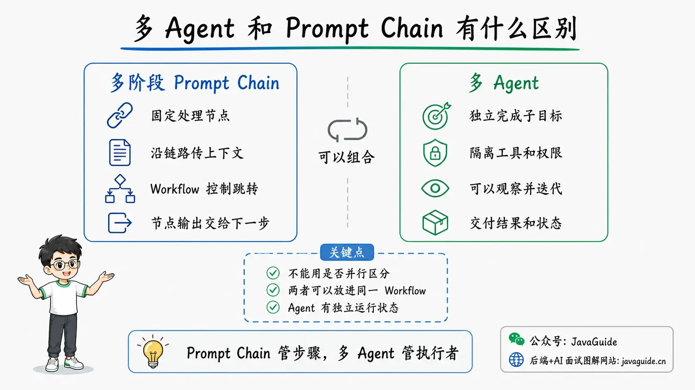
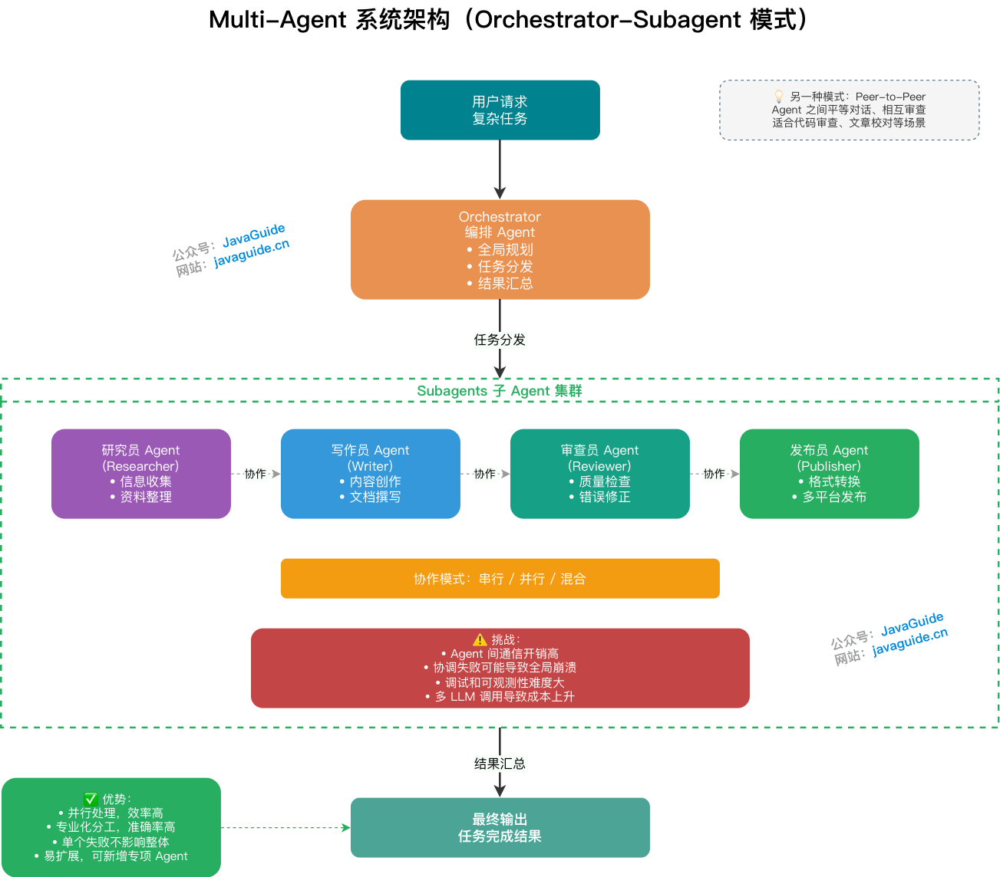
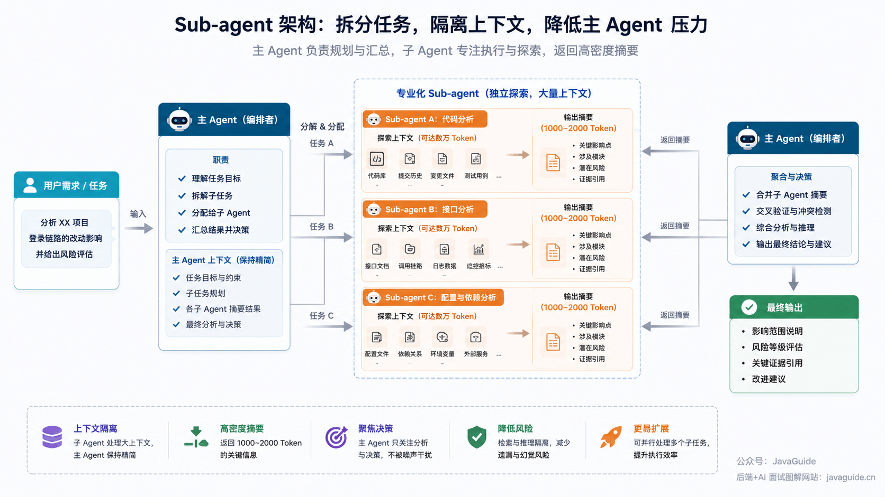
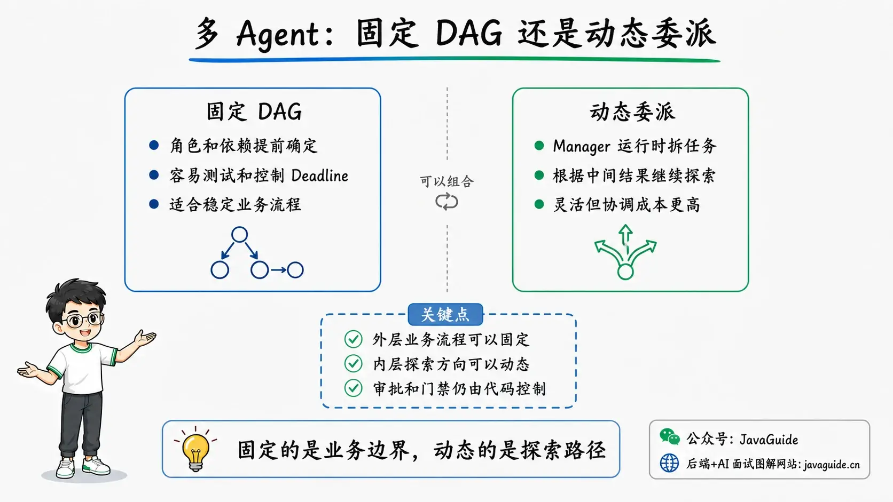
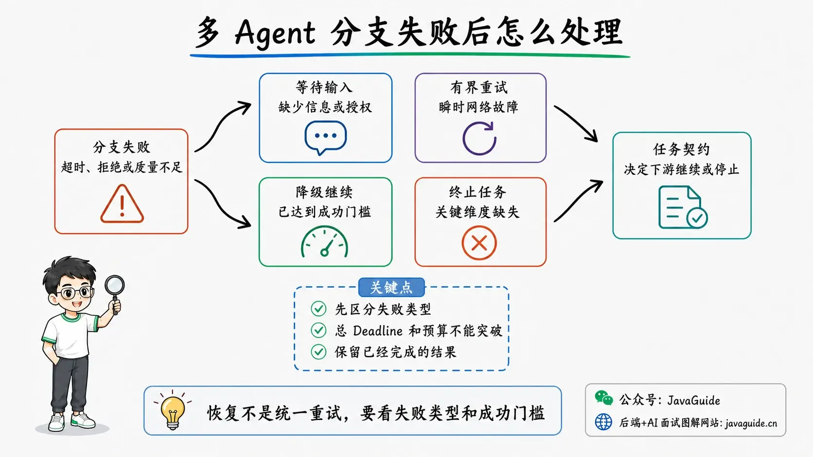

<!-- @include: @article-header.snippet.md -->

In AgentInvest, a multi-agent stock analysis system I built, I assigned work to four roles. A researcher completes the initial research, a technical analyst and a public-opinion analyst add findings in parallel, and an investment manager summarizes the results. Each role uses ReAct to call tools, while the outer pipeline controls ordering, concurrency, and failure conditions.

The engineering challenges appear once the roles are running. How far to decompose subtasks, whether two workers can update state at the same time, and whether to continue after one branch times out all affect the final result. Interviewers often ask follow-up questions about these details in multi-agent projects.

[AI Agent Fundamentals](./agent-basis.md#multi-agent) introduces collaboration patterns such as Orchestrator-Subagent and Peer-to-Peer. This article covers how to manage tasks, state, conflicts, and recovery when applying these patterns in a project.

Examples from technical research, customer support handoffs, and code review will also appear alongside AgentInvest.

## What Is the Difference Between Multi-Agent Systems and Multi-Stage Prompt Chains?

A Prompt Chain manages processing steps; a multi-agent system manages workers that can independently complete subtasks. They can be combined: a fixed outer workflow can run separate agents inside its nodes.

| Aspect           | Multi-stage Prompt Chain                                             | Multi-agent system                                                   |
| ---------------- | -------------------------------------------------------------------- | -------------------------------------------------------------------- |
| Unit of work     | A processing node in a workflow                                      | An agent that can independently complete a subgoal                   |
| How it works     | Nodes process input and produce output according to predefined logic | Agents can select tools, observe results, and iterate                |
| Control          | The workflow controls transitions and state                          | Orchestration can be fixed or dynamically delegated by a model       |
| Context          | Usually passed along the processing chain                            | Context, tools, permissions, and state can be isolated per agent     |
| Runtime state    | Tracks the current node in the workflow                              | Also tracks each agent's task, state, attempts, and deliverables     |
| Delivery         | A node's output usually becomes the next node's input                | Agents can send messages, share state, or deliver structured results |
| Failure handling | Retry a failed node or resume from a workflow checkpoint             | Also decide which roles can fall back, be skipped, or rerun          |



If AgentInvest's four roles were only four fixed model calls sharing one context and one set of tools, with each step transforming the previous step's text, the system would still be a multi-stage Prompt Chain.

Each role in the project is an independent `ReActAgent` with its own Prompt, Toolkit, `maxIters`, and context. The researcher retrieves market data, reports, news, and financial data; the technical analyst examines candlesticks and technical indicators; the public-opinion analyst checks market sentiment; and the investment manager reads the upstream `<core_thesis>` to make a combined assessment. The outer workflow manages four independent agents, rather than merely passing text between four steps.

Parallelism describes how tasks execute. Multi-agent systems can hand work off sequentially, and Prompt Chains can have parallel branches.

## What Should You Consider First When Designing a Multi-Agent System?

First define each role's responsibility, who controls the next step, how results are delivered, and how failures are handled. Then decide how many agents you need and which tasks can run in parallel.

| Design question                   | What to consider                                                                 | Example                                                                                           |
| --------------------------------- | -------------------------------------------------------------------------------- | ------------------------------------------------------------------------------------------------- |
| What does each agent own?         | Whether to isolate its subgoal, Prompt, tools, context, and permissions          | Technical research can split into retrieval, analysis, and review                                 |
| Who decides the next step?        | Whether code controls the flow or a model selects roles and tasks dynamically    | Give a fixed review flow to code and uncertain retrieval directions to a model                    |
| How do agents coordinate?         | Sequential, parallel, routed, handed off, looped, or combined execution          | Run retrieval branches in parallel and have a Reviewer check them when complete                   |
| What do agents deliver?           | Full conversations, shared state, or structured results with necessary evidence  | A retrieval agent returns findings, citations, and Artifact URIs instead of its full conversation |
| How is state and failure handled? | Whether to track role state and retry, skip, fall back, or stop after a timeout  | Keep other results after one retrieval branch times out and mark what is missing                  |
| Where do agents run?              | In one process or across services, teams, and security boundaries over a network | Local roles can be called directly; remote roles need identity, a protocol, and task state        |

For technical research, the outer workflow can have four fixed stages: planning, retrieval, analysis, and review. During retrieval, an agent chooses search terms, sources, and tools, and can add a new research direction when needed. Roles deliver only findings, citations, and artifacts; they do not need to share full conversation histories.

## When Is a Multi-Agent System Worthwhile?

I usually start with a single agent or a fixed workflow. If one agent can complete the task at an acceptable cost and latency, splitting it into roles only adds scheduling, context delivery, result aggregation, and recovery work.

Consider multiple agents when different stages need distinct tools, permissions, and context, or when a task can be divided into relatively independent directions. Each role also needs a clear deliverable, such as a structured finding, citation, code diff, or test report. If roles deliver only free-form text, much of the later work goes into merging results and diagnosing problems.

Anthropic's public [Multi-Agent Research system](https://www.anthropic.com/engineering/multi-agent-research-system) uses this design. A primary agent splits a question into research directions, subagents search independently, and the primary agent synthesizes their findings. The branches can explore independently and are well suited to parallel execution. If they frequently depend on each other's intermediate findings or must repeatedly synchronize full context, communication costs can quickly outweigh the benefits of decomposition.



For a code change, a coding agent edits files and delivers a diff, a testing agent runs tests and reports failures, and a Reviewer checks the requirements and diff. Each role has different tools and acceptance criteria, so decomposition gives each a clear task. If all three only read the same diff and write similar summaries, the result is just more model calls.

Before launch, compare a single-agent and multi-agent implementation on the same tasks. Measure quality, latency, token usage, and failure rate. Keep the simpler implementation unless the results show a measurable benefit.

## How Do the Four Agents in AgentInvest Work Together?

Consider this stock analysis request in AgentInvest:

> Analyze whether Kweichow Moutai is a buy right now.

A model's general knowledge cannot answer this question. The system needs current market data, research reports, financial indicators, candlestick data, and market sentiment. It also needs to consider whether the user already holds the stock. AgentInvest follows this sequence:

1. The researcher retrieves market data, reports, news, and financial data, then delivers initial findings and a `<core_thesis>`.
2. After the researcher finishes, the technical analyst retrieves candlestick data and technical indicators while the public-opinion analyst checks market sentiment. These roles run in parallel.
3. The investment manager reads the upstream thesis and combines it with the user's holdings, conversation memory, and strategy Skill to produce a recommendation.

The project's custom `AgentScopePipelineExecutionStrategy` controls the stage order. Inside each role, ReAct lets the model decide what data is missing, which tool to call, and whether to continue after receiving a result. This keeps the research workflow stable without turning each role into a completely fixed Prompt Chain.



The investment manager stage has two prerequisites: the researcher must have produced a core thesis, and at least one of the technical or public-opinion analysts must have succeeded. If the upstream results are clearly insufficient, the system skips the investment manager and returns an error over SSE instead of having the model invent a complete-looking recommendation.

The researcher must finish first and the investment manager must run last. Only the two independent middle roles execute in parallel. The multi-agent design defines the roles, while a DAG controls their execution order.

## Which Orchestration Pattern Should You Choose?

Choose an orchestration pattern based on who controls execution, when roles are selected, how tasks depend on each other, and which agent interacts directly with the user.

| Pattern             | Control model                                                         | Suitable scenarios                                                         | Main cost                                                         |
| ------------------- | --------------------------------------------------------------------- | -------------------------------------------------------------------------- | ----------------------------------------------------------------- |
| Sequential          | Code calls agents in a fixed order                                    | Defined steps with clear dependencies                                      | Latency accumulates; limited flexibility                          |
| Parallel            | Code dispatches independent tasks concurrently, then aggregates them  | Multi-perspective reviews, independent retrieval, voting                   | State aggregation and partial failure handling                    |
| Router              | Rules or a model route requests to one or more specialists            | Clear domains and relatively stable classification                         | A routing error selects the wrong specialist                      |
| Supervisor/Manager  | A primary agent dynamically calls subagents and retains final control | Subtasks cannot be fully specified in advance and need one combined answer | The primary agent can become a bottleneck; coordination is costly |
| Handoff             | One agent transfers control and necessary context to another          | Support routing, staged conversations, direct specialist service           | Harder to maintain conversation history and permission boundaries |
| Evaluator-Optimizer | A generator and evaluator iterate                                     | Clear scoring criteria and iterations improve results                      | Can refine indefinitely without a stop condition                  |
| Group Chat          | Agents share a conversation and speak by turn or selector             | Discussion, reviews, and tasks requiring mutual correction                 | Context can grow; stop conditions are difficult                   |
| Debate              | Agents propose, challenge, and revise positions over several turns    | Conclusions can be checked against evidence and disagreement is useful     | Repeated debate does not guarantee correctness                    |
| Event-driven/Peer   | Agents decide their next action from messages and local rules         | Open collaboration across services or teams                                | Hardest for consistency, security, and debugging                  |

AgentInvest uses a hybrid **Sequential + Parallel + Aggregator** pattern. The researcher and investment manager run in sequence, the technical and public-opinion analysts run in parallel between them, and the investment manager performs the final aggregation.

It does not use a Supervisor to choose the number of roles dynamically, nor does an agent hand the user's conversation to another agent. The main stock analysis stages are relatively fixed, so code provides more stable outer orchestration. Dynamic decisions are handled inside each role's ReAct loop.

These patterns can be combined. A specialist selected by a Router can still call subagents. A Supervisor can also complete preparation and then dispatch workers in parallel.

### Should Roles Be Defined Statically or Delegated Dynamically?

Static decomposition means roles, dependencies, and execution paths are defined before a run. Fixed sequences, fixed parallel branches, and conditional DAGs all fit this pattern. It is easier to test and control timeouts, budgets, and partial failures, making it suitable for tasks with stable business steps.

With dynamic delegation, a Manager or Supervisor chooses which agents to call, how many subtasks to create, and whether to continue exploring based on the current question and intermediate results. Anthropic's Multi-Agent Research uses this pattern: different questions need different research directions, so a fixed DAG is difficult to define in advance.

The two approaches can be combined. For example, keep the outer stages of retrieval, analysis, and review fixed, while the primary agent creates subagents during retrieval based on the question. The fixed workflow still controls review and release gates, while research directions can expand at runtime.



## How Do You Define an Executable Contract for a Subtask?

Writing “You are a technical research agent” in a Prompt does not tell the role what to investigate, which data it can use, or what counts as completion. When the coordinator dispatches a task, it should provide a subgoal and success criteria, identify upstream dependencies and available tools and permissions, and define the output Schema and artifact location. Time, token, call-count, and failure policies are also part of the task contract and must be enforced by the runtime.

The `AgentTask` below shows a simplified task contract.

```java
public record AgentTask(
        String taskId,
        String parentTaskId,
        AgentRole role,
        TaskContext context,
        List<AgentRole> dependencies,
        Set<String> allowedTools,
        String outputSchema,
        int maxIters,
        Duration modelTimeout,
        Duration toolTimeout,
        Instant deadline,
        int maxAttempts) {
}
```

In a real project, also include a task version, idempotency key, success criteria, and artifact location. The runtime enforces `allowedTools`, timeouts, and retry limits; the model receives only the information needed for its current subtask.

### How Do You Determine Whether Subtasks Can Run in Parallel?

For technical research, once the question is defined, searching official documentation and searching papers and benchmarks can start at the same time. Both have their inputs and neither needs the other's intermediate findings. Comparing the results must wait until both sets of material are ready.

Parallel branches should not write the same authoritative field. Let two retrieval agents submit separate source lists and have an aggregation node write the final report. Assign side effects such as sending notifications or editing code to one executor, or protect them with idempotency and uniqueness constraints. Define before execution whether a failed branch should wait, fall back, or terminate.

In Java, these branches can run on a thread pool, virtual threads, or structured concurrency; the specific mechanism is secondary. The orchestration layer still needs a concurrency limit and a shared deadline for the stage. When the deadline expires, cancel unfinished tasks, keep completed results, and use the success criteria to decide whether downstream work can proceed.

### How Do You Prevent Duplicate Work and Missing Results?

Responsibilities should be reflected in both tasks and tools. For code changes, the coding agent edits the workspace, the testing agent runs tests and returns failures, and the Reviewer reads the diff, test results, and rule checklist. Renaming roles without restricting their tools and outputs will still lead to duplicate work.

Each role also needs a clear delivery contract. A general `RoleResult` can include findings, evidence, data timestamp, Artifact URI, missing items, and confidence boundaries. The orchestration layer validates required fields. Structured output solves formatting and handoff problems; evidence and freshness still determine whether a conclusion is trustworthy.

AgentInvest currently uses `<core_thesis>` to pass the main thesis. This is lightweight and inexpensive to implement, but may omit data timestamps and key evidence. When stronger auditing is needed, gradually replace it with a structured result instead of adding more natural-language fallback rules.

## How Should Agents Communicate and Share State?

Agents do not need to communicate through chat messages by default. A fixed workflow within one process can usually pass results through parameters, return values, and shared state. Add messaging and remote protocols only when agents cross services or need ongoing negotiation.

| Communication method         | How it works                                                                    | Suitable cases                                               |
| ---------------------------- | ------------------------------------------------------------------------------- | ------------------------------------------------------------ |
| Parameters and return values | The orchestrator calls an agent and passes upstream results as downstream input | Simple, fixed workflows within one process                   |
| Shared state / blackboard    | Agents read shared state and update only their assigned fields                  | Graph orchestration where several nodes build a result       |
| Messages                     | Send point-to-point messages or broadcast to a Group Chat                       | Ongoing negotiation, handoffs, or asynchronous collaboration |
| Structured results           | Deliver findings, reports, or file references that follow a Schema              | Larger results that need validation, reuse, or auditing      |
| Remote agent protocol        | Discover agents and exchange tasks and artifacts through a protocol such as A2A | Cross-process, cross-team, or cross-security-domain calls    |

As communication mechanisms become more complex, authentication, retries, message ordering, and duplicate delivery become harder to handle. Do not replace a method call with a messaging system when the call is sufficient.

Shared state should contain only the information needed for collaboration across roles. Each agent's tool history and ReAct progress stay in its own session state. Pass the user request, tenant, resources, and permissions explicitly through `TaskContext`. When a role finishes, it writes its findings, evidence summary, missing items, and Artifact URI to its assigned state slot. The orchestrator separately records whether the role started, completed, failed, or timed out.

Raw materials such as web pages, logs, query results, and code diffs can remain in the current role's context or an artifact store. SSE and WebSocket only push progress to the frontend; they should not store task state.

Pass business context to agents and tools explicitly. Implicitly reading task data through `ThreadLocal` can mix up tasks under concurrent, asynchronous, or remote execution. It also makes it difficult to tell from a method signature which information a tool uses.

### How Do You Keep Shared State Small?

For technical research, a retrieval agent does not need to copy every fetched page, search step, and tool log to the Reviewer. It can store raw materials in an artifact store and deliver only a summary, citations, data timestamps, and Artifact URIs. The Reviewer can retrieve original evidence by URI when checking a finding.

Do not separate summaries from their evidence. For time-sensitive information such as prices, versions, regulations, and experimental data, retain the collection time, source, and key fields.

### What Runtime State Should a Multi-Agent System Record?

```java
public record AgentRunState(
        String runId,
        String subject,
        RunStatus status,
        Map<AgentRole, RoleState> roles,
        Map<AgentRole, ArtifactRef> artifacts,
        BudgetUsage usage,
        List<FailureRecord> failures,
        ArtifactRef finalOutput) {
}

public record RoleState(
        AgentRole role,
        TaskStatus status,
        int attempt,
        String providerId,
        String modelName,
        Instant startedAt,
        Instant updatedAt,
        FailureRecord lastFailure) {
}
```

This is a simplified example. Store an agent's session state, shared business state, and outer workflow state separately. Session storage records model conversation and tool progress; workflow state records which role is executing. They are not interchangeable.

Add `ownerAgentId`, `version`, `leaseUntil`, and `fencingToken` for task takeover only when roles become separate services. These fields belong to the distributed worker layer; an in-process multi-agent system does not need them in advance.

## What Can A2A Solve, and What Is Outside Its Scope?

When multiple roles run in one process, direct method calls are usually simpler. Consider A2A to standardize capability discovery, task state, and artifact delivery when agents are deployed independently, maintained by different teams, or called across security domains.

An A2A interaction often starts by reading an Agent Card. The caller checks the remote agent's capabilities, interface, and authentication requirements, then creates a Task with a unique ID. The parties exchange Messages to provide task details. On completion, the remote agent returns documents or structured results as Artifacts, while Context links related tasks and messages.

The `TaskState` in [A2A 1.0](https://a2a-protocol.org/latest/announcing-1.0/) includes `TASK_STATE_UNSPECIFIED` for an unknown or unspecified state, as well as `TASK_STATE_SUBMITTED`, `TASK_STATE_WORKING`, `TASK_STATE_INPUT_REQUIRED`, `TASK_STATE_AUTH_REQUIRED`, `TASK_STATE_COMPLETED`, `TASK_STATE_FAILED`, `TASK_STATE_CANCELED`, and `TASK_STATE_REJECTED`. `INPUT_REQUIRED` and `AUTH_REQUIRED` pause execution until external information is provided. This is more useful for long-running tasks than returning only “success” or “failure.”

A2A addresses how remote agents discover one another, exchange messages, track tasks, and deliver artifacts. It does not determine the application's execution topology or automatically provide internal consistency. The business system must still handle concurrent task updates, takeover after timeouts, and duplicate side effects such as notifications or refunds.

## How Do You Handle Concurrency Conflicts Between Agents?

When two agents return different results, do not simply overwrite one with the other. First identify the type of conflict.

| Conflict type        | Example                                                       | Handling                                                                    |
| -------------------- | ------------------------------------------------------------- | --------------------------------------------------------------------------- |
| State write conflict | Two retrieval agents overwrite the report's `sources` field   | Separate state slots by role, append to a collection, or use versioning/CAS |
| Disagreement         | Agents reach opposing conclusions from different sources      | Preserve source, timestamp, and scope; let an aggregator decide             |
| Ownership conflict   | An old worker and its replacement both submit results         | Lease, version/CAS, and a Fencing Token                                     |
| Side-effect conflict | Two agents send the same notification or issue a refund twice | Use one executor, idempotency keys, and business uniqueness constraints     |

### How Should Parallel State Be Aggregated?

Each parallel agent updates its own state slot, and results and errors are stored by role. Aggregate token and latency metrics from events, but allow only the aggregation node to write the final report and `finalOutput`. Frontend events carry the role and sequence number for display; they must not change task state.

If two agents can overwrite the same `finalOutput`, a thread-safe container can prevent corrupted writes but cannot decide which business result to keep. Store results by role and let one aggregation node write the authoritative field so the last writer cannot overwrite another branch.

### What If Agents Disagree About Facts?

In stock analysis, a disagreement does not necessarily mean that one agent is wrong. A technical analyst may see a bullish trend in a 60-day candlestick chart, while a public-opinion analyst detects rising negative sentiment in the short term. Their conclusions use different time ranges and sources, so a simple vote cannot decide which one is correct.

To make conclusions more auditable, represent key claims in a structured form:

```json
{
  "claimId": "claim-17",
  "subject": "600519",
  "predicate": "technical-trend",
  "value": "BULLISH",
  "scope": "daily-kline-60d",
  "sourceTool": "get_technical_indicators",
  "observedAt": "2026-08-15T10:00:00+08:00",
  "evidenceStatus": "VERIFIED"
}
```

`scope` indicates whether a finding is based on daily or minute-level data, `observedAt` records when the data was observed, and `sourceTool` identifies the tool that supplied the evidence. The investment manager can distinguish a bullish medium-term technical trend from bearish short-term sentiment instead of forcing them into one conclusion.

When data is insufficient, the final recommendation should express less certainty. ReAct can reduce answers that are given without retrieving data, but it cannot guarantee that an investment conclusion is correct.

### Why Pair a Lease with a Fencing Token?

When an in-process task can be canceled and awaited directly, a distributed lease is usually unnecessary. The issue of an old worker and its replacement both returning results arises when roles run as remote workers.

Suppose Worker A pauses for a long time after acquiring a task lease. The lease expires and the system assigns the task to Worker B. If A resumes and writes its result, a downstream system that checks only whether A once held the lock may still let the old result overwrite B's newer one.

Suppose A receives `fencingToken` 7 and B receives 8 after taking over. The state store records 8 as the current accepted version. When A resumes and submits with 7, the write condition fails and the stale result is rejected.

A lease prevents an unreachable owner from holding a task forever. A Fencing Token or version check rejects stale writes if an old owner resumes. Setting a TTL on a lock alone does not protect every external resource.

## How Should You Model the Task Lifecycle?

The outer execution strategy should manage role state; do not let the model set it freely. The orchestrator uses dependency states to decide whether downstream work can run. One general state-machine design is:

| State              | Meaning                                            | Main allowed next states                                         |
| ------------------ | -------------------------------------------------- | ---------------------------------------------------------------- |
| `PENDING`          | Created; dependencies are not yet met              | `READY`, `CANCELED`                                              |
| `READY`            | Ready to be scheduled                              | `RUNNING`, `CANCELED`                                            |
| `RUNNING`          | The role is executing                              | `WAITING_INPUT`, `SUCCEEDED`, `RETRYABLE_FAILED`, `FINAL_FAILED` |
| `WAITING_INPUT`    | Waiting for user input, approval, or authorization | `READY`, `CANCELED`, `FINAL_FAILED`                              |
| `RETRYABLE_FAILED` | A retryable failure was confirmed                  | `READY`, `FINAL_FAILED`                                          |
| `SUCCEEDED`        | Output was saved and passed basic validation       | Terminal state                                                   |
| `FINAL_FAILED`     | Automatic recovery is not possible                 | Terminal or manually reopened                                    |
| `CANCELED`         | Canceled by the user or system                     | Terminal state                                                   |

In a single-process pipeline, storing state by role is enough for the main controls. If the system later moves to distributed services, validate the task state, owner, Fencing Token, and version when submitting a result:

```sql
UPDATE agent_task
SET status = 'SUCCEEDED',
    artifact_uri = :artifactUri,
    version = version + 1
WHERE task_id = :taskId
  AND status = 'RUNNING'
  AND owner_agent_id = :ownerAgentId
  AND fencing_token = :fencingToken
  AND version = :expectedVersion;
```

If the update affects zero rows, the task may have been taken over, canceled, or updated concurrently. The worker must reload the state instead of trying to write around the conflict.

## How Do You Recover from Multi-Agent Failures?

Do not apply the same retry policy to every failure in a multi-agent system. Incomplete input, insufficient permissions, a search timeout, and missing evidence require different handling:

| Failure type                 | Example                                                          | Recommended action                                              |
| ---------------------------- | ---------------------------------------------------------------- | --------------------------------------------------------------- |
| Input / contract error       | Missing target resource or output violates Schema                | Correct once or fail immediately; do not retry the network call |
| Permission / business denial | Support agent lacks refund permission                            | Stop or wait for user or administrator authorization            |
| Transient failure            | Search connection reset, brief rate limit, temporary 5xx         | Retry a bounded number of times with backoff and jitter         |
| Call timeout                 | Model or tool exceeds its call budget                            | Stop the call and apply the role's policy                       |
| Role timeout                 | A research branch exceeds the stage deadline                     | Cancel unfinished tasks and retain successful results           |
| Quality failure              | Report lacks citations, required fields, or verifiable artifacts | Correct once, fall back, or skip downstream work                |
| Deterministic code error     | Event parsing fails or an invalid state transition occurs        | Fail fast, alert, and fix the code                              |

Handle recovery at the layer that owns the failure. The role executor handles models, tools, and iteration limits. The orchestrator decides whether to cancel other branches, which results to keep, and whether downstream work can continue. If roles run as remote workers, the scheduler handles leases, task takeover, and stale results.

### How Do You Limit Retries and the Overall Budget?

Use at least four budget levels: one model call, one tool call, an agent's iteration count, and the deadline for the whole task or stage. The first levels limit local usage; the outer deadline prevents internal retries from delaying the task indefinitely.

One layer should own the retry budget. If the model SDK, role executor, and Gateway each retry independently, one failure can multiply into nested calls. The orchestration layer should record attempts, tokens, time, and cost already used, then check the remaining budget before retrying.

### Where Should You Save Checkpoints?

Save checkpoints after a result has been persisted and can be validated independently. After retrieval in a technical research task, save the source list with citations. After data analysis, save reusable artifacts. When the Reviewer finishes, record the reason for approval or rejection. Before pausing for user authorization, also save the parameters for the pending action.

An agent's session state and the outer workflow checkpoint are separate data. Session state records conversation, tool calls, and progress within the role. The workflow checkpoint also records the current stage, completed roles, artifact references, model and Prompt versions, budget usage, and failures.

Storing chat history in Redis alone does not let a workflow resume automatically from a state such as “two retrieval tasks finished, one data analysis task timed out.” Recovery must rebuild dependencies and locate confirmed artifacts.

Recovery usually does not resume from a specific line of Java code. A role may rerun from a ReAct node or before a tool call, so read-only tools can use bounded retries. If the system later adds external side effects such as trades or notifications, those actions also need idempotency.

### What Should Happen When an Agent Times Out?

For in-process concurrency, cancel unfinished Futures when the stage deadline expires, record the timeout, and retain completed artifacts. Cancellation only signals a local task to stop. If the agent has called a remote model or external tool, also determine whether the remote request ended and whether it caused a side effect.

After roles are split into separate services, a caller timeout does not prove that the original worker has stopped. When the scheduler finds an expired lease, it first checks whether the worker or downstream system has produced a usable artifact. If a valid artifact exists, the task can proceed. If the outcome is still unknown, the scheduler increments `attempt` and `fencingToken`, returns the task to `READY`, and lets a new worker resume from the latest checkpoint and Artifact URI.

If the original worker later resumes and submits a result, its stale Fencing Token or version causes the write to fail. After the maximum number of attempts, the task enters `FINAL_FAILED`; preserve its state and completed artifacts for manual handling.

Record `lastProgressAt` in addition to `lastHeartbeatAt` to detect cases where the process is alive but ReAct is stuck in a loop.

### On Partial Failure, Should You Wait, Fall Back, or Return Partial Results?

The task's success criteria determine what to do, and they should be part of the task contract before execution. Fail the whole task if a required dimension is missing. If only a minimum number of similar branches must succeed, aggregate when the Quorum is met. For tasks that allow partial completion, return available results and mark missing items. Backup tools, models, and data sources are forms of fallback; high-value or high-risk tasks can be sent for manual completion.

AgentInvest uses Best-effort with a threshold: the researcher must succeed, and at least one of the technical or public-opinion analysts must succeed before the investment manager continues. If technical analysis fails but sentiment data is available, the manager can proceed with the available results. The run must still record the technical failure and must not report the analysis as fully successful. If both supporting roles fail, do not have the investment manager invent a conclusion.



### How Do You Compensate for External Side Effects?

Refunds, emails, support tickets, code changes, and releases all modify external state. Route these actions through an Action Executor; agents that analyze and generate text should submit only the action intent and parameters.

When the Action Executor receives a request, it checks identity, permissions, and risk level. High-risk actions wait for human approval. During execution, use idempotency keys and business uniqueness constraints, and record a transaction, Outbox, or Saga as needed. Verify external state after the action and save an audit record. If it fails, compensate for completed steps or escalate to a person.

Compensation is not the same as a database rollback. An email usually cannot be recalled; the system can only send a correction. Compensation can fail too, so it needs idempotency, retries, and a manual handling path. See [Distributed Transactions](../../distributed-system/distributed-transaction.md) for details.

## How Does Human-in-the-Loop Pause and Resume a Task?

Human-in-the-loop (HITL) occurs during task execution. If a support agent determines that an order can be refunded but the amount exceeds the automatic approval threshold, the orchestrator changes the task to `WAITING_INPUT`, saves a checkpoint, the reason for the refund, and the pending parameters, then releases the current compute resources.

An approver can later open the task, approve or reject it, or modify the parameters. The system resumes with the same `runId/taskId` and revalidates the approver's permissions, order status, refund amount, and task version. If any condition changes while waiting, invalidate the original approval.

Use the same pause mechanism for high-risk actions such as publishing code or deleting data. A task can also wait when an agent lacks required input, needs additional tool authorization, or cannot automatically reconcile multiple roles' findings. The framework handles interruption and resumption; business code defines who can approve, the scope of approval, and its expiration.

## How Do You Observe a Multi-Agent Run?

A multi-agent run creates several tasks, so traces should preserve their parent-child relationships:

```text
ResearchRun
├── Planner
│   └── ModelCall
├── SourceResearchStage
│   ├── OfficialDocsResearcher
│   │   └── WebSearchTool
│   └── PaperResearcher
│       └── PaperSearchTool
├── Analyst
│   └── DataAnalysisTool
└── Reviewer
    └── ModelCall
```

The root span represents the entire `ResearchRun` and records the `runId`, tenant, task topic, and code and Prompt versions. Each role task is a child span with its parent task ID, agent role, model, Skill, status, `attempt`, and stop reason. Model and tool calls are nested under the role span and record parameter and result summaries, error type, tokens, cost, and duration.

Parent-child relationships show whether time was spent waiting in a queue, executing a role, or aggregating results. They also explain why downstream work was skipped. A retry should remain under the original role task with a new `attempt`; do not make it look like an unrelated successful call.

The frontend can use SSE or WebSocket to display role starts, tool calls, result summaries, and final output. The event stream should not be the source of truth for task state. Reconnection, replay, and auditing should use persisted agent state, workflow run records, and artifacts.

Write the model routing result to the trace when the call starts, including the provider and model actually used. Routing again after execution to fill in the log could attribute the observation to a different model.

OpenTelemetry's [GenAI semantic conventions](https://opentelemetry.io/docs/specs/semconv/registry/attributes/gen-ai/) define operation names such as `invoke_agent`, `invoke_workflow`, and `execute_tool`, along with attributes for agents, conversations, tools, and token usage. These conventions are currently in Development. Tool parameters and results may contain sensitive data, and the specification cautions against recording such fields by default. Production systems should use summaries, redaction, sampling, and tiered access controls.

### Which Metrics Are Specific to Multi-Agent Systems?

When a task fails, start with success rates, timeout rates, and retry distributions by role, then inspect model and tool error rates and P95 latency. If a role frequently reaches the ReAct iteration limit, token usage, cost, and stage duration will usually rise as well.

For parallel stages, also record queue wait, actual concurrency, and the duration of the slowest branch. After a role delivers its result, track structured-output validation failures, rework, and downstream skips. For the full task, measure tokens, cost, and P95 latency, as well as the time to the first frontend event and to the complete result.

Even when branches run in parallel, end-to-end latency is determined by the slowest branch and final aggregation. If parallel execution does not make the workflow faster, inspect concurrency limits, external API rate limits, the longest tool call, and aggregation time.

## How Do You Evaluate a Multi-Agent System?

ReAct may choose tools in a different order on each run, so evaluation does not need to match one fixed trace node by node. First check whether each subagent delivered results according to its task contract. Then check whether the orchestrator followed dependencies, concurrency limits, and skip conditions. Finally, confirm that the aggregation node did not omit upstream conflicts, citations, or failure information.

For technical research, code can check citation format, source timestamps, required fields, and whether artifacts exist. Then assess whether the material supports the findings. Tool registration, role permissions, task dependencies, concurrency limits, timeout cancellation, and context isolation are deterministic and can be verified with unit and integration tests.

Verify recovery through fault injection. Time out a retrieval agent and check whether other artifacts are retained and whether the Reviewer follows the success criteria. Return invalid data from a tool and check that the role does not report success. Provide conflicting sources and confirm that the aggregator preserves both the disagreement and the evidence.

The quality of final recommendations still requires a fixed task set, repeated runs, and human calibration. See [AI Application Evaluation](../llm-basis/llm-evaluation.md) for the definitions of Task, Trial, Grader, Outcome, and Transcript.

Multi-agent systems also need a baseline. Compare a single agent with access to all tools, a fixed multi-agent workflow, and dynamic Supervisor orchestration. Use the same input snapshots, models, and budgets for all three. Compare required tool-call rate, evidence coverage, factual errors, P95 latency, tokens, and cost to determine whether decomposition provides real value.

Role ablation is also straightforward. Remove a retrieval agent, Reviewer, or aggregation node and evaluate again. If quality, coverage, and failure recovery barely change, that role may only be adding calls.

## What Are Common Multi-Agent Design Mistakes?

### Do Role Names Define Agent Boundaries?

Names such as Researcher, Analyst, and Reviewer describe responsibilities; they do not prove that the system has been divided into separate agents. If they share one context and one set of tools and each step only rewrites the previous step's text, the implementation is still closer to a Prompt Chain.

To determine whether a system has distinct agents, check whether each role can receive a subgoal independently, complete it with restricted context and tools, and deliver a result that follows an agreed Schema. Changing only the System Prompt does not create clear agent boundaries.

### Do Multi-Agent Systems Need to Run in Parallel?

In AgentInvest, the researcher must produce initial findings first, and the investment manager must wait for upstream tasks before aggregating them. Only the independent technical and public-opinion analyses should run in parallel. Parallelism depends on task dependencies, not on the number of agents. A Reviewer, Handoff, or turn-based Group Chat can also run sequentially. Forcing parallel execution without checking input readiness and result aggregation only adds state and failure-handling complexity.

### Should Deterministic Steps Be Handled by an Agent?

Whether input is valid, which tools a role can call, and whether upstream artifacts are complete all have explicit rules and should be handled by code and a state machine. The runtime should also enforce timeout cancellation, retry limits, and stage order. Agents are better suited to semantic decisions such as choosing research directions, explaining conflicting material, and synthesizing findings from multiple roles. Putting deterministic rules in a Prompt is slower and turns reproducible behavior into a probabilistic one.

### Should Every Agent Share the Full Context?

In technical research, a retrieval agent may fetch dozens of pages and produce many tool-call records. The Reviewer usually needs only findings, citations, missing items, and Artifact URIs; it does not need the full retrieval history. Retrieve original material by URI only when it needs verification. Give each agent only its task, available tools, and necessary upstream results to control token use and reduce irrelevant context.

### Can Agents Resolve Concurrent Write Conflicts by Discussing Them?

First distinguish conflicting findings from conflicting writes. If two analysis agents interpret the same data differently, preserve their evidence and let a Reviewer or aggregation node decide. If two branches overwrite `finalOutput` at the same time, that is a concurrent write problem; model discussion cannot solve it.

Store parallel results separately by role and allow only the aggregation node to write the final report. External side effects such as sending notifications, creating tickets, and issuing refunds need idempotency keys, uniqueness constraints, and transactions. Do not rely on a Prompt to prevent duplicate execution.

### What Happens If You Design Only the Happy Path?

Suppose two retrieval agents run in parallel, one succeeds, and the other times out. Whether to keep the available material and send it to the Reviewer or stop because the research is incomplete depends on the success criteria defined in advance. Task design should cover partial success, timeouts, cancellation, missing artifacts, and downstream skips. Otherwise, the happy path may work while the orchestrator has no idea whether to continue, fall back, or stop when the first production failure occurs.

### Why Not Validate Only the Final Response?

Even if a retrieval tool call fails, the model may still produce a fluent, well-structured report. Looking only at the final text can make this appear successful.

Validation should also check that required tools succeeded, each role delivered according to its contract, citations point to original material, and the aggregation node did not hide failed branches. The final response is only one deliverable; it cannot replace validation of the execution process.
