A code review may need to consider architecture, security, performance, and project conventions. If these rules are added to a Prompt for one task, they must be pasted again in a new session.

Keep global project conventions in `AGENTS.md`. Load review order, checklists, and references with the review task. A Skill provides a separate entry point for this task-specific material.

## What Are Agent Skills?

A Skill is a task guide that an agent can discover and read when needed. It can document API response formats, log fields, slow SQL investigation steps, or code review priorities in `SKILL.md`.

A Skill does not provide tools. It describes how a type of task should be done, and the host gives the agent the relevant instructions when the task matches.

## How Do Skills Relate to Prompts, MCP, and Function Calling?

They occupy different points in the same execution flow: a Prompt states what the user wants, Function Calling initiates an action, MCP connects external capabilities, and a Skill defines the procedure and constraints for completing a task.

Consider the request “Analyze this report.” The user's instruction is the **Prompt**. When the model decides to call `read_file` and generates structured parameters, it uses **Function Calling**. If an MCP Server provides `read_file`, **MCP** handles the connection and protocol.

“First confirm what the fields mean, then find anomalies, and finally give a business conclusion instead of listing statistics” belongs in a **Skill**. It describes the procedure and constraints; it does not replace the request, call mechanism, or external connection.

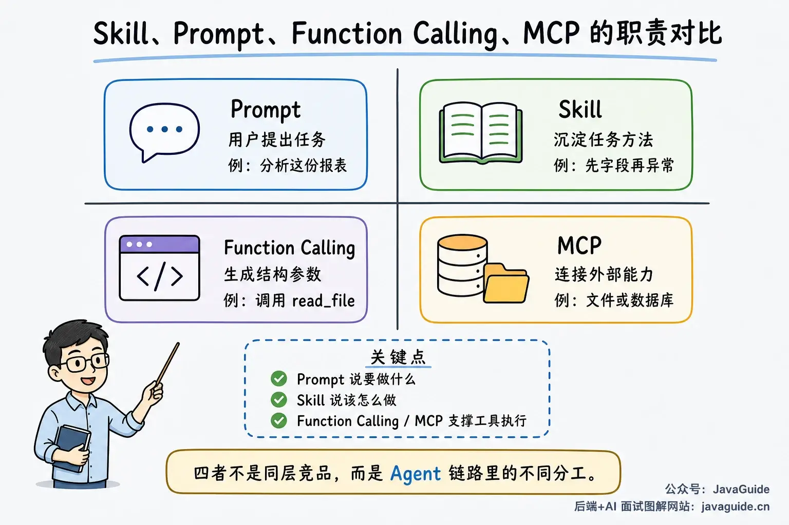

In a real execution flow, it looks like this:

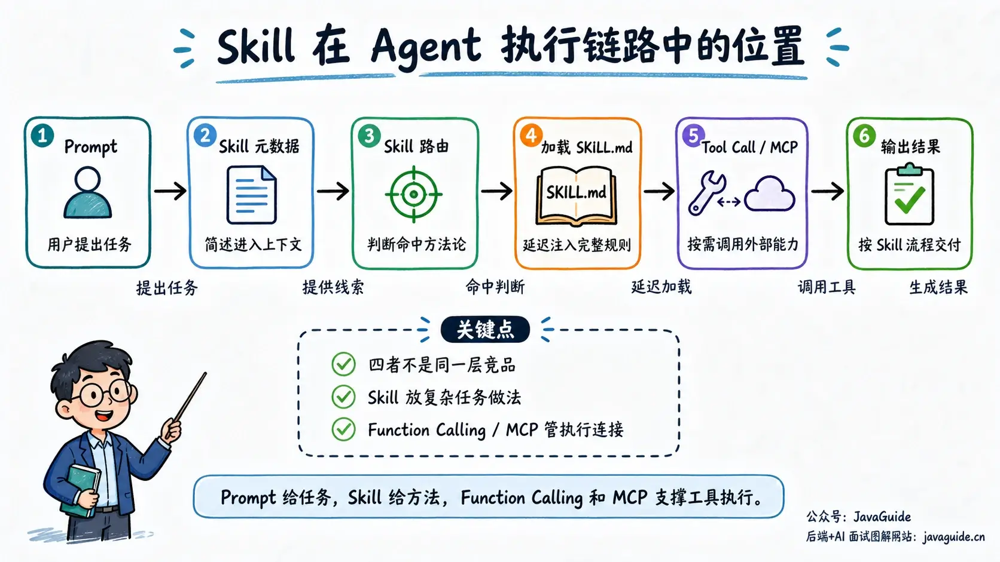

1. The user submits a task (Prompt).
2. The host adds brief descriptions of available Skills to the context (Skill metadata).
3. The model determines that a Skill matches the task (Skill routing).
4. The host loads the full `SKILL.md` (lazy loading).
5. The model follows the Skill's process to call tools, read material, and produce results (execution).

Tools are not required for a Skill. The Code Review Expert in [sanyuan-skills](https://github.com/sanyuan0704/sanyuan-skills) only defines how to review SOLID principles, security, and performance. The TDD Skill in [Superpowers](https://github.com/obra/superpowers) tells the agent to run tests, read the output, and then decide what to do next.

Function Calling may be used to execute an action; a Skill is closer to **on-demand context injection**. `load_skill()` is a conceptual example, not a cross-platform API. Claude Code, Cursor, Codex, and Copilot each discover and load Skills differently.

## ⭐️How Should You Write a SKILL.md?

### Basic Structure

A minimal Skill is simply a directory with a Markdown file named `SKILL.md`.

Folders such as `scripts/`, `references/`, and `assets/` are optional, but more complex Skills often use them. For example, `scripts/` can contain scripts used by the Skill.

```text
skill-name/
├── SKILL.md          # Main file, loaded when triggered
├── scripts/          # Utility scripts (executed, not loaded into context)
├── references/       # Reference material (loaded as needed)
└── assets/           # Templates and static files (loaded as needed)
```

`SKILL.md` has two parts:

1. **YAML frontmatter** at the top tells the host what the Skill is and when to use it.
2. The **body** describes the process, constraints, examples, and failure handling.

To learn how to write a Skill, it helps to examine well-maintained open-source examples.

This section uses the [Superpowers TDD Skill](https://github.com/obra/superpowers/blob/main/skills/test-driven-development/SKILL.md) as an example.

Its metadata has only two fields:

```yaml
---
name: test-driven-development
description: Use when implementing any feature or bugfix, before writing implementation code
---
```

TDD uses the Red-Green-Refactor cycle, but the Skill's description does not mention it. Instead, one sentence clearly states when to use the Skill. The body explains the procedure, as in this simplified version:

```markdown
# TDD

## Rule

Write a failing test before production code.

If you did not watch the test fail, the test is not trusted.

## Flow

1. **RED**: Write one small failing test.
2. **VERIFY RED**: Run it. Confirm it fails for the expected reason.
3. **GREEN**: Write the smallest code to pass.
4. **REFACTOR**: Clean up without changing behavior.

## Use For

- Features
- Bug fixes
- Refactoring
- Behavior changes

## Ask Before Skipping

- Throwaway prototypes
- Generated code

## Done Checklist

- [ ] Test written first
- [ ] Failure observed
- [ ] Minimal code added
- [ ] Tests pass
```

### Start with the Official skill-creator

[`skill-creator`](https://github.com/anthropics/skills/blob/main/skills/skill-creator/SKILL.md) is a Skill for creating Skills in Anthropic's official Skills repository. It first asks the agent to confirm the task, trigger conditions, and boundaries, then decide what belongs in `SKILL.md` and what should go in `scripts/` or `references/`.

It illustrates two practical tradeoffs: the `description` should help the host identify matching tasks, and steps that scripts can execute reliably or long references needed only in specific cases should be moved out of the main file. Claude's documentation also recommends accessing such supporting content only when needed.

### Metadata (Frontmatter)

Metadata determines whether a Skill can be discovered and triggered correctly. At a minimum, define `name` and `description`.

`name` identifies the Skill for systems and people. `description` acts as a routing hint, telling the agent when to load and use the Skill.

The `name` field has several strict requirements:

- At most 64 characters.
- Use only lowercase letters, numbers, and hyphens.
- Do not include XML tags.
- Do not use reserved words such as `anthropic` or `claude`.

Prefer a gerund form—a verb followed by `-ing`—when naming a Skill. It makes the capability clear at a glance.

| **Good name**             | **Poor name**                                 |
| ------------------------- | --------------------------------------------- |
| `processing-pdfs`         | `helper`, `utils` — too vague                 |
| `reviewing-code`          | `documents` — too broad                       |
| `test-driven-development` | `tools` — says nothing about the task         |
| `analyzing-spreadsheets`  | `anthropic-helper` — contains a reserved word |

The `description` is even more important. If it is unclear, the Skill may not be selected when needed. An agent does not read every `SKILL.md` first; it uses each description to decide whether to load the Skill.

A useful `description` should be neither too short nor too long. It should state two things:

1. What the Skill does.
2. When to use it.

The Superpowers TDD Skill above follows this guidance.

Include terms users are likely to mention, such as PDF, form, extract, commit message, and `git diff`. This helps both rule-based and semantic matching find the Skill.

```yaml
# ✓ Good: states capability, scenario, and trigger terms
description: Extract text and tables from PDF files, fill forms, and merge documents. Use when working with PDFs or when the user mentions PDFs, forms, or document extraction.

# ✗ Avoid: first-person phrasing and unclear triggers
description: I can help you work with PDF files.

# ✗ Avoid: states a capability but not when to use it
description: Process Excel files.
```

Here are a few real examples:

```yaml
# Superpowers TDD
name: test-driven-development
description: Use when implementing any feature or bugfix, before writing implementation code

# Code Review Expert from sanyuan-skills
name: code-review-expert
description: Expert code review of current git changes with a senior engineer lens. Detects SOLID violations, security risks, and proposes actionable improvements.

# Git commit assistant
description: Generate descriptive commit messages by analyzing `git diff`. Use when the user asks for a commit message or a review of staged changes.
```

Avoid descriptions that state only a concept, are too broad, or lack trigger conditions, for example:

```yaml
# Superpowers TDD counterexample: states the concept but not when to use it
name: test-driven-development
description: Helps with test-driven development and writing better tests.

# Code Review Expert counterexample: too broad
name: code-review-expert
description: Helps review code and improve quality.

# Git commit assistant counterexample: only names the function
description: Generate commit messages.
```

### Body

The agent reads the body only after a Skill matches. At startup, routing usually uses only `name` and `description`. Once loaded, the body shares the context window with the System Prompt, user request, and other material.

Keep only the default procedure, project conventions, inputs and outputs, and failure handling needed to perform the task. If rules are buried in a long tutorial, the agent may have trouble finding them when needed.

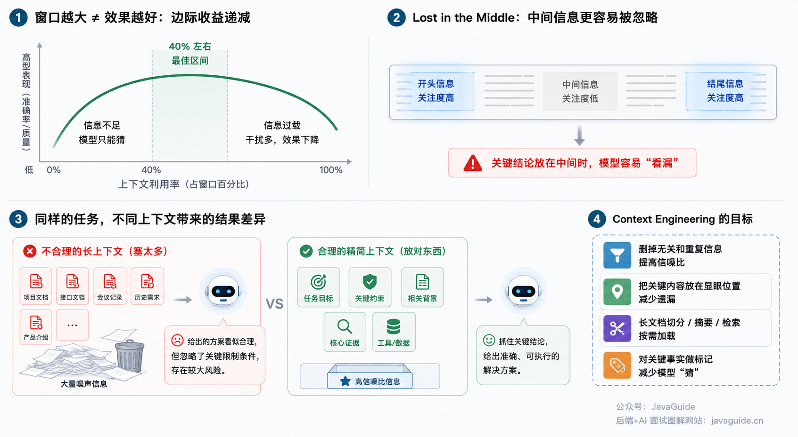

When reviewing the body, ask:

- Does the agent really need this explanation?
- Is this project-specific knowledge or general knowledge?
- Is this information worth the context space it uses?

For PDF text extraction, state the default library and how to use it directly:

````markdown
## Extract PDF Text

Use pdfplumber to extract text:

```python
import pdfplumber
with pdfplumber.open("file.pdf") as pdf:
    text = pdf.pages[0].extract_text()
```
````

Starting with a PDF definition and a list of tools does not help the agent take the next step:

```markdown
## Extract PDF Text

PDF (Portable Document Format) is a common file format that can contain text, images, and other content.
Extracting text from a PDF requires a dedicated PDF processing library.
Several libraries can do this, including pypdf, pdfplumber, and PyMuPDF.
This example uses pdfplumber because it is easy to learn and works for most standard text-extraction tasks.
First, install it with pip, then write the following code...
```

The agent needs to know which default to use, how to call it, how to handle the output, and what to do in special cases. Clearly state project-specific constraints that cannot be inferred from general knowledge, for example:

```markdown
The `users` table uses soft deletion. All production queries must include `WHERE deleted_at IS NULL`.
```

This rule directly affects query results. The general definition of soft deletion does not need to be in the Skill:

```markdown
Soft deletion is a common data-removal pattern. It usually keeps the database record and marks its state with a field.
```

If the main file is too long, move material used only in specific steps to separate files. Anthropic recommends keeping the `SKILL.md` body under 500 lines where possible and using progressive disclosure to load details as needed.

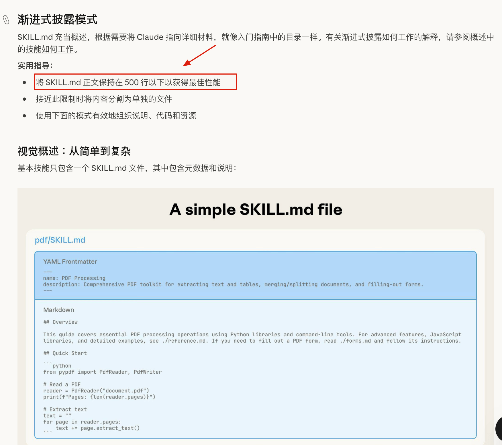

For example, a Code Review Skill's main file only needs to say when to read the SOLID checklist:

```markdown
When checking SOLID design principles, read `references/solid-checklist.md`.
```

`references/solid-checklist.md` contains the checklist. The agent does not need to read it when the task does not involve design review.

These open-source Skill collections show how to separate the main file from reference material:

- [Superpowers](https://github.com/obra/superpowers): Includes Skills for TDD, brainstorming, and code review. Its clearly structured TDD Skill is a useful example of organizing a body.
- [sanyuan-skills](https://github.com/sanyuan0704/sanyuan-skills): The Code Review Expert moves detailed checks into `references/` and keeps only trigger and loading instructions in the main file, illustrating progressive disclosure.
- [Anthropic's official Skills repository](https://github.com/anthropics/skills): A reference for directory structure and writing style.

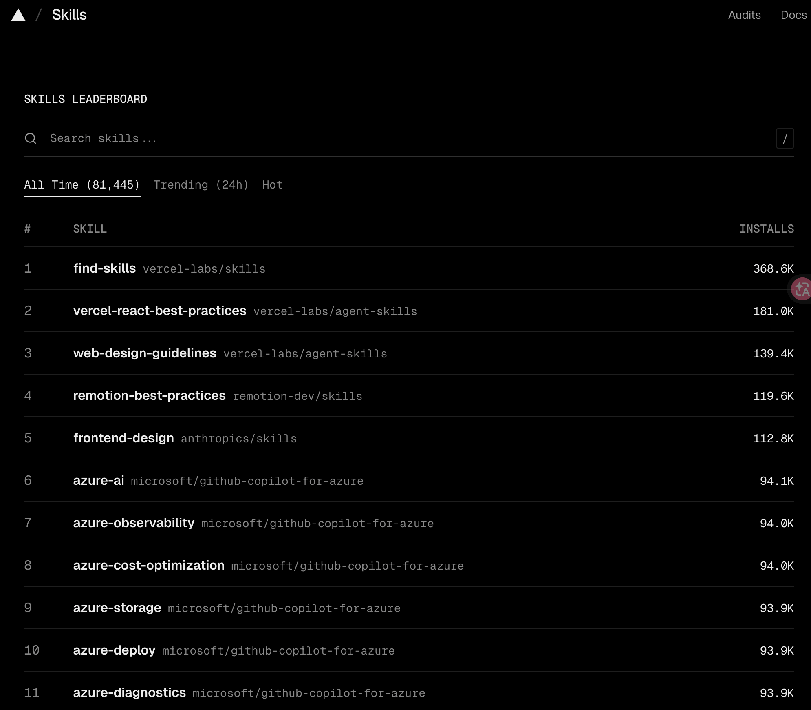

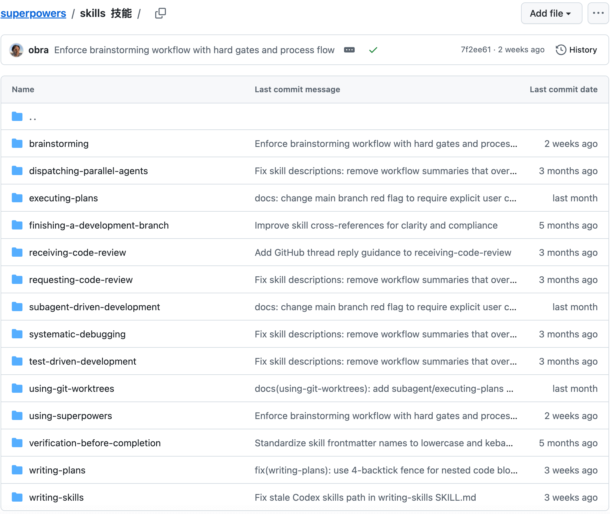

Tools such as Claude Code may allow explicit invocation with `/skill-name` or let the model select a Skill based on the task. After selection, the tool reads the procedure, constraints, scripts, and reference files.

## How Much Freedom Should a Skill Allow?

For database migrations and production deployments, specify commands, parameters, validation, and rollback conditions in the Skill. Errors in these operations may require restoring data or service state.

Code review and technical design evaluation depend on the change being reviewed. A Skill can define review dimensions such as security, performance, maintainability, and project conventions without prescribing an order for every file.

The table relates task risk to how much freedom to allow:

| **Freedom** | **Suitable scenario**                        | **How to write it**                                |
| ----------- | -------------------------------------------- | -------------------------------------------------- |
| High        | Requires judgment; there is no single answer | Give review directions without fixing every step   |
| Medium      | Uses a template that can vary by scenario    | Provide a template, parameters, and boundaries     |
| Low         | Fragile operation with high failure cost     | Give exact commands and state what must not change |

The Superpowers TDD Skill fixes the order of its workflow:

```text
NO PRODUCTION CODE WITHOUT A FAILING TEST FIRST
```

Red, Green, and Refactor must stay in order. Before implementing, the test must fail for the expected reason. The Skill also states:

```text
Write code before the test? Delete it. Start over.
```

The feature determines the test target, name, and assertions. A Code Review Skill can also fix its review dimensions—SOLID, security risks, performance, and maintainability—while the agent identifies concrete issues from the diff.

A low-freedom instruction might look like this:

````markdown
## Database Migration

Run this command:

```bash
python scripts/migrate.py --verify --backup
```

Do not modify the command or add parameters.

If the command fails, stop and return the error output to the user.
````

For a task such as code review, provide only the review scope:

```markdown
## Code Review

Focus on:

1. Are there obvious bugs or missing edge cases?
2. Are there security risks?
3. Does the change affect performance or resource usage?
4. Does it violate existing project conventions?
5. Is there a simpler implementation?

Prioritize issues that affect correctness or production reliability. Do not report only formatting suggestions.
```

This does not specify a file order, but it defines the review scope and output priorities. Restrict freedom for data changes, requests, deployments, migrations, and file deletion. Allow judgment for analysis, review, summaries, and drafts.

## ⭐️Lazy Loading and Progressive Disclosure

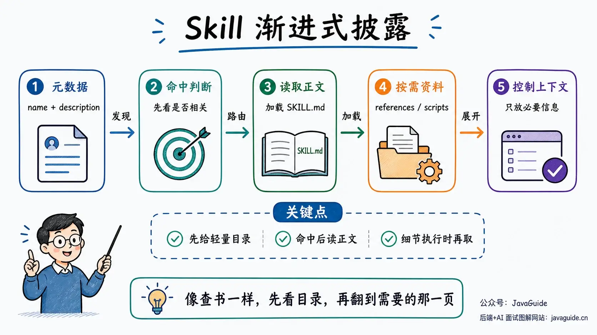

### Why Not Load Every Skill at Once?

An agent's context window is limited, at least for now.

Even a larger window only fits more content; it does not automatically identify what matters. In a long requirements document, for example, the key constraints may be only a few sentences among a lot of background. The model may overlook important details buried in the middle.

This is often called **Context Rot**. **As context gets longer and noisier, model performance in using it can become less reliable.**

**Lost in the Middle** describes how models may overlook information in the middle of a context. See [Why Context Can Fail](./context-engineering.md#why-does-context-fail) for details.

So a Skill should not be written as a reference library.

A better approach is progressive disclosure: **give the model a lightweight index first, then load only the material it needs.**

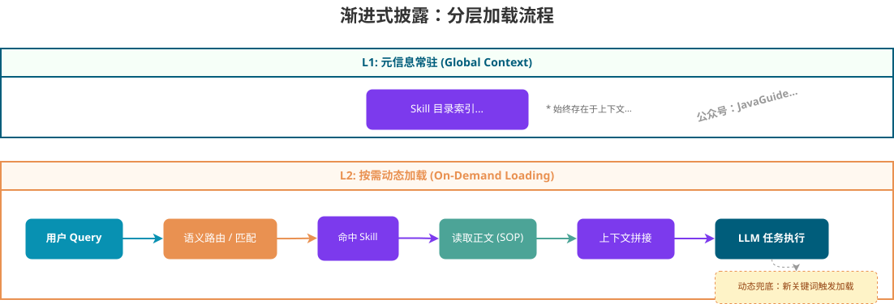

It is like looking something up in a book. You do not memorize the entire book first; you check the table of contents, find the relevant chapter, then read the specific page.

This can be divided into three layers:

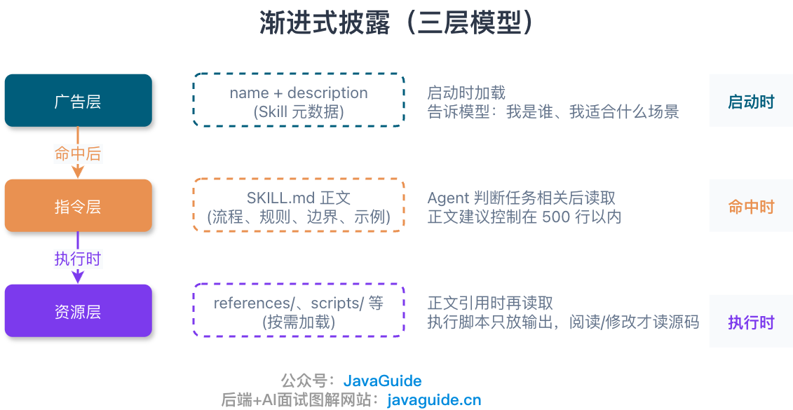

**1. Discovery layer: let the model know the Skill exists**

At startup, load only Skill metadata such as `name` and `description`. Keep it short; it tells the model what the Skill does and when it applies.

**2. Instruction layer: load the body after a match**

Only when an agent determines that a Skill is relevant does it read the corresponding `SKILL.md` body. The body contains procedures, rules, boundaries, and key examples. Keep it concise; Anthropic recommends keeping it under 500 lines where possible.

**3. Resource layer: load details during execution**

If the body references files in `references/` or `scripts/`, the agent reads or executes them as needed. If it only runs a script, usually only the script output needs to enter the context. The source code needs to be loaded only when the agent must inspect or modify it.

This is why Skills often contain references such as:

```markdown
## Advanced Features

**Form filling:** See [FORMS.md](FORMS.md) for the full guide.

**API reference:** See [REFERENCE.md](REFERENCE.md) for all methods.
```

The agent reads `FORMS.md` only when the task involves form filling; ordinary text extraction does not require it.

### How Should You Organize Files in a Real Project?

For example, a data-analysis Skill could be organized like this:

```text
bigquery-analysis/
├── SKILL.md              # Overview and navigation, loaded on a match
└── reference/
    ├── finance.md        # Revenue, ARR, and billing metrics
    ├── sales.md          # Opportunities, pipeline, and accounts
    ├── product.md        # API usage and feature adoption
    └── marketing.md      # Campaigns, attribution, and email
```

The main file lists available datasets and their reference files. Definitions and metrics stay in the corresponding references:

```markdown
# BigQuery Data Analysis

## Available Datasets

**Finance**: Revenue, ARR, billing → See [reference/finance.md](reference/finance.md).

**Sales**: Opportunities, pipeline, accounts → See [reference/sales.md](reference/sales.md).

**Product**: API usage, feature adoption → See [reference/product.md](reference/product.md).

**Marketing**: Campaigns, attribution, email → See [reference/marketing.md](reference/marketing.md).
```

When a user asks about last quarter's sales pipeline, the agent only needs to open `reference/sales.md`; finance, product, and marketing references do not need to be loaded.

If required rules are hidden behind several layers of references, the agent may have trouble finding them:

```markdown
SKILL.md -> advanced.md -> details.md -> the most important rule is buried here
```

List basic usage and the next layer of references in the main file:

```markdown
SKILL.md
├── Include basic usage directly
├── Advanced features -> advanced.md
└── API reference -> reference.md
```

The agent can locate the right material from the main file. If a reference is long, add a table of contents at the top so the agent can check what it contains first.

## How Should You Design Workflows and Feedback Loops?

For a simple task, a few rules may be enough. More complex scenarios need more structure.

An agent may skip steps such as checking output quality or running tests, then simply report that the task is complete.

To prevent this, make two things explicit:

1. The order of the steps.
2. Where execution must stop for validation.

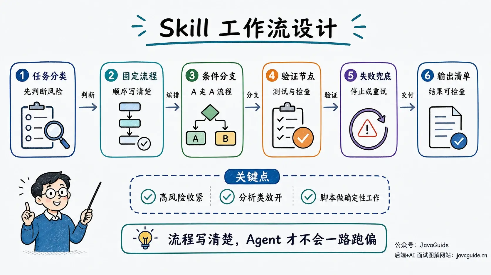

Diagram: a complex Skill should define task classification, conditional branches, validation points, and failure handling.

### Connect Steps with a Checklist

The Superpowers TDD Skill is a good example.

It does not stop at “write tests before code.” That instruction is too vague, so an agent can easily bypass it in practice.

Instead, it divides the process into explicit stages. A simplified version is:

```markdown
### RED - Write Failing Test

Write one minimal test showing what should happen.

### Verify RED - Watch It Fail

**MANDATORY. Never skip.**

Confirm:

- Test fails, not errors
- Failure message is expected
- Fails because feature missing, not typos

### GREEN - Minimal Code

Write simplest code to pass the test.
Don't add features.

### REFACTOR - Clean Up

After green only:

- Remove duplication
- Improve names
- Extract helpers

Keep tests green. Don't add behavior.
```

**Verify RED** requires the agent to observe the expected failure before implementation begins.

The test should fail because the feature has not been implemented, not because of a path, syntax, or test error.

Without this step, an agent may write the implementation first and then add a test that merely appears to pass. That is not TDD.

Write the completion checks as a checklist too:

```markdown
## Verification Checklist

Before marking work complete:

- [ ] Every new function/method has a test
- [ ] Watched each test fail before implementing
- [ ] Each test failed for expected reason
- [ ] Wrote minimal code to pass each test
- [ ] All tests pass
- [ ] Output has no errors or warnings
```

Every checklist item should be verifiable, such as “all tests pass” or “each new method has a test.” Instructions such as “ensure quality” or “follow testing best practices” have no clear pass criteria and cannot serve as validation points.

### Feedback Loops

For complex tasks, include intermediate validation in the workflow:

```text
Run -> Validate -> Fix -> Validate again
```

For example, if a code review only says “review thoroughly,” an agent may focus on names, formatting, and comments while missing architectural issues.

Split the review into two passes:

```markdown
## Code Review Workflow

1. Get the list of changed files and the diff.

2. First pass: design review.

   - Check whether the overall structure is sound.
   - Check for violations of SOLID principles.
   - If there is a clear architectural problem, report it before moving to implementation details.

3. Second pass: implementation review.

   - Check for security risks such as SQL injection, XSS, and authorization bypass.
   - Check performance hotspots such as database calls in loops and missing indexes.
   - Check error handling and edge cases.

4. Report findings.
   - Label severity as Critical, Warning, or Suggestion.
   - Provide actionable recommendations.
```

This workflow reviews design first, implementation second, and then reports recommendations.

### Conditional Branches

If a Skill handles multiple task types, list the conditions and branches. Creating a document and editing an existing one require different workflows:

```markdown
## Document Editing Workflow

1. Identify the task type.

   **Creating a new document?**

   Use the creation workflow.

   **Editing an existing document?**

   Use the editing workflow.

2. Creation workflow.

   - Generate the document from a template.
   - Export it to the target format.
   - Verify that the file opens correctly.

3. Editing workflow.

   - Unpack the existing document.
   - Edit the specified content.
   - Validate after each change.
   - Repackage the document when finished.
```

As the number of branches grows, keep decision logic in the main file and move detailed procedures into separate files:

```text
workflows/
├── create-document.md
├── edit-document.md
└── export-document.md
```

The agent reads the file for the matching branch. The workflow defines step order, and feedback points define when to validate. Without either, execution may skip steps.

## How Does Skill Routing Work?

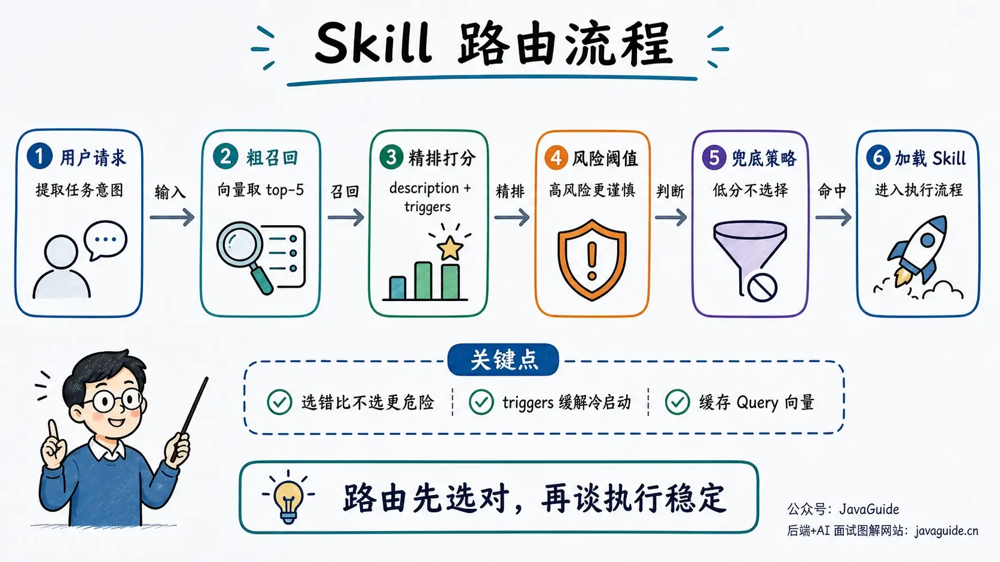

When the user reports “frequent Full GC,” the router should select the JVM diagnostics Skill and exclude database troubleshooting and document-processing Skills. Routing should return a set of Skills that can be loaded directly.

When there are only a few Skills, the model can usually select one from the `description` fields. With dozens of Skills, a “retrieve candidates -> rerank -> decide” pipeline is more reliable:

| Stage             | Input and processing                                                                                                                      | Output                                  |
| ----------------- | ----------------------------------------------------------------------------------------------------------------------------------------- | --------------------------------------- |
| Initial retrieval | Embed the request and Skill names, `description` fields, and example queries; select the top five by cosine similarity.                   | A small set of candidate Skills         |
| Reranking         | Compare matches in names, descriptions, and examples. Use higher thresholds for high-risk Skills such as security or database operations. | Candidates ranked by relevance and risk |
| Decision          | Load a Skill if its top score meets the threshold. If all scores are low, load none and use the default workflow.                         | One, multiple, or no selected Skills    |

If one request contains independent tasks, decompose it before routing. For example, “Analyze the GC log and edit a deployment document” requires at least JVM diagnostics and document editing; one generic Skill should not cover both workflows.

For a request about “frequent Full GC,” initial retrieval might return `jvm-metrics-analyzer`, distributed tracing, and K8s event inspection. Reranking checks examples such as “Full GC” and “stack trace,” placing the JVM diagnostics Skill first. If the request only says “help me handle this” and has too little semantic detail, keep the default workflow instead of guessing that the user wants a database migration or production operation.

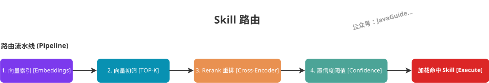

When a new Skill has no historical queries, an abstract `description` can hurt retrieval quality. The [Agent Skills specification](https://agentskills.io/specification) does not define a standard `triggers` frontmatter field, and hosts are not required to read custom fields. If you maintain your own router, store representative queries in a separate routing index:

```yaml
skill: jvm-runtime-diagnosis
examples:
  - "The endpoint is hanging"
  - "Frequent Full GC"
  - "Can you inspect this Java stack trace?"
  - "How do I troubleshoot a service OOM?"
```

A custom router embeds `examples` together with the Skill's `name` and `description`. When using a third-party host, use only fields it explicitly supports. Do not copy this routing index into every `SKILL.md` or assume every host reads it.

For dozens of Skills, NumPy can calculate similarity in memory; most latency usually comes from the external embedding API. Cache query vectors first. Consider an ANN index or vector database only when the number of Skills reaches hundreds or thousands.

A general router can be divided into four components:

| Component       | Responsibility                                                    |
| --------------- | ----------------------------------------------------------------- |
| Registry        | Store Skill metadata, routing examples, and vectors.              |
| Router          | Retrieve candidates, score them, and apply thresholds.            |
| Loader          | Read `SKILL.md` and required references based on routing results. |
| Context builder | Add loaded content to the context for the corresponding task.     |

The router does not read Skill bodies, and the loader does not score candidates. Updating a Skill body therefore does not change retrieval results, and changing the vector store does not require changes to loading logic.

## Common Mistakes When Writing Skills

### Writing a Skill Like a Project README

A README documents project background, installation, and features; readers can decide what to do next. An agent needs actionable boundaries: when to use the Skill, what order to follow, when to stop, and how to handle failures.


### Trying to Put Too Much in One Skill

If one “system troubleshooting” Skill covers JVMs, databases, K8s, gateways, and message queues, an agent receiving a GC log still has to choose among container resources, gateway logs, and JVM rules. Split Skills by problem boundaries so each input maps directly to the relevant material:

- `jvm-metrics-analyzer`: Handles JVM metrics, GC, and thread dumps.
- `distributed-trace-finder`: Traces latency using a TraceId.
- `k8s-pod-event-viewer`: Inspects Pod status, restart causes, and event records.

Route GC logs to the JVM metrics Skill, TraceIds to the distributed tracing Skill, and Pod restarts to the K8s events Skill. Each Skill then maintains only the rules and material needed for one type of problem.

### Giving the Agent Too Many Choices

If you only list pypdf, pdfplumber, PyMuPDF, and pdf2image, the agent may not know which path to use for a regular PDF versus a scanned one, and may run OCR on a text PDF:

```markdown
# ✗ Avoid: too many choices

You can use pypdf, pdfplumber, PyMuPDF, or pdf2image to process PDFs.
```

State the default path and exception together:

```markdown
# ✓ Recommended: default and fallback

Use pdfplumber for text extraction by default.
For a scanned PDF, use OCR with pdf2image and pytesseract.
```

A Skill should define the default for common cases and specify when to switch approaches.

### Keep Terminology Consistent

Use one name for each concept throughout a Skill. For example, if you call something an “API endpoint” earlier, do not later rename it as a URL, API route, or path. Inconsistent terms can make conditions ambiguous.

### Asking an LLM to Do Deterministic Work

Use scripts for format conversion, exact calculations, bulk file processing, and data changes:

- LLMs are better at judgment: understanding a task, extracting parameters, choosing the next step, and explaining results.
- Scripts are better at execution: parsing files, converting formats, processing batches, and validating output.

When reading a required input file, the script should return a clear error instead of creating an empty file that hides the missing input:

```python
# ✓ Recommended: make the error condition explicit
def process_file(path):
    try:
        with open(path, encoding="utf-8") as f:
            return f.read()
    except FileNotFoundError as exc:
        raise FileNotFoundError(
            f"Required input file does not exist: {path}. Check the path or generate the file first."
        ) from exc
```

The following example exposes only the low-level exception, so the agent cannot tell whether to check the path or generate the missing file:

```python
# ✗ Avoid: the agent must guess what caused the failure
def process_file(path):
    return open(path).read()
```

Document constraints for configuration values:

```markdown
# ✓ Recommended: explain the values

REQUEST_TIMEOUT = 30 # HTTP requests should usually complete within 30 seconds
MAX_RETRIES = 3 # Three retries balance reliability and latency
```

## Summary

Returning to the code review example: the Prompt contains the current review request, Function Calling initiates tool calls, MCP connects to external capabilities such as files, databases, or GitHub, and the Skill stores the review procedure and constraints.

The `description` should state both the task and trigger scenario. The body contains project conventions, steps, failure handling, and validation points. Keep the main workflow in the primary file and move details into `references/` or `scripts/`. Use stricter steps for migrations, deployments, and file deletion; leave room for judgment in reviews and design evaluations.

## References

- Anthropic Skills repository: <https://github.com/anthropics/skills>
- Anthropic skill-creator: <https://github.com/anthropics/skills/blob/main/skills/skill-creator/SKILL.md>
- Superpowers：<https://github.com/obra/superpowers>
- sanyuan-skills：<https://github.com/sanyuan0704/sanyuan-skills>
- Everything Claude Code：<https://github.com/nicekid1/everything-claude-code>
- skills.sh (a directory for finding existing Skills): <https://skills.sh/>

<!-- @include: @article-footer.snippet.md -->
