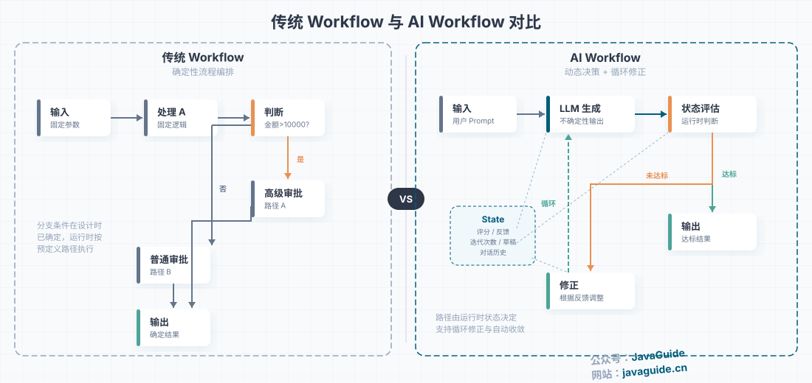
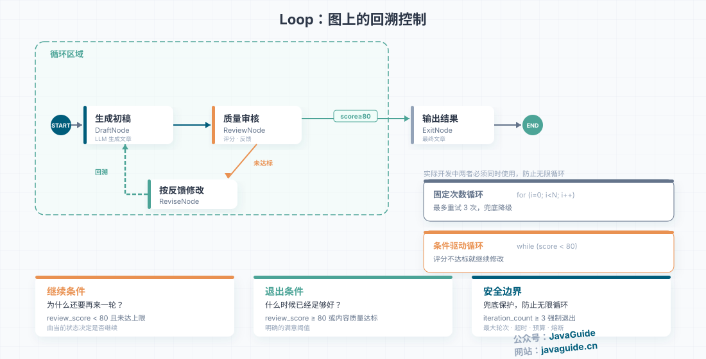
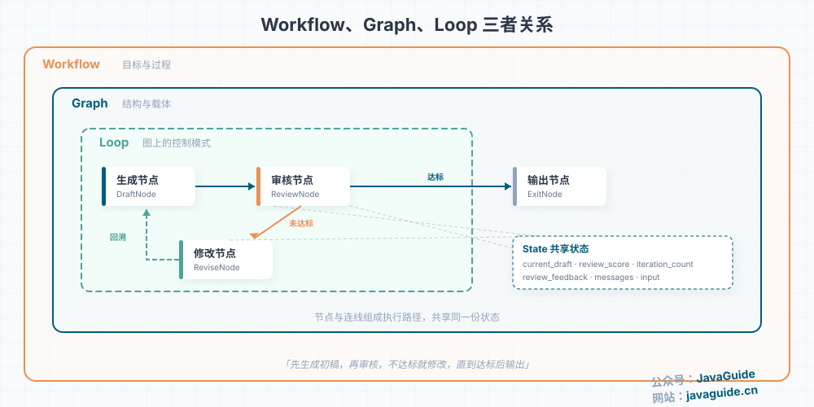
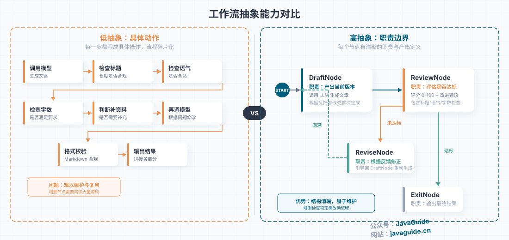
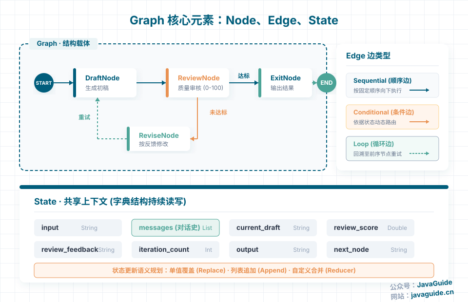

Traditional engines such as Camunda and Temporal also support events, branching, retries, and compensation. AI workflows add another challenge: some nodes generate output with an LLM, and a model or evaluator may need to judge at runtime whether the result meets the requirements. This often introduces back edges into the workflow: generate, evaluate, revise, and evaluate again.

Workflow describes how a task is completed. A Graph represents its execution structure through Nodes, Edges, and State, while a Loop controls backtracking through the Graph. The article-review example below shows how these concepts work together and uses Spring AI Alibaba Graph to demonstrate state updates and conditional edges.

## Why Do AI Systems Need Workflows?

A single-turn conversation can answer a question, but it rarely **delivers a result** reliably. Real production tasks involve more than a question and an answer: retrieve information, call tools, produce structured output, validate its format, retry on failure, and try again if the result is unsatisfactory. Together, these steps make up task delivery. Packing all the logic into one enormous prompt is bound to fail. You need an execution path that is **branchable, iterative, and observable**.

Traditional business workflows usually define candidate steps and branching rules in advance, though human actions and external APIs can still produce different results. Adding an LLM introduces further uncertainty in generated content and quality assessments. This creates three direct problems:

1. The next step is not always fixed; the workflow must choose a path based on the current result.
2. When a result is unsatisfactory, the system should revise it automatically instead of failing immediately.
3. Intermediate state must be recorded to support debugging, tracing, and recovery.

That is why AI systems need workflow thinking.

Consider a simple example: when asked to write an article, an AI's first draft is often unsatisfactory. You could copy it manually and add new instructions, but that is inefficient and quickly consumes context. The process becomes more reliable when structured as a **review → revise → review** loop with stopping conditions, such as meeting a quality threshold or reaching the iteration limit.

In short, a workflow turns a one-off generation task into a systematic process that is **iterative, convergent, and controllable**.

## How Do Traditional and AI Workflows Differ?



The diagram highlights the difference: traditional workflows tend to orchestrate fixed steps with explicit branches, while AI workflows rely more on runtime state to choose the next step and use loops to make generation, evaluation, and revision converge.

### Characteristics of Traditional Workflows

First, a basic definition: a **Workflow** breaks a task into steps to achieve a goal and defines how those steps work together. It answers the question, "How do we complete this task?"

Traditional workflows can also orchestrate human tasks, external APIs, and other nondeterministic activities, so identical node results for identical inputs are not a prerequisite. A more common distinction is that traditional workflows define activities, candidate branches, and compensation rules in advance, then select a path at runtime based on events and business data. BPMN 2.0, Camunda, Temporal, and Apache Airflow are not limited to linear sequences.

The key difference is that AI workflows choose paths based on runtime quality assessments of generated content, and may execute the same node repeatedly because its output is uncertain. In traditional scenarios such as approval processes, order flows, and ETL pipelines, branch conditions are explicit (for example, amounts above 10,000 require senior approval). In an AI workflow, deciding whether generated content meets the requirements itself requires runtime evaluation, and the result may send the workflow back to an earlier step for revision.

### Characteristics of AI Workflows

In AI systems, the word "workflow" has a somewhat different emphasis. Traditional workflows focus on sequence and determinism, while AI workflows must handle an execution environment full of uncertainty. The task is no longer just to follow steps:

- Determine at **runtime** whether a result meets the requirements.
- Decide whether to retry based on the **current state**.
- After a step fails, consider fallback, rollback, or another strategy instead of simply reporting an error and stopping.
- Pass **state** between nodes, including context, drafts, scores, errors, and iteration history, not just parameters.

Both AI and traditional systems use workflows, but AI workflows place greater emphasis on dynamic decisions and state. When the next step is not fixed or an unsatisfactory result needs another iteration, a linear list is not enough. This leads to the concepts of Graph (structure) and Loop (backtracking).

## What Are Graphs and Loops?

### Graph: The Workflow Structure

Continuing with the article-review example, suppose we build a path that generates a draft, reviews its quality, revises it if it falls short, and then reviews it again. Each step is a **Node**, the transitions between steps are **Edges**, and the shared context read and written throughout the workflow is **State**.

The three basic elements of a graph are:

-- **Node**: An execution unit that reads state, runs logic, and updates state. Typical nodes in the article-review example generate a draft, review its quality, and revise it based on feedback. Retrieval, format validation, and human approval can also be added.

- **Edge**: A control-flow abstraction that determines the execution path between nodes. Common edge types include:
  - **Sequential edge**: Executes nodes in a fixed order without checking conditions.
  - **Conditional edge**: Chooses from predefined paths based on runtime state. Spring AI Alibaba implements this with `addConditionalEdges()`.
  - **Dynamic routing**: Determines candidate nodes at runtime. For example, LangGraph's `Send` API can determine how many parallel calls to make.
  - **Loop edge**: Returns to the same or an earlier node for retries or iteration.
  - **Terminal edge**: Ends the workflow without executing subsequent nodes.
  - **Parallel edge**: Dispatches one node to multiple downstream nodes for concurrent execution.

> In practice, conditional edges and dynamic routing form a continuum. Conditional edges have candidates defined at design time, though their selection logic can depend on runtime state (such as an LLM score). Dynamic routing determines the candidates themselves at runtime (for example, LangGraph's `Send` API can create parallel branches dynamically). Conditional edges are sufficient for most cases; dynamic routing is useful for map-reduce and other cases where the number of parallel branches must be determined at runtime.

- **State**: Shared context that is continuously read and written during workflow execution. It is the "working memory" passed between nodes. A common implementation is a **key-value data structure** such as Java's `Map<String, Object>`, Python's `dict`, or TypeScript's `Record<string, any>`.

State design concerns not only what to store, but also how to update it. Workflow frameworks commonly support different update semantics for different fields:

- **Replace**: The new value replaces the old one. This suits single-value fields such as a classification result or current status. Spring AI Alibaba uses `ReplaceStrategy`; LangGraph uses this by default when no reducer is specified.
- **Append**: The new value is appended to an existing list. This suits cumulative fields such as conversation history (`messages`). Spring AI Alibaba uses `AppendStrategy`; LangGraph uses `Annotated[list, operator.add]`.
- **Custom reducer**: A custom function defines how values are merged. For example, LangGraph's `add_messages` appends or updates messages based on their IDs.

When multiple parallel nodes write to the same field using replace semantics, a race condition can occur (LangGraph raises `INVALID_CONCURRENT_GRAPH_UPDATE`). When designing State, identify fields that may receive parallel writes and choose an appropriate update strategy for each.

Common state fields in production projects (adjust them to your application's needs):

- `input`: User input, retained for the entire workflow.
- `messages`: Conversation history, updated with append semantics.
- `retrieval_result`: Intermediate RAG retrieval results.
- `tool_result`: Intermediate tool-call results.
- `llm_response`: Intermediate raw LLM output.
- `intermediate_steps`: Execution-step records, retained for the entire workflow.
- `next_step`: The next node in the control flow. Spring AI Alibaba uses this field with conditional edges for routing; LangGraph uses the conditional-edge function's return value and does not need this field.
- `output`: Final result.

Nodes and Edges define an executable path, but adding State lets the graph make decisions at runtime.

Graphs better represent the control flow of many AI systems. That flow may initially be implemented as ad hoc `if-else` statements, retry logic, or state machines scattered across modules.

### Loop: Backtracking Through a Graph

In the same article-review workflow, a failed review should not end execution. Instead, an edge should return control to the revision or regeneration step. This is what a Loop means at the business level. Technically, it is a **back edge** in the graph.

> Distinguish the Loop in this article from the **Agent Loop** described in the Agent fundamentals guide. The Agent Loop is the top-level runtime of an Agent, repeatedly executing "reason → act → observe" in a while loop until the task is complete. The Loop here is an internal Graph control pattern: a subset of nodes forms an iterative revision cycle through a back edge. The Agent Loop is the outer loop; a Graph Loop can be nested inside one of its nodes or subgraphs.



When first learning about AI workflows, it is easy to think of a `Loop` as simply "running a few more times." That is not wrong, but it is incomplete. More precisely, a **Loop is a control pattern in a graph**. It forms when an edge sends control back to an earlier node based on the current state. As the diagram shows, the key is deciding whether the result meets the requirements. Inside the loop, the LLM scores the result according to the prompt; it returns the result if it passes or sends it back for revision if it does not.

There are two common types of Loops:

1. **Fixed-iteration loop**: Similar to a `for` loop, such as "retry at most three times."
2. **Condition-driven loop**: Similar to a `while` loop, such as "continue revising while the score is below 80."

Condition-driven loops are more common in AI systems because the number of iterations depends on content quality, tool results, and external feedback. Production implementations usually add a fixed upper bound: the condition determines whether to continue, while iteration limits, timeouts, and token budgets enforce termination.

In production, **nested loops** are also common. The outer loop handles quality iterations (generate → review → revise), while the inner loop handles tool retries (for example, exponential backoff after an external API call fails inside a node). These loops have independent scopes, termination conditions, and counters. Exhausting the inner retry limit should not consume the outer iteration budget, and exiting the outer loop does not allow the inner loop to retry indefinitely. Define separate exit conditions and safety limits for each loop.

In short, a reliable Loop needs three things:

- A continuation condition: Why another iteration is needed.
- An exit condition: When the result is good enough to finish.
- Safety limits: Maximum iterations, timeouts, budgets, and circuit-breaker conditions.

Without these constraints, a Loop can turn from self-correction into an infinite cycle.

Returning to the article-review example, a Loop is not just "trying a few more times"; the review result determines the next step. The workflow returns from `ReviewNode` to `ReviseNode` only when the score is below the threshold and the iteration limit has not been reached. Once the score passes or a safety limit is reached, the workflow should exit and return a result. This makes the loop a controlled backtracking mechanism.

## How Are Workflow, Graph, and Loop Related?



Their relationship can be summarized in one sentence: **Workflow is the goal and process, Graph is the structure and representation, and Loop is a control pattern within the graph.**

Continuing with the article-writing and review example:

- "Generate a draft, review it, revise it if it falls short, and return it once it passes" describes the **Workflow**.
- Drawing `Generate → Review → Revise` as connected nodes that share state gives us a **Graph**.
- Defining "return to revision if the review fails, until the score passes or the limit is reached" specifies the **Loop**.

These are three perspectives on the same system: Workflow focuses on the task, Graph on its structure, and Loop on backtracking control.

## Implementation

Now that we have introduced the concepts of Node, Edge, and State, let's see how they map to specific frameworks. The examples use Spring AI Alibaba Graph in the Java ecosystem and LangGraph in the Python ecosystem.

### Framework Concept Mapping

Here is how several key concepts map between Spring AI Alibaba and LangGraph:

- **State**: Spring AI Alibaba uses `OverAllState` + `KeyStrategyFactory`; LangGraph uses `TypedDict` + `Annotated[type, reducer]`.
- **Replace semantics**: Spring AI Alibaba uses `ReplaceStrategy`; this is the default in LangGraph.
- **Append semantics**: Spring AI Alibaba uses `AppendStrategy`; LangGraph uses `Annotated[list, operator.add]`.
- **Node**: Spring AI Alibaba uses the `NodeAction` interface; LangGraph uses ordinary functions.
- **Sequential edge**: Spring AI Alibaba's `addEdge(source, target)` corresponds to LangGraph's `add_edge(source, target)`.
- **Conditional edge**: Spring AI Alibaba's `addConditionalEdges(source, fn, map)` corresponds to LangGraph's `add_conditional_edges(source, fn)`.
- **Loop**: Both use conditional edges to return to earlier nodes; Spring AI Alibaba also provides `LoopAgent`.
- **Fixed-iteration loop**: Both can maintain a counter in State and use a conditional edge to continue or exit.
- **Condition-driven loop**: Both can use a conditional edge to inspect a score, error state, or external event and choose the next step.
- **Persistence**: Spring AI Alibaba uses `MemorySaver` or `RedisSaver`; LangGraph uses `MemorySaver` or `SqliteSaver`.
- **Human-in-the-loop**: Spring AI Alibaba uses `interruptBefore()` + `updateState()`; LangGraph uses `interrupt_before` + `update_state`.
- **Compile and execute**: Spring AI Alibaba requires `StateGraph.compile(CompileConfig)`; LangGraph calls `StateGraph.compile()` directly.

### Example: Build an Article Review Workflow with Spring AI Alibaba

The following example implements the article-review workflow used throughout this guide with Spring AI Alibaba Graph. Imports, dependency injection, and model-provider configuration are omitted; the nodes, state strategies, and graph assembly are shown in full.

**Step 1: Define State and Update Strategies**

```java
// Configure how each state field is updated.
public static KeyStrategyFactory createKeyStrategyFactory() {
    return () -> {
        HashMap<String, KeyStrategy> strategies = new HashMap<>();
        strategies.put("input", new ReplaceStrategy());          // User input
        strategies.put("messages", new AppendStrategy());        // Conversation history (append)
        strategies.put("current_draft", new ReplaceStrategy());  // Current draft (replace)
        strategies.put("review_score", new ReplaceStrategy());   // Review score (replace)
        strategies.put("review_feedback", new ReplaceStrategy()); // Review feedback
        strategies.put("iteration_count", new ReplaceStrategy()); // Iteration count
        strategies.put("output", new ReplaceStrategy());         // Final output
        strategies.put("next_node", new ReplaceStrategy());      // Routing control
        return strategies;
    };
}
```

Note that `messages` uses `AppendStrategy` to retain conversation history, while `current_draft` uses `ReplaceStrategy` to replace the previous draft after each revision.

**Step 2: Implement the Nodes**

```java
// Draft generation node
public static class DraftNode implements NodeAction {
    private final ChatClient chatClient;

    public DraftNode(ChatClient.Builder builder) {
        this.chatClient = builder.build();
    }

    @Override
    public Map<String, Object> apply(OverAllState state) throws Exception {
        String input = state.value("input").map(v -> (String) v).orElse("");

        String draft = chatClient.prompt()
            .user(String.format("Write an article that meets the following requirements: %s", input))
            .call().content();

        return Map.of(
            "current_draft", draft,
            "next_node", "review"
        );
    }
}

// Quality review node
public static class ReviewNode implements NodeAction {
    private final ChatClient chatClient;

    public ReviewNode(ChatClient.Builder builder) {
        this.chatClient = builder.build();
    }

    private record ReviewResult(double score, String feedback) {}

    @Override
    public Map<String, Object> apply(OverAllState state) throws Exception {
        String draft = state.value("current_draft").map(v -> (String) v).orElse("");
        int count = state.value("iteration_count").map(v -> (Integer) v).orElse(0);

        String prompt = String.format(
            "Evaluate the quality of the following article and provide a score from 0 to 100 and suggestions for improvement.\n" +
            "Return JSON in this format: {\"score\": 85, \"feedback\": \"...\"}\n\n%s", draft);

        ReviewResult result = chatClient.prompt()
            .user(prompt)
            .call()
            .entity(ReviewResult.class);

        int nextCount = count + 1;
        String nextNode =
            (result.score() >= 80 || nextCount >= 3) ? "exit" : "revise";
        return Map.of(
            "review_score", result.score(),
            "review_feedback", result.feedback(),
            "iteration_count", nextCount,
            "next_node", nextNode
        );
    }
}

// Revision node: revise the content based on review feedback.
public static class ReviseNode implements NodeAction {
    private final ChatClient chatClient;

    public ReviseNode(ChatClient.Builder builder) {
        this.chatClient = builder.build();
    }

    @Override
    public Map<String, Object> apply(OverAllState state) throws Exception {
        String draft = state.value("current_draft").map(v -> (String) v).orElse("");
        String feedback = state.value("review_feedback").map(v -> (String) v).orElse("");

        String revised = chatClient.prompt()
            .user(String.format("Revise the article based on the feedback.\n\nOriginal: %s\n\nFeedback: %s", draft, feedback))
            .call().content();

        return Map.of(
            "current_draft", revised,
            "next_node", "review"
        );
    }
}

// Output node
public static class ExitNode implements NodeAction {
    @Override
    public Map<String, Object> apply(OverAllState state) throws Exception {
        String draft = state.value("current_draft").map(v -> (String) v).orElse("");
        return Map.of("output", draft);
    }
}
```

**Step 3: Assemble the Graph**

```java
public static CompiledGraph buildWorkflow(ChatModel chatModel) throws GraphStateException {
    ChatClient.Builder builder = ChatClient.builder(chatModel);

    var draft = node_async(new DraftNode(builder));
    var review = node_async(new ReviewNode(builder));
    var revise = node_async(new ReviseNode(builder));
    var exit = node_async(new ExitNode());

    StateGraph workflow = new StateGraph(createKeyStrategyFactory())
        .addNode("draft", draft)
        .addNode("review", review)
        .addNode("revise", revise)
        .addNode("exit", exit);

    // Sequential edge
    workflow.addEdge(START, "draft");

    // Conditional edge: route based on the next_node field.
    workflow.addConditionalEdges("draft",
        edge_async(state ->
            (String) state.value("next_node").orElse("review")),
        Map.of("review", "review"));

    workflow.addConditionalEdges("review",
        edge_async(state ->
            (String) state.value("next_node").orElse("exit")),
        Map.of(
            "revise", "revise",   // Review failed → revise
            "exit", "exit"        // Review passed or iteration limit reached → output
        ));

    // Return to the review node after revision to form a loop.
    workflow.addConditionalEdges("revise",
        edge_async(state ->
            (String) state.value("next_node").orElse("review")),
        Map.of("review", "review"));

    workflow.addEdge("exit", END);

    // MemorySaver stores checkpoints only in the current process.
    var saver = new MemorySaver();
    var compileConfig = CompileConfig.builder()
        .saverConfig(SaverConfig.builder().register(saver).build())
        .build();

    return workflow.compile(compileConfig);
}
```

Each Node has a single responsibility. Conditional edges route based on `next_node`, while `iteration_count` and `review_score` are stored in State. The `review → revise → review` path forms a loop. The workflow exits after the third review regardless of the score, preventing an infinite loop.

The example's `MemorySaver` retains checkpoints only within the current process and the same Saver instance. Resuming also requires a stable thread or session ID to locate the record. To resume after a process restart, use Redis or a database-backed Saver, and verify checkpoint serialization, expiration, and concurrent updates.

> For a more complete example with human-in-the-loop, persistence, and streaming output, see the [Spring AI Alibaba Graph documentation](https://java2ai.com/docs/frameworks/graph-core/quick-start/).

## Workflow Abstraction



The diagram shows a highly abstracted workflow that combines four evaluation nodes into one: determine whether the result meets the requirements. With less abstraction, adding or removing an evaluation node requires tracing the source code to find the relevant step. A good workflow depends on whether its Node, Edge, and State abstractions support reuse and extension, not on the number of steps.

When designing a workflow, beginners often turn every step into a specific action: call a model to generate copy, check the title length, check the tone, decide whether more information is needed, then call the model to revise it. This can work in the short term, but the workflow becomes fragmented and difficult to reuse. A more mature approach is to define stable structural abstractions:

1. **Node abstracts responsibility boundaries**: Define what the node should produce and what information is required, rather than which API it calls this time.
2. **Edge abstracts transition rules**: Define where execution can go in each state and when it ends. Use conditional edges for branches and loops instead of filling the code outside the graph with `if-else` statements.
3. **State abstracts the information that must persist as the task progresses**: Keep data such as work-item snapshots, review decisions, retry counts, and error codes so each transition has a clear basis.

For example, in an article-generation and review workflow, instead of creating a dozen separate nodes to check whether the title matches the topic and the article meets the word count, define a few stable responsibilities:

- `DraftNode`: Produces the current version of the content.
- `ReviewNode`: Evaluates whether the current result meets the requirements.
- `ReviseNode`: Revises the content based on feedback.
- `ExitNode`: Returns the final result when the requirements are met.



## What Can Go Wrong When Implementing a Workflow?

Implementation problems are usually caused by details that were not designed in advance, rather than an inability to draw the graph. These are some of the most common issues.

### State Granularity

- Too coarse: Everything is placed in one large object, making it hard to identify which node changed a field.
- Too fine: Fields are fragmented, and every node must assemble them, which is error-prone.
- Recommendation: Group fields by business meaning, such as original user input, the current generated result, review or scoring results, and workflow control data (such as the current step and retry count).

### Loop Termination Conditions

Do not simply specify "continue improving if the result is unsatisfactory." Define:

- What is the maximum number of iterations?
- What is the score threshold?
- What happens when a timeout or cost limit is reached?
- Should the workflow fall back after repeated failures?

### Error Handling and Fallbacks

AI workflows must handle more than the success path. Tool errors, model timeouts, format-validation failures, and external API rate limits should have **explicit edges** in the graph for retry, fallback (such as skipping a tool), human review, or returning the best available result with an error description. Do not rely only on outer `try-catch` blocks to swallow errors.

Spring AI Alibaba groups errors into four categories, each with a different handling strategy:

- **Transient errors** (network timeouts, API rate limits): Retry with exponential backoff and a maximum retry count.
- **Recoverable LLM errors** (tool-call failures, malformed output): Store the error in State and loop back so the LLM can adjust its response.
- **User-correctable errors** (missing information, unclear instructions): Pause with `interruptBefore` and wait for human input.
- **Unexpected errors** (unknown exceptions): Let the exception propagate for developers to debug.

These strategies are similar to resilience patterns used in distributed systems:

- **Exponential backoff**: Retry tool-call timeouts at increasing intervals, such as 1s, 2s, and 4s, with an overall deadline. On authentication failure, stop the affected branch, reauthenticate, or escalate to a human; never bypass authentication.
- **Circuit breaker**: After N consecutive LLM output-validation failures, open the circuit and fall back to a template or a simpler model instead of continuing to spend tokens.
- **Bulkhead isolation**: Set independent concurrency limits for external APIs so one slow service cannot exhaust the thread pool.
- **Compensating transactions (Saga)**: If a step in a multi-step operation fails, roll back completed steps in reverse order.

> These patterns must be implemented inside nodes or in middleware; the Graph framework provides only the execution structure and state management. For example, encapsulate retry and circuit-breaker logic in nodes and persist its state in fields such as `retry_count` and `circuit_state`. Use Java's `Semaphore` or Resilience4j for bulkhead isolation. For compensating transactions, record rollback information for completed steps in State and add dedicated compensation nodes.

### Token and Cost Controls

Loops naturally increase token usage and latency. Consider the following during design:

- Which nodes require an LLM call, and which can be implemented in code?
- Can the workflow perform a rough screening before detailed refinement?
- Should it stop once the result is "good enough" instead of pursuing a theoretical optimum?

### Data Passed Between Nodes

Agree early on what nodes pass to one another, how fields are named, and which schema to use for structured output (for example, standardize on JSON Schema or Pydantic models). Otherwise, debugging costs rise quickly as the graph grows.

## Review State and Loops Before Deployment

LLM output in a workflow is still untrusted data. Validate and encode it appropriately before passing it to a database, frontend template, shell command, or downstream tool. Give each node only the tool permissions required for its task, and control high-risk actions such as deletion, sending, and payment through approval nodes.

Also check the Graph for two additional risks:

- **State poisoning**: Malicious input processed by a node may be written to a routing field in State (such as `next_node`), affecting conditional routing and potentially bypassing review to reach output directly. Mitigation: validate routing fields in State against an allowlist.
- **Loop amplification**: Malicious input may cause `ReviewNode` to return a low score indefinitely, forcing the Loop to reach its iteration limit and consume many tokens. Mitigation: enforce a token budget as an independent safety limit in addition to the `iteration_count` limit.

Finally, use replay tests to cover normal exit, the iteration limit, tool timeouts, human interruption, authentication failures, and checkpoint recovery. Framework APIs change, so tests should lock down Node responsibilities, valid Edge transitions, and State update rules.

## Interview Preparation

**Common questions:**

1. **Why do AI systems need workflows?** → LLM output is uncertain, so systems need dynamic decisions, automatic revision, and controlled convergence.
2. **How are Workflow, Graph, and Loop related?** → Workflow is the goal and process, Graph is the structure and representation, and Loop is a control pattern within the graph.
3. **How does a Graph Loop differ from an Agent Loop?** → The Agent Loop is the Agent's top-level runtime (reason → act → observe); a Graph Loop is an internal backtracking pattern where a subset of nodes iterates through a back edge. They can be nested.
4. **How do you prevent an infinite Loop?** → Define a continuation condition, exit condition, and safety limits (maximum iterations, timeout, and token budget).
5. **How do you choose a State update strategy?** → Use Replace for single-value fields, Append for cumulative fields, and a Reducer for fields written by parallel nodes.
6. **How do conditional edges differ from dynamic routing?** → Conditional-edge candidates are defined at design time and selected at runtime; dynamic-routing candidates are determined at runtime. They form a continuum.
7. **How should you think about Graph abstractions?** → A Node defines responsibility and output, an Edge defines transition rules, and State defines the information that must persist.

**Follow-up questions:**

- How do you resume an interrupted workflow? (Persistence and checkpoints.)
- How do you handle errors inside a node? (Retry transient errors, loop back on recoverable LLM errors, escalate user-correctable errors to a human, and propagate unexpected errors.)
- How do Spring AI Alibaba and LangGraph implement loops differently? (The former can use a back-pointing conditional edge or `LoopAgent`; the latter requires maintaining a counter.)
- What security risks are specific to workflows? (State poisoning can affect routing, and Loop amplification can consume tokens.)

## Summary

Workflow describes how a task is completed. Graph organizes that process into an executable structure using Nodes, Edges, and State. Loop lets selected nodes return to earlier steps for revision based on conditions. Together, these concepts provide clearer state transitions and error handling for LLM-based generation, evaluation, and tool use than a single long prompt.

When implementing a workflow, first define State responsibilities and update rules, then specify conditional edges, exit conditions, iteration limits, timeouts, and token budgets. Validate all data passed to routing logic, databases, templates, or external tools. Include retries, fallbacks, human interruption, and checkpoint recovery in tests to prevent loops from amplifying costs when given invalid input or failing dependencies.
