<!-- @include: @small-advertisement.snippet.md -->

Why does a model produce a different answer each time? Why does an agent need a loop? Why can RAG still return a wrong answer even after retrieving documents? These questions involve model generation, task execution, knowledge retrieval, and application governance.

This article brings together concepts from JavaGuide's AI section. Detailed implementations and examples remain in the individual guides.

## LLM Fundamentals

Related guides:

- [How LLMs Work: Tokens, Context Windows, and Sampling Parameters](./llm-basis/llm-operation-mechanism.md)
- [Engineering LLM API Calls: Streaming, Retries, Rate Limits, and Structured Responses](./llm-basis/llm-api-engineering.md)
- [What Is Prompt Engineering? Core Techniques and Best Practices](./agent/prompt-engineering.md)
- [Structured Output and Function Calling: From JSON Contracts to Production](./llm-basis/structured-output-function-calling.md)
- [Evaluating AI Applications: From Golden Sets to Production Rollouts](./llm-basis/llm-evaluation.md)

### LLMs

When a keyboard sees “The weather is,” it might suggest “nice” as the next word. Autoregressive LLM generation works similarly: the model predicts a Token from the current context, appends it to the context, then predicts another until it reaches a stop marker or the output limit. This process is called **autoregressive generation**.

During generation, a Token is a text unit the model processes and emits step by step. The context window limits the total tokens in one call. Parameters such as Temperature and Top-p affect token sampling, while Max Tokens limits the length of the output.

### Tokens

A model first uses a Tokenizer to split text into pieces of different lengths. There is no fixed rule of one Token per character or word: English words may be split, Chinese words may use several Tokens, and some frequent terms may be combined.

Splitting every character makes sequences longer, while keeping whole words requires a large vocabulary. **Subword tokenization algorithms** such as BPE and Unigram balance the two: common pieces are retained, while less common words are split further. The provider's Tokenizer determines the actual result.

Use estimates for capacity planning, but use the actual `usage` returned by the API for billing and monitoring.

**Example tokenization:**

- Text: `Hello, I'm little G.`
- Tokens: `[Hello]` `[,]` `[I'm]` `[little]` `[G]` `[.]`
- Count: 20 characters → 6 Tokens → compression ratio of about 3.3:1

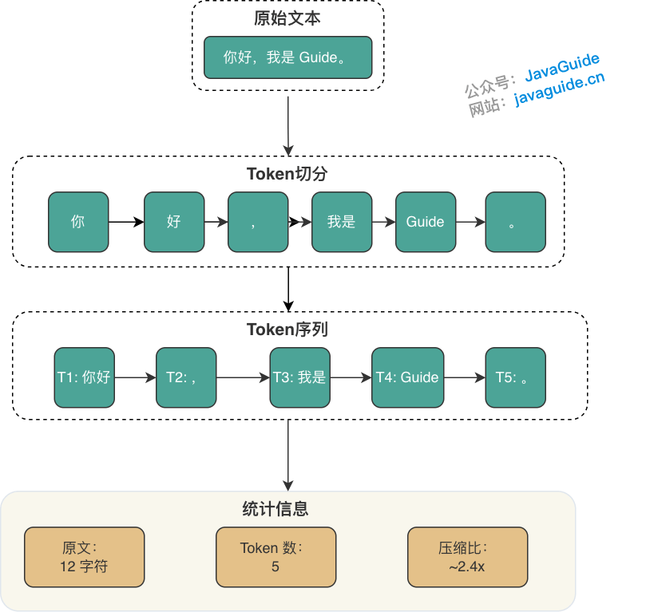

This example only illustrates the process; it does not show the actual output of a specific model. Providers and models may use different Tokenizers, so the same text can produce different Token sequences.

### Context Window

The **context window** is an LLM's working memory. It determines how much text, measured in Tokens, the model can process or “remember” at a time.

- Conversation continuity: determines how long the model can maintain a multi-turn conversation without losing earlier details.
- Per-call capacity: determines the largest document, codebase, or dataset the model can process in one call.

“Supports 128K/200K/1M” refers to the total Token limit for one call. Most models count input and output together in the context window, but some providers, such as Google Gemini, set separate input and output limits. Check the relevant API documentation before use.

The context window is shared by several less obvious costs:

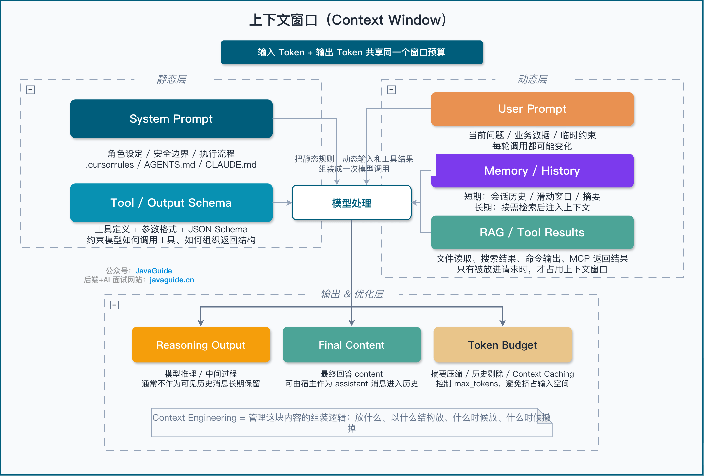

- System Prompt: instructions that shape model behavior (hidden from users but still occupying the window).
- User Prompt: application data and instructions.
- Conversation history: previous messages.
- RAG passages: additional information retrieved from an external knowledge base.
- Tool-call Schemas: function definitions and parameter structures.
- Formatting overhead: special characters, line breaks, Markdown markers, and more.
- Model output Tokens: **output also uses the context window**.

All of this shares the window, so the space left for the main application content is often much smaller than the advertised limit.

### Sampling Parameters

At each step, the model assigns a score to **every** candidate Token in its vocabulary. These scores are called **logits**; a higher score means the model considers that Token more likely to appear next.

For example, when completing “The weather is really \_\_,” a model might assign these scores:

| Candidate Token | Raw score (logit) |
| --------------- | ----------------- |
| nice            | 5.0               |
| good            | 3.2               |
| great           | 2.1               |
| awful           | 0.5               |
| purple          | -8.0              |

Raw scores are not probabilities. Apply **softmax** to get a probability distribution. If the candidate set contains only the five items above, the probabilities are approximately:

| Candidate Token | Probability |
| --------------- | ----------- |
| nice            | 81.21%      |
| good            | 13.42%      |
| great           | 4.47%       |
| awful           | 0.90%       |
| purple          | < 0.001%    |

The model samples from this distribution to choose the next Token.

Decoding parameters such as Temperature, Top-p, and Top-k control the “score → probability → sample” process:

- Temperature: changes the shape of the probability distribution, making high-scoring options more prominent or making the options more uniform.
- Top-p / Top-k: remove less suitable candidates to narrow the sampling pool.
- Penalties: lower the scores of tokens that have already appeared to reduce repetition.

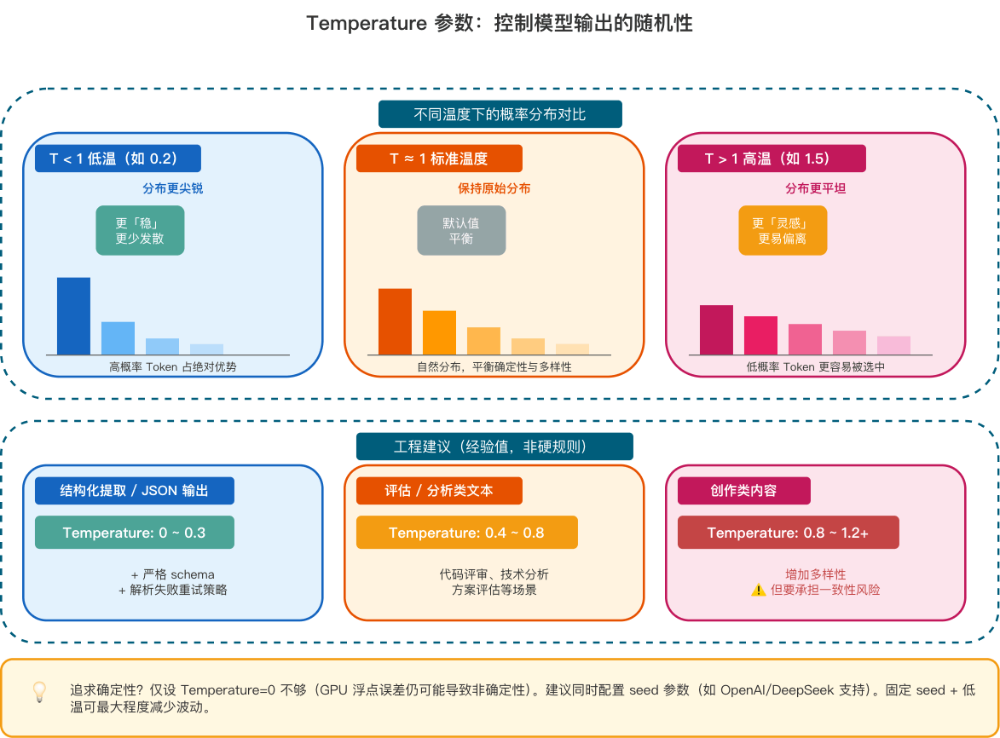

### Prompts

A Prompt is a task instruction given to a large language model (LLM). The model generates subsequent Tokens from the current context and can follow instructions and interpret meaning to some extent. When task boundaries are unclear, it may still go off topic or make up information.

A Prompt narrows the model's output space; quality is not directly related to length. Clearly specify the Role, Task, Context, and Format instead of piling on descriptive words.


| Element | Purpose                                      | Example                                                              |
| ------- | -------------------------------------------- | -------------------------------------------------------------------- |
| Role    | Sets the model's domain perspective and tone | “You are a Java architect with 10 years of experience.”              |
| Task    | States what the model should do              | “Review the following code for performance issues.”                  |
| Context | Provides relevant background                 | “Production traffic is 2,000 QPS, and response time exceeds 500 ms.” |
| Format  | Defines the output structure                 | “Return JSON with `bottleneck` and `solution` fields.”               |

### Structured Output

Consider this common Prompt:

```text
Classify the following customer feedback as a ticket type and return JSON.

Customer feedback: My payment succeeded, but the order still shows as unpaid.
```

The model might return:

```json
{
  "category": "payment",
  "priority": "high",
  "reason": "The user's payment succeeded, but the order status was not updated."
}
```

This result is readable, but it is not yet a contract that a backend can consume reliably. The application must also define these constraints:

- `category` must be one of `PAYMENT`, `LOGISTICS`, `AFTER_SALE`, or `ACCOUNT`.
- `priority` must be `LOW`, `MEDIUM`, or `HIGH`.
- `confidence` must be a decimal between `0` and `1`.
- Can `reason` be empty, and what is its maximum length?
- If the user input is incomplete, should the model return `NEED_MORE_INFO` or keep guessing?

Natural-language Prompts have difficulty enforcing these constraints consistently. It is also important to distinguish the roles of JSON Mode, JSON Schema, and Structured Outputs:

- **JSON Mode** is an output mode that constrains the model to return valid JSON.
- **JSON Schema** describes the structure: which fields and types are required, which enum values are allowed, and whether extra fields are permitted.
- **Structured Outputs** is a structured-generation capability provided by a model provider. It takes a JSON Schema or similar definition and guides or constrains generation to match it.

JSON Schema describes the contract. Model API capabilities such as Structured Outputs and Function Calling / Tool Calling apply that contract during generation. If you provide Schema text without a corresponding generation constraint, the model may still return content that violates the field requirements.

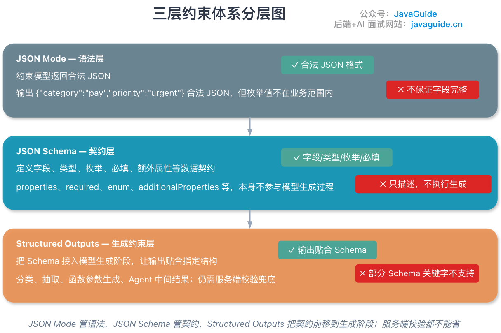

### Function Calling and Tool Calling

When a model returns `query_order` with `{"orderId": "1029384756"}`, no Java method has run yet. Function Calling / Tool Calling lets the model produce a structured call intent. A backend service, Agent Runtime, MCP Host, or provider-hosted environment is responsible for executing the tool.

One complete call consists of generating the intent, validating it in the application, executing the tool, and returning the result to the model:

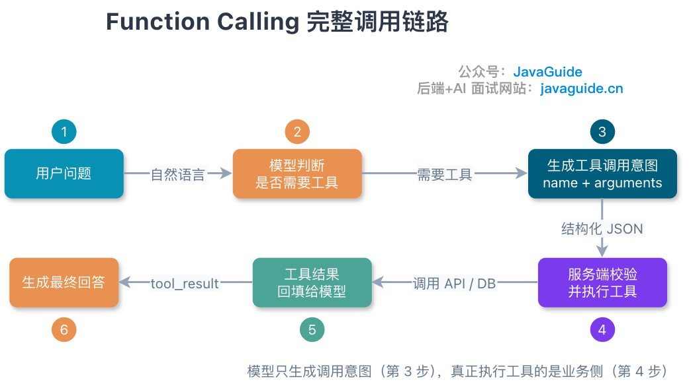

1. The server registers the tool name, purpose, and parameter Schema.
2. The user asks, “Can you check the status of order 1029384756?”
3. The model selects `query_order` and generates `{"orderId": "1029384756"}`.
4. The application validates field types, required values, user permissions, order ownership, and the idempotency key.
5. After validation, the application calls the order system, database, or HTTP API.
6. Return the tool result to the model with its `tool_use_id`. Anthropic requires an exact `tool_use_id` match, and Gemini 3 also assigns a unique `id` to each `functionCall`. If a parallel call omits the corresponding ID, the result may be associated with the wrong tool request.
7. The model uses the tool result to produce its final response.

### Production-Grade LLM Calls

A model response shown to a user passes through business validation, context assembly, model routing, provider calls, response parsing, and persistence. If any stage lacks state tracking or error handling, the user may see only a generic “model call failed” message.

Production systems should track at least these eight stages:

1. Validate user identity, tenant, plan, feature permissions, and request size.
2. Assemble the System Prompt, user input, conversation history, RAG evidence, tool Schemas, and output constraints.
3. Estimate input Tokens and reserve an output budget; trim history, compress context, or switch models when needed.
4. Use a shared client or model Gateway to select the model, provider, timeout, retry, and rate-limit policies.
5. Call the provider API and receive a synchronous or streaming response over SSE, WebSocket, or another supported protocol.
6. Parse incremental text, finish reason, tool calls, token usage, refusals, and structured output.
7. Save the response, call attempts, cost, error reason, and business state.
8. Record traces, TTFT, total duration, retry count, rate-limit ratio, and parsing failure rate.

Retries should also depend on the error type. Transient network failures, some provider 5xx errors, and overload errors can be retried a limited number of times within the overall deadline. Repeating a request with invalid parameters, an authentication error, or a safety refusal is usually pointless. If retries are possible, define idempotency keys and record the business message, model-call attempt, and provider request separately to avoid duplicate responses or repeated execution of tools with side effects.

### Evaluating AI Applications

Public benchmarks can rule out obviously unsuitable models, but cannot replace application-specific validation. Real requests may contain typos, colloquial abbreviations, screenshots, multiple languages, or contradictions. Average scores can also hide failures on a small number of high-risk paths.

Application evaluation usually starts with a Golden Set. Each case should include input, an expected result or success criteria, a scenario label, and a grading method. Evaluate retrieval and generation separately for RAG. For agents, check tool selection, parameters, execution traces, and the actual state of external systems as well as the final response.

Common grading methods serve different purposes:

| Method       | Suitable checks                                                             | Main limitation                                       |
| ------------ | --------------------------------------------------------------------------- | ----------------------------------------------------- |
| Rule-based   | JSON format, required fields, enum values, numeric bounds, and test results | Covers only conditions that can be explicitly encoded |
| LLM-as-Judge | Relevance, faithfulness, completeness, coherence, and tone                  | May have position or length biases                    |
| Human review | High-risk examples, complex semantics, and disputed results                 | Slow, costly, and difficult to keep consistent        |

A sustainable evaluation process combines offline evaluation, production trace replay, and staged rollouts. Compare versions on a fixed dataset during development, replay real traces before release, and add bad cases and user feedback to the set after launch. Associate evaluation results with the Prompt, model, retrieval strategy, and tool versions; otherwise, score changes will be difficult to explain.

## Agent

Related guides:

- [AI Agent Fundamentals: Agent Loops, Plan-and-Execute, A2A, Agentic Workflows, and Tool Registration](./agent/agent-basis.md)
- [Workflows, Graphs, and Loops in AI: From Concepts to Implementation](./agent/workflow-graph-loop.md)
- [What Is Context Engineering, and How Does It Differ from Prompt Engineering?](./agent/context-engineering.md)
- [AI Agent Memory: Short-Term and Long-Term Memory and How They Evolve](./agent/agent-memory.md)
- [Multi-Agent System Design: Task Decomposition, Shared State, Conflict Handling, and Recovery](./agent/multi-agent.md)
- [What Is the Model Context Protocol (MCP), and How Does It Relate to Function Calling and Agents?](./agent/mcp.md)
- [What Are Agent Skills, and How Do They Differ from Prompts and MCP?](./agent/skills.md)
- [Harness Engineering: A Six-Layer Checklist, Context Management, and Engineering Practices](./agent/harness-engineering.md)
- [What Is Loop Engineering?](./agent/loop-engineering.md)

### What Is an Agent?

A standard model call ends after generating text. An Agent Runtime checks whether the model requested a tool call, executes the tool, writes the result back into context, and asks the model to decide what to do next. Agent implementations in frameworks such as LangChain are therefore often built around a loop.

A common representation of the system is **Agent = LLM + Planning + Memory + Tools**. The LLM interprets the task and makes decisions; Planning manages steps and dependencies; Memory stores current state or history; and Tools connect to databases, APIs, file systems, and code execution environments.

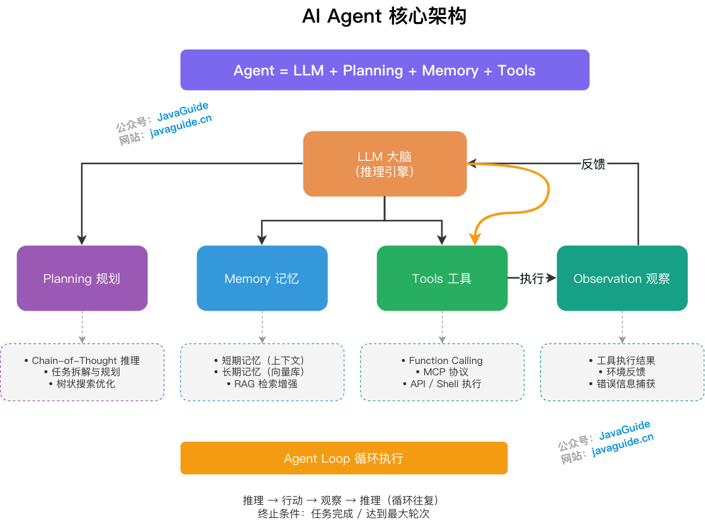

Short-term memory usually retains the current conversation and task state. Long-term memory reuses user preferences, past decisions, or task experience across sessions. Tool results are Observations; the runtime appends them to the context so the model can make its next decision based on actual results.

### Agent Loops

An Agent Loop connects model decisions and tool execution in a feedback cycle. At each step, the model reads the current context and chooses whether to respond directly or call a tool. The runtime executes the action, saves the result, and starts the next step.

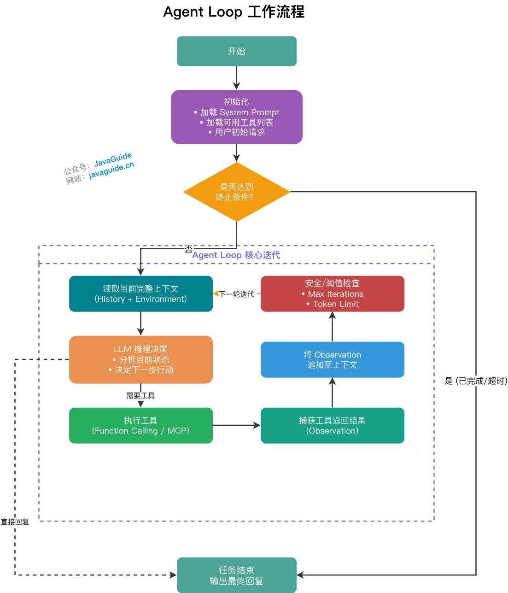

1. Initialize the System Prompt, tool list, and user request.
2. The model reads the context and returns text or a tool-call intent.
3. The runtime executes the tool and writes the result and state back to the context.
4. Finish when the model makes no more tool calls. The runtime must stop execution when it reaches the turn, token, time, or cost limit.

The loop itself is simple. As a task runs longer, conversation history, tool results, and intermediate state consume more context, and later content may dilute earlier constraints. Context Engineering determines what to retain, when to compress it, and what the model needs to see in the next step.

### ReAct

ReAct stands for Reasoning + Acting. Shunyu Yao and colleagues introduced it in 2022 in the paper [“ReAct: Synergizing Reasoning and Acting in Language Models”](https://react-lm.github.io/). It alternates reasoning, actions, and observations in one trace: the model chooses an action, the environment returns a result, and the model uses that result in the next step.

For example, if the model does not know an order's current status, it can call a query tool. If the order system returns “paid, awaiting shipment,” the model can answer directly or check the shipping status. External results inform later decisions, but do not guarantee that the answer is correct.

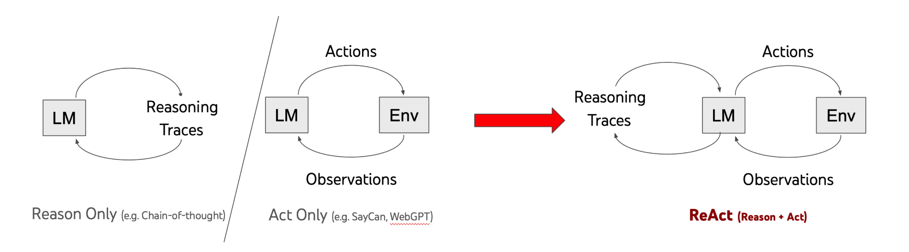

To implement ReAct, the runtime must save the execution history and current state, provide the available tools or Skills to the model, and associate each tool response as an Observation with its call. Environmental changes, such as system alerts or additional user input, should also be reflected in later steps.

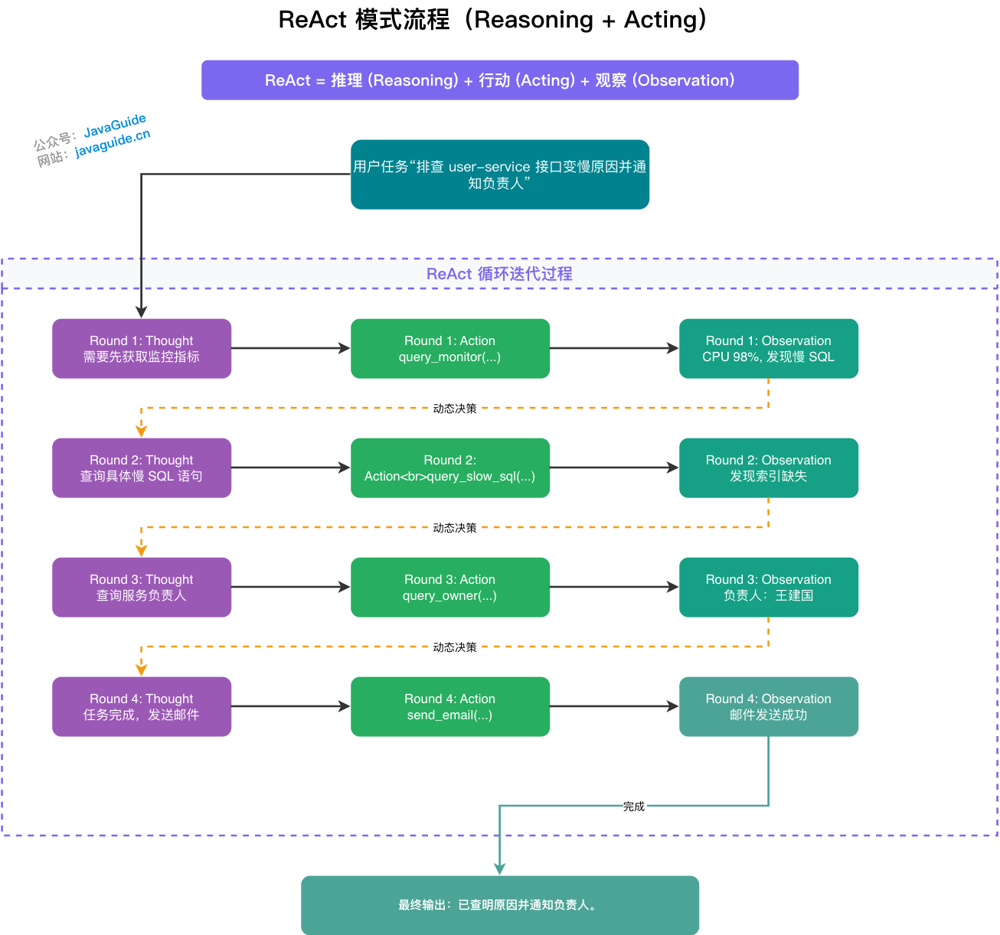

Multiple rounds of tool calls add latency and token usage. Result quality also depends on tool descriptions, parameter validation, returned data, and stop conditions. A trace can record the actions taken, but reasoning text in a model's output should not be treated as a direct representation of its internal decision process.

### Plan-and-Execute

Plan-and-Execute is a pattern introduced by the LangChain team in 2023. The planning stage produces steps and dependencies, then an executor handles them one by one. It suits long tasks whose main stages can be identified in advance.

A global plan makes dependencies and completion criteria visible earlier. If the environment or task objective changes during execution, the plan may become invalid and should be revised instead of followed blindly.

A project can use a plan to control outer stages and run a ReAct sub-loop inside a step. The plan constrains deterministic dependencies; tool calls fill in local information when it is missing.

### Workflows, Graphs, and Loops

An agent lets the model choose the next step. A workflow uses code or a graph to define node order, conditional transitions, and failure handling in advance. Both can call models and tools; the main difference is where control resides.

Use a workflow for stable processes with clear permission requirements. If retrieval, analysis, or tool selection cannot be enumerated in advance, embed an agent loop in a node. This Agentic Workflow uses the outer process to limit execution while leaving local decisions to the model.

An AI workflow can be represented as a directed graph with three elements: Nodes perform work, Edges control flow, and State shares context between nodes.

### Multi-Agent Systems

A multi-agent system coordinates workers that can independently complete subtasks; a multi-stage Prompt Chain coordinates steps in one workflow. A role should be a separate agent only when it has its own Prompt, tools, context, permissions, runtime state, and deliverable.

Multi-agent systems may help when stages need clearly different tools, permissions, and context, or when a task can be divided into relatively independent directions. If several roles share the same context and tools and produce similar text, the main result is more model calls, latency, and aggregation cost.

Common orchestration patterns include:

| Pattern            | Control model                                                    | Suitable scenarios                                                       |
| ------------------ | ---------------------------------------------------------------- | ------------------------------------------------------------------------ |
| Sequential         | Code calls several agents in a fixed order                       | Defined steps with clear dependencies                                    |
| Parallel           | Independent tasks run concurrently and are aggregated            | Multiple retrieval paths, multi-perspective review, voting               |
| Router             | Rules or a model route requests to one or more specialists       | Clear domains and relatively stable classification                       |
| Supervisor/Manager | A primary agent dynamically decomposes tasks and calls subagents | Subtasks cannot be fully defined in advance and need one combined answer |
| Handoff            | An agent transfers control and necessary context to another role | Customer support routing and staged conversations                        |

After splitting roles, define a task contract with the subgoal, success criteria, dependencies, allowed tools, output Schema, artifact location, timeout, token budget, and failure policy. If multiple agents write shared state or call tools with side effects, use idempotency, versioning, locks, compensation, and checkpoints to ensure consistency. Do not let the models negotiate write order.

### Context Engineering

When context is disorganized, an agent may miss constraints, call tools repeatedly, or drift from the task even if the model is capable.

Context Engineering selects, organizes, and updates the information a model needs within a limited Token window. This includes rules, memory, tool descriptions, session state, external observations, and token budgets. Prompt Engineering focuses more narrowly on how the instructions themselves are expressed.

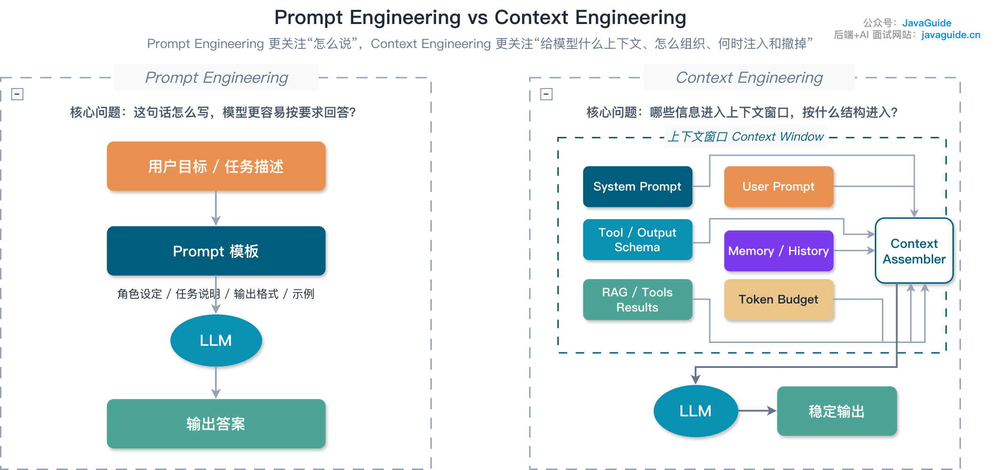

For further guidance, see [Prompt Engineering](https://javaguide.cn/ai/agent/prompt-engineering.html) and [Context Engineering](https://javaguide.cn/ai/agent/context-engineering.html).

### Memory

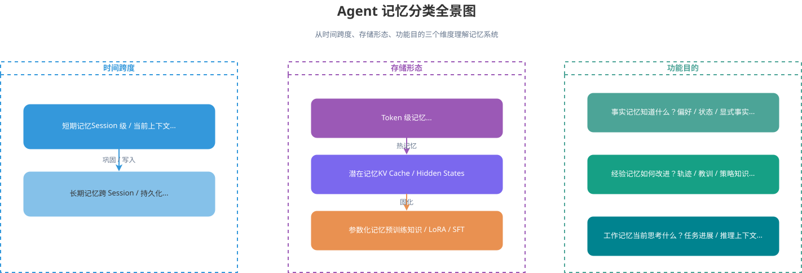

Memory systems usually have two layers: short-term and long-term memory. Short-term memory is scoped to a Session and supports the current task. Long-term memory spans Sessions and stores user preferences, past decisions, and task experience for reuse. Because these data have different lifecycles, permissions, and update patterns, keep them logically separate.

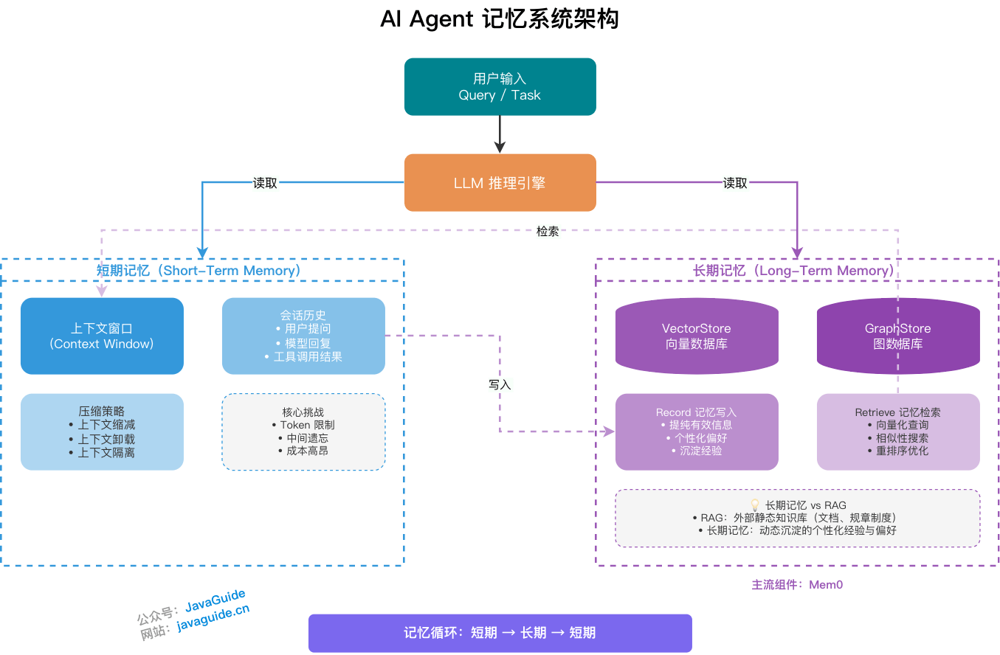

Agent memory can be grouped into three types by purpose:

| Type                | Core question                           | Stored information                                                   | Example use                                |
| ------------------- | --------------------------------------- | -------------------------------------------------------------------- | ------------------------------------------ |
| Factual memory      | What does the agent know?               | User preferences, environment state, explicit facts                  | Remember a user's preferred tech stack     |
| Experiential memory | How can the agent improve?              | Past traces, lessons from successes and failures, strategy knowledge | Learn from a failed code review            |
| Working memory      | What is the agent currently processing? | Current reasoning context and task progress                          | Intermediate state in multi-step reasoning |

Long-term memory and RAG are technically similar: both may use vector stores and semantic retrieval. They serve different purposes, however.

RAG connects to retrievable knowledge sources such as company policies, product documentation, and real-time database query results. It can serve a shared knowledge base or apply permission filtering and personalized retrieval by user, tenant, role, or session. The main difference from long-term memory is the data source and lifecycle: RAG retrieves external knowledge, while long-term memory stores information formed through interactions for reuse across sessions.

Long-term memory manages personalized information accumulated through an agent's interactions with a specific user, such as preferences, habits, past decisions, and individual context. It varies from user to user.

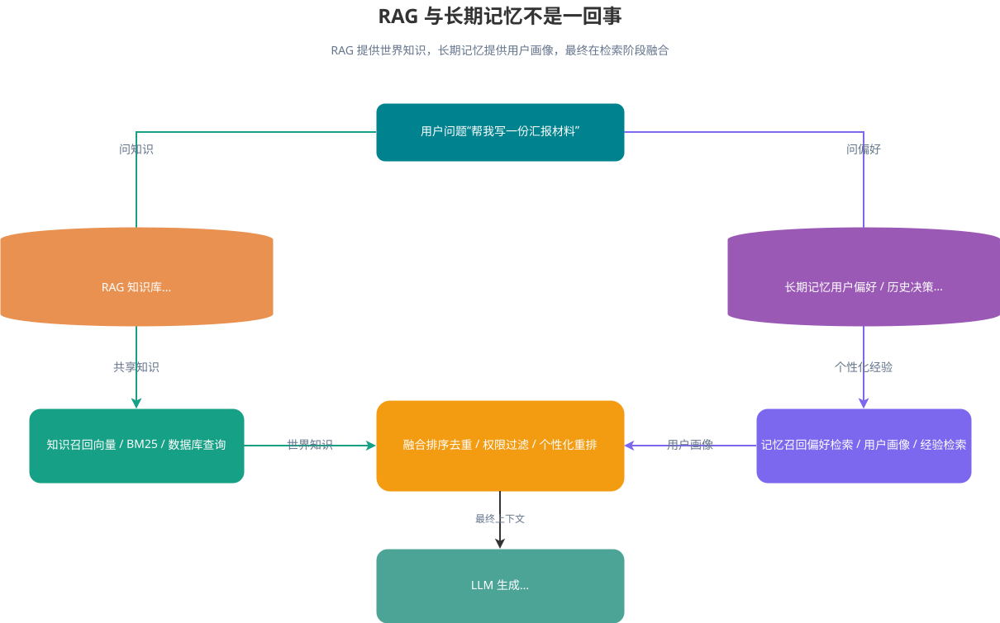

### MCP

MCP stands for Model Context Protocol. The three words describe its scope:

- Model: for LLM applications.
- Context: brings external context, tools, and data sources to a model.
- Protocol: standardizes how the components interact.

MCP defines **how an MCP Client communicates with an MCP Server**. The Host handles user interaction and model calls, the Client communicates with Servers, and Servers expose capabilities. Connecting MCP does not give the model built-in plugins.

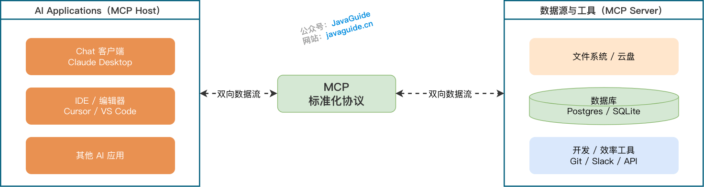

Function Calling, MCP, agents, and Skills often appear in the same system, but address different concerns. Function Calling lets a model express an intent to use a tool. MCP defines how a host discovers external capabilities and connects to backend services. An agent decides what to do across multiple steps. Skills store the procedures and experience needed for a type of task.

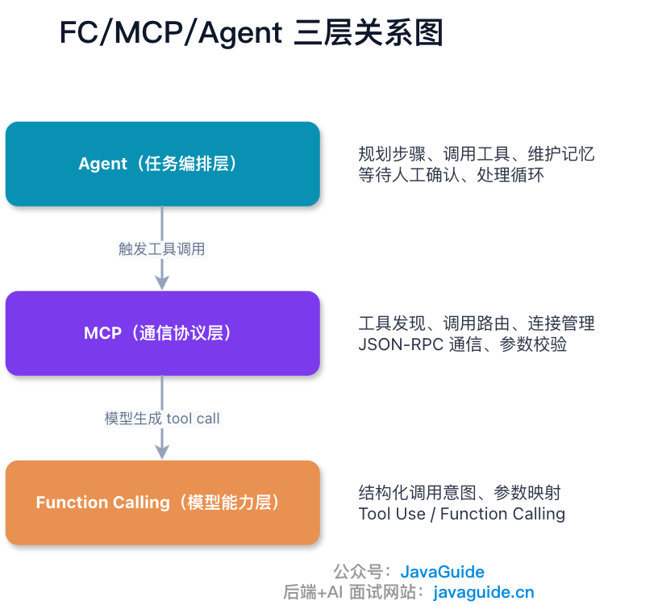

### Skills

When a user asks, “Analyze this report,” the Prompt states the current task. If the model needs to read a file, it can use Function Calling to generate structured parameters for `read_file`; an MCP Server can provide that tool. The analysis procedure—checking field meanings, finding anomalies, then interpreting them in context—is better captured in a Skill.

A Skill is a task guide that an agent can discover and load when needed. Team knowledge such as API formats, log fields, slow SQL investigation steps, and code review criteria can go in `SKILL.md`, so the entire set of rules does not need to be repeated in every Prompt. Prompts, Function Calling, MCP, and Skills handle task input, call intent, tool connectivity, and execution procedures respectively; all may be involved in one task.

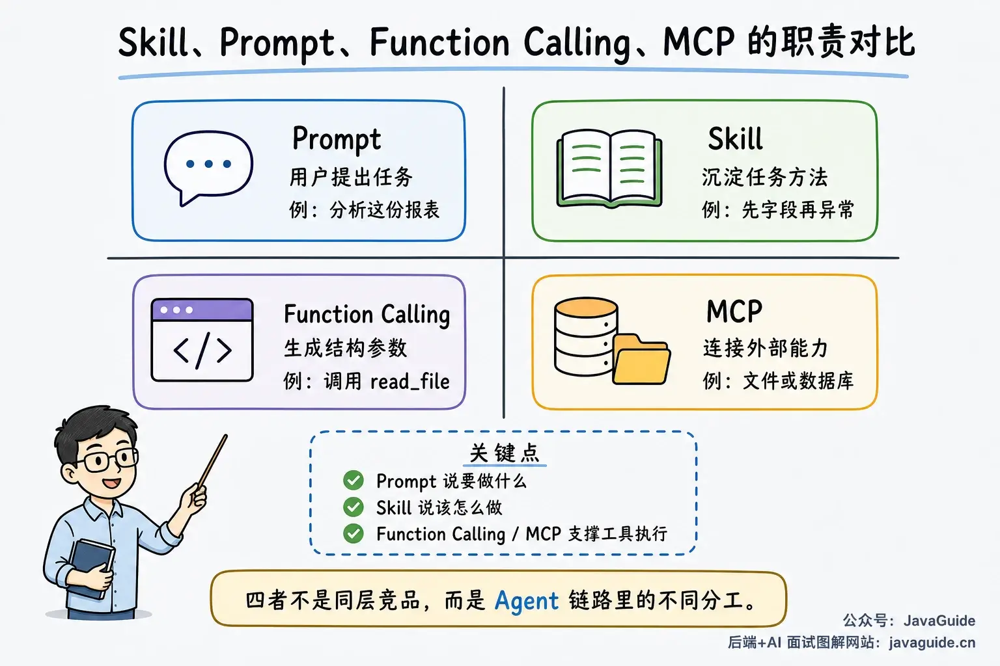

Skill loading and execution have five steps:

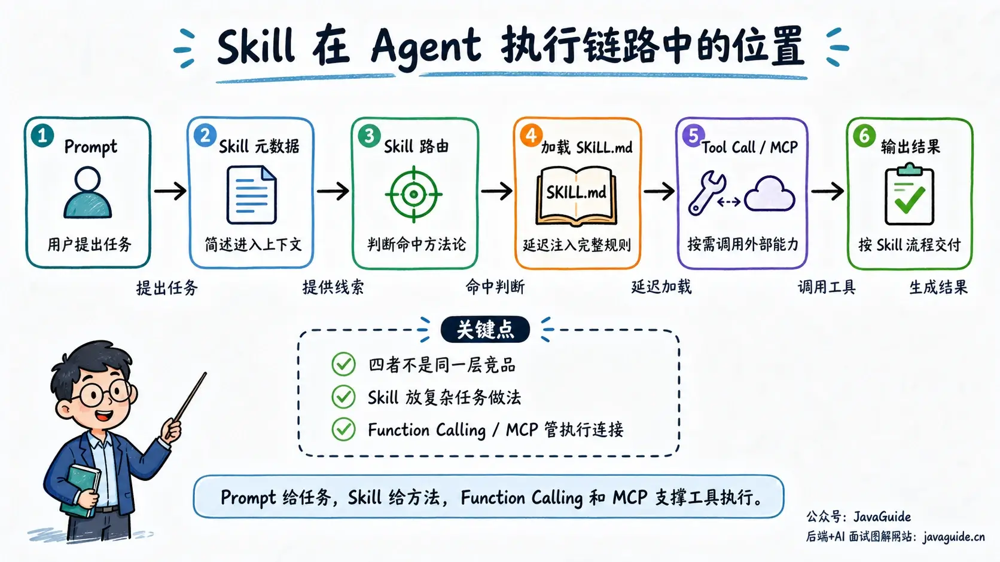

1. The user submits a task (Prompt).
2. The host adds short descriptions of available Skills to the context (Skill metadata).
3. The model determines that a Skill matches the task (Skill routing).
4. The host loads the full `SKILL.md` (lazy loading).
5. The model follows the Skill procedure to call tools, read material, and write results (execution).

### Harness Engineering

The model reasons and generates output, but does not save task state, restrict file permissions, run tests, or handle tool timeouts on its own. The Harness consists of the System Prompt, tool calls, file system, sandbox, orchestration, Hooks, feedback, and constraints. Engineers often use **Agent = Model + Harness** to emphasize that the runtime environment outside the model also determines whether a task can execute reliably.

Vivek Trivedi takes a similar approach in “The Anatomy of an Agent Harness”: distinguish the model's responsibilities, then inspect the surrounding system. When debugging an agent, check context completeness, tool availability, execution controls, and recovery behavior as well as the model output.

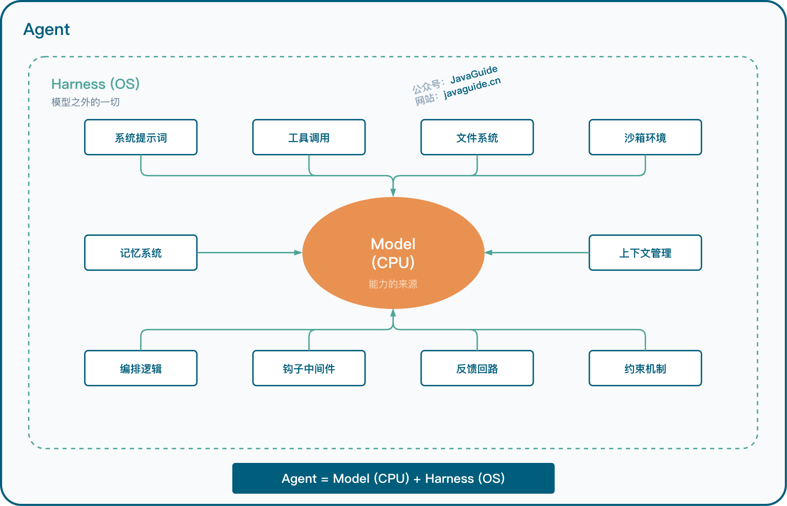

Prompt Engineering, Context Engineering, and Harness Engineering have different scopes. Prompt Engineering focuses on expressing instructions. Context Engineering determines what information to provide for a call. Harness Engineering manages execution, validation, observability, and recovery outside the model.

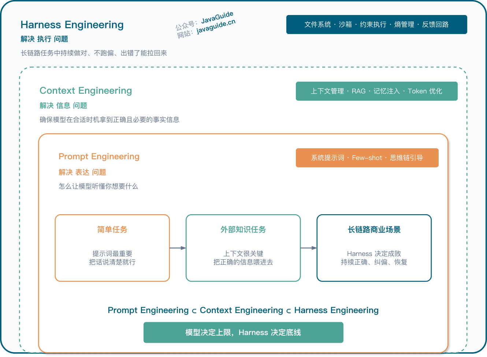

| Layer               | Question it answers                                         | Focus                                                       | Typical work                                                                 |
| ------------------- | ----------------------------------------------------------- | ----------------------------------------------------------- | ---------------------------------------------------------------------------- |
| Prompt Engineering  | How should instructions be expressed?                       | Help the model understand intent and reduce local ambiguity | System Prompt design, few-shot examples, Chain-of-Thought guidance           |
| Context Engineering | What information should the agent see?                      | Provide the right information at the right time             | Context management, RAG, memory injection, token optimization                |
| Harness Engineering | How does the system execute, correct, observe, and recover? | Reliability and recovery across long-running tasks          | File systems, sandboxes, enforced constraints, feedback loops, observability |

### Loop Engineering

Loop Engineering defines the triggers, goals, context, validation, state, and stop conditions for repeated agent execution. Each iteration should produce a checkable result. Exit the loop when the task completes or fails, the budget runs out, or approval is needed.

In practice, consider:

- Trigger: What starts an iteration—a manual command, scheduled task, CI failure, PR creation, Issue update, or message event?
- Goal: What counts as complete—all tests passing, CI green, coverage reaching a threshold, screenshots matching a design, or a draft awaiting human review?
- Context: Which files, rules, prior state, tool results, and project conventions should the agent see in each iteration?
- Action: Can the agent edit code, run tests, query GitHub, read logs, create a PR, or only make recommendations?
- Observation: How does it know the last step worked? Test output, lint, type checks, screenshots, review comments, and log summaries can all provide feedback.
- State: Record what the iteration tried, where it failed, and what comes next in an external file, Issue, Linear ticket, or database; do not rely on the current conversation to remember it.
- Stop: When should it exit, hand off to a person, or stop because its budget or iteration limit is exhausted?

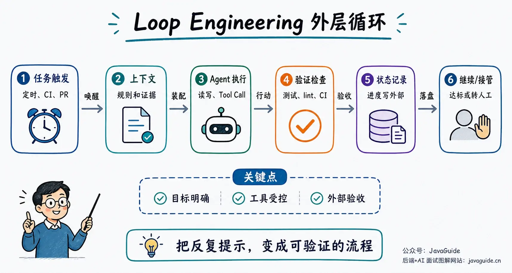

A minimal loop is: read context → choose the next step → call a tool or produce an answer → write back the result → check stop conditions. ReAct alternates Reasoning and Acting inside the loop. Loop Engineering also handles triggers, validation, persistence, budgets, and human takeover around it.

## RAG

Related guides:

- [RAG Fundamentals: Retrieval, Generation, and Engineering Tradeoffs](./rag/rag-basis.md)
- [RAG Vector Index Algorithms and Vector Databases](./rag/rag-vector-store.md)
- [RAG Document Processing and Chunking: Parsing, Cleaning, and Multimodal Content](./rag/rag-document-processing.md)
- [RAG Optimization: From Retrieval and Reranking to Context Engineering](./rag/rag-optimization.md)
- [GraphRAG: Enhancing Vector Retrieval with Graphs](./rag/graphrag.md)
- [Updating a RAG Knowledge Base: Incremental Updates, Versioning, Deduplication, and Rebuilds](./rag/rag-knowledge-update.md)

### What Is RAG?

**Retrieval-Augmented Generation (RAG)** adds information retrieval to an LLM's generation process. The system first finds relevant content in a database, document collection, or internal system, then sends the retrieved results and original question to the LLM. This gives the model evidence beyond its parametric knowledge.

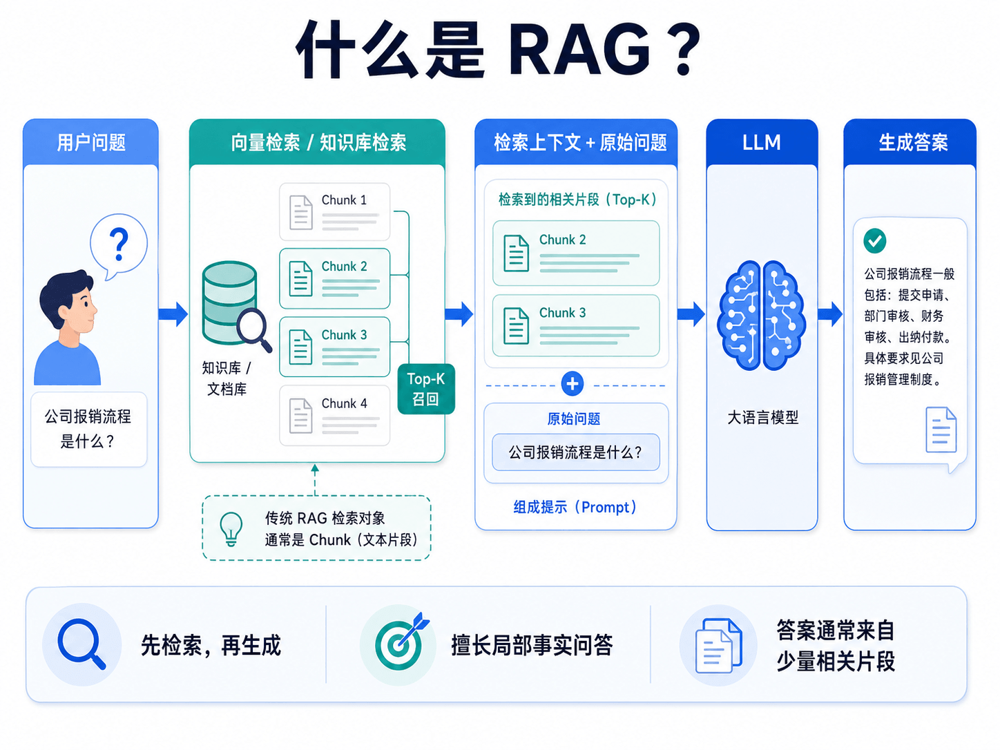

RAG primarily addresses three information gaps:

- **Knowledge freshness:** An LLM's parametric knowledge is limited by its training data cutoff. RAG can retrieve current events, policies, and product documentation when a request arrives.
- **Access to private data:** Company documentation, knowledge bases, and customer data are not part of public training data. An application can retrieve content according to the user's permissions and provide only the passages needed for an answer.
- **Evidence for answers:** Retrieved evidence can constrain the model's answer, but cannot eliminate hallucinations. Retrieval errors, noisy context, mismatched citations, and failure to follow instructions can still produce incorrect answers. Production systems also need citation checks, answer evaluation, refusals, and human feedback.

### How RAG Works

The RAG pipeline usually has two stages: offline indexing and online retrieval and generation. Indexing transforms source documents into searchable data structures. At query time, the online stage interprets the query, retrieves results, builds context, and generates an answer.

A simplified view of indexing and retrieval:

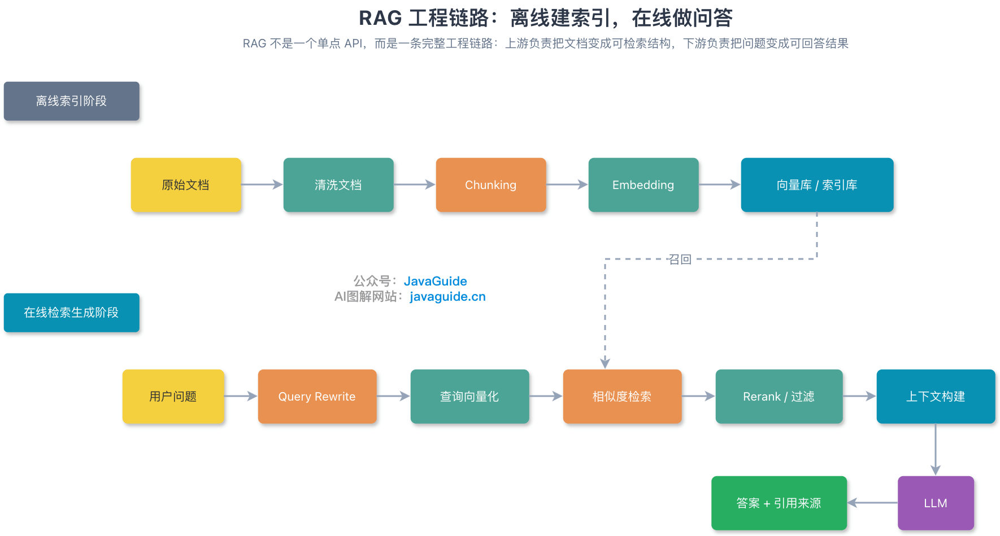

The indexing stage typically does the following:

1. **Load documents:** Source content can come from text files, PDFs, web pages, or database records.
2. **Clean documents:** Remove noise such as HTML tags and special characters.
3. **Enrich documents:** Add metadata such as timestamps and categories to support filtering during retrieval.
4. **Chunk documents:** Split documents into smaller passages. Balance semantic completeness, the embedding model's input limit, the generation model's context window, and retrieval granularity. Large chunks can add noise; small chunks can lose context. Chunking strategy directly affects retrieval quality. See [RAG Document Processing](./rag/rag-document-processing.md) for details.
5. **Generate embeddings:** Use an embedding model to map each text passage to a semantic vector, a high-dimensional dense vector. Common choices include OpenAI's `text-embedding-3-small` and `text-embedding-3-large`, as well as open-source models on Hugging Face.
6. **Store vectors and metadata:** Save embeddings, source content, and metadata in a vector store or index, such as Milvus, pgvector, Elasticsearch or OpenSearch vector search, or a local Faiss index. See [RAG Vector Stores](./rag/rag-vector-store.md) for database selection, index algorithms, and pgvector.

### Embedding

An embedding maps text to a sequence of numbers. More precisely, it maps text into a high-dimensional dense vector space where semantically similar texts are closer together.

For example, these questions:

- “How do I request a refund?”
- “What is the refund process?”
- “How do I cancel an order and get my money back?”

The wording differs, but the meaning is similar. A good embedding model maps them to nearby points so vector retrieval can find relevant chunks.

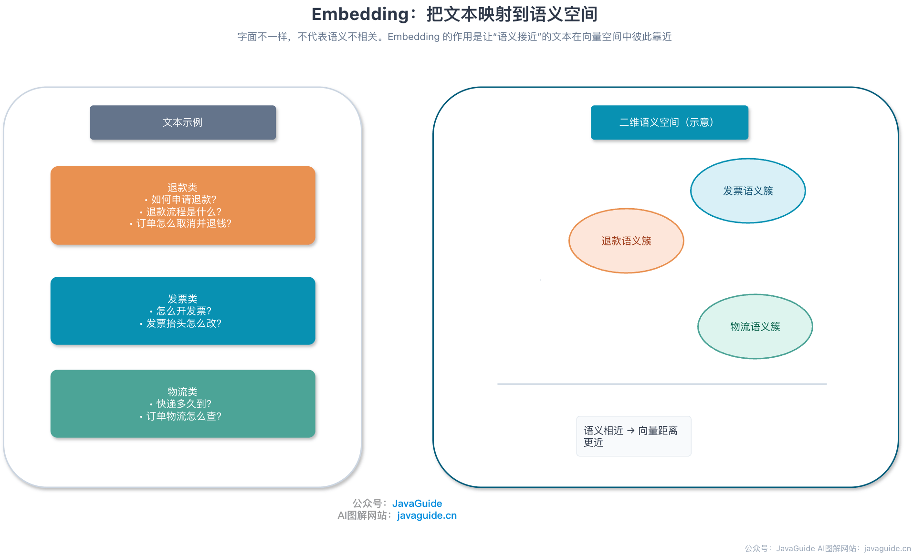

Common embedding dimensions include 768, 1024, 1536, and 3072. Dimension is part of a model's design and training; a higher number does not by itself mean better semantic quality. Higher dimensions usually increase storage, indexing, and similarity-computation costs. For example, OpenAI's `text-embedding-3-small` outputs 1536 dimensions by default, and `text-embedding-3-large` outputs 3072. Both support a lower dimension through the `dimensions` parameter.

### Vector Search and Vector Databases

The basic retrieval step in RAG is to embed both the user's question and the documents, then find the most relevant passages through similarity search.

The flow is:

1. Split documents into chunks before adding them to the knowledge base.
2. Use an embedding model to convert each chunk into a vector.
3. Store the vectors alongside their source text and metadata in a vector database.
4. Embed a user's question as a query vector.
5. Retrieve the Top-K document vectors with the highest similarity.
6. Add the corresponding passages to the Prompt and ask the LLM to generate an answer.

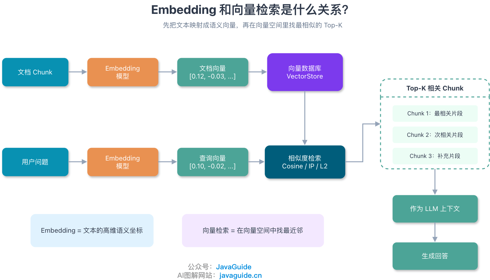

Embeddings convert text into comparable vectors, which vector search uses to find semantically similar content. Vector search is only one RAG implementation. RAG can also retrieve external evidence through BM25, SQL, knowledge graphs, search APIs, or other application queries.

In a small demo, a few thousand document vectors can be searched by brute force in memory. A production RAG system can quickly grow to millions or tens of millions of documents, or more.

In addition to storing vectors, a vector database must handle similarity indexes, metadata filters, updates and deletes, concurrent queries, and persistence:

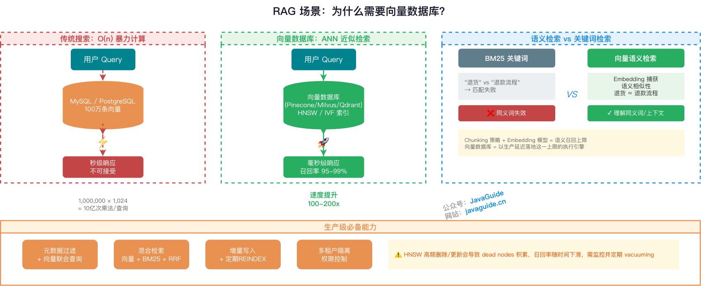

### Document Processing

Documents pass through at least six stages between upload and vector storage:

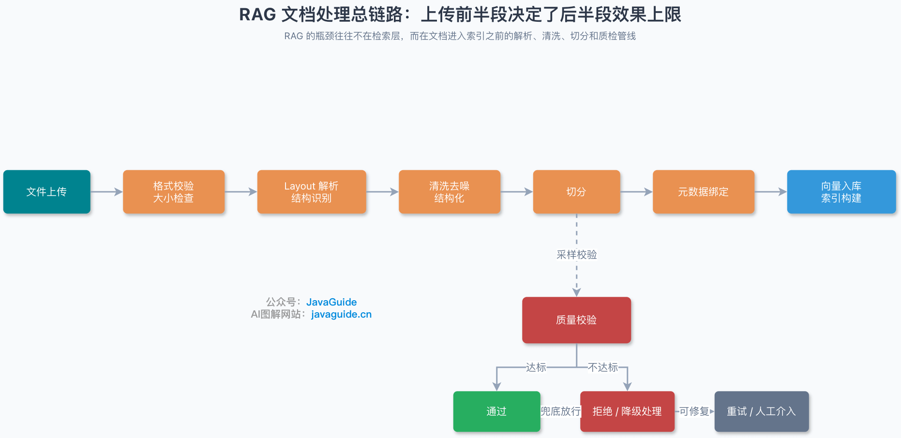

Do not wait until after indexing to validate quality. Sample and check chunks during Chunking to catch issues before large volumes of low-quality data enter the vector database.

Key risks at each stage:

| Stage          | Common issue                                                                        | Impact                                        |
| -------------- | ----------------------------------------------------------------------------------- | --------------------------------------------- |
| File upload    | Spoofed format, size limit exceeded, inconsistent encoding                          | Parser crashes or silently fails              |
| Format check   | File extension does not match actual MIME type                                      | Wrong parser is selected                      |
| Layout parsing | Multi-column PDFs, merged table cells, headers and footers                          | Structure is lost and context is misaligned   |
| Cleaning       | Garbled text, special characters, duplicate blank lines, leftover table of contents | Noise enters the index and embeddings degrade |
| Chunking       | Semantic cuts, broken context, or chunks that are too large or small                | Poor retrieval and incomplete answers         |
| Metadata       | Missing source, page, version, or permission data                                   | Filtering and citations are unavailable       |
| Indexing       | Inconsistent vector dimensions or token limits exceeded                             | Retrieval fails or the index is corrupted     |

Many teams focus on changing the embedding model. If the data is already corrupted at this stage, changing models only makes the bad results more consistent.

### Chunking

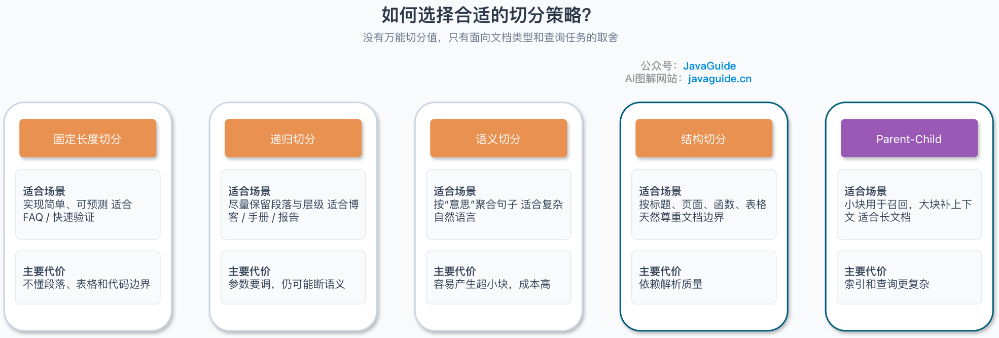

When documents have a clear structure, chunking by that structure is often more suitable. In one NVIDIA evaluation, Page-Level Chunking performed best on financial reports and legal documents, with a mean accuracy of 0.648 and the lowest variance. Page boundaries often carry section or layout semantics in these materials, so preserve them where possible.

Do not assume page-level chunking is always best. Its advantage over token-based chunking was only 0.3–4.5 percentage points, and on the FinanceBench dataset, 1024-token chunks performed better than page-level chunks (0.579 vs. 0.566). The documents in NVIDIA's evaluation—financial reports and legal documents—carry semantics in their page layout. Page-level chunking may not help with PDFs exported casually from Word. Query type also affects the best strategy: factual queries often suit small 256–512 Token chunks, while analytical queries may suit 1024+ Token or page-level chunks.

Start with chunking strategies suited to each document type, then evaluate them using application queries:

| Document type   | Suggested chunking strategy            | Example implementation            |
| --------------- | -------------------------------------- | --------------------------------- |
| Markdown        | Split by heading level (H1/H2/H3)      | `MarkdownHeaderTextSplitter`      |
| HTML            | Split by tag hierarchy (h1–h6, p, div) | `HTMLHeaderTextSplitter`          |
| PDF             | Split by page or section               | `chunk_by_title`, `chunk_by_page` |
| Code            | Split by function, class, or package   | `PythonCodeTextSplitter`          |
| Research papers | Split by section, paragraph, or table  | Layout-aware parser               |

Smaller chunks make it easier for vector search to match specific sentences, but may leave the model with incomplete context. Larger chunks preserve more of a passage, but also bring more irrelevant content into the candidate set.

Parent-Child Chunking separates retrieval granularity from generation context. For example, index child chunks of about 300 Tokens and associate each with a parent passage of about 1200 Tokens. When a query matches a child, provide the corresponding parent passage to the model. These are only starting values; tune them based on document structure, query type, and evaluation results.

### Hybrid Search

“How do I cancel my subscription?” and “Turn off auto-renewal” use different wording, but vector search can connect them semantically. Error codes and model numbers such as `E1027` and `ABX-4421` are better suited to exact BM25 matching. Hybrid Search keeps candidates from both methods.

| Query type                            | Vector search                       | BM25                  | Recommendation                     |
| ------------------------------------- | ----------------------------------- | --------------------- | ---------------------------------- |
| “How do I cancel my subscription?”    | Can match “turn off auto-renewal”   | May not match         | Keep vector retrieval              |
| “Error code E1027”                    | May retrieve generic errors         | Exact code match      | Keep keyword retrieval             |
| “ABX-4421 model specifications”       | May find similar models             | Exact SKU match       | Keep keyword retrieval             |
| “Java thread-pool rejection policies” | Good semantic match                 | Can match keywords    | Hybrid search is more reliable     |
| “Latest v3.2 pricing policy”          | Needs semantic and time constraints | Can match the version | Combine metadata and hybrid search |

Fuse both result sets before reranking:

- Vector search returns semantically similar candidates.
- BM25 or sparse vectors return keyword candidates.
- Combine the results with RRF or normalized weighted scores.
- Deduplicate the combined candidates before reranking.

The documentation for products such as Microsoft Azure AI Search, Google Vertex AI Vector Search, and Weaviate describes Hybrid Search and RRF. RRF combines results by rank position, avoiding the need to directly compare BM25 scores with vector cosine scores.

Whether Hybrid Search is worthwhile depends on the query distribution. Keyword retrieval is usually necessary when queries contain many error codes, product models, configuration options, or proper nouns. If documents are highly structured and queries rarely contain exact terms, adding BM25 may not provide enough benefit.

### Query Rewriting

Users often submit short queries such as:

- “How do I fix this error?”
- “Can I get my money back?”
- “Is that rate-limit issue happening again in production?”

Terms such as “this,” “my money,” and “that issue in production” depend on conversation context. Direct retrieval lacks the entity or constraints. Query rewriting adds necessary entities, synonyms, or filters to bring the query closer to the knowledge base's wording while preserving the user's intent.

Common strategies include:

| Strategy            | Suitable scenario                                   | Example                                                                            |
| ------------------- | --------------------------------------------------- | ---------------------------------------------------------------------------------- |
| Normalization       | Colloquial language, abbreviations, missing context | Rewrite “Can I get my money back?” as “refund policy, eligibility, and process”    |
| Multi-Query         | A concept has several common phrasings              | Search “cancel subscription,” “turn off auto-renewal,” and “end membership”        |
| Query Decomposition | A question contains multiple subquestions           | Split “Compare Stripe and Square fees and dispute handling” into four subquestions |
| Step-back Query     | A question is too specific and lacks context        | Retrieve “subscription billing rules” before answering a cancellation question     |
| HyDE                | Query is short or differs from document style       | Generate a hypothetical answer and use its embedding to retrieve real documents    |
| Self-Query          | The question includes filters                       | Extract year and category filters from “Find Java policies from 2025”              |

LangChain provides components such as `MultiQueryRetriever` and `SelfQueryRetriever`. Keep the original query as one retrieval input and fuse its results with rewritten-query results. If only rewritten queries are used, a misunderstanding can skew the entire candidate set.

### Reranking

Suppose a user asks, “Why does a thread pool trigger a rejection policy?”

Vector retrieval might return these passages:

1. An explanation of core thread-pool parameters.
2. A list of rejection policies.
3. The conditions for triggering a rejection policy when the queue is full and the pool has reached `maximumPoolSize`.
4. Example thread-pool code.

The first two results are semantically related to “thread pool” and “rejection policy,” but the third directly explains the trigger conditions. Dual-encoder retrieval encodes the query and documents separately, then quickly retrieves candidates by vector distance. Reranking usually uses a Cross-Encoder or specialized reranker to score the query together with each candidate, moving passages that answer the question to the top. It is more precise but more expensive, so it usually processes only a small set of retrieved candidates.

A common pipeline is shown below. Tune candidate counts based on the latency budget and evaluation results:

1. Prefilter by metadata.
2. Use Hybrid Search to retrieve 30–100 candidates.
3. Deduplicate and merge adjacent passages.
4. Use a reranker to select 5–10 passages.
5. Compress the context and add it to the Prompt.

### GraphRAG

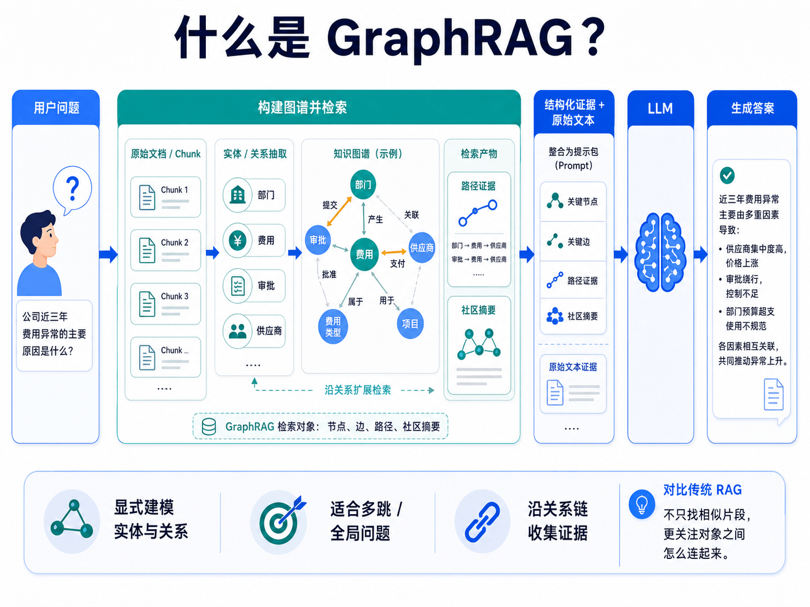

Graph-based Retrieval-Augmented Generation (GraphRAG) uses graph structures for retrieval-augmented generation. A system explicitly models entities, relationships, and structured context from documents, then follows graph relationships to gather evidence for the LLM to answer a query.

GraphRAG changes what the system retrieves. A graph database can store the data, but using a particular graph database product is not the only criterion for calling a system GraphRAG.

Traditional vector RAG primarily retrieves text chunks. GraphRAG can retrieve nodes, edges, graph paths, and source-text evidence. Community summaries are one indexing method used by implementations such as Microsoft GraphRAG, but are not required by every GraphRAG system.

One analogy is:

- **Vector RAG** is like finding a few semantically similar pages in a library.
- **GraphRAG** is like first organizing a relationship map, event timeline, and topic index, then following those connections to find evidence.

Vector RAG is good at finding passages that resemble a question. GraphRAG is better suited to exploring how entities are connected.

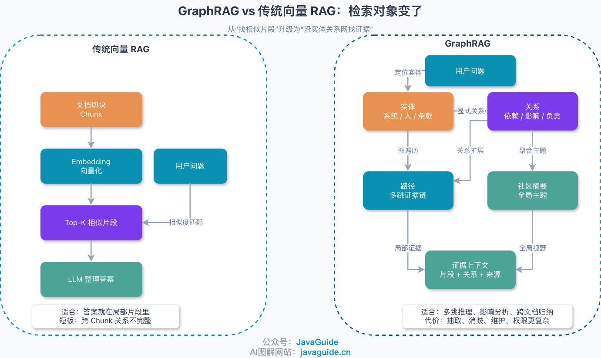

| Dimension       | Traditional vector RAG                        | GraphRAG                                                                                  |
| --------------- | --------------------------------------------- | ----------------------------------------------------------------------------------------- |
| Retrieval unit  | Text chunks                                   | Entities, relationships, paths, community summaries, and source passages                  |
| Core capability | Semantic similarity retrieval                 | Relationship reasoning, graph traversal, and global topic aggregation                     |
| Data structure  | Primarily a vector index                      | Knowledge graph, vector index, and full-text index                                        |
| Suitable tasks  | Local fact questions and passage explanations | Multi-hop relationship questions, cross-document synthesis, and complex business analysis |

### Knowledge Base Updates

A RAG knowledge base must continuously process additions, modifications, and deletions. After an update, retrieved results should match the current documents and permission metadata should be synchronized. If one index target fails, the system must identify the affected documents and recover to the last healthy index.

Indexing and querying must use the same Embedding model and version. Different models produce incompatible vector spaces; even vectors with the same dimensions have incomparable similarity scores. When upgrading an Embedding model or Chunking strategy, build a new index, compare it with the same evaluation set, then switch the alias. Keep the old index temporarily for rollback.

Use different strategies for routine updates and structural migrations:

| Dimension         | Incremental update                                            | Full rebuild                                                                  |
| ----------------- | ------------------------------------------------------------- | ----------------------------------------------------------------------------- |
| Scope             | Process only added, modified, and deleted documents           | Reprocess the entire knowledge base                                           |
| Suitable for      | Frequent routine changes and minute-level synchronization     | Model upgrades, Chunking changes, and recovery from major failures            |
| Main dependencies | Webhooks, CDC, polling, and message queues                    | Source-system snapshot, parallel old and new indexes, and atomic alias switch |
| Main risks        | Missed, out-of-order, or duplicate events and partial success | High rebuild cost; incomplete switch or rollback can affect service           |

Production systems often combine event-driven updates, polling as a fallback, and reconciliation. A metadata database records document versions, content hashes, Embedding and Chunk versions, and the status of each index. If the vector store, full-text index, and metadata database are only partially updated, background compensation jobs retry and reconcile based on their recorded states.

## AI System Design

Related guides:

- [AI Application System Design: From Prompt Demo to Production Architecture](./system-design/ai-application-architecture.md)
- [LLM Gateway Explained: Model Routing, Fallback, Rate Limiting, and Cost Control](./system-design/llm-gateway.md)
- [AI Observability and Tracing: Reconstructing an Agent's Execution](./system-design/ai-observability.md)
- [LLM/Agent Security in Practice: Prompt Injection, Tool Privilege Escalation, and Sandboxing](./system-design/llm-security.md)
- [AI Voice Technology: From ASR and TTS to Production Voice Agents](./system-design/ai-voice.md)

### Production-Grade AI Application Architecture

The simplest AI demo has one path: the frontend submits a question, the backend builds a Prompt, calls a model API, and returns the answer. It can validate a product idea, but does not address production reliability, permissions, cost, observability, evaluation, or data governance.

Production AI applications are often divided into layers by responsibility:

| Layer                         | Main responsibilities                                                                                   |
| ----------------------------- | ------------------------------------------------------------------------------------------------------- |
| Entry                         | Authentication, request normalization, rate limiting, idempotency, and sensitive-content preprocessing  |
| Business orchestration        | Choose standard Q&A, RAG, an agent, or an asynchronous task; manage confirmation, retries, and fallback |
| Prompt and Context management | Manage template versions, variable injection, token budgets, staged releases, and rollbacks             |
| Model Gateway                 | Unify model access, routing, rate limits, fallback, cost attribution, and call observability            |
| Knowledge, memory, and tools  | Manage external knowledge, personalized memory, and real business operations separately                 |
| Evaluation and observability  | Record traces, versions, quality, latency, cost, and bad cases; support replay and release gates        |

These modules do not all need separate deployments. Early projects can define clear responsibilities inside a monolith and split services later as call volume, team size, or governance needs grow. Keep model generation separate from deterministic business rules: the model interprets intent, generates content, and proposes tool calls; code and business systems decide identity, permissions, amounts, approvals, and idempotency.

### LLM Gateway

An LLM Gateway is a governance layer between the application and model providers. In addition to authentication, rate limiting, and forwarding, it manages model selection, token budgets, context length, provider differences, streaming, tool calls, structured responses, cost tracking, and Prompt versions.

An LLM Router only selects a model for the current request; it is one component of the Gateway. The Gateway manages the full lifecycle from request arrival to result delivery, including unified access, routing, fallback, error handling, observability, auditing, and cost attribution.

An internal tool with low call volume and one provider can start with a shared `LLMClient` for keys, timeouts, retries, and logs. Add a model registry, quotas, routing, caching, cost tracking, and auditing as multiple services, teams, or tenants begin to share models. An LLM Gateway is a set of responsibilities to govern centrally; it does not need to be a separate service from day one.

### AI Observability and Tracing

An AI endpoint returning HTTP 200 does not mean the answer is correct or the task is complete. RAG can fail during query rewriting, retrieval, reranking, or context truncation. An agent may select the wrong tool, repeat an action with side effects, or omit a result during multi-agent aggregation.

Common observability signals answer different questions:

| Signal     | Main question                                      | Typical content                                                         |
| ---------- | -------------------------------------------------- | ----------------------------------------------------------------------- |
| Metrics    | Is the system behaving abnormally overall?         | Request volume, error rate, P95 latency, token usage, tool failure rate |
| Logs       | What happened at a specific time?                  | Exception stack, state changes, retry reason, business alerts           |
| Trace      | Which steps did one request take?                  | Models, retrieval, tools, agents, and upstream/downstream relationships |
| Evaluation | Did the output and task result meet requirements?  | Correctness, faithfulness, tool choice, task completion, safety         |
| Audit      | Who performed which action under what permissions? | User identity, approval records, permission decisions, external writes  |

For long-running tasks, distinguish Session, Run, Trace, Span, and Attempt. A Session connects multiple conversation turns; a Run represents one task; a Trace is one actual call path; a Span represents a model, retrieval, or tool operation within it; and an Attempt records which try a step is on. Human approval or asynchronous recovery may create a new Trace, but should retain the same `runId`.

Sanitize confirmed failure traces before adding them to the bad-case set. After fixing a Prompt, RAG, tool, or orchestration logic, replay these traces offline and run regression evaluations, then verify the change through a staged production rollout.

### LLM and Agent Security

When an agent uses RAG, memory, tools, MCP, Skills, a browser, or code execution, external content can influence model decisions and may trigger real business operations. Treat user input, web pages, email, RAG passages, memory, tool results, messages from other agents, and model-generated parameters as untrusted data.

Prompt injection describes attack instructions entering an application and changing its intended task. Indirect injection hides instructions in web pages, email, documents, images, RAG passages, or tool results. A jailbreak primarily attempts to bypass the model's own safety policies. These threats can overlap, and one System Prompt instruction to “ignore external instructions” cannot protect the full call path.

Security controls must be enforced outside the model:

- Filter permissions by user, tenant, and data scope before retrieval.
- Limit visible tools by scenario and identity, then reauthorize before execution.
- Replace generic read/write endpoints with tools that have clear business actions and restricted parameters.
- Bind approvals for high-risk actions to the specific tool, parameters, resource version, and expiration time.
- Store only necessary metadata in Prompts, logs, and traces by default; retain raw content under controls for purpose, access, and duration.
- Run code execution and network access in a restricted environment with limits on files, processes, resources, and network egress.
- Include models, Prompts, MCP Servers, Skills, datasets, container images, and evaluators in supply-chain governance.

The model may propose an action, but the server must validate permissions, business rules, approvals, and execution results.

### Real-Time Voice Agents

In addition to a standard agent pipeline, a voice agent handles audio capture, preprocessing, VAD, ASR, TTS, streaming playback, and interruptions. One conversation turn passes through these stages:

```text
Audio capture -> Noise reduction / echo cancellation -> VAD -> Streaming ASR -> Context assembly
               -> LLM / tool calls -> Streaming TTS -> Audio playback -> State update
```

A one-second delay may be acceptable in text chat but creates an obvious pause in voice conversation. Optimize end-to-end P95/P99 latency and start independent stages early: predict intent from a stable ASR prefix, start TTS as soon as the LLM emits its first short sentence, and have the client play audio as chunks arrive.

An interruption is more than pausing the player. The system must stop the current TTS, clear queued audio, cancel any model request still generating, and determine whether tools already invoked can be canceled. For tools with external side effects, design interruption handling together with idempotency, compensation, and task state.

<!-- @include: @article-footer.snippet.md -->
