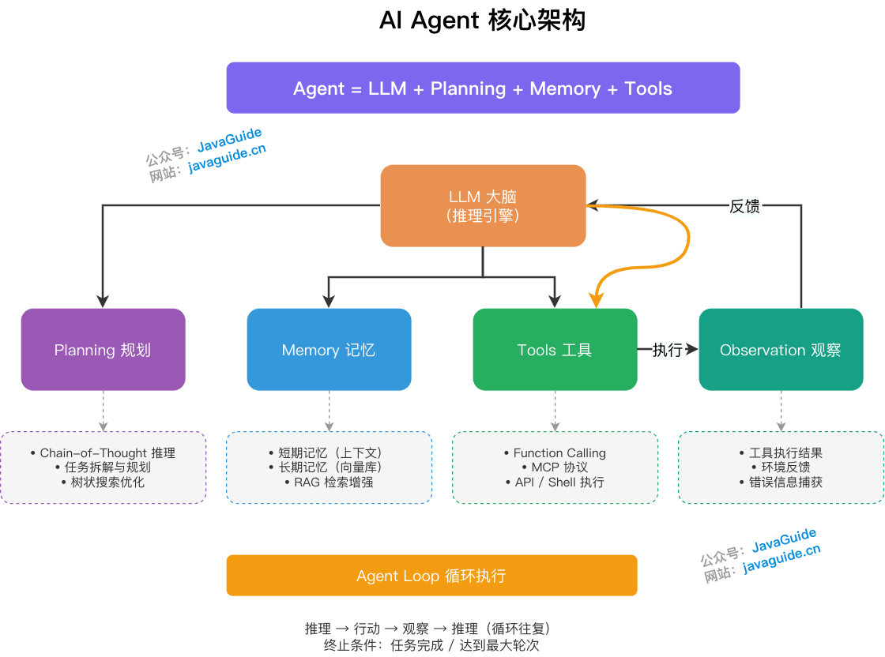
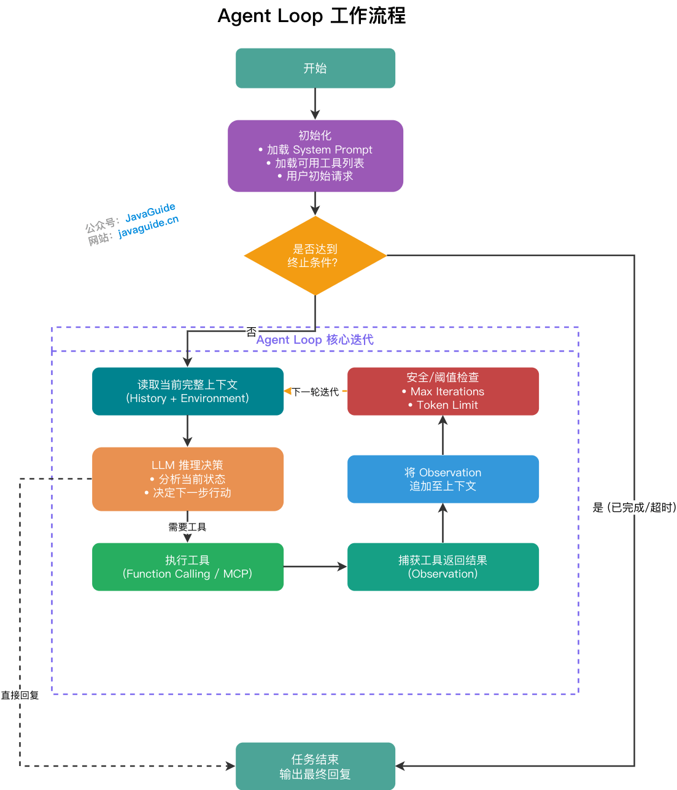
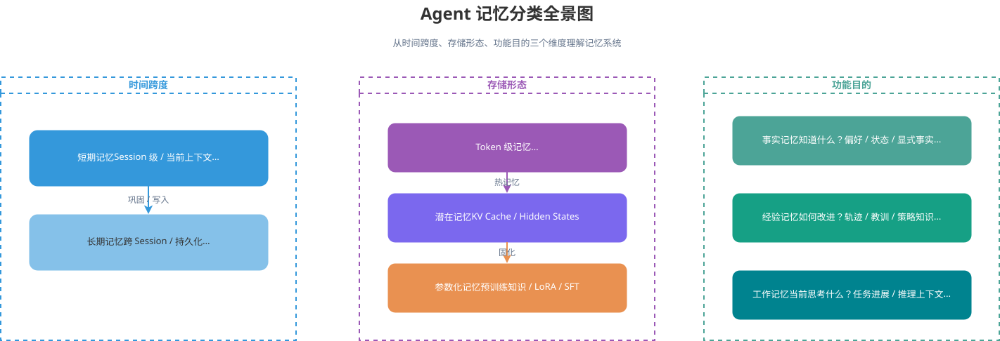
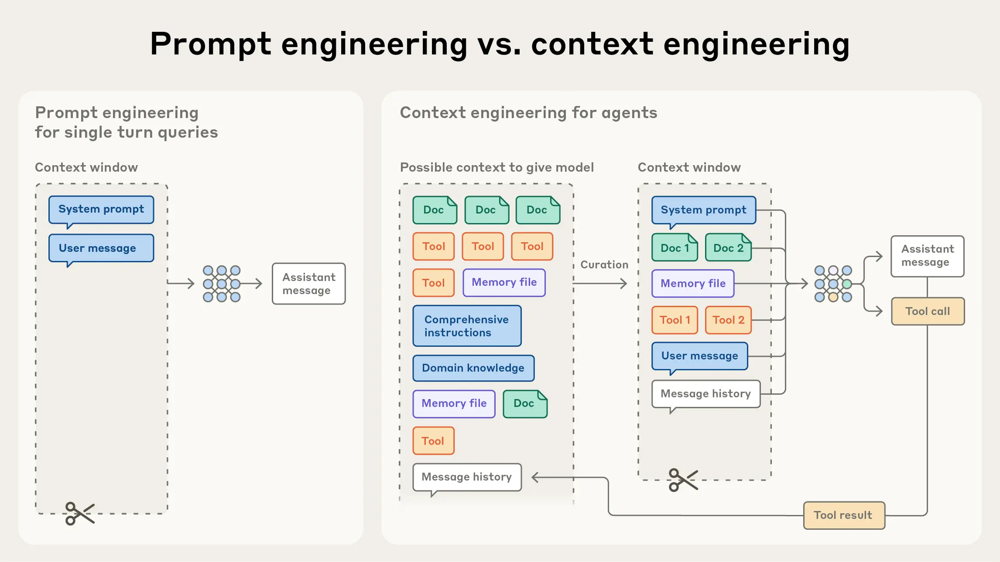
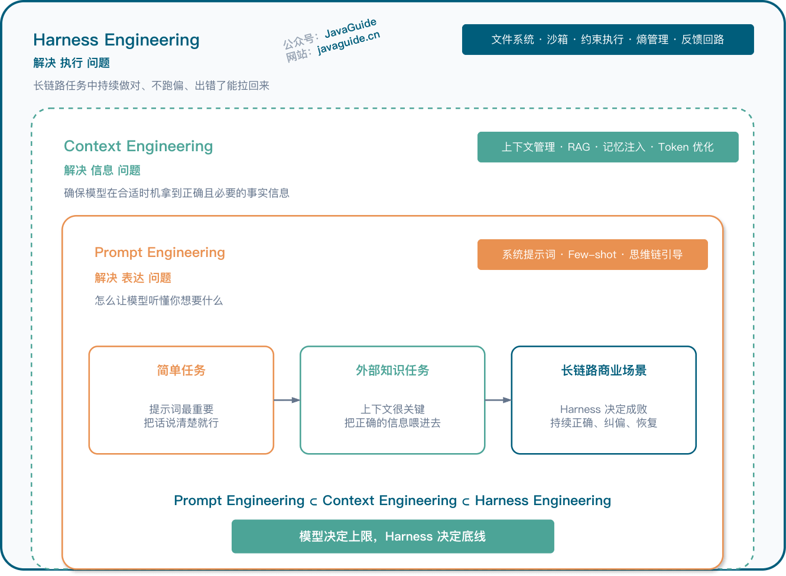

After receiving a task, an agent reads context, chooses its next action, calls tools, observes the results, and decides whether to continue, finish, or hand off to a person. AI agent interview questions follow this execution path; memory, MCP, skills, harnesses, and workflows can all be understood in that context.

The questions are grouped by the chapters in JavaGuide's AI agent section. Each group links to a detailed guide; this page collects topics and questions without repeating the answers.

## Agent Fundamentals

Related guides: [AI Agent Fundamentals: Agent Loops, Plan-and-Execute, Task Contracts, Agentic Workflows, and Tool Registration](../agent/agent-basis.md) and [Multi-Agent System Design: Task Decomposition, Shared State, Conflict Handling, and Failure Recovery](../agent/multi-agent.md)

For the full tool-calling lifecycle, permissions, confirmation, idempotency, auditing, timeouts, and Java examples, see [Structured Output and Function Calling](../llm-basis/structured-output-function-calling.md). For evaluation metrics such as task completion, tool calls, and execution traces, see [How to Evaluate Agent Applications](../llm-basis/llm-evaluation.md#how-do-you-evaluate-an-agent-application).

Questions usually start with the definition of an agent, followed by its execution loop and orchestration. Be ready to distinguish chatbots, workflows, and agents in how they handle task flow, state, and tools.

Common interview questions:

- What is an AI agent, and how does it differ from a regular chatbot?
- How should the formula Agent = LLM + Planning + Memory + Tools be understood?
- What is the complete Agent Loop?
- How do agents differ from traditional programs and workflows?
- Which use cases suit ReAct, Plan-and-Execute, Reflection, and multi-agent systems?
- Why is a tool description important when registering tools?
- When should a standalone agent, a workflow, or an agentic workflow be used?
- What are the main challenges of multi-agent collaboration, and why should multiple agents not be added indiscriminately in production?

## Agent Memory

Related guide: [AI Agent Memory: Short-Term and Long-Term Memory and How Memory Evolves](../agent/agent-memory.md)

Memory questions ask where information comes from, how long it is retained, when it is retrieved, and how stale or conflicting information is handled. Discuss conversation history, current task state, and cross-session memory separately.

Common interview questions:

- How does an agent's short-term memory differ from its long-term memory?
- Which core problems should an agent memory system solve?
- Which use cases suit vector memory and Markdown-based memory?
- What is Auto Memory, and why should it not write information automatically without limits?
- Which forms of shared team memory suit Git and code review, and which are better suited to a database?
- How should memory compression, expiration, and conflicts be handled?
- How can long-term memory be prevented from polluting the context?
- How can you explain in an interview that memory is more than simply saving chat history?

## Prompt and Context Engineering

Related guides: [What Is Prompt Engineering, and Which Prompting Techniques Are Useful?](../agent/prompt-engineering.md) and [What Is Context Engineering, and How Does It Differ from Prompt Engineering?](../agent/context-engineering.md)

Prompt questions focus on how instructions are expressed. Context questions also cover loading historical state, tool results, retrieval evidence, and task plans. Trimming, compression, and isolation for long-running tasks are common follow-ups.

Common interview questions:

- How do prompt engineering and context engineering differ?
- What problems do the four prompt elements—Role, Task, Context, and Format—each address?
- Which use cases suit few-shot prompting, CoT, task decomposition, and structured output?
- What is prompt injection, and how can it commonly be defended against?
- Why is prompt optimization alone insufficient for agent use cases?
- Which problems should context engineering solve?
- How should static rules, dynamic information, tool results, and memory be added to context?
- When context overflows in a long-running task, how should compaction, structured notes, and sub-agents be used?

## MCP and Agent Skills

Related guides: [What Is the Model Context Protocol (MCP), and How Does It Relate to Function Calling and Agents?](../agent/mcp.md) and [What Are Agent Skills, and How Do They Differ from Prompts and MCP?](../agent/skills.md)

Function Calling, MCP, and skills serve different stages: the model expresses the call intent, the host connects to tools, and the agent loads the procedures and information needed to complete the task. Follow-up questions often cover authorization, parameter validation, timeouts, and auditing.

Common interview questions:

- What problem does MCP solve, and why is it often compared to USB-C for AI?
- What are an MCP Client, MCP Server, and Host?
- What problems do MCP Tools, Resources, and Prompts each solve?
- How does MCP differ from Function Calling?
- What security controls should a production MCP Server have?
- What are Agent Skills, and how do they differ from prompts, MCP, and Function Calling?
- Why should skills be loaded on demand?
- How should skills be routed, and why are their goals similar to but different from RAG?
- What common pitfalls should be avoided when writing a `SKILL.md` file?

## Harness Engineering

Related guide: [Harness Engineering: A Six-Layer Checklist, Context Management, and Engineering Practices](../agent/harness-engineering.md)

Harness engineering focuses on the execution environment around the model, including task management, context provision, tool feedback, verification, and error recovery. Questions often ask how to implement these concepts with concrete components.

Common interview questions:

- What is harness engineering, and how does it relate to prompt and context engineering?
- Why is an agent described as Model + Harness?
- What problems do the six layers in JavaGuide's harness checklist each address?
- Why should some harness mechanisms be revalidated when model capabilities improve?
- How should context contamination, code entropy, and tool-call reliability be managed?
- Why do agent systems need evaluators, validators, and task-state management?
- What engineering challenges do teams commonly encounter when building agents?

## Workflows, Graphs, and Loops

Related guides: [Workflow, Graph, and Loop in AI Workflows: From Concepts to Implementation](../agent/workflow-graph-loop.md) and [What Is Loop Engineering? Is It Just Old Wine in a New Bottle?](../agent/loop-engineering.md)

Workflow questions examine process structure, state persistence, and loop control. In addition to explaining nodes, edges, and state, be ready to discuss interruption recovery, concurrent updates, and stop conditions. Here, outer-loop engineering means connecting an existing loop to CI, scheduled jobs, and stop conditions, with a focus on scheduling, verification, and stopping.

Common interview questions:

- Why do AI systems need workflows?
- How are workflows, graphs, and loops related?
- How does a graph loop differ from an Agent Loop?
- What triggers the next outer-loop iteration: a CI event, scheduled job, goal check, or human approval?
- How does an outer loop differ from the Agent Loop within a task, and how are state and verification results handed off?
- Which tasks are unsuitable for unattended execution? How should work stop and be handed to a person when there is no reliable acceptance signal, a high-risk write, or a need for business judgment?
- How can an infinite loop be prevented?
- How should state-update strategies be selected? Which fields suit Replace, Append, or a Reducer?
- How do conditional edges differ from dynamic routing?
- When a tool call fails, which errors are retryable? How should authentication failures and non-idempotent writes be handled?
- How should an interrupted workflow be resumed?
- What security risks are specific to workflows?

## Integrated Design Questions

Project interviews also ask about architecture, the rationale for choices, evidence of results, and production failures. For a full approach to structuring an answer, see [How to Present an Agent Project: Architecture, Technology Choices, and Bad-Case Analysis](./agent-project-interview-guide.md).

Integrated questions combine the components above in one task and focus on design choices and failure handling:

- If an agent must complete a long task using multiple tools, how would you break down the execution steps?
- Which decisions should be made by the model, and which should be controlled by rules or code?
- How should an agent's plan, tool results, and intermediate state be stored and recovered after interruption?
- If tools perform write operations, how should authorization, parameter validation, confirmation, and auditing be designed?
- When are multiple agents needed, and how can communication costs and state consistency be managed?
- Which traces would you record, and which metrics would you use to evaluate task completion, tool calls, and execution paths?
