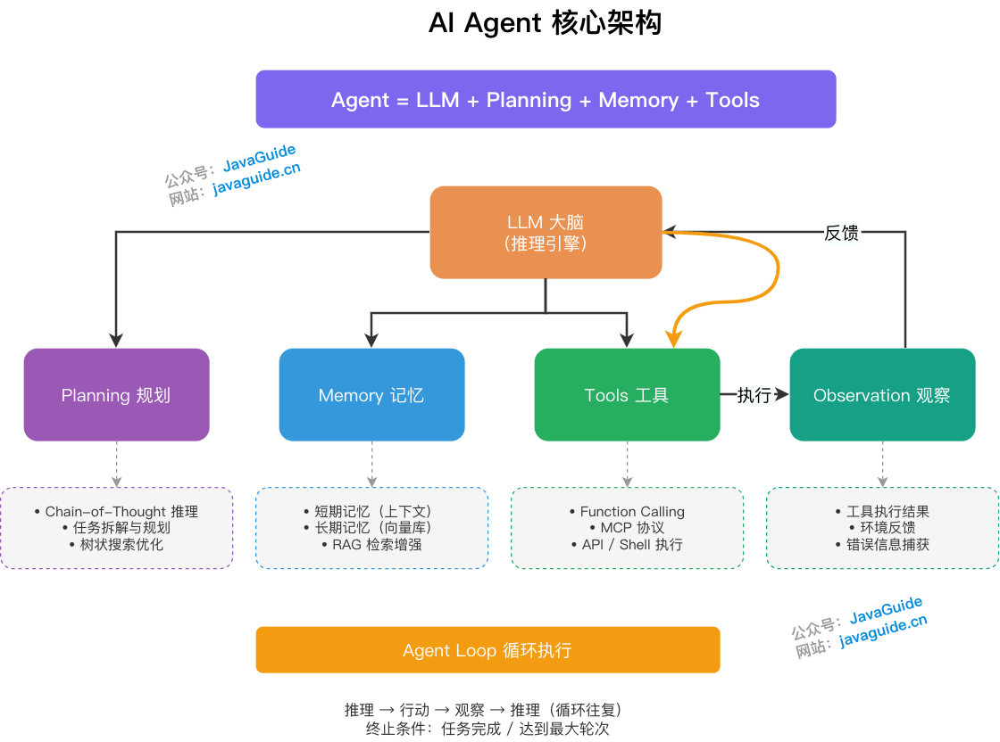
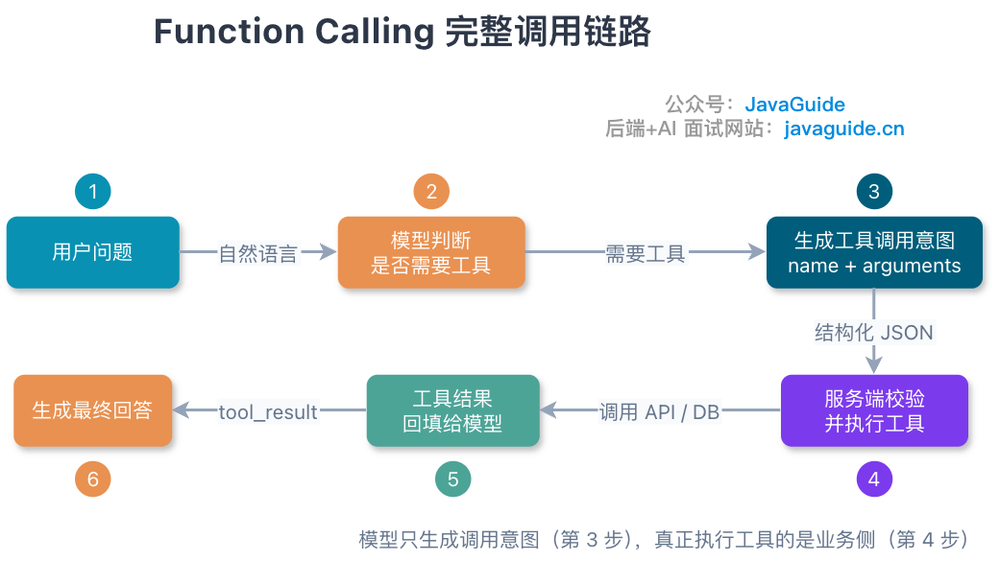
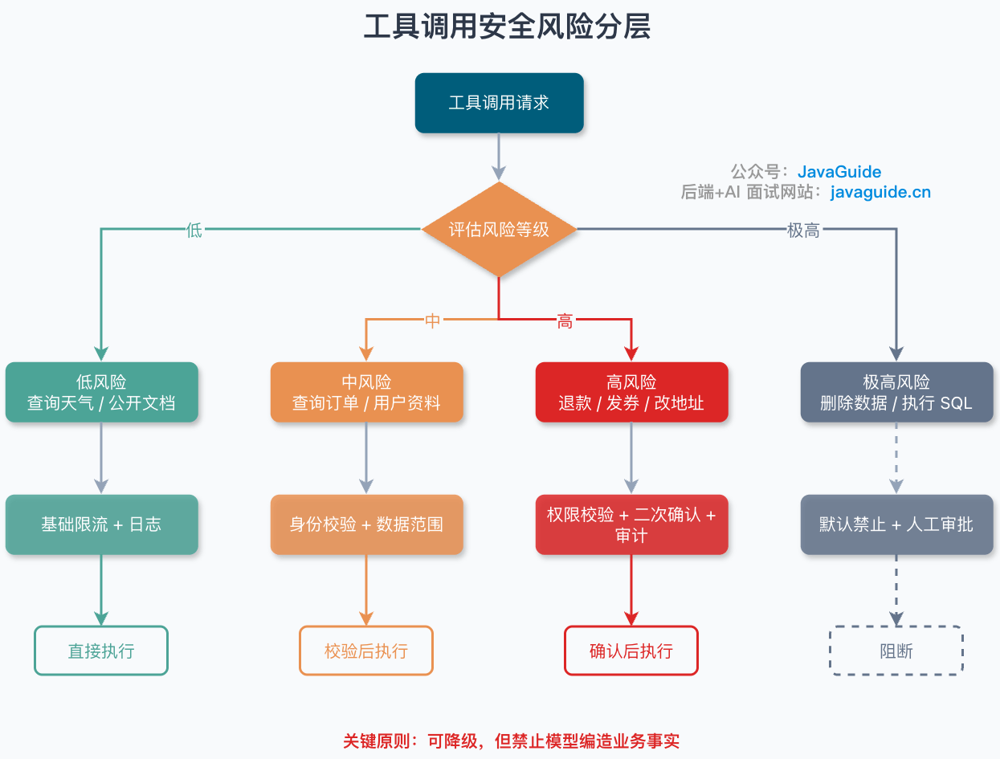
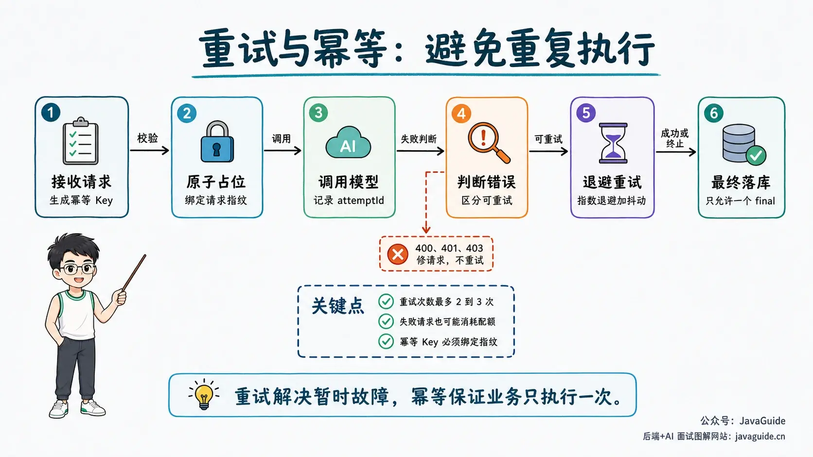
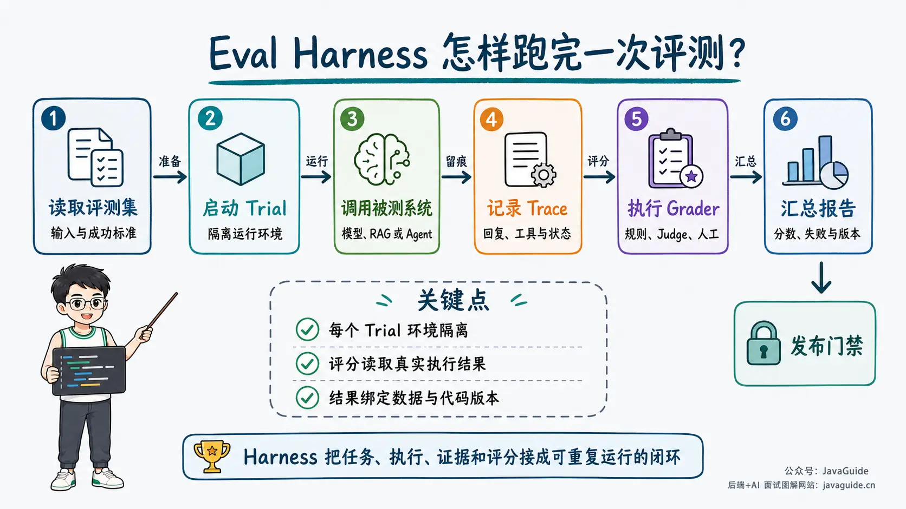

Interviews for Agent and AI application roles rarely stop at definitions. Interviewers usually explore your project in depth: why you designed it this way, what failed in production, and how you diagnosed and fixed it.

Memorizing concepts such as ReAct, RAG, Memory, MCP, and Function Calling is usually not enough to answer follow-up questions:

1. Is what you built really an Agent, and why could an ordinary API or fixed workflow not solve the problem?
2. Which components handle a request, and how do state and data flow through them?
3. Which constraints informed your key design choices, and what were the tradeoffs?
4. What failed in the project, and how did you diagnose, fix, and prevent it from happening again?

To make these questions concrete, this guide uses an intelligent after-sales ticket Agent as a running example.

Your project does not need to be similar; the methods apply broadly. When preparing your own project, use accurate details about its business context, your responsibilities, data scale, and metrics.

## What Do Agent Project Interviews Assess?

First, consider why interviewers ask these questions. Unlike CRUD projects, Agent projects do not have mature evaluation criteria. An interviewer cannot assess your skills from "I built one" alone, so follow-up questions help verify three things:

1. **Whether the project is real.** People who built a system can describe its constraints, data, and failures. Someone who only memorized it can repeat an architecture diagram. A few rounds of follow-up quickly expose the difference.
2. **Whether you can make technical decisions.** There is no silver bullet in the Agent domain. A problem might be solved with a Prompt, Workflow, RAG, tool calling, or Multi-Agent design. Interviewers want to know whether you can weigh options against real constraints instead of copying a tutorial or an AI-generated design.
3. **Whether you understand system boundaries.** Model output is unreliable, state can become inconsistent, and tools can fail. Production engineers recognize these risks and contain them with engineering controls.

Why are answers such as "the project performed well," "the architecture is scalable," or "the model is accurate" insufficient? They are conclusions without supporting reasoning. They tell interviewers nothing about whether the claims are true or how deeply you contributed. A strong answer connects constraints, decisions, tradeoffs, and evidence:

> Given these constraints, I chose this approach. It solved this problem and introduced these tradeoffs. I used this evidence to verify that the choice worked.

Leave out any one of these elements and the answer falls apart:

- Without **constraints**, the choice sounds like "everyone uses it" and reveals no judgment.
- Without **tradeoffs**, it suggests you have not deployed the system. Every approach has costs; splitting into Multi-Agent components increases debugging, context transfer, and latency costs.
- Without **evidence**, the result is subjective. "Tool selection errors fell from 8% to 2% on a 200-question evaluation set" is verifiable.
- Without **alternatives**, interviewers cannot tell whether you weighed options or know only one approach.

For example, "We improved results with Multi-Agent" does not explain why the system was split or what it cost. Describe how you made the decision:

> We started with one Agent. As the tool set grew, it often confused refund-policy lookup with ticket creation. Instead of immediately splitting it into several Agents, we first reduced the tool set, rewrote the descriptions, and added routing evaluations. The selection error rate fell from 8% to 3%. Later, separate business domains needed isolated context and were maintained by different teams, so we split the Agents by domain. This added a routing step and a few hundred milliseconds of latency for cross-domain tasks. We kept routing lightweight with intent classification instead of adding a "manager Agent."

The difference is clear. The short answer only names the approach. The expanded answer gives the symptom (tool confusion), the decision (improve tool governance before splitting), an alternative (some issues could be fixed without splitting), evidence (routing evaluation results), and the cost (extra latency and how it was managed). This gives interviewers a way to verify both the project and your decision process, with much more information than a list of framework names.

This answer also gives interviewers useful follow-up topics: how routing was evaluated, why intent classification was used instead of LLM routing, and how context was passed. Prepare these topics in advance so the discussion stays within areas you know well instead of exposing gaps unexpectedly.

## What Should a Project Review Table Include?

Before preparing answers, review the project using this table. Record facts you can verify when interviewers ask follow-up questions; it is not a résumé summary.

| Project element       | What to document                                                           | Commonly vague answer                   |
| --------------------- | -------------------------------------------------------------------------- | --------------------------------------- |
| Business problem      | Who encountered what problem, and in which scenario                        | "Improved user experience"              |
| Success criteria      | What counts as task completion                                             | "More accurate answers"                 |
| Inputs and outputs    | User input, final system output, and whether external state changes        | "Supports natural-language interaction" |
| Previous approach     | Limitations of manual processes, rule systems, or ordinary RAG             | "The old approach was not intelligent"  |
| Personal contribution | Modules, decisions, and troubleshooting you owned                          | "Participated in the overall project"   |
| Key constraints       | Latency, cost, permissions, data, model capabilities, and launch date      | "High availability was required"        |
| Design choice         | Alternatives, reasons for the choice, and known costs                      | "Researched and chose a framework"      |
| Quality evidence      | Dataset, metric definitions, baseline, sample size, and evaluation version | "Accuracy improved by 30%"              |
| Failure case          | Input, Trace, root cause, fix, and regression test                         | "Fixed it by improving the Prompt"      |
| Evidence location     | Code, tests, Trace, datasets, or commit history                            | "It is implemented in the code"         |

If you lack real evidence for an item, leave it blank. Do not invent QPS, accuracy, or labor-savings numbers. Fabricated data is easy to expose when interviewers ask about definitions, time ranges, or baselines.

Personal projects that are not yet deployed can still provide credible evidence: a fixed test set, reproducible Traces, error categories, load-test results, and design tradeoffs. Clearly label offline experiments as such; do not present them as production data.

State the project's stage clearly. A working demo, completed offline evaluation, limited pilot, and production deployment are not the same. Without real users, discuss test sets and fault injection. Without production incidents, describe risks found in reviews and planned mitigations, but do not reframe them as production failures.

Describe your role in one sentence: what the team delivered, which part you owned, which decisions or troubleshooting you handled personally, and what other teammates did. This is more credible than "I owned the entire Agent project" and keeps later answers consistent about your scope.

## How Can One Example Explain an Agent Project?

Suppose the project is an intelligent after-sales ticket Agent. Users describe their problem in natural language. The system checks the order, retrieves after-sales policies, identifies missing information, and creates a ticket after user confirmation.

The example deliberately includes three kinds of capability:

- Retrieving after-sales policies uses RAG.
- Checking orders and creating tickets use tool calling.
- Deciding whether to retrieve more information, ask a follow-up, or finish is Agent decision-making.

"Create ticket" changes external state, so a valid JSON response from the model is not enough. The business system must handle authorization, user confirmation, idempotency, and result verification.

The project's Agent Loop can use an execution pattern such as ReAct: the model proposes an action, receives an Observation from the environment, then decides whether to call another tool or finish.

ReAct means alternating between actions and observations; one tool call does not by itself constitute an Agent design. A production Trace should record actions, tool results, state summaries, and verifiable evidence. It does not need to store the model's private chain of thought.

### How Do You Give the 30-Second Version?

The 30-second version should cover what the project does, why it needs an Agent, what you owned, and its hardest problem.

Using the after-sales ticket Agent as an example:

> I built an intelligent after-sales ticket Agent. In addition to knowledge-base Q&A, it dynamically checks orders, retrieves after-sales policies, fills in missing information, and creates a ticket after user confirmation. It combines a fixed Workflow with a local Agent Loop: authentication, authorization checks, confirmation, and writes are deterministic nodes; the model handles intent understanding, information completion, and choosing the next tool.
>
> I mainly owned Agent orchestration, tool governance, and evaluation. The two most representative issues were confusing similar tools and being unable to tell whether a write had succeeded after a timeout. We addressed them by improving tool contracts and using an idempotency key, status lookup, and reconciliation.

Do not explain every detail at once. Leave room for prepared follow-up topics: why you chose a hybrid architecture, how you governed tools, why write operations cannot be retried blindly, and how you evaluated the system.

### How Do You Expand It to Three Minutes?

Use this order for the three-minute version:

1. Business problem and success criteria.
2. The full flow of one request.
3. Two key technical decisions.
4. One representative failure case.
5. Results and the scope of your responsibilities.

Do not recite the stack as "Spring AI, Redis, Milvus, MCP…". Mention technologies when explaining specific decisions instead of listing them in a separate section.

## How Do You Explain the System Architecture Through One Request?

"We use a layered architecture" is too abstract. Walk the interviewer through a request first, then explain each layer's responsibilities.

For the request "The headphones in this order are broken. Help me request after-sales service," the flow could be:

1. The ingress layer authenticates the user, identifies the tenant, applies rate limits, and generates `requestId` and `runId`.
2. The orchestration layer reads the current task state and checks whether required information, such as the order number, is available.
3. The Agent selects an order lookup tool based on available tools and context. The business execution layer checks again that the user can access the order.
4. The system retrieves the relevant after-sales policy based on the item, purchase time, and issue type, then adds the evidence to the current context.
5. If information is missing, the Agent asks a follow-up question. If the requirements are met, it creates a structured ticket draft.
6. Before a write, the system displays key fields and waits for user confirmation. After confirmation, it checks authorization, business rules, and the idempotency key.
7. When the ticket service responds, the system does not rely only on text saying the call succeeded; it saves the business ticket ID and final status.
8. Record model calls, Prompts, retrieval, tools, approvals, latency, and results for evaluation and failure replay.

The system can be summarized in seven logical layers:

| Layer         | Main responsibilities                                                                    | Must remain outside the model                                     |
| ------------- | ---------------------------------------------------------------------------------------- | ----------------------------------------------------------------- |
| Ingress       | Authentication, tenant identification, rate limiting, streaming connections, request IDs | Identity and tenant boundaries                                    |
| Orchestration | Workflow, Graph, Agent Loop, stopping conditions                                         | Timeout budgets, maximum steps, mandatory branches                |
| Model         | Model routing, Prompt, structured output                                                 | Provider fallback and hard cost limits                            |
| Context       | RAG, conversation history, Memory, context trimming                                      | Data access permissions and fact-source validation                |
| Tool          | Tool discovery, parameter validation, execution, result handling                         | Business validation, authorization, transactions, and idempotency |
| State         | Task state, checkpoints, business artifacts, and memory                                  | Consistency of authoritative business state                       |
| Governance    | Trace, evaluation, audit, alerts, canary releases, rollback                              | Release gates and approval of high-risk actions                   |

If your project does not have this many separate services, do not describe them as seven microservices. These are logical responsibilities that can live in one application, especially early on. Interviewers care more about clear boundaries than the number of services.

## What Questions Should You Answer About Agent Technology Choices?

Use the first five questions to explain each choice. The sixth checks whether the design can withstand validation:

1. What were the business constraints?
2. Which alternatives did you consider?
3. Why was the chosen approach a better fit?
4. What did it trade off, and how did you manage the cost?
5. What evaluation or production data validated it?
6. Under what changed constraints would you choose another approach?

### Why Use an Agent Instead of a Standard Workflow?

A fixed Workflow can read intermediate state, follow conditional branches, and even include an Agent in one of its nodes. When choosing an approach, determine whether predefined code or graph rules control the next step, or whether the model must choose actions, tools, and paths at runtime.

In the after-sales example, authentication, confirmation, ticket creation, and auditing are predictable and belong in the Workflow. A user might simply say "It's broken" or provide an order number, a photo, and steps already tried. If finite rules cannot enumerate the possible paths and evaluation shows a real benefit from model decisions, let an Agent handle the local choice between checking the order, retrieving the policy, and asking a follow-up.

Conversely, if ticket categories, required fields, and handling rules are limited and stable, intent classification, form completion, and fixed rules may be enough. A natural-language interface alone does not justify using an Agent.

This example suits a hybrid architecture:

> Use a deterministic Workflow to enforce safety boundaries, and embed an Agent Loop only where the path is uncertain.

For the differences between Workflow, Graph, and Loop, see [Workflow, Graph, and Loop in AI Systems](../agent/workflow-graph-loop.md).

### Why Start with One Agent Instead of Multi-Agent?

A single Agent has shorter state, Trace, and failure paths, and is usually easier to evaluate. A large tool set does not necessarily require multiple Agents. First try:

- Load tools dynamically by scenario.
- Merge tools with overlapping functions.
- Improve tool names, descriptions, and parameter Schemas.
- Route well-defined categories in code.
- Isolate sub-contexts for complex tasks.

Multi-Agent may be worthwhile when tasks can be separated and different roles require substantial private context, distinct tool permissions, or independent ownership. Its benefits must outweigh communication, cost, and debugging overhead.

Multiple Agents do not necessarily run in parallel. They may execute in a fixed sequence, run independent branches concurrently, receive dynamic delegation from a Manager, or hand off the current turn to a Specialist.

Explain whether code or the model determines the topology, whether context is shared or isolated, what result contract Agents use, how partial failures and conflicting parallel writes are handled, and who owns the final result.

For more on Multi-Agent design, see [Designing Multi-Agent Systems](../agent/multi-agent.md).

### How Do RAG, Memory, Context, and State Differ?

These four concepts are often conflated in project presentations.

The definitions below use the engineering conventions of this after-sales example; they are not universal types shared by all frameworks.

| Concept | Example in the after-sales project                                           | Main question                                    |
| ------- | ---------------------------------------------------------------------------- | ------------------------------------------------ |
| RAG     | After-sales policies, product manuals, service locations                     | What relevant evidence is in external knowledge? |
| Memory  | User preferences and information confirmed for long-term retention           | What should persist across turns or sessions?    |
| Context | Instructions, evidence, tools, and history sent to the model for this turn   | What can the model see now?                      |
| State   | Current order, missing fields, approval status, completed actions, ticket ID | What stage is the task at?                       |

Some frameworks treat short-term Memory as part of Agent State, and a Checkpoint may save State at a particular point in time. Names vary, but the boundaries matter: Memory, Agent State, and Workflow Checkpoints cannot replace the authoritative business database. Storing "whether the ticket was created" only in conversation history is dangerous.

For details, see [Context Engineering in Practice](../agent/context-engineering.md) and [AI Agent Memory Systems](../agent/agent-memory.md).

If the project uses long-term Memory, explain what information may be stored, who confirms its source, how long it is retained, how users can view and delete it, and how malicious content is removed. If the system stores only a few turns of Chat History, describe it as conversation history rather than a complete long-term memory system.

Do not describe the RAG component simply as "connected a vector database." Be prepared to explain document parsing and chunking, index updates, vector and keyword retrieval, whether you use a Reranker, how you set Top-K, where ACL checks happen, and how you replay citations and knowledge versions. Evaluate retrieval hits separately from final answers to distinguish retrieval problems from generation problems.

### What Do Function Calling, MCP, and an Agent Each Do?

Function Calling lets a model express which function it wants to call using structured arguments. MCP handles context exchange between Hosts, Clients, and Servers, exposing primitives such as Resources, Prompts, and Tools. An Agent decides what to do next based on its goal and state.

They operate at different layers and are not interchangeable.

If a tool serves only the current application, registering a local function is usually simpler. Consider MCP when multiple Agents, IDEs, or model clients need to reuse the same capability. Even with MCP, the business system remains responsible for authorization, parameter validation, and side-effect governance.

This topic often leads to follow-up questions. Review [Structured Outputs and Function Calling](../llm-basis/structured-output-function-calling.md) and [The MCP Protocol](../agent/mcp.md) as well.

### How Do You Choose a Model?

Do not choose a model solely because "it performs best." At minimum, compare:

- Success rate on the target task.
- Tool selection and parameter-generation quality.
- Stability with long contexts or multiple turns.
- Time to first token and total response latency.
- Input, output, and cached-token costs.
- Support for structured output, tool calling, and multimodal tasks.
- Data compliance, region, and provider availability.

A reliable approach is to establish a quality baseline with a capable model, then test smaller, less expensive models one node at a time. Classification, simple extraction, and format conversion may not need the strongest model; planning, complex decisions, and final synthesis may. Run the same evaluation set after every change rather than drawing conclusions from a few manual conversations.

### Why Introduce a Model Gateway?

If the project uses one model and is still in validation, call the API directly. Once you add providers or share model access across business units, use a model gateway to centralize authentication, routing, rate limits and quotas, retries, fallbacks, cost attribution, and auditing.

For the design, see [LLM Gateway](../system-design/llm-gateway.md).

### Which Capabilities Come from the Framework, and Which Does the Project Implement?

When discussing a framework in an interview, give its version and capability boundaries. A framework that runs a Tool Loop does not mean it handles business state, permissions, idempotency, or auditing for your project.

For the implementations checked for this guide, Spring AI 2.0.0 can manage tool loops with `ToolCallingAdvisor` and `ToolCallingManager`, and `ToolCallbackResolver` can resolve tools dynamically. Business code still decides whether a user can receive a refund or needs approval. AgentScope Java 2.0.1's `AgentStateStore` can save Agent session state, but it is not an order database or a business Workflow Checkpoint. `streamEvents()` provides an event stream; it does not mean the system has persisted a complete Trace.

If the project uses another version, verify its actual APIs. Structure your answer as "what the framework provides" and "what I implemented outside it." Do not claim framework capabilities as your own architecture design.

## Why Is Model Output Not Enough for Tool Calls?

A model returning valid arguments proves only that the format is valid; it does not mean the action is allowed.

A complete tool-calling pipeline needs at least these checks:

1. **Schema validation.** Check field types, enums, formats, and required fields.
2. **Business validation.** Check order status, after-sales deadlines, and field combinations against business rules.
3. **Identity and permissions.** Confirm that the current user can access the target resource.
4. **Risk assessment.** Define execution policies for read-only, reversible-write, and irreversible-write actions.
5. **Human confirmation.** Decide whether to show the final arguments and wait for approval based on risk.
6. **Idempotency.** Prevent retries or repeated clicks from causing duplicate side effects.
7. **Result verification.** Check whether the external system reached the expected final state.
8. **Audit logging.** Record who performed which action, with what arguments, and when.

A practical tool-risk classification:

| Risk level                   | Example                                               | Recommended controls                                       |
| ---------------------------- | ----------------------------------------------------- | ---------------------------------------------------------- |
| Low-risk read-only           | Read public policies or the user's own orders         | Authorization, parameter limits, timeouts, and audit       |
| Medium-risk reversible write | Create a draft or add a tag                           | Idempotency, result verification, and an undo path         |
| High-risk write              | Issue a refund, cancel an order, or send a message    | Explicit confirmation, limits, approval, or human takeover |
| Prohibited automation        | Actions outside authorization or without compensation | Reject execution and offer an explanation or human path    |

Evaluate tool descriptions as well. Ambiguous names, overlapping functions, or oversized results can cause an Agent to select the wrong tool or pollute the context.

Tool results, RAG documents, webpages, and MCP Server descriptions may contain indirect Prompt Injection. Treat them as untrusted data when they enter the next context. They must not change server identity, resource permissions, or tool risk levels. For a more complete threat model, see [LLM and Agent Security in Practice](../system-design/llm-security.md).

## How Do You Design Reliability for an Agent Project?

### Why Is a Timeout Not Necessarily an Execution Failure?

When asked what to do if a model or tool times out, many people answer, "Just retry a few times." That answer falls short when the interviewer asks, "What if the write succeeded but the response was lost?"

Blindly retrying can create duplicate tickets or issue duplicate refunds.

The problem is how a timeout is interpreted. It only means the caller did not receive a result within the deadline. On the server, the request may not have arrived, may still be running, or may have completed while the response was lost. The caller cannot distinguish these states, so a timeout is not a confirmed failure.

Read-only requests are easier: they have no side effects and can be retried a limited number of times for transient errors within the total time budget. Writes are different. Blindly retrying ticket creation or a refund can cause duplicate side effects.

A safer approach is:

1. Generate a stable `actionId` for each logical action and use it in the business idempotency key. Reuse it across SDK retries, message redelivery, and manual recovery; create a new ID only for a new action.
2. Use a unique constraint or request record on the server to detect duplicates.
3. Deterministically reject a repeated idempotency key with different arguments; do not silently return the result of the first request.
4. After a timeout, query execution status by the idempotency key first.
5. If the status remains unknown, reconcile or escalate to a human instead of retrying indefinitely.
6. Write the final business-object ID back to task state and the audit log.

Retries also need exponential backoff, jitter, a maximum count, an overall deadline, and a retry budget. The model SDK, gateway, HTTP client, tool adapter, and Workflow node must not each retry independently three times, or the number of calls will multiply. A safer approach is to share the overall Deadline and Retry Budget and record each layer's `attempt` in the Trace.

A caller timeout, Future cancellation, or user disconnecting from SSE does not mean the remote write has stopped. It may still succeed later, so retain idempotency keys, status lookup, and reconciliation after cancellation. Parameter errors, authorization failures, and business rejections are deterministic and should fail immediately. Rate limits and temporary network errors may be retried within budget. See [Timeouts and Retries](../../high-availability/timeout-and-retry.md) and [API Idempotency](../../high-availability/idempotency.md).

### How Do You Fall Back When a Model or Tool Remains Unavailable?

Retries mainly handle transient failures such as rate limits and temporary network errors. If a model provider is unavailable for a long time or a tool keeps failing, continuing to consume the retry budget only increases latency. Open the circuit and stop sending it new requests. Depending on task risk, use a fallback model, cached result, partial result, or human escalation.

Before switching to a fallback model, use the same evaluation set to confirm it can handle the task. A low-risk text summary may fall back to a less capable model. For writes such as refunds or sending messages, reduced model capability may affect tool selection and argument generation; pause or escalate those tasks instead of silently lowering safety requirements to preserve availability.

Tool fallback also depends on the tool's role in the task. Temporarily remove an optional tool if it is unavailable. If the question can still be answered without it, return a partial result and state the limitation. If required order, permission, or policy evidence is unavailable, stop short of a definitive conclusion. Record the circuit-breaker cause, fallback path, and final result in the Trace so normal completion is distinguishable from fallback completion.

As traffic grows, monitor model quotas, tool concurrency, thread and connection pools, and queue lengths. Apply rate limiting and backpressure near ingress. Give slow tools isolated concurrency bulkheads so one third-party API cannot stall every Agent Run. Define merge and conflict rules before parallel branches write shared State.

### How Do You Set Exit Boundaries for an Agent Loop?

If an Agent cannot obtain key information, it may repeatedly query the same order or call a tool with identical arguments. The model continues to return actions, but the task makes no progress. Without an executor that stops it, the loop keeps consuming time and tokens.

At task start, the executor should set an overall deadline, maximum model and tool call counts, and token and cost budgets. Check the remaining budget before every model or tool call. Each tool also needs its own timeout so one slow call does not consume the entire task deadline.

An Agent can enter an infinite loop without exceeding the call limit. Compare recent tool names, normalized arguments, and State versions. Stop for "no progress" if the same action repeats or State remains unchanged after several steps. Pause for user confirmation before high-risk actions such as refunds.

Record the reason for stopping, then decide whether to return the partial result or escalate based on completed work. The execution framework or business code must enforce these limits; a Prompt saying "call at most ten times" is only behavioral guidance.

### How Do You Resume Long Tasks and Human Confirmations?

Consider a refund: the Agent has collected the information but must wait for user confirmation before executing. The user may return hours later, so the system cannot depend on the original process or in-memory state. On pause, save `runId`, Checkpoint, pending tool, normalized arguments, current State, `actionId`, and tool Schema and policy versions.

When the user confirms, validate their identity and permissions and check whether the confirmation has expired. After resuming, read the order status again. If the refund amount, order state, tool Schema, or policy changed while waiting, invalidate the old confirmation, display the new arguments, and ask again.

Some frameworks resume by rerunning a node from its beginning. Write nodes must therefore reuse the same `actionId`, check external state before deciding whether to execute, and consume confirmation events only once. Duplicate resume triggers then cannot cause duplicate refunds or tickets.

## How Should You Present Agent Project Metrics?

In an interview, start with whether the task completed, then discuss execution, cost, and safety. "85% accuracy" without an evaluation set or metric definition says little about whether the project is useful.

| Question                  | Possible metrics                                                                    |
| ------------------------- | ----------------------------------------------------------------------------------- |
| Did the task complete?    | Task completion rate, final business-state accuracy, evidence-supported answer rate |
| Was execution correct?    | Tool and argument accuracy, unnecessary-call rate, unauthorized calls               |
| Was the cost acceptable?  | End-to-end P50/P95, model calls, tokens, cost per task                              |
| Were failures controlled? | Recovery rate, human-escalation rate, duplicate side effects, false-block rate      |

After stating the metrics, explain where the test set came from, how success was defined, how many trials each task received, and which version you compared against. For deployed projects, add business metrics such as self-service resolution rate and handling time, along with the measurement period and comparison group. For projects not yet deployed, present offline evaluations and error distributions without labeling experimental results as production data.

In the after-sales example, whether the ticket was created correctly is the Outcome. Which tools were called, whether their arguments were correct, and whether execution was unauthorized or duplicated should be checked in the Trace. Open-ended tasks can have multiple valid paths; evaluate the final business state and required safety rules instead of requiring one exact Golden Sequence.

A Task consists of a fixed input and success criteria; each execution is a Trial. Agent outputs are stochastic, so run important tasks multiple times. A Grader may use code rules, LLM-as-Judge, or human review. The Eval Harness runs Trials, saves Traces, and aggregates results.

For the complete methodology, see [Evaluating AI Applications](../llm-basis/llm-evaluation.md).

## How Do You Review an Agent Failure Case?

Saying "the model answered incorrectly, so we improved the Prompt" does not show that you found the root cause. A proper failure review needs reproducible evidence.

Use these seven steps:

1. **Preserve the run.** Keep the input, model and Prompt versions, context, retrieval results, tool requests and responses, and external state.
2. **Describe the symptom.** State the expected result, actual result, and impact.
3. **Form layer-specific hypotheses.** Check data, retrieval, context, model, tools, orchestration, and third-party systems.
4. **Control variables.** Change one variable at a time; do not simultaneously change the model, Prompt, and retrieval parameters.
5. **Confirm the root cause.** Provide evidence that reliably reproduces the issue rather than stopping at correlation.
6. **Apply a fix.** Explain which layer changed and why a Prompt-only fix was insufficient.
7. **Add regression cases.** Add the original case and nearby boundary cases to the regression set, then monitor production metrics.

Here are two examples that often invite follow-up questions. When discussing your project, clarify whether the evidence came from a real production incident, offline fault injection, or a design exercise. Do not present a simulated reproduction as a production incident.

### Why Might an Agent Choose the Wrong Similar Tool?

Suppose a system has two similarly named tools. `query_after_sale_policy` retrieves general policies and does not need a specific order. `check_after_sale_eligibility` takes an order ID and checks whether that order qualifies. When the user has provided an order ID, the Agent should call the second tool but selects the first. Its policy description may be factually correct, but it does not answer whether the user's order is eligible.

Start troubleshooting with the Trace. If the order ID never reached the model context, state assembly is at fault. If the model saw it but still chose incorrectly, inspect whether the tool names, descriptions, and arguments are confusing. With fixed inputs, change the tool description, Prompt, or model one at a time to see which fix resolves the issue.

Clarify each tool's responsibilities and prerequisites, and include the order ID in a short state summary. If code can determine the routing rule—for example, checking a specific order requires an order ID—reduce the tools exposed to the model for that turn. Code excludes tools with unmet prerequisites, so a fixed Prompt priority cannot misroute a request that lacks an order ID.

Finally, add cases for "order ID provided," "order ID missing," "order belongs to another user," and "invalid order ID format" to one regression set. Once there are enough samples, use a tool-confusion matrix to monitor how often the two tools are still mixed up.

### Why Can a Ticket-Creation Timeout Create Duplicate Records?

The first ticket-creation request succeeds in the ticket service, but the network times out before the response arrives. The Agent execution layer sees only a timeout and sends another request. The ticket service cannot tell the requests represent one business action, so it creates two tickets.

This failure occurred in the tool-execution layer. The caller treated the timeout as a failure, and the API lacked idempotency controls. In fact, a timeout means only that the result is unknown: the first request may have failed, may still be running, or may have succeeded.

Generate a stable `actionId` when the creation action begins, and reuse it across SDK retries, message redelivery, and manual recovery. The ticket service uses it for idempotency records and a unique constraint. Reject the same `actionId` with different arguments instead of silently returning an unrelated earlier result.

After a timeout, the execution layer first checks the original request status by `actionId`. If it succeeded, record the ticket ID. Retry only after a confirmed failure; if the status is still unknown, reconcile or escalate to a human. The Trace must distinguish `FAILED`, `TIMED_OUT_UNKNOWN`, and `SUCCEEDED` instead of recording all three as failed calls.

The regression test should simulate a server write succeeding while its response is lost, then verify that repeated recovery still produces only one ticket.

## How Do You Reconstruct an Agent Run with a Trace?

For an ordinary API exception, the status code and stack trace usually indicate where something went wrong. An Agent may retrieve the wrong document or select the wrong tool in an earlier turn, then produce a plausible but incorrect answer without throwing an exception. A Trace reconstructs execution over time by recording the inputs the system saw, the outputs it produced, and the actions it took. It neither stores the model's private chain of thought nor proves why the model made a decision internally.

For an after-sales ticket request, a Trace can record these events:

1. On ingress, generate `requestId` and `runId`, and associate them with redacted user and tenant identifiers and the code, Prompt, and tool Schema versions used for the run.
2. For each model call, save a redacted input summary and model output, along with tokens, latency, and stop reason. Do not retain only the final answer.
3. For retrieval, record the query, matched document IDs and scores, the passages actually injected into the model, and the knowledge-base version.
4. For each tool call, generate `toolCallId` and record an argument summary, authorization decision, execution result, and error type. Include `attempt`, parent Span, and an idempotency-key summary for retries so repeated executions are visible.
5. On task completion or pause, record state changes, Checkpoint, human confirmation, final Outcome, total calls, total cost, and fallback reason.

During troubleshooting, start from the final result and work backward to the first deviation from expectations. If retrieval found the wrong document, inspect chunking, retrieval, and the Reranker. If evidence was correct but the Agent chose the wrong tool, inspect the context and model. If the tool reported success but business state did not change, inspect the adapter and result verification. This narrows "the answer was wrong" to a specific retrieval, model call, or tool execution.

Model inputs, tool arguments, and retrieved passages may contain personal information or business secrets. Production systems should generally retain only redacted summaries, with sampling, access controls, and retention limits. Keep fields needed for troubleshooting; do not retain full source text indefinitely by default.

Use Traces to replay individual requests, Metrics to observe latency and error rates over time, Audits to verify external actions such as who approved a refund, and Eval Records to compare model or Prompt versions. Attach detailed error logs to the corresponding Span. These records can be linked by `runId`; they do not need to be stored in one giant table.

For distinctions among `Session`, `Run`, `Trace`, `Span`, and `Attempt`, context propagation for asynchronous tasks, sampling, and sensitive-data handling, see [AI Observability and Tracing](../system-design/ai-observability.md).

## What Should You Prepare Before the Interview?

For each Agent project, prepare at least:

- A project review table.
- 30-second, three-minute, and ten-minute project summaries.
- An architecture diagram that traces a request from ingress to final result.
- Two technology choices with alternatives considered.
- Two failure cases with different root causes, ideally one quality issue and one engineering issue.
- Evaluation-set categories and metric definitions.
- A Trace you can explain node by node.
- Versions of the models, frameworks, protocols, and tool Schemas currently in use.
- Known limitations and next steps for the project.
- Clear boundaries between your responsibilities and other people's work.

Finally, use these questions for a self-review:

1. What was the original process before adding an LLM?
2. Why use an Agent instead of RAG Q&A or a Workflow?
3. Where are the boundaries among the model, tools, Memory, RAG, and State?
4. Which decisions does the model make, and which must code enforce?
5. How are writes authorized, confirmed, made idempotent, and verified?
6. How do you limit infinite loops, cost, and total latency?
7. What are the metric formulas, samples, and baselines?
8. How can the most serious failure be reproduced?
9. How do you prove a fix did not introduce a regression?
10. Which component is likely to bottleneck first if traffic increases tenfold?
11. What problems do `requestId`, `runId`, `sessionId`, `toolCallId`, and `actionId` each solve?
12. How do you persist, expire, resume, and revalidate business state after an HITL pause?
13. Where are the trust boundaries for RAG, tool results, MCP Servers, and long-term Memory?
14. Which capabilities come from the framework, and which permissions, state, and reliability mechanisms did the project implement?
15. Which conclusions come from production, offline experiments, or design proposals?

If you can answer these questions with real evidence, your project presentation will go beyond a thin demo wrapped around an LLM.
