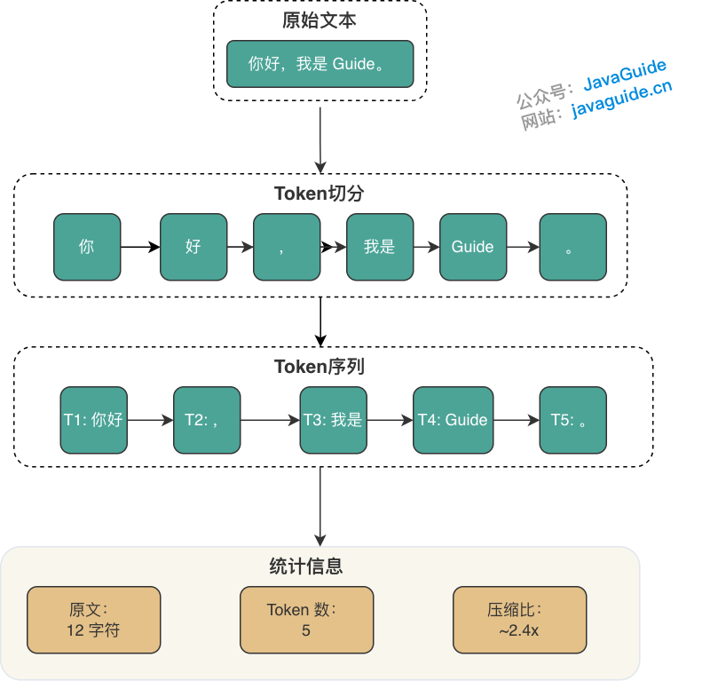

An LLM call starts with tokenization, proceeds through context assembly and sampled generation, then returns to the backend for streaming, rate limiting, retries, structured parsing, and logging. Fundamentals interviews follow this call path to ask about cost, latency, reliability, and security.

The questions are grouped by the chapters in JavaGuide's LLM fundamentals section. Detailed principles and engineering examples are in the linked guides; this page collects the topics and questions for review.

## How LLMs Work

Related guide: [How Tokens, Context Windows, and Sampling Parameters Affect LLM Output](../llm-basis/llm-operation-mechanism.md)

Tokens, context windows, and sampling parameters determine how much information a call can contain, how many resources it uses, and how much output varies. Follow-up questions often connect these topics to long conversations, RAG evidence, and structured output.

Common interview questions:

- What is a token, and why do Chinese, English, and code use different numbers of tokens?
- What is a context window? Does a larger context window always improve results?
- What is the Lost in the Middle problem, and how can it be mitigated with long contexts?
- What do Temperature, Top P, and Top K control? How can they be configured reliably in production?
- Why might a model still produce different outputs when Temperature is set to zero?
- Why do LLMs hallucinate, and what are common ways to reduce hallucinations?
- How should the Token budget be estimated? How should input, output, conversation history, and RAG evidence be balanced?
- Will long context windows replace RAG? Which use cases suit each approach?

## Engineering LLM API Calls

Related guide: [Engineering LLM API Calls: Streaming, Retries, Rate Limiting, and Structured Output](../llm-basis/llm-api-engineering.md)

Model APIs differ from ordinary business APIs in latency, billing, and error types. Interviews often consider streaming, retries, idempotency, rate limiting, and model gateways as parts of one call path.

Common interview questions:

- What is the complete lifecycle of an LLM API call?
- How does streaming improve user experience? Does it reduce total latency or Token cost?
- How should SSE, WebSocket, and HTTP chunked transfer be chosen for streaming output?
- Which LLM API errors are retryable, and which are not?
- Why should LLM calls be idempotent?
- Why is QPS alone insufficient for LLM rate limiting?
- What capabilities does a model gateway usually provide?
- Which fields should AI application call logs record at a minimum?

## Structured Output and Tool Calling

Related guide: [Structured Output for LLMs: From JSON Contracts to Function Calling](../llm-basis/structured-output-function-calling.md)

As soon as model output enters a business system, format validation, field constraints, and execution permissions must be addressed. JSON Mode, Structured Outputs, Function Calling, MCP tools, and ordinary HTTP APIs are easy to confuse.

Common interview questions:

- Why is "Return JSON" by itself unreliable?
- How do JSON Mode and Structured Outputs differ?
- What problem does JSON Schema solve in an LLM application?
- What is the full Function Calling lifecycle?
- How does Function Calling differ from MCP?
- How are MCP tools related to ordinary HTTP APIs?
- Are Agent Skills and Function Calling the same thing?
- How should structured-output failures be handled?
- Why do tool calls require security controls?
- How can structured output be summarized in one sentence in an interview?

## AI Application Evaluation

Related guide: [AI Application Evaluation: From Golden Sets to Online Canary Feedback](../llm-basis/llm-evaluation.md)

Evaluation questions focus on proving that a model, prompt, or system change improved results. Golden Sets, LLM-as-Judge, trace replay, and online canary releases cover different stages; public leaderboards and a few demos are not enough.

Common interview questions:

- Why are public benchmarks alone insufficient for evaluating AI application quality?
- How should a Golden Set be built? What can be done when production logs are unavailable during cold start?
- What are the main biases of LLM-as-Judge, and how can they be mitigated?
- Why should RAG evaluation separate retrieval from generation?
- Why is agent evaluation more complex than evaluating ordinary Q&A or RAG?
- What problems do offline evaluation, trace replay, and online canary releases each address?
- How can AI evaluation in CI balance speed and coverage?
- What should be done when LLM-as-Judge and human evaluations disagree?

## Integrated Scenarios

- As a customer-service bot's conversation history grows, how should the Token budget be allocated while preserving key business state?
- If a streaming response disconnects midway, how should the server handle retries, resumption, and duplicate billing?
- When an upstream model hits RPM or TPM limits, how should the model gateway queue requests, degrade service, or switch models?
- After a model generates parameters for a refund tool, which additional validations should the business system perform?
- After changing a model or prompt, how can offline evaluation, trace replay, and online canary releases verify the results?
