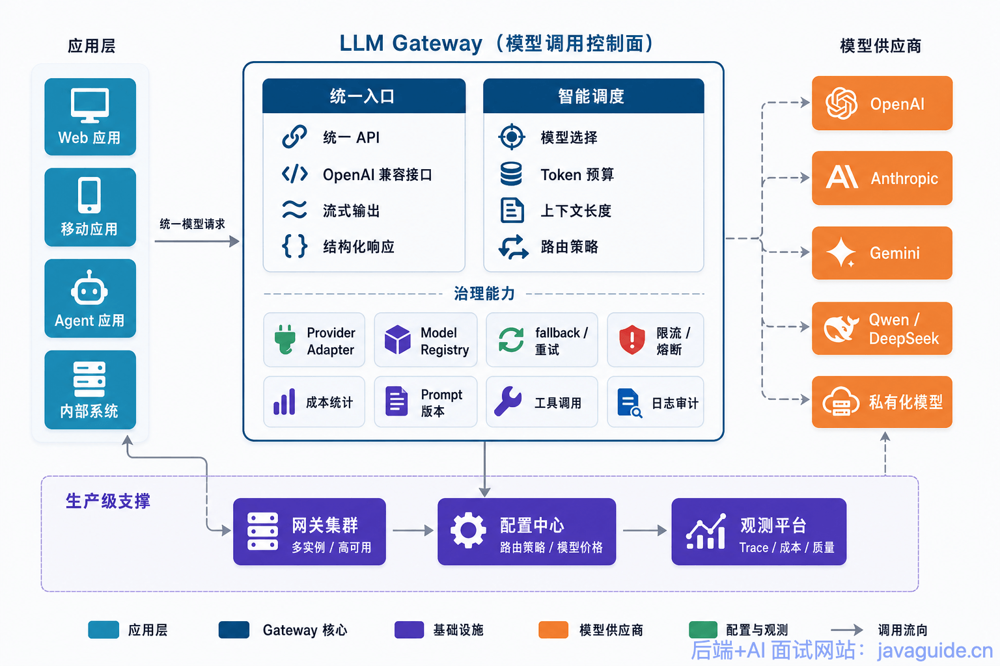
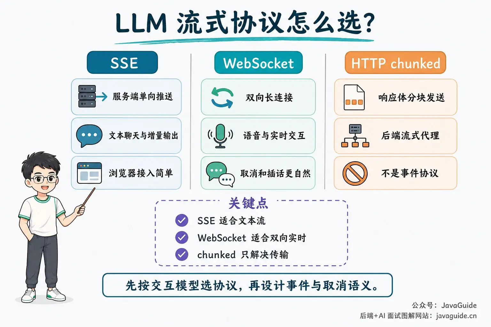
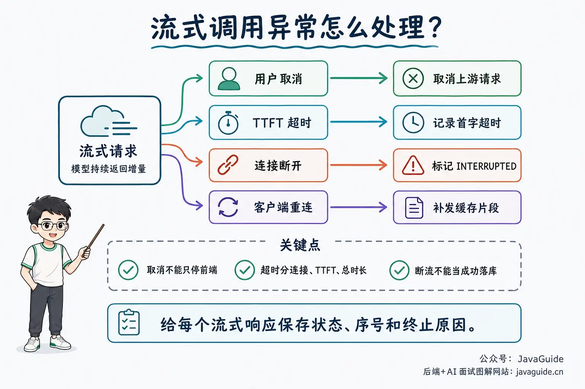
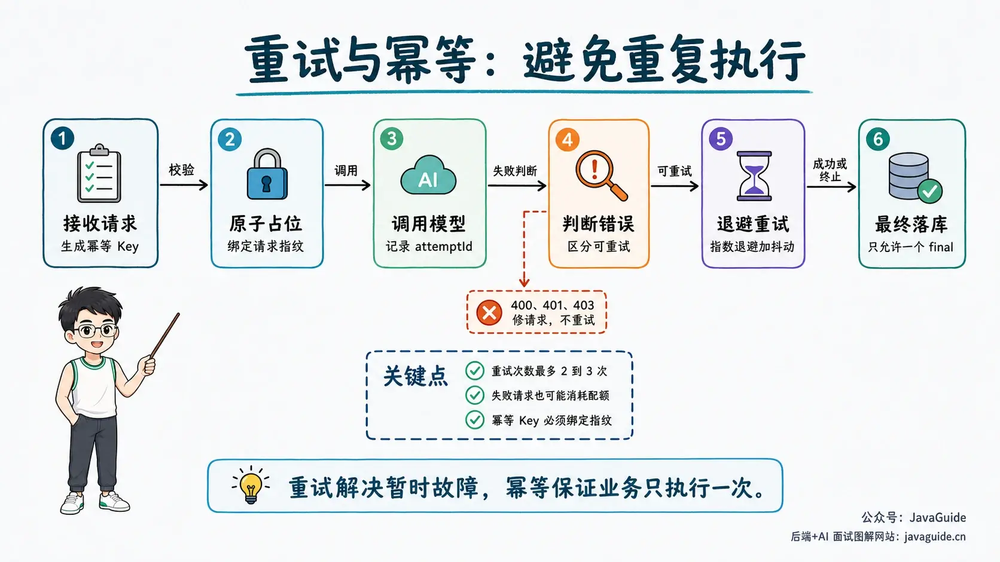
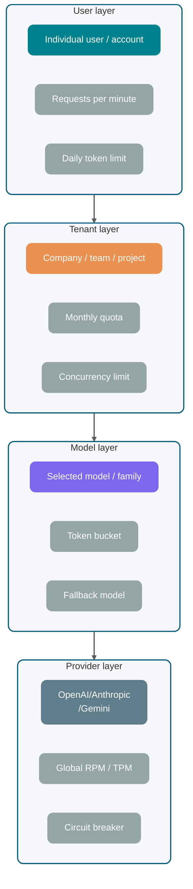
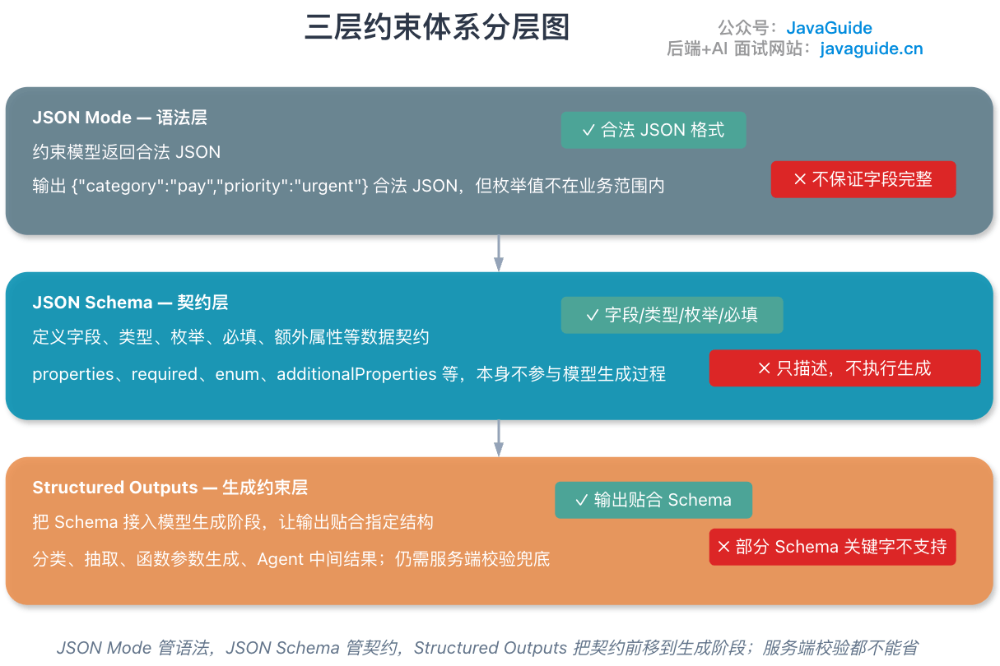
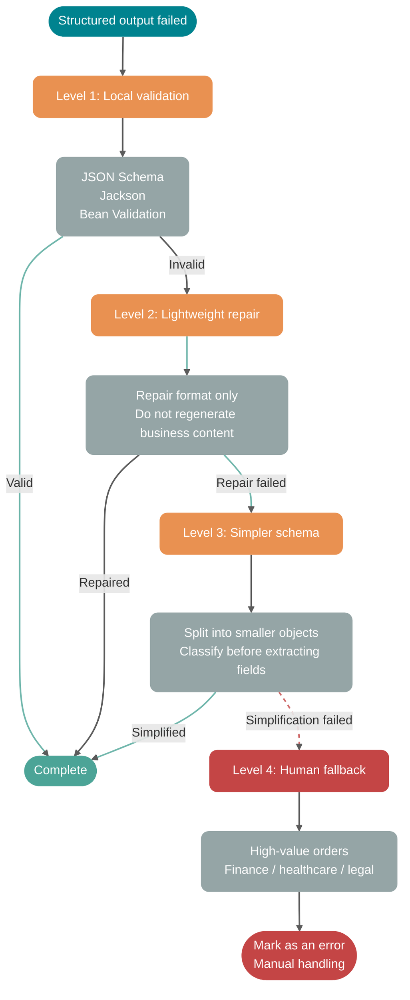

Getting an LLM API to work locally only confirms that the network and basic parameters are correct. Production use also needs to handle time to first token, incomplete JSON, 429 responses, cancellation, and duplicate execution:

- A user sees no output after eight seconds, assumes the system is stuck, and refreshes the page.
- The model returns partial JSON, the frontend fails to parse it, and the backend log contains only `{"answer": "The root cause is`.
- A provider returns occasional 429 responses, and your service retries aggressively until it is throttled even more.
- A user cancels and the browser disconnects, but the backend continues consuming tokens.
- A business request runs twice after a retry, duplicating database writes, charges, and notifications.

Sending an HTTP request is only one part of the call path. Design the business entry point, Prompt assembly, model routing, streaming response, state persistence, and observability together. Pay particular attention to cancellation, retries, quotas, and partial output.

This article assumes you understand Tokens, context windows, Temperature, and Top-p. If not, first read [How LLMs Work: Tokens, Context Windows, and Sampling Parameters](./llm-operation-mechanism.md) and [What Is Prompt Engineering?](../agent/prompt-engineering.md).

> Provider capabilities and parameters from OpenAI, Anthropic, Gemini, and others change frequently. Manage them dynamically through provider consoles, response headers, or a configuration service rather than relying on static values in documentation.

## What Are the Stages of a Production LLM Call?

Looking only at the provider's response makes it hard to diagnose an LLM call. A request crosses the business system, context system, model gateway, external provider, and frontend. Missing state or error handling at any stage can look like “model instability.”

```mermaid
flowchart LR
    User["User request"]:::client
    App["Business service"]:::business
    Prompt["Prompt assembly"]:::business
    Gateway["Model gateway"]:::gateway
    Provider["Provider API"]:::external
    Stream["Stream events"]:::infra
    Parser["Incremental parser"]:::infra
    Sink["Frontend / persistence / observability"]:::success

    User --> App --> Prompt --> Gateway --> Provider --> Stream --> Parser --> Sink

    classDef client fill:#00838F,color:#FFFFFF,stroke:none,rx:10,ry:10
    classDef business fill:#E99151,color:#FFFFFF,stroke:none,rx:10,ry:10
    classDef gateway fill:#7B68EE,color:#FFFFFF,stroke:none,rx:10,ry:10
    classDef external fill:#607D8B,color:#FFFFFF,stroke:none,rx:10,ry:10
    classDef infra fill:#9B59B6,color:#FFFFFF,stroke:none,rx:10,ry:10
    classDef success fill:#4CA497,color:#FFFFFF,stroke:none,rx:10,ry:10

    linkStyle default stroke-width:2px,stroke:#333333,opacity:0.8
```



An LLM request usually includes eight stages:

1. **Request intake:** Validate user identity, tenant, plan, feature permissions, and request size.
2. **Context assembly:** Combine the System Prompt, user input, conversation history, RAG evidence, tool schemas, and output-format constraints.
3. **Token budget estimation:** Estimate input tokens, reserve output tokens, and decide whether to trim history, compress context, or use a smaller model.
4. **Model gateway routing:** Select the model, provider, region, timeout, retry policy, and rate-limit bucket.
5. **Provider API call:** Make a synchronous or streaming request, possibly over SSE, WebSocket, or a regular HTTP response body.
6. **Response parsing:** Handle deltas, finish reasons, tool calls, usage, refusals, structured JSON, and interruptions.
7. **State persistence:** Save the complete answer, streamed chunks, token usage, call cost, failure reason, and business status.
8. **Observability and alerts:** Record `traceId`, `providerRequestId`, TTFT, total latency, retry count, 429 count, and parse-failure rate.

Centralize model calls in a shared client or `LLMGateway` that handles API keys, timeouts, retries, rate limits, logging, and provider switching. Otherwise, each business module may develop slightly different failure behavior that is hard to reproduce.



## Synchronous Responses vs. Streaming Responses

A synchronous call waits for the model to finish generating before returning the full response. Streaming returns output as it is generated: the provider sends each text chunk or event to the caller over a long-lived connection. OpenAI documents HTTP streaming with SSE; the Anthropic Messages API also streams events over SSE; and the Gemini API provides standard, streaming, and real-time interfaces. Fields and model capabilities may change, so **check the latest official documentation**.

**Why does streaming reduce TTFT?**

TTFT (Time To First Token) is the time from sending a request to receiving the first displayable token. With a synchronous response, users wait for the entire answer. If the model generates 800 tokens, the backend waits for all 800 before returning anything. With streaming, users see output as soon as the first chunk arrives.

Streaming does not reduce the number of tokens the model computes or inherently lower costs. It reduces the wait for the first visible output, not necessarily the total generation time.

| Comparison             | Synchronous response                             | Streaming response                                                     |
| ---------------------- | ------------------------------------------------ | ---------------------------------------------------------------------- |
| Time to first token    | High; wait for the full response                 | Low; show the first chunk as soon as it arrives                        |
| Total latency          | Depends on the full generation time              | Usually still depends on the full generation time                      |
| Frontend experience    | Wait for a form submission to complete           | Text appears progressively, like in a chat app                         |
| Backend implementation | Simple; process the complete string              | More complex; handle chunks, cancellation, and disconnects             |
| Structured parsing     | Simple; parse complete JSON once                 | Buffer the full response or use an incremental parser                  |
| Good for               | Short text, background jobs, strict transactions | Chat, writing, reports, long answers                                   |
| Poor fit for           | Long, interactive responses                      | Transactions that require validating the full result before proceeding |

Prefer streaming for long text shown to users. Synchronous responses are better for background processing and tasks that must validate a complete object before submitting it.

## Choosing Between SSE, WebSocket, and HTTP Chunked Transfer

Streaming uses several transport options. They serve different purposes and should not be treated as interchangeable.

| Transport    | Key characteristics                                                                   | Good for                                                              | Limitations                                                                                      |
| ------------ | ------------------------------------------------------------------------------------- | --------------------------------------------------------------------- | ------------------------------------------------------------------------------------------------ |
| SSE          | Browser-native `EventSource`; one-way server-to-client push using `text/event-stream` | Text chat, model output streaming, status updates                     | One-way communication; complex bidirectional control needs additional HTTP requests              |
| WebSocket    | Persistent bidirectional connection; client and server can send messages at any time  | Real-time voice, collaboration, frequent cancellation or interruption | Connection management, gateways, authentication, and heartbeats need extra work                  |
| HTTP chunked | HTTP/1.1 transfer encoding that sends the response body in chunks                     | Backend-to-backend streaming proxies and low-level transport          | A transport mechanism, not an application event protocol; HTTP/2 has its own streaming mechanism |



SSE is simple. A few lines of browser code can receive events, and the server writes them in `data:` fields. MDN also highlights the difference from WebSocket: SSE is a one-way stream from server to client.

WebSocket suits more real-time, complex interaction. In a voice Agent, for example, the client continuously uploads audio while the server returns ASR, LLM, and TTS status and supports user interruption. WebSocket is a natural fit for this.

HTTP chunked transfer is lower-level. Many server frameworks use chunked responses when `Content-Length` is absent. It can send data as it is written, but does not define event types, reconnection semantics, or message boundaries. The application still needs its own protocol.

### SSE Event Boundaries

SSE is usually carried in an HTTP response with the `text/event-stream` media type. The message format is a UTF-8 text event stream. Each event contains one or more field lines, and events are separated by a **blank line**. Line endings can be `\n` or `\r\n`, so event separators are commonly `\n\n` or `\r\n\r\n`.

Common fields include:

| Field   | Purpose                                                                   |
| ------- | ------------------------------------------------------------------------- |
| `data`  | Payload; multiple `data:` lines are joined according to the specification |
| `event` | Custom event name; the browser's default event type is `message`          |
| `id`    | Event identifier; can support resumption hints with browser reconnection  |
| `retry` | Suggested reconnection delay in milliseconds                              |

**Only a blank line separates events.** A single newline ends the current field line, not the event. If a server manually writes `data:` without prefixing each body line, the client may discard later lines. An extra blank line can end an event early. Markdown lists and code blocks make these mistakes easy.

The knowledge-base Q&A in my [Spring AI Interview Platform with a RAG Knowledge Base](https://javaguide.cn/zhuanlan/interview-guide.html) uses SSE: the model generates while the browser displays text progressively. The call path is short, but protocol details still matter.

### SSE with Spring Boot and Spring AI

In Java, a common approach is to set **`Content-Type: text/event-stream`** and write the response with a reactive stream. Spring provides `ServerSentEvent<T>` to avoid mistakes when manually concatenating `data:` fields and `\n\n` separators:

```java
@GetMapping(value = "/chat/stream", produces = MediaType.TEXT_EVENT_STREAM_VALUE)
public Flux<ServerSentEvent<String>> stream() {
    return Flux.interval(Duration.ofMillis(500))
        .map(seq -> ServerSentEvent.<String>builder()
            .id(Long.toString(seq))
            .event("token")
            .data("chunk-" + seq)
            .retry(Duration.ofSeconds(3))
            .build());
}
```

When integrating with an LLM, the stream usually comes from an SDK or framework. With Spring AI, for example, enable streaming on `ChatClient` to get a `Flux<String>`, then map it to SSE for the frontend:

```java
Flux<String> tokens = chatClient.prompt()
    .system(systemPrompt)
    .user(userPrompt)
    .stream()
    .content();
```

Keep the execution model in mind: with WebMVC, using `Flux` in a Controller to produce SSE does not change the underlying Servlet container. Manage thread pools, connection counts, and timeouts as long-lived requests. Java 21 virtual threads can reduce the cost of blocking a platform thread, which is useful for generation requests that last tens of seconds.

### Handle Newlines in Model Output

When writing raw SSE text, prefix every body line with `data:`. A blank line ends an event. The browser joins multiple `data:` lines in one event with newlines.

When using Spring `ServerSentEvent` and its message encoder, do not replace newlines in the body with the literal characters `\\n` first. That changes the text and requires another unescaping step on the frontend, which can introduce conflicts. Pass the original string to the encoder:

```java
.map(chunk -> ServerSentEvent.<String>builder()
    .event("token")
    .data(chunk)
    .build())
```

If the response passes through a custom gateway or a non-SSE client, wrap each chunk in JSON, such as `{"sequence":12,"delta":"First line\nSecond line"}`, and let the JSON encoder handle escaping. Test both approaches with LF, CRLF, blank lines, code blocks, and partial events caused by a disconnect.

### Configure Streaming Through Nginx and Gateways

If Nginx or another response-buffering gateway sits in front of the service, it may buffer `text/event-stream` until a full chunk is available. This can make TTFT feel as slow as a synchronous response.

A minimal configuration is:

```nginx
location /api/ {
    proxy_pass http://backend;
    proxy_buffering off;
    proxy_cache off;
    proxy_read_timeout 300s;
    proxy_set_header Connection "";
    add_header Cache-Control no-cache;
}
```

Set `proxy_read_timeout` or its equivalent to support long generations. Otherwise, middleware may close an idle connection when its timeout expires.

### Four Streaming Failure Scenarios

Design terminal states for streaming explicitly. Cancellation, timeout, disconnect, and reconnection should not all map to a generic “failed” state.



**User cancellation.**

Closing the page, clicking Stop, or switching conversations should trigger cancellation. The backend should cancel:

- The request to the provider API.
- The response stream being parsed.
- Subsequent TTS, tool-call, and persistence tasks.
- Any incremental cache that has not been committed.

Do not just stop displaying output in the frontend. If the provider keeps generating, tokens continue to be consumed.

**Timeouts.**

Use at least three timeout types:

- **Connection timeout:** The provider cannot be reached.
- **TTFT timeout:** The connection succeeds, but the first event takes too long.
- **Total-duration timeout:** Output continues, but exceeds the time allowed by the business requirement.

Record these separately. A TTFT timeout often points to model queueing, an oversized context, or provider instability. A total-duration timeout may simply mean the user asked for a long response.

**Stream interruption.**

Do not treat partial output as success after a disconnect. Record `finish_reason` or the final event state. If there is no normal completion marker, set the call status to `INTERRUPTED` and show “Interrupted; regenerate to try again” instead of saving a partial answer as complete.

**Reconnection.**

SSE's `EventSource` can reconnect automatically, but LLM output is not a simple news feed. Resuming from a disconnect requires the server to retain event sequence numbers, output chunks, and provider-call state. In most cases, the provider stream is already closed and cannot resume at the token level.

Safer handling is to:

- Generate a `messageId` and incrementing `sequence` for each server-side stream.
- Store sent chunks in a short-lived cache.
- Replay cached chunks when the frontend reconnects.
- If the provider stream has ended or expired, ask the user to regenerate instead of pretending to resume seamlessly.

## Which Errors Should You Retry?

Retries are familiar to backend engineers and easy to overuse.

Retries for LLM APIs have two special considerations:

1. **Requests are costly:** Failed requests may still consume quota and some tokens.
2. **Outputs are nondeterministic:** A second request can produce a different result even with the same Prompt.



### Error and Retry Guidance

| Error type                   | Example                                               | Retry?    | Handling                                                                      |
| ---------------------------- | ----------------------------------------------------- | --------- | ----------------------------------------------------------------------------- |
| Network interruption         | Connection reset, DNS issue, read timeout             | Yes       | Exponential backoff with jitter and a retry limit                             |
| Provider 5xx                 | 500, 502, 503, 504                                    | Yes       | Retry briefly; switch models or degrade after a threshold                     |
| Provider overload            | Anthropic 529 or similar `overloaded` error           | Yes       | Retry slowly; open the provider circuit breaker if needed                     |
| 429 rate limit               | RPM, TPM, RPD, or concurrency limit exceeded          | Carefully | Check `Retry-After` and rate-limit headers first; queue or degrade            |
| Stream interruption          | No normal completion event                            | Depends   | Do not auto-retry user-visible tasks; background tasks may retry idempotently |
| 400 invalid request          | Invalid schema, missing field, context limit exceeded | No        | Fix the request; do not retry the same payload                                |
| 401/403 authentication error | Invalid API key or insufficient permissions           | No        | Alert and disable the affected key                                            |
| Safety refusal               | Content policy refusal                                | No        | Follow the application's refusal flow                                         |
| Parse failure                | Incomplete JSON or invalid field type                 | Limited   | Retry with the failure details to repair the output, at most once or twice    |

OpenAI's rate-limit documentation recommends randomized exponential backoff for rate-limit errors and notes that failed requests may count toward per-minute limits. Anthropic's error documentation lists 429 rate limits, 500 API errors, 504 timeouts, and 529 overloads. For other providers, classify retryable, non-retryable, and overload errors using their documented codes.

### Exponential Backoff and Jitter

Exponential backoff increases the wait after each failure until it reaches a maximum delay or retry count. Jitter adds a random delay to prevent every request from retrying at once and overwhelming a system that has just recovered.

A practical formula is:

```text
sleep = min(maxDelay, baseDelay * 2^retryCount) + random(0, jitter)
```

In production, enforce two hard limits:

- **Maximum retry count:** Two or three retries are usually enough; never retry indefinitely.
- **Overall deadline:** A user request may have a 15-second SLA. Fail when it expires instead of extending it to a minute through retries.

### Idempotency Keys and Deduplication

Any retry strategy needs an idempotency plan.

The business layer can generate an idempotency key, for example:

```text
tenantId:userId:conversationId:messageId:attemptGroup
```

When the server receives a request, it checks whether the key already exists:

- If it already succeeded, return the stored result.
- If it is still generating, return the subscription address for the same stream task.
- If it failed and can be retried, create a new attempt under the same business message.
- If it failed and cannot be retried, return the failure reason.

This prevents two common problems:

1. A user repeatedly clicks “Resend,” causing the backend to create multiple model calls.
2. A gateway retries after a timeout even though the first request was persisted successfully, creating a duplicate message.

### Handling Duplicate Responses

Responses from retries may be duplicates, conflict, or overlap partially.

For chat applications, distinguish multiple model calls for one user message with:

- `message_id`: Business message ID, visible to the user.
- `attempt_id`: Model-call attempt ID, used internally.
- `provider_request_id`: Provider request ID, used for investigation.
- `stream_sequence`: Chunk sequence number, used for deduplication and replay.

Allow only one attempt to become `final` when persisting. Keep other attempts for diagnosis, but exclude them from user context. This supports investigation without polluting the next Prompt.

## Why and How Should You Rate-limit LLM Calls?

Many teams start thinking about rate limiting only after the first 429 response.

Starting rate limiting only after a provider returns 429 means the system lacks its own capacity management. A 429 is an external signal, not a substitute for application-level budgeting, queueing, and concurrency controls.

### Four Layers of Rate Limiting

| Layer    | Target                                | Purpose                                        | Common strategies                                |
| -------- | ------------------------------------- | ---------------------------------------------- | ------------------------------------------------ |
| User     | Individual user or account            | Prevent abuse, mistakes, and scripted requests | Requests per minute, daily token limit           |
| Tenant   | Company, team, or project             | Control plan costs and ensure fair use         | Monthly quota, concurrency limit, priority queue |
| Model    | Individual model or model family      | Prevent popular models from becoming saturated | Per-model token bucket, fallback model           |
| Provider | OpenAI, Anthropic, Gemini, and others | Protect external dependencies and API keys     | Global RPM, TPM, concurrency, circuit breaker    |



Gemini's rate-limit documentation separates limits into RPM, input TPM, and RPD, and notes that limits apply per project rather than per API key. OpenAI's documentation also describes rate-limit headers for request counts, token counts, and remaining quota. Values and model mappings change frequently; manage them dynamically through provider consoles, response headers, or a configuration service rather than hard-coding static documentation values.

### Why Token Budgets Matter More Than Request Counts

Traditional APIs are often rate-limited by QPS. That is not enough for LLM APIs.

Two requests can have very different costs:

- Request A: 500 input tokens and 100 output tokens.
- Request B: 80K input tokens and 8K output tokens.

Both are single requests, but they place very different demands on model inference, provider quota, and cost.

Rate limiting should account for at least:

- **RPM:** Requests per minute.
- **TPM:** Tokens per minute.
- **Concurrency:** Number of requests currently generating.
- **Context size:** Input tokens per request.
- **Maximum output:** `max_tokens` or an equivalent parameter.
- **Daily or monthly budget:** Total cost per tenant or user.

Deduct from the budget before sending a request to the provider.

When a request reaches the gateway, estimate `input_tokens + reserved_output_tokens` and attempt to deduct from the user, tenant, model, and provider budgets. If any bucket lacks capacity, do not call the provider; queue, degrade, or reject the request.

### Comparing Common Rate-limiting Strategies

| Strategy              | Good for                               | Advantages                             | Drawbacks                               |
| --------------------- | -------------------------------------- | -------------------------------------- | --------------------------------------- |
| Fixed window          | Simple background tasks and admin APIs | Easy to implement and measure          | Can create spikes at window boundaries  |
| Sliding window        | Per-user request limits                | Smoother boundaries                    | Higher implementation and storage cost  |
| Token bucket          | Model calls and token budgets          | Allows bursts; widely used in practice | Requires parameter tuning               |
| Leaky bucket          | Strictly smooth outbound traffic       | Stable output; protects providers      | Poor burst handling                     |
| Concurrency semaphore | Streaming and long-running tasks       | Limits simultaneous connections        | Does not control token cost per request |
| Priority queue        | Multiple tenants and plans             | Protects high-priority requests        | Must handle starvation and timeouts     |

Production systems often combine these strategies:

- User: Sliding window + daily token limit.
- Tenant: Token bucket + monthly budget.
- Model: Token bucket + concurrency semaphore.
- Provider: Global token bucket + circuit breaker.
- Streaming request: Concurrency semaphore + total-duration limit.

For a detailed introduction to rate-limiting algorithms, see [Rate Limiting Explained](https://javaguide.cn/high-availability/limit-request.html).

### Handling 429 Responses

HTTP 429 means too many requests. Handle it in this order:

1. **Read `Retry-After` or provider rate-limit headers:** Respect a stated recovery time.
2. **Identify the limit:** Determine whether the request count, token count, or daily quota was exhausted.
3. **Queue short background tasks:** For example, send summarization jobs to a delayed queue.
4. **Avoid repeated retries for interactive requests:** If users cannot wait, ask them to try later or switch to a lighter model.
5. **Open the circuit breaker after repeated 429s:** Do not keep sending requests into the same limit.

An example fallback chain:

```text
Preferred model available -> make the request
Preferred model returns 429 -> switch to a comparable backup model
Backup model is also rate-limited -> switch to a lighter model and shorten the output
Still unavailable -> queue the request or return "The service is busy"
```

Avoid one pitfall: degradation should not silently reduce quality. If a lighter model may affect answer quality, make that clear in the application, for example: “Fast mode is active; try again later for complex questions.”

## Why Use Structured Responses?

Many applications start with a Prompt like this:

```text
Analyze the user's question and return JSON with the fields `intent`, `confidence`, and `answer`.
```

The backend then calls `JSON.parse()` directly.

This is common in demos, but production introduces edge cases:

- The model adds “Sure, here are the results” before the JSON.
- A field is missing.
- An invalid enum value is returned.
- A number is returned as a string.
- A stream ends after only part of the object arrives.
- A safety refusal does not match the business schema at all.

Structured responses make model output reliable for programs to consume; the result merely looking like JSON is not enough.

### JSON Mode, JSON Schema, and Structured Outputs

| Method                      | Constraint strength | Engineering value                                           | Risk                                                            |
| --------------------------- | ------------------- | ----------------------------------------------------------- | --------------------------------------------------------------- |
| Plain natural language      | Almost none         | Suitable for user-facing answers                            | Unsuitable for programmatic parsing                             |
| Prompt requests JSON        | Weak                | Simple and model-agnostic                                   | May include explanatory text or omit fields                     |
| JSON Mode                   | Medium              | Usually guarantees valid JSON syntax                        | May not match the business schema                               |
| JSON Schema                 | Strong              | Defines fields, types, required values, and enums           | Provider support varies by schema subset                        |
| Structured Outputs          | Stronger            | Provider enforces constraints during decoding or in the SDK | Depends on the model, SDK, and supported schema subset          |
| Function Calling / Tool Use | Action-oriented     | Lets the model select tools and arguments                   | Not a universal replacement for a final natural-language answer |



OpenAI's Structured Outputs documentation describes how to make responses follow a developer-provided JSON Schema and provides `strict` settings. Gemini's documentation describes structured output with `response_format` and a supported subset of JSON Schema. Anthropic also provides Structured Outputs and Strict tool use, which address different needs. Models, fields, and supported schema subsets change; check the latest official documentation.

### Engineering Differences Between Plain JSON and Structured Outputs

Natural-language responses are like “instructions from one person to another”; structured responses are like “an API between services.”

For example, an intent-classification response might be:

```json
{
  "intent": "refund_request",
  "confidence": 0.86,
  "entities": {
    "order_id": "202605080001",
    "reason": "Damaged product"
  },
  "need_human_review": false
}
```

With a schema, the backend can enforce these rules:

- `intent` must be one of a defined set of values.
- `confidence` must be numeric.
- `order_id` may be empty, but its type must remain consistent.
- `need_human_review` is required.
- Parse failures can trigger a repair or human-review flow.

A schema turns model-generated JSON into a verifiable data contract.

### Fallbacks for Structured-output Failures

Structured output can still fail. The cause may not be the provider; it could be a complex schema, conflicting context, truncated output, or a safety refusal.

Use a four-level fallback:

1. **Local validation:** Check fields and types with JSON Schema, Jackson, or Bean Validation.
2. **Lightweight repair:** Ask the model to fix the format only; do not regenerate the business content.
3. **Simpler schema:** Split complex objects into smaller ones, or classify first and extract fields afterward.
4. **Human or rule-based fallback:** Do not rely entirely on automatic repair for high-value orders or finance, healthcare, and legal scenarios.



Practical rule: if structured output fails, do not pass raw natural language to a downstream system. Text that can be shown to a user is not necessarily safe for a program to execute.

## Implementing LLM Calls in a Java Backend

This Java pseudocode is not tied to a specific SDK. It centralizes token budgets, rate limiting, retries, stream parsing, idempotency, and observability in one gateway:

```java
public interface LLMClient {
    LLMResponse chat(LLMRequest request);

    void stream(LLMRequest request, StreamHandler handler);
}

public interface StreamHandler {
    void onStart(String messageId);

    void onDelta(String messageId, long sequence, String delta);

    void onComplete(String messageId, LLMUsage usage);

    void onError(String messageId, Throwable error);
}

public final class LLMGateway {
    private final LLMClient client;
    private final RateLimiter rateLimiter;
    private final IdempotencyStore idempotencyStore;
    private final TokenEstimator tokenEstimator;
    private final Observation observation;

    public LLMGateway(
            LLMClient client,
            RateLimiter rateLimiter,
            IdempotencyStore idempotencyStore,
            TokenEstimator tokenEstimator,
            Observation observation) {
        this.client = client;
        this.rateLimiter = rateLimiter;
        this.idempotencyStore = idempotencyStore;
        this.tokenEstimator = tokenEstimator;
        this.observation = observation;
    }

    public LLMResponse chatWithRetry(BusinessCommand command) {
        String idemKey = command.idempotencyKey();
        LLMRequest request = buildRequest(command);
        String requestFingerprint = command.requestFingerprint();
        IdempotencyClaim claim = idempotencyStore.claim(idemKey, requestFingerprint);

        if (claim.isCompleted()) {
            return claim.toResponse();
        }
        if (!claim.isOwner()) {
            throw new LLMException("Request with the same idempotency key is already running");
        }

        TokenBudget budget = tokenEstimator.estimate(request);
        try {
            rateLimiter.acquire(command.tenantId(), request.model(), budget);
        } catch (RuntimeException ex) {
            idempotencyStore.releaseClaim(idemKey, requestFingerprint);
            throw ex;
        }

        RetryPolicy retryPolicy = RetryPolicy.defaultPolicy();
        Throwable lastError = null;

        for (int attempt = 0; attempt <= retryPolicy.maxRetries(); attempt++) {
            String attemptId = idemKey + ":attempt:" + attempt;
            long startNanos = System.nanoTime();

            try {
                idempotencyStore.startAttempt(idemKey, requestFingerprint, attemptId);
                LLMResponse response = client.chat(request.withAttemptId(attemptId));

                ParsedAnswer parsed = parseAndValidate(response.content(), command.schema());
                idempotencyStore.markSuccess(idemKey, attemptId, response, parsed);
                observation.recordSuccess(request, response.usage(), startNanos, attempt);
                return response;
            } catch (LLMException ex) {
                lastError = ex;
                observation.recordFailure(request, ex, startNanos, attempt);

                if (!retryPolicy.canRetry(ex, attempt)) {
                    idempotencyStore.markFailed(idemKey, attemptId, ex);
                    throw ex;
                }

                sleep(retryPolicy.nextDelay(ex, attempt));
            }
        }

        throw new LLMException("LLM request failed after retries", lastError);
    }

    public void stream(BusinessCommand command, StreamHandler downstream) {
        String idemKey = command.idempotencyKey();
        LLMRequest request = buildRequest(command).enableStream();
        String messageId = command.messageId();
        String requestFingerprint = command.requestFingerprint();
        IdempotencyClaim claim = idempotencyStore.claim(idemKey, requestFingerprint);
        if (!claim.isOwner()) {
            downstream.onError(messageId,
                    new LLMException("Duplicate or conflicting idempotency key"));
            return;
        }

        TokenBudget budget = tokenEstimator.estimate(request);
        try {
            rateLimiter.acquire(command.tenantId(), request.model(), budget);
        } catch (RuntimeException ex) {
            idempotencyStore.releaseClaim(idemKey, requestFingerprint);
            downstream.onError(messageId, ex);
            return;
        }

        StreamBuffer buffer = new StreamBuffer(messageId);
        idempotencyStore.startAttempt(idemKey, requestFingerprint, messageId);

        client.stream(request, new StreamHandler() {
            @Override
            public void onStart(String ignored) {
                downstream.onStart(messageId);
            }

            @Override
            public void onDelta(String ignored, long sequence, String delta) {
                if (buffer.seen(sequence)) {
                    return;
                }
                buffer.append(sequence, delta);
                idempotencyStore.appendDelta(messageId, sequence, delta);
                downstream.onDelta(messageId, sequence, delta);
            }

            @Override
            public void onComplete(String ignored, LLMUsage usage) {
                String fullText = buffer.fullText();
                try {
                    ParsedAnswer parsed = parseAndValidate(fullText, command.schema());
                    idempotencyStore.markSuccess(idemKey, messageId, fullText, parsed, usage);
                } catch (Exception ex) {
                    idempotencyStore.markFailed(idemKey, messageId, ex);
                    downstream.onError(messageId, ex);
                    return;
                }
                downstream.onComplete(messageId, usage);
            }

            @Override
            public void onError(String ignored, Throwable error) {
                idempotencyStore.markInterrupted(idemKey, messageId, buffer.fullText(), error);
                downstream.onError(messageId, error);
            }
        });
    }

    private LLMRequest buildRequest(BusinessCommand command) {
        return LLMRequest.builder()
                .model(command.model())
                .systemPrompt(command.systemPrompt())
                .userPrompt(command.userPrompt())
                .context(command.context())
                .responseSchema(command.schema())
                .timeout(command.timeout())
                .metadata("tenantId", command.tenantId())
                .metadata("messageId", command.messageId())
                .build();
    }

    private ParsedAnswer parseAndValidate(String content, JsonSchema schema) {
        try {
            return ParsedAnswer.fromJson(content, schema);
        } catch (Exception ex) {
            throw new NonRetryableLLMException("Structured output validation failed", ex);
        }
    }

    private void sleep(Duration duration) {
        try {
            Thread.sleep(duration.toMillis());
        } catch (InterruptedException ex) {
            Thread.currentThread().interrupt();
            throw new LLMException("Retry sleep interrupted", ex);
        }
    }
}
```

This code omits the storage interfaces and concurrency controls. `claim` must use Redis `SET NX`, a database uniqueness constraint, or a conditional atomic update; do not replace it with “check, then write.” Bind the idempotency key to a request fingerprint. If the same key is reused for a different request, return a conflict instead of the previous result.

Other key points:

- **Do not call the provider SDK directly from business code:** route calls through `LLMGateway`.
- **Estimate tokens and reserve rate-limit capacity first:** avoid discovering the quota is exhausted after sending the request.
- **Scope idempotency to the business message:** attempts are internal retries.
- **Handle synchronous and streaming calls separately:** record the stream `sequence` to avoid duplicates during replay after reconnection.
- **Parse structured output before persistence:** on failure, record a failed state instead of corrupting business data.

Real projects also need:

- API-key pools and provider routing.
- Model priorities and fallback strategies.
- Prompt versioning.
- Safety review of responses.
- Usage and cost calculation.
- Correlation between `traceId` and `providerRequestId`.
- Propagation of stream-cancellation signals to provider requests.
- An SSE output contract: align newline and event-boundary handling with the frontend, disable gateway buffering, and increase read timeouts.

## Stability Requires Metrics

Observability for an AI application must track more than “call succeeded” or “call failed.”

At minimum, record these metrics:

| Metric              | Meaning                          | Use                                                           |
| ------------------- | -------------------------------- | ------------------------------------------------------------- |
| TTFT                | Time to first token              | Diagnose queueing, oversized context, or provider instability |
| E2E Latency         | End-to-end completion time       | Evaluate user experience and SLA                              |
| Input Tokens        | Input token count                | Analyze cost and context growth                               |
| Output Tokens       | Output token count               | Analyze cost and unusually long responses                     |
| Retry Count         | Number of retries                | Detect provider instability or overly aggressive policies     |
| 429 Rate            | Rate-limit response rate         | Evaluate quotas and rate-limit buckets                        |
| Parse Failure Rate  | Structured-output parse failures | Diagnose schema, Prompt, or model compatibility issues        |
| Cancel Rate         | User cancellation rate           | Detect slow responses or overly long generations              |
| Provider Error Rate | Provider errors                  | Guide routing, fallback, and circuit breaking                 |

Include these fields in logs:

```text
trace_id
tenant_id
user_id
conversation_id
message_id
attempt_id
model
provider
prompt_version
input_tokens
output_tokens
ttft_ms
latency_ms
retry_count
finish_reason
error_type
provider_request_id
```

Without these fields, production troubleshooting is difficult. If a user says “the AI did not respond,” you may not know which provider or model was used, which attempt ran, or whether the first delta arrived.

## Interview Questions

### 1. What Is the Full LLM API Call Path?

A call begins with a business request. The service validates the user, tenant, permissions, and parameters; assembles the System Prompt, user input, conversation history, RAG evidence, tool definitions, and output schema; estimates the token budget; and routes through a model gateway that handles rate limits, timeouts, retries, and provider selection. After receiving a synchronous response or stream, the backend parses the output, validates its structure, and persists status and usage. Finally, it records TTFT, total latency, error codes, retry count, and token cost in the observability system.

Manage an LLM call as a complete production workflow, not just an HTTP request.

### 2. How Does Streaming Improve the User Experience?

Streaming returns output as the model generates it, so users see the first token sooner and TTFT decreases. It does not guarantee lower total latency or token cost. The backend must also handle cancellation, timeouts, disconnects, reconnection, partial JSON, and incremental persistence.

### 3. Should You Use SSE or WebSocket?

For sending model text from a server to a browser, SSE is simpler and naturally supports one-way incremental output. Remember that **`text/event-stream` is sensitive to newlines and event boundaries**, and reverse-proxy buffering can turn streaming into batch delivery. If the client also needs to send data frequently, as with audio streams, real-time control, collaboration, or interruptions, WebSocket is a better fit. HTTP chunked transfer is lower-level; the application still needs to define message boundaries and event types.

### 4. Which LLM API Errors Can Be Retried?

Transient network failures, connection resets, some 5xx errors, 504 timeouts, and provider overloads can usually be retried a limited number of times. Handle 429 responses using `Retry-After`, rate-limit headers, queueing, and fallback. Do not normally retry 400 parameter errors, 401/403 authentication errors, or safety refusals. Structured-output parsing failures can receive one or two format-repair attempts, but should not be retried indefinitely.

### 5. Which LLM Calls Need Idempotency?

Plain-text generation may not require business-level idempotency, but retries can still create duplicate costs and multiple candidate results. For database writes, charges, notifications, or tool write operations, prevent the same business request from running more than once. Generate an idempotency key from the business message ID and bind it to a request fingerprint. Attach multiple model-call attempts to the same business message, but allow only one to become the final result.

### 6. Why Is QPS-only Rate Limiting Insufficient?

Because LLM API cost and load depend heavily on tokens. A 500-token request and an 80K-token request each count as one request but consume very different resources. Production rate limiting should consider RPM, TPM, concurrency, context size, maximum output, and tenant budgets.

### 7. How Do JSON Mode and Structured Outputs Differ?

JSON Mode focuses on producing syntactically valid JSON, but may not match the business schema. Structured Outputs and JSON Schema provide stronger constraints for fields, types, required values, and enums. Function Calling or Tool Use is better suited to generating tool-call arguments. Providers support different schema subsets, so check their documentation and implement a compatibility layer.

### 8. How Should You Handle Structured Output over a Stream?

Do not call `JSON.parse()` on the complete object as each delta arrives. A safer approach is to display or store chunks during streaming, then assemble the complete response and validate it against the schema after receiving a normal completion event. If the provider supports structured streaming events or an SDK accumulator, use the official accumulator; otherwise, manage the buffer, sequence, and completion state yourself.

## Pre-launch Checklist

Release checks should cover at least four failure paths: whether client cancellation reaches the provider; whether retryable errors are bounded by an overall deadline and atomic idempotency records; whether RPM, TPM, concurrency, and tenant budgets are enforced together; and whether structured-output parse failures enter an explicit failed state.

Observability records should correlate `messageId`, `attemptId`, and `providerRequestId`, and store TTFT, total latency, usage, finish reason, and parse result. Without any of these, disconnects, duplicate execution, and billing issues become hard to reproduce.

## References

- [OpenAI Streaming API responses](https://developers.openai.com/api/docs/guides/streaming-responses)
- [OpenAI Structured model outputs](https://developers.openai.com/api/docs/guides/structured-outputs)
- [OpenAI Rate limits](https://developers.openai.com/api/docs/guides/rate-limits)
- [Anthropic Streaming Messages](https://platform.claude.com/docs/en/build-with-claude/streaming)
- [Anthropic Errors](https://platform.claude.com/docs/en/api/errors)
- [Anthropic Structured outputs](https://platform.claude.com/docs/en/build-with-claude/structured-outputs)
- [Gemini Structured outputs](https://ai.google.dev/gemini-api/docs/structured-output)
- [Gemini Rate limits](https://ai.google.dev/gemini-api/docs/rate-limits)
- [MDN Using server-sent events](https://developer.mozilla.org/en-US/docs/Web/API/Server-sent_events/Using_server-sent_events)
- [MDN EventSource](https://developer.mozilla.org/en-US/docs/Web/API/EventSource)
- [Spring `ServerSentEvent` Javadoc](https://docs.spring.io/spring-framework/docs/current/javadoc-api/org/springframework/http/codec/ServerSentEvent.html)
- [MDN 429 Too Many Requests](https://developer.mozilla.org/en-US/docs/Web/HTTP/Reference/Status/429)
- [MDN Transfer-Encoding](https://developer.mozilla.org/en-US/docs/Web/HTTP/Reference/Headers/Transfer-Encoding)
