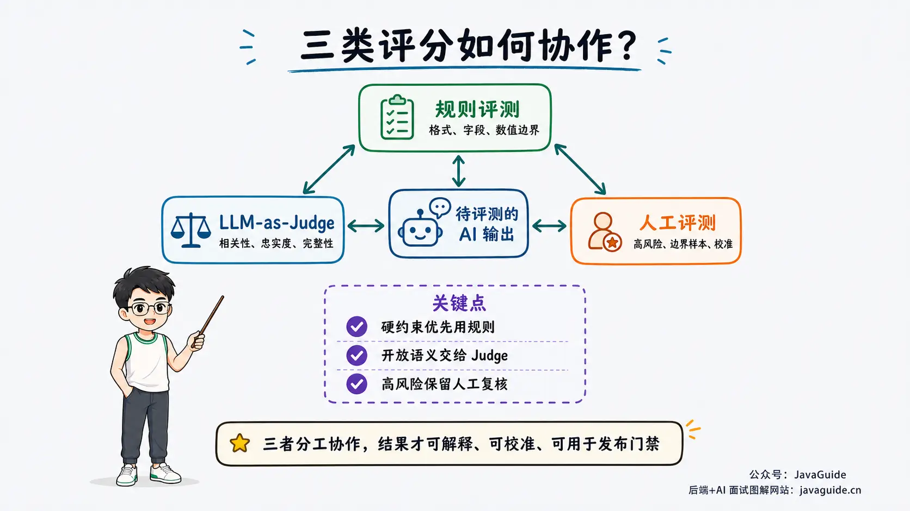
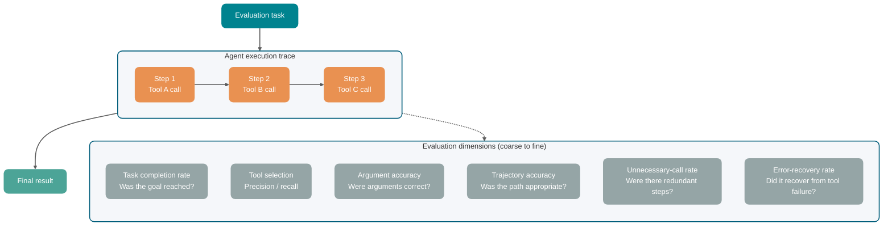
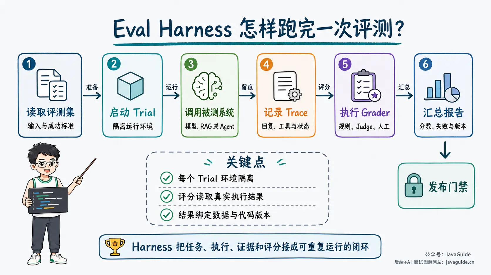
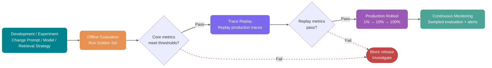

After upgrading a customer-service RAG system to hybrid search and a reranker, teams may test a few dozen questions locally, see smoother answers, and conclude that it is ready for a wider rollout.

If stakeholders report a week later that some answers seem less accurate than before, the investigation quickly stalls.

You need to compare results for the same scenarios: how the old version performed on returns, shipping queries, and product comparisons, and which categories regressed in the new version. Without a baseline, “less accurate than before” could indicate a quality regression or changed user expectations. The investigation ends up going through raw conversations one by one.

Model selection, prompt changes, retrieval optimization, and canary releases then lack a shared basis for comparison. An evaluation set provides a common measure for these changes.

Frameworks such as RAGAS, TruLens, LangSmith, and Langfuse continue to evolve; consult their latest official documentation before using them in production. This article focuses on evaluation methods and metric design. It does not compare tools or cite unverified benchmark results.

## Why Public Benchmarks Are Not Enough

Public benchmarks can help filter out clearly unsuitable models, such as candidates with weak Chinese performance, insufficient context windows, or inadequate tool-calling capabilities.

But using leaderboard scores as the sole basis for deployment misses important business requirements.

Benchmark tasks and datasets are fixed, so rankings cannot replace business validation. E-commerce support often involves returns, shipping times, promotions, and product comparisons; a high score on English reasoning tasks does not show that a model can follow these business rules.

Real requests also contain typos, colloquial abbreviations, screenshots, multiple languages, and contradictions. Clean test sets often do not cover these cases.

Before deployment, test critical paths separately. Missing a high-risk clause in a contract review can affect signing decisions; incorrect refund instructions can send customers down the wrong path; a coding Agent running a dangerous command can affect the repository or runtime environment. Even rare failures can be hidden by average scores, and generic benchmarks may not surface them.

Public benchmarks can rule out clearly unsuitable models. Your own evaluation set is still needed to decide whether a model fits your business.

## What Does an Evaluation Case Contain?

An evaluation case should define something verifiable: given an input, what should the system do, and what counts as success?

Single-turn question answering is straightforward. The input is a user question, the output is a model response, and a grader checks accuracy, completeness, and relevance.

Agent scenarios are more complex. An Agent may reason over multiple turns, call tools, change external state, and leave a complete execution record. Several concepts recur:

| Concept            | Meaning                                                                                             | Example                                                                 |
| ------------------ | --------------------------------------------------------------------------------------------------- | ----------------------------------------------------------------------- |
| Task               | An evaluation task with an input and success criteria                                               | “Fix the login check bypassed by an empty password”                     |
| Trial              | One run of a task                                                                                   | The third run of the same task by the same Agent                        |
| Grader             | A scorer for the output or process                                                                  | Unit test, JSON Schema, LLM-as-Judge, human review                      |
| Transcript / Trace | A complete record of one run                                                                        | User input, model response, tool calls, arguments, results, and latency |
| Outcome            | The actual state after the task ends                                                                | Tests pass, refund created, or database state updated                   |
| Eval Harness       | The engineering framework that runs tasks, records execution, calls graders, and aggregates results | Local script, evaluation platform, or workflow built with Claude Code   |

Keep these concepts separate when investigating a problem.

For example, a customer-service Agent may respond, “Your refund has been processed.” That is only the final message in the Transcript. The Outcome is whether the refund was created, its status updated, and the amount calculated correctly. Evaluating only the text can mistake “sounds successful” for actual success.

A Coding Agent passing tests does not prove the process was sound. It may have made many failed attempts or changed unrelated files. A Trace preserves evidence about tool selection, argument construction, context interpretation, and grader rules, not just a score.

## How Do You Build a Golden Set?

A Golden Set is an AI application's standard test set. Size is not the main concern; each case needs a clear input and criteria for judging the output.

The criteria do not have to specify one exact answer. They can be a reference answer, scoring dimensions, validation rules, or human-review instructions. They are useful as long as later evaluations apply them consistently.

### Where Does the Data Come From?

**Stratified sampling from production logs.**

Once a system is in production, its logs are often the most valuable data source. Do not sample only frequent questions: they may already have been optimized through product changes and prompt tuning. Rare, edge, and unusual inputs are more likely to expose weaknesses.

Focus on cases where users selected “unsatisfied,” asked follow-up questions, were transferred to a human, or nearly triggered a failure.

Sampling only normal conversations can leave out mixed text-and-image inputs, cross-intent follow-ups, and contradictory user descriptions. A later version may appear to improve simply because those cases are absent from the test set.

**Manually created cases.**

When a new feature has no logs yet, or risks such as unauthorized refunds and prompt injection rarely occur naturally, add the missing cases manually.

Do not create only normal cases. The first version should include at least these three types:

- Normal flow: “Can I return an unopened item within seven days?” The expected answer is clear and can validate the main path.
- Missing information: if the user only says “The item is broken,” the order, timing, and failure details are unknown, so the system should ask follow-up questions.
- Adversarial requests: include attempts to bypass refund rules or make a coding Agent run unauthorized commands.

**Adding failure cases back into the set.**

For every user complaint, consider whether it can become an evaluation case. Adding confirmed failures keeps the Golden Set aligned with weaknesses the model actually exposes instead of the team's initial assumptions.

For a cold start, use knowledge-base documents to generate questions, reference answers, and difficult cases. Review a sample manually before adding them to the candidate set; tools such as RAGAS can help generate them.

These cases help provide initial coverage but should not directly serve as release gates. Generated questions tend to be well-formed; logs, failures, and human review are still needed to cover typos, screenshot descriptions, contradictions, and unusual follow-ups.

### How Can You Expand Coverage When Cases Cannot Be Exhaustive?

It is impossible to enumerate every real request and context combination. To expand the test set, start from known tasks and vary conditions that may affect the result:

- Input perturbations: add typos, colloquial abbreviations, different word order, multiple languages, and missing information.
- Context perturbations: move irrelevant material, add stale or conflicting information, and vary conversation history length.
- Tool perturbations: simulate timeouts, rate limits, empty results, missing fields, partial success, and changes to third-party response formats.
- State perturbations: change permissions, order state, leftover files, cache hits, and timing conditions, then check whether the Agent still follows the rules.

You can write assertions using the idea behind Metamorphic Testing: instead of preparing a unique answer for every variant, define what should remain consistent when the input changes. For example, adding irrelevant context should not change the conclusion; a missing order number should trigger a follow-up question; revoked permissions must stop write operations; and paraphrasing a task should preserve its final Outcome.

Keep some expanded cases as a holdout set, excluded from prompt tuning, example selection, and rule adjustment. Otherwise, the team may overfit to known cases without knowing whether the system handles new phrasing, contexts, and failures.

### How Many Cases Are Enough?

There is no fixed answer. Choose an initial size based on the project's stage.

Start with 20 to 50 real tasks to validate the evaluation workflow. This is only an engineering starting point and does not support statistical conclusions. For release gates, calculate sample size based on risk, baseline variance, and the minimum acceptable difference. At any scale, define completion with repeatable checks.

The first evaluation can include real failures, manually created cases, and high-risk paths; there is no need to wait for a complete dataset. Anthropic's Agent evaluation practice follows a similar approach.

Release-gate cases should first cover the main feature paths and high-risk scenarios. Then examine baseline variance and acceptable error by stratum to calculate the required sample size. Without business context, 50, 200, or 500 are just numbers, not valid thresholds.

The distribution of cases often matters more than the total when determining whether an evaluation can find problems. One hundred cases across ten scenarios are more useful than 200 similar cases.

For Agents, also consider the number of Trials. One successful run does not show that a task is reliable. In customer service, payments, refunds, and compliance, repeat key tasks several times and compare “at least one success” with “success on every run.” The former shows the capability ceiling; the latter is closer to production reliability.

### Stratification Matters More Than the Total

| Stratum              | Typical cases                                       | Sampling approach                                                                  |
| -------------------- | --------------------------------------------------- | ---------------------------------------------------------------------------------- |
| Normal path          | Frequent, clear, common scenarios                   | Sample according to real traffic and cover all main features                       |
| Edge cases           | Missing information, ambiguity, cross-domain inputs | Increase sampling for known failures and confusing inputs                          |
| Adversarial cases    | Special inputs likely to cause model errors         | Design around attack surfaces and permission risks; do not rely on natural traffic |
| High-impact failures | Critical failure types defined by the business      | Set separate gates so normal cases cannot dilute them in the average               |

High-impact failure cases may be few, but release gates should evaluate them separately. Missing a risky clause in a compliance review or giving incorrect medication advice may be enough to stop a release, even if such cases are rare in the full set.

### A Golden Set Is Not a One-Time Asset

Products and users change, so an existing Golden Set can become outdated. Keep track of three things:

- Review coverage: check quarterly for new scenarios, outdated rules, and invalid cases.
- Add failures: after human review, add new production failure patterns to the evaluation set.
- Track versions: save Golden Set, model, and prompt versions together to keep cross-version comparisons valid.

## Three Evaluation Methods

Once the Golden Set is ready, decide how to grade it. Human review, rule-based grading, and LLM-as-Judge are usually complementary rather than interchangeable.



| Method             | Accuracy                                                | Speed   | Cost   | Typical evaluation                                                           | Typical use                                                                                |
| ------------------ | ------------------------------------------------------- | ------- | ------ | ---------------------------------------------------------------------------- | ------------------------------------------------------------------------------------------ |
| Human review       | High (depends on annotation guidelines and consistency) | Slow    | High   | Complex semantic judgments, edge-case arbitration, business risks            | Initial Golden Set labeling, final review of high-risk cases, and calibrating LLM-as-Judge |
| Rule-based grading | High within the rules' scope                            | Fastest | Low    | JSON format, required fields, enum values, numeric bounds, citation presence | Format checks, enum fields, citation checks, numeric bounds                                |
| LLM-as-Judge       | Medium (subject to bias)                                | Fast    | Medium | Relevance, factual grounding, completeness, coherence, and tone              | Semantic relevance, coherence, factual grounding, multi-dimensional scores                 |

Use rule-based grading to catch hard errors such as invalid formats, enum values, or missing citations. Use LLM-as-Judge for open-ended semantic judgments, and retain human review for high-risk and edge cases to calibrate the Judge.

When a requirement can be stated clearly, prefer a yes/no check that tests one condition at a time: “Was identity verified first?”, “Does the citation support this claim?”, or “Were files outside the task scope changed?” These results are easier to use as release gates and to debug than an ambiguous score of 82.

Scores are useful for continuous dimensions such as coherence, writing quality, and completeness, but each score level needs observable anchors. An average score must not cancel out a high-risk failure: an incorrect refund is still a failed task even if tone, completeness, and user experience score highly.

Production investigations need more than an aggregate score. Each result should at least answer: did it pass, what went wrong, and how certain is the judgment?

- `pass/fail`: whether the case passed.
- `score`: a dimension-specific score for comparing versions.
- `reason`: a short rationale for human review.
- `category`: a failure category such as formatting error, factual error, missing tool call, or overclaim.
- `confidence`: a signal of the grader's certainty. Low-confidence cases can go to human review. This is not the true probability of correctness and must be calibrated against human-labeled data.

This lets you group bad cases by symptom and identify candidate components without rereading every failure from scratch.

ARES first trains a lightweight Judge on synthetic data, then combines it with a small set of domain-specific human labels to estimate confidence intervals for RAG quality using Prediction-Powered Inference (PPI). This can be an option when evaluation volume is high and the cost of repeatedly calling a strong model limits scale. It still requires domain data, examples, and a human validation set; it is not a zero-labeling approach.

Most teams can start with a general-purpose LLM-as-Judge. Train a domain-specific Judge only when cost or consistency becomes a persistent bottleneck.

## How Should You Choose Evaluation Tools?

Do not integrate every tool at once. Start by identifying the problem you need to solve:

| Tool      | Best suited for                                | Typical use                                                                   |
| --------- | ---------------------------------------------- | ----------------------------------------------------------------------------- |
| RAGAS     | RAG metrics                                    | Faithfulness, Response Relevancy, Context Precision, Context Recall, and more |
| TruLens   | RAG/LLM observability and feedback functions   | Groundedness, Context Relevance, Answer Relevance, and other quality feedback |
| LangSmith | LLM/Agent development and production lifecycle | Datasets, traces, offline experiments, online evaluation, regression tests    |
| Langfuse  | Production traces and score analysis           | Trace sampling, human scoring, LLM-as-Judge, Score Analytics                  |

First stabilize the Golden Set, grading criteria, and version records, then integrate a platform for batch runs and reporting. Otherwise, dashboards in RAGAS, LangSmith, or Langfuse will simply display an unstable evaluation process.

## How Can You Use LLM-as-Judge Reliably?

LLM-as-Judge uses one model, usually a stronger one, to evaluate another model's output.

It works well for open-ended answers, avoids encoding every rule as an if/else, and costs less than human review. However, Judge models are also biased and should not be treated as infallible.

### Two Modes

**Reference-based (with a reference answer)**

With a reference answer, the Judge has a narrower task: check facts, edge conditions, and omissions against it instead of scoring only how fluent the response sounds.

```text
Reference answer: Submit refund requests within seven days of delivery; later requests are not accepted.
Model answer: You must request a refund within seven days of delivery. Otherwise, the request cannot be accepted.

Score the following dimensions from 1 to 5:
- Factual accuracy: Do the facts in the model answer match the reference answer?
- Completeness: Does the model answer include all key information from the reference?
- Clarity: Is the model answer clear and easy to understand?
```

**Reference-free (without a reference answer)**

In reference-free evaluation, the Judge has no answer key and must assess the response using the user question, context, and rubric. This is useful for creative writing, analysis, or tasks without a single valid answer. For factual business questions, provide source material, rules, or human-defined criteria whenever possible.

### Four Common Biases and Limitations

**Position bias**

In A/B comparisons, display order can affect the Judge. When two answers are similar in quality, some models favor the first, while others favor the one shown later.

Run the evaluation twice with the A/B order reversed and use the result only if both judgments agree. Alternatively, have the Judge score each answer separately instead of comparing them directly.

**Verbosity bias**

Judge models may prefer longer answers even when the extra length consists of filler and repetition.

Include both types of answers in the calibration set: one repeatedly pastes the policy, while the other keeps only the time limit, conditions, and exceptions. If the Judge still favors the first, the prompt's instruction to “avoid verbosity” is not effective.

**Self-enhancement bias**

If the Judge and evaluated model come from the same provider, or are even the same model, the Judge may be more lenient toward similar outputs.

In MT-Bench experiments, GPT-4 and Claude-v1 showed some preference for their own outputs, while GPT-3.5 did not show the same result. The paper notes that the sample size and differences were limited, so this does not establish a stable, systematic bias.

For important evaluations, use Judges from different providers or model families and retain sampled human reviews so conclusions do not depend on one model's preferences.

**Limited reasoning ability**

Do not rely solely on an LLM Judge to check correctness in math, code, SQL, or complex reasoning. Incorrect reasoning in the evaluated answer can mislead the Judge, even if it could solve the task correctly on its own.

For these cases, use a reference-guided Judge: provide a reference answer, unit-test results, SQL execution results, or key reasoning steps, and ask it to score against verifiable evidence. MT-Bench also notes that chain-of-thought and reference-guided Judges can mitigate limitations on math and reasoning tasks. Use a Judge for subjective quality, but provide evidence for objective correctness.

### How Should You Write a Judge Prompt?

Many LLM-as-Judge failures come from vague prompts. Without clear criteria, the Judge scores by intuition and gives similar answers similar scores, making it hard to distinguish quality.

A practical Judge prompt template:

```text
You are a strict evaluator responsible for judging the quality of an AI assistant's response.

[User question]
{question}

[Reference material] (retrieved context, if available)
{context}

[Reference answer] (if available; use it to check facts, numbers, code, or reasoning)
{reference_answer}

[AI response]
{answer}

Before scoring, perform these checks. In the final response, output JSON only; do not provide the full reasoning process:

- Identify explicit requirements and implicit constraints in the user's question.
- Check whether factual claims in the response are supported by the reference material and answer.
- Check whether the response covers key points and includes irrelevant content.
- Give an integer score from 1 to 5 for each of the three dimensions below.

Apply the following criteria strictly. Score each dimension independently with an integer from 1 to 5:

1. Factual grounding (Faithfulness)
   5: Every factual claim is supported by the reference material.
   3: Most claims are supported, but a few inferences cannot be verified.
   1: The response contains claims that contradict or lack support in the references.

2. Answer relevance
   5: Directly answers the question without irrelevant content.
   3: Mostly answers the question but partially digresses.
   1: Does not answer the user's actual question.

3. Completeness
   5: Covers all key points needed to answer the question.
   3: Covers the main points but omits important details.
   1: Omits major required information.

Output JSON in this format only. Do not add an explanation:
{"faithfulness": <score>, "relevance": <score>, "completeness": <score>, "reasoning": "<one-sentence rationale>"}
```

Clear dimensions, score anchors, and counterexamples can reduce intuition-based scoring. Verify that the Judge is actually more consistent with a human-calibrated set, checking agreement, per-dimension errors, and edge cases. A longer prompt alone is not evidence of better reliability.

If the Judge lacks sufficient evidence, let it return `Unknown` or `needs_human_review` instead of forcing a verdict. In finance, law, healthcare, compensation, and account security, routing low-confidence cases to human review is more reliable than having the Judge invent a confident-sounding answer.

G-Eval combines chain-of-thought with form-filling for NLG evaluation. An implementation can borrow its approach of generating evaluation steps and then scoring with a structured form. When storing scores, keep the score and a brief rationale; the full reasoning process need not be included.

This approach suits complex tasks with multiple constraints and fact checking. For simple format checks, or reasoning models that already reason internally, explicit steps may only increase token costs.

## How Should You Evaluate a RAG Application?

When RAG fails, the symptom is often simply “the answer is inaccurate.” But the fix depends on where the failure occurred: prompt changes cannot recover missing evidence, and tuning the vector store will not help if the evidence is in context but the model ignores it.

RAG evaluation therefore separates two layers: retrieval checks whether relevant content entered the context, while generation checks whether the model used that content to answer.

```mermaid
flowchart LR
    Query["User query"]:::client
    Retrieval["Retrieval layer\nVector / hybrid search"]:::business
    Context["Retrieved results\nCandidate passages"]:::external
    Generation["Generation layer\nModel + prompt"]:::gateway
    Answer["Final answer"]:::success

    Query --> Retrieval --> Context --> Generation --> Answer

    subgraph rMetrics["Retrieval metrics"]
        direction TB
        R1["Recall@k"]:::info
        R2["Hit Rate@k"]:::info
        R3["MRR"]:::info
        R4["Context Precision / Recall"]:::info
    end

    subgraph gMetrics["Generation metrics"]
        direction TB
        G1["Faithfulness"]:::info
        G2["Answer Relevance"]:::info
        G3["Context Usage"]:::info
        G4["Noise Sensitivity"]:::info
    end

    Retrieval -.-> rMetrics
    Generation -.-> gMetrics

    classDef client fill:#00838F,color:#FFFFFF,stroke:none,rx:10,ry:10
    classDef business fill:#E99151,color:#FFFFFF,stroke:none,rx:10,ry:10
    classDef gateway fill:#7B68EE,color:#FFFFFF,stroke:none,rx:10,ry:10
    classDef external fill:#607D8B,color:#FFFFFF,stroke:none,rx:10,ry:10
    classDef success fill:#4CA497,color:#FFFFFF,stroke:none,rx:10,ry:10
    classDef info fill:#95A5A6,color:#FFFFFF,stroke:none,rx:10,ry:10
    linkStyle default stroke-width:2px,stroke:#333333,opacity:0.8
    linkStyle 4,5 stroke-dasharray:5 5,opacity:0.8

    style rMetrics fill:#F5F7FA,stroke:#005D7B,stroke-width:2px,rx:10,ry:10
    style gMetrics fill:#F5F7FA,stroke:#005D7B,stroke-width:2px,rx:10,ry:10
```



### Retrieval Metrics

**Recall@k** measures what proportion of all relevant documents appear among the top k retrieved results.

```text
Recall@k = relevant documents retrieved / total relevant documents
```

This metric is sensitive to missing key information. Knowledge-base QA often tracks Recall@3 or Recall@5.

**Hit Rate@k** checks whether at least one relevant document appears in the top k results. Each case receives a 0 or 1, then the scores are averaged.

It is useful for quick evaluation. It does not count how many relevant documents were retrieved, only whether any relevant content entered the context. It is simple to calculate and explain.

**MRR (Mean Reciprocal Rank)** measures the rank of the first relevant document. Higher-ranked results produce a higher MRR.

If the generation model relies heavily on top-ranked documents, MRR can better reflect retrieval quality.

| Metric            | Focus                                                      | Suitable scenarios                                                                          |
| ----------------- | ---------------------------------------------------------- | ------------------------------------------------------------------------------------------- |
| Recall@k          | Retrieval coverage                                         | Scenarios where key information must not be missed, such as compliance, law, and healthcare |
| Hit Rate@k        | Whether any relevant result was found                      | Quick evaluation and milestone checks                                                       |
| MRR               | Rank of relevant results                                   | Scenarios where the model relies heavily on the top result                                  |
| Precision@k       | Retrieval precision                                        | Limited context-token budget and a need for highly precise input                            |
| Context Precision | Whether relevant context ranks near the top                | No full document-ID labels, but reference answers or generated answers are available        |
| Context Recall    | Whether context covers information in the reference answer | Document-level relevance labels are expensive, but reference answers are available          |

The first four traditional IR metrics usually require relevant document IDs to be labeled. For each question, you must identify which documents contain the correct answer to determine whether retrieval succeeded. This is often the most time-consuming part of building a Golden Set.

If document-level labeling is too expensive, start with LLM-based retrieval metrics such as those in RAGAS. Context Precision measures whether relevant context ranks higher: with a reference answer, it can judge chunk relevance; without one, a variant compares against the generated answer. Context Recall measures how many claims in the reference answer are supported by retrieved context. These metrics do not require exact relevant document IDs for every question, but rely on LLM judgments. Reference-free Context Precision may also penalize omissions in the generated answer, so validate it with sampled human reviews.

RAGAS also documents Context Utilization. Without a reference answer, it compares each retrieved chunk with the generated answer and calculates a ranking score similar to Context Precision. It is not a direct measure of how much context the answer used. If you want to measure that, use a distinct custom name such as Context Usage to avoid conflating the two definitions.

### Generation Metrics

At the generation layer, evaluate whether the answer is grounded in the context, addresses the question, and avoids being misled by noise.

**Faithfulness (factual grounding)**

This checks whether the answer invents claims beyond the retrieved results. Faithfulness is high when every factual claim is supported by retrieved content, and low when the model adds unsupported information. RAGAS uses a similar approach, checking whether each claim in the answer can be inferred from the context.

**Does the answer address the question?**

This checks whether the answer addresses what the user actually asked. If the user asks how to get a refund and the model only pastes the return policy, it may be fully grounded in retrieved content but still fail to explain where to apply, the deadline, required materials, and next steps.

**Was the available context used? (Custom metric)**

This does not assess whether retrieved results are relevant; it checks whether the answer uses material already included in the prompt. For example, if the refund policy appears in the top three results but the answer only says “Contact customer support,” the cause may be context ranking, prompt construction, or the model ignoring information in the middle. For more on Lost in the Middle, see [How Tokens, Context Windows, and Sampling Parameters Affect LLM Output](./llm-operation-mechanism.md).

This article deliberately avoids the name Context Utilization to distinguish the metric from RAGAS's metric of the same name. Here it refers to how well generation uses available context, not the ranking of retrieval results.

**Does noisy context mislead the answer?**

Increasing Top-k may add partially relevant or irrelevant chunks to the context. RAGAS Noise Sensitivity checks erroneous claims in the answer and whether they can be attributed to relevant or irrelevant retrieved context. Scores range from 0 to 1; lower is better. If the score is high, inspect chunking, the reranker, and context ranking first. If relevant material already ranks highly, check whether the prompt fails to require using only relevant sources.

### Two Common Pitfalls in RAG Evaluation

**Pitfall 1: Treating retrieved results as the reference answer.**

To reduce labeling costs, some teams use retrieved documents as reference answers and score the generated response by its similarity to these “answers.”

This conflates retrieval quality with generation quality. Retrieved documents are candidates, not necessarily the correct answer. The resulting score mostly measures whether the model repeats retrieved content and does little to establish whether it answered correctly.

**Pitfall 2: Scoring only the final answer without separating stages.**

Looking only at the final answer makes it hard to tell whether retrieval or generation failed. Both can produce an “inaccurate answer,” but require different fixes. Evaluating the stages separately is essential for diagnosis.

## How Should You Evaluate an Agent Application?

Agent evaluation is harder than RAG evaluation. RAG can usually be split into retrieval and generation, while an Agent calls tools, changes state, reads feedback, and makes further decisions across multiple turns. A small error early on can grow downstream.

Before choosing metrics, identify the kind of task the Agent performs. Conversational and task-execution Agents can share some metrics, but their release gates differ:

| Agent type                          | Main outcome                                                                                           | Priority checks                                                                                          |
| ----------------------------------- | ------------------------------------------------------------------------------------------------------ | -------------------------------------------------------------------------------------------------------- |
| Conversational / informational      | Provide an answer, explanation, retrieved result, or recommendation                                    | Factual accuracy, evidence support, timeliness, refusal, clarity, and user feedback                      |
| Task-execution                      | Change external state, such as sending email, issuing a refund, editing code, or writing to a database | Outcome, permissions, tools and arguments, critical steps, recovery, and side effects                    |
| Hybrid conversational and execution | Gather information over multiple turns, then use tools to complete a task                              | Sufficient information, confirmation before execution, final state, result explanation, and traceability |

Do not apply the same abstract dimensions to every Agent. Start with what can be observed and verified, then map quality requirements such as correctness, robustness, and safety to the relevant layer:

| Layer                      | What to verify                                                                 | Common evidence or metrics                                                                |
| -------------------------- | ------------------------------------------------------------------------------ | ----------------------------------------------------------------------------------------- |
| Final state                | Whether the answer or external state is correct after the task                 | Task completion, factual claims, database state, test results                             |
| Decision and execution     | Whether tool choices, arguments, and required business actions are appropriate | Tool selection, argument accuracy, critical-step assertions, unnecessary-call rate        |
| Runtime reliability        | Whether the Agent handles paraphrases, failures, and repeated runs reliably    | Recovery rate, multiple Trials, latency, tokens, environment and harness error rates      |
| Interaction and boundaries | Whether it respects permissions and risk limits and explains the result        | Unauthorized actions, confirmation of dangerous actions, refusals, clarity, human handoff |

This is a practical engineering breakdown, not a universal industry taxonomy. A project can split it further, for example by setting separate hard gates for permissions, privacy, and content safety, or by evaluating interaction quality through user research. The labels matter less than having evidence, thresholds, and actions for failures.

Evaluate the Outcome and Transcript separately.

The Outcome is the final state: whether an order was refunded, tests passed, or files were changed as required. The Transcript records the process: which tools were called, what arguments they received, what they returned, and how many turns ran.

A Coding Agent may pass tests but also change unrelated files. A customer-service Agent may say “the refund is complete” without verifying identity. A data-analysis Agent may produce a chart while interpreting an amount field as a count. These process failures are not visible from the final answer alone.

Refunds, transfers, database deletion, and email change external state, so verify their critical steps. For query and summarization tasks, first check whether the Outcome meets requirements; if not, inspect the Transcript to find the cause.

Reference trajectories should identify required actions without fixing the exact order of every call. Allow different paths as long as the result is valid, permissions are respected, and state is not changed incorrectly.



### Task Completion Rate

Task completion starts with the end state. Break the task into verifiable success criteria, then check each one.

For example, success criteria for “Send the team a meeting invitation” might be:

- Every person on the team list is a recipient.
- The subject contains a meeting-related keyword.
- The email body includes the time and location.
- The email was sent and the tool returned a success status.

```text
Task completion rate = tasks that pass all success criteria / total tasks
```

### Tool-Call Metrics

“Correct tool calls / total calls” measures precision among calls that occurred, but misses cases where a required tool was never called. The labeled set should also specify the required tool set, then calculate:

- Tool-selection precision: how many actual calls were necessary and correct.
- Tool-selection recall: how many labeled required tools were called.
- Exact tool-set match rate: whether the tools selected for a task match the expected set.
- Argument accuracy: whether generated tool arguments were correct.
- Unnecessary-call rate: how often the Agent called tools it did not need.

A high unnecessary-call rate often means the Agent keeps querying tools without gaining new information. Each extra call costs tokens and may encounter rate limits, stale data, or permission boundaries, complicating an otherwise simple task.

### Trajectory Accuracy

Trajectory accuracy measures how closely the tools and arguments used by the Agent follow the critical path labeled by an expert.

Keep critical-path labels at the right level of detail. For a refund Agent, require “verify identity → look up order → check policy → call refund tool,” but do not prescribe the wording at every step. Overly detailed labels can mark valid paths as failures.

For code execution, financial operations, account permissions, private data, and audited actions, enforce the critical path strictly. A refund Agent, for example, must verify identity, look up the order, check the policy, and only then call the refund tool.

For open-ended tasks such as research, writing, and code understanding, trajectory evaluation can be diagnostic. Allow different paths as long as the result is reliable and there are no unauthorized or dangerous actions.

### Error-Recovery Rate

Tool calls can fail. Evaluate separately whether the Agent recognizes an error, retries appropriately, or explains the situation to the user.

```text
Error-recovery rate = failures that reach a predefined recovery outcome / total tool failures
```

The next action after a tool failure determines how to score the case. Predefined recovery outcomes may include completing the task after gathering missing arguments, succeeding with a different retry, or safely stopping before a high-risk action and handing it to a person. Count these outcomes separately; do not treat task completion and safe termination as the same kind of success.

If the Agent stops as soon as a tool returns an error, add that case to the regression set. For details on handling tool-call failures, see the security section in [Structured Output and Function Calling](./structured-output-function-calling.md).

### Consistency Across Repeated Runs

Agent outputs are stochastic, so passing a task once does not prove reliability. Production use especially requires repeated runs.

For repeated runs of the same task, track two measures separately:

- At-least-once success rate (`pass@k`): at least one of k runs succeeds, indicating the model can complete the task.
- Consistent success rate (`pass^k`): all k runs succeed, which better reflects the reliability needed for customer service, payments, refunds, and compliance.

If runs are approximately independent and each has a 90% success rate, the probability that all five succeed is about 59%. Real runs may also vary with task difficulty, environment, and model version, so estimate `pass@k` and `pass^k` through repeated Trials and report the sample size. For high-risk domains such as payments, refunds, and compliance, “it succeeds eventually” is insufficient; track consistent success.

### How Do You Evaluate When Time and External Conditions Change?

First consider the goal of the evaluation. To compare prompt, model, or tool-routing changes, the evaluation must be reproducible. If the product is meant to retrieve current information, it must also be tested against a changing real-world environment. Record these two kinds of results separately.

| Evaluation track          | Environment                                                                      | Main use                                                                     |
| ------------------------- | -------------------------------------------------------------------------------- | ---------------------------------------------------------------------------- |
| Fixed-snapshot regression | Freeze retrieval corpus, tool responses, initial database state, and target time | Compare code, prompt, model, RAG, and Agent orchestration changes            |
| Live capability probe     | Access current Web, APIs, and third-party systems                                | Check information freshness, tool compatibility, and real-world adaptability |

Fixed-snapshot regression cases should specify the target time and environment snapshot, rather than asking an unanchored question such as “What happened today?” Bind search results, page content, API responses, knowledge-base index, timezone, and database seed to the evaluation record. Even if the original page later changes or disappears, you can tell what the Agent saw and avoid mistaking content drift for a model regression.

Do not evaluate live Web Search against a static answer indefinitely. Record at least the following for each Trial:

- Target time, execution time, and timezone.
- Search queries, visited URLs, retrieval time, and publication or update time reported by each source.
- A snapshot or content hash for the exact text read by the Agent; do not save only a URL that may later change.
- Citations for each key claim and whether each source supports that claim.
- Business requirements for evidence freshness and source scope, such as whether only official announcements are accepted and how old data may be.

For these tasks, `ground_truth` is better expressed as “target time + required factual claims + source requirements” than as a permanent answer key. Validate structured real-time data against an authoritative API or database state at the same time. The open Web often has no single oracle; another retrieval pipeline can provide candidate evidence, but its independence does not make it the answer key. Graders should check each claim, source, and conflict resolution. Route high-risk or insufficiently supported cases to human review rather than forcing the Judge to guess.

First check whether the answer was true at the target time. Then check evidence freshness, citation support, source requirements, and whether uncertainty was explained when sources conflicted. There is no universal evidence-expiration interval: acceptable freshness differs for weather, flights, prices, and software versions. Define `max_age` or a validity interval per task.

For a failed live probe, distinguish four outcomes: changed facts are content drift; API timeouts or webpage structure changes are tool or environment failures; missing inputs in the evaluation script are harness failures; an incorrect judgment given the same evidence is an Agent failure. Do not combine fixed-snapshot and live-probe scores. The former asks “Did this change cause a regression?”; the latter asks “Can the system handle the world as it is now?”

### How Do You Evaluate a Skill Separately?

Skills that package code review, PR summaries, TDD, data analysis, or refund handling should be evaluated separately. When a refund task fails, investigate at least four points: did the Skill trigger, was the correct order-state branch followed, were refund-tool arguments correct, and did the final response explain the failure?

Skill cases can be designed in four categories:

| Case type           | What to check                                                            | Example                                                         |
| ------------------- | ------------------------------------------------------------------------ | --------------------------------------------------------------- |
| Triggering          | Does it trigger when needed and stay inactive otherwise?                 | A refund Skill should not start during casual chat.             |
| Core logic          | Does it follow main and high-risk branches?                              | Check order status before refunding a shipped order.            |
| Deliverable quality | Does the output meet business format and quality requirements?           | Does a PR summary cover changes, risks, and tests?              |
| Error tolerance     | Does it behave safely with missing input, tool failures, and edge cases? | If order lookup fails, does it stop the refund and explain why? |

Evaluate a Skill's output against its purpose. For a requirements-clarification Skill such as `grilling`, check whether it asks about critical branches, avoids starting implementation too early, and turns vague requirements into an actionable plan. A single response does not establish that the Skill works.

## How Do You Build an Evaluation Harness?

Evaluation methods ultimately need a harness.

An evaluation harness runs batches of tasks: prepares inputs, calls the system under test, records Traces, runs graders, summarizes reports, and saves results. Without a harness, evaluation can fall back to “I tried a few cases manually and it seemed fine.”



At a minimum, a harness should do four things:

1. Load the evaluation set, where each case has an input and a reference answer or success criteria.
2. Call the system under test: a model, Agent, RAG service, or business endpoint.
3. Run graders, including rules, LLM-as-Judge, or human-review routing.
4. Save scores, pass status, failure reasons, Traces, model and prompt versions, and code commit.

For Agents, pay special attention to environment isolation. Start each Trial from a clean state so files, caches, and database records from a previous run do not affect the next evaluation. This is especially important for coding Agents: leftover workspace changes make later scores unreliable.

If the team does not have a full evaluation platform, start with a lightweight harness built with a coding Agent such as Claude Code or Codex.

Use this workflow to get started:

1. Put the system-under-test Agent's prompt, tool descriptions, and business rules in context.
2. Ask Claude Code to draft an evaluation plan with dimensions, metrics, thresholds, case distribution, and failure categories.
3. Prepare a small Golden Set with inputs and `ground_truth` in a consistent JSON or tabular format.
4. Generate an evaluation script or evaluator-Agent prompt so every case uses the same process.
5. Run a batch and analyze metric changes, major bad cases, likely causes, and suggested fixes.

This approach lowers the initial cost of building evaluation infrastructure. People must still own business criteria, Golden Set labeling, critical thresholds, and final decisions. Claude Code is better suited to drafting plans, generating scripts, analyzing results, and comparing versions.

Encode these rules in the evaluation script or grader prompt instead of letting the model invent them at runtime:

- Grade the system-under-test Agent's actual output; do not infer results from the input alone.
- Store scores, pass status, and rationale in structured JSON so later analysis is reproducible.
- Specify tool-argument construction rules in the prompt so the grader does not guess.
- Keep full process logs for debugging; for batch runs, save only the final grading JSON to reduce truncation.
- After changing evaluation prompts or rules, manually verify a small sample to rule out problems in the evaluation system itself.

## How Do You Evaluate Structured Output?

Structured-output evaluation is relatively mechanical, so automate it with rules first; an LLM-as-Judge may not be needed.

Common checks have three layers:

1. **Format-validity rate:** Is the output valid JSON? Check it with `JSON.parse()`; no human review is needed.
2. **Schema pass rate:** What proportion of valid JSON passes the defined JSON Schema? This checks required fields, types, and enum values.
3. **Field-level semantic accuracy:** A schema checks types and ranges, but business fields also need value checks, such as whether a classification is correct or a confidence score is reasonable.

Evaluate structured outputs at the field level rather than looking only at the overall pass rate. If an object has ten fields and nine are correct, the result can still fail if the incorrect field is critical.

## A Complete Evaluation Metric Framework

The metrics discussed above can be summarized in a reference table:

The “dynamic information” metrics are custom definitions proposed here for practical real-time Web evaluation; they are not standardized metrics in frameworks such as RAGAS. Before adding them to reports, define each metric's denominator, source priority, handling of missing values, and human-arbitration rules.

| Dimension             | Metric                                | Calculation                                                               | Use case                                                    |
| --------------------- | ------------------------------------- | ------------------------------------------------------------------------- | ----------------------------------------------------------- |
| Retrieval quality     | Recall@k                              | Proportion of relevant documents retrieved                                | RAG knowledge bases                                         |
|                       | Hit Rate@k                            | Whether at least one relevant result is found                             | Quick RAG checks                                            |
|                       | MRR                                   | Rank of the first relevant result                                         | RAG systems that rely heavily on the top result             |
|                       | Precision@k                           | Precision of retrieved results                                            | Limited token budget                                        |
|                       | Context Precision                     | Whether relevant context ranks near the top                               | RAGAS-style LLM retrieval evaluation                        |
|                       | Context Recall                        | Whether context covers the reference answer                               | Early RAG evaluation without document-ID labels             |
| Generation quality    | Faithfulness                          | Whether the answer is grounded in context                                 | RAG and factual QA                                          |
|                       | Answer Relevance / Response Relevancy | Whether the answer addresses the question                                 | General QA and customer service                             |
|                       | Completeness                          | Whether the answer covers key points                                      | Policy interpretation and compliance QA                     |
|                       | Context Usage                         | Whether generation uses retrieved context effectively                     | Diagnosing RAG when retrieval is good but answers are poor  |
|                       | Noise Sensitivity                     | Share of errors attributable to retrieved context (lower is better)       | RAG with large Top-k or noisy context                       |
| Dynamic information   | Target-time factual accuracy (custom) | Whether facts were true at the target time                                | Web Search, markets, news, version lookup                   |
|                       | Evidence freshness pass rate (custom) | Whether citations meet the task's validity interval                       | Time-sensitive retrieval                                    |
|                       | Citation support rate (custom)        | Whether citations support their associated claims                         | Sourced answers, research Agents                            |
|                       | Required-source coverage (custom)     | Whether key conclusions cover required sources                            | Multi-source verification, compliance research              |
| Tool use              | Tool-selection precision              | Necessary and correct tool calls / total calls                            | Agents                                                      |
|                       | Tool-selection recall                 | Required tools called / required tools labeled                            | Agents                                                      |
|                       | Exact tool-set match rate             | Tasks whose selected tool set matches the expected set / total tasks      | Agents                                                      |
|                       | Argument accuracy                     | Correct arguments / total arguments                                       | Agents                                                      |
|                       | Unnecessary-call rate                 | Redundant calls / total calls                                             | Agent efficiency                                            |
| Agent stability       | At-least-once success rate (`pass@k`) | Share of k runs with at least one success                                 | Capability ceiling                                          |
|                       | Consistent success rate (`pass^k`)    | Share of k runs where all runs succeed                                    | High-risk production tasks                                  |
|                       | Average turns / tool calls            | Mean number of turns or calls                                             | Cost, efficiency, excessive exploration                     |
| Skill quality         | Trigger recall                        | Correct triggers / cases that should trigger                              | Skill routing                                               |
|                       | False-trigger rate                    | Incorrect triggers / cases that should not trigger                        | Skill routing                                               |
|                       | Deliverable pass rate                 | Passing deliverables / total deliverables                                 | PR summaries, reports, code review                          |
|                       | Safe-recovery rate                    | Safe outcomes under abnormal inputs                                       | Tool failures, missing arguments, unauthorized requests     |
| Format compliance     | JSON validity rate                    | Valid JSON / total outputs                                                | Structured output                                           |
|                       | Schema pass rate                      | Passing validations / valid JSON outputs                                  | Structured output                                           |
|                       | Enum accuracy                         | Correct enums / fields containing enums                                   | Classification and status output                            |
| Cost and latency      | TTFT                                  | Time to first token                                                       | Streaming experience                                        |
|                       | E2E latency                           | Time from request to final result                                         | Overall performance                                         |
|                       | Input / output tokens                 | Number of input and output tokens                                         | Cost control                                                |
|                       | Retry rate                            | Share of requests that trigger a retry                                    | Reliability diagnosis                                       |
| Safety and compliance | Violation-block recall                | Disallowed cases blocked / disallowed cases                               | Content safety                                              |
|                       | False-refusal rate                    | Normal cases incorrectly refused / normal cases                           | Content safety                                              |
|                       | Unauthorized-action rate              | Unauthorized or out-of-scope actions / total actions                      | Task-execution Agents                                       |
|                       | Hallucination rate                    | Share of factual claims without evidence                                  | Factual QA                                                  |
|                       | Format adherence                      | Share of outputs meeting format constraints                               | Prompt quality                                              |
| User experience       | Positive-feedback rate                | Positive feedback / valid feedback                                        | Customer service and assistants                             |
|                       | Follow-up rate                        | Conversations requiring clarification or correction / total conversations | Conversational Agents                                       |
|                       | Human-handoff rate                    | Conversations handed to a person / total conversations                    | Customer-service Agents; interpret alongside handoff policy |

Satisfaction, follow-up, and human-handoff rates are proxy metrics and should not be judged without context. Necessary clarification increases follow-ups, and timely handoff in a risky case may be correct. Interpret these metrics alongside task completion, failure categories, and sampled conversations.

An initial customer-service RAG evaluation can track Recall@k, Faithfulness, Answer Relevance, latency, and handoff or satisfaction feedback. For Agents, start with task completion, critical tool calls, error recovery, and cost. A small set of interpretable metrics helps identify whether changes come from retrieval, the model, or the runtime environment.

## Offline Evaluation → Trace Replay → Production Rollouts

A Golden Set alone is not enough. Evaluation should cover three stages: find issues during development, block regressions before release, and monitor the system in production.



### Offline Evaluation

Before release, use a fixed Golden Set version and compare the new results with the previous stable version. Link changes to the Prompt, model, and retrieval strategy to the evaluation record.

Define two things in advance: whether a Faithfulness drop from 0.82 to 0.79 counts as a regression, and which Prompt, model, or retrieval strategy changes are linked to the evaluation. Otherwise, investigating a similar issue later means guessing at the history again.

### Trace Replay

A Golden Set cannot cover every production scenario. Trace replay samples real requests from production, includes the original input and full context, reruns them with a new model or Prompt version, and compares the outputs.

Trace replay requires the system to record enough context, such as retrieved documents, tool-call results, and the Prompt version used at the time. Without this information, “replay” only means processing an old request with a new Prompt; it cannot reproduce the original execution environment.

For Web Search or real-time APIs, saving only the URL and request parameters is not enough. Save the page content, API response, retrieval time, and content hash too. Otherwise, after a page changes, the old Trace cannot show which information the answer used.

For a Trace record structure, see the observability section in [LLM API Engineering Practices](./llm-api-engineering.md), which describes the log fields in more detail.

### Production Rollouts

The production rollout is the final stage before a full release. Send a small share of real traffic to the new version, then compare its metrics with the control group.

First decide how to evaluate outputs during the rollout:

- Use rules to evaluate structured-output tasks.
- For open-ended answers, sample rollout traffic for LLM-as-Judge evaluation, for example in a daily batch.
- Use user feedback, such as satisfaction, follow-up, and human-handoff rates, as supporting metrics.

Set rollout criteria in the release rules before the experiment. There is no universal rule such as “pause if metrics drop by 3%.” Define the non-inferiority margin based on historical variance, acceptable loss, and business risk, then estimate the required sample size. Review both the effect size and confidence interval. If the sample is too small, extend the experiment or hold traffic at its current level; a fixed percentage cannot compensate for statistical uncertainty.

### Continuous Monitoring

Evaluation should continue after a rollout succeeds. Production data distributions and user behavior change, knowledge bases are updated, and model providers may silently upgrade underlying versions.

The production sampling rate depends on daily traffic, Judge cost, scenario risk, and the smallest regression you need to detect. For low-volume, high-risk scenarios, evaluate rule-based metrics on every request and stratify samples for semantic quality. For high-volume, low-risk scenarios, sample according to budget. Base alerts on historical baselines, confidence intervals, or control charts instead of treating “three consecutive days” as a universal rule.

Keep both fixed-snapshot regression tests and live capability probes. If only the live probes decline, first check external data, tool protocols, and source changes. If both decline, investigate shared changes to the model, Prompt, retrieval, or Agent orchestration.

### Badcase Analysis and Dataset Feedback

Track failure cases throughout the release cycle. A failed regression run is only one source; production alerts, quality reviews, support tickets, and clear negative user feedback can also create a case. Once recorded, use one shared format for evidence, classification, reproduction, root cause, and regression tracking instead of separate spreadsheets for each source.

An evaluation report that only says “the pass rate dropped” has limited value. A useful badcase analysis explains why the case failed, which component is responsible, what to fix, and how to prevent a regression.

Track badcases in a single record. Keep the fields focused, but include enough detail for a review:

1. **Evidence:** Input, output, Trace, tool calls, retrieval results, Prompt and model versions, environment snapshot, and error logs.
2. **Observed behavior:** Factual error, irrelevant answer, missed tool call, incorrect parameters, overclaiming, formatting error, and similar issues.
3. **Diagnosis:** Candidate component, reproduction result, comparison experiments, and evidence ruling out other causes. Do not record only a guess.
4. **Root cause:** Primary cause, contributing factors, responsible component, issue category, confidence, and proposed fix.
5. **Follow-up:** Owner, fix, regression case ID, and validation run ID. Add high-risk, reproducible cases with clear expected behavior to the Golden Set or regression suite.

Map common symptoms to candidate components, then use Traces and controlled comparisons to narrow down the cause:

| Symptom                                                              | Components to check first                                                       | Evidence needed                                                              |
| -------------------------------------------------------------------- | ------------------------------------------------------------------------------- | ---------------------------------------------------------------------------- |
| Key information is missing from the context                          | Document parsing, indexing, retrieval, reranking                                | Candidate documents, scores, filters, index version                          |
| Sources are correct, but the answer contains factual errors          | Prompt, context assembly, generation model                                      | Actual Prompt, context position, model version, rerun with the same evidence |
| A tool should have been called, but was not                          | Intent detection, Skill routing, tool description, Agent planning               | Routing scores, tool schema, transcript                                      |
| The right tool was selected, but parameters or call order were wrong | Agent planning, parameter generation, business constraints                      | Actual and required parameters, assertions for critical steps                |
| The tool returned success, but external state did not change         | Tool adapter, third-party system, transaction, idempotency, result verification | API response, database state, audit log, idempotency key                     |
| Trials differ substantially with the same snapshot                   | Model sampling, concurrency, shared state, cache, environment isolation         | Sampling parameters, initial Trial state, cache key, concurrency logs        |
| Many cases fail at the same time                                     | External service, network, quota, model provider, or evaluation harness         | Status codes, timeouts, quota, harness logs, control service                 |
| The Judge consistently disagrees with human reviewers                | Rubric, Judge Prompt, Judge model, or annotation guidelines                     | Human-calibrated set, per-dimension confusion matrix, low-confidence cases   |

Start diagnosis by reproducing the original snapshot, then change one variable at a time: use the same evidence with a different model, keep the model and change retrieval results, call a tool directly without the Agent, or keep the output fixed and change only the grader. These comparisons help identify whether the cause is the model, a third-party system, architecture, code, or evaluator. Record external timeouts and page changes that cannot be reproduced separately; do not label them “model issues” just to complete a report.

After resolving a production failure, turn it into an automated regression case for future versions instead of leaving it in a chat screenshot.

## Automated Regression Testing in CI

Adding offline evaluation to CI turns testing from a reminder into a release requirement.

CI should distinguish between two evaluation sets.

The capability set should include tasks the system cannot handle reliably yet. Use it to track whether changes to the model, Prompt, or tool design improve performance; its initial pass rate does not need to be high.

The regression set contains tasks that already pass and must continue to pass reliably in CI. When a capability-set case becomes stable and remains valuable to the business, move it to the regression set and make it a release gate.

### How Should You Set Thresholds?

**Absolute threshold:** Define a minimum quality bar in the release rules. For example, fail results with Faithfulness below 0.75.

**Relative threshold:** Limit metric regression compared with the previous stable version. For example, task completion must not drop by more than 5% from the baseline. This is useful early on while quality is changing quickly, without locking the score to a strict absolute value.

You can combine both: absolute thresholds enforce a minimum bar, while relative thresholds prevent regressions.

### How Do You Balance Speed and Coverage?

Running 500 LLM-as-Judge cases in CI may take 10 to 30 minutes. If it takes too long, developers may try to bypass CI.

At the PR stage, run only a core regression set that fits the team's wait-time budget, prioritizing rule checks and calibrated automated graders. Run the full Golden Set on the main branch or on a schedule. Plan production Trace replay based on data volume and risk. Derive sample counts and duration for each layer from call latency, quotas, and statistical power rather than copying fixed numbers such as 50, 200, or 1,000.

Version the runtime environment for Agent evaluations too. Reusing a workspace, cache, or temporary database across Trials can skew scores due to leftover files, API timeouts, insufficient concurrent resources, or grader-script changes. Record these harness errors separately from model failures.

### Java Backend Evaluation Record Structure

```java
// Evaluation run record.
public record EvalRecord(
        String evalId,            // Evaluation run ID.
        String taskId,            // Evaluation task ID.
        String trialId,           // Run number for this task.
        String promptVersion,     // Prompt version; links to the prompt repository.
        String modelId,           // Model ID, e.g. gpt-4o-2024-08-06.
        String datasetVersion,    // Golden Set version.
        Instant taskAsOf,         // Target time for a dynamic task.
        String timezone,          // Task timezone to disambiguate relative dates such as "today."
        String environmentVersion, // Versions of database seeds, indexes, tool mocks, and other environment data.
        String evidenceSnapshotUri, // Snapshot location for webpages, retrieval results, and tool responses.
        String inputHash,         // Input hash for comparing the same case across versions.
        String rawInput,          // Original input.
        String referenceOutput,   // Reference answer, if available.
        String actualOutput,      // Actual model output.
        String transcriptUri,     // Trace / Transcript storage location.
        String outcomeStatus,     // Final state, e.g. SUCCESS, FAILED, or PARTIAL.
        Map<String, Double> scores,    // Scores by dimension.
        String judgeModel,        // Model used as the LLM-as-Judge.
        String graderVersion,     // Grader or Judge prompt version.
        String judgeReasoning,    // Judge rationale for review.
        String errorCategory,     // Failure category for bad-case grouping.
        String rootCauseLayer,    // Root-cause layer, e.g. DATA, MODEL, AGENT, TOOL, ENV, or GRADER.
        Double confidence,        // Calibrated confidence signal; low-confidence cases go to human review.
        Instant evaluatedAt,      // Evaluation time.
        String gitCommit          // Corresponding Git commit SHA.
) {}

// Evaluation run summary.
public record EvalRunSummary(
        String runId,
        String promptVersion,
        String modelId,
        String datasetVersion,
        int totalCases,
        Map<String, Double> avgScores,       // Average score by dimension.
        Map<String, Double> passRates,       // Pass rate by dimension (share above threshold).
        Map<String, Double> baselineScores,  // Scores from the previous stable version.
        boolean passedRegression,            // Whether regression checks passed.
        List<String> regressionDetails,      // Regressed dimensions and magnitudes.
        Instant startedAt,
        Instant completedAt
) {}
```

These fields support three main queries:

- Compare versions: use the same `inputHash` to compare results across `promptVersion` values.
- Track trends: aggregate scores by dimension using `evaluatedAt` and chart quality over time.
- Find regressions: identify which metrics dropped after a `gitCommit`, then investigate by dimension.

## Interview Questions

### 1. Why are public benchmarks insufficient for evaluating AI application quality?

Public benchmarks usually use clean, general-purpose data, while business systems face a different distribution: domain terminology, noisy input, permission rules, and rare high-risk failures. Leaderboard scores can help screen models but cannot replace a business-specific Golden Set before deployment.

### 2. How should you build a Golden Set?

Cases can come from three sources: production logs, prioritizing dissatisfied users, follow-up questions, and human handoffs; manually created cases for normal paths, edge cases, and adversarial inputs; and confirmed production failures. For a cold start, use a few dozen real failures or manually written tests to validate the workflow. Estimate release-gate sample sizes from scenario strata, historical variance, and the minimum acceptable difference, and retain version records.

### 3. What are the main LLM-as-Judge biases, and how can you mitigate them?

Check position bias by swapping the A/B order. Address verbosity bias in both the prompt and validation cases. For models from the same provider, bring in another model family or sampled human reviews. For objective tasks in math, code, or SQL, provide reference answers, test results, or execution results instead of asking a Judge to score by textual impression alone.

### 4. Why should RAG evaluation separate retrieval from generation?

If a user asks how to get a refund and receives a wrong answer, first check whether the return policy was retrieved. If not, inspect chunking, the vector store, hybrid-search weights, and the reranker. If the policy is in context but the answer omits where to apply, the deadline, or required documents, inspect the prompt, model, and context construction. An end-to-end score alone does not show which layer to change.

### 5. Why is Agent evaluation more complex than RAG evaluation?

An Agent makes a sequence of decisions and tool calls, so reaching the goal does not prove the process was reliable. For refunds, email, or code changes, inspect tool selection, arguments, error recovery, and unauthorized or unnecessary actions in the Trace. For open-ended tasks such as research and code understanding, use the Trace mainly for diagnosis rather than marking valid approaches as failures.

### 6. What do offline evaluation, Trace replay, and production canaries each do?

Use the Golden Set to catch known problems. Trace replay adds real production trajectories to cover gaps in offline cases. After deployment, use a small canary to monitor user feedback and data distribution. These forms of evidence apply at different stages and cannot replace one another.

### 7. How do you balance speed and coverage in CI evaluation?

Run the core regression set on pull requests; reserve the full Golden Set for the main branch or scheduled jobs; run Trace replay before major releases. Derive sample size for each stage from the wait-time budget, call quotas, and the smallest regression worth detecting. At release time, check absolute floors, relative baselines, and confidence intervals instead of relying on one threshold.

### 8. What should you do when LLM-as-Judge disagrees with human reviewers?

Collect cases where human and Judge results disagree. If a human gives a 3 because “the facts are correct but a step is missing,” while the Judge gives a high score for a polished tone, the rubric needs more precise dimensions.

Add these edge cases to the calibration set. For binary tasks, examine Cohen's kappa, precision, and recall; for ordinal scores, use weighted kappa. Do not judge a Judge by “80% agreement” alone without accounting for the class baseline.

### 9. What do task, trial, grader, and transcript mean in Agent evaluation?

Define the input and success criteria for a Task. Each execution of that task is a Trial. Because Agents are stochastic, run important tasks multiple times. A Grader scores the run using rules, LLM-as-Judge, or human review. Record model responses, tool calls, arguments, results, and intermediate outputs in the Transcript (Trace). Use the Outcome to verify the final state and the Transcript to diagnose process issues.

### 10. How should you evaluate a Skill independently?

Design Skill cases around stages that can fail:

- Routing: trigger when appropriate and remain inactive for unrelated requests such as casual chat.
- Main flow: cover the normal path and high-risk branches.
- Deliverables: check output format, fields, and business requirements.
- Error handling: ensure safe behavior with missing input, tool failures, or unauthorized requests.

An end-to-end task only shows that it failed. Evaluating these stages separately reveals whether the problem was routing, workflow, or output quality.

### 11. What does an evaluation harness do in an AI application?

An evaluation harness connects the dataset, system under test, Traces, graders, reports, and version information into a repeatable workflow. For Agents, isolate the environment for each Trial so caches, leftover files, or API timeouts do not skew scores. Early on, Claude Code or Codex can help build a lightweight harness, draft the evaluation plan, generate scripts and evaluator prompts, and analyze batch results. Humans must still confirm business criteria, Golden Set labels, and final release decisions.

### 12. How do you evaluate when time and Web Search results keep changing?

Use two separate tracks. Fixed-snapshot regression freezes the target time, webpage content, tool responses, knowledge-base index, and initial state to detect regressions from prompt, model, or code changes. Live capability probes access current websites and APIs and check facts, evidence freshness, citation support, and source requirements at runtime to detect content drift and tool compatibility issues.

Do not combine the two tracks into one score. Record the task time, timezone, URLs, retrieval times, and page snapshots or content hashes. On failure, distinguish content changes, tool or environment failures, harness defects, and Agent reasoning errors.

### 13. How do you distinguish model, third-party, architecture, and code issues after a bad case?

First save the input, Trace, external state, and environment snapshot needed to reproduce the problem. Then use the symptom to identify candidate layers. If key information was not retrieved, inspect the data and retrieval. If the evidence was correct but the answer was wrong, inspect the prompt and model. If a tool call succeeded but state did not change, inspect the adapter, third-party API, transaction, and outcome verification. If many cases time out together, check the environment, quotas, and harness first.

Change one variable at a time while keeping the others constant. After the fix, add the original case, root-cause layer, fix, and verification run ID to the regression set to close the loop.

## Make Evaluation Records Useful for the Next Release

Bind every report to the dataset, prompt, model, retrieval configuration, grader, code version, target time, and environment snapshot. Score RAG retrieval and generation separately; save both Outcome and Trace for Agents; report both missed policy violations and false refusals in safety evaluations; and preserve the evidence actually read at the time for dynamic-information tasks.

Include sample size, effect size, and uncertainty in canary conclusions. After human review, add production failures to the regression set so the next release can directly check whether similar issues recur.

## References

### Official Documentation and Papers

- [RAGAS documentation](https://docs.ragas.io/)
- [RAGAS available metrics](https://docs.ragas.io/en/latest/concepts/metrics/available_metrics/)
- [RAGAS Context Precision](https://docs.ragas.io/en/latest/concepts/metrics/available_metrics/context_precision/)
- [RAGAS Context Recall](https://docs.ragas.io/en/latest/concepts/metrics/available_metrics/context_recall/)
- [RAGAS Noise Sensitivity](https://docs.ragas.io/en/latest/concepts/metrics/available_metrics/noise_sensitivity/)
- [RAGAS v0.1 Context Utilization](https://docs.ragas.io/en/v0.1.21/concepts/metrics/context_utilization.html)
- [TruLens documentation](https://www.trulens.org/)
- [LangSmith evaluation](https://docs.langchain.com/langsmith/evaluation)
- [Langfuse Evaluation documentation](https://langfuse.com/docs/evaluation/overview)
- [MT-Bench paper: Judging LLM-as-a-Judge with MT-Bench and Chatbot Arena](https://arxiv.org/abs/2306.05685)
- [ARES paper: An Automated Evaluation Framework for Retrieval-Augmented Generation Systems](https://arxiv.org/abs/2311.09476)
- [OpenAI Evals framework](https://github.com/openai/evals)
- [OpenAI: Evaluation best practices](https://platform.openai.com/api/docs/guides/evaluation-best-practices)
- [G-Eval paper: NLG Evaluation using GPT-4 with Better Human Alignment](https://arxiv.org/abs/2303.16634)
- [Anthropic: Demystifying evals for AI agents](https://www.anthropic.com/engineering/demystifying-evals-for-ai-agents)
- [WebArena paper: A Realistic Web Environment for Building Autonomous Agents](https://arxiv.org/abs/2307.13854)

### Engineering Practice

- [Alibaba Technology: Agent evaluation methodology and system design](https://mp.weixin.qq.com/s/7a2L-GatYYwI6s1uK9mTjA) (Chinese)
- [Alibaba Cloud Developer: Building a business Agent evaluation harness with Claude Code](https://mp.weixin.qq.com/s/n9zkbKTi3Q1j-L2vgmO1Vw) (Chinese)
