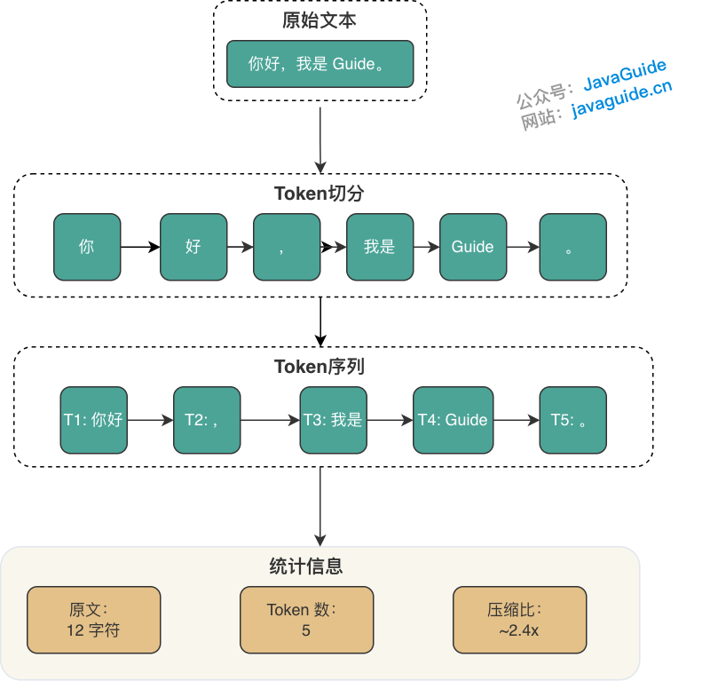
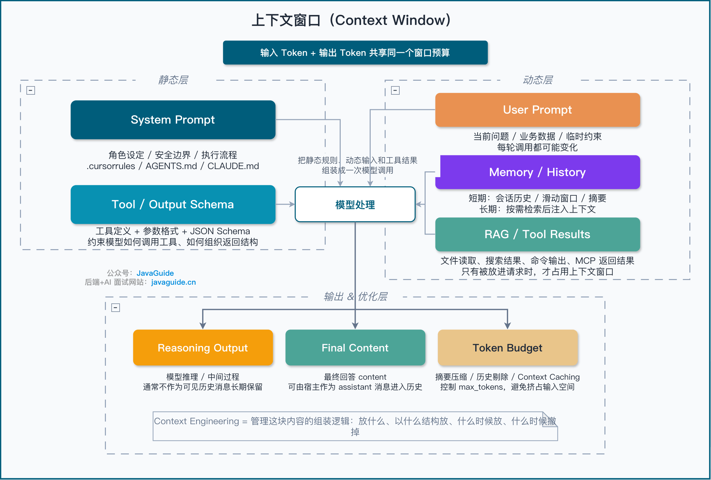
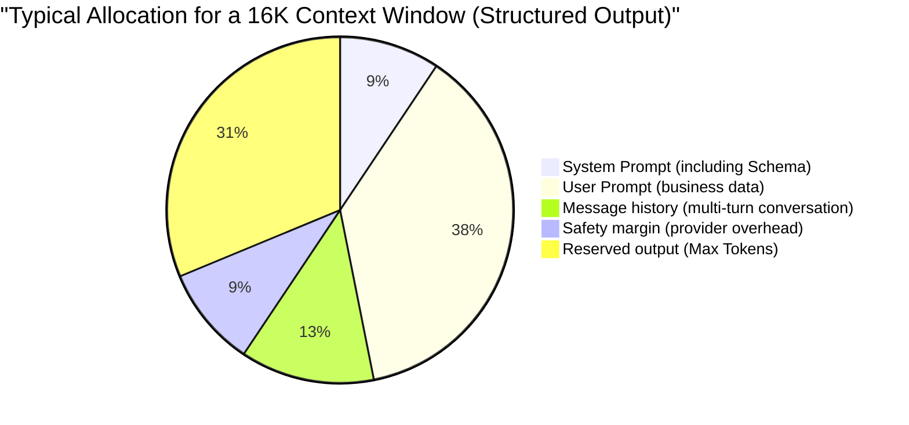
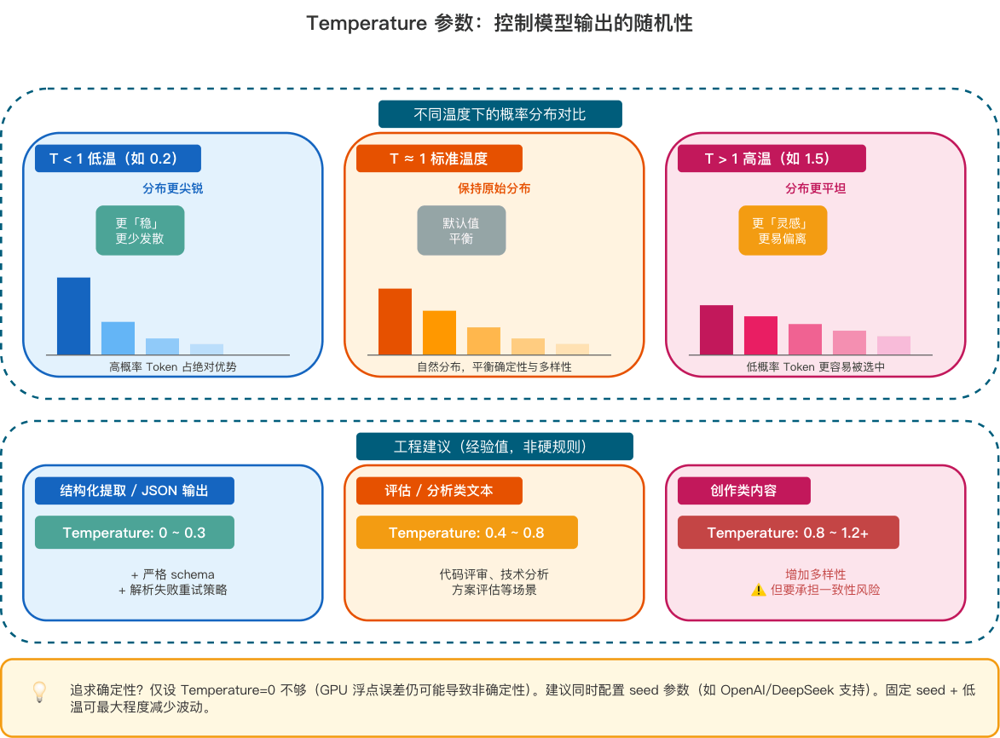

Structured output can still fail to parse when Temperature is set to zero, and a model may miss a key constraint in the middle of a context filled with documents. Diagnose these behaviors by examining tokenization, context capacity, and decoding strategy separately.

To investigate these issues, first identify the Tokens in a call, then check the context budget and decoding parameters such as Temperature, Top P, and Top K. Token counts and parameter ranges in this guide illustrate the mechanisms; actual billing and capability limits depend on the target model's API documentation and response `usage`.

## How Do Tokens and Context Affect Cost and Quality?

When you type "The weather today is so" into a keyboard, it may suggest "nice." An LLM also predicts what comes next, but it can use thousands or even hundreds of thousands of preceding characters as context. It generates one Token (a text fragment), adds it to the context, and predicts the next until the answer is complete.

This process is called **autoregressive generation**.

Autoregressive generation connects several concepts:

- **Token**: A text fragment the model generates at each step.
- **Context window**: The maximum number of Tokens a model can process in one call. System instructions, message history, current input, and output budget all use this capacity.
- **Temperature / Top P**: Parameters that affect how the model chooses among candidate fragments.
- **Max Tokens**: The maximum number of Tokens the model can generate.

The tokenizer splits input text into fragments of varying lengths. For example, `Hello, I'm little G.` might be tokenized like this:

- Text: `Hello, I'm little G.`
- Tokens: `[Hello]` `[,]` `[I'm]` `[little G]` `[.]`
- Count: 19 characters → 5 Tokens → compression ratio of about 3.8 characters per Token



This tokenization is illustrative. Actual results depend on the target model's tokenizer; the same text can produce a different sequence with another provider or model version. OpenAI also provides a [Tokenizer tool](https://platform.openai.com/tokenizer) for inspecting tokenization directly.

Character-based tokenization keeps the vocabulary relatively small but creates longer sequences. Word-based tokenization shortens sequences, but the number of Chinese word combinations would make the vocabulary grow rapidly. **Subword tokenization algorithms** such as BPE and Unigram balance the two: frequent fragments are kept intact where possible, while rare words are split into smaller pieces. Tokens therefore do not map one-to-one to characters or words. An English word may use multiple Tokens; a Chinese word may also use multiple Tokens, or several characters may form one Token.

For capacity planning, use rough estimates: one English Token is about 3–4 characters; a Chinese Token is usually about 1–2 characters, with more variation in mixed-language text. DeepSeek's published estimate is about 0.3 Token per English character and 0.6 Token per Chinese character, or roughly 3.3 English characters or 1.7 Chinese characters per Token.

Tokenizer versions also change these estimates. Earlier models such as GPT-3.5 had lower Chinese compression, at around 1.5–2 Tokens per character. GPT-4o uses the o200k_base tokenizer, with a vocabulary of about 200,000 tokens; Qwen 2.5 has a vocabulary of about 150,000. Some measurements found roughly 1.5 Chinese characters per Token for news text and 1.2 for technical documents, but these figures should not be used directly for billing.

"One character per Token" may apply only to some frequent terms. Use rough estimates with a safety margin for budgeting, and read the API's `usage` response for billing and monitoring. How ambiguous Chinese text, rare characters, and infrequent technical terms are tokenized can also affect how the model processes them.

**Special Tokens**: In addition to Tokens for text content, models use internal markers that also count toward the Token total:

| Special Token               | Purpose                           | Example        |
| --------------------------- | --------------------------------- | -------------- |
| BOS (Beginning of Sequence) | Marks the start of a sequence     | `<s>`          |
| EOS (End of Sequence)       | Marks the end of a sequence       | `</s>`         |
| PAD (Padding)               | Pads short sequences in a batch   | `<pad>`        |
| Tool-call marker            | Marks a Function Calling boundary | `<tool_call/>` |

These special Tokens are usually invisible to users but take up space in the context window. Use the official tokenizer tool rather than manual estimates for precise counts.

### Token Costs for Multimodal Inputs

Models that support vision convert images into internal representations and count input Tokens according to their own rules. The Token count cannot be estimated just by noting that there is "one image":

- OpenAI vision models calculate usage based on the model, image dimensions, and `detail` setting. For models using 512-pixel tiles, low detail uses a fixed base amount; high detail adds Tokens based on the number of tiles after resizing.
- Anthropic estimates usage from the resized image's pixel count. Its approximate formula is `tokens ≈ width × height / 750`. An unscaled 1024×1024 image is about 1,398 Tokens, not a fixed 5 or 85 Tokens.
- Gemini uses different tiling rules for smaller and larger images. The 258-Token figure in its documentation has image-size conditions and should not be applied to every 1024×1024 image.

Image billing rules can change between model versions. Before launch, use the provider's Token-counting API or official formula, and test thumbnails, screenshots, long images, and requests with multiple images. See [OpenAI Images and Vision](https://developers.openai.com/api/docs/guides/images-vision), [Anthropic Vision](https://platform.claude.com/docs/en/build-with-claude/vision), and [Gemini Token Counting](https://ai.google.dev/gemini-api/docs/tokens).

When images are included in multimodal RAG, these costs affect both the budget and latency:

- Count image Tokens together with text Tokens in the per-call budget.
- Multiple images can increase time to first token (TTFT), so load-test this separately.
- If a task only needs OCR results, extract the text first and send that text to the model.

### Capacity Limits of the Context Window

Model specifications such as 128K, 200K, or 1M refer to the maximum number of Tokens a call can contain. A larger window allows more documents and conversation history in one call, but some capacity must also be reserved for system prompts, tool definitions, and model output. Most models count input and output together; some providers, such as Google Gemini, set separate limits.



- **Fixed content**: System prompt, tool-call schemas, and formatting markers.
- **Current input**: User prompt, message history, and retrieved RAG passages.
- **Generation budget**: Tokens the model is allowed to generate.

After subtracting these items from the advertised window, the remainder is the capacity available for business data.

Note: the context window is not the same as the maximum output length. Many models support 128K or even 1M context, but the maximum output varies by model and API. The parameter may be named `max_tokens`, `max_completion_tokens`, or `max_output_tokens`. Do not infer limits from the provider name; check the target model's capability documentation before calling it.

Multi-turn message formats for reasoning models vary by provider:

- [DeepSeek thinking mode](https://api-docs.deepseek.com/guides/thinking_mode) returns `reasoning_content` and final `content` separately. Without a tool call, the previous turn's `reasoning_content` does not need to be included in the next context and is ignored if sent. When a tool call occurs, the current turn's `reasoning_content` must be sent back with the tool result until the turn is complete.
- [OpenAI reasoning models](https://developers.openai.com/api/docs/guides/reasoning) do not expose raw chain-of-thought to applications. The Responses API can continue context with `previous_response_id` or return reasoning items as required by the API. Applications may receive an optional reasoning summary, not the raw internal reasoning.

Reasoning Tokens may not appear in the next turn's message text, but they still use the current turn's generation budget and may count toward output Tokens and context limits. Do not infer that reasoning never uses context or incurs charges.

### Computational Constraints Behind Long Contexts

The Transformer's **self-attention** mechanism creates three costs for long contexts:

- **Quadratic growth in computation**: Compute requirements scale quadratically with sequence length (O(N²)). Doubling input Tokens may require four times the processing.
- **Higher inference latency**: With a longer context, the model must attend to more historical Tokens for every new Token it generates, which can significantly increase time to first token (TTFT).
- **Greater security risk**: A longer context creates a larger attack surface.

Techniques such as FlashAttention, GQA/MQA, Sliding Window Attention, and Ring Attention can reduce computation or memory use, but they do not make all long-context workloads linear in cost. O(N²) remains the theoretical complexity of standard self-attention.

### What Context Overflow Looks Like in Practice

A common symptom of an overly long context is that the model ignores a System Prompt instruction such as "You must return JSON." It may also drift off topic later in the answer or lose track of relevant evidence among too many RAG passages.

Putting information in the context window does not mean the model can use every position equally well. The "Lost in the Middle" effect describes how models may use information near the beginning and end more effectively than information in the middle. Expanding the window to 1M does not automatically eliminate this issue.

Long contexts also have measurable costs: input Tokens and bills grow with the amount of content, while prefill time and TTFT increase. When these signals appear, first check the number of retrieved passages, conversation-history trimming, and the placement of key information instead of continuing to fill the context window.

### Billing Differences Between Input and Output Tokens

Most providers bill input, cached input, and output Tokens separately. Reasoning models may also report reasoning Tokens as a separate category. Output rates are often higher than input rates, but there is no stable industry-wide "2–4 times" ratio; model version, batch processing, cache hits, and service tier all affect pricing.

Pricing changes frequently and should not be hard-coded in a fundamentals guide. Cost calculations should use the provider's current pricing page. A gateway should record `model_version`, each type of `usage`, and the actual billed rate.

Track input, cached input, output, and provider-reported reasoning Tokens separately. For RAG, control the number of retrieved passages so irrelevant content does not inflate input Tokens. Limit output and reasoning with generation limits. Since reasoning Tokens are often billed as output, monitor their usage separately for reasoning models.

### How Prompt Caching Reduces Costs

Batch evaluations often send the same System Prompt repeatedly, changing only the final sample. Multi-turn conversations may also resend a fixed history. **Prompt caching** can reuse these prefixes. When later requests meet the model, prefix-length, content, and validity-period requirements, the cached portion is billed as cached input and requires less prefill computation.

Tasks with long, frequently repeated prefixes are more likely to benefit:

- Multi-turn conversations with an unchanged System Prompt and message history.
- RAG applications with frequently repeated retrieved passages.
- Batch evaluations with the same System Prompt and different resumes or articles.

OpenAI Prompt Caching, Anthropic Prompt Caching, and DeepSeek Context Caching have different activation thresholds, cache lifetimes, and prices. Some distinguish automatic caching, explicit caching, and extended caching. Check current official documentation before configuring them; do not hard-code cache duration or discounts in business code.

The order of request content directly affects cache hits:

1. Put unchanged content first (System Prompt, tool definitions, and RAG context) and variable content last (User Prompt).
2. Monitor the provider response fields for cached-read and cached-write Tokens to verify the cache hit rate.
3. Run batch jobs within the cache validity window where possible.

### Token Budget for a Single Call

Think of the context window as a bucket with a fixed capacity. The diagram below shows a typical Token budget for one call:



The values are illustrative only. For a standard generative model, first check whether this relationship holds:

**window ≥ input_tokens + max_output_tokens**

For reasoning models, calculate the budget according to the target API's parameter definitions. Some APIs include both reasoning Tokens and the visible answer in `max_output_tokens` or `max_completion_tokens`; adding `reasoning_tokens` again would double-count them. Other APIs set separate limits for reasoning and the final answer. Before launch, use returned `usage` data to determine the composition of a real call and calibrate the budget formula.

At minimum, `input_tokens` includes:

- System Prompt (including schemas and tool definitions)
- User Prompt (including text after variable substitution)
- Message history (for multi-turn conversations)
- RAG context, if included

Structured tasks often have more predictable output lengths. Set `max_output_tokens` first, then reserve a 10–20% safety margin for input. If the budget is still insufficient, reduce RAG Top-K, merge duplicate passages, summarize or truncate long fields, and split tasks that still do not fit into batches or two-stage generation.

## How Do Sampling Parameters Affect Output Stability?

### From Logits to Probability Sampling

At each step, the model assigns a score (called a **logit**) to **every** candidate Token in the vocabulary. A higher score means the model considers that Token more likely to belong at this position.

For example, suppose the model is completing "The weather is so \_\_". It might assign these scores:

| Candidate Token | Raw score (logit) |
| --------------- | ----------------- |
| nice            | 5.0               |
| good            | 3.2               |
| great           | 2.1               |
| bad             | 0.5               |
| purple          | -8.0              |

Raw scores are not probabilities. They must be passed through **softmax** to produce a probability distribution over candidate Tokens. The result is approximately:

| Candidate Token | Probability |
| --------------- | ----------- |
| nice            | 81.21%      |
| good            | 13.42%      |
| great           | 4.47%       |
| bad             | 0.90%       |
| purple          | about 0.00% |

After obtaining the probability distribution, the model samples which Token to output.

Decoding parameters such as Temperature, Top P, and Top K control the "score → probability → sample" process:

- Temperature: Changes the shape of the probability distribution, making high-scoring choices more dominant or making the options more uniform.
- Top P / Top K: Removes lower-ranked candidates to narrow the sampling pool.
- Penalty parameters: Lower the scores of Tokens that have already appeared to reduce repetition.

### Temperature and Output Variability



Temperature works simply: before softmax, **divide** all scores by the temperature value T.

**p(t) = softmax(z_t / T)**

Applying this to the "The weather is so \_\_" example shows how Temperature changes the same logits:

| Temperature | Effect on the distribution                                                    | Example                                                       |
| ----------- | ----------------------------------------------------------------------------- | ------------------------------------------------------------- |
| T = 0.2     | Sharpens the distribution and concentrates probability on high-scoring Tokens | "nice" about 99.99%                                           |
| T = 1.0     | Preserves the original distribution                                           | "nice" about 81.21%, "good" about 13.42%                      |
| T = 1.5     | Flattens the distribution and gives lower-probability Tokens more chance      | "nice" about 66.85%, "good" about 20.14%, "great" about 9.67% |

Lower Temperature makes output more deterministic; higher Temperature makes it more random.

Engineering guidance (heuristics, not strict rules):

| Use case                                      | Suggested Temperature | Notes                                                              |
| --------------------------------------------- | --------------------- | ------------------------------------------------------------------ |
| Structured extraction / JSON output           | 0–0.3                 | Combine with a strict schema and retries for parse failures        |
| Evaluation / analysis / code review           | 0.4–0.8               | Balance determinism and expression variety                         |
| Creative content (copywriting, brainstorming) | 0.8–1.2+              | Increase variety while accepting a risk of inconsistent formatting |

If the target API supports `seed`, store it together with the model version, Prompt, and sampling parameters. A `seed` usually provides only best-effort reproducibility and does not guarantee identical output. DeepSeek's current API does not expose a `seed` parameter.

Results may still differ because of:

- Model version updates that change the underlying weights.
- Cross-region calls where clusters may run different versions.
- Changes to server-side decoding, parallel computation, or backend configuration.

Keep real LLM calls in smoke tests in CI/CD. Use mocks for logic tests that need stable, reproducible results.

### Top-p and Top-k: The Candidate Pool

Temperature changes the shape of the probability distribution. Top-p and Top-k truncate the candidate set, excluding lower-ranked candidates from sampling.

Consider the example "The weather is so \_\_":

| Candidate Token | Probability | Cumulative probability |
| --------------- | ----------- | ---------------------- |
| nice            | 81.21%      | 81.21%                 |
| good            | 13.42%      | 94.63%                 |
| great           | 4.47%       | 99.10%                 |
| bad             | 0.90%       | about 100%             |
| purple          | about 0.00% | 100%                   |

`Top-k = 3` keeps the three highest-probability candidates (`nice`, `good`, and `great`) and excludes the rest. `Top-p = 0.9` accumulates probability from highest to lowest. In this example, `nice` and `good` already total 94.63%, so only those two remain. If the top candidate alone exceeds 90%, it is the only one kept.

Top-k sets a fixed number of candidates, while Top-p sets a cumulative probability threshold, so the number of candidates for Top-p varies with the distribution. Common combinations with Temperature behave as follows:

| Combination                              | Effect                                                                                                                   | Use case                                   |
| ---------------------------------------- | ------------------------------------------------------------------------------------------------------------------------ | ------------------------------------------ |
| T=0 (usually treated as greedy decoding) | Selects the highest-scoring Token at each step; results still depend on the model version and server-side implementation | Structured output and low-randomness tasks |
| Low Temperature + Top-p=0.9              | Relatively stable, with some variation in wording                                                                        | Analysis reports and summaries             |
| Medium-to-high Temperature + Top-p=0.95  | More diverse, while excluding extremely unlikely options                                                                 | Creative writing and conversation          |

Note: Greedy decoding is generally the most stable, but it may be more prone to repetitive loops.

### Stop Conditions and Truncation Risks

Generation stops when it reaches Max Tokens, even if the JSON is missing a closing brace or a list is incomplete. If the server returns `finish_reason=length`, mark the result as truncated and do not pass it to downstream processing.

Stop Sequences end generation when the model emits a specified string, such as `"\n\n"` or `"```"`. If a stop sequence also appears in business text, it can truncate a key field. For structured output, handle both failure cases: reaching the generation limit and triggering a stop sequence unintentionally.

For reasoning models, check whether the generation limit covers both the reasoning process and the final answer. Some APIs use a shared generation budget, so more reasoning Tokens leave less room for the visible answer. Others control the amount of reasoning indirectly through parameters such as `reasoning_effort`. When `finish_reason=length` occurs, investigate both reasoning Tokens and the final answer.

### Penalties and Repetition

Models may repeat the same sentence or restate the same point throughout a long answer. Penalty parameters help mitigate this by **lowering the scores of Tokens that have already appeared** during decoding:

| Parameter          | Effect                                                               | In plain terms                                   |
| ------------------ | -------------------------------------------------------------------- | ------------------------------------------------ |
| Repetition Penalty | Lowers the probability of all Tokens that have appeared              | "Repeated words lose points"                     |
| Presence Penalty   | Applies a penalty once a Token has appeared, regardless of frequency | "Encourages new topics"                          |
| Frequency Penalty  | Applies a larger penalty as a Token appears more often               | "Said the same word three times? Bigger penalty" |

JSON objects may repeat field names such as `"name"` and `"score"`. A high Repetition Penalty can lower the scores of these necessary repetitions too, causing fields to be omitted. With RAG question answering, Presence Penalty may encourage the model to introduce terms that do not appear in retrieved content, reducing how faithfully the answer reflects its evidence.

Penalty definitions vary between providers. Unless you have a clear reason to tune them, keep the defaults and control structure through output length, Prompt constraints, and a Schema. This makes troubleshooting easier.

### Parameter Limits for Reasoning Models

Supported parameters for reasoning models depend on the specific API. Do not assume DeepSeek thinking mode and OpenAI reasoning models behave the same way.

- DeepSeek V4 thinking mode returns `reasoning_content` and the final `content`, and explicitly lists sampling parameters that are unsupported or have no effect.
- OpenAI does not return the raw internal reasoning process. The Responses API can return reasoning items and an optional summary. Support for parameters such as `temperature` and `top_p` may vary by reasoning model.

Before making a call, filter out parameters that the model does not support based on its capability documentation. For reliable structure, use Structured Outputs, server-side validation, and failure handling; changing Temperature alone is not enough.

### Streaming and Time to First Token

Synchronous APIs return only after generating the full response. Streaming APIs send incremental output after generating one or a few Tokens, so users see the first Token sooner and time to first token (TTFT) is lower. It is easy to conflate TTFT, total latency, and cost:

- Streaming does not necessarily reduce end-to-end latency; it does not reduce the total number of Tokens generated.
- Streaming does not automatically reduce cost. Token billing is unchanged, and rate limits and quotas still apply.
- For structured output such as JSON, account for how the frontend or gateway handles incomplete JSON during streaming.

### Logprobs for Confidence Checks

Some APIs, including OpenAI, can return the **log probability** (logprob) of each generated Token. This can be treated as an indication of how "confident" the model is about that Token. A logprob closer to 0 means higher confidence; a smaller value such as -5.0 indicates more uncertainty.

Engineering use cases:

- **Confidence assessment**: When extracting `amount: 1000`, a low logprob for the corresponding Token may indicate uncertainty and the need for human review.
- **Anomaly detection**: Monitor the average logprob of model output in production. A sudden drop may indicate Prompt drift or anomalous input data.
- **Candidate comparison**: Retrieve the Top-N candidate Tokens and their probabilities for correction or reranking.

Note: Logprobs increase response size, and not all providers support them. Check the API documentation before use.

### Recommended Sampling Parameters

| Use case                         | Temperature               | Top-p                     | Penalty                   | Other recommendations                                         |
| -------------------------------- | ------------------------- | ------------------------- | ------------------------- | ------------------------------------------------------------- |
| JSON / structured output         | 0–0.3                     | 1.0                       | Keep defaults             | Use Strict Mode and a retry strategy                          |
| Code review / technical analysis | 0.4–0.7                   | 0.9                       | Keep defaults             | Combine with a CoT Prompt                                     |
| Multi-turn conversation          | 0.6–0.8                   | 0.9                       | Enable moderately         | Limit message-history length                                  |
| Creative writing / brainstorming | 0.8–1.2                   | 0.95                      | Enable as needed          | Allow output variety and apply post-processing                |
| Reasoning models                 | Check model documentation | Check model documentation | Check model documentation | Filter unsupported parameters and keep server-side validation |

## Data to Retain in Production

Plan capacity in Tokens, and use the API's returned `usage` for billing and alerts. For each call, retain at least the model version, input Tokens, cached Tokens, reasoning Tokens (if provided by the provider), output Tokens, context-trimming strategy, and sampling parameters.

Long context increases the amount of information that can fit in a call, but it does not guarantee that the model can use every position equally well. Structured tasks also need a Schema and server-side validation. To reproduce experiments, fix the model version, Prompt, input, and decoding parameters, while allowing for small variations caused by the provider's service.
