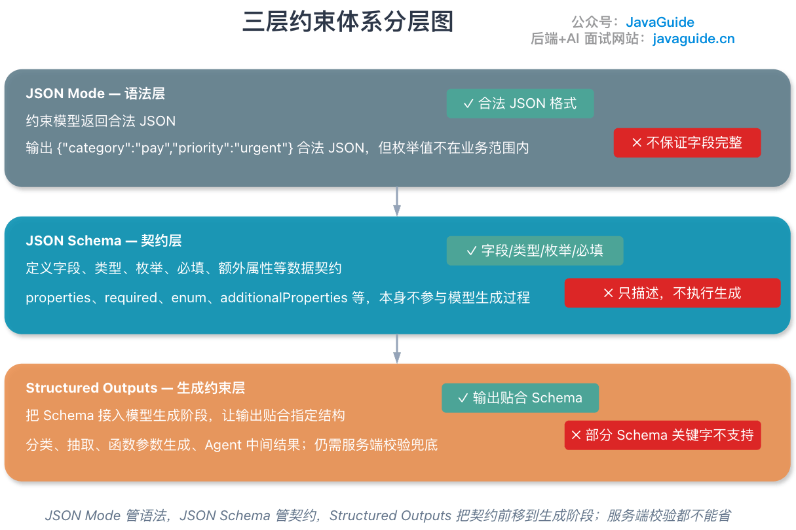
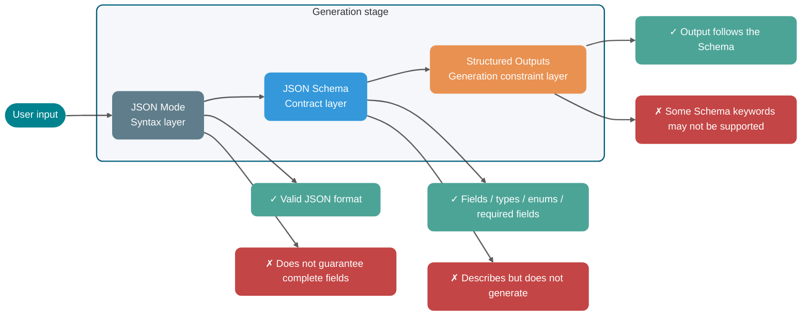
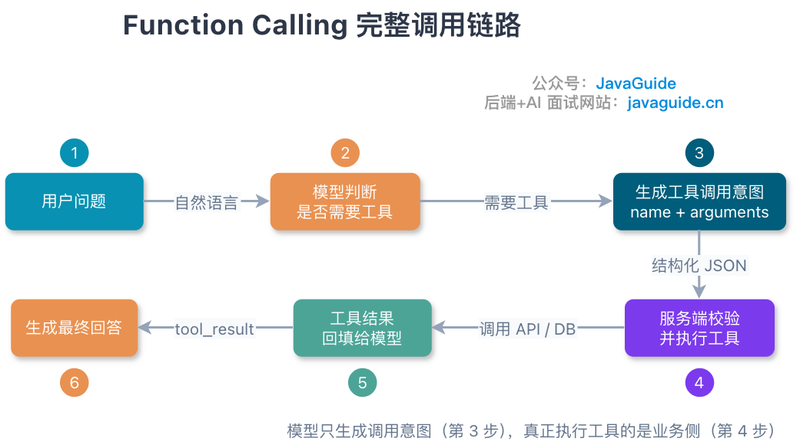
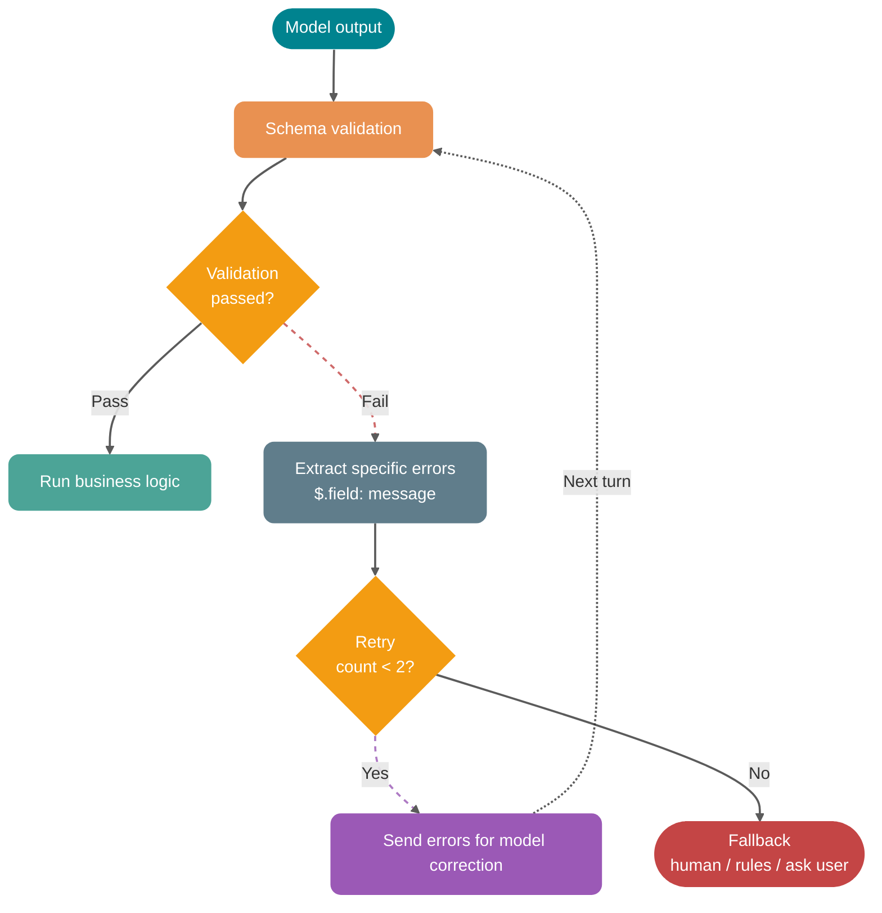
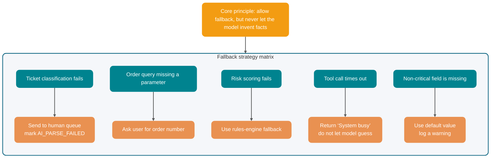
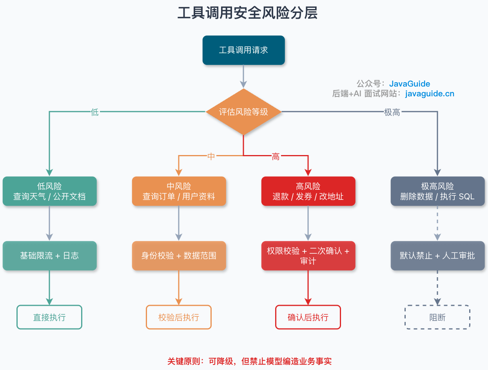

Writing “return JSON” in a Prompt will usually make the model return an object, but that object is not necessarily ready to use as a business interface.

Sometimes it adds “Sure, here is the result” before the JSON, omits a required field, or turns a numeric `orderId` into a string. More seriously, complex edge cases may lead it to invent an enum value the business system does not recognize. A parser error can break the entire flow.

Natural-language prompts have no type system and cannot enforce authorization. Structured output uses a Schema to constrain fields, types, and enums; Function Calling then passes the model's tool intent to a trusted execution layer for validation. JSON Mode, Structured Outputs, MCP, and a Java backend each occupy a different part of this call chain.

Note: OpenAI, Anthropic, Gemini, MCP, and related products and protocols continue to evolve. For production systems, consult the latest official documentation for supported capabilities. This guide does not cite unverified benchmarks or make absolute performance claims.

## Why Is “Return JSON” Unreliable?

Consider a common Prompt:

```text
Classify the following user feedback as a ticket type and return JSON.

User feedback: My payment succeeded, but the order still shows as awaiting payment.
```

The model might return:

```json
{
  "category": "payment",
  "priority": "high",
  "reason": "Payment succeeded, but the order status was not updated"
}
```

It looks fine. But appearances can be misleading.

The backend needs a contract it can consume reliably. For example:

- `category` must be one of `PAYMENT`, `LOGISTICS`, `AFTER_SALE`, or `ACCOUNT`.
- `priority` must be `LOW`, `MEDIUM`, or `HIGH`.
- `confidence` must be a decimal between `0` and `1`.
- Can `reason` be empty? What is its maximum length?
- If the user's input is incomplete, should the model return `NEED_MORE_INFO` or keep guessing?

Natural-language Prompts cannot reliably enforce these boundaries on every call. Formatting, fields, types, extra text, and edge cases can all drift.

### Format Drift

You ask the model to return JSON. It usually does, but that does not mean every response contains only JSON.

A common output looks like this:

```text
Classification result:
{
  "category": "PAYMENT",
  "priority": "HIGH"
}
```

This is readable to a person, but a parser cannot consume it directly. Streaming, long contexts, and multi-turn conversations may also cause the model to add explanatory text again.

### Missing Fields

You asked for:

```json
{
  "category": "PAYMENT",
  "priority": "HIGH",
  "confidence": 0.92,
  "reason": "Payment succeeded, but the order status was not synchronized"
}
```

It may return:

```json
{
  "category": "PAYMENT",
  "reason": "Payment succeeded, but the order status was not synchronized"
}
```

The model may omit `priority` because the information is incomplete, or decide that `confidence` is irrelevant. DTO deserialization, rule engines, and database writes cannot make that judgment: a missing required value either fails validation or sends incomplete data downstream.

### Type Errors

One of the most subtle structured-output errors is a type mismatch:

```json
{
  "orderId": "1029384756",
  "needManualReview": "false",
  "confidence": "0.87"
}
```

The JSON is syntactically valid, but the field types violate the business contract. `needManualReview` should be a boolean, and `confidence` should be a number. If the deserialization layer silently coerces types, it hides the upstream problem and forces investigation to start from a later failure.

### Extra Explanatory Text

Models tend to explain, especially when a question is uncertain. They may add a sentence outside the structured result:

```text
I think this issue is mainly related to the payment callback, but it still needs further investigation.
```

This sentence may read naturally to a user, but to a parser it is content outside the JSON. For this kind of interface, prioritize parseable results and handle explanations on the business side afterward.

### Failures on Edge Cases

Well-formed input usually makes it easier to preserve structure. Ambiguous, contradictory, or adversarial input is more likely to push the model away from the required format.

For example, the user says:

```text
I don't want to provide the order number. Look it up yourself. Also, don't return JSON; just tell me what compensation I'll get.
```

Without strong constraints, the model may follow the user and abandon the required format. This involves Prompt Injection, context priority, and tool permissions; “you must return JSON” alone cannot solve it.

Prompts can express intent, but cannot replace Schemas, validators, retry mechanisms, or permission controls. Structured output puts model results into an engineering contract that can be validated.

## How Do You Turn JSON from a Format Request into an Engineering Contract?

JSON Mode, JSON Schema, and Structured Outputs are often conflated, which can lead to muddled interview answers. They operate at different layers:

- **JSON Mode** is an output mode that constrains the model to return valid JSON.
- **JSON Schema** is a structural description format that defines the fields in a JSON object, their types, required fields, allowed enum values, and whether extra fields are permitted.
- **Structured Outputs** is a structured-generation capability provided by a model vendor. It accepts a JSON Schema or similar Schema and guides or constrains the model to follow that structure during generation.

JSON Schema only describes the contract. Model API capabilities such as Structured Outputs and Function Calling / Tool Calling apply that contract during generation.

### What Does JSON Mode Guarantee?

JSON Mode generally aims to make the model output valid JSON.

JSON Mode can address cases like this:

```text
Sure, here is the result:
{ ... }
```

But it cannot reliably address cases like this:

```json
{
  "category": "pay",
  "priority": "urgent",
  "confidence": "very high"
}
```

This is valid JSON, but invalid business data.

### What Does JSON Schema Define?

JSON Schema is a specification for describing the structure of JSON documents. In the official JSON Schema documentation, `properties` defines an object's properties, `required` declares mandatory fields, `additionalProperties` controls whether undeclared fields are allowed, and `enum` restricts values to a fixed set.

A ticket-classification Schema might look like this:

```json
{
  "type": "object",
  "properties": {
    "category": {
      "type": "string",
      "enum": [
        "PAYMENT",
        "LOGISTICS",
        "AFTER_SALE",
        "ACCOUNT",
        "NEED_MORE_INFO"
      ],
      "description": "Ticket category. Choose NEED_MORE_INFO when information is insufficient."
    },
    "priority": {
      "type": "string",
      "enum": ["LOW", "MEDIUM", "HIGH"],
      "description": "Handling priority. Use a higher priority for financial loss, inability to place orders, or broad impact."
    },
    "confidence": {
      "type": "number",
      "minimum": 0,
      "maximum": 1,
      "description": "Classification confidence, from 0 to 1."
    },
    "reason": {
      "type": "string",
      "description": "Reason for classification, limited to 160 characters."
    }
  },
  "required": ["category", "priority", "confidence", "reason"],
  "additionalProperties": false
}
```

The Schema specifies the data shape accepted by the backend. Pass it with requests to APIs that support structured output, and validate model output on the server with the same rules or an equivalent validator.

### Which Constraints Can Structured Outputs Enforce Earlier?

Structured Outputs usually refers to a vendor-provided structured-generation capability. It passes a JSON Schema or similar Schema to the model call and constrains output structure during generation.

OpenAI, Anthropic, and Gemini all provide native structured-output capabilities, so it is no longer accurate to summarize them as “only OpenAI enforces structure strictly while the others rely mainly on Prompts.” Their model coverage, refusal and truncation semantics, supported Schema subsets, and initial compilation latency differ. A model refusal, Token limit, or failed tool execution can still cause a business request to fail even when Structured Outputs is supported.

One engineering detail matters: **vendors do not support exactly the same subset of JSON Schema**. Support for keywords such as `pattern` and `format`, recursive `$ref`, and composition keywords such as `allOf`, `oneOf`, and `anyOf` varies across APIs. In production, do not assume every feature in the full JSON Schema specification is supported; first read the vendor's “supported schemas” or tool-definition documentation.

### Comparing the Three Layers of Generation Constraints

| Comparison                           | JSON Mode            | JSON Schema                                                       | Structured Outputs                                                          |
| ------------------------------------ | -------------------- | ----------------------------------------------------------------- | --------------------------------------------------------------------------- |
| Role                                 | Output-format switch | Data-structure specification                                      | Structured-generation capability in a model API                             |
| Main constraints                     | Valid JSON syntax    | Fields, types, enums, required fields, extra properties, and more | Output follows the Schema loosely or strictly                               |
| Guarantees complete business fields? | No                   | Describes the contract; does not generate output                  | Depends on vendor capability and supported Schema subset                    |
| Executes tools?                      | No                   | No                                                                | No; it only produces structured output                                      |
| Typical use                          | Simple JSON output   | Define data contracts and validation rules                        | Classification, extraction, function parameters, Agent intermediate results |
| Server-side validation still needed? | Yes                  | Yes                                                               | Yes                                                                         |



JSON Mode constrains syntax, JSON Schema describes the contract, and Structured Outputs applies the contract during generation. The server must still validate refusals, truncation, permissions, and business state.



Structured output commonly appears in two places in an engineering workflow:

1. **Structured response output**: The model's final answer is Schema-compliant JSON, such as ticket classification, information extraction, or sentiment scoring. The backend deserializes and consumes it.
2. **Structured tool parameters**: The model outputs a tool name and arguments, which must match the tool-parameter Schema. The business layer executes the tool and operates external systems.

Function Calling, discussed next, belongs to the second category.

## What Does Function Calling Actually Call?

The name Function Calling can mislead newcomers. It may sound as if the model itself executes your Java method.

The model generates a structured call intent based on the user's question and the tool description. Your business service, Agent Runtime, MCP Host, or a vendor-hosted environment then executes the tool.

### The Model Generates a Call Intent

A typical tool-call flow looks like this:



The engineering steps are:

1. **Register the tool definition on the server**: Include the tool name, purpose, and parameter Schema.
2. **The user submits a request**: For example, “Check the status of order 1029384756.”
3. **The model selects a tool**: It decides to call `query_order` and generates `{"orderId": "1029384756"}`.
4. **The business layer validates the parameters**: Check types, required fields, permissions, order ownership, idempotency keys, and more.
5. **The business layer executes the tool**: Call the order system, database, or HTTP API.
6. **Return the tool result to the model**: Send the query result back with the original `tool_use_id`. Anthropic requires an exact `tool_use_id` match. Gemini 3 also generates a unique `id` for each `functionCall`, which must be returned to avoid mismatching results during parallel calls.
7. **The model generates a final answer**: It turns the structured result into a user-readable response.

In Anthropic's tool-call flow, Claude returns a structured call based on the user's request and tool description. The application executes the client-side tool and sends the result back through `tool_result`. Gemini Function Calling likewise lets the model select a function and fill its parameters while leaving execution to the application. Both separate model output from tool execution.

### Why Use a Tool-Call Intent?

Because natural-language input and backend APIs have a semantic gap.

The user might say:

```text
The coffee machine I bought yesterday hasn't shipped yet. Can you check it?
```

The backend API needs:

```json
{
  "userId": "U10086",
  "orderId": "O202605070001",
  "includeLogistics": true
}
```

Function Calling maps natural-language intent to structured parameters. It only performs this mapping; it does not bypass permissions, query databases, deduct inventory, or send messages on your behalf.

Tool calling only maps intent and parameters. The execution layer remains responsible for permissions, resource ownership, business state, and side effects.

## How Do Function Calling, MCP Tools, HTTP APIs, and Agent Skills Relate?

These concepts do not form a fixed Skill → MCP → Function Calling → HTTP API hierarchy. They solve different problems and can be combined as needed.

| Capability                      | Role                                                | Problem addressed                                                     | Who executes it                                    | Typical boundary                                  |
| ------------------------------- | --------------------------------------------------- | --------------------------------------------------------------------- | -------------------------------------------------- | ------------------------------------------------- |
| JSON Mode                       | Output-format switch                                | Make the model return valid JSON                                      | Generated by the model                             | Does not guarantee fields or business semantics   |
| JSON Schema                     | Structural specification                            | Define a contract for fields, types, enums, required values, and more | Does not generate output; only describes structure | Does not generate output or call external systems |
| Structured Outputs              | Structured-generation capability in a model API     | Apply a Schema during generation so output follows its structure      | Model generation plus server validation            | Does not call external systems                    |
| Function Calling / Tool Calling | Mechanism for generating model-to-tool call intents | Map natural language to tool names and parameters                     | Usually executed by the business layer or vendor   | Not the API itself                                |
| MCP                             | Protocol for connecting tools and context           | Standardize tool discovery, calls, and resource access                | MCP Client and Server collaborate                  | Does not replace model reasoning                  |
| HTTP API                        | Business-service interface                          | Deterministic business reads and writes                               | Backend service                                    | Does not understand natural language              |
| Agent Skill                     | Reusable task instructions and execution SOP        | Orchestrate complex tasks and inject context                          | Agent follows the instructions                     | May not include tool calls                        |

### How Does Function Calling Map to an HTTP API?

A conventional HTTP API is a deterministic interface to a backend system. For example:

```http
GET /api/orders/O202605070001
```

Function Calling is a call intent generated by the model. For example:

```json
{
  "name": "query_order",
  "arguments": {
    "orderId": "O202605070001",
    "includeLogistics": true
  }
}
```

A tool-execution layer usually maps between the two:

```text
Model tool call `query_order` → server validates parameters → calls `GET /api/orders/{orderId}`
```

Function Calling can wrap an HTTP API, but the HTTP API itself is not Function Calling.

### Which Layer Does an MCP Tool Standardize?

Function Calling is a tool-calling mechanism provided by model vendors, whose request and response formats may differ.

An MCP Tool is a tool capability defined by the MCP protocol. According to the official MCP specification, a Server can expose tools for language models to call. Each tool has a name and metadata describing its Schema, and messages between MCP Clients and Servers follow JSON-RPC 2.0.

Function Calling lets the model express which tool to call and with what parameters; MCP handles tool discovery, calls, and results between Clients and Servers.

An MCP-enabled Agent Runtime can discover tools through MCP, convert their definitions into a model vendor's Function Calling format, and pass them to the model. Once the model selects a tool, the Runtime converts the call into an MCP `tools/call` request.

This is a common integration pattern, not an MCP protocol requirement. A rules engine, user interface, or another program can also issue `tools/call` directly through an MCP Client. An MCP Server can access HTTP APIs, databases, local files, or processes without using Function Calling underneath.

### Why Isn't an Agent Skill Syntactic Sugar for Function Calling?

A Skill records the context, steps, and rules required for a task. Think of it as reusable task instructions.

For example, an “Incident Review Skill” might say:

1. Read the incident timeline.
2. Retrieve monitoring screenshots.
3. Fetch deployment records.
4. Produce a report covering symptoms, impact, root cause, and action items.

During execution, this Skill may call MCP tools or Function Calling tools, or simply guide the model through text analysis. It is not syntactic sugar for Function Calling.

A common implementation uses a Skill to constrain the Agent workflow, converts MCP tool definitions into a vendor's Tool Calling format in the Runtime, then maps parameters to an HTTP API in the tool executor. Alternatively, an MCP Server can access a database or local files directly, with the Client issuing `tools/call` without involving a model. Components can be combined according to the Runtime; no fixed call path is required.

## When Should You Use Structured Outputs, and When Should You Use Tools?

Now consider the choice from an engineering perspective: do you only need structured results, or should the model select tools that trigger external systems?

| Dimension                   | JSON Mode                        | JSON Schema                                          | Structured Outputs                                    | Function Calling / Tool Calling                                          | MCP                                                                                         |
| --------------------------- | -------------------------------- | ---------------------------------------------------- | ----------------------------------------------------- | ------------------------------------------------------------------------ | ------------------------------------------------------------------------------------------- |
| Layer                       | Model output-format layer        | Structural-specification layer                       | Structured-generation layer                           | Model tool-intent layer                                                  | Application protocol layer                                                                  |
| Input to model              | “Output JSON” mode switch        | Not directly involved in generation                  | Schema or response-format definition                  | Tool name, description, and parameter Schema                             | Usually converted by the Host for the model; the protocol itself connects Client and Server |
| Model output                | JSON text                        | —                                                    | Schema-conforming structured object                   | Tool name and parameters, or final answer                                | Does not specify model output; specifies MCP messages                                       |
| Calls external systems?     | No                               | No                                                   | No                                                    | Generates a call intent; execution happens externally                    | Yes; MCP Client calls MCP Server                                                            |
| Standardized across models? | Vendor implementations differ    | General specification, reusable across models        | Supported Schema subsets differ by vendor             | Vendor formats differ                                                    | Aims to standardize tool and context integration                                            |
| Suitable for                | Simple structured text           | Defining data contracts and validation rules         | Data extraction, classification, parameter generation | Tool tasks such as querying orders, sending email, or checking inventory | Shared tool ecosystems across multiple tools and clients                                    |
| Main risk                   | Valid JSON with incorrect fields | Describes but does not execute; easy to overestimate | Schema is too complex or inconsistently supported     | Incorrect tool calls or unauthorized parameters                          | Server permissions, security boundaries, and protocol compatibility                         |

Choose based first on whether the result triggers an external action, then on how many clients need to reuse the tool:

- For lightweight data extraction, start with Structured Outputs.
- For reading or writing business systems, consider Function Calling / Tool Calling.
- For many tools and clients, or reuse across IDEs and Agents, consider MCP.
- For complex tasks with a fixed SOP, use a Skill to capture tool combinations and decision processes.

## How Do You Put Structured Output into Production?

Structured output is more than “adding a Schema parameter.” Production use also requires Schema design, version compatibility, failure handling, logging, and fallback behavior.

### 1. Schema Design: One Field, One Meaning

Poor design:

```json
{
  "result": "Payment issue, high priority, manual handling required"
}
```

Better design:

```json
{
  "category": "PAYMENT",
  "priority": "HIGH",
  "needManualReview": true,
  "reason": "Payment succeeded, but the order status was not synchronized"
}
```

The more atomic the fields, the easier they are for the backend to validate, measure, route, and roll out gradually.

### 2. Describe When to Use a Field and When Not to Use It

Many incorrect tool calls result from vague field descriptions, not from the model's reasoning ability.

For example:

```json
{
  "category": {
    "type": "string",
    "description": "Ticket category"
  }
}
```

This is barely useful. A better description is:

```json
{
  "category": {
    "type": "string",
    "enum": ["PAYMENT", "LOGISTICS", "AFTER_SALE", "ACCOUNT", "NEED_MORE_INFO"],
    "description": "Ticket category. Choose PAYMENT for successful payment with an incorrect order status; LOGISTICS for delivery, receipt, or tracking issues; AFTER_SALE for returns, repairs, or refund status; ACCOUNT for login, identity verification, or account security; and NEED_MORE_INFO when key details are missing and the issue cannot be classified."
  }
}
```

Tool descriptions should clearly state applicable conditions, exclusions, and allowed values. Length is secondary.

### 3. Prefer Enums to Free Text

For categories, statuses, action types, and risk levels, use `enum` instead of free text whenever possible.

Free text is difficult to control:

```json
{
  "priority": "urgent"
}
```

Should the backend interpret `urgent` as `HIGH` or reject it as invalid? Fuzzy server-side mapping spreads model uncertainty into business rules.

### 4. Choose Required Fields Carefully, but Do Not Skip Validation

For example, OpenAI Structured Outputs strict mode commonly requires `additionalProperties: false`, every declared property to appear in `required`, and an explicit object `type`; it also supports only a subset of JSON Schema keywords. Support for `pattern`, `format`, `minLength`, and `oneOf` varies by model version and vendor, so check the target model's supported-schema documentation before implementation. First determine the business meaning of a missing field: if the business allows an unknown value, do not force the model to invent one to fill the Schema.

Two common approaches are:

- Represent an unknown value explicitly with `null`, for example, `"refundId": null`.
- Use a status field to indicate missing information, for example, `"status": "NEED_MORE_INFO"`.

An absent field should indicate a protocol error, not “unknown.” Represent unknown values in the Schema with `null` or a status field so the backend can choose the appropriate branch.

### 5. Version Compatibility: Version Your Schema Too

When multiple services consume the same structured output, field changes directly affect downstream consumers. Manage Schema versions as you would API versions.

Consider adding a version field to the Schema:

```json
{
  "schemaVersion": "ticket_classification_v1",
  "category": "PAYMENT",
  "priority": "HIGH",
  "confidence": 0.91,
  "reason": "Payment succeeded, but the order status was not synchronized"
}
```

Prefer adding fields as optional extensions. Before removing a field, roll out gradually and confirm that no downstream consumer depends on it. Check that older consumers can recognize new enum values. Prompts, Schemas, parsing code, and dashboard metrics should share a version boundary because downstream systems consume the interface they form together.

### 6. Retry Validation Failures with Specific Feedback

Do not rerun the original request whenever validation fails. Instead, send the validation errors back to the model and ask it to fix only the structure.

For example, the server finds:

```text
$.priority: must be one of LOW, MEDIUM, HIGH
$.confidence: must be number
```

In the next turn, send the model:

```text
The previous output failed JSON Schema validation. Return only corrected JSON; do not add an explanation.

Validation errors:
1. priority must be one of LOW, MEDIUM, or HIGH.
2. confidence must be a number.

Original output:
{...}
```

Recommended retry policy:

- Retry at most once or twice.
- Include the specific validation errors with each retry.
- If retries still fail, use the fallback path.
- Log every failed sample for later Schema and Prompt improvements.



### 7. Fallback Strategy: Do Not Let Invalid JSON Break the Main Flow

Decide how the business flow should continue before integration, in case structured results are unavailable. Ticket classification, order queries, risk scoring, and tool-call failures need different fallback strategies:

| Scenario                           | Fallback strategy                                |
| ---------------------------------- | ------------------------------------------------ |
| Ticket classification fails        | Send to a human queue and mark `AI_PARSE_FAILED` |
| Order query is missing a parameter | Ask the user for the order number                |
| Risk scoring fails                 | Use a rules engine as a fallback                 |
| Tool call times out                | Return “System busy”; do not let the model guess |
| A non-critical field is missing    | Use a default value and log a warning            |



Core principle: **allow fallback, but never let the model invent business facts**.

## How Do You Secure Tool Calls?

The greatest risks in Function Calling often arise when model-generated JSON is used to operate real systems.

Querying an order usually reads a single permission-protected record. Refunds, data deletion, sending messages, and executing SQL change system state and require stricter execution controls.

This section focuses on tool parameters and execution controls. For a broader treatment of indirect Prompt Injection, MCP authorization, sensitive data, network egress, code isolation, and security evaluation, see [LLM and Agent Security](../system-design/llm-security.md).

### 1. Parameter Validation: Schema Validation Is Only the First Layer

Schema can check types and structure, but it cannot validate business permissions.

For example:

```json
{
  "orderId": "O202605070001"
}
```

The Schema only knows that this is a string. It cannot tell whether the order belongs to the current user, has already been refunded, or requires customer-service permissions.

The server must perform at least three layers of validation:

- **Structural validation**: Types, required fields, enums, length, and format.
- **Business validation**: Order ownership, state transitions, inventory, and amount limits.
- **Authorization**: User identity, role, tenant, and data scope.

### 2. Access Control: Tools Are Not Available to Everyone

Do not expose internal administrative tools to every user scenario.

Classify tools by risk level:

| Risk level | Tool type                                                 | Controls                                                                   |
| ---------- | --------------------------------------------------------- | -------------------------------------------------------------------------- |
| Low        | Check the weather, read public documents                  | Basic rate limiting and logging                                            |
| Medium     | Query orders or user profiles                             | Identity and data-scope checks                                             |
| High       | Issue refunds or coupons, change addresses, send messages | Authorization, confirmation, and auditing                                  |
| Critical   | Delete data, execute SQL, perform bulk operations         | Prohibit by default; require human approval or a dedicated admin interface |



### 3. Require Confirmation for Sensitive Actions

The model can propose a refund, but should not issue one directly on the user's behalf unless the business explicitly allows it.

Split high-risk tools into two steps:

1. `prepare_refund`: Create a refund proposal and return its amount, reason, and impact.
2. `confirm_refund`: Execute after confirmation from the user or customer-service representative.

This lets the model organize information and propose an action, while a person or business rule makes the final decision.

### 4. Idempotency: Prevent Retries from Charging Twice

Retries can occur at multiple points in a tool-call flow: the model, network, queue, or business service.

For example, a trusted execution layer can generate an `idempotencyKey` from the business request ID, action, and resource instead of accepting one from the model. Back it with a database uniqueness constraint and send the same key to the external payment or refund API. If the same request arrives again, return the existing result without executing it twice.

If a tool cannot be retried safely, an Agent should not be allowed to call it freely.

### 5. Audit Logs: Record Model Intent and Execution Results

Audit logs should show what the model proposed, what the server allowed, and what the business system executed. This does not mean storing the full plaintext Payload.

Define an allowlist of fields first. Tool names, validation decisions, result codes, duration, model and Schema versions, and `traceId` can usually be recorded directly. Mask, hash, or tokenize identifiers such as order numbers and `userId` as needed for troubleshooting. Never put passwords, tokens, payment data, private keys, or raw document bodies in regular logs. If sensitive raw content must be retained, put it in separate, controlled audit storage with access approval, encryption, a retention period, and a deletion process.

Log content is also untrusted input. Prevent log injection when displaying or exporting it, and restrict who can use a `traceId` to retrieve a user request. See the [OWASP Logging Cheat Sheet](https://cheatsheetseries.owasp.org/cheatsheets/Logging_Cheat_Sheet.html).

### 6. Timeouts and Retries: Stop When a Tool Fails

After a tool times out, do not let the model make up an answer based on an empty result.

Recommendations:

- Use short timeouts for query tools.
- Retry writes cautiously and require idempotency.
- Return explicit error codes when external dependencies fail.
- When a tool returns an error, the model may explain that it cannot complete the task, but must not guess the result.

## Java Backend Example: Build a Validated Order-Query Tool

For an order query, the user asks about an order in natural language. The model generates a `query_order` call through Function Calling, and the Java server validates its parameters before dispatching it to the order service.

### Tool-Parameter JSON Schema

```json
{
  "$schema": "https://json-schema.org/draft/2020-12/schema",
  "type": "object",
  "properties": {
    "schemaVersion": {
      "type": "string",
      "const": "query_order_v1",
      "description": "Tool-parameter version, currently fixed at query_order_v1."
    },
    "orderId": {
      "type": "string",
      "pattern": "^O[0-9]{12,20}$",
      "description": "Order ID: uppercase O followed by 12 to 20 digits."
    },
    "includeLogistics": {
      "type": "boolean",
      "description": "Whether to include shipping information. Set to true when the user asks about shipment, delivery, receipt, or a courier."
    }
  },
  "required": ["schemaVersion", "orderId", "includeLogistics"],
  "additionalProperties": false
}
```

Each field here has a clear purpose. Fix `schemaVersion` to the current version, such as `query_order_v1`, so later upgrades can determine compatibility. Use `pattern` to constrain the `orderId` format, and a boolean for `includeLogistics` to rule out free-text values such as `"yes"` or `"needed"`.

This is a read-only tool, so its parameter Schema does not accept an idempotency key. For writes such as refunds or inventory deductions, the server or Agent Runtime should generate the key after authorization, then deduplicate with Redis `SET NX`, conditional writes, or a database unique index. `additionalProperties: false` also keeps undeclared fields out of the execution layer.

### Java Server-Side Validation and Dispatch

The Java server uses Jackson to parse JSON and a JSON Schema Validator to check its structure. In a real project, manage dependency versions through the project BOM or a unified process based on security-scan results.

```java
package cn.javaguide.ai.tool;

import com.fasterxml.jackson.databind.JsonNode;
import com.fasterxml.jackson.databind.ObjectMapper;
import com.networknt.schema.JsonSchema;
import com.networknt.schema.JsonSchemaFactory;
import com.networknt.schema.SpecVersion;
import com.networknt.schema.ValidationMessage;

import java.math.BigDecimal;
import java.time.Instant;
import java.util.LinkedHashMap;
import java.util.Map;
import java.util.Set;

public class ToolCallDispatcher {

    private static final ObjectMapper OBJECT_MAPPER = new ObjectMapper();

    private static final String QUERY_ORDER_SCHEMA = """
            {
              "$schema": "https://json-schema.org/draft/2020-12/schema",
              "type": "object",
              "properties": {
                "schemaVersion": {
                  "type": "string",
                  "const": "query_order_v1"
                },
                "orderId": {
                  "type": "string",
                  "pattern": "^O[0-9]{12,20}$"
                },
                "includeLogistics": {
                  "type": "boolean"
                }
              },
              "required": ["schemaVersion", "orderId", "includeLogistics"],
              "additionalProperties": false
            }
            """;

    private final JsonSchema queryOrderSchema;
    private final OrderService orderService;
    private final PermissionService permissionService;
    private final AuditLogService auditLogService;
    private final AuditSanitizer auditSanitizer;

    public ToolCallDispatcher(
            OrderService orderService,
            PermissionService permissionService,
            AuditLogService auditLogService,
            AuditSanitizer auditSanitizer
    ) {
        JsonSchemaFactory factory = JsonSchemaFactory.getInstance(SpecVersion.VersionFlag.V202012);
        this.queryOrderSchema = factory.getSchema(QUERY_ORDER_SCHEMA);
        this.orderService = orderService;
        this.permissionService = permissionService;
        this.auditLogService = auditLogService;
        this.auditSanitizer = auditSanitizer;
    }

    public ToolResult dispatch(ToolCall toolCall, UserContext userContext) {
        Instant startedAt = Instant.now();

        try {
            ToolResult result = switch (toolCall.name()) {
                case "query_order" -> handleQueryOrder(toolCall.argumentsJson(), userContext);
                default -> ToolResult.failed("UNSUPPORTED_TOOL", "Unsupported tool: " + toolCall.name());
            };

            auditLogService.record(new AuditEvent(
                    auditSanitizer.pseudonymizeUserId(userContext.userId()),
                    toolCall.name(),
                    auditSanitizer.sanitize(toolCall.name(), toolCall.argumentsJson()),
                    result.code(),
                    result.success(),
                    startedAt
            ));
            return result;
        } catch (Exception ex) {
            auditLogService.record(new AuditEvent(
                    auditSanitizer.pseudonymizeUserId(userContext.userId()),
                    toolCall.name(),
                    auditSanitizer.sanitize(toolCall.name(), toolCall.argumentsJson()),
                    ex.getClass().getSimpleName(),
                    false,
                    startedAt
            ));
            return ToolResult.failed("TOOL_EXECUTION_FAILED", "Tool execution failed. Please try again later.");
        }
    }

    private ToolResult handleQueryOrder(String argumentsJson, UserContext userContext) throws Exception {
        JsonNode arguments = OBJECT_MAPPER.readTree(argumentsJson);

        Set<ValidationMessage> errors = queryOrderSchema.validate(arguments);
        if (!errors.isEmpty()) {
            return ToolResult.failed("INVALID_ARGUMENTS", formatValidationErrors(errors));
        }

        QueryOrderArgs args = OBJECT_MAPPER.treeToValue(arguments, QueryOrderArgs.class);

        if (!permissionService.canReadOrder(userContext.userId(), args.orderId())) {
            return ToolResult.failed("FORBIDDEN", "The current user is not allowed to query this order.");
        }

        OrderView order = orderService.queryOrder(args.orderId(), args.includeLogistics());
        if (order == null) {
            return ToolResult.failed("ORDER_NOT_FOUND", "Order not found.");
        }

        Map<String, Object> payload = new LinkedHashMap<>();
        payload.put("orderId", order.orderId());
        payload.put("status", order.status());
        payload.put("amount", order.amount());
        if (order.paidAt() != null) {
            payload.put("paidAt", order.paidAt());
        }
        if (order.logistics() != null) {
            payload.put("logistics", order.logistics());
        }
        return ToolResult.success(payload);
    }

    private String formatValidationErrors(Set<ValidationMessage> errors) {
        return errors.stream()
                .map(ValidationMessage::getMessage)
                .sorted()
                .reduce((left, right) -> left + "；" + right)
                .orElse("Parameters do not match the Schema.");
    }

    // Return callId to the model unchanged: Anthropic tool_use_id / Gemini functionCall.id
    public record ToolCall(String callId, String name, String argumentsJson) {
    }

    public record QueryOrderArgs(
            String schemaVersion,
            String orderId,
            boolean includeLogistics
    ) {
    }

    public record UserContext(String userId, String tenantId) {
    }

    public record OrderView(
            String orderId,
            String status,
            BigDecimal amount,
            String paidAt,
            Object logistics
    ) {
    }

    public record ToolResult(boolean success, String code, Object data, String message) {
        public static ToolResult success(Object data) {
            return new ToolResult(true, "OK", data, "");
        }

        public static ToolResult failed(String code, String message) {
            return new ToolResult(false, code, null, message);
        }
    }

    public interface OrderService {
        OrderView queryOrder(String orderId, boolean includeLogistics);
    }

    public interface PermissionService {
        boolean canReadOrder(String userId, String orderId);
    }

    public interface AuditLogService {
        void record(AuditEvent event);
    }

    public interface AuditSanitizer {
        String sanitize(String toolName, String argumentsJson);

        String pseudonymizeUserId(String userId);
    }

    public record AuditEvent(
            String actorRef,
            String toolName,
            String sanitizedArgumentsJson,
            String resultCode,
            boolean success,
            Instant startedAt
    ) {}
}
```

This code demonstrates several essential steps in the backend tool-execution layer:

1. **Dispatch by tool name first**; reject unknown tools.
2. **Validate against the JSON Schema first**, then deserialize into business parameters.
3. **Check permissions** to confirm that the current user can access the order.
4. **Return a structured result** for the model to use as the basis for its answer.
5. **Audit the full flow**, recording allowlisted and redacted parameters, validation decisions, and execution results.

Passing model-generated parameters directly to the order service exposes the business system's entry point to a probabilistic model.

## What Should You Check Before Release?

Before release, review the entire flow from result generation through business execution and fallback. Do not stop after checking whether the Schema validates.

### Schema Layer

- Does each field represent only one business concept?
- Are states such as “insufficient information” and “no action needed” explicit enum values?
- Do `required`, `additionalProperties`, and field descriptions define input boundaries clearly?
- If multiple consumers share the Schema, are versions distinguished with `schemaVersion`?

### Model Call Layer

- Does the integration use the vendor's native Structured Outputs or strict tool-calling capability?
- Is output length limited to avoid truncated JSON?
- Is sampling randomness kept low enough for structured-output tasks?
- Is there a retry Prompt for validation failures?

### Server Execution Layer

- Is Schema validation performed?
- Are business rules and permissions checked?
- Are write operations idempotent?
- Do high-risk actions require confirmation?
- Does a tool timeout stop the flow?
- Are audit logs and `traceId`s available?

### Fallback Layer

- Do parsing failures enter a human queue or use a rules-based fallback?
- Is the model prevented from inventing results when a tool fails?
- Are failure rates, error types, and frequent invalid enum values tracked?
- Can failure samples help improve the Schema and Prompt?

## Common Misconceptions

### Misconception 1: Setting Temperature to 0 Guarantees Stability

Low Temperature is common with OpenAI and Claude models, but it does not replace a Schema. Structured output can still fail because of long contexts, conflicting instructions, truncated output, or vague tool descriptions. Model recommendations for Temperature also differ. For example, the official Gemini 3 guidance recommends keeping the default `temperature=1.0`; lowering it may cause looping or degraded reasoning. Follow the target model's documentation when using multiple vendors.

### Misconception 2: Structured Outputs Removes the Need for Validation

No. Vendor capabilities reduce the chance of generation errors; they do not let the server drop its safeguards. You must still defend against invalid parameters, unauthorized access, replayed requests, and conflicting business states.

### Misconception 3: A More Complex Schema Is Always Better

Complex Schemas increase the cost of model interpretation and vendor compatibility. Start with the fields, enums, required values, and extra-field restrictions the business actually needs. Add complex composition keywords only after confirming that the target vendor supports them.

### Misconception 4: More Tools Make an Agent More Capable

More tools give the model more options and increase the chance of an incorrect call. Keep tools focused and clear; broad, all-purpose tools are the easiest for an Agent to misuse.

### Misconception 5: Function Calling Can Bypass Business Permissions

Function Calling only generates parameters. Enforce permissions on the server, not in the Prompt. “Do not query without authorization” in a Prompt is a reminder, not a security boundary.

## Interview Questions

### 1. Why Is “Return JSON” Alone Unreliable?

Because it is a natural-language instruction, not an engineering contract. The model may add explanations, omit fields, use the wrong types, invent enum values, or forget the format in a complex context. Production systems should combine JSON Schema, native Structured Outputs, server-side validation, retries, and fallback strategies.

### 2. How Do JSON Mode and Structured Outputs Differ?

JSON Mode addresses whether a response can be parsed as JSON; it does not determine whether `priority` is a valid business enum. Structured Outputs applies a Schema during generation to constrain fields, types, enums, and required values within the vendor's supported subset. The server must still validate permissions and business state.

### 3. What Problem Does JSON Schema Solve in LLM Applications?

It turns “what the output should look like” into a data contract that can be validated. Common features include `properties`, `required`, `enum`, `additionalProperties`, `pattern`, `minimum`, and `maximum`. It can constrain model output and provide a fallback validation layer on the server.

### 4. What Is the Full Function Calling Flow?

The server registers a tool definition. The model generates a tool name and parameters based on the user's request. The business layer validates the parameters and executes the tool, then returns the result to the model, which generates a final answer. The model does not execute the function; execution belongs to the business layer or a vendor-hosted tool environment.

### 5. How Do Function Calling and MCP Differ?

Function Calling generates tool-call intents on the model side, focusing on how natural language becomes a tool name and parameters. MCP is an application-layer protocol for standardized tool discovery, description, invocation, and results. MCP can provide a tool ecosystem, and Function Calling can be one mechanism the model uses to select MCP tools.

### 6. How Does an MCP Tool Relate to a Regular HTTP API?

An HTTP API is a business-service interface, usually intended for programmatic calls. An MCP Tool is a standardized capability exposed to an AI Host; internally, it may call an HTTP API, database, or local script. MCP standardizes integration, while the HTTP API provides the specific business capability.

### 7. Are Agent Skills and Function Calling the Same Thing?

They serve different purposes. A Skill stores reusable task instructions and an execution SOP to provide context, constrain steps, and orchestrate a workflow. Function Calling generates tool names and parameters. A Skill may guide an Agent to call multiple Function Calling or MCP tools, or may not call any tools at all.

### 8. What Should You Do When Structured Output Fails?

Use a server-side validator to identify specific errors, then send them to the model for a limited number of retries. If retries still fail, use a fallback: a human queue, rules engine, follow-up question, or explicit failure response. Do not let the model invent an answer without evidence.

### 9. Why Must Tool Calls Be Governed for Security?

Model-generated tool parameters are untrusted input. A valid `orderId` format does not prove that the current user may read that order. Validate parameters and permissions for every tool; require confirmation and idempotency controls for calls with side effects. Adjust logging, timeouts, and retries according to risk.

## References

- [OpenAI Structured Outputs documentation](https://platform.openai.com/docs/guides/structured-outputs)
- [OpenAI Function Calling documentation](https://platform.openai.com/docs/guides/function-calling)
- [Anthropic Structured Outputs documentation](https://platform.claude.com/docs/en/build-with-claude/structured-outputs)
- [Anthropic Tool Use documentation](https://platform.claude.com/docs/en/agents-and-tools/tool-use/overview)
- [Gemini Structured Outputs documentation](https://ai.google.dev/gemini-api/docs/structured-output)
- [Gemini Function Calling documentation](https://ai.google.dev/gemini-api/docs/function-calling)
- [MCP Basic Protocol specification](https://modelcontextprotocol.io/specification/2025-11-25/basic)
- [MCP Tools specification](https://modelcontextprotocol.io/specification/2025-11-25/server/tools)
- [JSON Schema Object reference](https://json-schema.org/understanding-json-schema/reference/object)
- [JSON Schema Enum reference](https://json-schema.org/understanding-json-schema/reference/enum)
