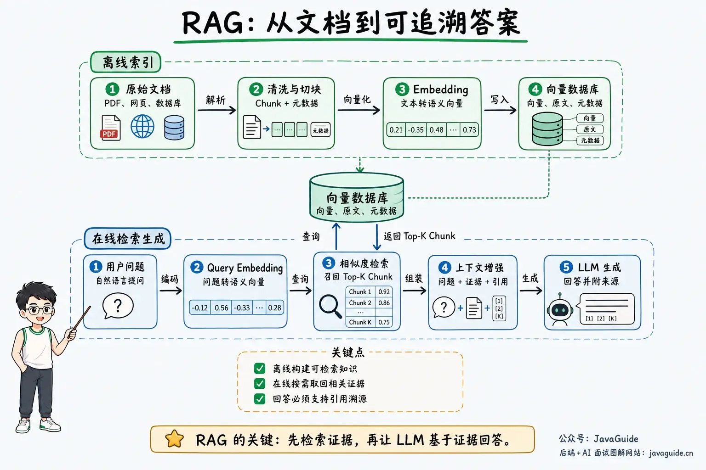
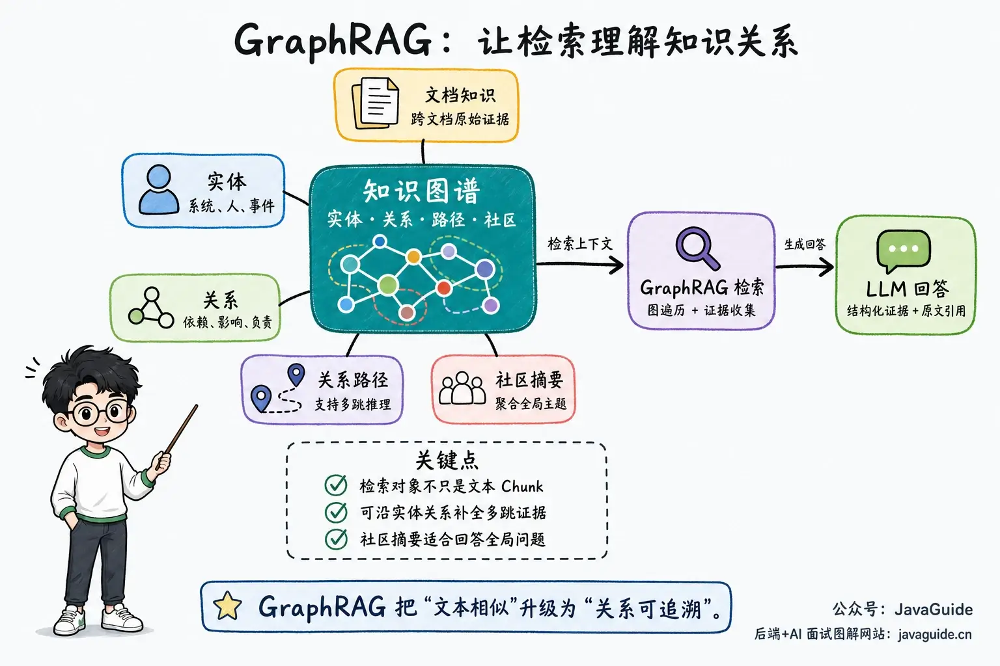
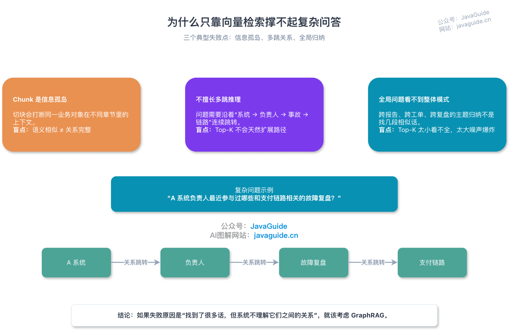
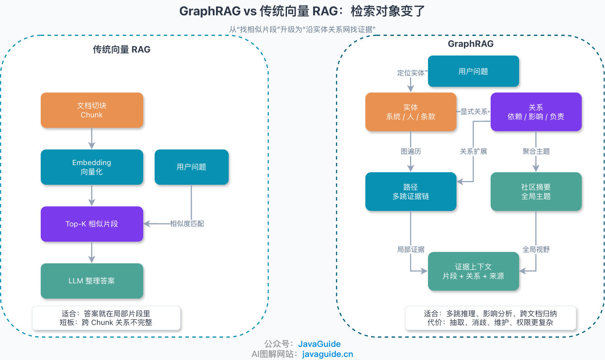
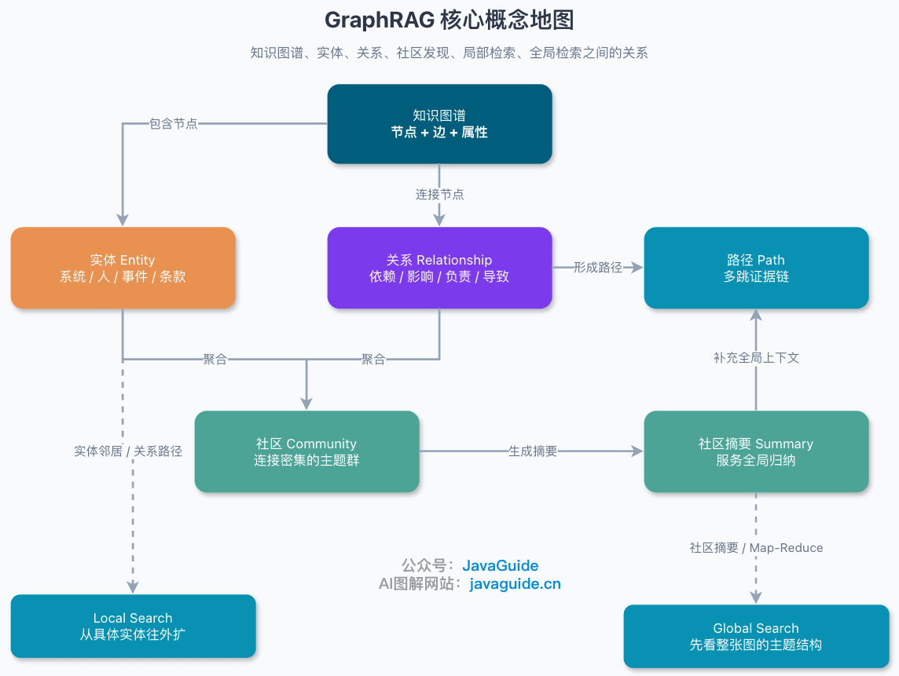
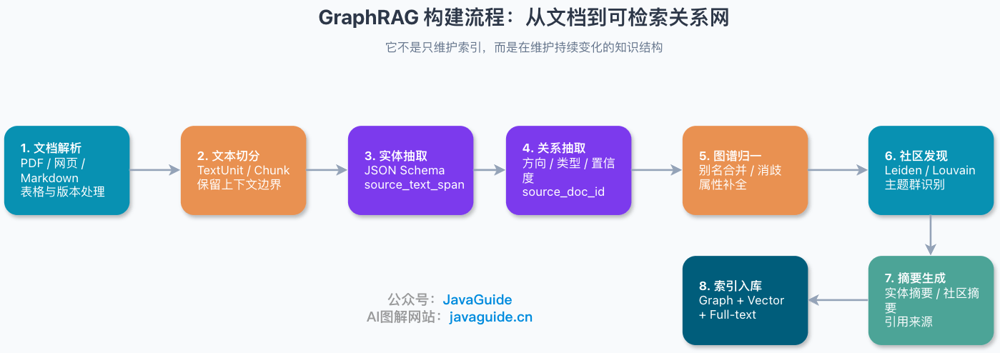
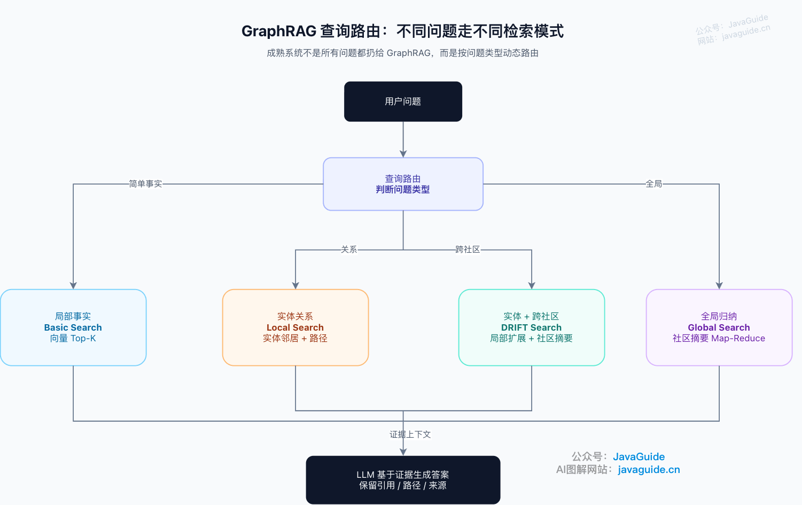
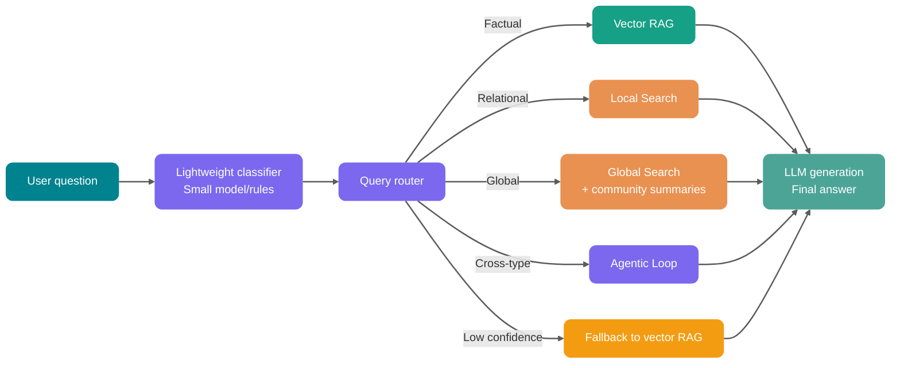

Questions such as "What risks have these departments repeatedly raised over the past six months, and how are they related?" require aggregating information about departments, risks, projects, suppliers, and time across documents. Top-K vector retrieval can find similar passages, but it does not automatically preserve relationships between these objects.

GraphRAG adds graph structure to the retrieval pipeline and organizes cross-document evidence through entities, relationships, or topic summaries. Whether it is worth introducing depends on whether failures in the existing RAG system center on multi-hop relationships and global synthesis.

## What Is RAG?



Retrieval-Augmented Generation (RAG) combines information retrieval with generative large language models.

The core idea is to retrieve relevant context from external knowledge sources, such as databases, document collections, or enterprise knowledge bases, before asking an LLM to answer a question or generate text. The LLM receives both the original question and the retrieved context, which can make its answers more accurate, current, and domain-specific.

Traditional RAG usually retrieves chunks, or individual text passages. It works well when the answer is contained in a few passages, such as policy questions, API documentation questions, and queries about local facts in a knowledge base.

## What Is GraphRAG?



Graph-based Retrieval-Augmented Generation (GraphRAG) is a family of approaches that use graph structures for retrieval augmentation. A system explicitly models entities, relationships, and structured context from documents, follows graph relationships to gather evidence at query time, and passes that evidence to an LLM to generate an answer.

GraphRAG is a broad term; indexing and query methods vary across implementations. Community summaries, Global Search, Local Search, and DRIFT Search are mainly associated with Microsoft's GraphRAG approach. Neo4j-centered implementations can also use property graphs, Cypher, full-text search, and vector retrieval directly, without first generating community summaries.

GraphRAG can include nodes, edges, paths, and community summaries in the retrieval context. A graph database is one way to store this data.

Traditional vector RAG retrieves chunks, or individual text passages. GraphRAG retrieves nodes, edges, paths, and community summaries from a knowledge graph, then combines them with source text as evidence for the answer.

As an analogy:

- **Vector RAG** is like finding a few semantically similar pages in a library.
- **GraphRAG** is like organizing relationship diagrams, event timelines, and topic indexes, then following those connections to find evidence.

Vector RAG is good at judging whether a passage is similar to a query. GraphRAG is better at representing how the objects in those passages are connected.

## What Are the Limitations of Traditional Vector RAG?



Vector retrieval encodes documents and the query in the same vector space, retrieves the Top-K chunks by similarity, and passes them to the LLM. This short pipeline suits questions whose evidence is concentrated in a few passages, such as:

- "What is the refund process?"
- "What is the rate limit for this API?"
- "How do I configure a vector database in Spring AI?"

The key constraints for these questions are usually in the same passage as the answer. Once that passage is retrieved, the model only needs to extract or organize the information.

Cross-document questions are different. Ownership, dependency chains, and incident reports may appear in separate chunks, so the answer requires connecting evidence across them.

### 1. Chunks Are Isolated Pieces of Information

Chunking turns long documents into searchable units, but can split facts across sections. For example, a system's definition, owner, database dependencies, and incident history may appear in different sections. Once indexed, they may no longer share an explicit business identifier.

Similarity can rank related passages highly, but that does not mean the system has identified them as upstream or downstream evidence for the same system. Semantic similarity and complete relationship modeling are different things.

### 2. Vector Similarity Is Not Good at Multi-Hop Reasoning

Suppose the user asks:

> "Which incident reviews related to the payment flow has the owner of System A recently participated in?"

Answering requires several constrained hops: find the owner of System A, identify the incident reviews that person participated in, then filter for those related to the payment flow.

The system description and payment incident review may both be retrieved, but Top-K alone does not tell the retriever to complete the evidence along `system -> owner -> review -> flow`.

### 3. Top-K Passages Struggle with Global Questions

Another class of questions is more difficult:

- "What are the main categories of customer complaints in this dataset?"
- "Which architectural risks have repeatedly appeared in the company's knowledge base over the past year?"
- "What strategic themes do these reports collectively point to?"

These questions require corpus-wide aggregation and thematic synthesis, while one Top-K retrieval sees only a local window:

- Too few passages hide the overall patterns.
- Too many passages cause token costs and noise to grow rapidly.

Increasing Top-K, adding reranking, or rewriting queries can improve candidate quality, but these techniques still focus on ranking passages. More candidates do not solve the problem when relationship chains or global themes are not represented explicitly.

## How Does GraphRAG Differ from Traditional Vector RAG?



| Dimension          | Traditional vector RAG                           | GraphRAG                                                                              |
| ------------------ | ------------------------------------------------ | ------------------------------------------------------------------------------------- |
| Retrieved objects  | Text chunks                                      | Entities, relationships, paths, community summaries, and source passages              |
| Core capability    | Semantic similarity retrieval                    | Relationship reasoning, graph traversal, global thematic aggregation                  |
| Data structure     | Primarily a vector index                         | Knowledge graph + vector index + full-text index                                      |
| Suitable questions | Local factual questions and passage explanations | Multi-hop relationship questions, cross-document synthesis, complex business analysis |
| Explainability     | Mainly based on cited passages                   | Can show nodes, relationships, paths, and sources                                     |
| Construction cost  | Moderate; focused on chunking and Embeddings     | High; focused on extraction, entity resolution, modeling, and evaluation              |
| Query latency      | Usually low                                      | Depends on graph traversal, community summaries, and LLM calls                        |
| Maintenance cost   | Update chunks and vectors                        | Also maintain entities, relationships, communities, and summaries                     |
| Main risk          | Incomplete retrieved passages                    | Incorrect graph construction can cause systematic errors                              |

Decide whether to introduce a graph structure by examining failure cases from the existing RAG system. Missed keywords and split chunks differ from multi-hop entity questions and global synthesis; the first two usually call for checking parsing, chunking, and hybrid retrieval.

Entity and relationship extraction, entity resolution, graph storage, summaries, and incremental updates all add work. During evaluation, record indexing tokens and time, storage, query P95, and answer quality on the same corpus. Then compare whether graph retrieval improves the target questions.

If an interviewer asks how GraphRAG differs from standard RAG, you can answer:

> Standard vector RAG primarily retrieves text chunks and suits local factual questions. GraphRAG also stores entities, relationships, and topic structures. A query can expand from a semantic match along graph relationships or use community summaries for global questions. Entity resolution, relationship extraction, incremental updates, and access control then become part of the system.

If they ask when not to use GraphRAG, add:

> If the questions are mostly simple document queries, or the dataset is small and relationships are uncomplicated, vector RAG with hybrid retrieval and reranking is often more cost-effective. Use GraphRAG when vector RAG failure cases clearly point to multi-hop relationships, cross-document synthesis, or structured constraints.

## Core GraphRAG Concepts

To understand GraphRAG, start with a few key terms.



### Knowledge Graph: Represent Knowledge as Traversable Relationships

Knowledge graphs represent entities, concepts, and their relationships as nodes and edges.

- **Node**: An entity or concept, such as a user, system, order, incident, supplier, or policy clause.
- **Edge**: A relationship between entities, such as owns, depends on, affects, belongs to, causes, or cites.
- **Property**: Additional information attached to a node or edge, such as time, version, confidence, or source document.

For example:

```text
User Service --depends on--> Redis Cluster
Redis Cluster --experienced--> Connection Pool Exhaustion
Connection Pool Exhaustion --affected--> Order API
Alex Chen --owns--> User Service
```

Once these relationships are represented in a graph, the system can answer:

> "What recent risks affecting the order flow involve systems owned by Alex Chen?"

Vector RAG retrieves text passages; a knowledge graph represents connections between objects.

### Entities: The Basic Business Objects in GraphRAG

An **entity** is a core node in the graph.

In GraphRAG, an entity does not have to be a traditional knowledge-graph entity such as a person, place, or organization. It could also be:

- A business system, such as "Order Center."
- A technical component, such as a "Kafka consumer group."
- A policy clause, such as a "data-redaction requirement."
- A risk topic, such as "authorization bypass."
- A project event, such as a "payment-flow load test."

The quality of entity extraction sets the ceiling for GraphRAG. Entities that are too broad leave the graph without detail; entities that are too granular create duplicates and noise.

This step resembles domain modeling. A few engineering practices:

- **Constrain the extraction format with JSON Schema**: Avoid free-form text parsing and reduce post-processing costs.
- **Cover positive, negative, and edge cases in Few-shot examples**: Show the LLM what not to extract.
- **Set a maximum entity count**: Prevent over-extraction from long documents.
- **Require a `source_text_span` for every entity**: Support traceability and human review.

### Relationships: Explicitly Record Connections Between Objects

Relationships record connections between entities, such as dependency, impact, containment, and ownership.

Vector RAG may show that "Order Center" and "payment incident" are semantically similar, but it does not inherently tell you whether one depends on, affects, causes, or merely co-occurs with the other.

GraphRAG attempts to make relationships explicit:

```text
Order Center --calls--> Payment Gateway
Payment Gateway --depends on--> Risk Service
Risk Service --caused--> Transaction Timeout
```

With relationships, retrieval is no longer just similarity ranking; it can expand along graph paths:

- Find neighbors of an entity.
- Find upstream and downstream objects through a relationship type.
- Find the impact scope of an incident.
- Find communities related to a topic.

This is what enables GraphRAG to handle multi-hop questions.

### Community Detection: Find Topic Clusters in the Graph

**Community detection** is a common graph-algorithm task. It groups densely connected nodes into communities.

Community detection operates on the graph's connectivity. For example, if the following nodes are frequently connected across a document collection:

```text
Payment Gateway, Risk Service, Transaction Timeout, Rate-Limiting Policy, Canary Release, Alert Escalation
```

The graph algorithm may group these nodes into a community. "Payment stability" could be a label generated for that group during summarization.

The Microsoft GraphRAG approach typically extracts entities, relationships, and key claims, then uses algorithms such as Leiden or Louvain to build hierarchical communities and generate summaries for them. Global queries use these summaries to identify topics, while source documents remain available as traceable evidence.

### Global Search and Local Search

Two common terms in GraphRAG are **Global Search** and **Local Search**.

They serve different query scopes. **Local Search** expands from a known entity to its neighbors and related text. It suits questions such as:

- "Which services does Order Center depend on?"
- "Which projects are affected by this supplier?"
- "What are the upstream and downstream systems for this incident?"

The search starts from an entity and returns neighbors, relationship paths, and relevant source passages as context.

**Global Search** handles corpus-wide thematic questions, such as:

- "Which risk themes recur across these reports?"
- "What are the main categories of customer complaints?"
- "What architectural bottlenecks appear most often in engineering documents?"

These queries first aggregate community or topic summaries, which the model then synthesizes and ranks. This should not replace source-level verification of specific facts.

**DRIFT Search** adds community summaries to entity neighbors. It can supplement Local Search with topic context across communities when a question has a clear entity focus but needs broader background.

| Search mode   | Use case                                      | Core mechanism                                  |
| ------------- | --------------------------------------------- | ----------------------------------------------- |
| Basic Search  | General factual queries                       | Standard Top-K vector retrieval                 |
| Local Search  | Questions about a specific entity             | Expand to entity neighbors and related concepts |
| DRIFT Search  | Entity focus with cross-community connections | Local expansion plus community-summary context  |
| Global Search | Global thematic synthesis                     | Map-Reduce over community summaries             |

## GraphRAG Indexing and Query Flows

### Indexing: From Documents to a Graph

The document-to-graph pipeline is:



Indexing includes the following steps:

| Step                    | Operation                                                                      | Key risk                                                                       |
| ----------------------- | ------------------------------------------------------------------------------ | ------------------------------------------------------------------------------ |
| Document parsing        | Extract text from PDFs, webpages, Markdown, and database records               | OCR errors, lost table structure, inconsistent document versions               |
| Text chunking           | Split long documents into TextUnits or chunks                                  | Overly small chunks lose relationships; large chunks increase extraction costs |
| Entity extraction       | Identify systems, people, organizations, concepts, and events                  | Duplicate names, aliases, abbreviations, and noisy entities                    |
| Relationship extraction | Identify dependencies, containment, impact, causality, and other relationships | Wrong direction, overly generic types, or low confidence                       |
| Graph normalization     | Merge duplicate entities and add properties and sources                        | Entity resolution is costly and needs human rules and evaluation               |
| Community detection     | Find densely connected topic groups                                            | Sparse or noisy graphs reduce community quality                                |
| Summary generation      | Summarize communities, entities, and relationships                             | LLM summaries may omit constraints or introduce hallucinations                 |
| Indexing                | Write to graph, vector, and full-text indexes                                  | Incremental updates and permission filtering are complex                       |

Compared with maintaining only chunks and vectors, graph retrieval also requires entity normalization, relationship provenance, and updates to communities and summaries, expanding production and maintenance work.

### Querying: Classify the Question First

The most important step in GraphRAG querying is **query routing**.

Different questions need different retrieval methods:

| Question type       | Suitable retrieval method             | Example                                                           |
| ------------------- | ------------------------------------- | ----------------------------------------------------------------- |
| Local fact          | Vector retrieval or Local Search      | "What is this API's timeout?"                                     |
| Entity relationship | Local Search                          | "Which services does Order Center depend on?"                     |
| Multi-hop reasoning | Graph traversal plus vector evidence  | "Which incidents affecting the payment flow involved this owner?" |
| Global synthesis    | Community summaries and Global Search | "What are the main risk themes in these reports?"                 |
| Exact filtering     | Graph or structured query             | "Which projects depended on Supplier A in Q4 2025?"               |

The mapping from question types to retrieval modes is shown below:



A mature system does not send every question to GraphRAG. Vector retrieval is cheaper, faster, and more reliable for many simple questions.

## When Is GraphRAG a Good Fit?

GraphRAG is a good fit when answering requires connecting evidence through entity relationships, paths, or themes across documents. It expands data governance beyond chunks and vectors to entities, relationships, summaries, and their versions.

Consider a graph structure for questions such as:

- **Complex enterprise knowledge-base questions**: The query connects information across departments, policies, or project reviews, such as "Which departments are involved in this process, and what does each do?" or "Which historical policies conflict with this one?"
- **IT architecture and incident impact analysis**: Services, APIs, databases, message queues, owners, alerts, and incidents have natural dependencies. For example, "Which core APIs are affected by a Redis cluster failure?" or "Which systems depend on the same high-risk component?"
- **Finance, risk, compliance, and supply chains**: These domains focus on relationships among objects rather than similarity between text passages, such as customers and accounts, companies and beneficial owners, suppliers and projects, or contract clauses and regulations.
- **Cross-document thematic synthesis**: To identify patterns in interview notes, research reports, support tickets, or incident reviews, community summaries can group the corpus into topics for the LLM to synthesize.

Improving vector or hybrid retrieval is usually more cost-effective when:

- **The dataset is small and questions are simple**: If the knowledge base contains only dozens of documents and questions mostly ask "What is this rule?", vector RAG with hybrid search and reranking is often more cost-effective.
- **Document quality is poor**: If source documents omit subjects, mix versions, use inconsistent terminology, or contain badly parsed tables, the extracted graph will also be noisy. Vector RAG may retrieve the wrong passages; GraphRAG may build an entire relationship network in the wrong direction.
- **Very low latency is required**: Entity and relationship extraction, community detection, and summary generation all increase update costs. If data must be visible within seconds, carefully evaluate incremental graph updates and summary refreshes.
- **The team lacks graph modeling and evaluation expertise**: GraphRAG requires ongoing decisions about which entities to model, how to define relationship types, how to resolve entities, how to evaluate graph errors, and where to apply permission filters. Without an owner for this work, it can become an expensive, opaque system.

The decision sequence is simple: if relevant text is missing from the candidate set, first investigate parsing, chunking, and retrieval. If all the text is present but the system cannot connect it through business relationships, then evaluate GraphRAG.

## What Problems Can Neo4j GraphRAG Solve?

The Neo4j approach puts a graph database at the center of the query pipeline. Vector or full-text search first locates entity or document nodes. Cypher then queries neighbors, paths, and properties through controlled relationships, and the LLM receives the original passages alongside the paths.

A query can be divided into these steps: identify a starting node, traverse relationships, assemble node properties and source evidence, and generate an answer. The application is responsible for the graph Schema, relationship direction, and query constraints; these are not details to add after the model has generated an answer.

The `neo4j-graphrag` Python package supports graph ingestion, vector indexes, and several retrievers. A retrieval pipeline can combine full-text, vector, and Cypher queries based on the question; it does not have to start with vector matches and then traverse relationships.

| Retrieval mode                              | How it works                                                                                               | Suitable questions                                                            |
| ------------------------------------------- | ---------------------------------------------------------------------------------------------------------- | ----------------------------------------------------------------------------- |
| **VectorRetriever**                         | Searches a Neo4j vector index and returns matching nodes and scores                                        | General semantic retrieval and candidate-entity search                        |
| **VectorCypherRetriever**                   | Finds nodes through vector search, then expands context with a Cypher query                                | "Find similar documents and include related entities, paths, and properties"  |
| **HybridRetriever / HybridCypherRetriever** | Combines vector and full-text indexes, with Cypher to add graph context if needed                          | Enterprise knowledge bases where both keywords and semantics matter           |
| **Text2Cypher**                             | The LLM generates Cypher from the graph Schema, and another LLM organizes the query results into an answer | Exact structured filters, multi-condition queries, and report-style questions |
| **ToolsRetriever**                          | Wraps multiple retrievers as tools so the LLM can select based on query intent                             | Complex query routing and combinations of retrievers                          |
| **External vector database + Neo4j**        | Stores vectors in Weaviate, Pinecone, Qdrant, or another system, then maps them to Neo4j nodes             | Existing vector infrastructure that should remain outside Neo4j               |

Distinguish `VectorCypherRetriever` from `Text2Cypher`. The former uses vector results to identify starting nodes, then runs a constrained Cypher query. After matching "Payment Gateway," for example, it can traverse `[:DEPENDS_ON]`, `[:AFFECTS]`, or `[:OWNER]` to find upstream and downstream systems, affected areas, and owners while preserving the paths.

`Text2Cypher` suits structured filters such as "Which high-priority projects depended on Supplier A in Q4 2025?" Restrict it with a Schema allowlist, query validation, a read-only account, result limits, and timeouts. For high-risk queries, prefer fixed templates or a semantic layer; do not give an LLM unrestricted Cypher execution.

Relationships among objects are central to areas such as financial risk, supply chains, IT asset management, access governance, and incident impact analysis. Neo4j GraphRAG's advantage is that it **connects the LLM to existing business relationships instead of asking it to infer them from text every time.**

## What Other GraphRAG Implementations Are Available?

Besides Neo4j, several common approaches are worth considering.

| Implementation                                 | Core idea                                                                                                                                                                    | Suitable when                                                                                          |
| ---------------------------------------------- | ---------------------------------------------------------------------------------------------------------------------------------------------------------------------------- | ------------------------------------------------------------------------------------------------------ |
| **LangChain + Neo4j**                          | Connects to Neo4j with `Neo4jGraph`; components such as `GraphCypherQAChain` convert natural language to Cypher and generate answers from query results                      | Already use LangChain / LangGraph and want to add a graph database to an Agent or RAG pipeline quickly |
| **LlamaIndex PropertyGraphIndex**              | Extracts entities and relationships from document chunks through `kg_extractors` and builds a queryable property-graph index                                                 | Document ingestion, indexing, and querying already use LlamaIndex                                      |
| **FalkorDB GraphRAG SDK**                      | Builds GraphRAG on a graph database with OpenCypher, full-text indexing, vector similarity, and range indexes                                                                | Want to try a graph database other than Neo4j or prioritize low-latency, multi-tenant graph queries    |
| **Lightweight custom graph + vector database** | Stores a small set of core entity relationships in business or edge tables, retrieves candidate text with the vector database, and adds context from the relationship tables | Want to validate GraphRAG in a first iteration without introducing a complete graph database           |

These approaches have different tradeoffs. Graph databases focus on online path queries. Frameworks such as LangChain and LlamaIndex reuse existing ingestion and Agent components. A lightweight custom implementation limits the first version by reducing the number of entity and relationship types.

Consider Neo4j when a stable business graph already exists and queries require explicit relationship constraints. If document indexing and Agents already use LangChain or LlamaIndex, first evaluate their graph retrieval components. If the goal is only to test whether relationship expansion improves a set of failures, a small edge table or model of core entities makes the result easier to observe.

## GraphRAG Engineering Challenges

Graph databases can store and traverse graphs. Extraction, entity resolution, version management, permission filtering, and incremental maintenance before text enters the graph determine whether the relationships are useful for retrieval.

Vector RAG mainly maintains documents, chunks, and indexes. Graph retrieval must also keep entities, relationships, sources, and permissions consistent. Synchronizing these objects is a common source of failures.

### 1. Entities Are Easy to Duplicate, Misidentify, or Over-Split

The same entity may have several names:

```text
Order Center, Order Service, order-service, OMS
```

Are these names the same entity? When should they be merged or kept separate?

Do not rely on the LLM to guess. Production systems usually need:

- A terminology dictionary.
- An alias table.
- Rule-based matching.
- Human review.
- Confidence thresholds.
- An evaluation set.

Poor entity resolution creates duplicate nodes and breaks retrieval paths.

### 2. Incorrect Relationship Direction Causes Systematic Errors

Relationships are even more error-prone than entities.

"A depends on B" and "B depends on A" differ only in direction but have opposite engineering meanings. LLMs can also extract causality, impact, and containment relationships incorrectly.

In production, add fields such as these to each relationship:

| Field                      | Purpose                                                                    |
| -------------------------- | -------------------------------------------------------------------------- |
| `source_doc_id`            | Trace the source document                                                  |
| `source_span`              | Trace the source location                                                  |
| `confidence`               | Record extraction confidence                                               |
| `relation_type`            | Constrain the relationship type                                            |
| `updated_at`               | Support incremental updates                                                |
| `extraction_model_version` | Support differential re-extraction and A/B comparison after an LLM upgrade |

Do not use a graph without source traceability directly for high-risk questions.

### 3. Community Summaries Are Not Free

Community summaries support corpus-wide synthesis, but generating or updating them requires additional LLM calls:

- Extract entities and relationships.
- Generate entity descriptions.
- Generate community summaries.
- Refresh relevant summaries when the source is updated.

As the corpus grows, entity extraction and summary refreshes increase indexing costs. First validate answer quality on a small set of global questions, then decide whether to add hierarchical community summaries and Global Search.

### 4. Updating One Document Can Affect a Large Part of the Graph

In ordinary vector RAG, updating a document usually means deleting its old chunks and writing new chunks and vectors.

Updating a document may require recalculating or invalidating:

- Entity nodes.
- Relationship edges.
- Community assignments.
- Community summaries.
- Entity summaries.
- Vector indexes.
- Permission indexes.

Full rebuilds increase costs, while incremental updates require tracking sources and dependency scope. The system maintains more than vector indexes: entities, edges, and summaries all change when documents change.

### 5. Permission Filtering Must Go Beyond Documents

Access control is essential in enterprise knowledge bases.

Vector RAG commonly applies Metadata filters before or during retrieval. GraphRAG must also consider:

- If a user can view a node, can they also view its neighbors?
- If a user can view an edge, can they view the other entity it connects to?
- Do community summaries include information from documents the user cannot access?
- Could a global summary expose sensitive topics?

When multiple sources contribute to a community summary, content from an inaccessible document may already be included. Filtering by document ID at query time cannot remove that content; enforce permission boundaries during summary generation:

- Generate separate summaries for stable permission partitions, and use only partitions the current user can fully access. Do not pre-generate cross-permission summaries when permission combinations change frequently.
- Keep all source document IDs in each summary for auditing and invalidation. Source IDs cannot filter sensitive content already incorporated into a summary, so an intersection of permissions is not sufficient authorization.
- For highly sensitive corpora or frequently changing permissions, use authorized local retrieval and add source evidence to the model context only after access checks.

## How Would You Implement GraphRAG in a Project?

Start with a vector RAG baseline and a small number of high-value relationships. Expand the graph only after confirming the benefits.

### Stage 1: Establish a Vector RAG Baseline

First, make sure these fundamentals work well:

- Reliable document parsing.
- An evaluable chunking strategy.
- Hybrid vector and BM25 retrieval.
- A pluggable reranker.
- Traceable citation sources.
- Reliable access-control filtering.

If these fundamentals are not in place, GraphRAG will only make the problems more complex.

### Stage 2: Collect Relationship-Related Failures

Before introducing a graph, categorize production failures by cause:

| Failure type                                   | Is GraphRAG suitable?                   |
| ---------------------------------------------- | --------------------------------------- |
| A keyword was not retrieved                    | Improve BM25 and query rewriting first. |
| Chunking is poor                               | Improve chunking first.                 |
| Requires reasoning across entity relationships | A graph structure may help.             |
| Requires global thematic synthesis             | Community summaries may help.           |
| Requires exact filters and access constraints  | Combine with structured queries.        |

Graph investment has a verifiable goal only when relationship reasoning and global synthesis recur in the failure set. Otherwise, fix the preceding issues in the table first.

### Stage 3: Start with a Lightweight Graph

The first version does not need a complete knowledge graph.

Start with a lightweight implementation:

- Extract only core entities, such as systems, APIs, owners, incidents, and policy clauses.
- Keep only a few high-value relationships, such as dependency, ownership, impact, membership, and citation.
- Use the graph to expand retrieval, not as the sole basis for final factual judgments.
- Retain source evidence for every relationship.

This provides a low-cost way to test whether GraphRAG improves business metrics.

### Stage 4: Add Community Detection and Global Search

Consider community detection and summaries when the corpus grows and global questions become more common.

Evaluate the following at this stage:

- Whether community assignments match business intuition.
- Whether summaries omit key constraints.
- Whether global answers have reliable citations.
- Whether summaries are safe for users with different permissions.

If evaluation is not adequate, do not enable global retrieval for high-risk use cases.

### Stage 5: Add Hybrid RAG Routing as Needed

If the same entry point handles factual, relational, and global synthesis questions, route requests dynamically by type:



Key design points: Make the entry classifier explainable, define a clear fallback strategy, and keep query-routing logs traceable.

## How Do You Evaluate GraphRAG?

Record separately whether the graph retrieved the right evidence and whether the model answered based on it. Then check whether these changes affect business outcomes.

### Retrieval Metrics

- **Entity recall / relationship recall**: Whether retrieval results include the entities and relationships needed for the answer.
- **Community consistency**: Whether sampled communities match business topics.

### Generation Metrics

- **Faithfulness**: Whether the generated answer is supported by retrieved context; this can be measured with RAGAS.
- **Answer Relevance** and **Context Precision**: Whether the answer addresses the question and the context passed to the model is useful.

### Business Metrics

- **User acceptance, human-escalation, and citation click-through rates**: Measure real-world usage.
- **Regression test set**: Include production failures and high-risk questions. Add samples based on traffic, change frequency, and human-labeling capacity.

## Comparison with Other RAG Enhancement Approaches

GraphRAG is not the only way to enhance RAG. Compare it with other approaches when making a technology choice:

| Approach                                      | Problem addressed                                | Problem not addressed                                      |
| --------------------------------------------- | ------------------------------------------------ | ---------------------------------------------------------- |
| **Multi-vector (ColBERT / late interaction)** | Fine-grained matching within chunks              | Relationship questions                                     |
| **HyDE / Query Rewriting**                    | Differences between query and document wording   | Multi-hop reasoning                                        |
| **Self-RAG / Corrective RAG**                 | Answer reliability                               | Retrieval structure                                        |
| **GraphRAG**                                  | Relationship retrieval and some global synthesis | Graph extraction, entity resolution, and maintenance costs |

GraphRAG is one approach to relationship retrieval and global synthesis, but not the only one. RAPTOR, iterative multi-hop retrieval, Agentic Retrieval, or business-specific structured queries can address some of the same problems. Compare benefits and costs on the same evaluation set.

<!-- @include: @rag-project.snippet.md -->

## Selection Checklist

First distinguish failure types. If relevant text was not retrieved, check parsing, BM25, vector search, and reranking. If relevant text was retrieved but the question depends on explicit entity relationships, multi-hop evidence, or themes across documents, evaluate a graph structure. During a pilot, limit entities and relationships to a few high-value types and retain source locations, versions, and permissions for every relationship.

## Summary

GraphRAG expands retrieval from chunks to entities, relationships, paths, and community summaries. This makes the evidence structure for multi-hop reasoning, impact analysis, and cross-document themes explicit.

The costs are also clear: extraction quality, entity resolution, relationship direction, version updates, and permission boundaries all need dedicated governance. If a business graph already exists, Neo4j graph queries can participate directly in retrieval. Systems using LangChain or LlamaIndex can first evaluate their graph retrieval components. The final choice depends on the existing stack, graph size, and maintenance capacity.

Attribute failures to their cause: if source text was not retrieved, improve parsing, chunking, and retrieval first. Evaluate GraphRAG when the source text is present but the system cannot establish the required relationships.

## References

- [Neo4j: What Is GraphRAG?](https://neo4j.com/blog/genai/what-is-graphrag/)
- [Neo4j GraphRAG Python Package](https://neo4j.com/docs/neo4j-graphrag-python/current/)
- [Neo4j GraphRAG RAG User Guide](https://neo4j.com/docs/neo4j-graphrag-python/current/user_guide_rag.html)
- [LangChain Neo4j Integration](https://docs.langchain.com/oss/python/integrations/graphs/neo4j_cypher)
- [LlamaIndex PropertyGraphIndex](https://developers.llamaindex.ai/python/framework/module_guides/indexing/lpg_index_guide/)
- [FalkorDB Docs](https://docs.falkordb.com/)
- [RAPTOR: Recursive Abstractive Processing for Tree-Organized Retrieval](https://arxiv.org/abs/2401.18059)
- [GraphRAG: Enterprise Knowledge Retrieval from RAG to GraphRAG](https://juejin.cn/post/7618261670406438964)
- [RAGAS evaluation framework](https://docs.ragas.io/)
