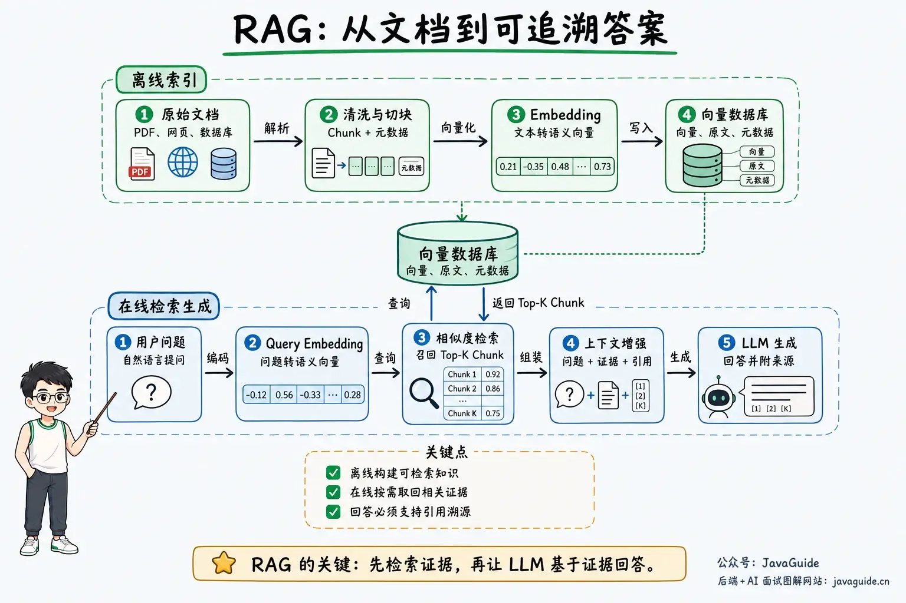
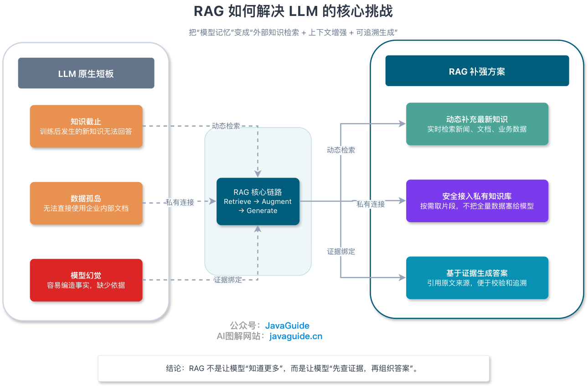
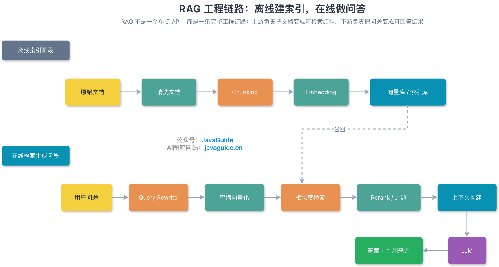
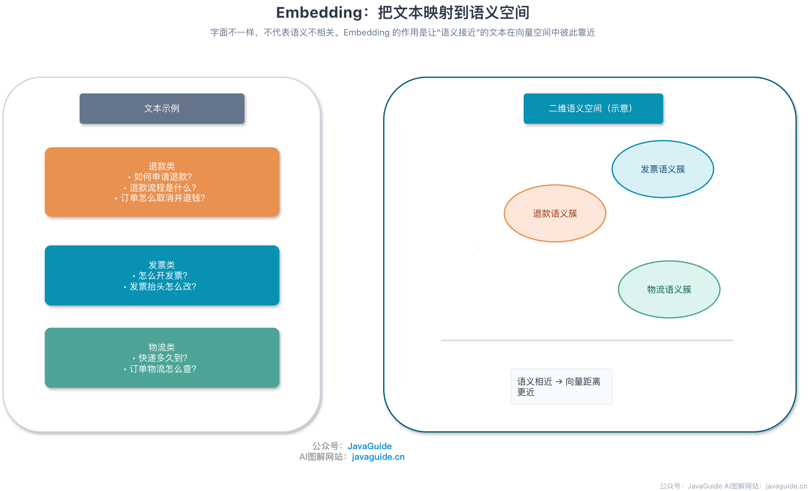
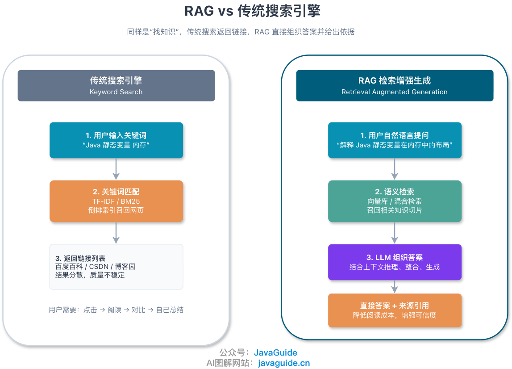
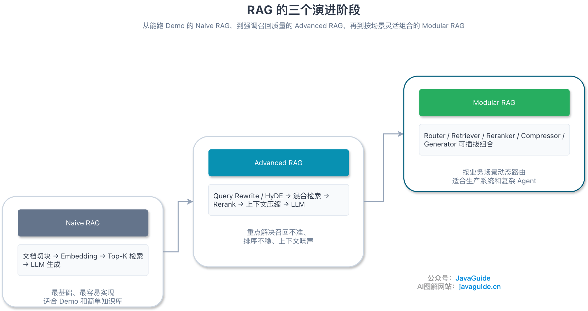

For enterprise knowledge-base Q&A, teams often start by putting documents directly into the LLM context. This can work for a few documents, but once the knowledge base grows to hundreds of thousands or millions of words, a single request can quickly hit the Token limit or increase time to first token. Enterprise systems must also handle document updates, access control, source attribution, and call costs, so they cannot support routine queries by concatenating the entire knowledge base into the context.

RAG retrieves relevant passages from a knowledge base before the model generates an answer, then places those passages in context so the response can be grounded in verifiable evidence. Errors in retrieval, context organization, or generation can still make the final answer diverge from the source.

## What Is RAG?

**RAG (Retrieval-Augmented Generation)** combines information retrieval with LLM generation. The system first retrieves passages related to the current question from a database, document collection, or internal enterprise system. It then combines those passages with the original question in a prompt, allowing the LLM to answer based on retrieved material rather than relying only on knowledge encoded in its pretrained parameters.

## Why Use RAG?

Using a pretrained LLM directly for enterprise Q&A usually presents three problems:

1. **Knowledge freshness is limited**: A pretrained model's knowledge reflects the training-data cutoff. The model does not know about policies, product manuals, or live business data published later. These must be supplied dynamically through retrieval or tool calls.
2. **Private data cannot be used directly**: Enterprise product documents, policies, and customer data cannot simply be added to a public model's training set. RAG retrieves only relevant passages the user is authorized to access and adds them to context, allowing the system to answer from internal knowledge without retraining the model.
3. **Factual hallucinations are hard to verify**: An LLM may produce a plausible but incorrect conclusion without supporting evidence. RAG can reduce unsupported claims by providing source material and asking the model to answer from it with citations. It does not eliminate hallucinations: missed retrievals, noisy context, incorrect citations, or failure to follow instructions can still produce wrong answers. Production systems also need citation checks, refusal behavior, and evaluation feedback.

## Common RAG Use Cases

RAG suits use cases where answers depend on external information, documents are long, or content changes frequently. Common applications include:

- Customer service and after-sales support: Use product manuals for troubleshooting and process guidance, such as return policies or device error codes.
- Development and operations assistants: Search code repositories, API documentation, alert runbooks, and historical tickets to help diagnose incidents and draft fixes.
- Medical and clinical assistance: Retrieve clinical guidelines, drug information, and institutional protocols to explain test results or contraindications for clinicians to review.
- Legal and compliance search: Retrieve regulations, case law, and contract templates to compare clauses and flag risks.
- Internal enterprise knowledge assistants: Connect HR and finance policies, SOPs, meeting notes, and technical proposals for cross-document Q&A, summaries, and comparisons.

## Why Do Some Enterprises Prefer Traditional Search to RAG?

Many enterprises retain traditional search because everyday tasks often require locating a document, not having a model read it and generate a conclusion.

If a user wants to download a policy, check an API definition, or find a contract template, returning a list of documents for a keyword query is more direct. The workflow is shorter, costs less, and gives more predictable results. RAG also has to assemble context and call an LLM after retrieval. Generation adds time to first token, Token costs, and the risk of summarization errors.

Choose between traditional search and RAG based on whether the user wants to find source material or synthesize a conclusion from multiple sources.

| Dimension                | Traditional search                                                 | RAG (retrieval + generation)                                                              |
| ------------------------ | ------------------------------------------------------------------ | ----------------------------------------------------------------------------------------- |
| User goal                | Find documents, pages, or attachments                              | Get a readable answer, summary, or comparison directly                                    |
| Latency and cost         | Usually lower and easier to scale                                  | Higher; requires retrieval and LLM inference                                              |
| Control and auditability | Strong; returns source links directly                              | Lower; may misinterpret or summarize inaccurately, so citations and evaluation are needed |
| Risks                    | Low; mainly retrieval and ranking issues                           | Higher; includes hallucinations, incorrect citations, and unauthorized disclosure         |
| Data governance          | Relatively mature; ACLs and field filtering are straightforward    | More complex; requires retrieval filters, context redaction, and log governance           |
| Use cases                | Search by ID, title, or keyword; find templates or source policies | Customer support, troubleshooting, policy explanations, and cross-document synthesis      |
| Common practice          | Elasticsearch/BM25 with access filters                             | Hybrid retrieval, reranking, source attribution, access filtering, and evaluation         |

In practice, many enterprises keep both options: use search for simple lookups and RAG for complex questions to balance response time and answer quality.

## How Does RAG Work?

The RAG workflow has two stages: offline indexing and online retrieval and generation. Offline processing converts source documents into searchable data structures. When a user asks a question, the online stage interprets the query, retrieves passages, builds context, and generates an answer.

The offline indexing stage generally includes:

1. **Ingest and parse documents**: Extract text, tables, and structure from PDFs, Word files, web pages, Markdown, or database records.
2. **Clean and remove noise**: Remove garbled text, repeated headers and footers, meaningless HTML tags, and other noise.
3. **Extract metadata**: Add fields such as source, update time, section path, tenant, and access-control list (ACL) for retrieval filtering and source attribution.
4. **Chunk documents**: Split long documents into smaller passages. Chunk size must balance semantic completeness, the embedding model's input limit, and retrieval accuracy. Large chunks can add irrelevant noise; small chunks can omit prerequisites. See [RAG Document Processing](./rag-document-processing.md) for chunking strategies.
5. **Generate embeddings**: Use an embedding model to map each text chunk to a high-dimensional dense vector. Common options include OpenAI `text-embedding-3-small` and `text-embedding-3-large`, as well as open-source models such as BGE and Qwen3-Embedding.
6. **Write to index storage**: Store vectors, source passages, and metadata in systems such as Milvus, pgvector, Elasticsearch, or OpenSearch. See [RAG Vector Stores](./rag-vector-store.md) for index algorithms and selection practices.

Offline indexes can be updated incrementally by scheduled batch jobs or change events. For files uploaded temporarily during a conversation, they can also be parsed online and written to a temporary index.

The online retrieval and generation stage typically follows these steps:

1. **Receive and rewrite the query**: Accept the user's natural-language question. When needed, rewrite or decompose the query, or extract metadata filters.
2. **Embed the query**: Convert it into a vector using the same embedding model used for offline indexing.
3. **Retrieve and rerank**: Apply metadata filters and retrieve candidate passages using vector similarity or hybrid keyword search, then use a reranking model to order them by relevance to the question.
4. **Assemble context (augmentation)**: Combine the reranked passages, original question, and system instructions (for example, answer only from the supplied material and cite sources) into a prompt.
5. **Generate the answer**: The LLM uses the context to produce an answer with links to supporting sources.

When retrieval is inconsistent, the cause is often chunk size, query rewriting, hybrid retrieval, or reranking. See [RAG Retrieval Optimization](./rag-optimization.md) for troubleshooting.

## What Are Embeddings?

Embedding maps text into a high-dimensional dense vector space, with semantically similar text placed closer together.

For example, consider these three questions:

- "How do I request a refund?"
- "What is the refund process?"
- "How can I cancel an order and get my money back?"

They use different words but express similar intent. After encoding with an embedding model, their vectors are close together. Even if a document is titled "Returns and Refunds Guide," vector search can retrieve it despite the wording differences.

Common embedding dimensions include 768, 1024, 1536, and 3072. The dimension is determined by the model architecture, so there is no general rule that a higher dimension is better. Higher dimensions also increase memory use, index-building time, and distance-computation cost. For example, OpenAI `text-embedding-3-small` outputs 1536 dimensions by default and `text-embedding-3-large` outputs 3072; both support reducing the output dimensions through Matryoshka Representation Learning with the `dimensions` parameter.

Embedding models generally fall into two groups: closed-source commercial APIs and open-source models that can be deployed privately:

| Type               | Examples                                                                                      | Suitable use cases                                                                                     |
| ------------------ | --------------------------------------------------------------------------------------------- | ------------------------------------------------------------------------------------------------------ |
| Closed-source APIs | OpenAI `text-embedding-3-small` / `text-embedding-3-large`, Cohere Embed, Jina Embeddings API | Ready-to-use services, multilingual quality, and less operations work                                  |
| Open-source models | BGE, Qwen3-Embedding, GTE, E5, and open-source Jina Embeddings                                | Data must stay within a private network, private deployment is required, or costs need tighter control |

For initial screening, public leaderboards such as MTEB (Massive Text Embedding Benchmark) can be useful. Final choices still need to be tested against the application's own questions for recall, latency, and deployment cost. If the corpus contains many internal abbreviations, proprietary model numbers, or specific error codes, general-purpose embeddings alone may not be enough; combine them with BM25 keyword search.

## How Is Vector Similarity Calculated?

Once text is converted into vectors, the retrieval system uses distance or similarity functions to measure how close a query vector is to a document vector. Three common metrics are:

| Metric                           | Meaning                                                 | Characteristics                                                                                             |
| -------------------------------- | ------------------------------------------------------- | ----------------------------------------------------------------------------------------------------------- |
| Cosine similarity                | Measures the alignment of the angle between two vectors | Not sensitive to vector magnitude; commonly used for semantic text retrieval                                |
| Inner product (dot product)      | Sums the products of corresponding vector dimensions    | For L2-normalized vectors, values and rankings are equivalent to cosine similarity, with faster computation |
| Euclidean distance (L2 distance) | Measures the straight-line distance between two points  | Affected by vector magnitude; for L2-normalized vectors, its ranking is also equivalent to cosine distance  |

If asked why cosine similarity is common in text retrieval, give two reasons. First, text length or term frequency can affect the magnitude of unnormalized vectors, while cosine similarity focuses on direction and more consistently reflects semantic alignment. Second, many major embedding models use cosine similarity or normalized inner product as a training objective. In production, the vector index's distance metric must match the metric recommended for the embedding model; otherwise, retrieval quality may decline or the index may not be used as intended.

## How Does RAG Differ from a Traditional Search Engine?

Traditional search engines and RAG both include retrieval, but they deliver different results. Traditional search ranks candidate documents and returns a list of links for users to open and compare. RAG puts retrieved passages into the LLM context, extracts and combines information across them, and generates an answer with citations.

Their main engineering differences are:

1. **Retrieval method**: Traditional search centers on inverted indexes and keyword matching such as BM25. Modern search may also add vector retrieval and ranking models. RAG retrieval is designed to provide high-signal evidence to an LLM and often combines vector search, BM25, metadata filters, parent-child chunk expansion, or graph retrieval.
2. **Result format**: Traditional search returns a list of documents or passages. RAG returns a natural-language answer or structured conclusion with citations for verification.
3. **Latency and cost**: Traditional search typically responds in tens of milliseconds with very low marginal cost. RAG adds LLM inference, often bringing time to first token to the order of seconds and consuming input and output Tokens for each request.

## How Should You Choose Between RAG and Fine-Tuning?

"Why not fine-tune the model directly?" is a common RAG interview question. The two approaches have different roles: RAG addresses a model's lack of external or current knowledge, while fine-tuning addresses inconsistent output style, format, or adherence to task-specific instructions.

Consider Q&A about enterprise policies. RAG is like an open-book exam: policy manuals are stored in an external vector database, relevant clauses are retrieved for each answer, and only the index needs updating when policies change. Fine-tuning is more like memorization for a closed-book exam: training changes the model's weights. Using fine-tuning to memorize frequently changing business rules requires long training and evaluation cycles, can still lead to mix-ups, and does not naturally provide source citations.

| Dimension             | RAG                                                                                                       | Fine-tuning                                                                                                               |
| --------------------- | --------------------------------------------------------------------------------------------------------- | ------------------------------------------------------------------------------------------------------------------------- |
| Knowledge updates     | Update the knowledge base or vector index                                                                 | Rebuild the training set, train, and evaluate the model                                                                   |
| Data security         | Keep knowledge in external storage and filter retrieval dynamically by user ACL                           | Patterns and information in training data enter model parameters, making fine-grained per-user access control difficult   |
| Hallucination control | Instruct the model to answer from retrieved sources and cite them                                         | The model generates from its parameters and may still invent details; citations are not directly tied to source documents |
| Cost structure        | Vector storage plus retrieval and context Tokens for each request                                         | Data cleaning and labeling, training compute, model hosting, and maintaining multiple versions                            |
| Use cases             | Knowledge-intensive Q&A, enterprise knowledge bases, policies, product documents, and current information | Style alignment, fixed output formats, domain terminology, and distilling specialized capabilities into smaller models    |
| Main risks            | Missed retrievals, noisy context, and missed access filters                                               | Catastrophic forgetting, overfitting, stale knowledge, and costly rollback or updates                                     |

In complex domains such as law, medicine, and financial research, the two approaches can also be combined: fine-tune the model on domain terminology, reasoning conventions, and fixed output formats, then use RAG to provide current business data and traceable source evidence. Most engineering teams should first stabilize the RAG workflow and evaluation set, then consider fine-tuning if the actual problem is instruction following or domain-specific style.

## Will Long Context Windows Replace RAG?

No. They complement each other. Their appropriate boundaries depend on data volume, call frequency, and governance requirements.

Long context windows, such as 128K to over 1M Tokens, suit one-off tasks that require reading a small number of complete documents, such as analyzing an entire financial-report PDF, understanding a small or medium-sized code module, or summarizing a long meeting transcript. These tasks require reading the full text; chunk-based retrieval may miss the overall context.

In enterprise knowledge-base scenarios, long context runs into four hard constraints:

1. **The knowledge base exceeds the context limit**: Enterprise documents, historical tickets, and contract libraries can contain tens or hundreds of millions of Tokens, far too much for a single request.
2. **Latency and call costs grow sharply**: Even if a knowledge base with hundreds of thousands of Tokens fits in a long-context window, every ordinary question would carry that much input (even with prefix caching). Time to first token and billing costs would be much higher than sending only a few thousand retrieved Tokens.
3. **Attention dilution (Lost in the Middle)**: When context contains many irrelevant documents, the model becomes less accurate at extracting key facts from the middle and is more likely to be distracted by similar but irrelevant clauses.
4. **Access control and auditability**: Enterprise knowledge bases must strictly filter visible content by tenant, role, and document ACL, and record which document and page an answer cited. RAG retrieval handles early permission filtering, reduces the evidence set, and attaches citation metadata.

## What Are the Stages in RAG's Evolution?

RAG architecture is commonly described in three stages:

| Stage        | Typical workflow                                                                             | Characteristics                                                                    |
| ------------ | -------------------------------------------------------------------------------------------- | ---------------------------------------------------------------------------------- |
| Naive RAG    | Chunk documents → generate embeddings → Top-K retrieval → LLM generation                     | Simplest to implement; suitable for demos and basic knowledge bases                |
| Advanced RAG | Query rewriting / HyDE → hybrid retrieval → reranking → context compression → LLM generation | Addresses inaccurate retrieval, noisy context, and unstable ranking                |
| Modular RAG  | Combine pluggable retrievers, rerankers, compressors, routers, generators, and other modules | Dynamically routes by use case; suitable for production systems and complex agents |

Naive RAG can quickly produce a working prototype, but complex real-world documents may expose structural damage from chunking, missed retrieval of specialized terms, and inaccurate Top-K rankings. Advanced RAG adds query rewriting before retrieval, hybrid retrieval and reranking during retrieval, and context compression afterward. Modular RAG goes further by separating parsing, routing, retrieval (vector, full-text, SQL, and graph), and self-checking into orchestratable modules that can be selected dynamically by question type.

## What Are RAG's Engineering Limitations?

RAG offers benefits for knowledge updates, private-data isolation, and source attribution. In production, teams should also evaluate five engineering costs:

1. **Retrieval quality sets the upper limit for answers**: If PDF tables are misparsed or a prerequisite is cut off during chunking, evidence that never enters the candidate set cannot be recovered by even the strongest downstream LLM.
2. **Noisy context can mislead generation**: If retrieved passages include outdated documents or rules for similar products, the model may combine conditions from different sources into an incorrect conclusion.
3. **End-to-end latency increases**: A request may involve query rewriting, embedding, multiple retrieval methods, Cross-Encoder reranking, and LLM generation. Each step adds latency, so high-concurrency systems need caching, timeouts, and fallbacks.
4. **Consistency across storage systems is complex**: When documents or permissions change, the vector database, full-text index, and metadata store must be updated together. Otherwise, deleted data or content the user can no longer access may still be retrieved. See [RAG Knowledge-Base Update Strategies](./rag-knowledge-update.md).
5. **Ongoing Token and operational costs**: RAG avoids model-training costs, but every query includes retrieved passages as input Tokens and requires maintaining vector indexes and offline evaluation pipelines.

<!-- @include: @rag-project.snippet.md -->

## Summary

RAG's core value is grounding LLM answers in external evidence that can be retrieved, cited, and access-controlled.

Three guidelines can help with technology selection:

1. Use traditional search when users only need to locate source files. Use RAG when they need synthesis, summaries, or answers across passages.
2. Prefer RAG when knowledge changes frequently, access must be permission-filtered, and answers need citations. Consider fine-tuning to adjust style, enforce a fixed output format, or distill specialized capabilities.
3. Use long context to read a single long document in full. For knowledge-base Q&A across many documents, use RAG to narrow the evidence first.

A working demo only proves that a vector store is connected. Production RAG work is mostly about document-parsing quality, tuning hybrid retrieval and reranking, keeping incremental updates consistent, and running regressions against a fixed evaluation set.

Use these common interview questions to review your understanding:

- What is RAG, and which limitations of LLMs does it address?
- How does RAG differ from traditional search, and when is RAG unnecessary?
- How should RAG and fine-tuning be chosen, and when should they be combined?
- How should an embedding model be selected for RAG, and why is the MTEB leaderboard alone insufficient?
- How do cosine similarity, inner product, and Euclidean distance differ? How are they related for normalized vectors?
- Why can hallucinations still occur with RAG, and which stages should be investigated?
- What is the Lost in the Middle problem, and why can long context windows not fully replace RAG?
- What are the key differences among Naive RAG, Advanced RAG, and Modular RAG?
