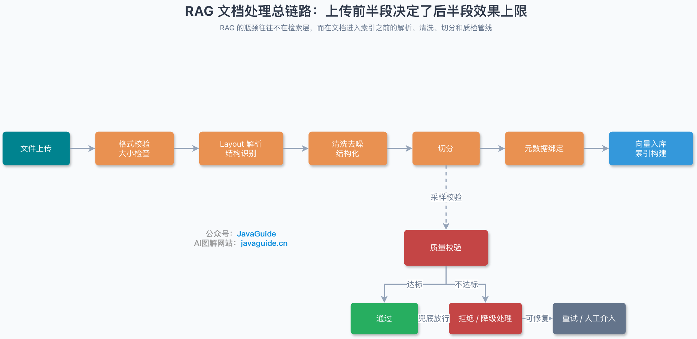
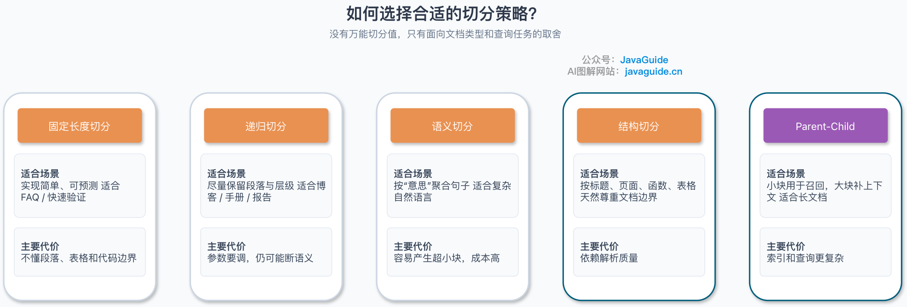
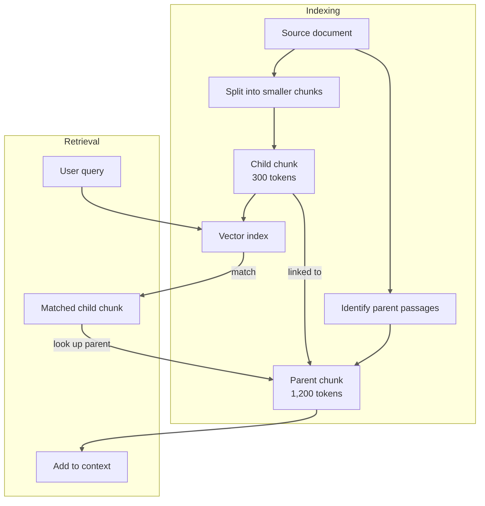
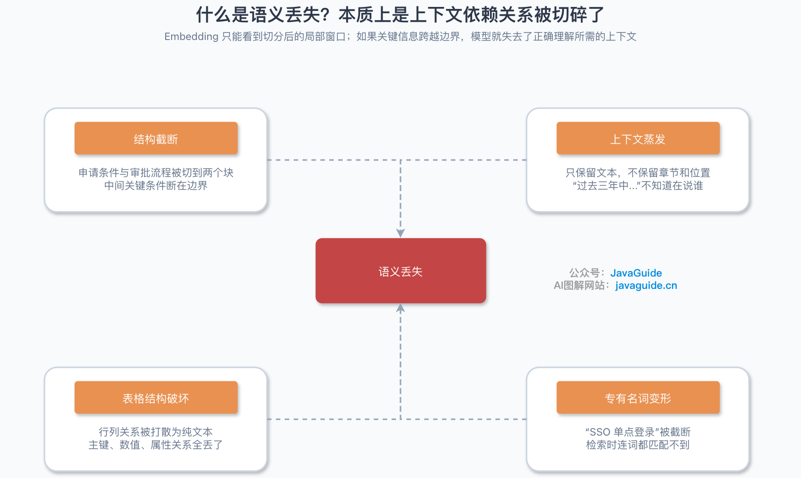
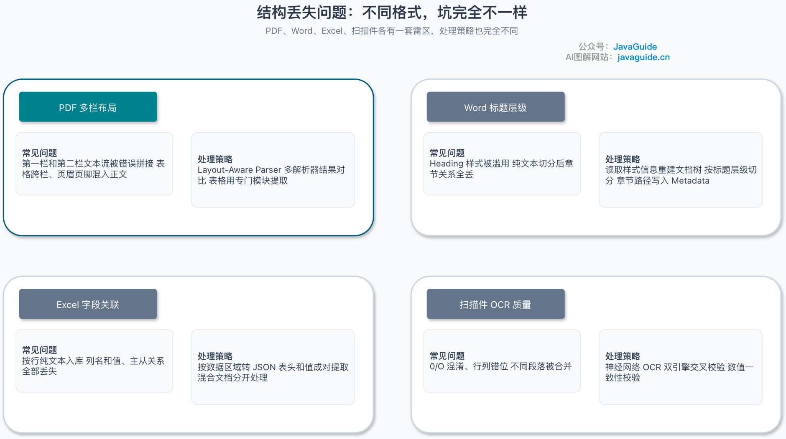
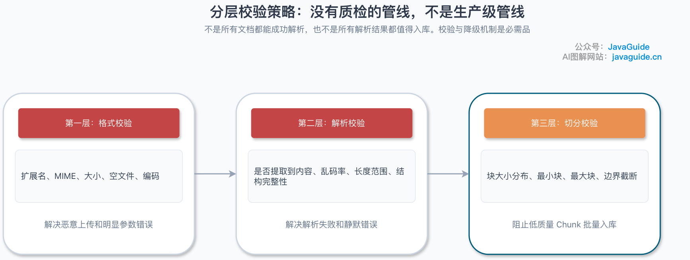
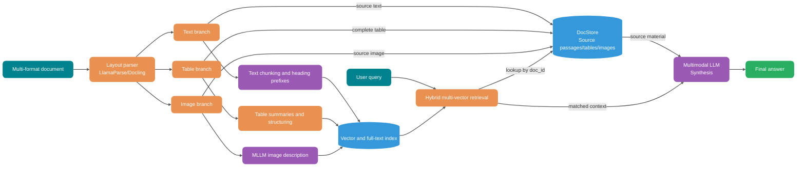
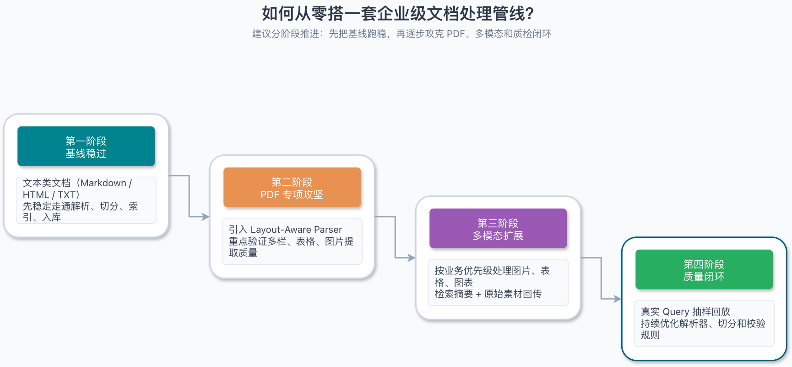

Before retrieval, RAG must convert PDFs, Word documents, spreadsheets, and scans into searchable content. If this step mishandles reading order in multi-column PDFs, table relationships, heading hierarchy, or OCR errors, switching the Embedding model or vector database later cannot recover the lost information.

This guide follows the document lifecycle from upload and parsing through chunking, validation, and multimodal indexing, explaining the engineering practices and limits at each stage.

## What Happens Between Document Upload and Indexing?

Documents pass through at least six stages between upload and storage in a vector database:



Quality checks should not be postponed until after indexing. Add layered sampling checks during parsing and chunking to catch corrupted files, garbled text, and abnormal splits early, before large amounts of low-quality data enter the vector database.

Common issues at each stage and their downstream effects:

| Stage             | Typical issue                                                                       | Downstream effect                              |
| ----------------- | ----------------------------------------------------------------------------------- | ---------------------------------------------- |
| File upload       | Spoofed format, excessive size, or encoding issues                                  | Parser crashes or fails silently               |
| Format validation | File extension does not match the actual MIME type                                  | Wrong parser is selected                       |
| Layout parsing    | Multi-column PDFs, merged table cells, headers and footers                          | Lost structure and mismatched context          |
| Cleaning          | Garbled text, special characters, duplicate blank lines, leftover table of contents | Noise enters the index and distorts Embeddings |
| Chunking          | Semantic truncation, broken context, chunks that are too large or small             | Poor retrieval and incomplete answers          |
| Metadata          | Missing source, page, version, or permissions                                       | Filtering and citation are unavailable         |
| Indexing          | Inconsistent vector dimensions or token limits exceeded                             | Retrieval fails or the index is corrupted      |

Embedding models and vector databases can only process the text they receive. Once incorrect reading order from a multi-column PDF, lost table-column relationships, or OCR errors enter the index, retrieval cannot reconstruct the original structure from vectors.

## How Do You Choose a Chunking Strategy?



### Fixed-Size Chunking: Establish an Evaluation Baseline

Fixed-size chunking requires only a chunk size (`chunk_size`) and overlap between adjacent chunks (`chunk_overlap`), such as 512 tokens per chunk with 50–100 tokens of overlap.

This approach is simple to implement and very fast, making it a useful evaluation baseline for short documents and individual FAQ entries. Its limitation is that it does not account for paragraph, table, or code-block boundaries.

For example, an after-sales policy might say:

> Products can be returned within seven days without a reason, except in the following cases: (1) custom-made products; (2) fresh or perishable products; and (3) digitally delivered products…

If the list crosses a fixed-size chunk boundary, the preceding chunk may contain only "Products can be returned within seven days without a reason, except in the following cases," while the next contains only "(1) custom-made products…" Neither chunk has complete context, so the model may miss the restrictions. Before evaluating more complex strategies, use fixed-size chunks to run a question set, then check whether structure-aware chunking improves these boundary cases.

### Recursive Character Splitting: Preserve Paragraph and Sentence Boundaries

Recursive character splitting tries separators in priority order (for example, `["\n\n", "\n", ".", " ", ""]`). It splits at a lower-priority separator only when a natural paragraph exceeds the target chunk size, preserving headings, paragraphs, and sentences as much as possible within a controlled token budget.

This approach is a good starting point for documents with inconsistent heading levels and varied paragraph lengths, such as technical blogs, product manuals, and research reports. LangChain's `RecursiveCharacterTextSplitter` is a typical implementation. For general technical documents, test chunk sizes of 400–800 tokens with 10%–15% overlap. For code, use a language-aware splitter such as `RecursiveCharacterTextSplitter.from_language(Language.PYTHON, ...)` and prefer syntax boundaries such as `class` and `def` to avoid splitting a function body in the middle.

### Semantic Chunking: Group by Topic Boundaries

Semantic chunking does not rely directly on a fixed character count. It first splits the text into sentences, then calculates the cosine distance between Embeddings for adjacent sentences or sliding windows. It creates a boundary when the semantic distance exceeds a threshold, such as a percentile or standard-deviation threshold, grouping semantically related sentences into the same chunk.

The tradeoff is that offline indexing must compute Embeddings for many sentences, making it significantly slower and more expensive than character-based splitting. Without minimum and maximum chunk-size limits (`min_chunk_size` / `max_chunk_size`), frequent topic changes can produce tiny chunks of only one or two sentences, while long passages on a single topic can exceed the context budget. Before deployment, inspect the mean and P95 chunk lengths and the proportion of undersized chunks.

### Structure-Based Chunking: Reuse Layout and Syntax Boundaries

When a document has a clear layout or syntax, splitting along its structural boundaries is usually more reliable than using character counts alone.

In consistently formatted documents such as financial reports and legal contracts, each page may correspond to a relatively independent topic. NVIDIA benchmarks on financial reports and legal documents found that page-level chunking achieved an average accuracy of 0.648 with less variance than fixed-token chunking. However, page-level chunking does not perform best on every dataset: on FinanceBench, 1,024-token chunks scored 0.579, slightly above page-level chunks at 0.566. If a PDF is simply a Word document exported with content flowing across arbitrary page breaks, those breaks have no semantic meaning and page-level chunking offers no benefit. Factual queries also tend to favor fine-grained chunks of 256–512 tokens, while cross-paragraph analysis may benefit from chunks of 1,024 tokens or more, or page-level chunks.

Common document structures and starting chunking strategies:

| Document type      | Recommended chunking strategy                        | Common tools or approach                                                             |
| ------------------ | ---------------------------------------------------- | ------------------------------------------------------------------------------------ |
| Markdown           | Split by heading level (H1/H2/H3)                    | `MarkdownHeaderTextSplitter`, followed by recursive splitting for oversized sections |
| HTML               | Split by semantic tags (h1–h6, p, div)               | `HTMLHeaderTextSplitter` / `HTMLSectionSplitter`                                     |
| PDF                | Split by section heading, table, or page             | Docling, LlamaParse, `chunk_by_title`                                                |
| Code               | Split by syntax tree (AST), class, or function       | Tree-sitter, `RecursiveCharacterTextSplitter.from_language`                          |
| Laws and contracts | Split by part, chapter, section, article, and clause | Regex-based structure detection with hierarchy-path reconstruction                   |

### Parent-Child Chunking: Separate Retrieval and Reading Granularity

Vector retrieval benefits from small, topic-focused chunks for precise matching, while a generative model needs longer passages that include prerequisites and context. Parent-child chunking handles these goals separately: create Embeddings and index child chunks of about 200–400 tokens, and link them through `parent_id` to parent chunks of about 1,000–1,500 tokens or to their containing sections. When retrieval matches a child chunk, deduplicate by `parent_id` and fetch the corresponding parent chunk for the LLM context.



This pattern is useful for long technical manuals, policy collections, and troubleshooting guides. The tradeoff is that storage must maintain a separate parent-chunk document store (DocStore), and retrieval requires an additional batch lookup by primary key.

### Overlap: Reduce Boundary Truncation

Fixed-size and recursive splitting can both divide related content across chunk boundaries. An overlap window includes sentences near the boundary in both adjacent chunks. Too much overlap, however, increases index size and can cause Top-K retrieval to return many duplicate passages.

For general text, start with 512-token chunks and 50–100 tokens of overlap. For code, legal clauses, and standalone tables, preserve complete syntax or clause units; use overlap only when a unit itself is too long. Research reports sometimes show accuracy differences of dozens of percentage points between chunking strategies (for example, [an experiment on 30 medical question-answering samples](https://pubmed.ncbi.nlm.nih.gov/41301150/) compared adaptive and fixed chunking). Such findings depend heavily on the corpus and question design, so determine production parameters using your own evaluation set.

## What Is Semantic Loss, and Why Does It Happen?



Semantic loss occurs when prerequisites, referents, or structural relationships in the source document are weakened or removed during parsing, cleaning, or chunking, making the original meaning impossible to recover from an individual chunk.

### Four Common Cases of Semantic Loss

1. **Conditions separated from conclusions**: A business rule may describe application requirements first and the approval process later. If an exception such as "if X applies, provide document Y" lands on a chunk boundary, each chunk may lose a key constraint.
2. **References and background lost**: A chunk retains body text but loses its section heading. When the model reads "this rate has declined over the past three years," it cannot tell whether the rate refers to a supplier's defect rate or a business line's return rate.
3. **Table row and column relationships broken**: A text extractor may flatten a multi-row, multi-column table into unaligned text, losing the relationships between headers, row keys, and values.
4. **Proper names truncated or split**: Line-break hyphenation in an English PDF (such as `micro-\nservice`), OCR mistakes (such as reading `OAuth2` as `0Auth2`), or hard character-based splitting can break product IDs, API names, and internal codes, preventing both vector and keyword retrieval from finding them.

### Why an Embedding of One Chunk Cannot Restore Lost Context

Standard Embedding models encode one chunk at a time. If a chunk does not retain a subject, scope, or table header from another paragraph, its vector reflects only the local text and cannot restore that context.

There are four ways to add context, listed from lowest to highest implementation cost:

1. **Prepend the heading path (title or breadcrumb)**: During chunking, prepend the document title and parent headings to each chunk (for example, `[Order system > Refund policy > Special products] Body text…`) and store them in Metadata. This requires almost no extra compute and can resolve ambiguous references.
2. **Add retrieval variants (summaries and hypothetical questions)**: Generate a short summary or two or three likely user questions for important chunks (for example, "How do I get a refund?" for a section titled "Refund application process"). Associate both question and content vectors with the original chunk to bridge the gap between colloquial queries and formal documents.
3. **Contextual chunking**: Proposed by teams such as Anthropic, this approach calls a small model after splitting to generate 50–100 tokens of background for each chunk based on the full document. Prepend that context before creating Embeddings and a BM25 index. It can improve results significantly, but increases offline LLM token costs; Prompt Caching can reduce them.
4. **Late chunking**: First pass the entire long document (within the context window of a long-context Embedding model, such as 8,192 tokens) through the Transformer's encoding layers so each token's hidden state incorporates attention to the whole document. Then mean-pool token vectors at chunk boundaries. This preserves document-wide references without calling a generative model and suits local Embedding models that support long inputs.

## How Do You Prevent Structural Loss?



Different file formats lose structure in different ways during parsing; a single plain-text extractor cannot handle them all.

### Multi-Column PDF Layouts and Complex Tables

PDFs are essentially collections of layout-drawing instructions, and the storage order of their text objects may not match human reading order. Extracting a two-column paper or financial report in stream order with a basic tool such as PyPDF can combine text from the left and right columns on the same line. Row and column alignment gets even worse with merged cells or borderless financial tables.

These documents need a layout-aware parser. A vision model first identifies bounding boxes for headings, body columns, tables, equations, headers, and footers; the parser then reconstructs reading order before extracting content. Open-source options include Docling (with TableFormer for table structure), MinerU, and Marker. Commercial or cloud options include LlamaParse and Azure Document Intelligence. For high-value documents such as contracts and financial reports, flag pages with inconsistent table column counts or failed numerical validation for human review.

### Reconstructing Heading Hierarchy in Word Documents

Word (`.docx`) documents usually use paragraph styles (`Heading 1`, `Heading 2`, and body text) to express structure, but business documents are often inconsistently formatted. Authors may enlarge and bold a normal paragraph instead of applying a heading style, use only top-level headings, or place a second-level heading immediately under a top-level heading without body text between them.

When parsing Word documents, read paragraph styles or outline levels and maintain the current heading path with a stack. This prevents a child heading from replacing its parent or introductory content before the first heading from being lost:

```python
from docx import Document


def extract_sections(doc_path):
    """
    Extract sections by Word heading level and preserve the full section path (section_path).
    """
    doc = Document(doc_path)
    heading_stack = []  # Each item is (level, heading_text).
    current_content = []

    def current_path():
        return " / ".join(text for _, text in heading_stack) if heading_stack else "Introduction"

    for para in doc.paragraphs:
        text = para.text.strip()
        if not text:
            continue

        style_name = para.style.name if para.style else ""
        if style_name.startswith("Heading"):
            # Emit the accumulated body text before processing the next heading.
            if current_content:
                yield {
                    "section_path": current_path(),
                    "content": "\n".join(current_content),
                }
                current_content = []

            # Parse the heading level (for example, "Heading 2" -> 2) and pop
            # headings at the same or a deeper level from the stack.
            parts = style_name.split()
            level = int(parts[1]) if len(parts) > 1 and parts[1].isdigit() else 1
            while heading_stack and heading_stack[-1][0] >= level:
                heading_stack.pop()
            heading_stack.append((level, text))
        else:
            current_content.append(text)

    if current_content:
        yield {
            "section_path": current_path(),
            "content": "\n".join(current_content),
        }
```

### Preserve Relationships Between Excel Fields

The meaning of an Excel cell depends on row and column headers, merged cells, and the sheet name. Flattening cells into plain text breaks the relationship between field names and values.

When processing Excel or CSV files, first identify the data range and any multi-level headers, then convert the data according to its purpose:

- **Detail and summary reports**: Convert each row (or group of aggregated records) into a JSON object or Markdown row with complete header-value pairs. Include the sheet name, calculation basis, and units.
- **Configuration and parameter mappings**: Assemble "parameter name – default value – description" into self-contained entries.
- **Large numerical tables**: If users frequently ask for sums, year-over-year comparisons, or conditional filtering, vector retrieval over text chunks is unlikely to calculate accurately. Also store the structured table in a relational database and query it through Text2SQL or tool calls.

### OCR Quality Control for Scans

Scanned PDFs and image documents rely on OCR for text conversion. Recognition accuracy is affected by resolution, obscuring stamps, skew, and handwritten annotations. Common errors include character confusion (such as the digit `0` versus the letter `O`, or the digit `1` versus the letter `l`), which can make product IDs and contract numbers unsearchable; broken table borders that merge adjacent columns; and scrambled paragraphs caused by mixed columns, annotations, and body text.

For scans, correct skew and remove image noise before OCR, and use an engine with layout analysis, such as PaddleOCR, Surya, Google Document AI, or AWS Textract. Before indexing, validate critical fields such as model numbers, identity numbers, and amounts with regular expressions or business rules (for example, line items must sum to the total). Flag pages that fail validation for alerts or human review.

## How Do You Design a Layered Validation Strategy?



Uploaded documents vary in quality in production. The document-processing pipeline must validate at the upload, parsing, and chunking stages, with a clear fallback path for documents that fail.

### Three Validation Gates

The first gate validates file formats during upload. Before saving a file or adding it to the parsing queue, check the extension, actual MIME type (using magic bytes, for example with Apache Tika, to prevent an `.exe` or corrupted archive from being renamed to `.pdf`), file size, and encryption status.

```java
public class DocumentValidationException extends RuntimeException {
  private final ValidationErrorType errorType;
  private final String fileName;
  private final Object rejectedValue;

  public enum ValidationErrorType {
    FILE_TOO_LARGE,     // File exceeds the size limit
    UNSUPPORTED_FORMAT, // Unsupported format
    MIME_TYPE_MISMATCH, // Extension does not match the actual MIME type
    CORRUPTED_FILE,     // File is corrupted or unreadable due to encryption
    EMPTY_FILE,         // Empty file
    ENCODING_ERROR      // Character encoding error
  }
}
```

The second gate validates parsing results. After the parser returns text, check whether the extracted character count is zero or unusually low (for example, a plain-text parser that extracts only a few dozen blank characters from a 50-page scanned PDF should route it to OCR). Also measure the proportion of garbled characters, such as replacement characters and invisible control characters.

```java
public class ParseResultValidator {

  public ValidationResult validate(DocumentParseResult parseResult) {
    List<String> errors = new ArrayList<>();

    if (parseResult.getContent().isEmpty()) {
      errors.add("Parse result is empty; the file may be a scanned image or encrypted document.");
    }

    double garbledRate = calculateGarbledRate(parseResult.getContent());
    if (garbledRate > 0.05) { // More than 5% garbled characters
      errors.add("Garbled-character rate is too high: " + String.format("%.2f%%", garbledRate * 100));
    }

    int contentLength = parseResult.getContent().length();
    if (contentLength < 50) {
      errors.add("Extracted content is too short; parsing may be incomplete.");
    }
    if (contentLength > 10_000_000) {
      errors.add("Document text exceeds the limit; split it by section.");
    }

    if (parseResult.hasStructure()) {
      validateStructure(parseResult.getStructure()).forEach(errors::add);
    }

    return new ValidationResult(errors);
  }
}
```

The third gate checks chunking quality. After chunking, inspect the number of chunks, minimum and maximum lengths, and length standard deviation. Look for large numbers of fragments only a few characters long or oversized chunks that exceed the Embedding model's input limit.

```java
public class ChunkingQualityReport {
  private final int totalChunks;
  private final int totalCharacters;
  private final double averageChunkSize;
  private final int minChunkSize;
  private final int maxChunkSize;
  private final double chunkSizeStdDev;

  private final List<String> warnings = new ArrayList<>();
  private final List<String> errors = new ArrayList<>();

  public boolean isAcceptable() {
    if (chunkSizeStdDev > averageChunkSize * 0.5) {
      warnings.add("Chunk sizes vary widely; check whether the structural separators match this document.");
    }

    if (minChunkSize < 20) {
      warnings.add("Undersized fragment chunks were found; consider merging them with adjacent chunks.");
    }

    if (maxChunkSize > 5000) {
      errors.add("Oversized chunks were found; they may exceed the Embedding model's token limit.");
    }

    return errors.isEmpty();
  }
}
```

### Fallback Strategies for Validation Failures

When validation fails, do not silently discard the affected pages. Route them according to the failure:

| Validation failure                | Handling strategy                                                                                                                       |
| --------------------------------- | --------------------------------------------------------------------------------------------------------------------------------------- |
| Empty file or spoofed format      | Reject it from indexing, record an audit log, and return a clear error code to the caller.                                              |
| Image-only scanned PDF            | Route it to OCR and layout analysis for re-extraction.                                                                                  |
| Complex parser failure            | Retry with a fallback parser; if it still fails, send it for human review.                                                              |
| Abnormal structure-aware chunking | Merge fragments or fall back to recursive character splitting with heading prefixes.                                                    |
| Some pages fail to parse          | Record the missing page numbers and mark the document as partially available. Hold back contracts and legal documents from publication. |

If table parsing fails on 10 pages of a 100-page document, do not mark the remaining 90 pages as fully indexed. For contracts, regulations, financial reports, and other materials that require complete evidence, block publication when pages are missing and notify a human reviewer. For general reference materials that permit partial indexing, record missing page numbers in the document metadata so the system does not give definitive answers about missing content.

## How Do You Process Multimodal Content?

Real-world enterprise documents contain architecture diagrams, UI screenshots, flowcharts, tables spanning multiple pages, and statistical charts. If the parsing pipeline discards non-text elements, questions about diagrams and processes may be answered incorrectly because the evidence is missing.

### Three Ways to Process Images

During parsing, first filter out images with no informational value, such as header logos, background patterns, and decorative icons. These can be identified by size thresholds, aspect ratio, or repeated occurrence in the same position across pages. Process only screenshots, architecture diagrams, and flowcharts that carry business information. Three common approaches are:

1. **Multimodal Embeddings (such as CLIP, SigLIP, or ColPali) with source-image retrieval**: Encode images directly into a text-image aligned vector space (or, as ColPali does, generate multi-vector representations of document-page images). At query time, match text vectors against image vectors. On a match, retrieve the original image from object storage and pass it to a multimodal LLM (MLLM). General-purpose CLIP models work well for natural images, but may not distinguish architecture diagrams or error screenshots with dense small Chinese text and complex connections.
2. **MLLM-generated image descriptions with text retrieval**: During offline indexing, call a vision model to generate a detailed text description using the image's heading and the body text that refers to it as context. Store the description in a standard vector database and full-text index, and retain the original image's object-storage URI in Metadata.
3. **Multi-Vector Retriever**: Operationalize the previous approach by storing searchable structured image summaries in the vector index (including text in the image, node flow, and key conclusions) and the original high-resolution image in a DocStore such as object storage plus a key-value store. When a summary matches, retrieve the original image by `doc_id` and pass it to the multimodal LLM with its text context.

```python
# LangChain multi-vector retrieval example
# Note: LangChain 0.3 imports from langchain.retrievers.multi_vector;
# LangChain 1.0+ uses langchain_classic.
from langchain_classic.retrievers.multi_vector import MultiVectorRetriever
from langchain_core.stores import InMemoryByteStore

# The vector store holds text summaries of images and tables for retrieval.
vectorstore = Chroma(
    collection_name="multimodal_summaries",
    embedding_function=OpenAIEmbeddings(),
)

# DocStore holds original image bytes or complete table content.
# In production, replace it with S3 plus Redis or PostgreSQL.
docstore = InMemoryByteStore()

retriever = MultiVectorRetriever(
    vectorstore=vectorstore,
    byte_store=docstore,
    id_key="doc_id",
    search_kwargs={"k": 5},
)
```

### Preserve Table Structure

If a table is chunked as ordinary continuous text, its headers become detached from values, and rows split in the middle lose their headers entirely. Common practices include:

1. **Preserve a structured format**: Use tools such as Docling or LlamaParse to convert tables to Markdown, HTML `<table>` elements (including merged-cell `rowspan` / `colspan` information), or JSON row arrays. If a large table exceeds the chunk limit, repeat the complete header at the start of every row-based subchunk.
2. **Generate semantic table summaries**: Numerically dense financial or monitoring tables are difficult to match with natural-language queries in vector space. Create a text summary for each table with its section, title, time range, dimensions, and key metrics (for example, "2024 annual sales by product line in East China, including Q1 and Q2 sales and quarter-over-quarter growth for Phone A and Phone B; unit: devices"). Index the summary as a vector, then include the complete Markdown or JSON table in the generation context when it matches.

### Bind Charts to Their Context

The meaning of line, bar, and pie charts depends heavily on the caption, axis labels, legend, measurement units, and the surrounding text that discusses the chart. When using an MLLM to extract chart information offline, include the caption and adjacent paragraphs from the same page. Ask it to return a structured description (with the subject, time range, units, extrema, and trend) and a corresponding data table. This avoids errors such as reading "millions" as "units" or confusing legend series based on the image alone.

### End-to-End Multimodal RAG Pipeline

The complete multimodal architecture connects parsing and summary indexing for text, tables, and images with retrieval of the original source material:



The core design separates retrieval representations from generation material. The vector and full-text indexes store text chunks, table descriptions, and image captions optimized for semantic matching. The DocStore retains complete uncompressed tables, parent passages, and high-resolution images. After retrieval, these are assembled for the generation model by `doc_id`.

## How Do You Build a Document-Processing Pipeline from Scratch?



Build an enterprise document-processing pipeline in stages based on format complexity. Do not add expensive vision models to every file from the start:

1. **Stage 1 (structured text baseline)**: Establish parsing for Markdown, HTML, and well-formatted Word documents. Implement recursive splitting by heading level, store `doc_id`, `section_path`, update time, and ACL permissions in Metadata, and run a baseline evaluation set.
2. **Stage 2 (complex PDF layouts and table handling)**: For multi-column PDFs, merged-cell tables, and scans, add a layout-aware parser and OCR pipeline such as Docling, MinerU, or LlamaParse. Add the three quality gates, repeat oversized table headers in split chunks, and route abnormal documents to a fallback queue.
3. **Stage 3 (parent-child chunking and multimodal support)**: Introduce parent-child chunking or section-level context when error analysis finds a conflict between fine-grained retrieval and long-context completeness. Add MLLM chart descriptions and Multi-Vector retrieval only when the business depends heavily on flowcharts, architecture diagrams, or financial charts.

## Summary

Document processing and chunking determine whether the index contains complete and accurate evidence. Before deployment and after changing parsers or chunking parameters, verify at least these four areas:

1. **Layout and structure fidelity**: Sample-check reading order in multi-column PDFs, row and column alignment in tables spanning pages, Word and Markdown section paths (`section_path`), and OCR accuracy for critical fields in scans.
2. **Chunk size and context completeness**: Ensure chunks do not separate prerequisites from conclusions, split long tables with headers retained, and track chunk-length distributions and the proportion of fragments.
3. **Complete, searchable Metadata**: Bind every chunk to its source document ID, version, page, section path, and ACL permissions to support pre-filtering and answer traceability.
4. **Regression on a fixed evaluation set**: Whenever you change a parsing tool or adjust `chunk_size` / `chunk_overlap`, compare Context Recall and final-answer accuracy on the same questions covering tables, cross-paragraph conditions, and proper names.

## References

- [Databricks: Mastering Chunking Strategies for RAG](https://community.databricks.com/t5/technical-blog/the-ultimate-guide-to-chunking-strategies-for-rag-applications/ba-p/113089)
- [Firecrawl: Best Chunking Strategies for RAG in 2026](https://www.firecrawl.dev/blog/best-chunking-strategies-rag)
- [Premiere AI: RAG Chunking Strategies 2026 Benchmark Guide](https://blog.premai.io/rag-chunking-strategies-the-2026-benchmark-guide/)
- [Weaviate: Chunking Strategies to Improve LLM RAG Pipeline Performance](https://weaviate.io/blog/chunking-strategies-for-rag)
- [Omdena: Document Parsing for RAG - A Complete Guide for 2026](https://www.omdena.com/blog/document-parsing-for-rag)
- [DataCamp: Multimodal RAG - A Hands-On Guide](https://www.datacamp.com/tutorial/multimodal-rag)
- [LangChain: Multi-Vector Retriever for RAG on Tables, Text, and Images](https://www.langchain.com/blog/semi-structured-multi-modal-rag)
- [Procycons: PDF Data Extraction Benchmark 2025](https://procycons.com/en/blogs/pdf-data-extraction-benchmark/)
- [LlamaIndex: Mastering PDF Parsing](https://www.llamaindex.ai/blog/mastering-pdfs-extracting-sections-headings-paragraphs-and-tables-with-cutting-edge-parser-faea18870125)
