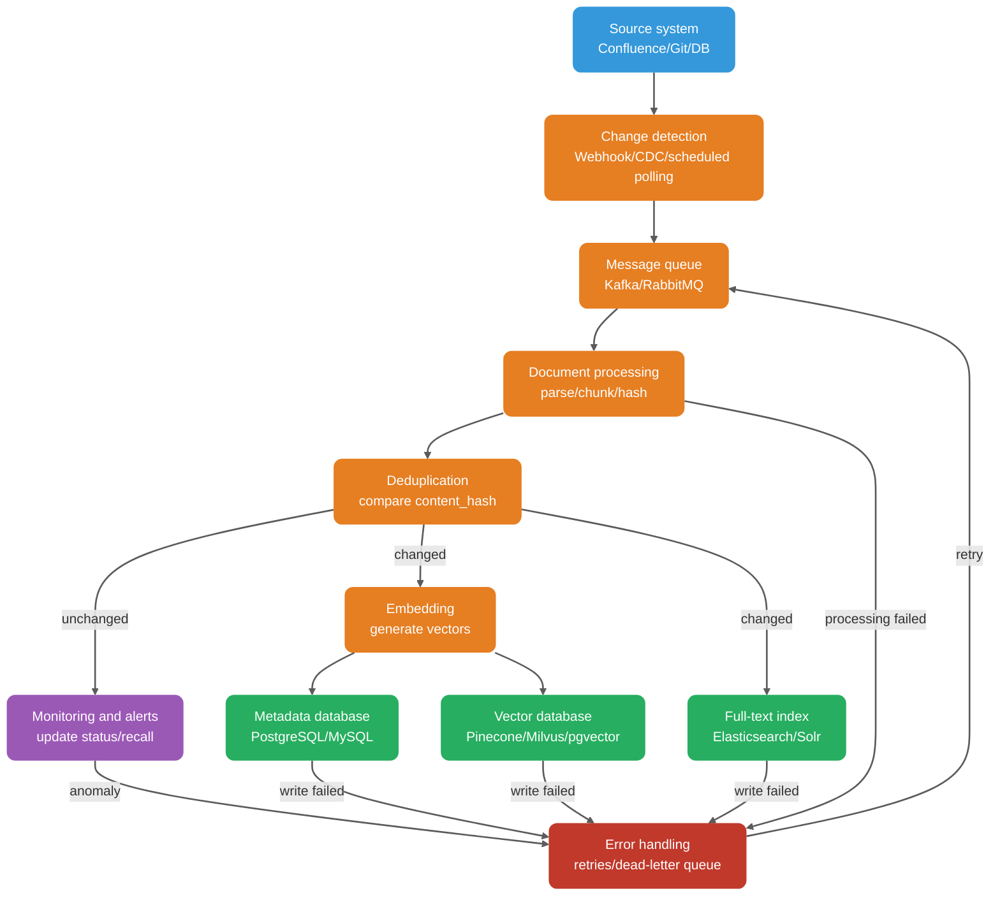
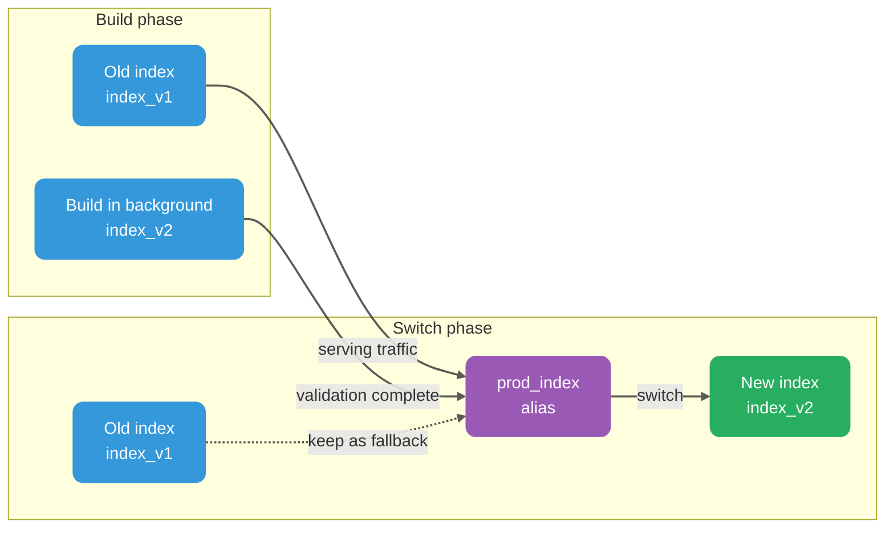

After deploying their first enterprise RAG knowledge base, many teams encounter a familiar problem: the documents have been updated, but the answers have not changed.

Do not blame the LLM right away. More often, the knowledge base was not synchronized, or the update pipeline only wrote new content without handling old versions, permissions, and index consistency.

The problem becomes more obvious when documents change frequently. Rebuilding the entire index every time is too slow and expensive. Updating only changed content risks leaving stale chunks behind. Inserting new vectors without cleaning up old versions means outdated content can still be retrieved. And when the Embedding model changes, the question of whether to reindex all historical data cannot be avoided.

Knowledge-base updates must handle versioning, permissions, and consistency across multiple indexes. This guide covers how incremental synchronization, full rebuilds, canary releases, rollbacks, and monitoring work together for three events: create, update, and delete.

## What Problems Must Knowledge-Base Updates Solve?

First, define the goals before discussing implementation.

After an update, retrieval results must match the current document and respect access controls. If synchronization fails, the failure must be traceable to a document and destination, with a way to restore the previous index version.

Freshness means the index keeps up with document changes. The required update time does not always have to be seconds; it may be minutes or even a day, depending on business needs. An internal policy library may need only daily synchronization, while a customer-support knowledge base or compliance rules may need faster updates.

Accuracy means retrieved content matches the current document. The model must not cite an old version after the document has changed; users notice this immediately.

Consistency is more difficult. A document has multiple versions, and the vector database, metadata database, and full-text index are separate systems. A missed or delayed write to any one of them can create inconsistent results.

Rollback means quickly returning to the last healthy state after a failure instead of manually repairing data under pressure. Observability means monitoring the update process, evaluating its results, and tracing failures to a specific stage.

These goals may seem obvious, but many projects implement only the first step—"update"—and leave the rest to chance. The result: a document has gone through ten revisions, but answers still reflect the first; a sensitive document was deleted, but it can still be retrieved months later.

## Why Must the Embedding Model Remain Consistent?

This deserves special attention: the Embedding model used for indexing must match the one used for queries.

Embedding models convert text into vectors, but vector spaces from different models are not interchangeable. The vectors produced for the same sentence by OpenAI's `text-embedding-3-small` and sentence-transformers' `all-MiniLM-L6-v2` are not comparable. Using model A for indexing and model B for queries is like calculating similarity across two different spaces.

The exact failure depends on vector dimensions. If dimensions differ, the vectors usually cannot share an index, and many vector databases reject the insert or query. If dimensions match but models differ, similarity scores are still incomparable and retrieval results are unreliable. The problem is not simply randomness; the basis for ranking has broken down.

Two scenarios are easy to overlook in production.

**The first is a model upgrade.** A team may want to switch from `text-embedding-3-small` to `text-embedding-3-large` because the new model performs better. Historical data must then be re-encoded and reindexed. Running both indexes in parallel and shifting traffic gradually can reduce risk, but rebuilding is unavoidable.

**The second is mixing a local model with an API model.** For example, the test environment uses local sentence-transformers while production uses the OpenAI API. This is common in team workflows: tests look fine, but recall drops sharply after deployment.

A safer approach is to store Embedding model details in metadata and validate the model version on every query. If they do not match, either reject the query or log a warning and fall back to a more conservative retrieval strategy.

| Field                     | Description      | Example                  |
| ------------------------- | ---------------- | ------------------------ |
| `embedding_model`         | Model name       | `text-embedding-3-large` |
| `embedding_model_version` | Model version    | `2025-01-15`             |
| `embedding_dimension`     | Vector dimension | `3072`                   |

When upgrading the Embedding model, use a process such as:

1. Rebuild all data in a new index with the new model.
2. Run both indexes in parallel for a period and compare recall and answer quality.
3. Once the new index is stable, switch traffic to it through an index alias.
4. Keep the old index for a period so you can roll back quickly.
5. Delete the old index after confirming the new one works correctly.

This is similar to blue-green database deployment: do not modify the existing index in place. Build a new one, validate it, and then switch over.

## How Do You Design Metadata for Updates?

Good metadata design is a prerequisite for incremental updates and rollbacks. Many RAG systems appear to "forget" over time, not because they lack document content, but because they cannot tell which document or version a vector belongs to, when it was indexed, or what permissions apply.

Every chunk should include at least this metadata:

```json
{
  "doc_id": "doc-uuid-001",
  "chunk_id": "chunk-uuid-001",
  "content_hash": "sha256:abc123...",
  "version_id": 3,
  "chunk_strategy": "semantic",
  "chunk_size": 512,
  "chunk_overlap": 50,
  "source_id": "confluence-page-123",
  "source_type": "confluence",
  "title": "Order Center API Documentation",
  "section_path": "Technical Documentation / Order System / API Specification",
  "page": 5,
  "tenant_id": "tenant-001",
  "acl": ["role:admin", "team:order-team"],
  "created_at": "2025-03-01T10:00:00Z",
  "updated_at": "2025-04-15T14:30:00Z",
  "embedding_model": "text-embedding-3-large",
  "embedding_model_version": "2025-01-15",
  "embedding_dimension": 3072,
  "is_deleted": false
}
```

Version the chunking strategy as well. Changes to splitting, overlap, or parsing can have as much impact as an Embedding model change and should trigger a rebuild or a dual-index canary. Record fields such as `chunk_strategy`, `chunk_size`, and `chunk_overlap` to support evaluation and rollback.

`content_hash` is central to incremental updates. It is a hash of the document body or chunk content, not the file. Common algorithms include MD5, which is fast but has collision risks and suits cases where collisions are not critical; SHA-256, which has a very low collision risk and is recommended for production; and SimHash, which detects roughly similar content and is often used for webpage deduplication, but cannot identify exact changes.

In production, `content_hash` is mainly used to determine whether a passage has changed. Calculate the hash during indexing and compare it with the existing record. If they match, skip Embedding; if they differ, encode the content again.

`version_id` records the document revision. Increment it after each update. Together with `content_hash`, it tracks change history and supports rollback.

`is_deleted` is a soft-delete flag. Removing a record only from the vector database without retaining its deletion state in the metadata database undermines auditing, recovery, and cross-index synchronization. On a delete event, set `is_deleted` to `true`. When the document is uploaded again, create a new version or restore the record and recalculate `content_hash`. By default, queries should include only records where `is_deleted = false`.

Soft deletion does more than distinguish old and current documents. It provides a buffer for auditing, accidental-deletion recovery, delayed physical deletion, and cross-system consistency.

`tenant_id` and `acl` are the basis for multi-tenancy and access control. Every item included in the model context must pass authorization checks. Usually, filter by tenant, role, and resource ACL before or during retrieval so unauthorized documents do not occupy Top-K slots or reach the model. Complex rules such as dynamic permissions or cross-organization inheritance can be checked again after candidate retrieval, but the second check must occur before assembling the model context. Check once more before returning citations as a defensive measure.

## How Do You Synchronize Document Creations, Updates, and Deletions?

Documents pass through several stages from the source system to the vector database. A failure at any stage can cause inconsistency.



Watch for partial success. The vector database, metadata database, and full-text index usually do not share a transaction boundary, so a write to all three may succeed only partially. A safer approach is to use the metadata database as the source of truth and record each chunk's index status, such as `index_status = 'ready' / 'partial_failed'`. A background compensation task can retry failed destinations and use reconciliation to find discrepancies.

### Creating a Document

Creation is the simplest of the three operations. A typical flow parses the document and extracts its body, title, and hierarchy; splits it into chunks using the established strategy; computes each chunk's `content_hash`; checks whether the hash already exists; and, if not, generates a vector and writes it to the vector database, metadata database, and full-text index.

Idempotency is important. A create operation must be safe to repeat. Duplicate message delivery or a worker restarting after a crash must not create duplicate records.

### Updating a Document

Updates are more complex than creation. The key question is what to do with the old version.

Prevent queries from seeing both versions at once, but also avoid a period when neither version is available. A common approach is to write a hidden new version first, then atomically switch the active version:

1. Look up the active version and old `chunk_id` values by `doc_id` in the metadata database.
2. Write chunks with the new `version_id` to the vector database and full-text index, keeping `status = 'building'` so they are excluded from online retrieval.
3. After validating writes to all three systems, atomically switch the active version in the metadata database or through an index alias.
4. Mark the old version for deletion and clean it up asynchronously according to the retention policy.

If the vector database supports atomic updates by primary key, such as Milvus upsert, it can overwrite the record with the same key. However, upsert replaces only that record. If re-chunking changes the number of chunks or their `chunk_id` values, clean up old-version remnants by `doc_id + version_id`.

If the storage system cannot atomically replace an entire document, use an `active_version` filter, index aliases, or a dual-index switch. Deleting old records before writing new ones creates a gap; writing new records first without version filtering may expose both versions at once.

A common pitfall is writing new vectors without deleting the old ones.

If the vector database retains all 10 versions after a document has been updated 10 times, queries may retrieve outdated content. The update process must deactivate old versions and clean up old vectors according to the retention policy, or the knowledge base will keep drifting.

### Deleting Documents

Deletions can be soft or physical.

Soft deletion sets the `is_deleted` flag to `true`. It preserves change history and supports recovery from accidental deletion, but is unsuitable for compliance requests that require immediate erasure.

Physical deletion removes records from the vector database, metadata database, full-text index, and related caches. Choose the soft-delete retention period based on recovery objectives, data classification, and compliance requirements; there is no universal default number of days.

Soft deletion simplifies recovery and auditing but adds storage and filtering costs. Physical deletion is more thorough and suits compliance requests and sensitive data, but recovery is difficult. A common production pattern is soft deletion followed by delayed physical deletion, with an audit log. For sensitive documents, also clear side caches such as reranking and LLM context caches.

Deletion has another subtle issue: "ghost data" after a permission change. A document may have been visible to all employees and later restricted to executives. If the old `acl` in the vector database is not updated, ordinary employees may still retrieve it. A permission change should trigger reindexing so the metadata contains the current `acl`. If the vector database supports atomic ACL updates, the metadata can be changed without rebuilding the vectors.

## When Should You Use Incremental Updates or Full Rebuilds?

A common approach is to use incremental updates for routine changes and full rebuilds for model upgrades, chunking-strategy migrations, or serious data inconsistency. Whether to schedule periodic rebuilds depends on the index implementation, update frequency, and consistency-check results.

| Dimension        | Incremental update                   | Full rebuild                                                                              |
| ---------------- | ------------------------------------ | ----------------------------------------------------------------------------------------- |
| Trigger          | Document change event                | Scheduled or manual                                                                       |
| Scope            | Changed documents only               | Entire knowledge base                                                                     |
| Compute cost     | Low; processes only changes          | High; processes all data                                                                  |
| Update latency   | Low; can be near real time           | High; may take hours                                                                      |
| Data consistency | Depends on accurate change detection | Must use a source-system snapshot or version timestamp to stay consistent with the source |
| Use case         | Routine and frequent changes         | Model upgrades, strategy changes, recovery from failures                                  |
| Main risk        | Missed changes leave data stale      | Extra compute and storage; an incomplete switch can affect service                        |

### When Are Incremental Updates a Good Fit?

Incremental updates suit large knowledge bases with a moderate document-change rate and freshness requirements. For example, a system may receive dozens or hundreds of document changes per day, require synchronization within minutes, and find full rebuilds too costly.

Incremental updates depend on change detection. Three common approaches are:

1. **Webhook or event-driven**: Source systems such as Confluence, Git, or a database send change notifications for the RAG system to consume. This has the lowest latency but requires source-system support.
2. **Change Data Capture (CDC)**: Monitor database binlogs or change logs. This suits structured data sources.
3. **Scheduled polling**: Scan the source system at a fixed interval, such as every five minutes, and compare `updated_at` timestamps. This is simple to implement but adds latency and load to the source system.

A more reliable production setup combines event-driven updates with polling as a fallback. Events handle routine changes; polling catches missed events. Add a message queue such as Kafka or RocketMQ to decouple the source system from RAG processing.

### When Is a Full Rebuild Appropriate?

Full rebuilds are commonly used in these situations:

- An Embedding model upgrade. A full rebuild is unavoidable.
- A chunking-strategy change, such as switching from fixed 500-token chunks to semantic chunking. You can rebuild fully or migrate in batches with versioned indexes, but the evaluation and retrieval pipelines must distinguish strategy versions.
- A data-schema change, such as adding or modifying metadata fields.
- Recovery from a serious failure, such as a long-running incremental pipeline failure that has left data stale.
- Periodic health maintenance. Frequent deletions can leave tombstones or index fragmentation in some vector databases, and may degrade recall. Behavior depends on the index type and product; check the database documentation for details, especially for products that combine HNSW with tombstone cleanup.

Service interruption is the main risk of a full rebuild. A safer approach is to switch through an index alias:



The steps are roughly:

1. The query service accesses the old index, `index_v1`, through the `prod_index` alias.
2. Start a background rebuild to create the new index, `index_v2`.
3. After validating the new index, point `prod_index` to `index_v2`. Milvus / Zilliz aliases support switching between collections; verify whether other vector databases offer equivalent functionality.
4. Keep `index_v1` for a period, such as seven days, for quick rollback.
5. Delete the old index after confirming the new one works.

### A Stable Production Strategy

Use Webhooks or CDC to capture routine changes, and polling plus reconciliation to catch missed writes, deletions, or out-of-order events. Trigger full rebuilds as needed for model upgrades, index-strategy migrations, or persistent consistency-check failures. Some systems schedule periodic rebuilds, but choose the interval based on index implementation, deletion rate, rebuild cost, and consistency metrics rather than using a universal weekly or monthly schedule.

## How Do You Make the Update Pipeline Reliable?

### Idempotent Updates: A Good Fit for Message Queues

Message queues can deliver duplicates. Network instability, consumer crashes and restarts, or an uncommitted offset can cause the same message to be consumed more than once.

Idempotent updates need a reliable deduplication key. A unique constraint on `doc_id + content_hash` or `doc_id + version_id` is a good option. In concurrent workflows, however, a simple "check then write" is not safe: duplicate or out-of-order messages arriving at the same time may overwrite or insert duplicate records.

More reliable approaches include:

1. **Use a unique constraint**: Create a unique index on `doc_id + content_hash` or `doc_id + version_id` so the database rejects duplicates.
2. **Use optimistic or distributed locking**: Acquire a lock before writing a new version to prevent concurrent overwrites.
3. **Use a transactional outbox**: Write change events to an outbox table first, then let consumers process them idempotently.

The example adds index status alongside a unique constraint. `index_status` can be `pending`, `processing`, `partial_failed`, or `ready`. `claim_token` and `claimed_at` prevent multiple consumers from processing the same record at once and allow another consumer to take over timed-out work.

```python
from uuid import uuid4


def process_document_change(event):
    doc_id = event['doc_id']
    content = event['content']
    version_id = event.get('version_id', 1)
    chunk_hash = compute_hash(content)

    # Use the full content hash to distinguish content with a shared prefix.
    chunk_id = f"{doc_id}_{version_id}_{chunk_hash}"

    # Duplicate events do not create new records; failed records can be retried.
    db.execute("""
        INSERT INTO chunks (
            doc_id, chunk_id, content_hash, version_id, is_deleted, index_status
        )
        VALUES (
            :doc_id, :chunk_id, :content_hash, :version_id, false, 'pending'
        )
        ON CONFLICT (doc_id, chunk_id) DO NOTHING
    """, {
        'doc_id': doc_id,
        'chunk_id': chunk_id,
        'content_hash': chunk_hash,
        'version_id': version_id
    })

    claim_token = str(uuid4())
    claimed = db.fetch_one("""
        UPDATE chunks
        SET index_status = 'processing',
            claim_token = :claim_token,
            claimed_at = CURRENT_TIMESTAMP
        WHERE doc_id = :doc_id
          AND chunk_id = :chunk_id
          AND (
              index_status IN ('pending', 'partial_failed')
              OR (
                  index_status = 'processing'
                  AND claimed_at < CURRENT_TIMESTAMP - INTERVAL '10 minutes'
              )
          )
        RETURNING chunk_id
    """, {
        'doc_id': doc_id,
        'chunk_id': chunk_id,
        'claim_token': claim_token
    })

    # If no task was claimed, the record is complete or another consumer is processing it.
    if claimed is None:
        logger.info(f"Doc {doc_id} is ready or being processed, skipping")
        return

    try:
        # Use chunk_id as the upsert idempotency key to avoid duplicate vectors.
        embedding = embedding_model.encode(content)
        vector_db.upsert(doc_id, chunk_id, embedding, {
            'doc_id': doc_id,
            'content_hash': chunk_hash,
            'version_id': version_id,
            'updated_at': now()
        })

        db.execute("""
            UPDATE chunks
            SET index_status = 'ready',
                claim_token = NULL,
                claimed_at = NULL
            WHERE doc_id = :doc_id
              AND chunk_id = :chunk_id
              AND claim_token = :claim_token
        """, {
            'doc_id': doc_id,
            'chunk_id': chunk_id,
            'claim_token': claim_token
        })
    except Exception as e:
        db.execute("""
            UPDATE chunks
            SET index_status = 'partial_failed',
                claim_token = NULL,
                claimed_at = NULL
            WHERE doc_id = :doc_id
              AND chunk_id = :chunk_id
              AND claim_token = :claim_token
        """, {
            'doc_id': doc_id,
            'chunk_id': chunk_id,
            'claim_token': claim_token
        })
        logger.error(f"Failed to process {doc_id}: {e}")
        raise
```

The unique constraint handles deduplication, the conditional update atomically claims work, and `partial_failed` allows a later retry to continue writing vectors. This example uses PostgreSQL-style `RETURNING` to get the claim result rather than relying on `rowcount`, which varies across database drivers. If the business database and vector database cannot share a transaction, vector writes must be idempotent by `chunk_id`. Even if a vector write succeeds but the status update fails, retrying the upsert is safe. In production, a scheduled task should also scan for `processing` records whose lease has expired.

### Handle Out-of-Order Events

Message queues do not always deliver events in the expected order. In a RAG update pipeline, receiving v3 before v2 is common. Without out-of-order handling, the older version may overwrite the newer one.

Common safeguards include:

1. Include `source_version`, `updated_at`, or a monotonically increasing `revision` in each document event to determine its age.
2. Before writing, verify `event.version >= current_version`; discard older events or record them in the audit log.
3. Consume events for each `doc_id` in partition order. For example, use `doc_id` as the Kafka key to keep each document's messages in one partition.
4. Monitor discarded out-of-order events to detect source-system problems.

### Retry Failures and Use a Dead-Letter Queue

Any stage in the pipeline can fail because of network instability, API rate limiting, temporary vector database outages, or parser errors.

A reliable strategy combines exponential backoff retries with a dead-letter queue.

```python
def process_with_retry(event, max_retries=3):
    # max_retries is the number of retries allowed after the initial attempt fails.
    for attempt in range(max_retries + 1):
        try:
            process_document_change(event)
            return  # Succeeded.
        except TransientError as e:
            if attempt == max_retries:
                break
            wait_time = 2 ** (attempt + 1)  # Exponential backoff: 2s, 4s, 8s.
            logger.warning(f"Attempt {attempt + 1} failed: {e}, retrying in {wait_time}s")
            time.sleep(wait_time)
        except PermanentError as e:
            # Do not retry permanent errors, such as an invalid format; send them to the DLQ.
            logger.error(f"Permanent error, sending to DLQ: {e}")
            dlq.send(event, reason=str(e))
            return

    # Exceeded the retry limit; send the event to the DLQ and alert.
    logger.error(f"Max retries exceeded for {event['doc_id']}")
    dlq.send(event, reason="max_retries_exceeded")
    alert.trigger(f"Document update failed after {max_retries} retries: {event['doc_id']}")
```

Error classification is important. Retry transient errors such as network timeouts and API rate limits. Do not repeatedly retry permanent errors such as invalid formats or missing fields; retries will not help and will only waste resources.

Do not let messages accumulate indefinitely in the dead-letter queue. Review it regularly, such as weekly, and redeliver messages after fixing the underlying cause.

### Rollback: An Emergency Path When Things Go Wrong

Rollback is an emergency path, not a way to undo a decision casually. A good rollback mechanism lets operators quickly return to the last healthy state.

Rollback is simplest when switching index aliases. If the new index has problems, point the alias back to the old index, provided it has not been deleted.

For a model-upgrade rollback, record the old model's `model_name`, `model_version`, and corresponding index before upgrading. If the new model performs poorly, switch both the model and index back to the old versions. Rebuild with the old model only if the old index has already been removed.

Data-version rollback can use `updated_at` and `version_id`. To restore a previous point in time, recover from a historical snapshot. The snapshot may be a vector database snapshot or stored in separate object storage.

Roll back permission changes with extra care. If a permission change caused a data leak, immediately contain the impact instead of slowly repairing the index: disable the affected knowledge base or tenant retrieval entry point, disable the affected index, and require authorization checks before citations. Consider taking the entire service offline only if the impact cannot be contained.

```python
def rollback_to_version(target_version_id):
    # Find the snapshot for the target version.
    snapshot = get_snapshot(version_id=target_version_id)
    if not snapshot:
        raise ValueError(f"No snapshot found for version {target_version_id}")

    # Stop the service.
    service.set_status('maintenance')

    # Restore the snapshot.
    vector_db.restore(snapshot)

    # Restart the service.
    service.set_status('active')

    # Send an alert.
    alert.trigger(f"System rolled back to version {target_version_id}")
```

### Canary Release: Validate a New Strategy with Limited Traffic

Roll out knowledge-base update strategies gradually, just like application releases. Do not switch everything at once.

Common canary strategies include rollout by document count (update 10% first), by users (show the new index results to 5% of users), or by question type (start with exact-match questions that are more sensitive to index changes).

Monitor these metrics during a canary. The thresholds below are examples only. Calibrate them for production using historical baselines, offline evaluation sets, and online A/B results; do not copy them blindly.

| Metric                        | Meaning                                                       | Alert threshold |
| ----------------------------- | ------------------------------------------------------------- | --------------- |
| `retrieval_hit_rate@10`       | Proportion of top-10 retrievals containing the correct answer | Decrease > 5%   |
| `avg_answer_latency`          | Average answer latency                                        | Increase > 20%  |
| `citation_accuracy`           | Citation accuracy                                             | Decrease > 3%   |
| `user_feedback_negative_rate` | Negative user feedback rate                                   | Increase > 2%   |

Pause the canary and investigate if any key metric triggers an alert. Do not wait until the full rollout to discover that retrieval quality has dropped.

## What Are Common Pitfalls in Knowledge-Base Updates?

### Pitfall 1: Insert New Vectors Without Deleting Old Ones

This is the most common problem. After five document updates, the vector database may contain five versions. A query can retrieve an old version, causing the model to answer with outdated information.

The fix is simple but essential: handle old vectors when updating the document. For example, clean up old records by `doc_id` before writing new vectors.

### Pitfall 2: Mix Embedding Models

Using model A for indexing and model B for queries makes the vector spaces incompatible.

Require `embedding_model` and `embedding_model_version` in the metadata. Validate the model version before each query and reject or fall back if it does not match.

### Pitfall 3: Change the Chunking Strategy Without Rebuilding Historical Data

If you switch from fixed-size to semantic chunking or increase chunk size from 500 to 800 tokens but apply the change only to new documents, historical data retains the old strategy. The knowledge base then mixes chunking strategies, making retrieval evaluation difficult to interpret.

Version the chunking strategy. Rebuild the index or write to a new index and migrate old documents in batches, then switch the active version after validation. Do not mix strategies without version markers.

### Pitfall 4: Retrieve a Document After Deletion

Soft deletion may be incomplete, or the deletion logic may update the vector database but not the full-text index.

Deletion must be consistent across all three destinations: the vector database, metadata database, and full-text index. A more reliable approach is to record change events with the outbox pattern and process them idempotently, then periodically reconcile the source, metadata database, vector database, and full-text index to find missed deletions, writes, or out-of-order events.

### Pitfall 5: Permission Metadata Is Not Synchronized

The document's permissions change from public to admin-only, but its `acl` field in the vector database is not updated.

Permission changes must trigger reindexing. If the vector database supports atomic ACL updates, update only the metadata without rebuilding vectors.

### Pitfall 6: Miss Changes During Detection

Dropped Webhooks, delayed CDC, or long polling intervals can leave an updated document with a stale index.

Use event-driven updates with polling as a fallback. Monitor data freshness by regularly comparing `updated_at` in the source system and vector database. If the source is newer than the index by more than a threshold, trigger an alert and, if needed, reindex automatically.

## How Do You Make Knowledge-Base Updates Observable?

The knowledge-base update pipeline needs monitoring. Do not rely on user complaints to discover whether documents were updated, where a failure occurred, or whether compensation succeeded.

Start with these monitoring metrics:

| Metric                        | Description                                          | Suggested alert threshold      |
| ----------------------------- | ---------------------------------------------------- | ------------------------------ |
| `index_lag_seconds`           | Time from document change to completed indexing      | > 5 minutes                    |
| `failed_updates_total`        | Cumulative failed update operations                  | > 0 for 10 minutes             |
| `dlq_size`                    | Current dead-letter queue backlog                    | > 100                          |
| `retrieval_hit_rate`          | Retrieval accuracy                                   | Decrease > 5% month over month |
| `stale_docs_count`            | Documents updated in the source but not in the index | > 10                           |
| `source_to_queue_lag_seconds` | Delay from source change to event enqueue            | > 1 minute                     |
| `queue_to_index_lag_seconds`  | Delay from event enqueue to completed indexing       | > 5 minutes                    |
| `index_success_rate`          | Indexing success rate                                | < 99%                          |
| `partial_index_count`         | Documents with partial writes that are not complete  | > 0 for 30 minutes             |
| `acl_mismatch_count`          | ACL mismatches between source and index              | > 0                            |

Record an audit log for every update, including `doc_id`, `change_type` (create, update, or delete), `timestamp`, `operator` (automatic or manual), `result` (success or failure), and `error_message`. These fields help locate the affected record, pipeline stage, and failure time.

## Pre-Deployment Checklist

Verify these four items before deployment:

1. Indexing and queries use the same Embedding model and version.
2. All candidates are authorized before entering the model context.
3. Document updates atomically switch the active version or alias. Compensation tasks can detect failures in the vector database, metadata database, full-text index, and caches.
4. `doc_id`, `content_hash`, `version_id`, index status, and audit logs are tracked throughout the pipeline.

## Summary

Updating a RAG knowledge base is more than scheduling periodic reindexing. It involves change detection, data consistency, idempotent writes, versioning, canary releases, rollback, and observability.

Keep these points in mind:

Embedding model consistency is mandatory. A model change requires a full index rebuild.

Metadata design is a prerequisite for incremental updates. Fields such as `doc_id`, `content_hash`, `version_id`, and `is_deleted` support idempotency, version tracking, and rollback.

Deletion must be consistent across all three destinations: the vector database, metadata database, and full-text index. Otherwise, ghost data will eventually appear.

Incremental updates handle routine changes, while full rebuilds support periodic maintenance. Together, they reduce long-term data drift.

Index-alias switching is a common production approach to canary releases and rollback: build and validate a new index, switch to it, and retain the old index for a while as a fallback.

Idempotency, retries, and a dead-letter queue are the foundation of a reliable update pipeline. Observability is the final safeguard: if you cannot tell whether an update succeeded, it is as good as not updated.

RAG knowledge-base maintenance does not end at deployment; that is when it really begins.

## References

- [How to Update RAG Knowledge Base Without Rebuilding Everything](https://particula.tech/blog/update-rag-knowledge-without-rebuilding)
- [RAG Knowledge Base Management: Updates & Refresh](https://apxml.com/courses/optimizing-rag-for-production/chapter-7-rag-scalability-reliability-maintainability/rag-knowledge-base-updates)
- [RAG in Practice: Versioning, Observability, and Evaluation in Production](https://pub.towardsai.net/rag-in-practice-exploring-versioning-observability-and-evaluation-in-production-systems-85dc28e1d9a8)
- [RAG in Production: Deployment Strategies & Practical Considerations](https://coralogix.com/ai-blog/rag-in-production-deployment-strategies-and-practical-considerations/)
- [23 RAG Pitfalls and How to Fix Them](https://www.nb-data.com/p/23-rag-pitfalls-and-how-to-fix-them)
- [Incremental Indexing Strategies for Large RAG Systems](https://medium.com/@vasanthancomrads/incremental-indexing-strategies-for-large-rag-systems-e3e5a9e2ced7)
- [RAG Series: Embedding Versioning with pgvector](https://www.dbi-services.com/blog/rag-series-embedding-versioning-with-pgvector-why-event-driven-architecture-is-a-precondition-to-ai-data-workflows/)
