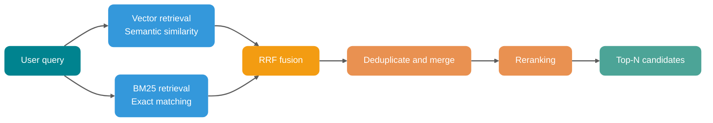
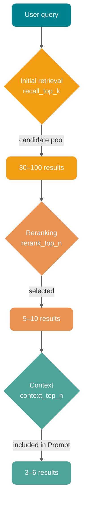
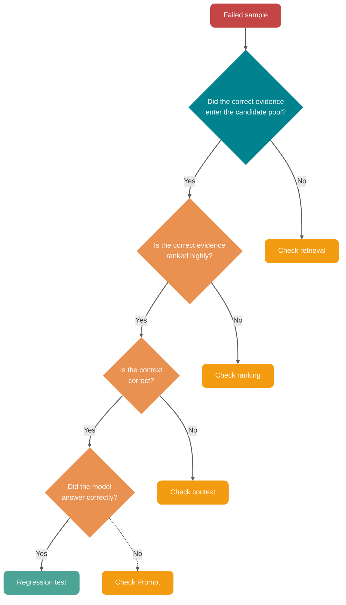

When RAG produces a wrong answer, replacing the Embedding model or increasing Top-K rarely solves the problem reliably. Incorrect PDF table parsing, chunks that split conditions, late permission filtering, or missing evidence in the candidate pool can all give the generation model the wrong context.

Tune the pipeline by tracing each stage—documents, indexing, retrieval, reranking, context, and generation—then replay changes against a fixed evaluation set. For guidance on preparing an evaluation set and scoring retrieval and generation, see [RAG Evaluation: From Offline Datasets to Production Observability](./rag-evaluation.md).

## What Does RAG Optimization Improve?

RAG is best understood as an evidence-processing pipeline. Source material is parsed, cleaned, chunked, tagged, and indexed. A user query then passes through query understanding, retrieval, reranking, and context construction before the LLM generates an answer.

An error at any stage propagates downstream.

| Stage            | Typical issue                                                    | Result                                                   |
| ---------------- | ---------------------------------------------------------------- | -------------------------------------------------------- |
| Document parsing | Misaligned tables, missing headings or page numbers              | Inaccurate citations and missing conditions              |
| Chunking         | Chunks too large or small, or split across semantic boundaries   | Noisy retrieval or passages without context              |
| Metadata         | Missing source, date, permissions, or section                    | Cannot filter or cite; risk of unauthorized access       |
| Retrieval        | Vector search alone, ignoring keywords and structured conditions | Missed error codes, SKUs, versions, and proper names     |
| Reranking        | Pass Top-K directly to the model                                 | Relevant passages rank too low to be noticed             |
| Context          | No deduplication, compression, or ordering                       | Wasted tokens and noisy input                            |
| Generation       | Prompt does not define evidence boundaries                       | Fluent answers with unsupported facts or citations       |
| Evaluation       | Subjective review without a test set                             | Changes rely on intuition and require repeated rollbacks |

RAG tuning is ultimately measured by answer usefulness, traceability, and stability, as well as the latency and cost required. For every failed sample, record at least five things: whether the correct evidence was retrieved, its candidate rank, what entered the context, whether the answer was supported by evidence, and whether the change is reproducible on a fixed dataset. Without these records, there is no clear basis for discussing vector database selection.

## The RAG Optimization Loop

Production RAG requires evaluation and replay. Otherwise, you cannot tell which problems a change fixed or which regressions it introduced.

```mermaid
flowchart LR
    Q["Production issue<br/>Failed sample"]:::client --> E["Offline evaluation<br/>Metric breakdown"]:::infra
    E --> L["Find the bottleneck<br/>Retrieval/reranking/generation"]:::business
    L --> T["Tune the strategy<br/>Chunk/query/reranking"]:::warning
    T --> G["Canary release<br/>Compare versions"]:::gateway
    G --> M["Monitor feedback<br/>Human review"]:::success
    M --> Q

    classDef gateway fill:#7B68EE,color:#FFFFFF,stroke:none,rx:10,ry:10
    classDef business fill:#E99151,color:#FFFFFF,stroke:none,rx:10,ry:10
    classDef infra fill:#9B59B6,color:#FFFFFF,stroke:none,rx:10,ry:10
    classDef client fill:#00838F,color:#FFFFFF,stroke:none,rx:10,ry:10
    classDef success fill:#4CA497,color:#FFFFFF,stroke:none,rx:10,ry:10
    classDef warning fill:#F39C12,color:#FFFFFF,stroke:none,rx:10,ry:10
    linkStyle default stroke-width:2px,stroke:#333333,opacity:0.8
```

Whenever you change chunk size, rewriting strategy, Rerank model, or Top-K parameters, run the same questions and compare Context Recall, Context Precision, Faithfulness, Answer Relevancy, latency, and cost.

Without replay, you cannot tell whether the system improved or simply started making different mistakes.

## Govern the Data Before Tuning Retrieval

If parsing has already misaligned data or lost its structure, retrieval and generation cannot restore the original evidence.

### Document Parsing Sets the Ceiling

PDFs, Word files, HTML, Markdown, database records, and ticket logs may all appear to be text, but their structures differ significantly. Plain-text extraction often mishandles PDF tables, images, headers and footers, footnotes, and tables spanning pages:

- Table-column relationships are lost, mixing prices, versions, and conditions.
- Headers and footers are repeated in every chunk, polluting the vector space.
- Images and flowcharts disappear, leaving answers without key steps.
- Heading hierarchy is lost, so the model cannot tell which section a passage belongs to.

For engineering documentation, policies, and product manuals, **parsing quality is often more important than changing the Embedding model**.

A practical guide:

| Document type       | Recommended handling                                      | Goal                         |
| ------------------- | --------------------------------------------------------- | ---------------------------- |
| Markdown / HTML     | Preserve heading levels, lists, and code blocks           | Retain the native structure  |
| PDF documents       | Parse body text, tables, page numbers, and image captions | Preserve evidence boundaries |
| Tabular documents   | Convert to structured rows or Markdown tables             | Preserve field relationships |
| Code documents      | Split by package, class, method, and comments             | Preserve call semantics      |
| Tickets / chat logs | Split by conversation, time, and role                     | Preserve context order       |

For documents with many tables and images, add OCR or multimodal structured descriptions where retrieval performs poorly. Do not send every file to a vision model. Start with high-value documents and frequent failure cases, and check whether parsing improvements justify the added cost and latency.

### The Role of Metadata

Retrieval filters and source information for the final answer both depend on Metadata. It determines which chunks can enter the candidate pool and lets results be traced back to the source, page, and version.

At minimum, store these fields for each chunk:

- `source_id`: Source document ID for tracing and deduplication.
- `source_type`: PDF, webpage, ticket, code, database record, and so on.
- `title`: Document title.
- `section_path`: Heading path, such as "Returns policy / After-sales scope / Special products."
- `page`: Page number or passage location.
- `created_at` / `updated_at`: Time-based filtering and version comparison.
- `tenant_id` / `acl`: Tenant isolation and access control.
- `business_tags`: Product line, language, region, version, and module.

Apply access-control filters before retrieval. If the vector database first returns Top-10 and eight results are inaccessible, the two remaining results do not mean that only two relevant passages exist. A missing permission filter can also put unauthorized content into the context.

Therefore, narrow the search with Metadata wherever possible. For example, filter by `tenant_id`, document type, version, and update time before calculating vector similarity or running hybrid retrieval.

## Chunking Strategy: Keep Related Knowledge Together

Chunk boundaries determine how much of a condition and conclusion each retrieved unit contains. If a condition is split into an adjacent chunk, reranking can only choose among incomplete candidates.

### There Is No Universal Chunk Size

Chunk sizes of 512, 800, or 1,000 tokens are only starting points for an initial experimental index. A sentence with a prerequisite, such as "The seven-day return policy does not apply in the cases above," may lose its prerequisite when split too finely. A chunk that is too large may bring an entire irrelevant passage into the context with one relevant sentence.

For the first round, try these ranges:

- FAQs, short policies, and API descriptions: start with 200–500 tokens.
- Technical documentation, tutorials, and design documents: start with 400–800 tokens.
- Regulations, contracts, and financial policies: prioritize clause completeness and split by heading, article, section, and item.
- Code knowledge bases: do not split by tokens alone; prefer files, classes, functions, and comment blocks.

Build separate indexes for these candidate settings. Compare Context Recall, Context Precision, answer accuracy, and average context tokens using the same questions, then keep the settings that fit the document collection.

### Semantic Chunking Suits Stable Documents

Semantic chunking uses relationships among headings, paragraphs, and adjacent sentences to determine boundaries instead of splitting at a fixed character count. Consider testing it when documents cover mixed topics, queries are conceptual, and more complex offline processing is acceptable:

- Documents mix several topics on a single page.
- User queries are conceptual rather than field lookups.
- The knowledge base is updated infrequently, so complex offline preprocessing is acceptable.

Semantic chunking also has clear limits:

- Frequent incremental updates require recalculating sentence or paragraph Embeddings for changed documents, at a higher offline cost than structure-based chunking. Typical semantic chunking compares adjacent content within each document; it does not require reclustering the entire knowledge base each time.
- The document structure is already clear, such as Markdown heading levels.
- Queries mainly look up exact IDs, fields, statuses, or configuration items.

When API documentation has OpenAPI paths, methods, and parameter tables, split along those structures. Using sentence Embeddings to choose boundaries may separate parameters from their response conditions.

### Parent-Child Chunking Is a Practical Compromise

Parent-child chunking separates retrieval granularity from reading granularity. Index a 300-token child chunk and link it to a 1,200-token parent passage. When the child matches, include the parent in the context. This supports fine-grained matches while preserving prerequisites and nearby explanations, without relying only on a larger Top-K. This pattern works well for long documents, tutorials, policy guides, and troubleshooting manuals.

### Add Semantic Entry Points to Chunks

"How do I get my money back?" and "refund application process" express the same need, but may have low surface similarity. During indexing, add more entry points to the same chunk:

- Generate a summary for each chunk and index both the summary and source text.
- Generate likely questions for each chunk and use their vectors to aid retrieval.
- Generate heading vectors for sections so conceptual queries can match the topic first.
- Create structured descriptions of code or tables when the original content is difficult to embed.

Summaries, questions, and structured descriptions must be regenerated and maintained. First test whether these entry points recover missing evidence for high-value documents or frequent failure cases before expanding their use.

## Retrieval Optimization: Do Not Rely on Vector Similarity Alone

Converting a query into an Embedding and retrieving Top-K results is a useful baseline. Exact terms such as error codes, model numbers, and versions can be displaced by semantically similar but incorrect content, so add keyword retrieval signals.

### Which Queries Benefit from Hybrid Search?

Vector search retrieves candidates by semantic similarity, while BM25 matches terms that appear in the text. Each approach covers different query types:

| Query type                                                | Vector search                     | BM25                  | Recommendation          |
| --------------------------------------------------------- | --------------------------------- | --------------------- | ----------------------- |
| "How do I cancel a subscription?"                         | Can match "turn off auto-renewal" | May not match         | Keep vector retrieval   |
| "Error code E1027"                                        | May retrieve generic failures     | Exact code match      | Keep keyword retrieval  |
| "ABX-4421 model specifications"                           | May find similar models           | Exact SKU match       | Keep keyword retrieval  |
| "Differences between Java thread-pool rejection policies" | Good semantic understanding       | Matches keywords      | Hybrid is more reliable |
| "Latest v3.2 pricing policy"                              | Needs semantic and time filters   | Can match the version | Metadata + Hybrid       |

In practice, semantic and keyword candidates are retrieved in parallel, combined with RRF or normalized weighted fusion, deduplicated, and passed to the Reranker. Microsoft Azure AI Search, Google Vertex AI Vector Search, and Weaviate all support Hybrid Search with RRF. RRF combines candidate ranks, so BM25 scores do not need to be converted to the same scale as vector cosine scores.

Hybrid Search may offer little benefit when documents are highly structured and queries contain few keywords. For queries rich in error codes, model numbers, configuration keys, and proper nouns, retain a keyword channel to prevent similar documents without the exact entity from ranking first.

### Query Rewrite: Make the Question Searchable

User queries often omit the entity, time, or scope needed for retrieval. For example:

- "How do I fix this error?"
- "Can I get a refund?"
- "Is that rate-limiting issue in production back again?"

"How do I fix this error?" does not specify the error code or service, and "Can I get a refund?" does not specify the order status. Query Rewrite should make the question easier to search without changing its meaning.

Common strategies include:

| Strategy            | Use case                                                           | Example                                                                                     |
| ------------------- | ------------------------------------------------------------------ | ------------------------------------------------------------------------------------------- |
| Normalization       | Informal language, abbreviations, or missing context               | Expand "Can I get a refund?" into "refund policy, refund conditions, refund process"        |
| Multi-Query         | Several phrasings are possible                                     | Search for "cancel subscription," "turn off auto-renewal," and "end membership" in parallel |
| Query Decomposition | The query contains multiple subquestions                           | Split "Compare Stripe and Square fees and dispute handling" into four subquestions          |
| Step-back Query     | The query is too specific and lacks context                        | Search for "subscription billing rules" before answering a specific cancellation question   |
| HyDE                | The query is very short or differs greatly from the document style | Generate a hypothetical answer, then use its vector to retrieve real documents              |
| Self-Query          | The query includes filter conditions                               | Extract year and category filters from "Find Java policies from 2025"                       |

LangChain components such as MultiQueryRetriever and SelfQueryRetriever package these strategies. Whether or not you use them, include the original query alongside rewritten queries in retrieval and fusion. If the rewrite model misinterprets "refund" as "cancel subscription," the original query still provides a correct retrieval path.

### A Larger Top-K Is Not Always Better

Increasing Top-K raises the chance that relevant evidence enters the candidate pool, but also increases Reranker input, Prompt tokens, and noise. Use separate limits for the candidate pool, reranked results, and final context:

- `recall_top_k`: Candidate pool for initial retrieval, such as 30–100.
- `rerank_top_n`: Results retained after reranking, such as 5–10.
- `context_top_n`: Results included in the final context, such as 3–6.

`recall_top_k` helps prevent missed evidence, `rerank_top_n` controls reranking costs, and `context_top_n` depends on how much evidence the model can actually read. Tune all three against the same evaluation set.

## Reranking: Turn Relevance into Answerability

Bi-encoder retrieval encodes the query and documents separately, then calculates vector distances. It is useful for quickly retrieving candidates from large collections. A Cross-Encoder or dedicated reranker encodes the query and candidate document together. This costs more but can judge whether a candidate contains the conditions and conclusions needed to answer the query.

### Why Is Reranking Useful?

Vector scores measure similarity of expression. Reranking scores should answer the question, "Can this passage answer the current query?"

For example:

The user asks: "Why does a thread pool trigger its rejection policy?"

Vector retrieval may return these passages:

1. A description of core thread-pool parameters.
2. A list of rejection policy enums.
3. The conditions that trigger rejection: the queue is full and the thread count has reached `maximumPoolSize`.
4. Example code using a thread pool.

Items 1 and 2 are semantically close to the query, but item 3 contains the core answer. Reranking should move item 3 to the top.

### Where Does Reranking Fit?

The pipeline can be split into five steps: pre-filter by Metadata; retrieve 30–100 candidates with Hybrid Search; deduplicate and merge adjacent passages; rerank to keep 5–10; then compress and add them to the Prompt.

Reranking cannot recover a document that is missing from the candidate pool. Check Context Recall first. If initial retrieval missed the correct passage, investigate parsing, chunking, and query handling instead of continuing to replace the reranker.

### LLM Reranking or a Dedicated Reranker?

| Option                 | Advantage                                             | Drawback                                                                                 | Use case                                                     |
| ---------------------- | ----------------------------------------------------- | ---------------------------------------------------------------------------------------- | ------------------------------------------------------------ |
| Cross-Encoder reranker | Fine-grained relevance scoring at a controllable cost | Requires model selection and may have language or domain bias                            | General production pipelines                                 |
| LLM scoring            | Can provide scoring rationale and flexible rules      | Slow and expensive; consistency depends on the Prompt, and rationale is not ground truth | Low-volume, high-value, complex judgments                    |
| Rule-based reranking   | Inexpensive and controllable                          | Handles only explicit rules                                                              | Prioritize by date, permissions, version, or source          |
| Hybrid reranking       | Flexible for complex business needs                   | Higher engineering complexity                                                            | Enterprise knowledge bases, customer support, and compliance |

Use a dedicated reranker for relevance in the main pipeline and rules for deterministic conditions such as time, permissions, and version. LLM scoring suits offline evaluation or low-volume complex judgments. Compare candidate models on the target language, domain data, latency, and cost.

## Context Engineering: Do Not Treat the Model as a Dumping Ground

After retrieval, decide which passages enter the Prompt and in what order. A larger context window does not eliminate concerns about attention, latency, cost, or signal-to-noise ratio. Irrelevant passages take up the model's attention and can cause:

- Selecting the wrong evidence and relying on similar but irrelevant passages.
- Missing important information in the middle of the context.
- Longer but less focused answers.
- Incorrect citations.
- Significantly higher costs and time to first token.

Every passage in the Prompt should support a conclusion, condition, or exception relevant to the current question.

### Context Compression

Compression should preserve evidence relevant to the current query, rather than summarize all candidates uniformly. Common options include:

| Compression method    | How it works                                                   | Risk                             |
| --------------------- | -------------------------------------------------------------- | -------------------------------- |
| Selective extraction  | Keep only source sentences relevant to the question            | May omit implicit conditions     |
| Query-focused summary | Condense a long passage into a summary focused on the question | May introduce paraphrasing bias  |
| Structured extraction | Extract fields, conditions, conclusions, and exceptions        | Depends on the extraction Schema |

ContextualCompressionRetriever implements a "base retriever + compressor" combination. In practice, filter and deduplicate with rules first, then call an LLM to compress only longer passages. This avoids model-call costs for every chunk.

### Context Order Also Affects the Answer

The returned order may mix retrieval channels, document sources, and versions, so do not pass it directly to the Prompt. Organize it using rules such as:

- Put the most relevant evidence first.
- Preserve the original order of adjacent passages from the same document where possible.
- Label conflicting passages with their update times and versions.
- Retain source information for cited passages.
- Keep low-confidence evidence separate from high-confidence evidence.

Group passages by topic for cross-document comparisons, arrange them chronologically for time-based analysis, and organize troubleshooting evidence by symptom, cause, steps, and precautions. Context engineering structures evidence in the model input; it is not just about the number of retrieved passages.

### Define Evidence Boundaries in the Prompt

At minimum, the Prompt should specify:

- Answer only from the provided context.
- State clearly when the context is insufficient to decide.
- Cite the source for each key conclusion where possible.
- Do not treat similar documents as facts about the current version.

Evidence quality checks and citation validation must still happen outside the Prompt. An instruction can tell the model to refuse when evidence is insufficient, but it cannot verify by itself whether the model follows that instruction.

## Evaluation: Diagnose Retrieval and Generation Separately

Evaluate RAG in separate stages. The final answer score alone does not reveal which stage failed.

### Build a Minimal Evaluation Set

You do not need thousands of samples at the start. Begin with 50–100 high-value questions:

- Frequent user questions.
- Production failures.
- Business-critical questions.
- Multi-hop reasoning questions.
- Exact-match questions, such as error codes, versions, and SKUs.
- Questions vulnerable to access-control or stale-data issues.
- Questions that should be refused.

Each sample should include:

- `question`: The user's original question.
- `golden_answer`: The ideal answer.
- `golden_context`: The evidence passage or document that should be retrieved.
- `metadata_filter`: Required filters.
- `answer_type`: Factual answer, process explanation, comparison, refusal, summary, and so on.

### Separate Retrieval and Generation Metrics

| Metric            | Measures                | Description                                               |
| ----------------- | ----------------------- | --------------------------------------------------------- |
| Hit Rate@K        | Retrieval               | Whether the correct evidence appears in the top K results |
| MRR               | Ranking                 | How highly the first correct result ranks                 |
| Context Recall    | Retrieval completeness  | Whether all evidence needed to answer was retrieved       |
| Context Precision | Context quality         | How much of the context is actually relevant              |
| Faithfulness      | Generation faithfulness | Whether the answer is supported by the context            |
| Answer Relevancy  | Answer relevance        | Whether the answer addresses the user's question          |
| Citation Accuracy | Citation correctness    | Whether each citation supports its corresponding claim    |
| Latency / Cost    | Engineering metrics     | P95 latency, tokens, reranking time, and cache hit rate   |

Tools such as RAGAS, DeepEval, and LangSmith support evaluation of context relevance, faithfulness, and answer relevance. RAGAS clearly defines metrics such as Context Precision, Context Recall, Faithfulness, and Response Relevancy. DeepEval can also combine retrieval and generation metrics in end-to-end tests.

Remember: **LLM-as-a-Judge is not the source of truth; it is only a supporting signal.**

Before deployment, manually review a sample of results to calibrate the evaluator. Check whether it favors long answers, misses citation errors, or struggles with domain terminology in the target language.

### Version Every Change

Each evaluation result must be associated with versions of:

- Document parser.
- Chunking strategy.
- Embedding model.
- Index parameters.
- Query Rewrite Prompt.
- Rerank model.
- Generation Prompt.
- Evaluation set.

When metrics change after a knowledge-base update, these records help identify whether a regression came from parsing, indexing, retrieval, or generation.

## Common Mistakes

### Tuning Only the Embedding Model

If PDF tables were parsed incorrectly, chunks lost prerequisites, Metadata did not filter access, or the correct document never entered the candidate pool, even a better Embedding model cannot restore the missing evidence. First use an evaluation set to distinguish retrieval, ranking, context, and generation problems; then decide whether to change the Embedding model.

### Skipping Evaluation

A single answer that looks better does not prove an overall improvement. Increasing Top-K may recover evidence for some questions while adding noise for others. Without a fixed sample set, it is difficult to observe both effects. A minimal evaluation set should include frequent, failed, exact-match, and refusal questions.

### Increasing Top-K Without Evaluation

A larger Top-K increases reranking costs, Prompt tokens, and model latency while lowering the context signal-to-noise ratio. To improve retrieval coverage, expand the initial candidate pool, then use reranking and compression to remove noise. Do not append all new candidates directly to the context. Track and evaluate initial retrieval Top-K, reranking Top-N, and context Top-N separately.

### Passing Irrelevant Context to the Model

When multiple policy versions, similar product documents, and adjacent but irrelevant passages are mixed together, the model may combine them into a plausible but incorrect conclusion. Before adding passages to the Prompt, deduplicate, compress, rank by evidence strength, and retain version and source information.

### Ignoring the Ability to Refuse

When retrieval confidence is low, evidence conflicts, or the user cannot access a key document, the system should refuse, ask a follow-up question, or escalate to a human. Add a post-retrieval evidence-quality check to trigger query rewriting, broader retrieval, external search, or refusal.

## A Practical Troubleshooting Workflow

When production RAG performance declines, first check whether the correct evidence entered the candidate pool, then inspect its ranking, context, and final answer. This prevents changing the Prompt, model, and retrieval parameters all at once.

### Step 1: Categorize Failed Samples

Start with 20–50 failed queries and group them into categories:

- The correct document was not retrieved at all.
- The correct document was retrieved but ranked too low.
- The correct document entered the context, but the answer did not use it.
- The answer used the context but misunderstood it.
- The answer cited a nonexistent or irrelevant source.
- The system answered when it should have refused.
- Permission, time, or version filtering failed.

This step is valuable because each category requires a different fix.

### Step 2: Check Whether the Correct Evidence Entered the Candidate Pool

If the correct evidence is missing from the initial Top-50, check:

- Whether the document was indexed.
- Whether the document was parsed correctly.
- Whether chunking split a key fact.
- Whether Metadata filters are too restrictive.
- Whether the query needs rewriting, decomposition, or HyDE.
- Whether BM25 or Hybrid Search is needed.

Further Rerank tuning is pointless at this stage: if the answer is not in the candidate pool, reranking can only reorder incorrect results.

### Step 3: The Correct Evidence Is in the Candidate Pool but Not in the Context

If the correct evidence is in the Top-50 but not in the final context, check:

- Whether the Rerank model fits the language and domain.
- Whether the Rerank input is too long and gets truncated.
- Whether score fusion suppresses keyword results.
- Whether merging adjacent chunks also brings in noise.
- Whether `rerank_top_n` is too small.

These signals point to the reranker, fusion weights, candidate-pool size, or deduplication strategy.

### Step 4: The Context Is Correct but the Answer Is Wrong

If the correct evidence is in the Prompt but the model still answers incorrectly, check:

- Whether the Prompt requires answers to be based on the context.
- Whether the context contains conflicting versions.
- Whether evidence is buried in the middle of the context.
- Whether the question requires multi-hop reasoning or a comparison table.
- Whether structured output and citation constraints are needed.
- Whether compression is needed before generation.

After ruling out the previous three categories, tune the Prompt, context order, compression, and generation model.

### Step 5: Add a Regression Test

For every fixed failure, add the reproducing input, expected evidence, and evaluation criteria to the evaluation set. Replay it after later changes to detect new regressions.

## Implementation Sequence from Scratch

When building enterprise RAG from scratch, first make sure document parsing, noise removal, heading hierarchy, page numbers, tables, and Metadata work correctly. Establish evaluation replay with questions covering frequent use, failures, exact matches, access control, and refusals.

Once there is a baseline, compare fixed-size, structure-aware, parent-child, and semantic chunks. Use vector retrieval for semantically similar content and BM25 or sparse vectors for exact terms. Then add Query Rewrite for informal language, abbreviations, multiple intents, and multi-hop questions. After expanding the candidate pool, apply reranking, deduplication, trimming, summarization, or structured extraction to build context within token and noise limits.

On the generation side, handle refusals when evidence is insufficient and cite key conclusions. Record metrics by version during canary releases and continue collecting failures. Change only a few variables per iteration and record parser, chunking, Embedding, index, Query Rewrite, Rerank, and Prompt versions. Confirm offline gains against canary traffic as well.

## Summary

An optimization replay starts with the searchable content produced by parsing and Metadata, then passes through chunking, Hybrid Search, Query Rewrite, Reranking, and context assembly. Finally, inspect the evidence the model actually read and its answer. A fixed evaluation set and version records make changes at every stage comparable and repeatable.

## References

- [Production RAG: The Five Decisions Behind Every System That Works](https://www.bestblogs.dev/article/899eff0a)
- [RAG Optimization Handbook: 20 Methods Explained](https://cloud.tencent.com/developer/article/2634637)
- [Weaviate Hybrid Search Documentation](https://docs.weaviate.io/weaviate/concepts/search/hybrid-search)
- [Microsoft Azure AI Search: Hybrid Search RRF](https://learn.microsoft.com/en-us/azure/search/hybrid-search-ranking)
- [Google Vertex AI Vector Search: Hybrid Search](https://docs.cloud.google.com/vertex-ai/docs/vector-search/about-hybrid-search)
- [Cohere Rerank Documentation](https://docs.cohere.com/docs/rerank-overview)
- [LangChain Retriever API Documentation](https://api.python.langchain.com/en/latest/langchain/retrievers.html)
- [RAGAS Metrics Documentation](https://docs.ragas.io/en/stable/concepts/metrics/available_metrics/context_precision/)
- [DeepEval RAG Evaluation Guide](https://deepeval.com/guides/guides-rag-evaluation)
