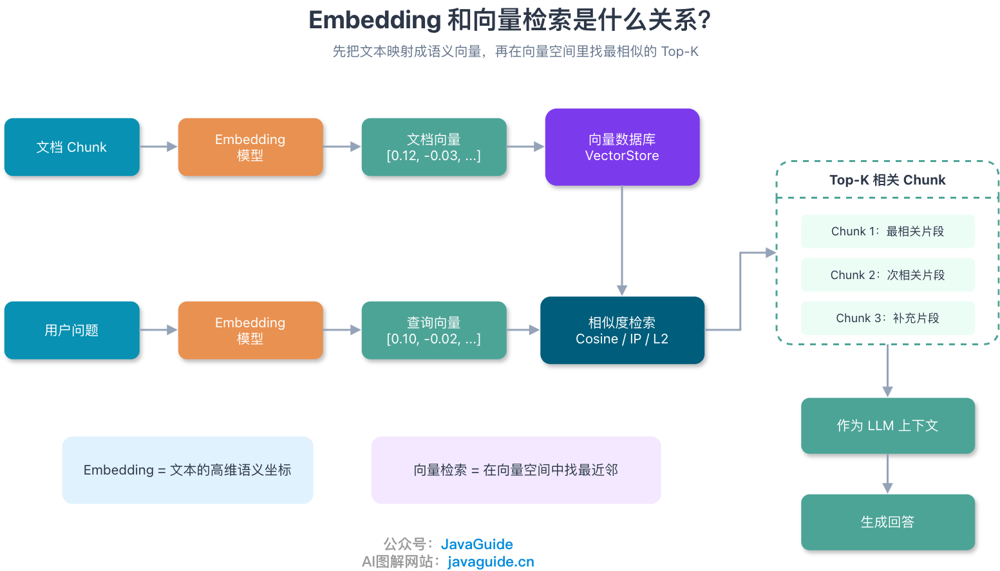
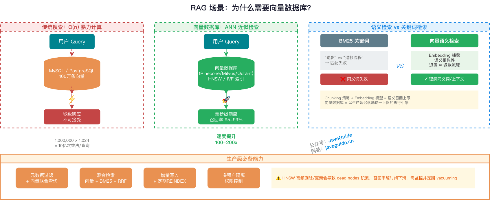
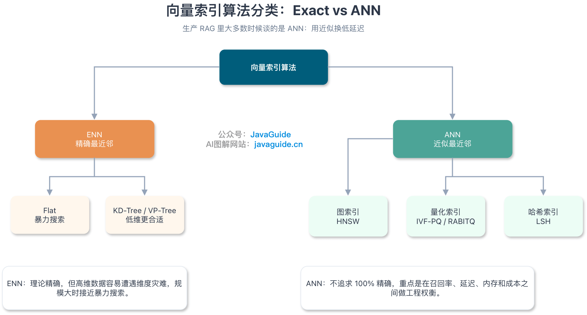
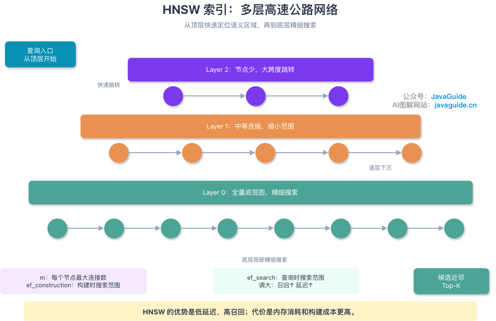
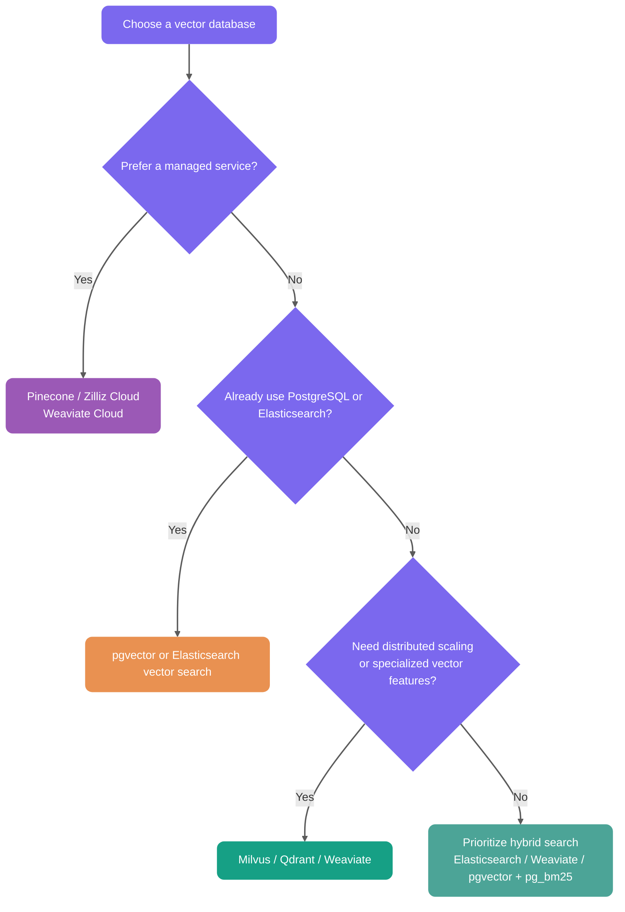
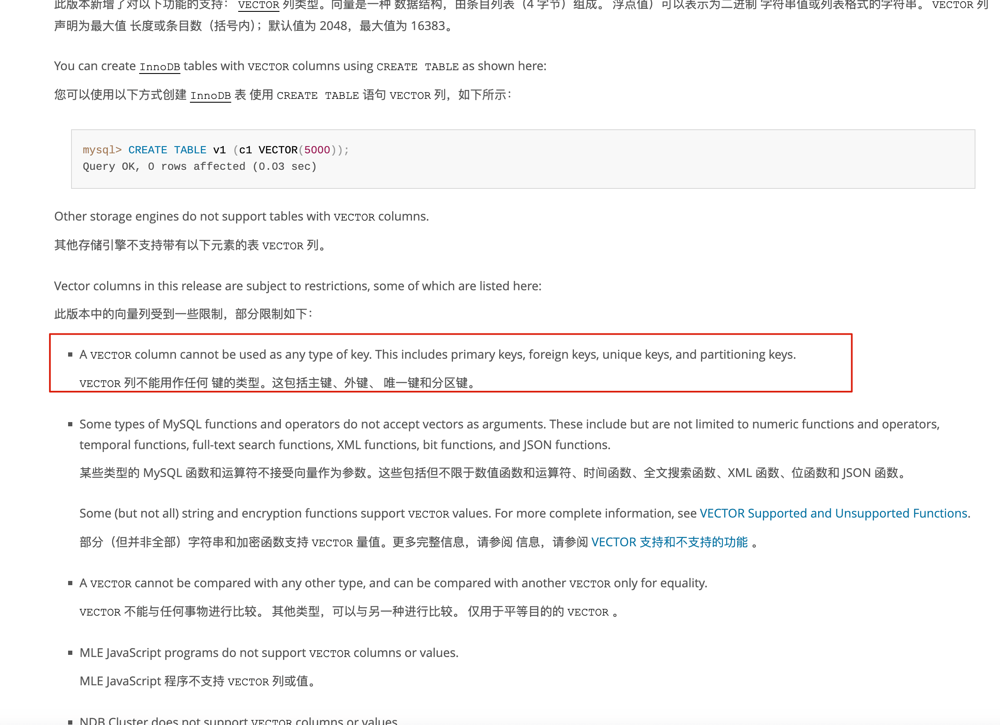

Storing Embeddings in ordinary fields and calculating distances row by row can serve as an exact-search baseline for small datasets. As data volume, concurrency, or latency requirements grow, the cost of a full table scan increases linearly with the number of vectors. At that point, consider an ANN index or a dedicated vector retrieval system.

This guide starts with distance metrics and index algorithms, then uses PostgreSQL + pgvector to explain HNSW and IVFFLAT parameters, filtering behavior, and selection criteria.

## How Are Embeddings Related to Vector Retrieval?

Vector databases do not understand text directly. They store and retrieve Embeddings.

An Embedding model converts a text passage into a dense vector with a fixed number of dimensions. You can think of it as a set of semantic coordinates for the text. Passages with similar meanings are usually closer together in vector space.



The RAG vector retrieval flow can be simplified as follows:

```text
Document chunk -> Embedding model -> document vector -> store in vector database
User query -> Embedding model -> query vector -> retrieve the most similar Top-K document vectors
```

For the fundamentals, see [RAG Basics](./rag-basis.md). This guide focuses on the second half of the pipeline: how to store, index, and retrieve these vectors efficiently.

## Why Does RAG Need a Vector Database?

Vector semantic search is one common retrieval method in RAG. The system converts documents and user queries into high-dimensional vectors, then finds the most similar Top-K passages for the LLM's context. RAG can also use BM25, SQL, graph queries, or external APIs, depending on the data.

The real challenge in RAG is not simply whether Embeddings can be stored, but whether the most relevant Top-K results can be found at low latency in a large collection of high-dimensional vectors.

Traditional relational databases can store vectors and calculate similarity with functions or SQL expressions. Without a dedicated vector index, however, they usually have to scan the entire table, making production-grade low-latency retrieval difficult. When the number of chunks reaches hundreds of thousands or millions, consider a vector database, vector search engine, or database extension with vector-index support, such as PostgreSQL + pgvector.



### Similarity Search over High-Dimensional Vectors

Embeddings are typically dense vectors with 768 to 3,072 dimensions. Without a vector index, a database may be able to calculate cosine similarity, inner product, or Euclidean distance, but still struggle to retrieve the Top-K results quickly from a large dataset.

Brute-force search calculates distances across the entire table, with O(n) complexity. For one million 1,024-dimensional vectors, a single query requires roughly:

```text
1,000,000 × 1,024 multiplications
```

Depending on the hardware and implementation, latency can easily reach seconds, which is generally unacceptable for a real-time question-answering system.

Approximate Nearest Neighbor (ANN) retrieval addresses this problem. Vector databases reduce the number of distance calculations through graph navigation, space partitioning, quantization, and other techniques, instead of comparing every vector on every query.

ANN does not always return the exact nearest neighbors. Its value is in balancing recall, latency, and resource use. With suitable index parameters and hardware, ANN can often reduce retrieval time for millions of vectors from seconds of brute-force scanning to tens of milliseconds or less. Measure performance with your own data, Top-K, filters, concurrency, and recall targets; theoretical complexity alone is not enough.

| Metric    | Brute-force search                  | ANN index search                                     |
| --------- | ----------------------------------- | ---------------------------------------------------- |
| Retrieval | Calculate distances for all vectors | Search only a candidate set                          |
| Recall    | Theoretically 100%                  | Depends on index type and parameters                 |
| Latency   | Increases with dataset size         | Usually much lower                                   |
| Cost      | High compute cost                   | Index construction and additional memory or disk use |

The table gives only a rough comparison. Actual performance depends on hardware, concurrency, data distribution, filters, Top-K, and index parameters such as `ef_search` and `nprobe`. Refer to [ann-benchmarks.com](https://ann-benchmarks.com) when selecting and tuning an index, and validate it in your own environment.

### Support for Large Datasets

Vector databases typically support persistence, incremental updates, sharding, and index construction. Traditional databases can also store vectors in columns. Test whether you need a separate vector database against your existing stack, vector dimensions, filters, QPS, latency, and recall targets. Without a vector index, growth in data volume directly increases the cost of exact scans.

### How Does Semantic Search Differ from Keyword Search?

Keyword search and vector semantic search solve different problems.

| Retrieval method       | Principle                                | Limitation                                                                      |
| ---------------------- | ---------------------------------------- | ------------------------------------------------------------------------------- |
| BM25 keyword search    | Literal matching based on term frequency | Can miss synonyms or paraphrases, such as "return" versus "refund process"      |
| Vector semantic search | Embeddings capture semantic similarity   | Handles synonyms, context, and implied intent, but depends on Embedding quality |

The chunking strategy and Embedding model determine the theoretical ceiling for semantic retrieval. The vector database aims to approach that ceiling within an acceptable latency.

Production-grade RAG also needs capabilities such as:

- Metadata filtering combined with vector similarity, such as `WHERE category='Java' AND version>='v2'`.
- Hybrid Search that combines vectors, BM25, and RRF.
- Dynamic updates and incremental writes. Frequent updates and deletions can bloat the vector index, accumulate dead entries, and destabilize recall or latency. Monitor these effects with `VACUUM`, `REINDEX`, query plans, and business evaluation sets.
- Access control and tenant isolation, both essential for enterprise RAG.

## How Do You Choose a Vector Similarity or Distance Metric?

Vector databases do not match keywords; they calculate the distance or similarity between query and document vectors. Common metrics in RAG include cosine distance, inner product, and Euclidean distance.

Here are three common metrics in pgvector:

| Metric                  | pgvector operator | Operator class      | Characteristics                                                                                | Typical use                                   |
| ----------------------- | ----------------- | ------------------- | ---------------------------------------------------------------------------------------------- | --------------------------------------------- |
| Euclidean distance (L2) | `<->`             | `vector_l2_ops`     | Measures absolute distance in vector space; smaller is more similar                            | Models or indexes explicitly optimized for L2 |
| Inner product           | `<#>`             | `vector_ip_ops`     | pgvector returns the negative inner product; smaller is more similar                           | Normalized vectors and efficient computation  |
| Cosine distance         | `<=>`             | `vector_cosine_ops` | Independent of vector magnitude; smaller is more similar. Cosine similarity is `1 - distance`. | Common for text semantic search and RAG       |

If asked in an interview why RAG often uses cosine similarity, explain that text semantic search cares more about whether vector directions are close than about vector magnitudes. Cosine distance is independent of magnitude and is therefore useful for semantic similarity. If the Embedding model already normalizes its output, inner product and cosine usually produce the same ranking, and inner product is more direct to compute.

Do not choose a metric by intuition alone. Check whether the Embedding model normalizes its output, which metric it recommends, and whether the vector index supports the corresponding operator class.

One common pitfall is that the query operator must match the index's operator class. For example, if the index uses `vector_cosine_ops`, the query must use `<=>`; otherwise, PostgreSQL may not use the vector index.

## What Is a Vector Index Algorithm?

Vector index algorithms solve the problem of quickly finding the vectors most similar to a query in a large collection of high-dimensional vectors.

Without an index, the database must compare the query with every vector using brute-force search. At the million or hundred-million scale, the resulting latency is unacceptable.

The index organizes data in advance so that a query can skip most irrelevant vectors and perform exact comparisons on a much smaller candidate set.

An everyday analogy:

- Without an index: search for someone door to door across an entire city.
- With an index: narrow the search to a district, then a street, then a building.

In practice, vector index algorithms fall into two broad categories.



Most discussions of vector indexing focus on ANN algorithms. Index benefits depend on data distribution, hardware, Top-K, filters, and recall targets, so they cannot be summarized with a fixed speedup. Record query latency, resource use, and recall when tuning.

### Exact Nearest Neighbor (ENN)

ENN aims to find the most similar vectors with 100% accuracy. Traditional spatial tree structures such as KD-Trees and VP-Trees belong to this category.

KD-Trees and VP-Trees work better on low-dimensional data. As dimensionality increases, pruning often becomes less effective, and queries may approach brute-force scans. The extent of this degradation depends on the data and implementation; there is no universal dimensionality threshold.

### Approximate Nearest Neighbor (ANN)

ANN is the mainstream approach to modern vector retrieval. It makes an engineering tradeoff: rather than guaranteeing the exact nearest neighbors, it finds sufficiently similar results with high probability, exchanging some recall for orders-of-magnitude faster search.

Common ANN algorithms fall into three categories:

- **Graph-based**, such as HNSW: organizes vectors in a multi-layer graph and navigates the graph during retrieval. HNSW often balances query speed and recall well.
- **Quantization-based**, such as IVF-PQ: uses clustering and compression to reduce the memory footprint of large vector collections, making it suitable for very large-scale use.
- **Hash-based**, such as LSH: uses specialized hash functions so similar vectors are likely to fall into the same bucket, narrowing the search space.

## What Vector Index Algorithms Are Available?

In RAG applications, the index algorithm directly affects recall, response latency, and resource consumption.

First, distinguish between two levels:

| Level                      | Examples                    | Description                                                              |
| -------------------------- | --------------------------- | ------------------------------------------------------------------------ |
| Vector database            | Milvus, Qdrant, pgvector    | A complete system for storing, retrieving, and managing vectors          |
| Supported index algorithms | HNSW, IVF-PQ, IVFFLAT, Flat | Internal implementations that determine retrieval performance and recall |

The following table summarizes common index algorithms:

| Algorithm                          | Mechanism                                       | Main advantage                                       | Main drawback                                  | Typical use                                                                                                            |
| ---------------------------------- | ----------------------------------------------- | ---------------------------------------------------- | ---------------------------------------------- | ---------------------------------------------------------------------------------------------------------------------- |
| Flat (brute-force search)          | Calculate distance against every vector         | Exact, 100% recall                                   | Slow on large datasets                         | Small datasets, low QPS, offline evaluation, and recall baselines                                                      |
| HNSW (graph index)                 | Hierarchical navigable small-world graph        | Fast queries and high recall                         | High memory use and slow construction          | Medium to large datasets requiring high recall and low latency; assess memory carefully at tens of millions of vectors |
| IVFFLAT (inverted-file clustering) | Clustering and inverted-list buckets            | More memory-efficient and faster to build            | Requires training and may have lower recall    | Prioritize memory and build speed, with some recall loss acceptable                                                    |
| IVF-PQ (product quantization)      | Clustering and aggressive vector compression    | Supports very large datasets with lower resource use | Greater accuracy loss                          | Very large datasets with memory constraints and tolerance for quantization error                                       |
| IVF_RABITQ                         | Clustering and random-rotation bit quantization | Low memory use and better recall than traditional PQ | Newer algorithm; ecosystem support is evolving | Very large datasets with memory constraints and tolerance for quantization error                                       |

IVF_RABITQ is a newer quantization algorithm proposed in 2024. Its core idea combines random rotation and bit quantization. Unlike traditional PQ, which splits vectors into subvectors and clusters them separately, RABITQ first rotates vectors randomly to make dimension distributions more uniform, then quantizes each dimension to one bit, retaining only its sign. This can reduce memory use while maintaining relatively high recall, and bitwise operations can accelerate distance calculations. Milvus 2.6.x provides the `IVF_RABITQ` index type.

## Which Vector Index Algorithm Does Your Project Use?

This section uses the [Spring AI interview platform with a RAG knowledge base](https://javaguide.cn/zhuanlan/interview-guide.html) as an example.

The project uses PostgreSQL's pgvector extension with an HNSW index.

Why HNSW? At the current scale, it offers a reasonable balance between retrieval speed, recall, and implementation complexity.

You can think of HNSW as a multi-level highway network.



HNSW has three core mechanisms.

First, it is hierarchical. A node's highest level is determined by `level = floor(-ln(random()) * mL)`, where `mL` is the level multiplier. The number of nodes decreases exponentially at higher levels, forming a pyramid-like structure.

Second, it uses greedy search. Retrieval starts at the top level and moves at each level to the neighbor closest to the query point.

Third, it searches from coarse to fine. Upper layers quickly locate a semantic region, while lower layers find candidate neighbors more precisely.

This approach quickly finds candidate neighbors without comparing every point as brute-force search does.

HNSW is an ANN algorithm that trades speed for recall and does not guarantee 100% recall. Parameters affect both recall and latency; evaluate them with a business test set and final-answer quality.

HNSW has three common tuning parameters:

- `m`: Maximum number of connections per node. A larger `m` creates a denser graph and may improve recall, but increases construction time and memory use.
- `ef_construction`: Search scope during index construction. Larger values can improve index quality but make construction slower.
- `ef_search`: Search scope at query time. This runtime parameter has the greatest direct effect on query speed and recall.

pgvector's HNSW defaults are `m = 16`, `ef_construction = 64`, and `ef_search = 40`. Use the following as a starting point for tuning:

| Parameter         | Common range | Effect of increasing it                                                                | Tuning advice                                                        |
| ----------------- | ------------ | -------------------------------------------------------------------------------------- | -------------------------------------------------------------------- |
| `m`               | 8–64         | Denser graph and potentially higher recall, with more memory use and construction time | Start with the default; try 24 or 32 if recall is insufficient.      |
| `ef_construction` | 64–256+      | Better index quality but slower construction                                           | Increase it when slower offline construction is acceptable.          |
| `ef_search`       | 40–200+      | Higher query recall but greater latency                                                | Tune online against an evaluation set to balance recall and latency. |

A practical approach is to build the index with fixed `m` and `ef_construction`, then tune `ef_search` with a session parameter:

```sql
SET hnsw.ef_search = 100;
```

Use `EXPLAIN ANALYZE` to confirm that the index is used, then compare recall, latency, and final-answer quality across different `ef_search` values with a set of human-labeled questions. Do not increase `ef_search` indefinitely. Stop once recall meets the business requirement; otherwise, you may trade latency and CPU for only marginal gains.

Plan for scale as well. HNSW is memory-intensive. If the dataset grows to tens or hundreds of millions of vectors, or write throughput requirements increase, memory use and index-construction costs may become bottlenecks.

At that point, consider IVFFLAT, which clusters the vector space into buckets, following the inverted-index model, to narrow the search. You could also introduce a dedicated vector database such as Milvus, which is more mature for distributed and large-scale workloads.

Another easily overlooked point is filtering.

When using `WHERE` filters with pgvector's HNSW index, inspect the query plan. Approximate indexes usually find vector candidates first and apply filters afterward. Strict filters can leave fewer results than the requested Top-K and, for some query patterns, may result in a slower scan.

For example, if a query asks for 10 similar documents where `category='Java'` and only three candidates satisfy the filter, it can return only three results.

Common approaches include:

1. Increase the candidate set: raise `ef_search` or `LIMIT` so more candidates reach the filtering stage.
2. Pre-filter: filter by metadata before vector search, though this may prevent index use and fall back to brute-force search.
3. Partial index: PostgreSQL supports conditional HNSW indexes, such as `CREATE INDEX ... WHERE category = 'Java'`, but common filter conditions may require separate indexes.
4. Iterative index scan: pgvector 0.8.0+ can scan more of the index when too few results remain after filtering, mitigating Top-K shortfalls from "ANN first, filter later." Control the cost with parameters such as `hnsw.max_scan_tuples` and `ivfflat.max_probes`.

## How Do HNSW and IVFFLAT Indexes Differ?

The key difference is simple: HNSW uses graph connectivity to find neighbors, while IVFFLAT uses clustering to narrow the search.

HNSW builds a multi-layer graph. A query moves across longer distances in upper layers, then performs a more precise local search in lower layers, like traveling on a highway. It offers fast queries and typically high, stable recall. Its drawbacks are high memory use for both vectors and node connections, and generally slower index construction.

IVFFLAT uses K-Means to divide the vector space into buckets. A query selects the nearest buckets, then performs a brute-force search within them. It uses memory more efficiently, has a simpler structure, and is usually faster to build. At the same recall target, however, query performance and stability are often lower than HNSW. Significant changes in data distribution may also require retraining the centroids.

| Feature              | HNSW (graph index)                                                                         | IVFFLAT (inverted-file clustering)                               |
| -------------------- | ------------------------------------------------------------------------------------------ | ---------------------------------------------------------------- |
| Underlying mechanism | Hierarchical small-world graph                                                             | Clustering and inverted lists                                    |
| Query speed          | Usually faster with more stable recall                                                     | Depends on `lists` and `probes`                                  |
| Memory use           | Higher due to vectors and graph connections                                                | Usually lower than HNSW                                          |
| Build speed          | Slower; nodes are inserted individually                                                    | Usually faster, but requires clustering                          |
| Data updates         | Incremental additions are convenient; monitor index health after many updates or deletions | May need to rebuild when data distribution changes significantly |
| Typical use          | Medium to large datasets requiring high recall and low latency                             | Prioritize memory and build speed, accepting some recall loss    |

Which should you choose?

Prefer HNSW when you need low latency and high recall and have enough server memory. Consider IVFFLAT when memory and build speed matter more, some recall loss is acceptable, and you are prepared to tune `lists` and `probes`.

## What Vector Databases Are Available?

There is no one-size-fits-all vector database. The right choice depends on the project.

### Traditional Database Extensions

Examples include PostgreSQL + pgvector and MongoDB Atlas Vector Search.

These solutions keep the technology stack unified, avoid introducing another database system, and allow vector and business data to be managed in the same transaction. Teams can reuse their SQL experience and combine SQL filters with vector search.

They suit early-stage or small-to-medium projects. PostgreSQL + pgvector is especially useful when business and vector data require strong consistency and must be managed in a single transaction. Teams already using PostgreSQL also benefit from lower learning and operations costs.

### Search Engine Extensions

Examples include Elasticsearch and OpenSearch.

These systems provide strong hybrid search, combining BM25 keyword retrieval with vector semantic search. They also retain traditional search-engine strengths in long-text handling, tokenization, highlighting, and aggregations, with mature distributed architectures.

If your business already depends on keyword search, such as e-commerce or document search with complex filtering and aggregations, or your team already uses Elasticsearch, reusing the vector capabilities in Elasticsearch or OpenSearch is a natural option.

### Purpose-Built Vector Databases

Examples include Milvus, Weaviate, and Qdrant.

Milvus is feature-rich and has a large community. Weaviate includes AI modules, supports GraphQL queries, and is easy to use. Qdrant is written in Rust, with efficient memory use and strong filtering capabilities.

These databases are optimized for vector retrieval and typically support multiple index algorithms, such as HNSW, IVF, and LSH. They also provide specialized features for partitioning, multi-tenancy, dynamic updates, and distance metrics.

Purpose-built vector databases may be a better fit than pgvector when the dataset reaches hundreds of millions of vectors or QPS and latency requirements are strict. The tradeoff is another system to operate, monitor, back up, and learn.

### Managed Vector Database Services

Examples include Pinecone, Zilliz Cloud, and Weaviate Cloud.

These services reduce operational work, speed up deployment, and often provide automatic scaling and high-availability SLAs. They are attractive when the budget allows and the team prefers not to operate the infrastructure.

However, managed does not mean maintenance-free. You are still responsible for index parameters, recall evaluation, access isolation, and cost monitoring.

## How Do You Choose a Vector Database?

Use this diagram as a rough guide:



Start with your existing stack and business constraints:

- If you already use PostgreSQL and a single instance meets evaluation targets for resources, write throughput, filtered queries, and latency, start with pgvector.
- If you already use Elasticsearch or OpenSearch and depend on keyword search, tokenization, highlighting, and aggregations, reuse its vector search and combine it with BM25.
- Evaluate Milvus, Qdrant, or Weaviate when you need distributed scaling, isolated resources, multi-tenancy, or specialized index features.
- If your team does not plan to operate a cluster, compare the pricing, data residency, and SLAs of Pinecone, Zilliz Cloud, and Weaviate Cloud.

Vector count is useful for capacity estimates, but should not determine the product by itself. Results for the same one million vectors can differ significantly depending on dimensions, filter selectivity, QPS, Top-K, and hardware.

## Why Choose PostgreSQL + pgvector?

This section uses the [Spring AI interview platform with a RAG knowledge base](https://javaguide.cn/zhuanlan/interview-guide.html) as an example. The project stores structured data, such as resumes and interview records, as well as document Embeddings.

The options compare as follows:

| Option                  | Advantage                                     | Main tradeoff                                                | Best suited for                                                                      |
| ----------------------- | --------------------------------------------- | ------------------------------------------------------------ | ------------------------------------------------------------------------------------ |
| PostgreSQL + pgvector   | One database to manage and simpler operations | Vector workloads compete with business queries for resources | Already use PostgreSQL, and measured latency, recall, and capacity meet requirements |
| PostgreSQL + Milvus     | Separates business data from vector workloads | Adds a component and operational complexity                  | Need to scale vector retrieval separately while retaining PostgreSQL transactions    |
| Pinecone / Zilliz Cloud | Managed service with less cluster operations  | Cost, data residency, and vendor dependency                  | Prioritize deployment speed and can accept related compliance and cost constraints   |

There are several reasons to choose pgvector.

First, the architecture is simple. No extra component is needed, so deployment and operations remain straightforward.

Second, performance is sufficient. HNSW index speed and recall meet current business requirements.

Third, transactional consistency is strong. Vector and business data share a database and can use the same transactions.

Fourth, SQL queries are convenient. They can include `WHERE` filters, but filters may affect vector index usage, so always inspect the query plan.

```sql
-- pgvector cosine similarity search example
-- <=> is the cosine distance operator (0 = identical, 2 = opposite)
-- cosine similarity = 1 - cosine distance
SELECT content, 1 - (embedding <=> $1) as cosine_similarity
FROM vector_store
WHERE metadata->>'category' = 'Java'
ORDER BY embedding <=> $1  -- Ascending distance; smaller means more similar.
LIMIT 5;

-- ⚠️ Important: The query distance operator must match the operator class
-- specified when creating the HNSW index (for example, vector_cosine_ops).
-- Otherwise, the query cannot use the index and falls back to a full table scan.
-- Verify with EXPLAIN ANALYZE and check for an Index Scan in the query plan.
```

## What Are the Practical Details of Using pgvector?

The key to pgvector is not just storing vectors; the index, distance metric, and query must work together.

### Create an HNSW Index

```sql
-- Example Embedding type: vector(1536)
CREATE INDEX idx_document_embedding_hnsw
ON document_chunk
USING hnsw (embedding vector_cosine_ops)
WITH (m = 16, ef_construction = 64);
```

If the query uses cosine distance (`<=>`), the index must use `vector_cosine_ops`. If it uses `<->`, use `vector_l2_ops` instead.

### Create an IVFFLAT Index

```sql
CREATE INDEX idx_document_embedding_ivfflat
ON document_chunk
USING ivfflat (embedding vector_cosine_ops)
WITH (lists = 100);

-- Control how many cluster lists are scanned at query time.
SET ivfflat.probes = 10;
```

IVFFLAT needs a sufficient amount of data before index creation because it must cluster the vectors. pgvector's documentation suggests starting with `rows / 1000` for up to one million rows and `sqrt(rows)` above one million. These are only starting values; tune with business data. Increasing `probes` usually improves recall but slows queries.

### Index Maintenance

After many deletions or updates, a vector index may bloat, accumulate dead entries, or show fluctuations in recall and latency. Run `VACUUM` and `REINDEX` during off-peak hours, and monitor query plans and business evaluation sets.

`VACUUM` remains important, but it is not a universal fix for recall. Assess vector index health using query latency, recall evaluations, and query plans together.

After changing a distance operator, operator class, filter, or index parameter, use `EXPLAIN ANALYZE` to verify index usage.

### Version Features

- pgvector 0.5+ supports HNSW indexes.
- pgvector 0.7+ adds types such as `halfvec`, `sparsevec`, and `bit`, along with additional distance operations for reducing storage or handling sparse vectors.
- pgvector 0.8.0+ supports iterative index scans, which scan more of the index when filtering leaves too few results and help address Top-K shortfalls. Pin the production version and run regression evaluations before upgrading.

## Why Not Use MySQL with a Vector Database?

PostgreSQL's main advantage in these scenarios is its extensibility. Extensions add capabilities without modifying the database kernel.

For example:

- **AI vector retrieval**: The pgvector extension integrates closely with PostgreSQL and supports ACID transactions, JOINs, backup and recovery, and SQL filtering. It suits small-to-medium RAG projects that want a simpler stack.
- **Full-text search**: Built-in `tsvector` supports basic needs; consider pg_bm25 for more advanced search.
- **Time-series data**: TimescaleDB.
- **Geospatial data**: PostGIS.

This approach lets one PostgreSQL instance provide several foundational capabilities, which is convenient for small-to-medium projects. Start with PostgreSQL to simplify the stack, then add specialized components such as Elasticsearch, Milvus, Qdrant, or Weaviate when data volume, QPS, or tenant isolation requirements grow.

MySQL capabilities depend on the version. The MySQL 8.x series, including 8.4 LTS, does not have an official `VECTOR` data type. MySQL 9.x introduced the `VECTOR` type and related functions, but its documented capabilities focus on vector storage and basic functions; it is not yet a mature production ANN retrieval solution.

If the project is already closely tied to MySQL, continue using it for business data and pair it with an external vector retrieval component such as pgvector, Milvus, Qdrant, Weaviate, Elasticsearch, or OpenSearch. There is no need to force all RAG data into MySQL.



For a detailed comparison of MySQL and PostgreSQL, see [MySQL vs PostgreSQL: Which Should You Choose?](https://mp.weixin.qq.com/s/APWD-PzTcTqGUuibAw7GGw).

<!-- @include: @rag-project.snippet.md -->

## Summary

Vector storage and indexing are essential RAG infrastructure. A poor choice can lead to slow retrieval, low recall, and high costs.

Without a dedicated vector index, Top-K retrieval over large collections of high-dimensional vectors usually requires a full table scan. ANN indexes trade some exactness to balance recall, latency, and resource use.

Among common index algorithms, Flat performs brute-force search and suits small datasets, low QPS, offline evaluation, and recall baselines. HNSW is a graph index with fast queries and high recall, but uses more memory. IVFFLAT uses inverted-file clustering, with lower memory use and faster construction, but requires tuning and may reduce recall. IVF-PQ supports very large datasets through product quantization, at the cost of accuracy.

HNSW suits low-latency, high-recall workloads; IVFFLAT suits workloads sensitive to memory and construction costs. PostgreSQL + pgvector is a good fit for small-to-medium datasets. Milvus, Qdrant, and Weaviate suit large-scale or specialized vector retrieval, while Pinecone and Zilliz Cloud suit teams seeking lower operational overhead.

Common interview questions include:

- What is an Embedding, and why convert text into vectors?
- Why does RAG need a vector database?
- How do cosine similarity and Euclidean distance differ, and which is suitable for RAG?
- Why can ANN algorithms return results that are not 100% exact?
- What vector index algorithms are available, and what are their tradeoffs?
- How do HNSW and IVFFLAT differ?
- How do you tune HNSW's `ef_search`, and what happens when you increase or decrease it?
- What is the key difference between a vector database and a traditional database?
- How should the architecture change as vector data grows from one million to 100 million entries?
- When can a pgvector HNSW index be bypassed or degrade into a slower scan?
- Why choose PostgreSQL + pgvector?

For hands-on practice, first understand the HNSW graph and IVF clustering. Then build a small demo with pgvector or Milvus and compare recall and latency across index parameters. Do not tune `ef_search` or `nprobe` by intuition; evaluate them against real business queries.

Vector database selection and index tuning have a direct impact on whether a RAG system can perform reliably in production. The wrong choice can mean slow retrieval, poor recall, and runaway costs.
