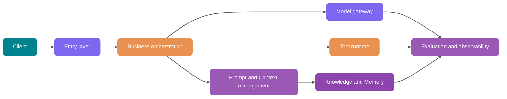
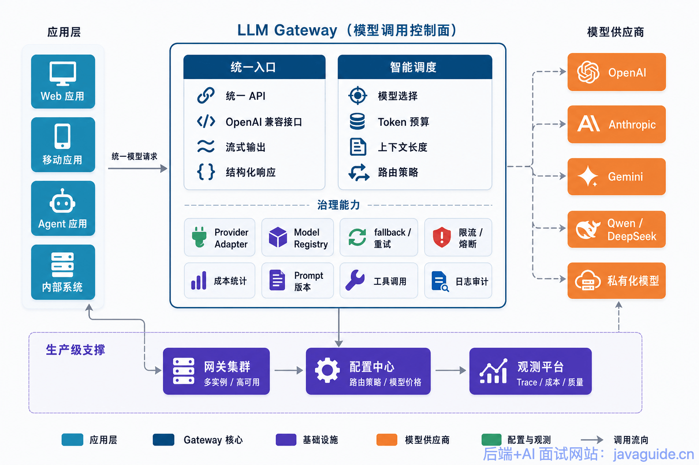
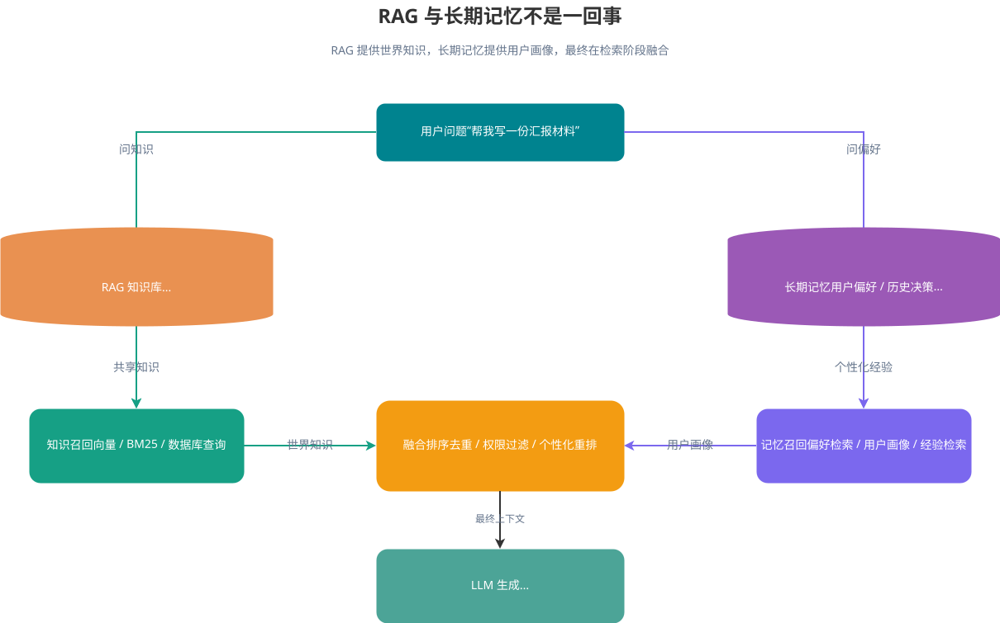
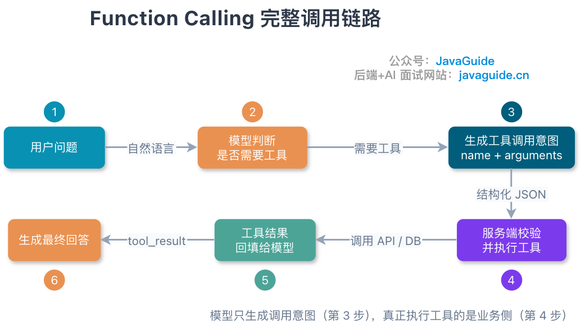
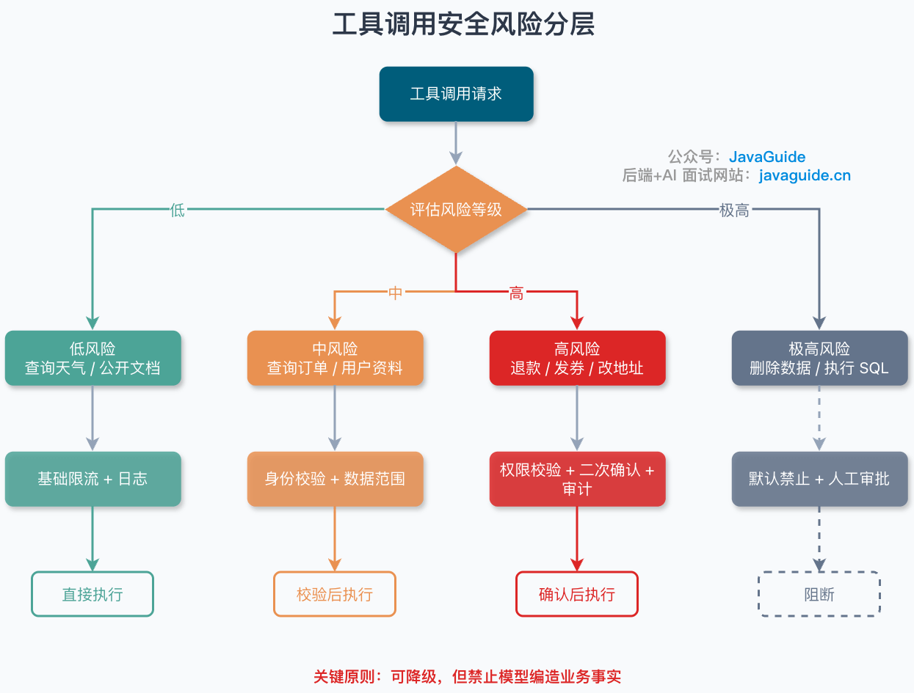

<!-- @include: @article-header.snippet.md -->

A minimal AI application is easy to build: the frontend accepts a question, the backend combines it with a system prompt, calls a model API once, and returns a plausible-looking answer.

That is usually enough for a demo.

Once real users arrive, problems become concrete. A user asks about an internal policy, and retrieval adds documents they are not allowed to access to the context. An operator changes a Prompt, and questions answered correctly yesterday start going off track. A model call times out while the browser keeps waiting. At month-end, the bill shows higher Token usage but not which tenant, feature, or model drove the cost. During an incident review, the team has to piece together events from application logs, vector-store results, and model responses.

This guide explains how to turn a working Prompt demo into a production AI application that can be deployed, debugged, rolled back, and cost-controlled.

This is an overview. It first compares demos with production systems, then explains the responsibilities of the entry layer, business orchestration, model gateway, Prompt/Context, RAG, Memory, tools, asynchronous tasks, evaluation, and observability. Java backend modules, table design, and service interfaces appear in the relevant sections, with links to deeper guides.

## Why Doesn't a Demo Architecture Hold Up Under Production Traffic?

Consider a common demo:

```text
Frontend submits a question -> backend builds the Prompt -> calls the model API -> returns an answer
```

This flow can demonstrate a product idea, but it lacks six capabilities essential to production systems.

| Dimension       | Prompt demo                                      | Production architecture                                                                 |
| --------------- | ------------------------------------------------ | --------------------------------------------------------------------------------------- |
| Reliability     | One model and one call; failure returns an error | Multi-model routing, retries, fallback, circuit breaking, and graceful degradation      |
| Permissions     | Assume users may query anything they ask about   | Filter permissions before retrieval and authorize tool calls by user and tenant         |
| Cost            | Check only whether a single call succeeds        | Token budgets, model tiers, caching, cost attribution, and quotas                       |
| Observability   | Record the user question and final answer        | Record Prompts, retrieved chunks, tool calls, model output, Tokens, latency, and errors |
| Evaluation      | Manually try a few examples                      | Fixed evaluation sets, production sampling, LLM-as-Judge, and human review              |
| Data governance | Ingest documents and store logs without controls | PII redaction, retention, auditing, versioning, deletion, and authorization             |

These capabilities are not just another wrapper around the existing API. Model output is probabilistic: the same question can be affected by the Prompt version, context order, retrieval results, tool descriptions, and sampling parameters. When an answer goes off track, the cause may not be traceable to one line in the call stack as it often is with ordinary `if-else` logic.

Production systems need to record each request's inputs, processing steps, and results. This makes it possible to replay a bad answer and determine whether the issue came from retrieval, the model, permission filtering, or output parsing.

If you are unfamiliar with LLM API calls, start with [LLM API Engineering: Streaming, Retries, Rate Limits, and Structured Responses](../llm-basis/llm-api-engineering.md). For background on Tokens, context windows, and sampling parameters, see [How Tokens, Context Windows, and Sampling Parameters Affect LLM Output](../llm-basis/llm-operation-mechanism.md).

## A Practical Layered Architecture for AI Applications

After a request enters the system, determine identity and permissions first. Then decide whether to retrieve knowledge, call tools, or run asynchronously, and record the call flow in the observability system. The diagram assigns responsibilities along this path; real projects may combine modules, and this is not a fixed industry standard.



### Entry Layer: Turn User Requests into Governable Tasks

When a user request reaches the system, the entry layer converts it into a task that downstream services can handle:

- Authentication and authorization: Identify the user, tenant, role, and data scope.
- Request normalization: Convert Web, app, API, Webhook, and scheduled-job requests into an internal task model.
- Rate limiting and abuse prevention: Apply limits by user, tenant, model capability, and business scenario.
- Idempotency: Retriable asynchronous tasks and tool calls with side effects need idempotency keys. Deduplicate read-only queries when cost or consistency requirements justify it.
- Sensitive-content preprocessing: Redact PII, detect malicious input, and screen for Prompt Injection.

Downstream components should receive a structured request, not just a string of user input:

```java
public record AiRequest(
        String requestId,
        String tenantId,
        String userId,
        String sceneCode,
        String input,
        Map<String, Object> variables,
        PermissionScope permissionScope
) {
}
```

### Business Orchestration: Decide How to Handle Each Request

The business orchestration layer selects the execution path for each request:

- Is this ordinary Q&A, RAG-based Q&A, a multi-step Agent task, or a batch task?
- Which context is needed: conversation history, user profile, knowledge base, or live business data?
- Are tool calls allowed? Which tools require confirmation?
- Should the request run synchronously, stream, or run asynchronously?
- Should the output go through evaluation, human review, or post-processing?

Business rules should determine whether a user may read a document or whether an action requires confirmation. The model is better suited to language understanding that is difficult to exhaustively encode as rules. Combining both decisions in a “super Prompt” makes it hard to tell whether a failure came from a broken rule or incorrect model judgment.

### Model Gateway: Make Model Calls Infrastructure

The model gateway provides a unified interface to OpenAI, Anthropic, Google Gemini, self-hosted models, embedding models, rerankers, and other capabilities. It hides API differences and exposes a stable interface to upstream services. For details, see [LLM Gateway: Multi-Model Routing, Fallback, Rate Limits, and Cost Control](./llm-gateway.md).



Centralizing model calls at the gateway gives routing, quotas, and observability a consistent control point:

- Multi-model routing: Select models by scenario, cost, latency, language, context length, and success rate.
- Fallback: Switch to a backup when the primary model fails, times out, or reaches its quota.
- Rate limiting and circuit breaking: Prevent provider failures from overwhelming business thread pools.
- Token budget: Estimate input and output Tokens; compress context or use a less capable model when the budget is exceeded.
- Cost attribution: Track costs by tenant, user, scenario, and Prompt version.
- Unified observability: Record model requests, responses, errors, TTFT, total latency, and Token usage.

Official documentation from OpenAI, Anthropic, Google, and others continually changes details about models, tools, streaming, evaluation, and costs. Maintain model names, context windows, prices, availability, and tool support in a configuration center or model registry, and verify them against current official documentation instead of hard-coding them in business logic.

### Prompt and Context Management: Do Not Treat Prompts as Code Strings

Prompts used in production should have explicit versions instead of being scattered as multiline strings in code. Each release and rollback should identify the content, variable constraints, and scope:

- Template versioning: Create a new version for each change and keep old versions replayable.
- Variable injection: Inject business variables, user input, retrieval results, and tool results in separate sections.
- Gradual rollout: Select a Prompt version by tenant, user percentage, or scenario flag.
- Fast rollback: Restore a stable version when production quality drops.
- Audit records: Track who changed what, when, and why.
- Runtime binding: Record the Prompt name, version, and variable summary for each request.

Prompt changes affect answers and may also change retrieval, tool calls, costs, and evaluation results. Change records, runtime Traces, and evaluation results must therefore link to the same Prompt version. Langfuse combines Prompt Management, Tracing, and Evaluation to support these links. Whether you use it depends on the project, but the links themselves are essential.

For Prompt-writing techniques, see [What Is Prompt Engineering, and Which Prompting Techniques Are Useful?](../agent/prompt-engineering.md). For deciding which information belongs in context, how much to include, and when to compress it, see [What Is Context Engineering, and How Does It Differ from Prompt Engineering?](../agent/context-engineering.md).


### RAG, Memory, and Tools: Keep These Context Types Separate

Retrieved documents, user preferences, and tool results may all enter the model context, but they have different sources, update cycles, and risks:

| Type   | Stored data                                                                  | Lifecycle                       | Main risks                                                                      |
| ------ | ---------------------------------------------------------------------------- | ------------------------------- | ------------------------------------------------------------------------------- |
| RAG    | Enterprise documents, product manuals, policies, code docs, ticket knowledge | Updated with the knowledge base | Missed retrieval, unauthorized retrieval, stale documents, mismatched citations |
| Memory | User preferences, past decisions, long-term profiles, task experience        | Evolves with users and sessions | Persistent errors, privacy leaks, stale memory                                  |
| Tool   | Query orders, create tickets, send email, change settings, query databases   | Called on demand at runtime     | Invalid parameters, excess permissions, unintended sensitive actions            |

They may all use vector retrieval, structured storage, and reranking underneath, but they need different governance. RAG provides shared knowledge, Memory stores personalized context, and tools connect to business systems. Design separate permission checks and invalidation policies for each.



Do not treat Memory as personal RAG and write to it indiscriminately. An incorrect memory can affect many later conversations. Apply different controls to different memory types: write user-confirmed preferences synchronously; validate model-extracted long-term facts against a Schema, record their source, and filter by confidence before deciding whether to write them asynchronously, set an expiration, or send them for human review.

For RAG fundamentals, see [RAG Fundamentals: Retrieval, Generation, and Engineering Tradeoffs](../rag/rag-basis.md). For document parsing, cleaning, and chunking, see [RAG Document Processing and Chunking Strategies](../rag/rag-document-processing.md). For retrieval tuning, see [RAG Optimization: From Recall and Reranking to Context Engineering](../rag/rag-optimization.md). For Memory, see [AI Agent Memory: Short-Term and Long-Term Memory and How Memory Evolves](../agent/agent-memory.md).

## Choosing Between Synchronous, Streaming, and Asynchronous Interactions

Not every AI request should wait for a synchronous HTTP response. Choosing the wrong interaction mode can harm both user experience and system reliability.

| Mode                | Suitable scenarios                                                            | Benefits                                      | Risks                                                | Backend considerations                                        |
| ------------------- | ----------------------------------------------------------------------------- | --------------------------------------------- | ---------------------------------------------------- | ------------------------------------------------------------- |
| Synchronous request | Short Q&A, classification, extraction, low-latency tasks                      | Simple implementation and clear call flow     | Sensitive to timeouts; can exhaust threads           | Short timeouts, fail fast, cache results                      |
| Streaming response  | Chat, long answers, code generation, speech pre-transcripts                   | Faster first token and shorter perceived wait | Complex mid-stream failures and more frontend states | SSE/WebSocket, TTFT monitoring, cancelable generation         |
| Asynchronous task   | Report generation, batch evaluation, long-document analysis, multi-tool tasks | Queueable, retriable, recoverable             | Complex task state and notifications                 | Task table, queue, progress events, idempotency, compensation |

If a request reliably finishes in about three seconds and fits within client and gateway timeouts, a synchronous call is usually simpler. This is not a fixed threshold; choose one based on your timeout settings.

Use streaming when users need to see generation immediately. Queue tasks that depend on long documents, multiple tool calls, or batch processing so they are easier to retry and recover.

Internal calls such as label classification, risk scoring, and routing decisions usually do not need first-token feedback. Maintaining SSE or WebSocket connections for them only adds the cost of handling interruptions, cancellation, and frontend state.

For a detailed engineering discussion of streaming, retries, rate limiting, and structured responses, see [LLM API Engineering](../llm-basis/llm-api-engineering.md). Real-time voice also involves VAD, ASR, TTS, interruption handling, and end-to-end latency; see [AI Voice Engineering: From ASR and TTS to Real-Time Voice Agents](./ai-voice.md).

## Prompt Management: From Template Strings to Versioning

Model production-grade Prompt management around five entities:

- `prompt_template`: Prompt metadata such as name, scenario, type, and status.
- `prompt_version`: Content, variable definitions, model parameters, author, and change notes.
- `prompt_release`: The environment, tenants, and traffic share for a released version.
- `prompt_run`: The Prompt version, variable summary, and model output for each call.
- `prompt_eval_result`: Evaluation results for a Prompt version.

Core tables might look like this:

| Table                | Key fields                                                                                                      | Purpose                                     |
| -------------------- | --------------------------------------------------------------------------------------------------------------- | ------------------------------------------- |
| `ai_prompt_template` | `id`, `tenant_id`, `name`, `scene_code`, `type`, `status`                                                       | Manage logical Prompt names                 |
| `ai_prompt_version`  | `id`, `template_id`, `version_no`, `content`, `variables_schema`, `model_config`, `created_by`, `change_reason` | Store replayable Prompt content             |
| `ai_prompt_release`  | `id`, `template_id`, `version_id`, `env`, `traffic_ratio`, `tenant_scope`, `status`                             | Control gradual rollout and rollback        |
| `ai_prompt_run`      | `id`, `request_id`, `version_id`, `variables_hash`, `input_tokens`, `output_tokens`, `created_at`               | Link production requests to Prompt versions |

Variable injection commonly causes two problems. User input, tool results, and retrieved chunks may contain injection instructions. Delimiters and escaping can help the model identify untrusted content, but the backend must still restrict available tools and revalidate parameters and permissions before execution.

Another problem is version mismatch: a Prompt adds a variable that the code does not supply, leaving the rendered result without required context. `variables_schema` can reject such requests at runtime.

`ai_prompt_run` should usually store only variable summaries, hashes, Tokens, and correlation IDs. If full user input, retrieved chunks, or tool results contain PII or sensitive business data, decide whether to redact, encrypt, or shorten retention based on risk. Do not store all plaintext just to make replay easier.

A minimal interface might look like this:

```java
public interface PromptService {

    RenderedPrompt render(RenderPromptCommand command);

    PromptVersion publish(PublishPromptCommand command);

    void rollback(String templateId, String targetVersionId);
}
```

If software must parse Prompt output reliably, do not rely only on “return JSON.” For engineering details on structured output, JSON Schema, and Function Calling, see [Structured Outputs for LLMs: From JSON Contracts to Function Calling](../llm-basis/structured-output-function-calling.md).

## Model Gateway: Multi-Model Routing, Fallback, and Cost Control

Model gateways are easy to underestimate. Teams often call a vendor SDK directly from business code, then discover tight coupling when they need to switch models, roll out gradually, or investigate costs.

### Comparing Model-Gateway Strategies

| Strategy              | Core behavior                                                         | Suitable scenarios                                 | Risk                                                       |
| --------------------- | --------------------------------------------------------------------- | -------------------------------------------------- | ---------------------------------------------------------- |
| Fixed model           | Always call one model for a scenario                                  | Early systems and low-complexity tasks             | Cost and reliability depend on one vendor                  |
| Cost-first routing    | Use a low-cost model by default; upgrade on failure or low confidence | Classification, summaries, lightweight Q&A         | Errors from a low-cost model can affect downstream systems |
| Quality-first routing | Route high-value requests to a more capable model                     | Legal, finance, medical assistance, complex Agents | High cost requires budget controls                         |
| Latency-first routing | Select a model by P95/P99 latency and region availability             | Real-time chat, voice, online support              | May reduce complex reasoning quality                       |
| Multi-model voting    | Generate in parallel and choose with a judge                          | High-risk content, critical reports                | High cost and latency                                      |
| Fallback chain        | Switch to a backup when the primary fails                             | Most production systems                            | Backup capability differences affect consistency           |

### How to Set a Token Budget

Before calling a model, the gateway should estimate how many Tokens the context and maximum output will use:

```text
Estimated input Tokens = System Prompt + user input + conversation history + RAG chunks + Memory + Tool Schema
Estimated total Tokens = estimated input Tokens + maximum output Tokens
```

When the budget is exceeded, remove content less relevant to the current question instead of truncating the middle of a string:

1. Remove low-relevance RAG chunks.
2. Compress older conversation messages.
3. Reduce the tool Schema list to candidate tools.
4. Lower the maximum output length.
5. Switch to a long-context model.
6. Reject the request and ask the user to narrow its scope.

Token budgeting and context compression are part of Context Engineering. For context assembly, on-demand loading, and fallback strategies, see [What Is Context Engineering, and How Does It Differ from Prompt Engineering?](../agent/context-engineering.md).

The OpenTelemetry GenAI registry includes fields such as `gen_ai.request.model`, `gen_ai.response.model`, `gen_ai.usage.input_tokens`, `gen_ai.usage.output_tokens`, and `gen_ai.response.time_to_first_chunk`, as well as retrieval and tool fields. OpenTelemetry notes that GenAI semantic conventions have moved to a separate repository. Do not copy field names from an old page without checking; pin a current version and map fields explicitly. Whether you use Langfuse, LangSmith, or a custom observability platform, prefer common field conventions to simplify future migrations and unified monitoring.

## Tool Calls and Permissions: The Model Proposes; the System Decides

Tool Calling can create the impression that the system should simply execute the function name and parameters returned by the model.

That is dangerous in production.

A safer mental model is: **the model proposes which tool to call; the system validates before execution**.

The tool runtime should include at least six checks:

| Stage                | Responsibility                                                                                                                          |
| -------------------- | --------------------------------------------------------------------------------------------------------------------------------------- |
| Tool registration    | Declare the tool name, description, parameter Schema, permission tags, and risk level                                                   |
| Tool retrieval       | Select a small set of tools relevant to the task to avoid context bloat                                                                 |
| Parameter validation | Validate required fields, formats, enums, and ranges with JSON Schema or typed objects                                                  |
| Authorization        | Check access on the backend by user, tenant, role, and resource ID                                                                      |
| Confirmation policy  | Require confirmation for deletion, payment, messaging, configuration changes, and similar actions based on risk and prior authorization |
| Audit log            | Record the model proposal, final parameters, executor, result, and rollback details                                                     |

Official tool/function-calling documentation from Anthropic, OpenAI, and Google emphasizes tool definitions, parameter structures, and call handling. Google also advises asking users to confirm function calls with significant consequences, such as sending orders or updating a database. Low-risk actions covered by explicit prior authorization may run automatically under policy, but the business system—not the model—must make authorization decisions.

Even when a vendor provides server-side tools, the business layer still needs its own ACLs, auditing, and confirmation flow. The vendor connects tools to the model; the business system decides whether this user, tenant, and resource may use them in the current scenario.

For an introduction to tool calls, see [Structured Outputs for LLMs: From JSON Contracts to Function Calling](../llm-basis/structured-output-function-calling.md). If tools must be reused across models, Agents, or IDEs, see [What Is the Model Context Protocol (MCP), and How Does It Relate to Function Calling and Agents?](../agent/mcp.md).



A tool interface might look like this:

```java
public interface AiTool {

    ToolDefinition definition();

    ToolResult execute(ToolExecutionContext context, Map<String, Object> arguments);
}
```

Tool definitions should distinguish side effects from risk level. Read-only does not always mean low risk: reading secrets, medical records, or large volumes of customer data has no write side effect but still requires stricter authorization and auditing.

```java
public enum ToolSideEffect {
    READ_ONLY,
    WRITE
}

public enum ToolRiskLevel {
    LOW,
    MEDIUM,
    HIGH
}
```

The orchestration layer selects controls based on `sideEffect + riskLevel + preAuthorization`. By default, convert high-risk writes into actions pending confirmation. High-risk reads require stronger resource-level authorization, field redaction, result limits, and auditing. If the business allows preauthorized writes to run automatically, use a clearly scoped, revocable credential and add idempotency, auditing, and compensation mechanisms.



## How Do RAG and Memory Combine Shared Knowledge with Personal Context?

RAG and Memory both add external information to the context, but they require different governance.

### Recommended Order Within a Request

For a request, use this order:

1. The entry layer verifies user identity and permission scope.
2. The Memory service retrieves preferences and long-term facts within the user's scope.
3. The RAG service retrieves shared knowledge within the tenant and resource permission scope.
4. The Context manager deduplicates, filters, and compresses each result set separately.
5. The orchestration layer places Memory in a “user context” section and RAG in an “evidence” section.
6. Instruct the model to distinguish facts based on source material from wording based on user preferences.

This order helps prevent context contamination. A project may query RAG before Memory, but permission scope must be established first; do not make “retrieve first, filter later” the default.

### How to Prevent Context Contamination

| Contamination type      | Typical symptom                                           | Safeguard                                                                 |
| ----------------------- | --------------------------------------------------------- | ------------------------------------------------------------------------- |
| RAG noise               | Irrelevant documents skew the model                       | Hybrid Search, reranking, Top-N compression, citation checks              |
| Permission              | User receives document chunks they cannot access          | ACL filtering before retrieval, tenant isolation, audit retrieved results |
| Persistent Memory error | A temporary user statement becomes a long-term preference | Confidence thresholds, expiration, user editing, human review             |
| Conflicting facts       | Old and new policy versions enter the context together    | Version fields, time filters, conflict detection                          |
| Prompt Injection        | A document says “ignore the rules above”                  | Delimit document content, set instruction priorities, detect injections   |

Do not concatenate RAG and Memory results into generic “background information.” Clearly label their source, time, permissions, and confidence so the model does not confuse user preferences, company policies, and tool results.

Knowledge-base management does not end after an initial import. Document versions, incremental sync, deduplication, rollback, and full rebuilds can all affect production answers. See [Updating RAG Knowledge-Base Documents](../rag/rag-knowledge-update.md). For cross-document and entity relationships or global summaries, traditional vector retrieval may not be enough; see [GraphRAG: Adding Graph Structure to Vector Retrieval](../rag/graphrag.md).

## Observability and Evaluation: No Replay, No Improvement

### What Should a Trace Record?

When troubleshooting an AI application, seeing only the final answer is not enough.

Record enough correlated metadata for each request. Retain raw content only when replay is necessary and after setting authorization, encryption, access control, and retention:

| Category  | Metadata to record by default                                                                       |
| --------- | --------------------------------------------------------------------------------------------------- |
| Prompt    | Template name, version, variable hash or redacted summary, message roles and lengths                |
| Retrieval | Redacted query or hash, Chunk ID, score, source, permission-filter result, reranking order          |
| Memory    | Retrieved memory IDs, source, update time, confidence                                               |
| Tool      | Tool name, parameter hash or redacted fields, permission result, execution time, result code, error |
| Model     | Provider, model name, sampling parameters, input/output Tokens, finish reason                       |
| Latency   | Entry processing, retrieval, model TTFT, total duration, tool duration                              |
| Cost      | Input and output costs, cache hits, attribution by tenant and scenario                              |
| Result    | Response hash, structured parse result, user feedback, evaluation score                             |

Official documentation for Langfuse, LangSmith, Google Vertex AI, and OpenTelemetry covers concepts such as tracing, datasets, evaluators, Token usage, and latency. Tools may differ, but the signals to capture are broadly similar.

### How Should You Evaluate the Application?

Evaluation needs a fixed dataset, clear pass criteria, and replayable target versions. For building datasets, separating RAG and Agent metrics, and integrating LLM-as-Judge into CI, see [AI Application Evaluation](../llm-basis/llm-evaluation.md).

Scoring only whether the final answer is “good” cannot show whether a problem occurred during retrieval, generation, or tool execution. Track metrics for each stage. Platform names may differ, but keep internal definitions consistent:

- **Context Recall**: Whether the correct evidence was retrieved.
- **Context Precision**: How much of the context is useful.
- **Faithfulness**: Whether the answer is faithful to the evidence.
- **Answer Relevancy**: Whether the answer addresses the user's question.
- **Tool Success Rate**: Whether tool calls complete successfully.
- **Format Valid Rate**: Whether structured output can be parsed.
- **Cost per Success**: Average cost per successful response.

LLM-as-Judge is useful for large-scale screening, regression comparisons, and production sampling, but its judgment cannot replace business-rule validation, human review, or user feedback for critical use cases. External evaluation platforms change over time, so store evaluation tasks, datasets, and results in your own data model; use the platform to run or display them.

The replay and release flow for production samples is:

```text
Production failure sample -> add to dataset -> replay against pinned versions -> identify Prompt/RAG/Tool/model issue -> gradually roll out a new strategy -> compare metrics -> release
```

Without replay against fixed versions, it is difficult to tell what an adjustment improved after the Prompt, retrieval strategy, or model changes.

## Security and Compliance: AI Applications Have More Risk Entry Points

AI applications have a broader attack surface than traditional CRUD systems because user input, retrieved documents, tool results, and stored memories can all influence model behavior.

### Enforce Risk Controls in Code and Workflows

| Risk                        | Description                                                                      | Mitigation                                                                               |
| --------------------------- | -------------------------------------------------------------------------------- | ---------------------------------------------------------------------------------------- |
| PII disclosure              | Logs, Prompts, or evaluation sets contain phone numbers, IDs, or email addresses | Redact before storage, encrypt sensitive fields, minimize retention                      |
| Authorization bypass        | Retrieval or tool calls bypass business ACLs                                     | Filter before retrieval and reauthorize before tool execution                            |
| Prompt Injection            | User or document content persuades the model to ignore system rules              | Separate content, set instruction priorities, detect injections, define refusal behavior |
| Uncontrolled retention      | Model requests and observability logs are stored too long                        | Set retention periods by tenant and scenario                                             |
| Training-data risk          | Sensitive user data is used for fine-tuning or evaluation                        | Obtain explicit authorization, redact, isolate, and support deletion                     |
| Unintended high-risk action | The model incorrectly calls tools to delete, pay, or send messages               | Risk tiers, confirmation, auditing, and compensation                                     |

One easy-to-miss point: **security policies cannot live only in Prompts**. A Prompt can tell the model not to disclose private information, but code and infrastructure must enforce permission filtering, redaction, auditing, and confirmation flows.

### Manage Data Boundaries for Third-Party Models

If requests go to a third-party model, verify data authorization, region, retention, and training-use policies. When uncertain, follow data minimization: do not send fields that are not needed, redact or summarize fields that must be sent, and record retention periods in configuration and audit logs.

Prompt Injection, context separation, and tool permissions are connected. See the related guides on [Prompt Engineering](../agent/prompt-engineering.md), [Context Engineering](../agent/context-engineering.md), and [MCP](../agent/mcp.md).

If an Agent can read external content and call write tools, also design resource-level authorization, parameter-bound approvals, MCP Tokens, code and network isolation, and security regression tests. See [LLM and Agent Security](./llm-security.md).

## Java Backend Implementation

For a production AI application in Java, organize modules around domain capabilities rather than vendor SDKs.

### Module Breakdown

| Module             | Responsibility                                                                        |
| ------------------ | ------------------------------------------------------------------------------------- |
| `ai-api`           | External REST/SSE/WebSocket endpoints, request authorization, and protocol adaptation |
| `ai-orchestrator`  | Business orchestration, interaction-mode selection, task state machine                |
| `ai-prompt`        | Prompt templates, versions, gradual rollout, rendering, rollback                      |
| `ai-context`       | Context assembly, Token budgets, history compression, context separation              |
| `ai-gateway`       | Model routing, fallback, rate limiting, circuit breaking, cost tracking               |
| `ai-rag`           | Knowledge retrieval, permission filtering, reranking, citation management             |
| `ai-memory`        | User-memory writes and retrieval, conflict handling, expiration policies              |
| `ai-tool`          | Tool registration, parameter validation, execution, confirmation, auditing            |
| `ai-eval`          | Datasets, evaluation runs, LLM-as-Judge, human feedback                               |
| `ai-observability` | Traces, metrics, logs, costs, alerts                                                  |

### Core Table Design

You do not need to build all these tables in the first release. They show which data needs an owner in a production system. At minimum, record request Traces, model calls, Prompt versions, and RAG retrievals so there is enough information to investigate issues.

| Table              | Suggested key fields                                                                                                                                                  | Purpose                                                                      |
| ------------------ | --------------------------------------------------------------------------------------------------------------------------------------------------------------------- | ---------------------------------------------------------------------------- |
| `ai_request_trace` | `id`, `request_id`, `tenant_id`, `user_id`, `scene_code`, `mode`, `status`, `total_latency_ms`, `error_code`, `created_at`                                            | Main Trace for an AI request: user, tenant, scenario, status, duration       |
| `ai_model_call`    | `id`, `request_id`, `provider`, `model_name`, `prompt_version_id`, `input_tokens`, `output_tokens`, `ttft_ms`, `latency_ms`, `finish_reason`, `error_code`            | Model-call details: model, parameters, Tokens, TTFT, errors                  |
| `ai_context_item`  | `id`, `request_id`, `source_type`, `source_id`, `content_hash`, `token_count`, `inject_position`, `sensitivity_level`                                                 | Context item source, ID, Token count, injection position                     |
| `ai_rag_chunk_hit` | `id`, `request_id`, `knowledge_base_id`, `doc_id`, `chunk_id`, `score`, `rank_no`, `acl_result`, `citation_url`                                                       | RAG retrieval details: score, rank, document permissions, citations          |
| `ai_memory_item`   | `id`, `tenant_id`, `user_id`, `memory_type`, `content`, `source_type`, `source_id`, `evidence_hash`, `request_id`, `confidence`, `expires_at`, `status`, `updated_at` | Long-term memory content, source evidence, confidence, expiration, status    |
| `ai_tool_call`     | `id`, `request_id`, `tool_name`, `risk_level`, `arguments_hash`, `permission_result`, `confirm_status`, `execute_status`, `latency_ms`                                | Tool-call details: tool, parameter summary, permission and execution results |
| `ai_eval_dataset`  | `id`, `name`, `scene_code`, `version_no`, `status`, `created_by`                                                                                                      | Evaluation dataset metadata                                                  |
| `ai_eval_case`     | `id`, `dataset_id`, `input`, `expected_behavior`, `tags`, `difficulty`, `status`                                                                                      | Evaluation case input, expected behavior, and tags                           |
| `ai_eval_run`      | `id`, `dataset_id`, `target_type`, `target_version`, `judge_config`, `status`, `started_at`, `finished_at`                                                            | An evaluation run                                                            |
| `ai_eval_result`   | `id`, `run_id`, `case_id`, `score`, `pass_status`, `judge_reason`, `error_code`                                                                                       | Result for an individual evaluation case                                     |

Do not skip these three details in the table design:

1. Carry `request_id` through Prompt, RAG, Memory, Tool, Model Call, and Evaluation; make it unique across the full flow where possible.
2. Do not put large fields in MySQL indiscriminately. Store full Prompts, model outputs, and tool results in object storage or a logging system; keep summaries, hashes, sensitivity levels, and references in business tables.
3. Index and archive runtime tables by `tenant_id`, `scene_code`, `created_at`, and `status`, or observability tables may quickly become a performance bottleneck.

### Core Interfaces

```java
public interface ModelGateway {

    ModelResponse generate(ModelRequest request);

    Flux<ModelStreamEvent> stream(ModelRequest request);
}
```

If the project does not use WebFlux, replace `Flux<ModelStreamEvent>` with JDK `Flow.Publisher`, an SSE emitter, or an internal event callback. The key is to separate synchronous generation from streaming events so callers know when a result is complete.

```java
public interface ContextAssembler {

    AssembledContext assemble(AiRequest request, ContextPolicy policy);
}
```

```java
public interface RagService {

    List<RagHit> retrieve(RagQuery query, PermissionScope permissionScope);
}
```

```java
public interface EvaluationService {

    EvalRunResult runDataset(EvalRunCommand command);
}
```

### A Minimal Request Flow

```text
Controller
  -> RequestGuard: authorize, rate-limit, redact
  -> Orchestrator: select synchronous, streaming, or asynchronous execution
  -> ContextAssembler: retrieve RAG, Memory, and history
  -> PromptService: render a template version
  -> ModelGateway: route to a model and record Token usage
  -> OutputParser: validate structured output
  -> TraceService: write observability data
```

For an initial enterprise knowledge-base Q&A release, start with `ai-api`, `ai-prompt`, `ai-gateway`, `ai-rag`, and `ai-observability`. Add Memory, Tool, and Evaluation as needed. Record each request's Trace and Prompt version from the first release; otherwise, there will be little evidence to investigate incorrect production answers.

For Java backend details on calling LLM APIs, see [LLM API Engineering](../llm-basis/llm-api-engineering.md). If the team plans to standardize model calls as infrastructure, read the [LLM Gateway guide](./llm-gateway.md).

## How to Explain This Architecture in an Interview

Start with a request flow instead of listing framework names. After the request reaches the entry layer, authenticate and rate-limit it. The orchestration layer decides whether to retrieve data, call tools, or run asynchronously. Once Prompt and Context are assembled, the model gateway routes the call; parse the output and write a Trace. Then explain how Prompt versioning, Token budgets, tool permissions, and PII redaction address risk. Finish by describing how fixed datasets and replayed failures validate changes.

For interview preparation, see [AI System Design Interview Questions](../interview-questions/ai-system-design-interview-questions.md), [RAG Interview Questions](../interview-questions/rag-interview-questions.md), [AI Agent Interview Questions](../interview-questions/agent-interview-questions.md), and [LLM Fundamentals Interview Questions](../interview-questions/llm-interview-questions.md).

## Common Interview Questions

**1. What is the biggest gap between a Prompt demo and a production system?**

A demo tests whether a model can answer once. A production system must also handle timeouts and fallbacks, tenant and resource permissions, Token costs, call Traces, evaluation replay, and sensitive-data retention.

**2. Why do you need a model gateway?**

A model gateway centralizes vendor API differences and handles model routing, fallback, rate limiting, circuit breaking, Token budgets, cost tracking, and observability. Business services do not need to couple to each vendor's API separately.

**3. How do you choose between synchronous, streaming, and asynchronous execution?**

Return short tasks synchronously when they reliably finish within the client timeout. Stream chat and long answers when users need early feedback. Queue report generation, batch processing, and multi-tool tasks. Base the choice on duration, first-token requirements, and whether failures need retries or recovery.

**4. Why version Prompts?**

Prompts can change output, retrieval strategy, tool calls, and Token usage. Versioning links production requests to specific content and gives gradual rollouts, rollback, auditing, and offline replay a clear target.

**5. Where is the security boundary for Tool Calling?**

The model only produces a tool-call intent. The backend validates parameters and resource-level permissions, confirms sensitive actions, and writes audit logs.

**6. How do RAG and Memory differ?**

RAG retrieves shared knowledge such as enterprise documents and product manuals. Memory stores personalized long-term facts such as user preferences and past decisions. Both can be used together, but inject them separately and handle permissions, sources, and expiration independently.

**7. Which metrics matter for AI application observability?**

At minimum, correlate each request with the Prompt version, retrieval hits, tool calls, model output, input/output Tokens, TTFT, total latency, success or error status, cost, and evaluation score.

**8. Can LLM-as-Judge replace human evaluation?**

No. It can support automated regression, production sampling, and large-scale screening, but critical use cases still need rule validation, human review, and user-feedback loops.

## Summary

Model calls are only one step in a production flow. The entry layer handles permissions, rate limits, and redaction. The orchestration layer selects synchronous, streaming, or asynchronous execution and coordinates retrieval, memory, and tools. The model gateway handles model selection, Tokens, and fallbacks. Evaluation and observability provide evidence for each change. Memory, tools, and evaluation can be added as needed, but establish Prompt versioning and Traces early.

## References

Related JavaGuide guides:

- [AI Application Development: LLMs, Agents, RAG, MCP, Prompt Engineering, and System Design](../README.md)
- [AI System Design: Production Architecture, Model Gateways, Evaluation, and Voice Agents](./README.md)
- [LLM Fundamentals: Model Mechanics, API Calls, Structured Output, and Evaluation](../llm-basis/README.md)
- [RAG: Document Processing, Vector Databases, GraphRAG, Retrieval, and Knowledge-Base Updates](../rag/README.md)
- [AI Agents: Agent Loops, Memory, Prompts, Context, MCP, and Skills](../agent/README.md)

- [OpenAI API documentation](https://developers.openai.com/api/docs)
- [OpenAI Function Calling documentation](https://developers.openai.com/api/docs/guides/function-calling)
- [OpenAI Streaming documentation](https://developers.openai.com/api/docs/guides/streaming-responses)
- [OpenAI Evals documentation](https://developers.openai.com/api/docs/guides/evals)
- [OpenAI Agents SDK observability and integrations](https://developers.openai.com/api/docs/guides/agents/integrations-observability)
- [Anthropic Tool Use documentation](https://platform.claude.com/docs/en/agents-and-tools/tool-use/overview)
- [Anthropic Prompt Caching documentation](https://platform.claude.com/docs/en/build-with-claude/prompt-caching)
- [Google Gemini Function Calling documentation](https://docs.cloud.google.com/gemini-enterprise-agent-platform/models/tools/function-calling)
- [Google Generative AI evaluation documentation](https://docs.cloud.google.com/gemini-enterprise-agent-platform/models/evaluation-overview)
- [Google RAG grounding documentation](https://docs.cloud.google.com/gemini-enterprise-agent-platform/models/grounding/ground-responses-using-rag)
- [Langfuse Observability documentation](https://langfuse.com/docs/observability/overview)
- [Langfuse Prompt Management documentation](https://langfuse.com/docs/prompt-management/overview)
- [LangSmith Evaluation documentation](https://docs.langchain.com/langsmith/evaluation)
- [OpenTelemetry GenAI attribute registry](https://opentelemetry.io/docs/specs/semconv/registry/attributes/gen-ai/)
