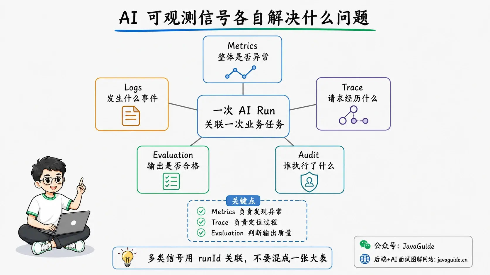
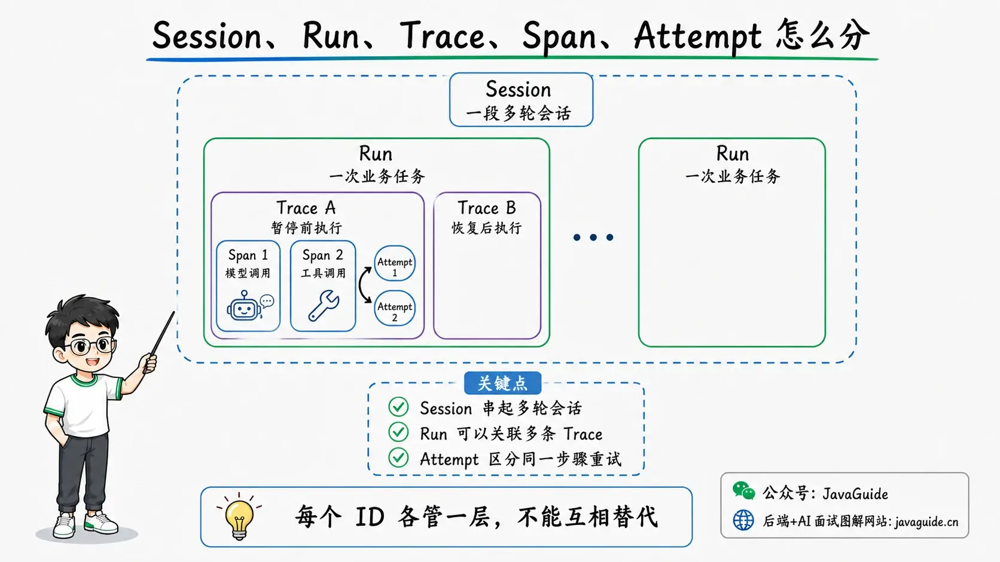
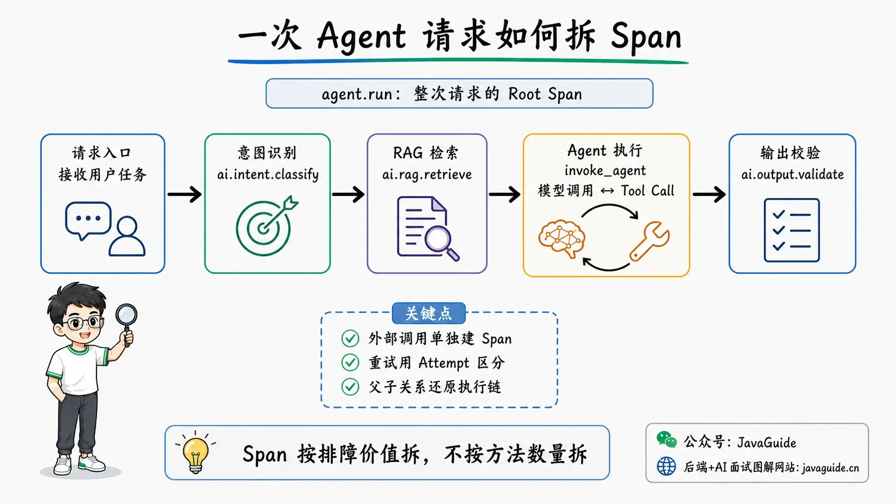
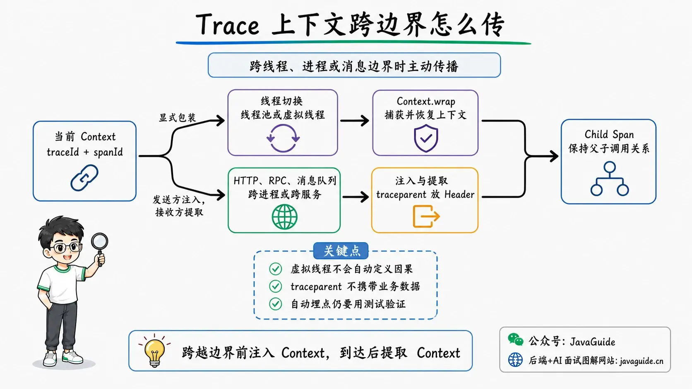
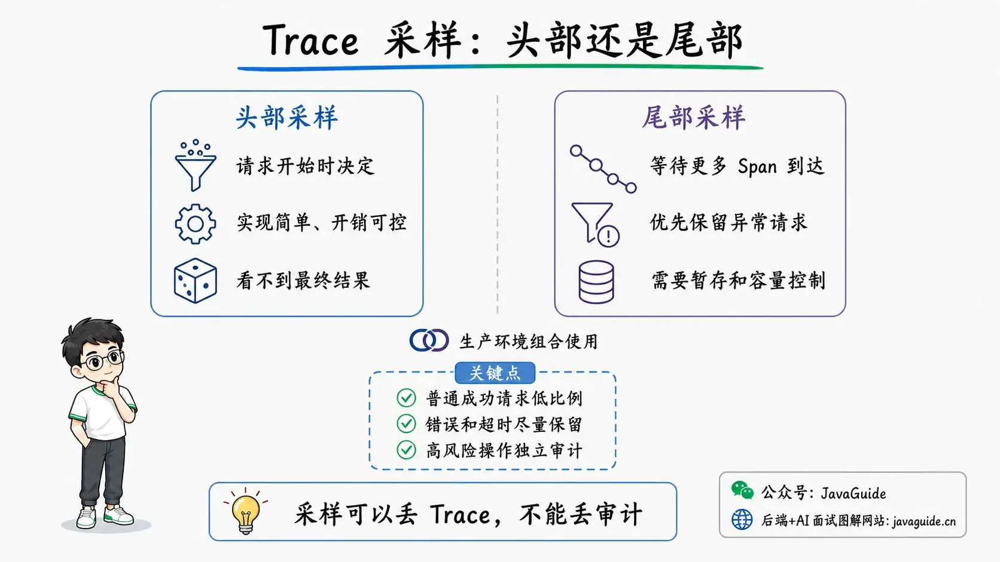

The endpoint returns 200 within its normal latency, but the support Agent gives the wrong refund policy.

The dashboard shows that the request called an LLM and generated a response successfully. Finding the cause is harder: did retrieval miss the right document, was the Prompt assembled incorrectly, did the model ignore context, or did a tool return stale data? Ordinary API logs usually cannot answer these questions.

An AI request may pass through query rewriting, knowledge retrieval, reranking, model calls, tool calls, and result validation. An Agent may repeat some steps. Each call can succeed while passing incorrect results to the next step, eventually producing a well-formatted but inaccurate answer.

To investigate, trace the execution backward: which model and Prompt were used, which documents were retrieved, which tools were called, how many times the Agent retried, and which results informed the final answer.

Keeping this information in one call chain makes the problem traceable.

## Why Isn't API Success Enough to Monitor an AI Application?

Traditional backend monitoring focuses on QPS, error rates, P99 latency, CPU, memory, and slow database queries. These metrics reveal service problems but cannot explain why a model generated a particular answer.

With RAG, an incorrect query rewrite can skew retrieval. The right document may be retrieved but dropped from `topK` during reranking. Even with the right documents in the right order, a long Prompt may be truncated. None of this necessarily raises an exception; the endpoint can still return 200.

Agents also introduce tool and execution-state problems. A successful tool call may return stale business data; a timeout retry may repeat an operation with side effects; and a multi-Agent summary may omit a result that has already completed.

To trace a problem to a specific step, cover models, retrieval, tools, Agents, and final results. Confirmed failure Traces can become Badcases for regression evaluation.

Traces reconstruct the steps the system actually executed; they do not expose a model's internal reasoning mechanism. Any reasoning text returned by a model is still just output and should not be treated as a complete explanation of its decisions.

## How Do Metrics, Logs, Traces, Evaluation, and Audits Differ?

AI observability often uses Metrics, Logs, Traces, Evaluation, and Audits together.

Each serves a different purpose.

| Signal     | Main question                                      | Typical data                                                                           |
| ---------- | -------------------------------------------------- | -------------------------------------------------------------------------------------- |
| Metrics    | Is the system behaving abnormally?                 | Request volume, error rate, P95 latency, Token usage, tool failure rate                |
| Logs       | What event happened at a given time?               | Exception stacks, state changes, retry reasons, business alerts                        |
| Trace      | What happened during one request?                  | Model calls, retrieval, tool calls, Agent execution, upstream/downstream relationships |
| Evaluation | Does the output meet quality requirements?         | Correctness, faithfulness, tool selection, task completion, safety                     |
| Audit      | Who performed which action under what permissions? | User identity, approvals, permission decisions, external writes                        |



Their roles can be summarized as: **metrics detect anomalies, Traces locate the process, evaluation measures quality, and audits establish accountability.**

For example, a sudden increase in Token usage can trigger a Metrics alert. Traces from that period may show that an Agent called the model 12 times in a row. Evaluation rules are still needed to determine whether those calls were necessary and whether the final answer was correct.

Traces do not replace Logs. Traces show call relationships and duration; Logs capture discrete events and detailed exceptions. A practical approach is to attach `traceId` and `spanId` to Logs so an investigator can jump from a Trace to related Logs or use an error Log to find the full call chain.

## How Do Trace, Span, Session, Run, and Attempt Differ?

These concepts are easy to confuse. OpenTelemetry defines Trace and Span; applications usually define Session, Run, and Attempt.

| Concept | Meaning                      | Example                                                          |
| ------- | ---------------------------- | ---------------------------------------------------------------- |
| Session | A continuous conversation    | Eight turns between a user and a support Agent                   |
| Run     | One task execution           | The user asks to request a refund in turn five                   |
| Trace   | One end-to-end call chain    | From API request receipt to the returned result                  |
| Span    | One operation within a Trace | Search the knowledge base, call a model, execute the refund tool |
| Attempt | One try at a step            | The second attempt after a model-call timeout                    |

Synchronous requests are straightforward: create a Trace when the task starts and end it when the response returns. One Run usually fits in one Trace.

This mapping breaks down for long-running tasks such as human approval or asynchronous resumption. An Agent may wait hours for an approval, so there is no need to keep the original Span open. End the current Trace when it enters a waiting state and save the `runId`. After approval, start a new Trace with the same `runId`. This links both execution segments without creating a Trace that lasts for hours.

Session has a broader scope: it links multiple conversation turns, each of which may produce its own Trace. Each ID has a separate role:

```text
sessionId: links turns in one conversation
runId: links a task, including execution after pause and resumption
traceId: identifies the call chain for one execution
spanId: identifies one operation in the call chain
attempt: identifies the attempt number for a step
```



Handle retries separately. Create a new Span for each attempt and record its number in `attempt`. Otherwise, the first timeout and second-attempt success will be mixed into one record, making execution difficult to reconstruct.

## How Should an Agent Request Be Split into Spans?

Span granularity determines whether a Trace is useful. If spans are too coarse, you only see “Agent ran for 8 seconds.” If they are too fine, every ordinary method becomes a Span and the call chain fills with nodes that do not help troubleshooting.

For an Agent that can query orders and request refunds, a Trace might be divided like this:

```text
agent.run
├── ai.intent.classify
│   └── gen_ai.client.operation
├── ai.rag.retrieve
│   ├── gen_ai.client.operation        # Generate query embedding
│   ├── db.vector.client.operation     # Vector retrieval
│   └── ai.rag.rerank
├── invoke_agent                       # Run the customer-service Agent
│   ├── gen_ai.client.operation        # First model call
│   ├── execute_tool                   # Query order
│   │   └── HTTP GET /orders/{id}
│   ├── gen_ai.client.operation        # Continue reasoning with tool results
│   └── execute_tool                   # Create refund request
│       └── POST /refunds
└── ai.output.validate
```



This example does not create separate Spans for ordinary methods such as rendering a Prompt template or concatenating strings. A step usually deserves its own Span if it meets any of these conditions:

- It calls an external system such as a model service, vector database, or business API.
- It is an important business stage such as retrieval, reranking, planning, or result validation.
- It has its own timeout, retry, or fallback policy.
- Its latency, cost, error rate, or quality needs to be measured separately.
- Developers need to know whether it ran and how many times when troubleshooting.

A Span should answer at least four questions: what ran, when it started and ended, whether it succeeded, and how it relates to other steps.

### How Should Parent-Child Relationships Be Designed?

For synchronous calls, use parent-child Spans. A parent Span represents a larger stage, while child Spans represent operations within it.

When an Agent calls multiple specialists in parallel, make each specialist Span a child of the same orchestration Span. Their overlapping time intervals will show the parallel execution in the Trace view.

```text
invoke_workflow
├── invoke_agent: technical-analysis   ──────────┐
├── invoke_agent: sentiment-analysis   ───────┐  │ Parallel
└── invoke_agent: portfolio-manager            └── Aggregate
```

Each Span can have only one parent. If an aggregation task is triggered by multiple independent messages, use the current consumer operation as the parent and add Span Links to the other upstream contexts. Do not manually build a tree that violates the Trace model to represent “multiple parents.”

### How Should Span Names Be Chosen?

Span names should be stable and low-cardinality. Do not include user questions, order IDs, or full URLs.

Recommended:

```text
invoke_agent customer-service
execute_tool query_order
ai.rag.retrieve
POST /refunds
```

Not recommended:

```text
Answer user question: Why hasn't order 202608160001 been refunded?
Query order 202608160001
```

The latter makes the number of Span names grow with user input, complicating aggregation and increasing storage and indexing costs. Store order IDs as controlled attributes or hashes; they do not belong in Span names.

### Has OpenTelemetry Standardized Agent Spans?

OpenTelemetry provides GenAI semantic conventions covering models, Agents, and some workflow operations. The current Agent Span documentation includes operation names such as `invoke_agent`, `invoke_workflow`, `plan`, and `execute_tool`.

However, at the time of writing, the [OpenTelemetry GenAI semantic conventions](https://github.com/open-telemetry/semantic-conventions-genai/blob/main/docs/gen-ai/README.md) and [Agent Span conventions](https://github.com/open-telemetry/semantic-conventions-genai/blob/main/docs/gen-ai/gen-ai-agent-spans.md) are still marked `Development`. Their attributes and names may change.

Prefer reusing established semantic-convention fields, then add a namespace for business stages, such as `ai.rag.*` or `ai.guardrail.*`. Record the convention version in the instrumentation library and adapt upgrades centrally. Do not scatter vendor-specific fields through business code as if they were stable standards.

## What Information Should a Trace Record?

More Trace data can make troubleshooting easier, but it also increases storage costs and exposure risk. In production, start with structured metadata, then decide whether to retain content based on the environment and permissions.

### Request and Version Information

An AI request should at least identify the code and configuration that were active at the time:

- `service.name`, environment, and service version;
- `sessionId`, `runId`, and tenant ID;
- Agent, Workflow, Prompt, and knowledge-base versions;
- Gradual-rollout group, experiment group, and feature flags;
- Request entry point, caller, and region.

Recording only the Prompt template is not enough. Output may change even when the template is unchanged if the system Prompt, Few-shot examples, retrieved context, or model parameters change. Record the version or hash of the effective configuration as well.

### Model-Call Information

A model Span should usually record:

- Model provider, requested model, and actual response model;
- Temperature, maximum output Tokens, and whether the response was streamed;
- Input, output, and cache-hit Tokens;
- Time to first Token and total duration;
- Finish reason, rate limits, timeouts, and retry count;
- Estimated cost or billing correlation ID.

Model aliases may point to different versions. If you record only `model=smart-model` from the business configuration, it will be difficult to identify the model that actually ran. Retain the model version or response ID whenever the provider returns it.

### RAG Retrieval Information

Useful fields for the retrieval stage include:

- Knowledge-base and index versions;
- Hashes or controlled copies of the original and rewritten queries;
- Retrieval strategy, filters, `topK`, and similarity threshold;
- Retrieved document IDs, scores, ranking, and data versions;
- Reranking model and order before and after reranking;
- Document IDs ultimately added to the Prompt;
- Query duration, result count, and an empty-retrieval flag.

If you record only “vector database query succeeded,” you still cannot tell whether the right material was retrieved after an incorrect answer. At minimum, retain document IDs, versions, and scores. Decide separately whether the full document belongs in a Trace based on its data classification.

### Tool-Call Information

Tools connect Agents to real business systems. Consider recording:

- Tool name, version, and call ID;
- Parameter summary or hash;
- Authorization and human-approval results;
- Timeouts, retries, idempotency key, and execution status;
- Result summary, business error code, and side-effect identifier;
- Downstream service Trace context.

“Tool call succeeded” does not necessarily mean the business operation succeeded. An HTTP 200 response may contain `stock=0`, or a refund API may return “duplicate request.” Record Span status, HTTP status, and business outcome separately.

### Agent and Workflow Information

Agent and workflow Spans should also include:

- Agent role, version, and allowed tool set;
- Current step, loop count, and maximum iteration count;
- Routing result, stop reason, and fallback reason;
- Whether parallel branches completed, timed out, or were canceled;
- Which upstream results were used in the summary;
- Structured-validation result for the final output.

These fields answer a concrete question: which information informed the final answer? In a multi-Agent system, “a specialist completed” and “the aggregator used its result” are separate events, so record them separately.

## How Should Low- and High-Cardinality Fields Be Distinguished?

Observability systems aggregate and index data. Poor field design can quickly inflate metric time series and Trace indexes.

Low-cardinality fields have a limited set of values and are suitable for Metrics and Traces:

```text
model.provider = openai
model.name = gpt-x
agent.role = customer-service
tool.name = query_order
result.status = success
environment = production
```

High-cardinality fields have many possible values and usually belong only in Traces; some should not be indexed:

```text
user.id
session.id
document.id
model.response.id
tool.call.id
```

Prompts, Completions, tool parameters, and document bodies are not only high-cardinality; they may also be long and sensitive. Store them as controlled events or in separate content storage, or retain only hashes and object references.

Spring AI observability follows a similar principle: [low-cardinality keys go into Metrics and Traces, while high-cardinality keys go only into Traces](https://docs.spring.io/spring-ai/reference/observability/index.html). Keep the same boundary when adding business instrumentation.

## Which Metrics Should AI Applications Monitor?

Design metrics around user experience, reliability, cost, and quality. The following metrics are useful for most AI applications.

### Request-Level Metrics

- Request volume, success rate, and concurrency;
- End-to-end P50, P95, and P99 latency;
- Timeout, cancellation, and fallback rates;
- Time to first Token and full response time;
- Traffic by entry point, tenant, and version.

For streaming endpoints, distinguish time to first Token from total duration. Users usually care about when the first content appears, while batch tasks are measured by when the entire task finishes.

### Model-Level Metrics

- Model-call count, error rate, and rate-limit rate;
- Input, output, and total Tokens;
- Token distribution per request;
- Cache-hit Tokens;
- Model retries and fallback count;
- Cost by model, scenario, and tenant.

Average Token usage can hide long-tail behavior, so also monitor at least P95 and the maximum. If an Agent occasionally loops, the average may barely change while high percentiles reveal the issue.

### RAG-Level Metrics

- Empty-retrieval rate and number of relevant documents;
- Retrieval, reranking, and context-assembly duration;
- Similarity-score distribution;
- Document truncation rate and context Tokens;
- Offline or online evaluation metrics such as citation coverage and faithfulness.

High similarity does not guarantee a correct answer; it indicates relatedness in vector space. Assess retrieval quality alongside labeled data and answer evaluation.

### Agent and Tool Metrics

- Model calls, tool calls, and iterations per Run;
- Tool success, business failure, and timeout rates;
- Invalid, duplicate, and rejected tool calls;
- Human handoff rate and approval wait time;
- Task completion, partial success, and failure-reason distribution;
- Multi-Agent branch duration, missing results, and summary-fallback rate.

Do not copy thresholds directly from another project. Six model calls may be abnormal for a simple Q&A but normal for complex technical research. Establish baselines by scenario and version, then alert on deviations instead of applying one fixed threshold to every Agent.

## How Can Traces Help Locate Common AI Badcases?

A useful Trace lets you investigate each step in execution order. The following examples cover three common problems.

### Where Should You Start When RAG Returns a Wrong Answer?

Check in this order:

1. Check the query-rewrite Span to see whether the retrieval query drifted from the user's intent.
2. Check the retrieval Span to confirm whether the correct document was retrieved.
3. Check reranking to see whether the correct document fell outside `topK`.
4. Check context assembly to determine whether Token limits truncated the document.
5. Check the final model Span to see which Prompt version and document IDs were sent.
6. Use citation checks and faithfulness evaluation to determine whether the model answered beyond the provided material.

This flow separates “wrong answer” into retrieval, ranking, context, and generation problems, allowing more targeted fixes.

### Why Did the Refund Tool Run Twice?

Check the number of `execute_tool` Spans and their `attempt` values. If the first call timed out and the Agent made a second call, also check:

- Whether both requests used the same stable idempotency key;
- Whether the downstream service completed the refund after the first timeout;
- Whether retries came from the model, Agent framework, or HTTP client;
- Whether the Agent mistook an unknown result for failure after losing the tool response;
- Whether downstream business records and audit logs confirm two side effects.

Traces show which calls the application initiated; they do not replace business records from the refund system. A timeout does not prove that a remote operation stopped, even if the Span status is `ERROR` or the application marks the task `CANCELED`.

### Why Did a Multi-Agent Summary Omit a Result?

Find the workflow Span, then check each child Agent's status and time interval:

- Whether the child Agent actually started;
- Whether it succeeded, failed, timed out, or was canceled;
- Whether its result was written back through a message or shared state;
- Whether its dependencies were ready when the aggregator started;
- Which Agent result IDs were included in the aggregation input;
- Whether a missing result triggered failure, waiting, or fallback.

Investigations often overlook the “aggregation input.” Child-Agent completion Spans alone are not enough; without the aggregation input list, you cannot tell whether a result was lost in transit or ignored by the aggregator.

## How Do You Preserve Traces Across Agents, Async Tasks, and Queues?

In single-threaded synchronous code, Trace context usually propagates along the call stack automatically. When work crosses threads, processes, or message queues, propagation must be handled explicitly.



### How Is Context Propagated Across Services?

[W3C Trace Context](https://www.w3.org/TR/trace-context/) defines the standard `traceparent` and `tracestate` headers. `traceparent` carries the Trace ID, parent Span ID, and sampling flag; `tracestate` can carry vendor-specific information.

When calling a downstream service over HTTP, RPC, or a message queue, the sender should inject context and the receiver should extract it and create a child Span. Message queues usually carry these fields in message headers, not the business payload.

Do not put business data such as user identities or order numbers in `traceparent` or `tracestate`. The W3C specification explicitly advises against including personally identifiable information in these fields.

### Why Can Trace Context Be Lost When Switching Threads?

OpenTelemetry Java stores the current context using `ThreadLocal` by default. When a task is submitted to a regular thread pool, the child thread cannot see the caller's context unless automatic instrumentation or explicit wrapping is used.

With the OpenTelemetry API, capture the context before submitting the task:

```java
Context context = Context.current();

executorService.submit(context.wrap(() -> {
    supplementalAgent.run(task);
}));
```

Context-wrapping methods are available for `Runnable`, `Callable`, and `ExecutorService`; see the [OpenTelemetry Java API](https://opentelemetry.io/docs/languages/java/api/).

In Spring Boot projects, prefer the framework-configured HTTP clients, `TaskExecutor`, and Micrometer Context Propagation. Automatic propagation may not work when clients or thread pools are instantiated manually.

Virtual threads do not change the basic requirements for Trace context propagation. They address thread cost and blocking concurrency, but do not define causal relationships between tasks. Whether manual propagation is required still depends on the instrumentation library, executor, and context mechanism.

### Are Streaming Calls Always Correlated Automatically?

Do not assume so.

For example, the current Spring AI 2.0.0 documentation says synchronous OpenAI and Anthropic calls correctly nest the HTTP Span under the model Span. The asynchronous path for streaming calls switches to `ForkJoinPool.commonPool()`, so the HTTP Span is recorded but is not a child of the model Span. This limitation is documented in the [official Spring AI Observability guide](https://docs.spring.io/spring-ai/reference/observability/index.html#_chat_model).

This shows why automatic framework instrumentation still needs integration tests to verify the actual topology. Cover synchronous and streaming calls, thread pools, virtual threads, message queues, and cross-service tool calls to confirm `traceId` is not lost at boundaries.

### How Do You Link a Task Across Multiple Traces?

An asynchronous Agent task may run for a long time and wait for human input. There is no need to keep one Span open throughout.

Handle it as follows:

- Use `runId` to link the full business task.
- Create a new Trace for each actual execution.
- Store the previous Trace ID in the task state.
- When resuming, link the prior Trace through attributes or a Span Link.
- Reconstruct task order using event times and state versions.

This preserves business continuity while avoiding the sampling and storage burden of very long Spans.

## Should Full Prompts and Tool Results Be Stored in Traces?

Storing full content is convenient for troubleshooting, but often creates the greatest security and compliance risks.

Prompts, model responses, and tool results may contain:

- User names, phone numbers, addresses, and identity documents;
- Internal company code, contracts, and financial data;
- System Prompts, tool definitions, and security policies;
- Access Tokens, Cookies, and database connection information;
- Copyrighted or access-controlled content from third-party knowledge bases.

By default, production systems should record metadata and summaries, enabling content capture only when needed. Consider these levels:

1. **Default**: Store structured metadata such as versions, Tokens, duration, status, document IDs, and parameter hashes.
2. **Redacted**: Store Prompts and results after masking phone numbers, email addresses, Tokens, and similar fields.
3. **Restricted debugging**: Temporarily enable full content for specific environments, tenants, or Traces, with shorter retention.
4. **Audit**: Record who requested, approved, and accessed sensitive Trace content.

Spring AI does not export Prompts, Completions, tool parameters, tool results, or vector-query results by default because they may be large and sensitive. Content attributes in OpenTelemetry GenAI, such as `gen_ai.input.messages`, `gen_ai.output.messages`, and `gen_ai.system_instructions`, also require explicit opt-in.

In addition to redaction, address access controls, encryption in transit and at rest, retention periods, tenant isolation, and deletion. Microsoft's [observability guidance for GenAI and Agent systems](https://learn.microsoft.com/en-us/security/zero-trust/sfi/observability-ai-systems) also emphasizes defining collection and retention based on forensic needs, data minimization, residency requirements, compliance, and permissions.

Some data should never enter a Trace, including plaintext passwords, long-lived keys, and full authentication Tokens. Restricting them to administrators does not justify the added risk.

## How Should Trace Sampling Be Designed?

You can enable full Tracing briefly in test environments, but long-term full capture is usually expensive in production. AI requests may have more Spans, larger attributes, and longer execution times than conventional APIs, so sampling needs its own strategy.

### How Do Head Sampling and Tail Sampling Differ?

Head sampling decides when a request enters the system. For example, it may randomly keep 10% of Traces by Trace ID. It is simple and has predictable overhead, but the decision is made before knowing whether the request will fail or be unusually slow.

Tail sampling waits for more Spans from a Trace before deciding. It can prioritize retaining:

- Traces with errors or timeouts;
- Slow requests that exceed scenario thresholds;
- Requests with unusually high Token usage or cost;
- Requests that used fallback or human handoff;
- Requests that triggered security policies or high-risk tools;
- Requests for new versions and gradual-rollout experiments.

Tail sampling requires a Collector to buffer Traces, increasing memory and wait costs. A distributed Collector must also route every Span for one Trace to the same decision point. The OpenTelemetry Collector [Tail Sampling Processor](https://explorer.opentelemetry.io/collector/components/contrib-tailsamplingprocessor?type=processor) is currently marked Beta; load-test capacity and drop behavior before using it in production.



### What Is a Practical Combined Strategy?

A practical combined strategy is:

In production, use a tiered strategy:

```text
Ordinary successful requests: sample at a low rate
Errors, timeouts, and high-latency requests: retain when possible
Unusually high Token usage, costs, or loop counts: retain when possible
High-risk writes, human approvals, and security incidents: use a separate audit flow
Gradual-rollout versions and key tenants: increase the rate for a controlled period
```

Keep sampling decisions consistent within each Trace. Retaining the root Span while dropping key child Spans produces an incomplete call chain.

Do not rely on Trace sampling for audit data. Audit records for high-risk operations such as refunds, transfers, and resource deletion must be retained separately according to business and compliance requirements, even when the business Trace is not sampled.

## How Can Production Traces Feed the Evaluation System?

Traces are useful for more than troubleshooting. Feed production Badcases back into evaluation continuously:

```text
Production alert or user feedback
        ↓
Find the anomalous Trace
        ↓
Confirm the root cause and add human annotations
        ↓
Redact and add it to the Badcase dataset
        ↓
Fix the Prompt, RAG, tool, or orchestration logic
        ↓
Replay offline and run regression evaluation
        ↓
Roll out gradually and continue monitoring
```

Distinguish two goals during replay.

The first is to **reproduce the original problem**. Pin the model version, Prompt, document snapshot, tool responses, sampling parameters, and timeout configuration to approximate the original conditions.

The second is to **validate a new version**. Run the same inputs against a new Prompt, model, or knowledge base and compare correctness, task completion, latency, and cost.

Saving only the user's question makes accurate replay difficult. Retain version information and snapshots of external dependencies too. For dynamic data such as current orders or stock prices, save the tool result or a traceable data version; a later API request may return a different answer.

For Golden Sets, Agent evaluation, production Badcase feedback, and regression gates, see [How to Evaluate LLM Applications](../llm-basis/llm-evaluation.md).

## How Can Observability Be Added to a Java/Spring AI Project?

Spring AI provides observability for `ChatClient`, Advisors, `ChatModel`, `EmbeddingModel`, `ImageModel`, tool calls, and `VectorStore`. Start by connecting basic Traces, then add business Spans; evaluation and auditing can follow.

The configuration below uses **Spring AI 2.0.0 and current Spring Boot 4.x properties** as examples. Dependencies and properties may differ across versions; consult the official documentation for the version in use when upgrading.

### How Do You Enable Spring AI Traces?

Spring Boot 4 can use `spring-boot-starter-opentelemetry` to send Traces over OTLP to an OpenTelemetry Collector or a compatible backend. Key application configuration:

```yaml
management:
  tracing:
    sampling:
      probability: 0.1
    export:
      otlp:
        enabled: true
  opentelemetry:
    tracing:
      export:
        otlp:
          endpoint: http://otel-collector:4318/v1/traces

spring:
  ai:
    chat:
      client:
        observations:
          log-prompt: false
          log-completion: false
      observations:
        log-prompt: false
        log-completion: false
        include-error-logging: false
    tools:
      observations:
        include-content: false
    vectorstore:
      observations:
        log-query-response: false
```

Spring Boot currently uses a default sampling probability of 0.1. In development, you can temporarily set it to 1.0 to inspect Trace structure. In production, base sampling on traffic, Trace size, and backend capacity.

The content-recording options above remain disabled. First confirm that metadata and call chains are sufficient for troubleshooting, then enable content capture selectively by data classification. This is safer than sending every Prompt and result to an observability platform from the start.

### Which Spans Should You Add Yourself?

Automatic framework instrumentation mainly covers AI components. Add business orchestration Spans yourself, for example:

- A complete Agent Run;
- Query rewriting, reranking, and context trimming;
- Workflow routing, parallel aggregation, and fallback;
- Structured-output validation and security checks;
- Human approval, task suspension, and resumption;
- Business outcomes, such as whether a refund request was actually created.

Spring Boot projects can use the Micrometer Observation API to instrument business stages:

```java
@Component
public class RagObservationService {

    private final ObservationRegistry observationRegistry;
    private final DocumentRetriever documentRetriever;

    public RagObservationService(ObservationRegistry observationRegistry,
                                 DocumentRetriever documentRetriever) {
        this.observationRegistry = observationRegistry;
        this.documentRetriever = documentRetriever;
    }

    public List<DocumentHit> retrieve(RagQuery query) {
        Observation observation = Observation
                .createNotStarted("ai.rag.retrieve", observationRegistry)
                .lowCardinalityKeyValue(
                        "ai.rag.strategy",
                        query.strategy().name()
                )
                .highCardinalityKeyValue(
                        "ai.rag.knowledge_base_id",
                        query.knowledgeBaseId().toString()
                );

        return observation.observe(() -> {
            List<DocumentHit> hits = documentRetriever.retrieve(query);
            observation.lowCardinalityKeyValue(
                    "ai.rag.result",
                    hits.isEmpty() ? "empty" : "hit"
            );
            observation.highCardinalityKeyValue(
                    "ai.rag.result_count",
                    Integer.toString(hits.size())
            );
            return hits;
        });
    }
}
```

This code only demonstrates Span boundaries and cardinality. `ai.rag.result` has only two possible values, `empty` and `hit`, so it can be used for metric aggregation; retrieval count belongs only in the Trace. In a real project, standardize error types and tag names. Do not use raw queries or document bodies as default Tags.

To add a Span to a stable method, you can also use [`@WithSpan` from the OpenTelemetry Java Agent](https://opentelemetry.io/docs/zero-code/java/agent/annotations/):

```java
@WithSpan("ai.output.validate")
public ValidationResult validate(AgentResponse response) {
    return outputValidator.validate(response);
}
```

If the business code already uses Micrometer Observation, do not add a duplicate OpenTelemetry Span for the same operation. Standardize instrumentation first to avoid two equivalent nodes with different names in a Trace.

### How Do You Verify the Integration?

Prepare integration-test scenarios for at least:

1. A normal RAG Q&A;
2. A retry after a model timeout;
3. A business failure returned by a tool;
4. Parallel execution with a thread pool or virtual threads;
5. A streaming model response;
6. A downstream call over HTTP or a message queue;
7. An Agent resuming after suspension;
8. Sensitive information in a Prompt or tool result.

Do more than check whether “a Trace appears in the platform.” Confirm that:

- Parent-child relationships and parallel timelines are correct;
- Each retry has its own Attempt;
- Error, business-result, and cancellation statuses are accurate;
- Tokens, model versions, and document IDs are available;
- `traceId` remains consistent across threads and services;
- Sensitive fields are redacted or not exported;
- Critical call chains remain complete after sampling.

Current Spring Boot documentation also notes that `@SpringBootTest` does not automatically configure the Tracing component that exports data. If exported data is missing in tests, first check whether an exporter was explicitly configured instead of assuming a context-propagation issue.

## How Should You Choose an AI Observability Platform?

Before choosing a platform, identify what the project actually needs. Capabilities generally fall into four categories:

1. **General APM**: Service traces, log correlation, metric alerts, and infrastructure monitoring;
2. **LLM Tracing**: Views of Prompts, models, Tokens, costs, retrieval, and tool calls;
3. **Evaluation**: Datasets, scorers, experiment comparison, Badcase management, and release gates;
4. **Governance**: Redaction, tenant isolation, permissions, retention, and auditing.

If the company already has a mature OpenTelemetry and APM setup, have applications export OTLP consistently and add a dedicated LLM observability or evaluation UI as needed. Network, database, and AI calls can then remain in the same distributed Trace.

For a project still in validation, start with framework instrumentation and an OpenTelemetry-compatible backend, and verify the required Span hierarchy. Depending too early on many platform-specific fields makes later migration difficult.

Examples of services and middleware available in China include:

- [Alibaba Cloud ARMS](https://help.aliyun.com/zh/arms/application-monitoring/developer-reference/llm-trace-field-definition-description) shows Completion, RAG, Agent, and Tool fields, including extensions based on OpenTelemetry GenAI conventions.
- [Tencent Cloud Log Service](https://cloud.tencent.com/document/product/614/133517) combines metrics, Trace trees, and Session views in one Agent observability interface.
- A [SkyWalking 10.4 article](https://skywalking.apache.org/zh/2026-04-05-virtual-genai-monitoring/) focuses on Java client instrumentation, TTFT, Tokens, and cost. These resources show product implementations; their Span types and extension fields remain product-specific and are not OpenTelemetry conventions.

Also check:

- Whether OpenTelemetry is supported and which fields are proprietary extensions;
- Whether ordinary HTTP, database, and message-queue Spans can be correlated;
- Whether Prompts and tool parameters support redaction, encryption, and fine-grained access;
- Whether sampling can be configured by error, latency, Token, and business attributes;
- Whether Traces can be added to datasets for offline evaluation;
- Whether data can be isolated by tenant, deleted, and assigned retention periods;
- Whether a platform outage can affect primary business requests.

Export telemetry asynchronously, with timeouts and bounded queues. Some routine telemetry may be lost when the observability backend is unavailable, but it must not bring down the Agent's main flow. Use a separate durable pipeline for audit data that requires stronger reliability.

## What Common Mistakes Should You Avoid in AI Observability?

### Recording Only One Model Call

An Agent Run often includes multiple model, retrieval, and tool calls. Recording only “model call succeeded” at the outer layer cannot locate problems or show loops and retries.

### Treating HTTP Success as Task Success

A tool may return 200 even though the business operation was rejected; a model may return normally with an unacceptable answer. Record transport status, execution status, business status, and quality separately.

### Exporting All Content by Default

Full Prompts and tool results help with debugging, but also increase the risk of sensitive-data exposure, index growth, and storage costs. Record metadata by default and enable content capture based on scenario, permissions, and duration.

### Putting User Input in Metric Labels

User IDs, Session IDs, query text, and order numbers create high-cardinality time series. Put them in Traces or controlled Logs, not general-purpose Metric labels.

### Relying on Automatic Instrumentation Without Checking Context

Thread pools, asynchronous streams, message queues, and custom HTTP clients can break context propagation. Automatic instrumentation reduces manual work, but integration tests must still verify the call topology.

### Losing Audit Records Because Traces Were Sampled

Traces are used for troubleshooting and can be sampled. Audit records for high-risk operations support accountability and must not depend on ordinary random Trace sampling.

### Collecting Traces Without Feeding Badcases Back into Evaluation

If Badcases are not added to a dataset and fixes are not regression-tested, the team will keep solving similar problems repeatedly. At minimum, connect anomalous Traces, evaluation datasets, and release gates.

## How Should You Answer AI Observability Interview Questions?

### What Is the Main Difference Between AI and Traditional Observability?

Traditional observability focuses on services, requests, and resources. AI observability also covers models, Prompts, Tokens, retrieval, tools, and Agent execution. Because AI output is probabilistic, a successful API call does not prove the result is correct; combine Traces with Evaluation.

### Why Aren't Metrics and Logs Enough?

Metrics detect overall anomalies, and Logs record discrete events. An Agent request may include multiple model and tool calls; Traces are the clearest way to reconstruct their order, parallelism, duration, and dependencies.

### How Should Agent Traces Be Split into Spans?

Create a root Span for each Run, then add child Spans for key stages such as model calls, retrieval, reranking, tool calls, child Agents, and result validation. Give a step its own Span when it needs separate metrics, retries, timeouts, or troubleshooting; ordinary methods do not all need instrumentation.

### How Do You Investigate an Incorrect RAG Answer?

Follow the Trace through query rewriting, retrieved documents, reranking order, context trimming, Prompt version, and model output. Then use citation checks and faithfulness evaluation to determine whether the answer is grounded in the source material. This separates retrieval problems from generation problems.

### How Do You Preserve Traces During Parallel Multi-Agent Execution?

Have child-Agent Spans inherit the same workflow context. Propagate Context explicitly across threads or use framework support; inject and extract W3C Trace Context across services and message queues. Record which child-Agent results were actually used during aggregation.

### Should Full Prompts and Model Responses Be Written to Traces?

Do not retain all content by default in production. Record versions, Tokens, duration, hashes, and result status first. Temporarily enable content capture for controlled environments or specific requests when needed, with redaction, permissions, encryption, retention, and auditing.

### How Do You Choose Between Head and Tail Sampling?

Head sampling is simple and predictable, but the request may not yet be known to be anomalous. Tail sampling can prioritize errors, slow requests, and high-Token Traces, at the cost of buffering data in the Collector. In practice, use a low baseline rate and retain anomalous or high-risk requests at a higher rate.

### How Are Traces and Evaluation Related?

Traces reconstruct “what the system did”; Evaluation determines “how well it did it.” Redacted production failure Traces can become Badcases for offline replay, version comparison, and release regression.

## Summary

Effective AI observability makes each AI request reconstructable. Adding another dashboard does not fix missing data or broken call chains.

A production-ready troubleshooting setup should at least:

- Distinguish Session, Run, Trace, Span, and Attempt.
- Cover models, RAG, tools, Agents, and final business outcomes.
- Propagate Trace context correctly across threads, services, and message queues.
- Handle high- and low-cardinality fields, metadata, and sensitive content separately.
- Combine head and tail sampling to control costs while retaining critical anomalies.
- Feed production Traces into Badcases, evaluation datasets, and release gates.
- Keep observability Traces separate from business audits.

When “the request succeeded, but the answer was wrong” happens again, a single 200 log is not enough. Follow the Trace to identify the model, source material, tools, versions, and result of each step. This gives the Agent system a basis for ongoing investigation and improvement.

## References

- [OpenTelemetry: Generative AI Semantic Conventions](https://github.com/open-telemetry/semantic-conventions-genai/blob/main/docs/gen-ai/README.md)
- [OpenTelemetry: Semantic Conventions for GenAI Agent Spans](https://github.com/open-telemetry/semantic-conventions-genai/blob/main/docs/gen-ai/gen-ai-agent-spans.md)
- [OpenTelemetry: Semantic Conventions for GenAI Metrics](https://github.com/open-telemetry/semantic-conventions-genai/blob/main/docs/gen-ai/gen-ai-metrics.md)
- [OpenTelemetry: Java API and Context Propagation](https://opentelemetry.io/docs/languages/java/api/)
- [OpenTelemetry: Java Agent Instrumentation Annotations](https://opentelemetry.io/docs/zero-code/java/agent/annotations/)
- [OpenTelemetry Collector: Tail Sampling Processor](https://explorer.opentelemetry.io/collector/components/contrib-tailsamplingprocessor?type=processor)
- [W3C: Trace Context](https://www.w3.org/TR/trace-context/)
- [Spring AI: Observability](https://docs.spring.io/spring-ai/reference/observability/index.html)
- [Spring Boot: Tracing](https://docs.spring.io/spring-boot/reference/actuator/tracing.html)
- [OpenAI Agents SDK: Tracing](https://openai.github.io/openai-agents-python/zh/tracing/)
- [Microsoft：Observability for Generative AI and agentic AI systems](https://learn.microsoft.com/en-us/security/zero-trust/sfi/observability-ai-systems)
- [Microsoft Foundry: Set up tracing in Microsoft Foundry](https://learn.microsoft.com/zh-cn/azure/foundry/observability/how-to/trace-agent-setup)
- [Alibaba Cloud ARMS: LLM Trace field definitions](https://help.aliyun.com/zh/arms/application-monitoring/developer-reference/llm-trace-field-definition-description)
- [Tencent Cloud Log Service: Agent observability details](https://cloud.tencent.com/document/product/614/133517)
- [Apache SkyWalking: LLM application monitoring with SkyWalking 10.4](https://skywalking.apache.org/zh/2026-04-05-virtual-genai-monitoring/)
